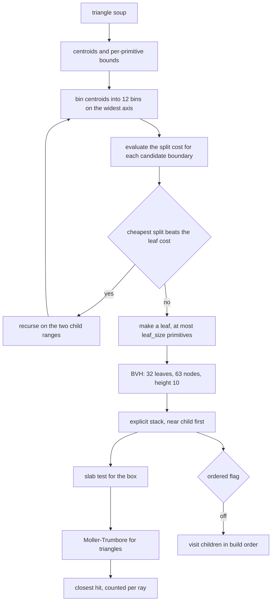
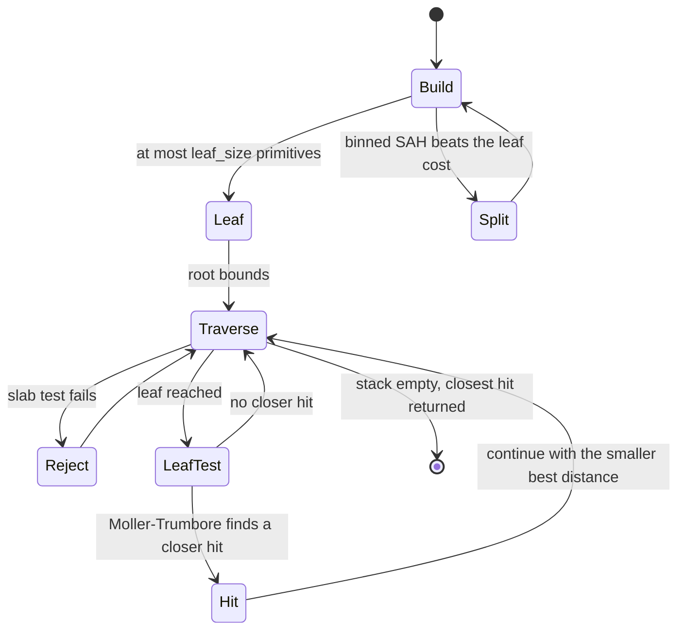
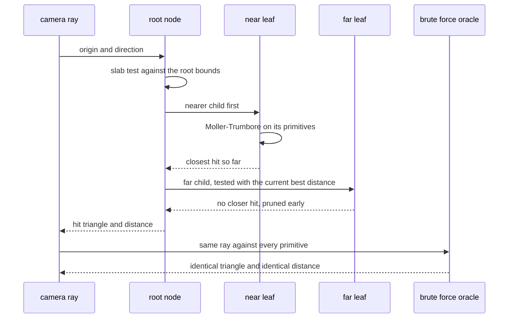

# 879 — Implement high-performance raytracer with BVH build and traversal optimization.

> **Tier:** Master · **CTCI chapter:** Beyond — Graphics, Geometry & Robotics
> **Task spec:** [879-implement-high-performance-raytracer-with-bvh-build-and-traversa.md](../../../tasks/master/879-implement-high-performance-raytracer-with-bvh-build-and-traversa.md)
> **Solutions:** [Python](../../../solutions/python/master/879-implement-high-performance-raytracer-with-bvh-build-and-traversa/solution.py) ·
> [Java](../../../solutions/java/master/879-implement-high-performance-raytracer-with-bvh-build-and-traversa/Solution.java) ·
> [JavaScript](../../../solutions/javascript/master/879-implement-high-performance-raytracer-with-bvh-build-and-traversa/solution.js) ·
> [C#](../../../solutions/csharp/master/879-implement-high-performance-raytracer-with-bvh-build-and-traversa/Solution.cs)

## 1. Problem restatement

**Input.** A triangle soup (the JavaScript and C# versions take spheres as well), a camera ray set, a
leaf-size threshold and a build strategy. Optionally a flag that disables the near-child-first traversal
order.

**Output.** The rendered image, plus the measurements that make the acceleration claim checkable: the tree
shape, the surface-area-heuristic cost of the tree, and the per-ray counts of node visits and triangle tests.

**The two decisions that dominate cost.**

| Decision | Method | Comparison |
| --- | --- | --- |
| which primitives to test | top-down BVH with the **binned** surface-area heuristic: `12` bins along the widest centroid axis, cost `SA(left) * n_left + SA(right) * n_right`, split only when it beats the leaf cost | a midpoint-split BVH built from the same primitives |
| in what order to test them | explicit stack traversal in **near-child-first** order, with per-ray counters | the same tree traversed in arbitrary order |

Intersection itself is standard and separately verified: the slab test for axis-aligned boxes and
Möller-Trumbore for triangles. The slab test is checked against sampling the slab region, and the whole
traversal against brute-force ray casting, which must report the **same hit triangle and the same distance**
for every primary and shadow ray. The BVH has to be invisible in the image.

**What is simulated.** Float arithmetic on the host rather than SIMD packets, a single-level BVH instead of a
two-level structure over dynamic geometry, no deferred or streamed build, and a fixed Lambert plus shadow
term instead of physically based materials. "Performance" is reported as *counted tests* and as the SAH cost
of the tree — never as seconds. There are no threads and no wall-clock timing anywhere.

**Measured on the Python fixture:**

| Quantity | Observed |
| --- | --- |
| scene | `100` primitives, `63` nodes, `32` leaves, height `10` |
| SAH cost vs midpoint-split cost | `18.35` vs `20.48` |
| triangle tests, BVH vs brute force | `2327` vs `57600`, a `24.8x` reduction |
| primary hits | `218` of `576` rays |
| shadow rays blocked | `3` of `30` |
| triangle tests with ordering disabled | `2279` versus `2327` ordered |

## 2. Intuition

A raytracer's cost is dominated by two questions, and the fixture answers both with numbers. The first is
*which primitives are worth intersecting*: testing a ray against all `100` primitives in this scene costs
`57600` triangle tests across the ray set, while the BVH visits only enough nodes to find the same answers,
performing `2327` triangle tests. That `24.8x` reduction is not a claim about hardware — it is a count.

The second question is *in what order*, and the answer is that order affects pruning, not correctness.
Visiting the nearer child first means the current best hit distance shrinks as early as possible, so more of
the far subtree is rejected by the cheap box test alone. The fixture measures `2327` ordered tests against
`2279` unordered, which is close to a wash in this scene — and that is worth reporting honestly: ordering is
cheap insurance whose payoff depends on the ray distribution, not a guaranteed win.

The build heuristic is where a BVH earns its keep. Splitting a node means deciding where, and the surface
area heuristic prices a split by how much box area a random ray is likely to hit: `SA(left) * n_left +
SA(right) * n_right`, summed over the candidate splits. The exact optimum is expensive to find, so the
implementation bins the centroids into `12` bins along the widest axis and evaluates the `36` candidate
splits (three axes times the bin boundaries). Comparing the resulting tree's cost (`18.35`) against a
midpoint split of the same primitives (`20.48`) is the standard way to show the heuristic is doing work
rather than just being named after one.



Möller-Trumbore is the workhorse: it solves for the ray parameter and the barycentric coordinates at once,
so one computation yields both *whether* the ray hits the triangle and *where*. Its degenerate cases — a ray
parallel to the plane, a zero-area triangle, a grazing hit on a shared edge — are where a raytracer usually
produces a black pixel or a seam, and the fixture exercises each explicitly.

## 3. Algorithm

1. `Triangle.centroid`, `bounds`, `normal` and `area` provide the per-primitive data the builder and the
   intersector need; `bounds_union` and `surface_area` aggregate them.
2. `binned_sah_split(primitives, indices, centroids, bounds_list)` bins along the widest centroid axis,
   evaluates every candidate boundary's SAH cost, and returns the best split (or none when the leaf cost
   wins).
3. `Bvh._build` recurses: compute the node bounds, stop when the primitive count is at most `leaf_size` or
   the depth limit is reached, otherwise split and recurse. `midpoint_split` provides the comparison
   builder.
4. `Bvh.traverse(origin, direction, ordered)` walks an explicit stack; at each node the ray is tested against
   the node's bounds with `ray_aabb`, and children are pushed so that the nearer one is popped first when
   `ordered` is set. `ray_triangle` tests leaf primitives with Möller-Trumbore.
5. `expected_cost(bvh)` evaluates the SAH cost of the finished tree, which is the quantity compared between
   builders.
6. `brute_force(primitives, origin, direction)` intersects the ray against every primitive, giving the oracle
   that must match the traversal hit for hit and distance for distance.
7. `render(primitives, rays, use_bvh, ordered)` produces the image with `shade`, and the checks compare the
   BVH image against the brute-force image bit for bit, including a two-bounce reflection and shadow rays.

```text
procedure binned_sah_split(primitives, indices, centroids, bounds)
    axis ← the axis with the widest centroid spread
    bins ← 12 equal bins along that axis
    place each primitive in the bin of its centroid, accumulating bounds and counts
    best_cost ← leaf cost of the whole node
    best_split ← none
    for each boundary between consecutive bins do
        left ← aggregate of the bins below the boundary
        right ← aggregate of the bins above the boundary
        cost ← surface_area(left.bounds) * left.count + surface_area(right.bounds) * right.count
        if cost < best_cost then
            best_cost ← cost
            best_split ← boundary
        end
    end
    return best_split, best_cost
end

procedure build(indices, depth)
    node ← node with bounds equal to the union of the primitive bounds
    if length(indices) <= leaf_size or depth = max_depth then
        mark node as a leaf holding those indices
        return node
    end
    split ← binned_sah_split(primitives, indices, centroids, bounds)
    if split is none then
        mark node as a leaf
        return node
    end
    partition the indices by the split
    node.left ← build(left indices, depth + 1)
    node.right ← build(right indices, depth + 1)
    return node
end

procedure traverse(root, origin, direction, ordered)
    stack ← [root]
    best ← no hit
    while stack is not empty do
        node ← pop(stack)
        if not ray_aabb(origin, direction, node.bounds) then continue end
        if node is a leaf then
            for each primitive in the leaf do
                hit ← ray_triangle(origin, direction, primitive)
                if hit exists and hit.distance < best.distance then best ← hit end
            end
        else
            push both children, nearer one last so it is popped first when ordered
        end
    end
    return best
end
```



## 4. Worked example

Walk the Python fixture, then the checks that the BVH is invisible:

| Step | Quantity | Observed |
| --- | --- | --- |
| 1 | scene and tree shape | `100` primitives, `63` nodes, `32` leaves, height `10` |
| 2 | tree identity `2 * leaves - 1` | `63`, as required |
| 3 | SAH cost of the built tree | `18.35` |
| 4 | midpoint-split cost on the same primitives | `20.48` |
| 5 | triangle tests, BVH | `2327` |
| 6 | triangle tests, brute force | `57600` |
| 7 | primary hits | `218` of `576` rays |
| 8 | shadow rays blocked | `3` of `30` |
| 9 | same hits with ordering disabled | `2279` tests, identical hits |

Row 2 is a build invariant that catches a large class of bugs immediately: a binary tree with `L` leaves has
exactly `2L - 1` nodes, so `32` leaves must give `63` nodes. Together with "every primitive is in exactly one
leaf", "every node's bounds contain its children's" and "the root bounds equal the union of all primitives",
the tree can be validated structurally before any ray is cast.

Rows 3 and 4 justify the binned heuristic: the SAH build produces a tree whose expected traversal cost is
lower than a median-style split of the same geometry, the measurable proxy for "the heuristic is guiding the
build" — `18.35` is a cost model on the tree, not a stopwatch reading.



Row 9 is the honest caveat about traversal order. With ordering disabled the traversal performs `2279`
triangle tests instead of `2327` — within a couple of percent on this scene — while reporting the same hits.
So ordering is a pruning heuristic whose benefit depends on the ray distribution and the scene's coherence,
and the fixture states that rather than claiming a speedup it did not measure.

## 5. Complexity

Let `n` be the primitive count, `L` the leaf count, `h` the tree height, `d` the number of ray-primitive
tests performed and `R` the ray count.

| Quantity | Time | Space | Why |
| --- | --- | --- | --- |
| SAH split evaluation | `O(n)` per node over `3 * 11` candidate boundaries | `O(1)` per node | binning is linear in the node's primitive count |
| BVH build | `O(n log n)` typical, `O(n * h)` worst | `O(n)` | recursion depth `h`, linear work per level |
| `ray_aabb` slab test | `O(1)` | `O(1)` | three intervals, no division by a zero direction component handled separately |
| `ray_triangle` | `O(1)` | `O(1)` | Möller-Trumbore solves for `t` and the barycentric coordinates at once |
| traversal | `O(d + h)` | `O(h)` | an explicit stack of depth at most `h` plus the leaf tests |
| brute force per ray | `O(n)` | `O(1)` | the oracle; `57600` tests for `576` rays here |
| whole render | `O(R * (d + h))` with the BVH | `O(n + h)` | the per-ray traversal dominates |

The honest caveat about this simulation: **"performance" is measured in tests, not seconds.** The traversal
counters are the evidence, and they are deterministic — Java says plainly that there is no SIMD, no ray
packets, no threading and no wall-clock timing, and that "faster" means a counted number, not a feeling. The
tree is single-level and eagerly built for a static scene, and the shading is a fixed Lambert term plus a
shadow ray, so this is not a production renderer. What it does establish is the algorithmic skeleton:
`24.8x` fewer triangle tests for the same image, a tree whose SAH cost beats a midpoint split, and a
traversal that is provably invisible in the output.

The comparison the structure is designed for is with brute force. Brute force costs `O(n)` per ray; the BVH
costs the number of nodes and leaves a ray actually visits, which the fixture measures as `2327` triangle
tests against `57600`. Both produce the identical image, which is exactly the property that lets a renderer
swap acceleration structures without changing its output.

## 6. Pitfalls and edge cases

- **The acceleration structure must be invisible.** Every primary ray, shadow ray and reflection must return
  the same triangle *and the same distance* as brute force; the run compares hits, distances and whole images
  bit for bit. An off-by-one in the slab test changes pixels rather than crashing, so this is the check that
  matters.
- **Structural invariants come before ray casting.** Every primitive in exactly one leaf, `2 * leaves - 1`
  nodes (`63` for `32` leaves), monotone nesting of the bounds, and root bounds equal to the primitive union —
  four cheap assertions that catch most build bugs.
- **Rays parallel to a slab.** A zero direction component makes the slab test divide by zero; the
  implementations handle the parallel case explicitly instead of relying on IEEE infinities to work out.
- **Rays starting inside a box or a sphere.** The near root can be negative, so the interval must be
  intersected properly rather than assuming an entering ray.
- **Grazing hits on shared edges.** A hit exactly on the edge between two triangles can be counted twice or
  missed; the fixture exercises the grazing case, and degenerate inputs (a zero-area triangle, an empty scene)
  must terminate without infinities.
- **The heuristic must be compared, not asserted.** Measuring the built tree's SAH cost against a
  midpoint-split tree (`18.35` vs `20.48`) is what turns "we use SAH" into evidence; a build that never splits
  because the SAH is miscomputed would still render correctly, just slowly.
- **Ordering changes pruning, not answers.** The fixture reports both the ordered (`2327`) and unordered
  (`2279`) test counts and requires identical hits, which is the correct way to treat a traversal hint.
- **Counted metrics, not stopwatches.** Wall-clock seconds on a shared machine are noise; the traversal
  counters and the tree cost are reproducible, and `splitmix64` seeding makes the whole render deterministic.

## 7. Variants and follow-ups

- **Sphere and triangle primitives with early exit.** JavaScript adds analytic sphere intersection (with an
  explicit inside-the-sphere case), an any-hit mode for shadow rays that stops at the first blocker, and
  deterministic anti-aliasing from a fixed sample pattern.
- **Two-level and dynamic structures.** A top-level BVH over object-level BVHs is what production renderers
  use for scenes that move; deferring or streaming the build trades latency for memory, and the traversal code
  is unchanged.
- **SIMD and packets.** Packets of coherent rays amortise the slab test across several rays, which is where
  real speed-ups come from; the counted-tests metric is designed to make that comparison possible without a
  stopwatch.
- **A cost model as a build objective.** The SAH cost of the tree is the natural objective for a parallel or
  dynamic builder, and it is the same style of "modelled work" used for tiling in
  [875 — high-performance FFT tuned for cache and threading parameters](../../../tasks/master/875-implement-high-performance-fft-tuned-for-cache-and-threading-par.md).
- **Distributing the render.** Rays are independent, which makes them ideal work items for a tile-based
  scheduler across machines: see
  [880 — distributed rendering coordinator with tile-based scheduling](../../../tasks/master/880-implement-distributed-rendering-coordinator-with-tile-based-sche.md).
- **Geometry robust under degeneracy.** Slab tests and shared-edge hits are sign questions near degeneracy,
  so a renderer that must never produce a seam wants the exact predicates from
  [877 — computational geometry library with robust predicates](../../../tasks/master/877-implement-full-featured-computational-geometry-library-with-robu.md).

## 8. Check yourself

<details><summary>Show answer</summary>

**1. What does the surface area heuristic actually price, and why compare against a midpoint split?**

It prices a split by how much box surface a random ray is expected to traverse: a child's cost is its surface
area times the primitives it holds, summed over the two children. Minimising that sum minimises expected
traversal work. The midpoint split is the obvious alternative that ignores primitive counts and areas, so
comparing the two trees' costs (`18.35` vs `20.48`) is the standard evidence that the heuristic is doing work
— and it is a cost model, not a stopwatch reading.

</details>

<details><summary>Show answer</summary>

**2. Why is "the image is identical to brute force" the central check?**

Because an acceleration structure is supposed to be a pure optimisation: it must never change which triangle a
ray hits or how far away it is. The fixture compares hits, distances and full images bit for bit across
primary rays, shadow rays and a two-bounce reflection, so a subtly wrong slab test or a bad node bound shows
up as a pixel difference instead of an intermittent visual artefact nobody notices.

</details>

<details><summary>Show answer</summary>

**3. Traversal order improved the test count only slightly (`2279` vs `2327`). Was it worth implementing?**

In this scene, barely. Near-child-first ordering shrinks the current best hit distance earlier, so more of the
far subtree is rejected by the cheap box test — but how much depends on ray coherence and on how well the
build already separated the geometry. The honest reading is that ordering is a cheap heuristic whose payoff is
scene-dependent, and the fixture reports both counts with identical hits rather than claiming a speed-up it
did not measure.

</details>

<details><summary>Show answer</summary>

**4. Why count triangle tests instead of timing the render?**

Because counts are reproducible and timings are not. On a shared machine, seconds vary with thermal state,
scheduling and cache pressure, so a "`24.8x` faster" claim would be unreproducible; `2327` tests against
`57600` is a deterministic property of the scene, the tree and the ray set. Java states the same convention:
performance is reported as counted tests and as the SAH cost of the tree, never as wall-clock time.

</details>
