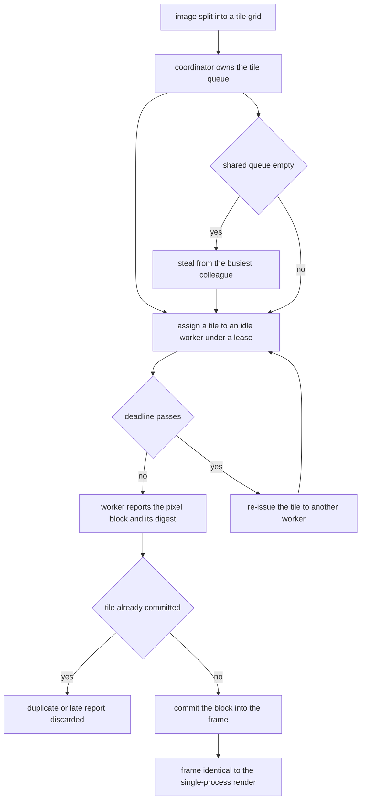
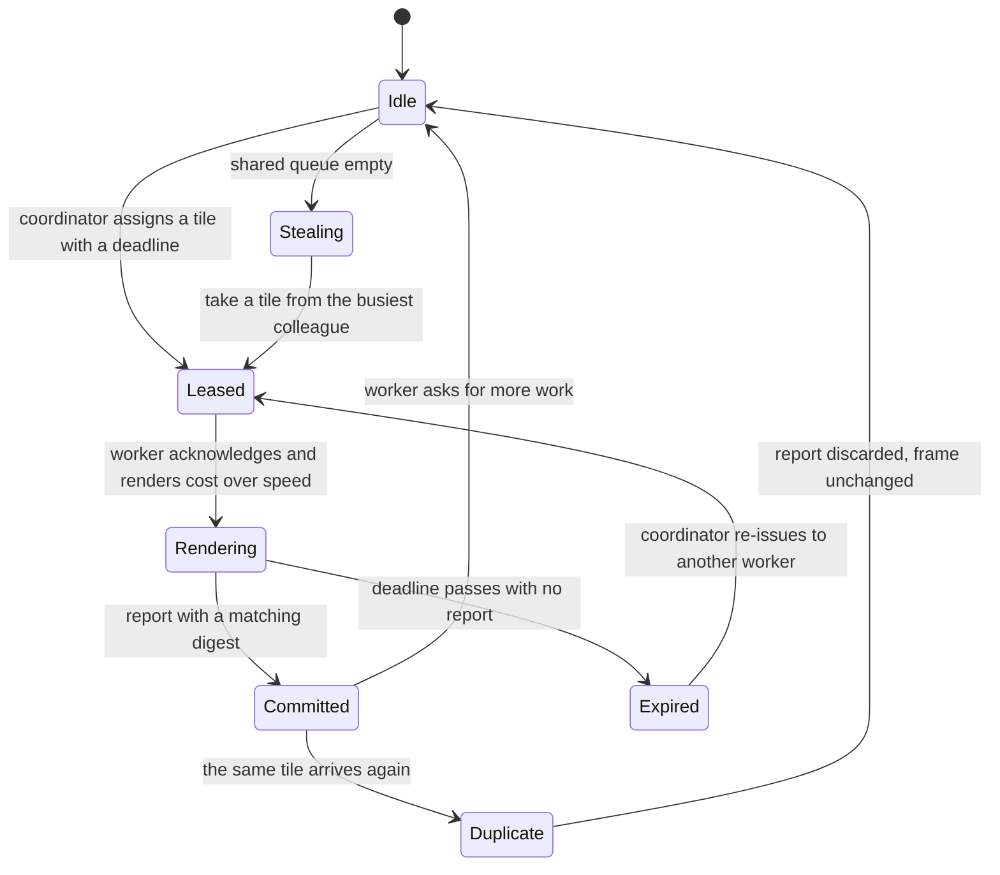
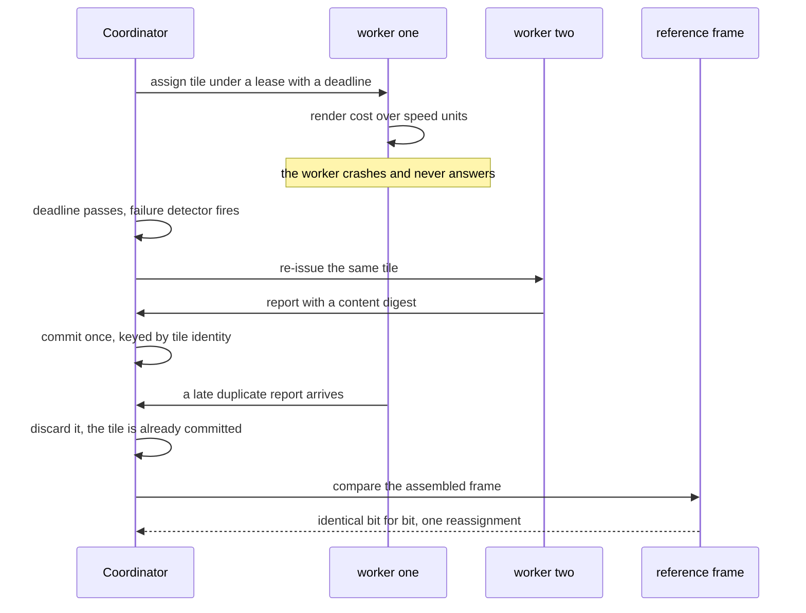

# 880 — Implement distributed rendering coordinator with tile-based scheduling.

> **Tier:** Master · **CTCI chapter:** Beyond — Graphics, Geometry & Robotics
> **Task spec:** [880-implement-distributed-rendering-coordinator-with-tile-based-sche.md](../../../tasks/master/880-implement-distributed-rendering-coordinator-with-tile-based-sche.md)
> **Solutions:** [Python](../../../solutions/python/master/880-implement-distributed-rendering-coordinator-with-tile-based-sche/solution.py) ·
> [Java](../../../solutions/java/master/880-implement-distributed-rendering-coordinator-with-tile-based-sche/Solution.java) ·
> [JavaScript](../../../solutions/javascript/master/880-implement-distributed-rendering-coordinator-with-tile-based-sche/solution.js) ·
> [C#](../../../solutions/csharp/master/880-implement-distributed-rendering-coordinator-with-tile-based-sche/Solution.cs)

## 1. Problem restatement

**Input.** An image size and tile size, a fleet of workers with declared speeds, a lease timeout, a message
latency, and a plan that may inject a crash, duplicates and speculative work.

**Output.** The assembled frame — which must equal a single-process render **bit for bit** — together with the
schedule that produced it: the makespan in simulated units, the number of reassignments, the per-worker tile
counts and the message count.

**The model.** A deterministic discrete-event simulation of a render farm. There are no threads, no sockets
and no wall-clock time: a message is a scheduled callback carrying an explicit delivery time, the event queue
is ordered by `(time, sequence number)`, and every worker action has a modelled duration.

| Component | Responsibility |
| --- | --- |
| coordinator | owns the tile list, hands out tiles in priority order, tracks exactly one assignment per tile with a deadline, and reassigns work whose deadline passes |
| workers | ask for work when idle, steal from the busiest colleague when the shared queue runs dry, render a tile in `cost / speed` simulated units, report the pixel block with its content digest |
| tile identity | a result is applied through the digest of its pixel payload, so a duplicate or late report for a finished tile is discarded |

That last row is the whole point: the network is **at-least-once**, and the coordinator turns it into
**exactly-once assembly** by making commits idempotent. A worker that dies simply stops answering, so its
lease deadline is the *only* thing that recovers the tile.

**What is simulated.** Workers are speed parameters rather than processes, the renderer is a deterministic
function of pixel coordinates, message latency is a fixed per-channel cost, and failures are injected by the
plan rather than observed. Java adds FIFO bounded channels and deliberate duplication of the slowest tiles
once the queue empties; JavaScript uses logical ticks with checksum validation; C# renders with a real shading
kernel so the committed frame is verified pixel by pixel, and bounds the attempts per tile so a broken cluster
cannot spin forever.

**Measured on the Python fixture:**

| Quantity | Observed |
| --- | --- |
| tile grid | `16` tiles |
| makespan, dynamic (stealing) vs static round-robin | `1810.0` vs `2402.0` |
| makespan, healthy fleet vs mid-tile crash | `2514.0` vs `3412.0`, with `1` reassignment |
| per-worker balance | `[4, 4, 4, 4]` |
| messages sent / duplicate reports | `21` / `6` |

## 2. Intuition

Rendering is embarrassingly parallel in the worst sense: rays are independent, so tiles are trivially
distributable, and yet a render farm is where distributed-systems bugs become *visible*. A tile computed
twice and committed twice double-exposes part of the image. A crashed worker leaves its tile unrendered
forever. A slow worker looks exactly like a dead one.

The design that solves all three follows from a single decision: **make each tile's result content
addressed**. A result is (tile id, pixel block, digest of the pixel payload), and the coordinator commits a
tile only once, keyed by identity. Then the network may deliver results twice, late or out of order, and the
frame is still exactly right — the fixture sends `6` duplicate reports and the committed frame never changes.
This is the classic at-least-once delivery plus idempotent processing pattern, and rendering is a perfect
place to see why it beats trying to make the network reliable.

The second decision is the **lease**. The coordinator hands out a tile with a deadline and considers the
worker dead if the deadline passes. That means a merely slow worker is indistinguishable from a crashed one
— which is fine, because the recovery action is the same: re-issue the tile, and let the duplicate result be
discarded by the idempotent commit. The fixture's crash costs exactly one reassignment (`reassignments = 1`)
and pushes the makespan from `2514.0` to `3412.0`, because only the lost tile is re-rendered rather than the
whole frame.



The third decision is **work stealing**, and the fixture shows why it matters: a static round-robin partition
finishes at `2402.0` while the dynamic schedule finishes at `1810.0` on the same tiles and workers, because a
fast worker that runs out of assigned work takes a tile off a slow colleague's queue instead of idling. The
reported balance `[4, 4, 4, 4]` is the structural form of the same fact — each worker handled a quarter of
the tiles.

## 3. Algorithm

1. `tile_grid(width, tile_size)` enumerates the tiles so that the grid covers the image exactly once;
   `tile_pixels` and `shade_pixel` define the deterministic payload of a tile, and `pixel_digest` is the
   content address the coordinator commits against.
2. `Simulation.schedule(delay, action)` pushes an event at `now + delay` with a monotone sequence number;
   `run(until)` pops events in `(time, sequence)` order, which makes the whole run a pure function of its
   inputs.
3. `Coordinator.start` begins by asking every worker for work; `request_work` hands out the next tile in
   priority order or triggers a steal via `busiest_worker` when the shared queue is empty.
4. `assign(tile, worker)` records the single assignment for that tile and schedules `check_deadline` at the
   lease expiry. `on_start` is the worker's acknowledgement, and `check_deadline` re-issues the tile when the
   lease has expired — the failure detector.
5. `submit(worker, tile, digest, block)` validates the digest against the tile's identity and commits once;
   a duplicate or late report is discarded, and the worker is then given more work.
6. `Worker.receive`, `pump` and `finish` model the worker loop: render for `cost / speed` simulated units,
   report, and immediately ask for the next tile.
7. `run_farm(...)` runs the dynamic plan (with optional crash, duplicates and differing speeds) and
   `run_static(...)` runs the round-robin baseline; the frame from each is compared with `reference_frame`
   built in a single process.

```text
procedure assign(coordinator, tile, worker_name)
    coordinator.assigned[tile] ← worker_name
    schedule the start message at now + latency
    schedule check_deadline(tile, worker_name) at now + timeout
end

procedure check_deadline(coordinator, tile, worker_name, deadline)
    if coordinator.committed contains tile then return end
    if coordinator.assigned[tile] is not worker_name then return end
    reassignments ← reassignments + 1
    assign(coordinator, tile, an idle worker other than worker_name)
end

procedure submit(coordinator, worker_name, tile, digest, block)
    if coordinator.committed contains tile then
        duplicates ← duplicates + 1
        return
    end
    if digest is not the expected digest for tile then reject end
    coordinator.committed[tile] ← block
    coordinator.assigned.remove(tile)
    request_work(coordinator, worker_name)
end

procedure request_work(coordinator, worker_name)
    if the shared queue is not empty then
        assign(coordinator, pop(shared queue), worker_name)
    else if stealing is allowed then
        donor ← busiest_worker(exclude = worker_name)
        if donor exists and donor has queued tiles then
            assign(coordinator, steal one tile from donor, worker_name)
        else
            mark worker_name idle
        end
    else
        mark worker_name idle
    end
end

procedure run(coordinator, until)
    while the event queue is not empty and clock <= until do
        event ← pop the event with the smallest (time, sequence)
        clock ← event.time
        event.action()
    end
end
```



## 4. Worked example

Walk the Python fixture, which renders a `16`-tile frame under four conditions and always compares the result
with the single-process reference:

| Scenario | Makespan (simulated units) | Other observations |
| --- | --- | --- |
| dynamic schedule with stealing | `1810.0` | `balance = [4, 4, 4, 4]` |
| static round-robin baseline | `2402.0` | same `16` tiles, same workers |
| healthy fleet | `2514.0` | `21` messages, frame identical to the reference |
| one worker crashes mid-tile | `3412.0` | `reassignments = 1`, only that tile re-rendered |
| duplicate traffic injected | unchanged frame | `6` duplicate reports discarded |

Two rows deserve attention. The crash costs `3412.0 - 2514.0 = 898.0` units and is a cost rather than a
corruption because of the lease plus the idempotent commit: the lease detects the silence, the reassignment
recovers exactly one tile, and a late result from a merely slow worker is dropped because the tile is already
committed. The stealing row shows dynamic assignment beating a static partition by `592.0` units on the same
work.

The frame comparison is the check that keeps all of this honest. Every scenario, including the crashed and
duplicated ones, must produce a frame that is **bit for bit identical** to the single-process render — which
is exactly what content-addressed commits guarantee, because the pixels of a tile are a pure function of the
tile id and the shading kernel.



## 5. Complexity

Let `T` be the tile count, `W` the worker count, `c` the per-tile cost, `E` the number of scheduled events,
`s` the number of steals and `r` the number of reassignments.

| Quantity | Time | Space | Why |
| --- | --- | --- | --- |
| `tile_grid` | `O(T)` | `O(T)` | one rectangle per tile, covering the image exactly once |
| event loop | `O(E log E)` | `O(E)` | the queue is ordered by `(time, sequence number)` |
| `assign` / `check_deadline` | `O(log E)` per event | `O(T)` | one scheduled callback per assignment |
| static round-robin makespan | `max over workers of its assigned cost` | `O(T)` | bounded by the slowest worker's share, not the average |
| dynamic schedule with stealing | `O(T * c / W + s * latency)` | `O(T)` | work moves to idle workers instead of waiting |
| failure recovery | one extra tile render plus `r` reassignments | `O(1)` extra | only the tiles whose leases expired restart |
| duplicate tolerance | `O(1)` per report | `O(T)` | a committed tile is dropped from the assignment map |

The honest caveat about this simulation: **everything is modelled.** Workers are speed parameters, the
renderer is a deterministic pixel function rather than a real raytracer, latency is a fixed per-channel cost
and failures are injected by the plan instead of being observed. Java says the same thing in its header: no
threads, no sockets, no sleeping, no wall-clock time, and the whole run is a deterministic function of the
worker speeds, the grid and the seed. So the makespans above are properties of the *scheduling algorithm*
under a stated cost model — `1810.0` against `2402.0` is a claim about stealing versus static partitioning,
not about real machines.

What the run does establish are the correctness properties modelling cannot fake: the frame equals the
single-process render bit for bit in every scenario, a duplicate changes nothing, no tile is assigned twice at
once, a crash costs exactly one reassignment, and a checkpoint can re-insert a partial frame without redoing
finished tiles.

## 6. Pitfalls and edge cases

- **At-least-once delivery needs exactly-once commits.** The network may deliver a result twice, late or out
  of order; committing a tile twice double-exposes the image. Content addressing makes the commit idempotent,
  and the fixture injects `6` duplicates that change the frame not at all.
- **A deadline is the only failure detector.** A worker that dies silently cannot announce anything, so the
  lease expiry is what recovers the tile. The consequence is deliberate: a slow worker is treated as a failed
  one, and the surplus result is discarded rather than merged.
- **Only the lost tile restarts.** Recovery must re-issue the tiles whose leases expired, not the whole
  frame; the run reports `reassignments = 1` for a crash, which is the measurable form of that requirement.
- **Speculation must be bounded and invisible.** Duplicating a straggler's tile is a good idea only while
  redundancy stays bounded and the output does not depend on which copy wins; C# bounds the attempts per tile
  so a fully broken cluster gives up instead of spinning, and Java duplicates only the slowest tiles.
- **The tile grid must cover the image exactly once.** A gap leaves uninitialised pixels and an overlap
  double-writes them; `tile_grid` plus the bit-for-bit comparison against the single-process frame is what
  catches both.
- **Stealing must not starve the victim.** Taking the *last* queued tile from the busiest worker just moves
  the cliff; the fixture reports a balanced `[4, 4, 4, 4]` distribution and a shorter makespan than a static
  partition, which is the evidence that the policy improves the tail.
- **Checkpoint and resume are part of the contract.** Re-inserting a partial frame must not redo finished
  tiles, which is only possible because a committed tile is identified by its content and can be skipped.
- **Malformed configurations must be rejected.** A zero tile size, no workers, a non-positive timeout or a
  grid that does not cover the image are refused before any event is scheduled.

## 7. Variants and follow-ups

- **Bounded FIFO channels.** Java models an in-memory network of bounded channels with FIFO delivery at send
  time, so back-pressure and message ordering are explicit rather than assumed, and adds deliberate
  duplication of the slowest tiles once the queue empties to shorten the schedule tail.
- **Logical ticks and checksums.** JavaScript advances a tick counter, delivers each node's inbox for that
  tick, validates results with a checksum, and rejects corrupted payloads as well as duplicates.
- **A real renderer under the scheduler.** C# renders with the same shading kernel as the raytracer tier
  exercise, so the committed frame can be compared pixel by pixel with an in-process oracle over many
  deterministic cluster shapes — the strongest available check that scheduling never touches the image.
- **Bounded redundancy.** A straggler threshold plus a speculation limit is the standard production control:
  compute a tile twice, never count it twice, and never let redundancy grow without bound.
- **The work being distributed.** Tile scheduling only makes sense if the underlying renderer is fast and
  correct per tile: see
  [879 — high-performance raytracer with BVH build and traversal](../../../tasks/master/879-implement-high-performance-raytracer-with-bvh-build-and-traversa.md).
- **The same scheduler in another domain.** Deadlines, reassignment of lost work, idempotent results and
  bounded retries are the same primitives a CI pipeline needs: see
  [870 — continuous integration pipeline for large-scale numerical code](../../../tasks/master/870-implement-continuous-integration-pipeline-for-large-scale-numeri.md).

## 8. Check yourself

<details><summary>Show answer</summary>

**1. How can a farm tolerate duplicates without corrupting the frame?**

By making the commit idempotent. A result carries the tile's identity and a digest of its pixel payload, and
the coordinator commits each tile at most once — a second report for a committed tile is dropped. The network
is therefore allowed to be at-least-once, which is what real networks are, and the fixture proves the point by
injecting `6` duplicate reports while the assembled frame stays bit-identical to the single-process render.

</details>

<details><summary>Show answer</summary>

**2. Why is a lease deadline the only viable failure detector here?**

Because a crashed worker sends nothing at all — there is no failure message to wait for. The coordinator
therefore treats silence past a deadline as failure and re-issues the tile. The cost of that choice is that a
merely slow worker is treated as dead too, which is acceptable only because the duplicate result is harmless:
whoever finishes first commits, and the second result is discarded.

</details>

<details><summary>Show answer</summary>

**3. What does the `1810.0` versus `2402.0` comparison actually show?**

That dynamic assignment with stealing beats a static round-robin partition on the same tiles and workers. A
statically assigned fast worker goes idle while a slow colleague still has a queue; the dynamic policy lets it
take that work instead. The reported `balance = [4, 4, 4, 4]` shows the end state — each worker handled a
quarter of the `16` tiles — and the shorter makespan shows that balancing the tail is worth the extra
coordination.

</details>

<details><summary>Show answer</summary>

**4. A crash cost `898.0` simulated units. Why so little, and what would make it worse?**

Because only the tiles whose leases expired are re-issued and re-rendered, and the fixture reports
`reassignments = 1`. It would be far worse if recovery restarted the frame, if the deadline were so long that
the stalled tile became the critical path, or if the lost worker had been holding many tiles — which is why
assignments are tracked one per tile and the deadline is a tuned parameter rather than a large constant.

</details>

<details><summary>Show answer</summary>

**5. Which parts of this simulation are models rather than measurements?**

Worker speeds, per-channel latency, message delivery, the pixel shader and the injected failures are models;
no threads, sockets or clocks exist, and Java states that the whole run is a deterministic function of the
speeds, the grid and the seed. What is *verified* is structural: bit-identical frames in every scenario,
single assignment per tile, exactly-once commits, bounded redundancy and one-tile recovery.

</details>
