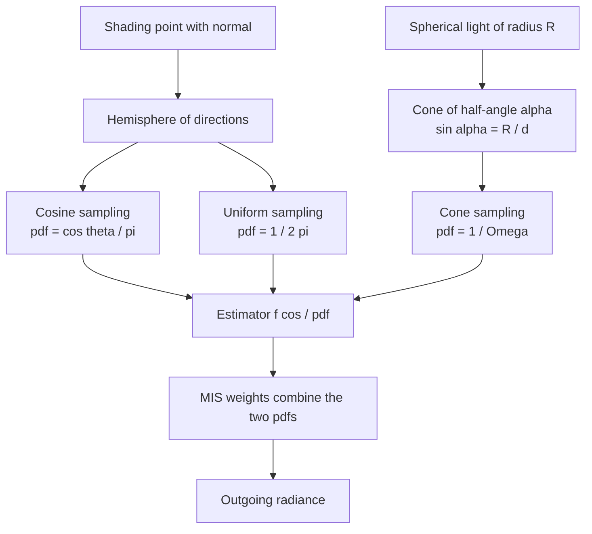
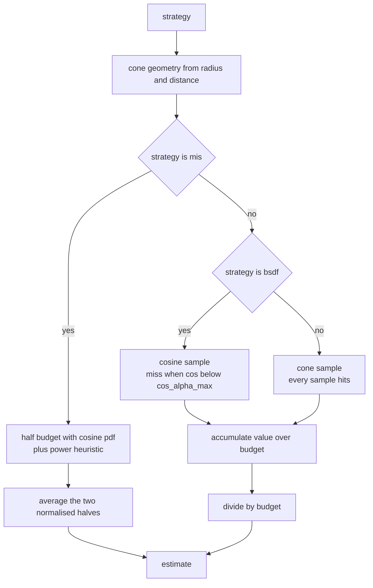
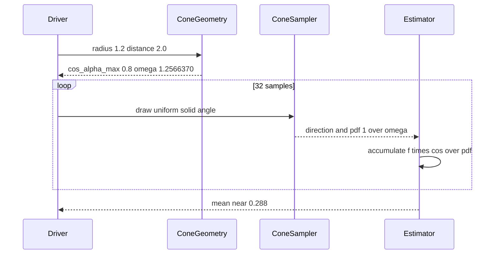

# 881 — Implement global illumination importance sampling techniques in renderer.

> **Tier:** Master · **CTCI chapter:** Beyond — Graphics, Geometry & Robotics
> **Task spec:** [881-implement-global-illumination-importance-sampling-techniques-in.md](../../../tasks/master/881-implement-global-illumination-importance-sampling-techniques-in.md)
> **Solutions:** [Python](../../../solutions/python/master/881-implement-global-illumination-importance-sampling-techniques-in/solution.py) ·
> [Java](../../../solutions/java/master/881-implement-global-illumination-importance-sampling-techniques-in/Solution.java) ·
> [JavaScript](../../../solutions/javascript/master/881-implement-global-illumination-importance-sampling-techniques-in/solution.js) ·
> [C#](../../../solutions/csharp/master/881-implement-global-illumination-importance-sampling-techniques-in/Solution.cs)

## 1. Problem restatement

**Input:** a shading configuration — a Lambertian albedo `albedo`, an emitted radiance `radiance`,
a spherical light of radius `radius` sitting `distance` away on the surface normal axis, an
integration budget `samples`, and a strategy name from `"bsdf"`, `"nee"` and `"mis"`.

**Output:** one Monte Carlo estimate of the outgoing radiance for each strategy, plus the
auxiliary pieces a renderer needs around the integrator: a cosine-weighted hemisphere sampler, a
uniform hemisphere sampler, a uniform sphere sampler, the balance/power MIS weights, the cone
geometry of a spherical light, Russian-roulette path termination and a stratified sampler.

**Modelling contract (what this file is and is not).** Every solution is an *in-process
simulation* of an importance-sampling integrator, not a scene renderer:

* a **single shading point** with a spherical light on the surface normal axis, instead of a full
  scene traversal with many lights and a BVH;
* **analytic visibility** — a direction either lands inside the light cone or misses, there is no
  shadow ray and no occlusion between the shading point and the light;
* the BRDF is the **diffuse cosine lobe** only: no spectral rendering, no microfacet or
  measured-BSDF importance sampling, no texture lookups;
* randomness comes from exactly one deterministic source, a `splitmix64` stream seeded by the
  caller, so every estimator is reproducible bit for bit.

The task spec itself is a one-liner, so the contract is fixed by the assertions the four solution
files ship with. Verified against closed forms:

| Configuration | Exact answer | Estimator |
| --- | --- | --- |
| Uniform environment, `albedo = 0.8`, `radiance = 1.0` | `0.8` | cosine sampling with 16 samples gives exactly `0.8`, variance below `1e-24` |
| Direct light, `R = 1.2`, `d = 2.0`, `albedo = 0.8` | `0.8 * (R/d)^2 = 0.288` | `nee` and `mis` unbiased, `bsdf` unbiased but far noisier |
| Direct light, `R = 0.05`, `d = 2.0` | `0.8 * (0.05/2)^2 = 0.0005` | `nee` has variance below `(0.1 * 0.0005)^2` |
| Inter-reflecting cavity, `albedo = 0.6`, `radiance = 1.0` | `1 / (1 - 0.6) = 2.5` | finite path sum to depth 80 is exact to `1e-12` |

Degenerate configurations are rejected: `cone_geometry` requires `0 < radius < distance`, so a
light that touches or intersects the surface raises an error rather than producing a nonsense
solid angle.

## 2. Intuition

The rendering equation at a diffuse point with a uniform environment reduces to
`L_out = (albedo / pi) * integral over hemisphere of L_in * cos(theta)`. The naive estimator draws
directions uniformly over the hemisphere — pdf `1 / (2 pi)` — and averages
`(albedo / pi) * L_in * cos(theta) * 2 pi`. That estimator is unbiased, but every sample carries a
`cos(theta)` factor that can be near zero: the integrand is *not* the same shape as the sampling
density, so the variance is real and measurable.

The first key insight is that the cosine lobe *is* a density: `cos(theta) / pi` integrates to one
over the hemisphere, and drawing a direction with pdf `cos(theta) / pi` makes the cosine factor and
the `1 / pi` of the diffuse BRDF cancel exactly. For a uniform environment the integrand becomes the
constant `albedo * L_in` for every sample — so the estimator has **zero** variance, not merely small
variance. Cosine sampling being "the right one" for the environment is proven by the assertions, not
asserted by hand: 64 independent estimates with 16 samples each all equal `0.8` to `1e-12`.

The second insight concerns a *small* light. Sampling the BRDF only ("bsdf" strategy) is hopeless for
a small sphere light: at `R = 0.05, d = 2` a cosine-sampled direction lands inside the light cone with
probability `sin^2(alpha) = 0.000625`, so with 32 samples the estimator fires zero or one times — the
classic firefly. Sampling the light instead (next-event estimation) draws directions uniformly over the
cone's solid angle with pdf `1 / Omega`, and *every* sample hits, because hitting is guaranteed by
construction.

The third insight is that neither strategy dominates: NEE is quiet for small lights but wasteful for
large ones (the cone is nearly the whole hemisphere), BSDF sampling is fine for large lights but
catastrophic for small ones. Multiple importance sampling combines them with weights
`w_i = p_i^power / sum_j p_j^power`, so each sample is discounted by how likely the *other* strategy
was to have produced it. The result is unbiased for every light size and never much worse than the
better of the two strategies — the assertions check exactly that: MIS beats BSDF-only sampling by
more than 1000x at `R = 0.05` and more than 10x at `R = 1.2`, while staying within 20x of the better
strategy.



## 3. Algorithm

The direct-lighting estimator with its three strategies:

1. Convert the spherical light into cone geometry: `sin_alpha = radius / distance`,
   `cos_alpha_max = sqrt(1 - sin_alpha^2)`, solid angle `Omega = 2 pi (1 - cos_alpha_max)`.
2. For the `"bsdf"` strategy, draw a cosine-weighted direction. If its cosine is below
   `cos_alpha_max` the ray misses the light, so the sample contributes zero; otherwise the value is
   `(albedo / pi) * radiance * cos_theta / pdf` with `pdf = cos_theta / pi`, which simplifies to
   `albedo * radiance`.
3. For the `"nee"` strategy, sample the cone uniformly in solid angle
   (`cos_alpha = cos_alpha_max + (1 - cos_alpha_max) * u`) and divide by `pdf = 1 / Omega`.
4. For the `"mis"` strategy, take a **fixed** half of the budget from each strategy and sum the two
   properly normalised averages — the estimator is a sum of two averages, not a randomly chosen
   strategy — multiplying each sample by the power-heuristic weight `w` (exponent 2) computed from
   its own pdf and the pdf the other strategy would have assigned to that same direction.
5. Optionally clamp firefly values (used only to demonstrate that clamping is biased).
6. Average over the budget and return.

```text
function cosine_geometry(radius, distance)
    if not 0 < radius < distance then raise error
    sin_alpha = radius / distance
    cos_alpha_max = sqrt(1 - sin_alpha * sin_alpha)
    omega = 2 * pi * (1 - cos_alpha_max)
    return sin_alpha, cos_alpha_max, omega
end

function sample_cosine_hemisphere(rng)
    u1 = rng.uniform()
    u2 = rng.uniform()
    cos_theta = sqrt(1 - u1)
    sin_theta = sqrt(u1)
    phi = 2 * pi * u2
    return (sin_theta * cos(phi), sin_theta * sin(phi), cos_theta), cos_theta / pi
end

function sample_cone(rng, cos_alpha_max)
    cos_alpha = cos_alpha_max + (1 - cos_alpha_max) * rng.uniform()
    sin_alpha = sqrt(1 - cos_alpha * cos_alpha)
    phi = 2 * pi * rng.uniform()
    return (sin_alpha * cos(phi), sin_alpha * sin(phi), cos_alpha), 1 / (2 * pi * (1 - cos_alpha_max))
end

function mis_weight(pdf_used, pdf_other, power)
    if pdf_used <= 0 then return 0 end
    a = pdf_used ** power
    b = pdf_other ** power
    return a / (a + b) if a + b > 0 else 0
end

procedure direct_light_estimate(strategy, rng, radius, distance, albedo, radiance, samples, clamp)
    _sa, cos_alpha_max, omega = cosine_geometry(radius, distance)
    if strategy = "mis" then
        half = max(samples / 2, 1)
        total = 0
        for half times do
            direction, pdf_bsdf = sample_cosine_hemisphere(rng)
            cos_theta = direction.z
            if cos_theta >= cos_alpha_max then
                total += (albedo / pi) * radiance * cos_theta / pdf_bsdf
                         * mis_weight(pdf_bsdf, 1 / omega, 2)
            end
        end
        for samples - half times do
            direction, pdf_light = sample_cone(rng, cos_alpha_max)
            cos_theta = direction.z
            total += (albedo / pi) * radiance * cos_theta / pdf_light
                     * mis_weight(pdf_light, cos_theta / pi, 2)
        end
        return total / half
    end
    total = 0
    for samples times do
        if strategy = "bsdf" then
            direction, pdf_bsdf = sample_cosine_hemisphere(rng)
            cos_theta = direction.z
            if cos_theta < cos_alpha_max then continue end
            value = albedo * radiance
        else
            direction, pdf_light = sample_cone(rng, cos_alpha_max)
            cos_theta = direction.z
            value = (albedo / pi) * radiance * cos_theta / pdf_light
        end
        if clamp is set and value > clamp then value = clamp end
        total += value
    end
    return total / samples
end
```

The two supporting estimators used to validate the samplers:

```text
function uniform_environment_estimate(rng, albedo, radiance, samples, stratified, strata)
    total = 0
    for index from 0 to samples - 1 do
        if stratified and strata > 1 then
            u1 = ((index mod strata) + rng.uniform()) / strata
            cos_theta = sqrt(1 - u1)
            pdf = cos_theta / pi
        else
            direction, pdf = sample_cosine_hemisphere(rng)
            cos_theta = direction.z
        end
        total += (albedo / pi) * radiance * cos_theta / pdf
    end
    return total / samples
end

function cavity_estimate(rng, albedo, radiance, max_depth, roulette)
    weight = 1
    total = 0
    depth = 0
    while depth < max_depth do
        total += weight * radiance
        weight *= albedo
        depth += 1
        if weight <= 1e-17 then break end
        if roulette is set and depth > 1 then
            if rng.uniform() > roulette then break end
            weight /= roulette
        end
    end
    return total, depth
end
```



## 4. Worked example

Trace `direct_light_estimate("nee", rng, radius = 1.2, distance = 2.0, albedo = 0.8,
radiance = 1.0, samples = 32)` in Python:

| Step | State | Value |
| --- | --- | --- |
| 1 | `sin_alpha = 1.2 / 2.0` | `0.6` |
| 2 | `cos_alpha_max = sqrt(1 - 0.36)` | `0.8` |
| 3 | `Omega = 2 pi (1 - 0.8)` | `1.2566370` |
| 4 | analytic reference `albedo * radiance * (R/d)^2` | `0.8 * 0.36 = 0.288` |
| 5 | typical sample: `cos_alpha = 0.9` (mean of the cone) | `value = (0.8 / pi) * 1.0 * 0.9 / (1/1.2566370) = 0.288` |
| 6 | each sample's expectation `albedo * L * (Omega / pi) * E[cos_alpha]` | `0.8 * 0.4 * 0.9 = 0.288` |
| 7 | 32-sample average, 400 seeds, mean vs `0.288` | within 4 standard errors |
| 8 | measured variance of those 400 estimates | below `(0.1 * 0.288)^2` |

The identity in step 6 is why NEE is exact here: `Omega / pi = 0.4` and `(R/d)^2 = 0.36` are the
same number up to the mean cosine `(1 + cos_alpha_max)/2 = 0.9`, so the cone estimator reproduces
`albedo * radiance * (R / d)^2` with a standard error far below one percent.

Contrast the same geometry with the `"bsdf"` strategy at `radius = 0.05`: `cos_alpha_max` becomes
`0.9996875`, so a cosine-sampled direction hits the light with probability
`1 - cos_alpha_max^2 = 0.000625`. When it does hit, `value = albedo / pi * cos_theta / (cos_theta / pi)
= 0.8`; when it misses it contributes zero. The mean is therefore `0.8 * 0.000625 = 0.0005`, matching
the closed form `0.8 * (0.05/2)^2`, but the relative standard error at 64 samples stays around
`1 / sqrt(64 * 0.000625) = 1 / 0.2`, i.e. hundreds of percent. Clamping those rare samples at `0.1`
drops the mean below half of the unclamped value — the assertion in the Python file shows clamping
is a bias, not a fix.



## 5. Complexity

| Quantity | Bound | Reason |
| --- | --- | --- |
| Direct-light estimate (any strategy) | `O(samples * d)` time, `O(1)` space | each sample is a fixed number of transcendental calls; the MIS branch adds one extra weight computation per sample |
| Uniform-environment estimate | `O(samples)` time, `O(1)` space | one direction and one division per sample |
| Cavity path sum | `O(max_depth)` time, `O(1)` space | the geometric weight `albedo^k` is carried in one variable; the loop also exits when the weight falls below `1e-17` |
| Cone geometry | `O(1)` | closed form from `radius` and `distance` |
| Error versus budget | `StdError ∝ 1 / sqrt(samples)` | measured: the spread at 1024 samples is below `0.75x` and above `0.25x` the spread at 256 samples |
| Uniform hemisphere sampling (alternative) | same `O(samples)`, but variance above `1e-6` at 16 samples | the integrand carries an uncancelled `cos(theta)` factor |
| Cosine sampling (this file) | same `O(samples)`, but zero measured variance for the uniform environment | pdf equals the integrand shape |
| BSDF-only sampling for a small light | same `O(samples)`, variance orders of magnitude larger than NEE | the hit probability `sin^2(alpha)` collapses to `0.000625` |

Space is constant for every estimator because only running sums are kept; the solution never
materialises the sample list except in the validation code, which deliberately stores estimate
vectors to compute a variance.

## 6. Pitfalls and edge cases

* **A light that touches or intersects the surface.** `cone_geometry(1.0, 1.0)` and
  `cone_geometry(1.5, 1.0)` both raise `ValueError`, as does `cone_geometry(0.0, 1.0)`; the
  half-angle formula `sin_alpha = R / d` is only defined for `0 < R < d`.
* **Zero-probability strategies.** `mis_weight(0.0, 3.0)` returns `0.0` and
  `mis_weight(3.0, 0.0, power = 2)` returns `1.0`, so the estimator never divides by a zero
  denominator; the balance weights also satisfy `w(a, b) + w(b, a) = 1` exactly.
* **Missing the light.** Under `"bsdf"` sampling a direction that misses contributes zero and is
  still counted in the budget — dropping it instead of counting it as zero would inflate the
  estimate by `1 / hit_rate`.
* **Firefly clamping.** Clamping is *not* variance reduction done right: the clamped mean falls
  below half the unclamped mean at `R = 0.05`, while the unclamped estimator stays within `10%` of
  the closed form.
* **Russian roulette bookkeeping.** A path that survives a roulette draw must have its weight
  divided by the survival probability; the assertion compresses the mean of 600 runs to within four
  standard errors of `2.5`, so any missing division shows up immediately.
* **Path termination.** `cavity_estimate` always keeps at least one vertex (`depth >= 1`), stops
  early when the geometric weight underflows below `1e-17`, and never exceeds `max_depth = 80`.
* **Stratification.** Stratified sampling only reduces variance when `strata > 1` and the strata
  partition `[0, 1)`; the solution uses `(index mod strata + u) / strata` so each stratum is hit
  exactly `samples / strata` times.
* **Determinism.** All randomness flows through the seeded `splitmix64` stream, so two runs with the
  same seed produce bit-identical results — the last assertion checks this for both a MIS estimate and
  a roulette path.

## 7. Variants and follow-ups

* **Environment maps instead of a uniform environment.** Replace the constant `radiance` with a lookup
  on the sampled direction; cosine sampling no longer has zero variance, so the natural next step is
  alias-table or wavelet importance sampling of the environment. See
  [879](../../../tasks/master/879-implement-high-performance-raytracer-with-bvh-build-and-traversa.md)
  for the scene traversal and shadow rays this file omits, and
  [880](../../../tasks/master/880-implement-distributed-rendering-coordinator-with-tile-based-sche.md)
  for how the per-pixel budget is scheduled across workers.
* **Denoising the noisy output.** One-sample-per-pixel renders are exactly what a learned denoiser is
  built for: [882](../../../tasks/master/882-implement-real-time-denoising-neural-network-pipeline-integratio.md)
  trains a kernel-predicting filter on a 3x3 neighbourhood and leaves the integrator's variance as the
  input signal.
* **Many lights, paths and devices.** With `n` lights the single cone becomes a light-selection
  problem whose probabilities fold into the pdf, while the MIS weights are unchanged; the same
  samplers plus roulette drive a full path tracer, and the deterministic RNG stream is the piece that
  does not translate directly to a GPU.

## 8. Check yourself

<details><summary>Show answer</summary>

**Q1. Why does cosine-weighted sampling give zero variance for a uniform environment while uniform
hemisphere sampling does not?**

Because `pdf = cos(theta) / pi` makes the cosine factor and the `1 / pi` in `(albedo / pi) * L` cancel
identically, so every sample returns the constant `albedo * L`. Uniform sampling keeps an uncancelled
`cos(theta)` factor, and the solution measures a variance above `1e-6` at 16 samples there while the
cosine estimator's 64 estimates all sit `1e-12` from `0.8`.

</details>

<details><summary>Show answer</summary>

**Q2. At `R = 0.05, d = 2`, how often does a cosine-sampled ray hit the light, and what does that
imply?**

`sin_alpha = 0.025`, so `cos_alpha_max = 0.9996875` and the hit probability for a cosine-distributed
direction is `sin_alpha^2 = 0.000625`. At 32 samples the expected hit count is `0.02`, so the estimator
is almost always either zero or one big value — the firefly regime that NEE removes by constructing
samples inside the cone.

</details>

<details><summary>Show answer</summary>

**Q3. What exactly does the MIS weight divide by, and why is the cavity sum exactly
`radiance / (1 - albedo)`?**

`mis_weight(pdf_used, pdf_other)` uses the pdf the strategy actually used and the pdf the other
strategy would have assigned to the same direction; using one pdf twice collapses the weight to a
constant and re-exposes the fireflies. The cavity sum is analytic because every Lambertian bounce with
cosine sampling reproduces the factor `albedo` exactly (the cosine cancels its pdf), giving the
geometric series ratio `0.6` and the value `2.5` to within `1e-12`; roulette divides the surviving
weight by the survival probability and so keeps the mean while cutting the measured path length.

</details>
