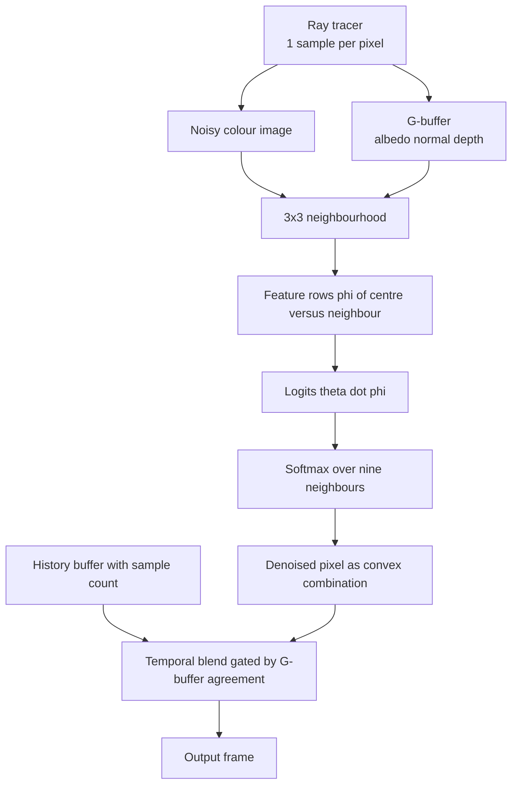
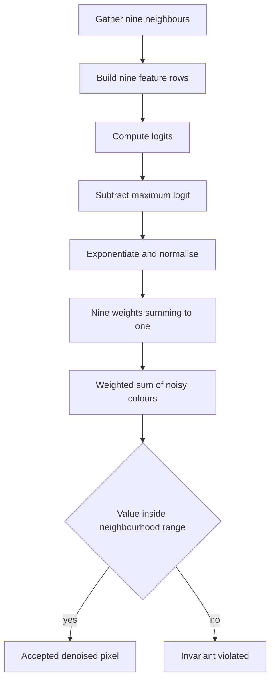
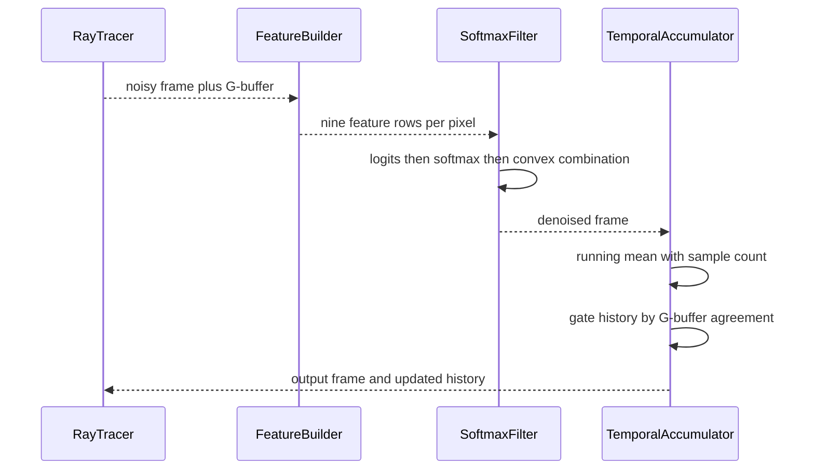

# 882 — Implement real-time denoising neural network pipeline integration for raytracer.

> **Tier:** Master · **CTCI chapter:** Beyond — Graphics, Geometry & Robotics
> **Task spec:** [882-implement-real-time-denoising-neural-network-pipeline-integratio.md](../../../tasks/master/882-implement-real-time-denoising-neural-network-pipeline-integratio.md)
> **Solutions:** [Python](../../../solutions/python/master/882-implement-real-time-denoising-neural-network-pipeline-integratio/solution.py) ·
> [Java](../../../solutions/java/master/882-implement-real-time-denoising-neural-network-pipeline-integratio/Solution.java) ·
> [JavaScript](../../../solutions/javascript/master/882-implement-real-time-denoising-neural-network-pipeline-integratio/solution.js) ·
> [C#](../../../solutions/csharp/master/882-implement-real-time-denoising-neural-network-pipeline-integratio/Solution.cs)

## 1. Problem restatement

**Input:** a noisy render — a small greyscale image plus its **G-buffer** (one `(albedo, normal,
depth)` triple per pixel) — and a parameter vector `theta` of length `PARAMETERS = 6`
(`FEATURES = 5` feature weights plus a bias). Training input is a set of `(noisy frame, G-buffer,
many-sample reference)` patches.

**Output:** a denoised frame of the same size, produced by a 3x3 **kernel-predicting** filter whose
weights are a softmax over per-neighbour logits; plus, for training, the mean squared error and its
exact gradient with respect to `theta`.

**Modelling contract (what this file is and is not).** Each solution is an in-process *simulation*
of a real-time denoising stage, not a renderer plus a production CNN:

* a **single scalar colour channel** instead of RGB;
* a **one-layer softmax kernel predictor** (`logit = theta . phi(p, q)`) instead of a multi-layer,
  U-Net-style CNN with auxiliary feature buffers;
* a small **synthetic scene** (`20 x 20`, an analytic disc plus a checkerboard albedo) instead of
  deferred-rendered frames — direct lighting is a closed form, the indirect term is a Monte Carlo
  average so that "more samples" really means "less noise";
* **no motion vectors**: temporal reprojection is a direct index, so history rejection is exercised
  through G-buffer disagreement rather than through re-projection error;
* G-buffer neighbours are clamped to the image border, so the 3x3 kernel is well defined at edges.

Verified: the softmax weights are non-negative and sum to one; the denoised value stays inside the
range of its 3x3 neighbourhood; training lowers the training loss below `75%` of its initial value
*and* lowers the held-out loss below the untrained-parameter baseline; every held-out frame gains
more than `0.5 dB` PSNR with a mean gain above `1.5 dB`; the 16-sample render stays the accuracy
ceiling; the trained filter preserves a `0.9 / 0.1` albedo edge instead of blurring across it;
parameters export and re-import bit for bit; eight accumulated one-sample frames reduce the error
monotonically below `60%` of a single frame's error; the history weight collapses to below `1e-6`
on a depth jump; per-frame work is a deterministic function of the image size; invalid
configurations raise; and every run is reproducible.

| Configuration | Result |
| --- | --- |
| 1-sample frame at `20 x 20`, seed 999 | PSNR below `30 dB` against the 64-sample reference |
| 16-sample frame at the same seed | strictly higher PSNR than the 1-sample frame |
| Trained filter on the first held-out frame | at least `1 dB` above the noisy input |
| `theta = [1, 2, 3, -0.5, 0, 0.5]` on one pixel | weights non-negative and summing to `1` within `1e-12` |
| Unchanged G-buffer at `(5, 5)` | history weight exactly `1.0` |
| Depth shifted by `+0.5` at `(5, 5)` | history weight below `1e-6` |

## 2. Intuition

The naive way to kill render noise is to keep tracing more samples, but a real-time renderer gets
one sample per pixel per frame. Denoising therefore has to *borrow* information from the 3x3
neighbourhood — and the moment you blur across a neighbourhood you risk smearing texture across an
object boundary. A fixed Gaussian kernel cannot tell "noisy flat region" from "sharp albedo edge";
everything it needs to make that call already sits in the G-buffer.

The key insight is to make the filter **data-dependent but strictly convex**: build a logit
`logit(p, q) = theta . phi(p, q)` from *agreement* features between the centre pixel `p` and the
neighbour `q`, then take a softmax over the nine neighbours. Because a softmax is non-negative and
sums to one, the denoised value is a convex combination of the nine noisy values, so it can never
leave the neighbourhood's `[min, max]` range — a boundedness invariant the solutions verify
directly instead of assuming. The features are all *negative* magnitudes of disagreement: albedo
difference, normal difference, `10x` depth difference, squared pixel distance over `8`, and `2x`
colour difference, with a constant `1.0` for the bias. A large depth or normal mismatch drives the
logit down, the softmax sends that neighbour's weight toward zero, and the filter refuses to blur
across the disocclusion it was told about.

The second insight is that because the weights are a softmax, the gradient of a mean squared error
loss with respect to `theta` has a closed form, so the filter can be trained by plain gradient
descent — no autodiff framework needed. For each pixel the derivative picks up
`(output - target) * w_q * (c_q - output) * (phi_q - E_w[phi])`: the `(c_q - output)` factor says
"moving this neighbour's weight toward a value it already has changes nothing", which is exactly the
variance-reduction term a denoiser needs, and `(phi_q - E_w[phi])` is the centred feature vector.

The third insight is temporal: if the G-buffer at a pixel still agrees with the previous frame, the
sample count can grow by a running mean; if it does not (disocclusion, moving object), the history
must be thrown away. A `exp(-(weighted disagreement)^2)` gate does both continuously, reaching
exactly `1.0` on a perfect match and below `1e-6` on a big depth jump.



## 3. Algorithm

The spatial pass, then training, then the temporal pass.

1. For each pixel, gather the nine clamped neighbours and build one feature row each:
   `albedo_agreement = -|a_p - a_q|`, `normal_agreement = -(|n1_p - n1_q| + |n2_p - n2_q|)`,
   `depth_agreement = -10 * |z_p - z_q|`, `distance = -(dx^2 + dy^2) / 8`, and
   `colour_agreement = -2 * |c_p - c_q|`, followed by the constant `1.0`.
2. Evaluate the nine logits `theta . phi`, subtract the maximum logit for numerical stability, take
   exponentials, normalise — that is the weight vector.
3. The denoised pixel is the weighted sum of the nine noisy colours.
4. Training: cache the feature rows and sampled colours once per patch (`prepare`), then run 40
   epochs of gradient descent with learning rate `8.0` on the training split, computing an exact
   softmax gradient per epoch.
5. Temporal: keep a running mean with an explicit sample count; a new frame enters as
   `running += (sample - running) / (index + 1)`, and the history is gated by the G-buffer
   agreement when a history buffer is available.

```text
function features(buffer, x, y, color, neighbour_x, neighbour_y)
    centre = buffer[y][x]
    other = buffer[neighbour_y][neighbour_x]
    return [ -abs(centre.albedo - other.albedo),
             -(abs(centre.n1 - other.n1) + abs(centre.n2 - other.n2)),
             -abs(centre.depth - other.depth) * 10,
             -((x - neighbour_x)^2 + (y - neighbour_y)^2) / 8,
             -abs(color[y][x] - color[neighbour_y][neighbour_x]) * 2,
             1 ]
end

function neighbourhood(buffer, color, x, y)
    rows = empty list
    positions = empty list
    for dy in (-1, 0, 1) do
        for dx in (-1, 0, 1) do
            nx = clamp(x + dx, 0, size - 1)
            ny = clamp(y + dy, 0, size - 1)
            append features(buffer, x, y, color, nx, ny) to rows
            append (nx, ny) to positions
        end
    end
    return rows, positions
end

function weights_at(theta, rows)
    logits = [ dot(theta, row) for row in rows ]
    peak = maximum(logits)
    exponentials = [ exp(value - peak) for value in logits ]
    normaliser = sum(exponentials)
    return [ value / normaliser for value in exponentials ]
end

procedure denoise(color, buffer, theta)
    output = new image with the same size
    for each pixel (x, y) do
        rows, positions = neighbourhood(buffer, color, x, y)
        weights = weights_at(theta, rows)
        output[y][x] = sum of weight * color[py][px] over the nine pairs
    end
    return output
end
```

The exact gradient used by training, and the temporal gate:

```text
function loss_and_gradient_cached(cache, target, theta)
    gradient = zeros of length PARAMETERS
    total = 0
    for each pixel (x, y) do
        rows, sampled = cache[y][x]
        logits = [ dot(theta, row) for row in rows ]
        weights = softmax(logits)
        output = sum of weights[index] * sampled[index]
        difference = output - target[y][x]
        total += difference * difference
        expected = [ sum over index of weights[index] * rows[index][k] for k in PARAMETERS ]
        for each neighbour index do
            common = 2 * difference * weights[index] * (sampled[index] - output)
            for k in PARAMETERS do
                gradient[k] += common * (rows[index][k] - expected[k])
            end
        end
    end
    scale = 1 / (size * size)
    return total * scale, gradient * scale
end

function history_weight(buffer, previous_buffer, x, y, sigma_albedo, sigma_normal, sigma_depth)
    difference = abs(a - a_prev) / sigma_albedo
               + (abs(n1 - n1_prev) + abs(n2 - n2_prev)) / sigma_normal
               + abs(z - z_prev) / sigma_depth
    return exp(-difference * difference)
end
```



## 4. Worked example

Take `theta = [1.0, 2.0, 3.0, -0.5, 0.0, 0.5]` — the vector the Python file uses for its convexity
check — and evaluate the weights on a locally flat patch where every neighbour agrees with the
centre (so all agreement features are `0` and only `distance` and the bias survive):

| Neighbour | `distance = -(dx^2 + dy^2)/8` | `logit = -0.5 * distance + 0.5` | `exp(logit)` | Weight |
| --- | --- | --- | --- | --- |
| centre `(0, 0)` | `0` | `0.5` | `1.64872` | `0.1021` |
| face `(1, 0)` and three peers | `-0.125` | `0.5625` | `1.75505` | `0.1087` |
| corner `(1, 1)` and three peers | `-0.25` | `0.625` | `1.86825` | `0.1157` |
| **sum** | | | `16.14192` | `1.0000` |

The weights sum to one and every one is positive, so the output is a convex combination: if all
nine noisy values lie in `[0.31, 0.37]`, the denoised value must lie there too. Notice that the
filter is *not* a plain box average — the centre keeps `0.1021` while the corners get `0.1157`,
because the distance feature prefers farther neighbours when the G-buffer agrees — and on a truly
flat patch where all nine values are equal the result is that common value exactly, so the filter is
an identity on constant regions.

Now change one feature: let the centre pixel have albedo `0.9` and its right-hand neighbour `0.1`
(the edge case the Python file constructs), so `albedo_agreement = -0.8` and that neighbour's logit
drops by `1.0 * 0.8`. With `logit = 0.5625 - 0.8 = -0.2375` its exponential falls from `1.75505` to
`0.7886`, cutting its share of the normaliser roughly in half; a full depth mismatch
(`-10 * 0.5 = -5` added to the logit) drives the weight to zero in the limit. That is the mechanism
behind the assertion that the trained filter keeps the `0.9` side of the synthetic albedo edge
separated from the `0.1` side by more than `0.5` in average brightness.

The temporal half of the pipeline, traced on eight one-sample frames (seeds 4000 to 4007):

| Frame index | Running mean update | Measured behaviour |
| --- | --- | --- |
| 0 | `running = sample_0` | error equals the single-frame error |
| 1 | `running += (sample_1 - running) / 2` | error falls; update weight `1/2` |
| 2 | `running += (sample_2 - running) / 3` | error falls again; update weight `1/3` |
| 4 | `running += (sample_4 - running) / 5` | squared error below `60%` of the single-frame error |
| 7 | `running += (sample_7 - running) / 8` | highest PSNR of the sequence, error strictly monotone throughout |



## 5. Complexity

| Step | Time | Space | Reason |
| --- | --- | --- | --- |
| `features` | `O(FEATURES + 1)` | `O(1)` | five agreements and a constant, no loops |
| `neighbourhood` | `O(KERNEL^2 * PARAMETERS)` | `O(KERNEL^2 * PARAMETERS)` | nine feature rows of six numbers |
| `weights_at` | `O(KERNEL^2 * PARAMETERS)` | `O(KERNEL^2)` | one dot product per neighbour plus a softmax |
| `denoise` on an `n x n` image | `O(n^2 * KERNEL^2 * PARAMETERS)` | `O(n^2)` output | the work counter reports `n^2` kernels and `n^2 * KERNEL^2` weights (for `n = 20`: `400` and `3600`) |
| `prepare` (once per patch) | `O(n^2 * KERNEL^2 * PARAMETERS)` | `O(n^2 * KERNEL^2 * PARAMETERS)` | feature rows are cached, so 40 epochs cost no re-extraction |
| `loss_and_gradient_cached` | `O(n^2 * KERNEL^2 * PARAMETERS)` | `O(PARAMETERS)` | one exact gradient per pixel, accumulated |
| `train` (40 epochs, 3 patches) | `O(epochs * patches * n^2 * KERNEL^2 * PARAMETERS)` | `O(1)` beyond the cache | gradient descent, no line search |
| `accumulate` (8 frames) | `O(frames * n^2)` | `O(n^2)` | one division per pixel per frame |
| Brute-force alternative: `64` samples per pixel for the reference | `O(64 * n^2)` ray work | `O(n^2)` | the reference the assertions compare PSNR against |

The pipeline is linear in pixels and constant in `PARAMETERS`; the only super-linear cost is the
optional reference render, which is exactly the budget denoising is meant to avoid at runtime.

## 6. Pitfalls and edge cases

* **Image size zero.** `trace_color(0, 0, size = 0, ...)` divides by the size and must raise; the
  Python file asserts a `ValueError`/`ZeroDivisionError`.
* **Empty G-buffer.** `neighbourhood([], [], 0, 0)` indexes an empty list and must raise
  `IndexError` rather than silently returning zeros.
* **Wrong parameter count.** `weights_at` with only `PARAMETERS - 1` entries must fail loudly; a
  silent zero-padding would quietly disable part of the model.
* **Border pixels.** Neighbours are clamped, not skipped, so all nine weights always exist and the
  output is a full convex combination even at the image boundary.
* **Softmax overflow.** The maximum logit is subtracted before exponentiation; without it a large
  `theta` would overflow `exp` and produce `NaN` weights.
* **Untrained filter.** With `theta` all zeros every weight is exactly `1 / 9`, so the filter is a
  box blur; the assertion checks it gains no more than `1.5 dB`, i.e. that the measured improvement
  really comes from training.
* **Colour-only blur.** A denoiser that ignores the G-buffer still reduces noise on flat patches but
  destroys edges; the edge assertion (`left - right > 0.5` across a hard jump) exists to catch that.
* **Disocclusion rejection.** The gate must approach zero for a large depth or albedo jump; the
  albedo threshold is softer (`0.4` step must give a weight below `0.5`) because a `sigma_albedo` of
  `0.05` still lets small shading differences through.
* **Monotonicity of accumulation.** The running mean must never increase the error frame over frame;
  the file asserts `spread[i + 1] <= spread[i]` for all eight frames, which fails if the sample count
  is mis-incremented.
* **Determinism and export.** All randomness comes from the seeded `splitmix64` stream, and the
  parameter round-trip must reproduce the frame bit for bit — a filters or quantization step would
  break that equality.

## 7. Variants and follow-ups

* **Feeding the denoiser a noisier input.** The variance the denoiser has to remove comes from the
  integrator: [881](../../../tasks/master/881-implement-global-illumination-importance-sampling-techniques-in.md)
  studies the sampling strategies that decide how much of it is left per pixel.
* **Scaling to a full frame budget.** Where the pixel budget comes from — tile scheduling across
  workers, per-tile sample counts — is the subject of
  [880](../../../tasks/master/880-implement-distributed-rendering-coordinator-with-tile-based-sche.md),
  while this file always assumes one sample per pixel per frame.
* **Making the filter differentiable and deeper.** Replace the hand-derived softmax gradient with a
  tape-based autodiff engine ([883](../../../tasks/master/883-implement-automatic-differentiation-for-gpu-kernels-across-fused.md))
  so the feature weights become learnable, or let a differentiable renderer
  ([824](../../../tasks/master/824-implement-differentiable-renderer-basic-and-integrate-into-autog.md))
  back-propagate through the sampling itself; a production denoiser stacks several kernels and adds
  motion vectors, keeping the `prepare`-then-train split intact.

## 8. Check yourself

<details><summary>Show answer</summary>

**Q1. Why must the denoised value lie inside the range of its 3x3 neighbourhood?**

Because the weights are a softmax: each weight is `exp(logit - peak) / sum(exp(...))`, hence
non-negative, and they sum to one. A convex combination of the nine noisy values is bounded by their
minimum and maximum, which the Python file checks for every pixel with a `1e-12` tolerance.

</details>

<details><summary>Show answer</summary>

**Q2. What does the `(sampled[index] - output)` factor in the gradient mean?**

It is the "leave the value alone" term. If a neighbour's colour already equals the filtered output,
then adding weight to it does not change the result, so its contribution to the gradient vanishes.
That is why a trained filter ends up concentrating weight on neighbours that agree with the current
estimate rather than on the loudest one.

</details>

<details><summary>Show answer</summary>

**Q3. How do you know the reported PSNR improvement is generalisation rather than memorisation, and
why does the accumulator fall in variance like `1/n`?**

Patches are split by parity: seeds 300, 302 and 304 go to validation and 301, 303 and 305 to training,
and the assertions require the held-out loss to fall below the zero-parameter baseline, every held-out
frame to gain more than `0.5 dB` (mean above `1.5 dB`), and an untrained filter to gain at most
`1.5 dB`. The accumulator is a running mean of independent one-sample frames, so after `k` frames each
pixel has variance `1/k` of a single frame's; keeping an explicit sample count — instead of a fixed
exponential blend — is what makes the approach monotone, and the squared error is asserted never to
rise across the eight frames.

</details>
