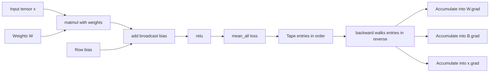
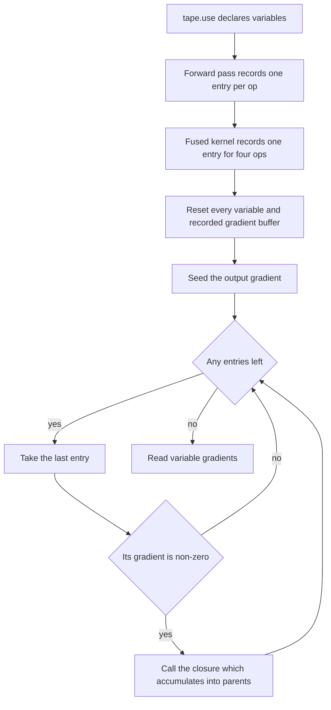
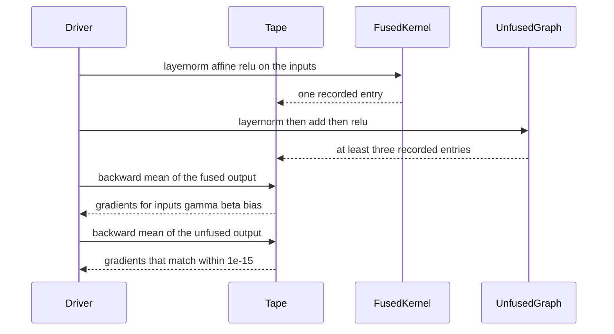

# 883 — Implement automatic differentiation for GPU kernels across fused operators.

> **Tier:** Master · **CTCI chapter:** Beyond — Compilers, Languages & Solvers
> **Task spec:** [883-implement-automatic-differentiation-for-gpu-kernels-across-fused.md](../../../tasks/master/883-implement-automatic-differentiation-for-gpu-kernels-across-fused.md)
> **Solutions:** [Python](../../../solutions/python/master/883-implement-automatic-differentiation-for-gpu-kernels-across-fused/solution.py) ·
> [Java](../../../solutions/java/master/883-implement-automatic-differentiation-for-gpu-kernels-across-fused/Solution.java) ·
> [JavaScript](../../../solutions/javascript/master/883-implement-automatic-differentiation-for-gpu-kernels-across-fused/solution.js) ·
> [C#](../../../solutions/csharp/master/883-implement-automatic-differentiation-for-gpu-kernels-across-fused/Solution.cs)

## 1. Problem restatement

**Input:** a differentiable expression built from `Tensor` values — elementwise `add` (with an
optional broadcast row bias), `multiply`, `matmul`, `relu`, `exp`, `log`, `scale`, `softmax`,
`layernorm`, `sum_all` and `mean_all` — plus a separate hand-written fused kernel that evaluates
layer-normalise, affine and rectify in one pass.

**Output:** for each declared variable, the gradient of a scalar loss with respect to it, produced
by walking the recorded tape backwards; and a fused kernel whose forward *and* backward numbers
match the unfused composition exactly while materialising one output tensor instead of five.

**Modelling contract (what this file is and is not).** Each solution is an in-process *simulation*
of a compiler's autodiff and fusion layer, not a GPU toolchain:

* **float64 on the host** with an explicit tape of backward closures, instead of a kernel language
  and a device-side pass;
* every op is a scalar loop over flat `data`, so "kernel" means "one recorded tape entry" — a fused
  entry replaces three (plus two temporaries) entries of the same expression;
* **no memory planning, register allocation or launch configuration**: only the fusion *boundary*
  is modelled, which is exactly what the assertions measure (tape entry counts and tensor
  allocations);
* variables are declared explicitly with `tape.use(...)`, because one tensor can be declared in two
  graphs and `Tape.backward` resets the gradient buffers it owns;
* matrices are dense and small: `Tensor` holds `data`, `shape` and `grad`, and permits only
  elementwise, `(m, k) x (k, n)` and `(1, n)`-broadcast shapes.

Verified against independent references, all in the four solution files:

| Check | Reference | Tolerance |
| --- | --- | --- |
| `mean(relu(x @ W + b))` gradients | central finite differences with `EPSILON = 1e-5` | worst error below `1e-5` |
| `sum(x * x)` | `2x` | `1e-12` |
| `sum(x * x + x)` (shared operand) | `2x + 1` | `1e-12` |
| Broadcast row bias over 5 rows | `5.0` per column | `1e-12` |
| Cross-entropy cotangent through softmax | `p - onehot` | `1e-9` |
| Layer-norm row gradient | sums to zero, orthogonal to the centred input | `1e-9` / relatively `1e-3` |
| `beta` gradient over a 6-row batch | `6.0` per column | `1e-9` |
| Fused versus unfused forward | bit-for-bit equality | exact |
| Fused versus unfused gradients | same numbers, `allocations = 1` versus `>= 3` | `1e-15` |
| Forward-mode dual numbers | reverse-mode directional derivative, same tangent | `1e-12` |
| 80 gradient-descent steps at rate `0.2` | loss falls below `5%` of the start and below `0.02` | monotone every step |

## 2. Intuition

The naive way to get a gradient is finite differences: perturb one parameter, re-evaluate, divide by
the step. That is correct but costs one full forward pass *per parameter* — `O(P)` evaluations — and
its accuracy depends on a step size that is either too large (truncation error) or too small
(cancellation). Reverse-mode autodiff gets the whole gradient for the price of **one forward pass
plus one backward pass**, because each operation knows its own vector-Jacobian product and the chain
rule composes them.

The trick that makes this work is the **tape**: instead of storing a graph data structure with
node objects and edges, each op *records a closure* over the tensors it consumed, and the backward
pass iterates the recorded entries **in reverse order**, calling `closure(output.grad)` for every
node that actually received gradient. The closure *accumulates* (`+=`) into its parents' `grad`
buffers rather than assigning, and that single detail is what makes the whole engine correct on
graphs that are not trees:

* a **shared subexpression** such as `x * x` is consumed twice, so `sum(x * x)` must give `2x` — the
  two contributions add up in `x.grad`;
* a **broadcast operand** such as a `(1, n)` bias used by an `(m, n)` tensor receives one
  contribution per row, so its gradient is the row-wise sum — `5.0` per column for a 5-row batch;
* an operand that is both multiplied and added (`x * x + x`) accumulates both paths into `2x + 1`.

The second half of the task is the *fused operator*. A compiler takes
`relu(layernorm(x, gamma, beta) + bias)` and rewrites it into a single kernel that normalises,
scales, shifts and rectifies tile-by-tile without ever writing the normalised tensor to memory. The
fused version must be *numerically identical* — the file asserts `fused_output.data ==
unfused_output.data` bit for bit and gradient agreement to `1e-15` — while the tape records one
allocation instead of at least three. The subtle part is the backward: the fused kernel cannot lean
on the recorded backwards of its four components, so the analytic chain
`relu -> affine -> normalise` is written out by hand, including the two layer-norm corrections
(`mean_dxhat` and `mean_product`) and the rectifier's zero-subgradient rule at exactly `0`.



## 3. Algorithm

Reverse mode, expressed with three pieces of state: `Tensor.data`, `Tensor.grad`, and the tape's
list of `(output, backward)` entries plus the declared `variables`.

1. Declare the variables with `tape.use(...)`; each variable's gradient buffer is reset at the start
   of `backward`, and every recorded tensor's buffer is reset too.
2. Build the expression forward. Each op allocates its output tensor, computes the data, and calls
   `tape.record(output, backward)` where `backward` closes over the inputs and *accumulates* into
   their gradients.
3. Seed `output.grad` — `[1.0] * size` by default, or an explicit `seed` for a non-unit cotangent
   such as the cross-entropy cotangent `-onehot / p`.
4. Walk the entries in reverse. Skip any node whose gradient is all zeros (the pruning step that
   makes a sparse graph cheap) and otherwise call its closure with the node's accumulated gradient.
5. Read `variable.grad` for every declared variable.

```text
class Tensor
    data, shape, grad
end

class Tape
    entries, variables, allocations

    procedure use(tensors)
        for tensor in tensors do
            if tensor is not already in variables then append tensor to variables end
        end
    end

    function record(output, backward)
        append (output, backward) to entries
        allocations += 1
        return output
    end

    procedure backward(output, seed)
        for tensor in variables do tensor.grad = zeros end
        for (tensor, _backward) in entries do tensor.grad = zeros end
        output.grad = seed if seed is given else ones
        for (tensor, backward) in reversed(entries) do
            if any value in tensor.grad is not zero then
                backward(tensor.grad)
            end
        end
    end
end
```

Each op contributes one closure; the four that carry the interesting algebra:

```text
function matmul(tape, left, right)
    output = left @ right as a new tensor
    function backward(gradient)
        for i, j do
            value = gradient[i, j]
            if value != 0 then
                for index do
                    left.grad[i, index] += value * right.data[index, j]
                    right.grad[index, j] += value * left.data[i, index]
                end
            end
        end
    end
    return tape.record(output, backward)
end

function softmax(tape, tensor)
    per row: subtract the row maximum, exponentiate, normalise
    function backward(gradient)
        for each row do
            projection = sum over columns of gradient * output
            for each column do
                tensor.grad += output[column] * (gradient[column] - projection)
            end
        end
    end
end

function layernorm(tape, tensor, gamma, beta)
    per row: mean, variance, deviation = sqrt(variance + 1e-5), xhat = (x - mean) / deviation
    output = xhat * gamma + beta
    function backward(gradient)
        for each row do
            gamma.grad += gradient * xhat
            beta.grad += gradient
            dxhat = gradient * gamma
            mean_dxhat = mean(dxhat)
            mean_product = mean(dxhat * xhat)
            tensor.grad += inverse_deviation * (dxhat - mean_dxhat - xhat * mean_product)
        end
    end
end

function fused_layernorm_affine_relu(tape, tensor, gamma, beta, bias)
    per row: compute mean, inverse deviation, xhat, value = xhat * gamma + beta + bias, clip at zero
    one recorded entry; the backward re-derives xhat, skips non-positive pre-activations,
    accumulates gamma, beta and bias, then applies the same two layer-norm corrections
end
```



## 4. Worked example

Three traces, each taken verbatim from the assertions in the Python file.

**Trace 1 — the ReLU subgradient boundary.** `boundary = Tensor([0.0, -1.0, 1.0])` through
`relu`, then `sum_all`:

| Index | Input | Output of `relu` | Seeded gradient | `boundary.grad` | Rule |
| --- | --- | --- | --- | --- | --- |
| 0 | `0.0` | `0.0` | `1.0` | `0.0` | the subgradient at exactly zero is defined as zero |
| 1 | `-1.0` | `0.0` | `1.0` | `0.0` | dead unit, gate closed |
| 2 | `1.0` | `1.0` | `1.0` | `1.0` | live unit passes the gradient through |

`rectified.data == [0.0, 0.0, 1.0]` and the three gradient assertions are `==` comparisons, not
tolerance checks, so the gating rule cannot drift by a rounding step.

**Trace 2 — accumulation over a broadcast.** `matrix` of shape `(5, 3)`, `row_bias` of shape
`(1, 3)`, loss `sum(add(matrix, row_bias, broadcast_right = True))`:

| Quantity | Value | Why |
| --- | --- | --- |
| `matrix.grad[index]` | `1.0` for all 15 entries | `sum` sends one unit to each element |
| `row_bias.grad[index]` | `5.0` for all 3 columns | the broadcast closure adds the incoming value into `index mod columns`, once per row |
| checks | `< 1e-12` | accumulation, not assignment, is what makes this exact |

Without the `+=` in that closure the bias gradient would be `1.0` instead of `5.0` — an error that
is invisible on a single-row batch and appears only once the operand is broadcast.

**Trace 3 — the fused kernel versus the tape.** Both graphs run on the same `(6, 8)` input with
`gamma = ones`, `beta = zeros` and a `(1, 8)` bias:

| Quantity | Fused | Unfused |
| --- | --- | --- |
| Forward data | one `Tensor` of the same shape | identical data, bit for bit |
| Tape entries allocated | `1` | `>= 3` (layernorm, broadcast add, relu) |
| Backward | hand-written chain: `dxhat = incoming * gamma`, skip if pre-activation `<= 0`, then `inverse_deviation * (dxhat - mean_dxhat - xhat * mean_product)` | the three recorded closures compose in reverse |
| Gradient agreement | `|fused - unfused| < 1e-15` for `inputs`, `gamma`, `beta`, `bias` | reference |
| Independent check of the fused backward | central finite differences on `bias` agree within `1e-5` | — |

The third row is the whole point of the exercise: an optimising compiler is allowed to rewrite the
expression, but the derivative it produces must still be the derivative of the original expression,
and the file proves it twice — once against the tape, once against finite differences.



## 5. Complexity

| Operation | Time | Space | Reason |
| --- | --- | --- | --- |
| `add`, `multiply`, `relu`, `exp`, `log`, `scale` | `O(size)` forward and backward | `O(size)` per tensor | one closure per element, one pass each way |
| `matmul` `(m, k) x (k, n)` | `O(m k n)` forward, `O(m k n)` backward | `O(m n)` output | the inner loop appears once in each closure |
| `softmax` on `r x c` | `O(r c)` forward, `O(r c)` backward | `O(r c)` output | the Jacobian is applied in its factored form `p * (g - dot(g, p))` instead of as a `c x c` matrix |
| `layernorm` on `r x c` | `O(r c)` forward, `O(r c)` backward | `O(r c)` plus `O(r)` statistics | two row means in each direction |
| `fused_layernorm_affine_relu` | `O(r c)` forward, `O(r c)` backward | one output tensor (`allocations = 1`) | per-row scratch buffers are reused, not recorded |
| Unfused equivalent | same asymptotics | `>= 3` recorded tensors | intermediate results are materialised |
| `Tape.backward` | `O(entries + sum of backward costs)` | `O(total tensors)` gradient buffers | reverse iteration with zero-gradient pruning |
| Finite differences (the alternative) | `O(P)` full forward passes | `O(size)` | one re-evaluation per parameter — the reference only, never the training path |
| Forward-mode dual numbers (the alternative) | `O(1)` pass per *direction* | `O(size)` | pairs `(value, tangent)`; a full gradient needs `P` directions, so it wins only when directions are few |

The engine's memory is dominated by the recorded tensors, not by the tape entries: each entry is
one closure plus a reference, whereas the fused kernel avoids two intermediate tensors of size
`r * c` each.

## 6. Pitfalls and edge cases

* **ReLU at exactly zero.** The gate is `value > 0.0`, so the subgradient at `0.0` is `0.0`; the
  assertion compares with `==`, so this cannot be "almost right".
* **Dead units.** A unit whose pre-activation is non-positive receives no gradient and its weights
  stop moving; the fused backward reproduces this by `continue`-ing before accumulating.
* **Zero-gradient pruning.** `Tape.backward` skips entries whose gradient is entirely zero; a bug
  here silently drops contributions from a branch of the graph, which is why the shared-operand and
  broadcast cases are asserted.
* **Accumulation versus assignment.** Every closure uses `+=`. Overwriting would still pass a
  single-path test and fail the `x * x` and broadcast tests.
* **Numerical stability of softmax.** The row maximum is subtracted before `exp`; without it a
  large logit overflows to `inf` and the whole row becomes `NaN`.
* **Layer-norm epsilon.** `sqrt(variance + 1e-5)` means the orthogonality identity is only
  approximately true, so the file compares the projection against `1e-3 * |g| * |centred|` rather
  than against zero — a hand-written exact-zero check would be a false alarm.
* **Decorating the wrong tensor with the tolerance.** `beta.grad` accumulates `6.0` per column for a
  6-row batch and `gamma.grad` sums to zero across features; both are asserted separately because a
  transposed accumulation satisfies one and breaks the other.
* **Shape mismatches must raise.** Ragged rows, `matmul` with a mismatched inner dimension,
  `multiply` on different shapes, data that does not fit its shape, and normalisation parameters that
  are not `(1, c)` all raise `ValueError`.
* **Finite differences perturb the tensor.** `finite_difference` writes `tensor.data[index]`, builds a
  *fresh* tape, and restores the original value; the caller therefore has to snapshot the analytic
  gradients first, and the perturbed graph must declare the tensor with `tape.use` so its gradient
  buffer is reset.
* **Determinism.** Two runs of the same fused expression produce bit-identical gradients — no hash
  order, no floating-point reordering, no uninitialised buffers.

## 7. Variants and follow-ups

* **Autotuning the kernel the fusion produces.** Once the expression is one kernel, the block and grid
  parameters still have to be chosen:
  [884](../../../tasks/master/884-implement-autotuner-that-explores-kernel-block-grid-parameters-a.md)
  searches that space with a cost model, a bandit and a warm-start cache, and
  [885](../../../tasks/master/885-implement-dynamic-recompilation-pipeline-for-dsl-to-optimized-ke.md)
  adds the heuristics that decide *which* expressions to specialise and when.
* **Fusion without a tape.** A production compiler performs the same rewrite as a graph pass over an
  operator DAG; [725](../../../tasks/expert/725-implement-operator-fusion-simulation-for-compute-graph-speedups.md)
  simulates the speedups that pass buys, and
  [724](../../../tasks/expert/724-implement-memory-planner-for-computation-graph-scheduling-simple.md)
  plans buffer reuse once the intermediates disappear.
* **Differentiating through a renderer.** The same reverse-mode machinery drives image-space gradients
  where the "ops" are ray intersections instead of matmuls; see
  [824](../../../tasks/master/824-implement-differentiable-renderer-basic-and-integrate-into-autog.md).
  Forward-mode dual numbers win instead whenever the number of directions is smaller than the number
  of parameters, which is why the file implements both and checks that they agree.

## 8. Check yourself

<details><summary>Show answer</summary>

**Q1. Why does the tape store closures instead of a graph of node objects with edges?**

A closure captures exactly the values it needs (`right.data`, the output's exponentials, the per-row
statistics) and performs its own vector-Jacobian product, so the backward pass is just a reverse
iteration over a flat list with zero-gradient pruning. No node identity, no edge lists, no topological
sort at backward time — and the accumulation pattern is enforced by writing `+=` once, inside each
closure.

</details>

<details><summary>Show answer</summary>

**Q2. `sum(x * x)` gives `2x` but a naive implementation sometimes gives `x`. Which line is
responsible, and how is it tested?**

The `multiply` closure accumulates into both operands with `+=`. `x` is consumed twice — once as each
factor — so its buffer receives a contribution from both the "left" and the "right" path. The solution
asserts `value.grad[i] == 2.0 * value.data[i]` to `1e-12`, and a second assertion on `sum(x * x + x)`
checks the mixed case `2x + 1`.

</details>

<details><summary>Show answer</summary>

**Q3. The fused kernel computes the same numbers as the unfused graph. Why is that not enough to
make it a valid optimisation, and where do the layer-norm corrections come from?**

Because a fused operator also has to differentiate correctly: an optimiser that changes the forward
pass but keeps a stale backward silently corrupts training. The file therefore checks the fused
*gradients* against the unfused tape to `1e-15` and against central finite differences of the fused
loss itself (worst error below `1e-5`). Normalisation couples every element of a row through the mean
and the variance, so its backward needs the `- mean_dxhat` centring correction and the
`- xhat * mean_product` projection term; dropping either breaks the two invariants the file asserts —
the row gradient sums to zero and is orthogonal to the centred input.

</details>
