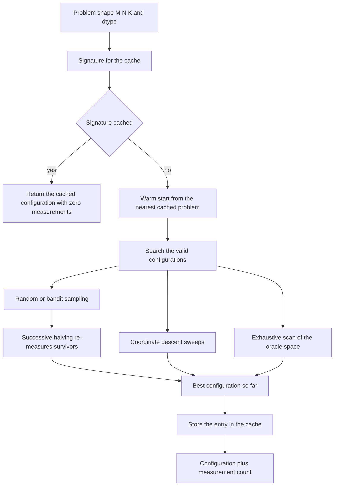
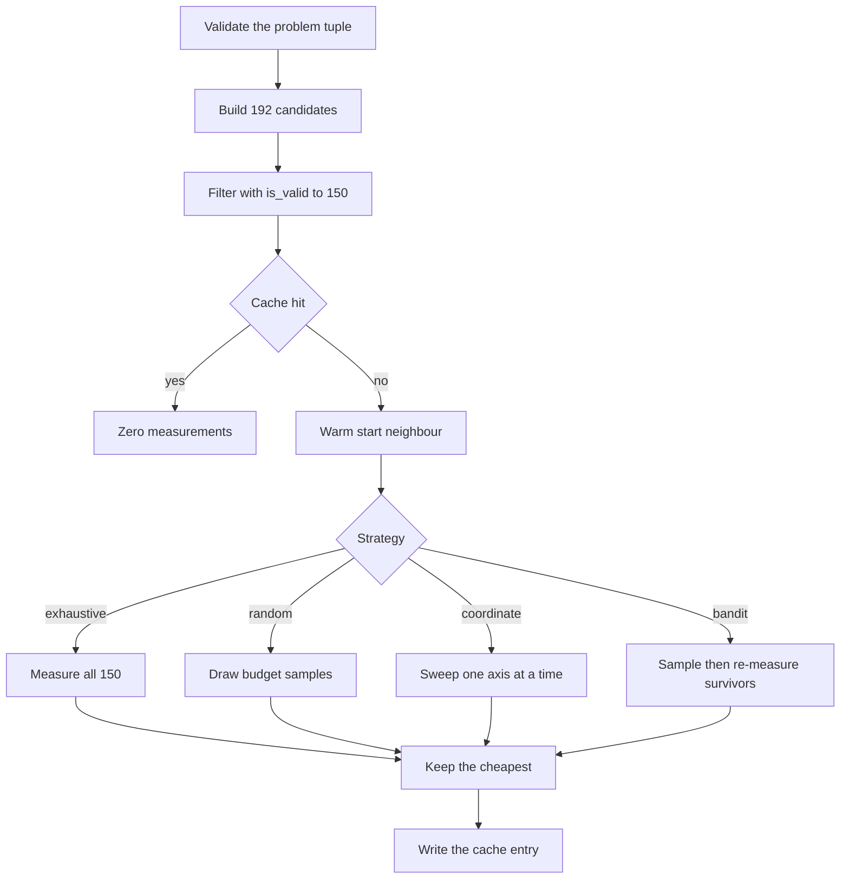
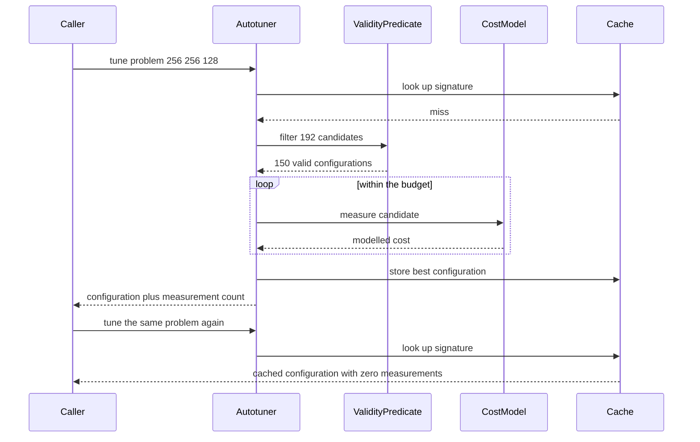

# 884 — Implement autotuner that explores kernel/block/grid parameters and caches best.

> **Tier:** Master · **CTCI chapter:** Beyond — Compilers, Languages & Solvers
> **Task spec:** [884-implement-autotuner-that-explores-kernel-block-grid-parameters-a.md](../../../tasks/master/884-implement-autotuner-that-explores-kernel-block-grid-parameters-a.md)
> **Solutions:** [Python](../../../solutions/python/master/884-implement-autotuner-that-explores-kernel-block-grid-parameters-a/solution.py) ·
> [Java](../../../solutions/java/master/884-implement-autotuner-that-explores-kernel-block-grid-parameters-a/Solution.java) ·
> [JavaScript](../../../solutions/javascript/master/884-implement-autotuner-that-explores-kernel-block-grid-parameters-a/solution.js) ·
> [C#](../../../solutions/csharp/master/884-implement-autotuner-that-explores-kernel-block-grid-parameters-a/Solution.cs)

## 1. Problem restatement

**Input:** a *problem* `(M, N, K)` of the matrix-shaped kind a tiled GPU kernel sees — say
`(256, 256, 128)` — and a *search space* of configurations `(block_x, block_y, unroll, vector)`
built from `block_x, block_y ∈ {16, 32, 64, 128}`, `unroll ∈ {1, 2, 4, 8}` and `vector ∈ {1, 2, 4}`
— `192` candidates in total.

**Output:** the configuration with the lowest modelled kernel cost, the number of measurements that
search spent, and a cache entry keyed by the problem signature so that a repeated tune costs zero
measurements and a *related* shape can start from the nearest cached answer.

**Modelling contract (what this file is and is not).** Each solution is an in-process *simulation* of
a kernel autotuner, not a GPU profiler:

* the objective is an **analytic cost model**, not a real measurement — `measure` returns `cost`
  plus an optional deterministic perturbation, so every experiment is reproducible;
* there is no device, no compiler and no launch: the model encodes the classic terms a tuner sees
  (launch overhead, wave count, per-thread work, coalescing, bank conflicts, tail waste, occupancy,
  register pressure) with fixed constants;
* the machine model is explicit and small: `SM_COUNT = 8`, `MAX_THREADS_PER_SM = 2048`,
  `SHARED_MEMORY_BYTES = 48 * 1024`, `LAUNCH_COST = 3.0` stage units, `BLOCK_OVERHEAD = 0.2` units
  per block, and the untuned reference `DEFAULT_CONFIG = (32, 32, 1, 1)`;
* the "search cost" is modelled by counting `measure` calls, so the trade-off between search budget
  and accuracy is exact rather than statistical.

Verified properties (all four languages ship the same assertions):

| Check | Result |
| --- | --- |
| Candidate space versus valid subspace | `192` candidates, `150` valid — a proper subset |
| Validity predicate versus an independent re-derivation | identical lists |
| Exhaustive search against the brute-force oracle on `(256, 256, 128)` | same configuration, same cost, exactly `150` measurements |
| Optimum versus the untuned default | `(16, 128, 1, 4)` at `137.400` versus `(32, 32, 1, 1)` at `579.000`, a `4.214x` speedup |
| Default versus optimum regret | above `0.1` — the landscape really has an interior optimum |
| Cache behaviour | a repeated tune is a hit with `0` measurements; a new shape invalidates |
| Warm start | one measurement on a neighbouring shape lands within `0.05` relative regret |
| Regret versus budget `(2, 8, 32)` averaged over three shapes | `0.4091`, `0.1879`, `0.0148` |
| Bandit versus random at budget `8` | bandit regret `0.205`, `0.287`, `0.045` — never worse by more than `0.1` in total |
| `3%` measurement noise | chosen configuration stays within `0.15` relative regret |
| Landscape richness | more than `20` distinct costs, optimum at least `20%` better than the median |

Invalid inputs are rejected: a zero budget, an unknown strategy, a zero or non-integer extent, a
malformed problem tuple and any attempt to *evaluate* an invalid configuration all raise.

## 2. Intuition

A tiled kernel's runtime is not monotone in any single knob. Bigger tiles amortise block overhead
but cut the number of resident blocks per SM; more unrolling exposes instruction-level parallelism
but costs registers; vector width helps only when the row extent is a multiple of it, otherwise the
tail is uncoalesced. The result is a genuine **interior optimum**, and the numbers show it: the
landscape has more than twenty distinct costs, the best configuration is at least `20%` cheaper than
the median, and a search is needed because `(16, 128, 1, 4)` beats the usual default by `4.214x`.

The first insight is that **validity can be decided before anything is measured**. A configuration
is only well formed if each block extent is a power of two, the tile divides evenly into the thread
count, the thread count lands in `[32, 1024]`, and the tile fits in `48 KiB` of shared memory.
Applying that predicate first turns `192` candidates into `150` and guarantees the search never
wastes a measurement on a configuration that could not launch. The file even re-derives the pruning
rules a second time (`prune_without_optimum`) and asserts the two lists are equal, so a typo in the
predicate cannot silently narrow the space.

The second insight is that the objective must be **interpretable term by term**, because that is
what makes the search results trustworthy:

* `tiles = ceil(M / block_x) * ceil(N / block_y)` blocks are issued, but only
  `resident = SM_COUNT * blocks_per_SM` are in flight, so the kernel runs `ceil(tiles / resident)`
  waves;
* each wave costs `stage = block_x * block_y * K / (threads * throughput)` where
  `throughput = vector * (1 + 0.5 * log2(unroll))` — more ILP per thread, less time per stage;
* penalties model the classic pathologies: `+30%` when `N` is not a multiple of the vector width
  (an uncoalesced tail), `+20%` when `block_y` is not a multiple of `32` (partial warps), up to
  `+50% * wasted` for tile waste on either axis, `+25%` below `64` threads (latency not hidden),
  `+10%` above `512` threads (fewer blocks resident), `+5%` when `unroll * vector > 8` (register
  pressure);
* `LAUNCH_COST` and a per-block `BLOCK_OVERHEAD` are added last, which is exactly what stops an
  absurdly small tile from being free — `cost((128, 128, 64), (32, 32, 8, 4))` is not cheaper than
  `cost((128, 128, 64), (64, 64, 8, 4))`.

The third insight is that **the cache is the product**, not the search. A tuning run costs real time,
so a hit must cost nothing, and a *related* shape should not have to start from scratch: the warm
start picks the cached problem minimising `|dM| + |dN| + 0.1 * |dK|` (the depth transfers more
freely, hence the `0.1`). With one measurement plus that transfer, the regret on `(256, 256, 256)`
drops below `0.05`, better than a cold single measurement, because tilings depend mostly on the row
and column extents.



## 3. Algorithm

1. Validate the problem: exactly three positive integer extents.
2. Build the candidate list by the Cartesian product of the four `block_x` values, four `block_y`
   values, four unroll factors and three vector widths; filter with `is_valid`.
3. Look the problem signature `(problem, dtype)` up in the cache; on a hit return immediately with
   `measurements = 0`.
4. Otherwise warm-start: pick the cached neighbour with the smallest weighted extent distance, if
   any, and measure it first.
5. Search according to the strategy — exhaustive over the valid space, seeded random sampling of the
   given budget, single-axis coordinate descent from the default, or random sampling followed by
   successive halving of the best few survivors re-measured with more repetitions.
6. Every candidate is validated *before* `evaluate` is called; invalid configurations are skipped and
   attempting to evaluate one raises.
7. Record the best configuration and its cost in the cache under the signature and return the
   measurement count.

Pseudocode, mirroring the four solution files:

```text
function candidate_configs(blocks, unrolls, vectors)
    configs = empty list
    for block_x in blocks do
        for block_y in blocks do
            for unroll in unrolls do
                for vector in vectors do
                    append (block_x, block_y, unroll, vector) to configs
                end
            end
        end
    end
    return configs
end

function is_valid(config)
    block_x, block_y, unroll, vector = config
    if any component <= 0 then return false end
    if block_x is not a power of two or block_y is not a power of two then return false end
    if (block_x * block_y) mod (unroll * vector) != 0 then return false end
    threads = (block_x * block_y) / (unroll * vector)
    if threads < 32 or threads > 1024 then return false end
    return block_x * block_y * 4 <= SHARED_MEMORY_BYTES
end

function cost(problem, config)
    m, n, k = problem
    block_x, block_y, unroll, vector = config
    tiles_x = ceil(m / block_x)
    tiles_y = ceil(n / block_y)
    tiles = tiles_x * tiles_y
    threads = (block_x * block_y) / (unroll * vector)
    blocks_per_sm = max(1, min(MAX_THREADS_PER_SM / threads, SHARED_MEMORY_BYTES / (block_x * block_y * 4)))
    resident = max(1, min(tiles, SM_COUNT * blocks_per_sm))
    waves = ceil(tiles / resident)
    throughput = vector * (1 + 0.5 * log2(unroll))
    stage = (block_x * block_y * k) / (threads * throughput)
    total = waves * stage
    penalty = 0
    if n mod vector != 0 then penalty += 0.30 * total end
    if block_y mod 32 != 0 then penalty += 0.20 * total end
    if m mod block_x != 0 or n mod block_y != 0 then
        wasted = mean of the relative waste on both axes
        penalty += 0.5 * wasted * total
    end
    if threads < 64 then penalty += 0.25 * total end
    if threads > 512 then penalty += 0.10 * total end
    if unroll * vector > 8 then penalty += 0.05 * total end
    return LAUNCH_COST + total + penalty + BLOCK_OVERHEAD * tiles
end

function measure(problem, config, repetition, noise, seed)
    base = cost(problem, config)
    if noise <= 0 then return base end
    mixer = hash of config and problem and repetition
    return base * (1 + noise * (2 * rng_uniform(mixer xor seed) - 1))
end

function tune(tuner, problem, dtype)
    signature = (problem, dtype)
    if signature in cache then return cached entry with measurements = 0 end
    space = valid candidates
    best = none
    seed_config = warm_start(signature)
    if seed_config exists then best = (seed_config, evaluate(problem, seed_config)) end
    if strategy is "exhaustive" then
        for config in space do consider config end
    else if strategy is "coordinate" then
        best = coordinate_descent(problem, DEFAULT_CONFIG)
    else
        for each of budget draws do consider a random valid config end
    end
    if strategy is "bandit" then best = successive_halving(problem, best) end
    cache[signature] = best
    return best with the number of measurements spent
end

function successive_halving(tuner, problem, incumbent)
    survivors = the last eight measured configurations
    for config in survivors do
        average three extra repetitions of measure within the remaining budget
        if the average beats the incumbent then replace the incumbent
    end
    return incumbent
end
```



## 4. Worked example

Evaluate the cost model by hand for the two configurations that make the headline number — the
default `(32, 32, 1, 1)` and the optimal `(16, 128, 1, 4)` — on `problem = (256, 256, 128)`:

| Term | `(32, 32, 1, 1)` | `(16, 128, 1, 4)` | Formula |
| --- | --- | --- | --- |
| threads | `32 * 32 / 1 = 1024` | `16 * 128 / 4 = 512` | `block_x * block_y / (unroll * vector)` |
| shared bytes | `4096` | `8192` | `block_x * block_y * 4` |
| blocks per SM | `min(2048/1024, 49152/4096) = 2` | `min(2048/512, 49152/8192) = 4` | thread and shared-memory limits |
| tiles | `8 * 8 = 64` | `16 * 2 = 32` | `ceil(256/block_x) * ceil(256/block_y)` |
| resident blocks | `min(64, 8 * 2) = 16` | `min(32, 8 * 4) = 32` | `SM_COUNT * blocks per SM` |
| waves | `ceil(64 / 16) = 4` | `ceil(32 / 32) = 1` | `ceil(tiles / resident)` |
| throughput | `1 * (1 + 0.5 * 0) = 1` | `4 * (1 + 0.5 * 0) = 4` | `vector * (1 + 0.5 * log2(unroll))` |
| stage | `131072 / 1024 = 128` | `262144 / 2048 = 128` | `block_x * block_y * K / (threads * throughput)` |
| base | `4 * 128 = 512` | `1 * 128 = 128` | `waves * stage` |
| penalties | `+10%` for `threads > 512` → `51.2` | none | tail, warp, waste, occupancy, register rules |
| launch | `3.0` | `3.0` | `LAUNCH_COST` |
| block overhead | `0.2 * 64 = 12.8` | `0.2 * 32 = 6.4` | `BLOCK_OVERHEAD * tiles` |
| **total** | **`579.0`** | **`137.4`** | `3 + base + penalty + overhead` |

The two rows explain the `4.214x` speedup: the default pays four waves where the optimum pays one,
because its tile is eight times larger in area yet only sixteen blocks are resident, and it also
carries the `threads > 512` penalty. Larger still is not better — `(128, 128, ...)` would exceed the
`48 KiB` shared-memory budget and is pruned before it is measured, and `(64, 64, 1, 4)` lands at
`147.0`, worse than `137.4` because its `16` tiles raise block overhead without shortening the wave.

Search behaviour around that optimum, taken from the printed run of the Python solution:

| Budget | Average relative regret over `(128,128,128)`, `(256,256,128)`, `(512,256,64)` |
| --- | --- |
| `2` | `0.4091` |
| `8` | `0.1879` |
| `32` | `0.0148` |
| `8` (bandit) | `0.205`, `0.287`, `0.045` per shape, never worse than random by more than `0.1` in total |

At `32` measurements the search is within `1.5%` of the exhaustive oracle on the same landscape,
which is exactly the trade-off the bandit's successive-halving stage buys: cheap first passes over
many candidates, expensive re-measurement of the few survivors.



## 5. Complexity

| Quantity | Bound | Reason |
| --- | --- | --- |
| Candidate enumeration | `4 * 4 * 4 * 3 = 192` configurations | fixed Cartesian product, no dependence on the problem |
| Valid subspace | `150` configurations | the predicate removes `42` ill-formed tiles |
| `is_valid` | `O(1)` | a handful of integer tests, no loops |
| `cost` | `O(1)` | a few divisions, one `log2` and one integer square-free penalty sum |
| `measure` | `O(repetitions)` | averaging, with a deterministic perturbation per repetition |
| Exhaustive tune | `150` measurements | the oracle, exact but expensive |
| Random tune | `budget` measurements | plus the warm-start measurement |
| Coordinate tune | `O(budget)` | sweeps of `4 + 4 + 4 + 3 = 15` single-axis neighbours per pass, bounded by the budget |
| Bandit tune | `budget` plus up to `3 * 8` re-measurements | successive halving over at most eight survivors |
| Cache lookup | `O(1)` keyed on `(problem, dtype)` | the signature includes the dtype so a precision change invalidates |
| Warm start | `O(cache size)` | a linear scan for the minimum weighted extent distance `|dM| + |dN| + 0.1 * |dK|` |
| Brute-force oracle | `150` measurements — the alternative used as ground truth | same as exhaustive here because the space is small |

Relative regret `(measure - optimum) / optimum` is the acceptance metric rather than distance in the
configuration space, because two very different tilings can perform identically.

## 6. Pitfalls and edge cases

* **Invalid configurations must never be measured.** `evaluate` raises on an invalid configuration and
  `cost` refuses it too; the assertion that the pruned set *exactly* equals the independent
  re-derivation catches a predicate that is too permissive as well as one that is too strict.
* **Boundary conditions.** `cost((0, 128, 64), ...)` and `cost((128, 128), ...)` raise (zero extent,
  malformed tuple), a zero budget and an unknown strategy raise in the constructor, and extents must
  be positive integers.
* **Cache invalidation and warm start.** The signature is `(problem, dtype)`, so a new shape forces a
  fresh tune; a transferred configuration must beat a cold measurement at the same budget and must be
  the donor's own answer rather than a random pick.
* **Noise, local minima and ragged shapes.** With `3%` noise the choice can drift but regret must stay
  below `0.15`, and `repetitions = 3` costs at least as much while staying equally accurate;
  coordinate descent can stop at a local minimum, so the bandit must be no worse at the same budget;
  `N = 130` triggers the coalescing penalty and `M = 130` triggers tail waste, so ragged shapes need a
  larger search space.
* **Tiny tiles are not free, and the search is deterministic.** Without `BLOCK_OVERHEAD` and
  `LAUNCH_COST` an `(1 x 1)` tile would win every comparison; the candidate list is asserted to have
  no repeats, and every draw — including the noise perturbation keyed by configuration, repetition and
  problem — flows through the seeded `Rng`.

## 7. Variants and follow-ups

* **Where the configuration space comes from.** The kernel being tuned is usually the output of a
  fusion pass; [883](../../../tasks/master/883-implement-automatic-differentiation-for-gpu-kernels-across-fused.md)
  builds that pass and its fused kernel.
* **Recompiling instead of tuning.** An alternative to searching parameters is generating a
  specialised kernel per shape — [885](../../../tasks/master/885-implement-dynamic-recompilation-pipeline-for-dsl-to-optimized-ke.md)
  drives that pipeline with heuristics and a compilation cache; [725](../../../tasks/expert/725-implement-operator-fusion-simulation-for-compute-graph-speedups.md)
  measures the fusion pass alone.
* **Autotuning a real workload.** Replacing the analytic cost model with a profiler call is exactly
  the substitution a production tuner makes; the cache, the warm start and the strategies carry over
  unchanged, and the hand-weighted transfer distance gives way to a learned model of the shape.

## 8. Check yourself

<details><summary>Show answer</summary>

**Q1. Why prune before measuring instead of measuring and ignoring failures?**

Because a measurement is the scarce resource: the budget counts `measure` calls. `42` of the `192`
candidates can never launch — non-power-of-two extents, a tile that does not divide the thread count,
fewer than `32` or more than `1024` threads, more than `48 KiB` of shared memory — so pruning first
buys `12%` more real search per unit of budget. The file also proves the pruning is not hiding the
optimum by re-deriving the rule independently and comparing the two lists.

</details>

<details><summary>Show answer</summary>

**Q2. Why is the optimum interior rather than the largest tile that fits?**

A larger tile cuts the block count and therefore the overhead `0.2 * tiles`, but it also raises
`block_x * block_y * 4` bytes of shared memory per block, so fewer blocks fit per SM. `(16, 128, 1, 4)`
fits `4` blocks per SM and runs in one wave; `(32, 32, 1, 1)` fits only `2` and needs four waves, and
`(64, 64, 1, 4)` fits `3` but issues more, smaller waves that lose more to block overhead. The
`4.214x` gap between the default and the optimum is that trade-off expressed in the model.

</details>

<details><summary>Show answer</summary>

**Q3. What is successive halving doing for the bandit, and how is the result reproducible?**

After a cheap random pass over the budget, the last eight candidates are re-measured with up to three
extra repetitions each (subject to the same budget) and the best average wins, so noise is less likely
to pick the winner: the bandit regrets `[0.205, 0.287, 0.045]` never exceed random's by more than `0.1`
in total. Reproducibility comes from `measure` returning the analytic cost perturbed by a mixer of the
configuration, repetition, problem and seed, so identical seeds give identical decisions and counts.

</details>
