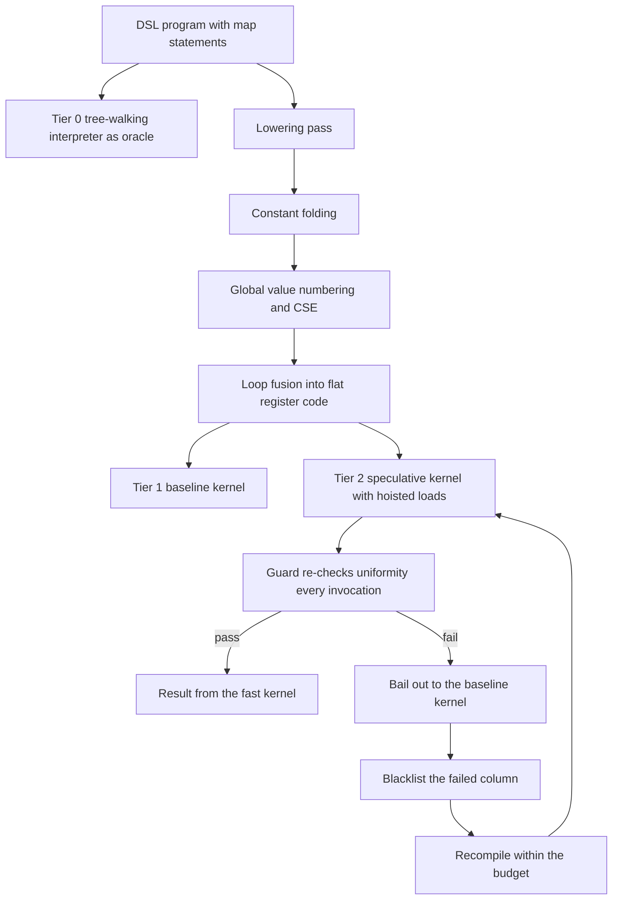
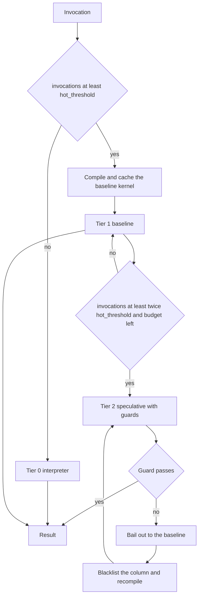
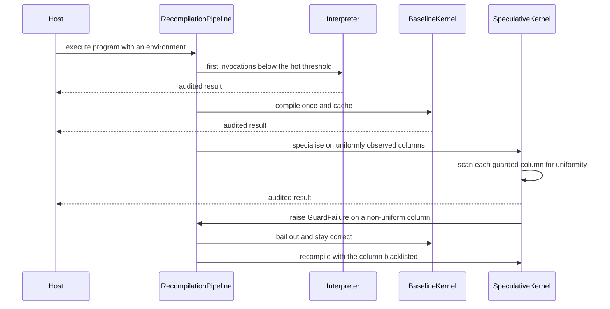

# 885 — Implement dynamic recompilation pipeline for DSL to optimized kernels with heuristics.

> **Tier:** Master · **CTCI chapter:** Beyond — Compilers, Languages & Solvers
> **Task spec:** [885-implement-dynamic-recompilation-pipeline-for-dsl-to-optimized-ke.md](../../../tasks/master/885-implement-dynamic-recompilation-pipeline-for-dsl-to-optimized-ke.md)
> **Solutions:** [Python](../../../solutions/python/master/885-implement-dynamic-recompilation-pipeline-for-dsl-to-optimized-ke/solution.py) ·
> [Java](../../../solutions/java/master/885-implement-dynamic-recompilation-pipeline-for-dsl-to-optimized-ke/Solution.java) ·
> [JavaScript](../../../solutions/javascript/master/885-implement-dynamic-recompilation-pipeline-for-dsl-to-optimized-ke/solution.js) ·
> [C#](../../../solutions/csharp/master/885-implement-dynamic-recompilation-pipeline-for-dsl-to-optimized-ke/Solution.cs)

## 1. Problem restatement

**Input:** a *program* in a small "map" DSL — a list of independent statements `out_j = expr`
evaluated for every index `i` of a column set, where an expression is built from integer constants,
element reads `load(col)[i]` and the operators `+`, `-`, `*` — together with an *environment*: one
integer column per referenced name.

**Output:** the same result the DSL's meaning prescribes, produced by a three-tier execution engine,
plus the bookkeeping a real dynamic compiler keeps: which tier ran, how many compilations happened,
how many guards failed, and the modelled cost per invocation.

**Modelling contract (what this file is and is not).** Each solution is an in-process *simulation* of
a JIT pipeline, not a code generator:

* the DSL has **no control flow, no loops, no memory side effects** — every statement is an
  independent elementwise map, so "loop fusion" is simply emitting one flat register program;
* **no machine code**: tier 1 and tier 2 are interpreted register programs; the lowering pass
  (constant folding, global value numbering / CSE, fusion) is real, the target is not;
* the register allocator is naive (a fresh register per emitted value, memoised subexpressions
  reused), there is no spilling and no instruction selection;
* **no real profiler**: invocation counts stand in for profiling, and the "uniform column" facts are
  observed from the environment rather than from sampled runs;
* guards are checked **once per invocation**, not per basic block;
* the cost model is **analytic** (`OP_COST = 1`, `READ_COST = 4`, `ITER_COST = 1`, `FILL_COST = 1`,
  `GUARD_COST = 3` per element) rather than measured on hardware.

Two execution tiers surround the interpreter: **tier 1** is the baseline register kernel
(`fold = True`, `cse = True`, no assumptions), and **tier 2** is the speculative kernel that hoists
the loads of columns profiled as uniform and re-checks that uniformity with a guard on every later
invocation. `hot_threshold = 3` promotions and `max_recompiles = 2` speculative compilations bound
the machine, after which the program stays on the baseline kernel forever.

Verified invariants, measured by the printed run:

| Check | Result |
| --- | --- |
| Differential testing against the interpreter and an independent stack-machine evaluator | `90` baseline executions, `0` disagreements |
| Greedy heuristic plan versus exhaustive search over all plans | equal cost on all `25` random programs, worst gap `0` |
| Specialisation versus baseline kernel for the benchmark program | `832` versus `709` modelled units per invocation |
| Tier schedule with `hot_threshold = 3` over nine invocations | `[0, 0, 1, 1, 1, 2, 2, 2, 2]` |
| Speculation statistics | `2` recompiles, `0` cache hits, `3` guard failures |
| The guard is load-bearing | bypassing it on a non-uniform column demonstrably changes the result |
| Reproducibility | every schedule replays identically from its seed |

## 2. Intuition

The naive way to run the DSL is to walk the expression tree for every output element. That is the
ground truth — and it stays in the file as the oracle — but it re-derives the same subexpression
per row and pays a recursive call per node. A real JIT instead *lowers* the program once: fold
constants, give every distinct subexpression one register (global value numbering), fuse the
statements into a single loop, and emit one flat list of register operations.

The interesting tier is the speculative one, and its key insight is that **the expensive thing in
this DSL is a load**, not an add. `READ_COST = 4` against `OP_COST = 1` means a column read costs
four times an arithmetic operation, so hoisting a load out of the loop saves `4` units per element —
but re-checking the assumption costs `GUARD_COST = 3` per element, so the net win is exactly **one
unit per element** for a hoisted column. That single comparison is why the pipeline is careful: it
only specialises columns that have actually been *observed* uniform, and it charges the guard in the
same cost model that decides the plan. With `length = 8` and one hoisted column the arithmetic is
`8 * (2 + 1 + 4) + 5 + 8 * 3 = 85` against a baseline of `8 * (3 + 1 + 8) = 96`.

The second insight is that speculation must be *safe*, which is what the guard buys. A column that
was uniform in the observed history need not stay uniform, so the kernel verifies the assumption on
every invocation before running; if it fails, the pipeline raises `GuardFailure`, **deoptimises to
the baseline kernel** (which carries no assumptions and is therefore always correct), blacklists the
offending column so it is never speculated again, and recompiles with the reduced assumption set.
That is the standard compile/guard/bail-out/recompile loop. Two design decisions make it terminate:
the recompile budget is explicit (`max_recompiles = 2`), and the blacklist only ever grows, so the
number of possible recompilations is bounded by the number of columns.

The third insight is that *when* to compile is a heuristic question with a measurable answer: the
tier schedule `[0, 0, 1, 1, 1, 2, 2, 2, 2]` shows the interpreter running for the first
`hot_threshold` invocations, the baseline taking over at invocation 3, and the speculative kernel
appearing at invocation `2 * hot_threshold = 6` — compile early and you pay for code that may never
run; compile late and you waste the hot phase on the slow tier.



## 3. Algorithm

1. Validate the program: statements are `(target, expression)` pairs over a known column set, and
   every expression is well formed (`const`, `load`, or a binary op on two expressions).
2. Lower the program with `compile_ir(program, fold, cse, invariants)`:
   fold constant subexpressions; emit one register operation per node, reusing the register of an
   identical subexpression when CSE is on; treat the loads of declared invariant columns as
   pre-loop scalars instead of in-loop loads; emit constant statements as *fills* (a broadcast
   value) rather than in-loop work.
3. Model the per-invocation cost:
   `length * (loop_ops * OP_COST + ITER_COST + inline_reads * READ_COST) + prelude_reads *
   (READ_COST + OP_COST) + length * FILL_COST * fills + length * GUARD_COST * guarded_columns`.
4. Choose the plan: `heuristic_plan` tries fold, then CSE, then each uniform column in sorted order,
   accepting a step exactly when it lowers the modelled cost; `exhaustive_plan` enumerates every
   `(fold, cse, subset)` combination as the oracle for small programs.
5. Execute by tier: the interpreter until `invocations >= hot_threshold`, the cached baseline kernel
   after that, and — once `invocations >= 2 * hot_threshold` and the recompile budget allows — the
   speculative kernel whose guarded columns are compiled into the kernel cache key
   `(program, sorted invariants)`.
6. On `GuardFailure`: count a deopt, grow the blacklist, fall back to the baseline kernel, and
   re-specialise with the remaining candidates only if the budget allows.
7. Audit every result against the interpreter (`audit = True`) and append the tier actually used to
   the per-program history.

```text
function compile_ir(program, fold, cse, invariants)
    reject invariants that name columns the program does not read
    registers = fresh counter
    memo = empty      # CSE: expression to register
    ops, stores, fills = empty lists
    scalars = empty   # invariant column to pre-loop register

    function emit(expression)
        if cse and expression in memo then return memo[expression] end
        if expression is const then
            dest = new register; append ("const", dest, value) to ops
        else if expression is load(column) then
            if column in invariants then
                dest = scalars[column], created once before the loop
            else
                dest = new register; append ("load", dest, column) to ops
            end
        else
            left = emit(expression.left)
            right = emit(expression.right)
            dest = new register; append (op, dest, left, right) to ops
        end
        if cse then memo[expression] = dest end
        return dest
    end

    for (target, expression) in program.statements do
        folded = fold_expression(expression) if fold else expression
        if is_constant_expression(folded) then
            append (target, value) to fills
        else
            append (target, emit(folded)) to stores
        end
    end
    return the lowered program with fill and guard counts
end

function estimate_cost(program, fold, cse, invariants)
    ir = compile_ir(program, fold, cse, invariants)
    return program.length * (ir.loop_ops * OP_COST + ITER_COST + ir.inline_reads * READ_COST)
         + ir.prelude_reads * (READ_COST + OP_COST)
         + program.length * FILL_COST * ir.fills
         + program.length * GUARD_COST * ir.guarded_columns
end

function heuristic_plan(program, candidates)
    plan = (fold = false, cse = false, invariants = empty)
    best = estimate_cost(program, plan)
    try fold on; keep it if cheaper
    try cse on; keep it if cheaper
    for column in sorted(candidates) do
        trial = plan with column added to invariants
        if estimate_cost(program, trial) < best then plan = trial end
    end
    return plan
end
```

The runtime half of the pipeline:

```text
function kernel_run(kernel, env, guard)
    if guard then
        for column in kernel.guarded_columns do
            first = env[column][0]
            for value in env[column] do
                kernel.guard_scans += 1
                if value != first then raise GuardFailure(column) end
            end
        end
    end
    return execute(kernel, env)
end

function execute(kernel, env)
    fill every constant output with its broadcast value
    preset the scalar registers from row 0 of the invariant columns
    for index from 0 to length - 1 do
        run every emitted operation against the register file
        store the requested registers into the output columns
    end
    return the output columns
end

function pipeline_execute(pipeline, key, env)
    state = pipeline.state[key]
    state.invocations += 1
    promote to BASELINE when invocations >= hot_threshold
    specialise when invocations >= 2 * hot_threshold and recompiles <= max_recompiles
    try
        result = the kernel of the current tier
    except GuardFailure as failure
        guard_failures += 1; deopts += 1; recompiles += 1
        blacklist.add(failure.column)
        state.specialized = none
        state.tier = BASELINE
        result = state.baseline.run(env)
        if recompiles <= max_recompiles then re-specialise with the remaining candidates end
    end
    audit the result against the interpreter
    append the tier used to the history
    return result
end
```



## 4. Worked example

Take the two-statement map program `out = load(a)[i] + load(b)[i]` over `length = 8`, where column
`a` is uniform (`[5, 5, 5, 5, 5, 5, 5, 5]`) and `b` is not.

| Plan | Lowered shape | Cost arithmetic | Cost |
| --- | --- | --- | --- |
| no fold, no CSE, no invariants | `2` loads, `1` add in the loop, `3` ops, `2` inline reads | `8 * (3 * 1 + 1 + 2 * 4)` | `96` |
| baseline (fold + CSE) | same shape here — nothing to fold and no repeated subexpression | `8 * (3 + 1 + 8)` | `96` |
| specialise on `a` | pre-loop scalar read for `a`, `1` load, `1` add, `1` guard scanned per element | `8 * (2 + 1 + 4) + 1 * (4 + 1) + 8 * 1 * 3` | `85` |
| specialise on `a` and `b` | both columns pre-read, `1` add in the loop, `2` guards | `8 * (1 + 1 + 0) + 2 * 5 + 8 * 2 * 3` | `74` |

The third row is the economics of speculation in one line: hoisting `a` removes `8 * 4 = 32` units of
in-loop reads, but the guard adds `8 * 3 = 24` and the pre-loop scalar read adds `5`, so the net
saving is `3` units — small but positive, which is exactly why the heuristic accepts it. The fourth
row is a trap: specialising `b` looks free by the same table, but `b` is *not* uniform, so the guard
raises `GuardFailure` at run time, the pipeline deoptimises to the baseline and blacklists `b`. That
is the load-bearing guard the file checks by bypassing it: executing the speculative kernel with
`guard = False` on the non-uniform column returns a wrong answer, which is why deoptimisation rather
than assumption is the fallback.

The tier schedule from the printed run (`hot_threshold = 3`, `max_recompiles = 2`) over nine
invocations:

| Invocation | 1 | 2 | 3 | 4 | 5 | 6 | 7 | 8 | 9 |
| --- | --- | --- | --- | --- | --- | --- | --- | --- | --- |
| Tier used | `0` | `0` | `1` | `1` | `1` | `2` | `2` | `2` | `2` |
| Why | below hot threshold | below hot threshold | baseline compiled at `3` | baseline | baseline | `invocations >= 2 * hot_threshold` triggers specialisation | speculative | speculative | speculative |

Across the whole benchmark the model reports `832` units per invocation for the baseline kernel and
`709` for the specialised one — a `15%` reduction — with `2` speculative recompilations and `3` guard
failures, i.e. three columns that the profile believed uniform and the guard disproved.



## 5. Complexity

| Step | Time | Space | Reason |
| --- | --- | --- | --- |
| `validate_expression` / `validate_program` | `O(program size)` | `O(1)` | one walk per statement |
| `compile_ir` | `O(program size)` | `O(program size)` registers and ops | one emit per distinct subexpression when CSE is on |
| `estimate_cost` | `O(program size)` | `O(program size)` | compiles the IR and counts operations and reads |
| `heuristic_plan` | `O(columns * program size)` | `O(program size)` | one cost evaluation per candidate column |
| `exhaustive_plan` | `O(2^(2 + columns) * program size)` | `O(program size)` | every fold/CSE/subset combination — the oracle |
| Interpreter (tier 0) | `O(length * expression nodes)` | `O(expression depth)` | the tree is re-walked per index |
| Baseline kernel (tier 1) | `O(length * loop_ops)` | `O(registers)` | one pass over a flat op list, no recursion |
| Speculative kernel (tier 2) | `O(length * loop_ops)` plus `O(length * guarded columns)` for the guard | `O(registers + guarded columns)` | the guard costs `GUARD_COST * length` per checked column |
| Compilations | at most `2 + max_recompiles` for the whole run | `O(kernels)` | baseline plus the bounded speculative recompiles |
| Cache lookup | `O(1)` on `(program, sorted invariants)` | `O(kernels)` | a cached kernel is reused, counted as a cache hit |

The pipeline's whole point is that the *steady-state* cost is the tier-2 cost while the *worst case*
is still the interpreter's answer, because deoptimisation never returns an unverified value.

## 6. Pitfalls and edge cases

* **A guard that is not checked.** `Kernel.execute` runs the lowered assumptions blindly; only
  `Kernel.run(guard = True)` verifies them. The file asserts that calling the unchecked path on a
  non-uniform column changes the result, which is the difference between a 3-unit saving and
  silent corruption.
* **Deoptimisation must stay correct.** After a `GuardFailure` the pipeline reruns the *baseline*
  kernel, never the failed speculative one, and the audit still compares against the interpreter.
* **Blacklisting.** A failed column is added to the blacklist and excluded from every later
  specialisation attempt; without it the pipeline would recompile, fail again, and burn the budget.
* **Bounded compilation.** `state["recompiles"] <= self.max_recompiles` gates both the first
  specialisation and every retry, so the run can never compile in a loop.
* **Absent columns.** Declaring a column as invariant when the program never reads it raises
  `ValueError`; specialising on unused data would inflate the guard cost for nothing.
* **Boundary conditions.** A zero-length column, or a length-one column, is trivially uniform and
  yields a guard that can never fail; a zero-length program must still produce empty outputs, and a
  constant statement (`out = 3 * 4`) is emitted as a *fill* of the broadcast value, costing
  `length * FILL_COST` instead of a loop of operations.
* **CSE keys and tier bookkeeping.** Memoisation keys on the whole expression value, so two
  structurally identical subexpressions compare equal; a key that ignored operand order would reuse a
  register between `a - b` and `b - a`. `invocations` counts attempts rather than successes, and the
  history records the tier *actually used* — after a deopt the entry is `1` even though tier `2` was
  attempted.
* **Cache hits versus compiles, and reproducibility.** The kernel cache is keyed by
  `(program, invariants)`, and the printed run shows `0` cache hits and `2` recompiles because each
  specialisation uses a different blacklist. Every random program, environment and schedule is drawn
  from a seeded `splitmix64` stream, so replaying a seed reproduces the tier history exactly.

## 7. Variants and follow-ups

* **Choosing the kernel's launch parameters.** Lowering decides the *shape* of the kernel;
  [884](../../../tasks/master/884-implement-autotuner-that-explores-kernel-block-grid-parameters-a.md)
  then searches block, unroll and vector parameters with a cost model and a cache.
* **Fusion as a graph pass.** The fusion this file performs textually is what an operator fusion pass
  does on a DAG, and
  [725](../../../tasks/expert/725-implement-operator-fusion-simulation-for-compute-graph-speedups.md)
  measures the speedups that pass alone buys.
* **Differentiating the kernels, profiling for real.** Once the DSL grows gradients, the compiled
  kernels need vector-Jacobian products — the fused operator in
  [883](../../../tasks/master/883-implement-automatic-differentiation-for-gpu-kernels-across-fused.md)
  is that next step — and a production JIT replaces invocation counters with sampled profile data and
  per-branch guards, keeping the compile/guard/bail-out/recompile budget loop exactly as it is here.

## 8. Check yourself

<details><summary>Show answer</summary>

**Q1. Why is hoisting a uniform column worth only one unit per element?**

Because the two constants are close: a hoisted load saves `READ_COST = 4` per element of in-loop
reads, while re-checking the assumption costs `GUARD_COST = 3` per element, and the pre-loop scalar
read adds `READ_COST + OP_COST = 5` once. For `length = 8` that is `32 - 24 - 5 = 3` units saved —
positive, which is why the heuristic accepts it, but small enough that the cost model, not intuition,
has to decide.

</details>

<details><summary>Show answer</summary>

**Q2. What exactly happens on a guard failure, and why is the result still correct?**

`Kernel.run` raises `GuardFailure(column)` before executing. The pipeline counts a deopt, increments
the recompile counter, blacklists the column, drops the speculative kernel, runs the **baseline**
kernel (which carries no assumptions) and only then re-specialises with the reduced candidate set if
the budget allows. The returned value therefore always comes from either the interpreter or the
assumption-free baseline.

</details>

<details><summary>Show answer</summary>

**Q3. Why does the tier history go `0, 0, 1, 1, 1, 2, 2, 2, 2` with `hot_threshold = 3`, and why is
the greedy plan not proven optimal?**

Promotion to the baseline needs `invocations >= hot_threshold`, so the first three invocations are
interpreted; speculation additionally needs `invocations >= 2 * hot_threshold = 6` and budget left, so
tier 2 first appears on invocation 6. The greedy plan matching the exhaustive oracle on all `25` random
programs is a *measured* property of these programs, not a theorem: fold and CSE are each independently
beneficial and invariant candidates are tested one at a time, so a cost model where two optimisations
interacted non-monotonically would break greedy first.

</details>
