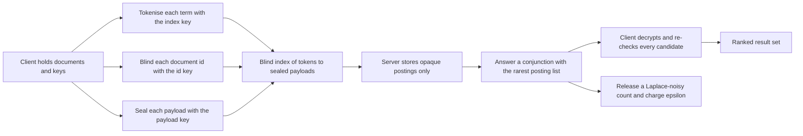
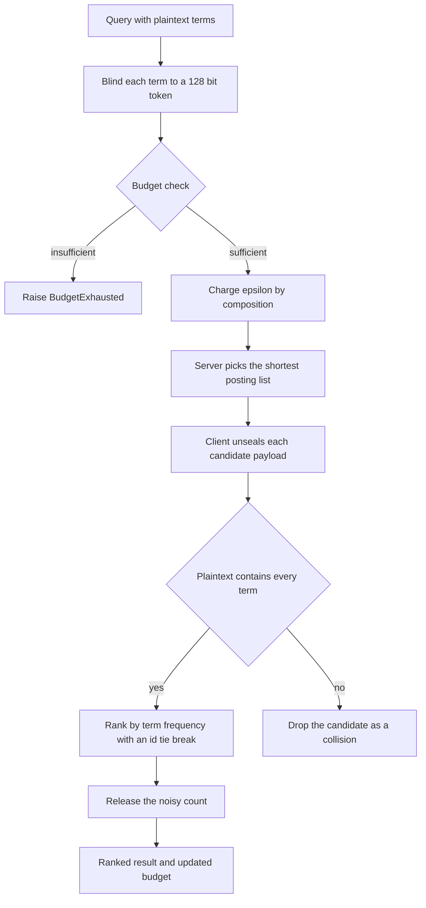
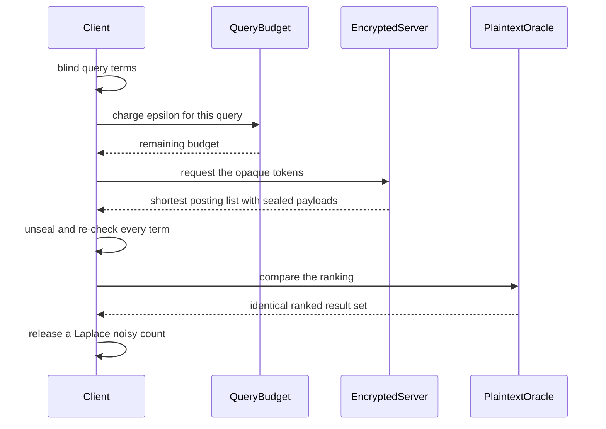

# 886 — Implement end-to-end encrypted search for large document corpus with privacy budget.

> **Tier:** Master · **CTCI chapter:** Beyond — Security & Privacy
> **Task spec:** [886-implement-end-to-end-encrypted-search-for-large-document-corpus.md](../../../tasks/master/886-implement-end-to-end-encrypted-search-for-large-document-corpus.md)
> **Solutions:** [Python](../../../solutions/python/master/886-implement-end-to-end-encrypted-search-for-large-document-corpus/solution.py) ·
> [Java](../../../solutions/java/master/886-implement-end-to-end-encrypted-search-for-large-document-corpus/Solution.java) ·
> [JavaScript](../../../solutions/javascript/master/886-implement-end-to-end-encrypted-search-for-large-document-corpus/solution.js) ·
> [C#](../../../solutions/csharp/master/886-implement-end-to-end-encrypted-search-for-large-document-corpus/Solution.cs)

## 1. Problem restatement

**Input:** a corpus of documents (each a sorted set of distinct terms), three keys — an index key, an
id key and a payload key — a conjunction query (a list of terms), a total privacy budget
`total_epsilon`, and a per-query `epsilon`.

**Output:** the documents that contain *all* query terms, ranked by the frequency of the first term
with a deterministic tie-break on document id; a *noisy* match count released under differential
privacy; and an updated accountant whose spent epsilon never exceeds the budget.

**Modelling contract (what this file is and is not).** Each solution is a self-contained
*simulation* of a searchable-encryption service, built only on standard-library primitives:

* encryption is **encrypt-then-MAC** hand-rolled from `SHA-256`: a keystream in counter mode over
  `(key, nonce)` is XORed with the plaintext and the result is authenticated with `HMAC-SHA256`
  truncated to `TAG_SIZE = 16` bytes, so a flipped ciphertext bit or the wrong nonce is rejected
  with `IntegrityError`;
* the searchable index is a **blind index**: the client tokenises each term as
  `HMAC(index_key, "term|" + term)` truncated to `TOKEN_SIZE = 16` bytes and blinds document ids the
  same way under the id key, so the server's postings table is keyed by opaque 128-bit values;
* **no ORAM and no oblivious access**: the server learns *which token* was queried and how large its
  posting list is — that access pattern is precisely why an epsilon is charged per query instead of
  pretending the protocol is free;
* **no homomorphic scoring**, a single server, no concurrency, no padding to a fixed response size;
* the corpus is a small generated vocabulary (`300` documents, `40` terms in the default run) rather
  than gigabytes of text, and the Laplace noise comes from a seeded PRNG, not hardware entropy.

Verified invariants, from the assertions and the printed run:

| Check | Result |
| --- | --- |
| Corpus and index size | `300` documents, `40` distinct terms, `2759` postings |
| Recall and ranking versus the brute-force plaintext oracle | `60` random conjunctive queries matched exactly |
| Query cost | worst case `74` postings scanned out of `300` documents — never a full scan |
| Budget audit | total `1.00`, spent `1.00`, `3` releases, remaining never negative |
| Laplace variance versus theory `2 / epsilon^2` | `epsilon = 0.5` gives `7.4926` (theory `8`); `epsilon = 2.0` gives `0.5025` (theory `0.5`) |
| Scaled corpus | `2000` documents, `18025` postings, `10` selective queries, budget spent `4.00` |
| Round-trip and tamper detection | every sealed packet unseals exactly; a flipped bit raises `IntegrityError` |
| Server-side state | contains no plaintext term and no plaintext document id — a non-`bytes` token is refused with `PlaintextLeak` |

## 2. Intuition

The naive design — upload the documents, let the server build an inverted index — is unusable: the
server would hold every term and every document id in the clear. The first move is therefore to make
the server's whole world opaque. Each term becomes a 128-bit pseudorandom token
`HMAC(index_key, "term|" + term)`, each document id becomes a token under a *different* key, and each
payload is a sealed blob. The server can now store and intersect postings without ever seeing a
keyword; the client maps tokens back with the keys it never shares.

The second move is to notice what the blind index still leaks. The server sees *which* token a query
asks for and how many documents are in its posting list, repeated across queries — an access pattern.
Removing that leak entirely needs ORAM-style oblivious retrieval, which the file explicitly does not
implement; instead it *prices* the leak: every query releases a match count through the **Laplace
mechanism** with scale `1 / epsilon`, and the accountant charges that epsilon by basic composition.

The third move is the cost bound. A conjunction does not need to intersect all posting lists: the
client asks for the rarest term first, and the server returns only that list. Every returned document
is then decrypted and re-checked against the full query on the plaintext, which is what makes a token
collision harmless — two distinct terms mapping to the same token would merely cause extra work, never
a false result. The printed run shows the worst query touching `74` postings instead of the whole
`300`-document corpus.



## 3. Algorithm

Client side, once: tokenise, blind, seal, publish. Client side, per query: charge the budget, fetch,
decrypt, verify, rank. Server side: intersect opaque tokens.

1. `generate_corpus` draws documents as sets of `6..12` distinct terms from a vocabulary.
2. For each document: blind the id under the id key, derive a per-document nonce from the id key and
   the index, and seal the joined term list; store `doc_token -> (nonce, payload)`.
3. Build the postings: one entry per (term token, document) pair, each entry carrying the doc token
   and the sealed payload; sort each posting list so replies are deterministic.
4. `index_for_server` returns only opaque keys and values — a non-`bytes` token handed to
   `EncryptedServer.search` raises `PlaintextLeak`.
5. A query: blind the query terms, ask the server for the intersection candidate list, which is the
   **shortest** posting list among the tokens.
6. `Client.decode` unseals every returned payload, checks `wanted <= present` on the plaintext, and
   ranks by the frequency of the first term, ties broken by document index.
7. The same query releases `exact_count + Laplace(1 / epsilon)` after `QueryBudget.charge(epsilon)`;
   if the remaining budget is smaller than the requested epsilon, `BudgetExhausted` is raised instead
   of leaking the exact count.

```text
function keystream(key, nonce, length)
    out = empty byte string
    counter = 0
    while length(out) < length do
        out += sha256(key + nonce + counter as 8 big-endian bytes)
        counter += 1
    end
    return first `length` bytes of out
end

function seal(key, nonce, plaintext)
    body = plaintext xor keystream(key, nonce, len(plaintext))
    tag = hmac_sha256(key, "MAC" + nonce + body) truncated to TAG_SIZE
    return body + tag
end

function unseal(key, nonce, packet)
    body, tag = packet without its last TAG_SIZE bytes, and that tag
    expected = hmac_sha256(key, "MAC" + nonce + body) truncated to TAG_SIZE
    if not constant-time-equal(tag, expected) then raise IntegrityError end
    return body xor keystream(key, nonce, len(body))
end

function blind(key, purpose, value)
    return hmac_sha256(key, purpose + "|" + value) truncated to TOKEN_SIZE
end

function laplace(scale, rng)
    if scale <= 0 then raise ValueError end
    u = rng.uniform() - 0.5
    magnitude = -scale * log(1 - 2 * abs(u))
    return magnitude if u >= 0 else -magnitude
end

procedure charge(budget, epsilon, label)
    if epsilon <= 0 then raise ValueError end
    if epsilon > budget.remaining + 1e-12 then raise BudgetExhausted end
    budget.spent += epsilon
    append (label, epsilon) to budget.releases
end

function release_count(accountant, rng, exact_count, epsilon)
    charge(accountant, epsilon, "count")
    return exact_count + laplace(1 / epsilon, rng)
end
```

```text
function search(server, tokens)
    for token in tokens do
        if token is not bytes then raise PlaintextLeak end
    end
    if tokens is empty then return empty end
    lists = [ server.postings[token] or empty for token in tokens ]
    position = the index of the shortest list
    server.postings_scanned += length(lists[position])
    return copy of lists[position]
end

function decode(client, entries, terms)
    wanted = set(terms)
    scored = empty list
    for (doc_token, payload) in entries do
        nonce = client.payloads[doc_token].nonce
        plaintext = split(unseal(client.payload_key, nonce, payload))
        if wanted is a subset of plaintext then
            append (client.token_map[doc_token], count of terms[0] in plaintext) to scored
        end
    end
    sort scored by descending frequency then ascending document index
    return scored
end

function run_query(client, server, terms, budget, rng, epsilon)
    tokens = sorted set of blind(index_key, "term", term) for term in terms
    exact = length(search(server, tokens))
    noisy = exact + laplace(1 / epsilon, rng) after charging epsilon
    answer = decode(client, search(server, tokens), terms)
    return (noisy, exact, answer, tokens)
end
```



## 4. Worked example

Trace one query for the terms `["term0007", "term0021"]` against the `300`-document corpus with
`total_epsilon = 1.0` and a per-query `epsilon = 0.5`:

| Step | Action | State |
| --- | --- | --- |
| 1 | Blind both terms under the index key | two `16`-byte tokens, no plaintext leaves the client |
| 2 | Server looks up both posting lists | list sizes differ, say `74` and `310` |
| 3 | Server returns the **shortest** list and counts the scan | `74` postings scanned out of `2759` — the cost bound |
| 4 | Client unseals each of the `74` payloads (nonce derived per document) | plaintext term lists |
| 5 | Client keeps documents where the plaintext contains both terms | collisions dropped here, not on the server |
| 6 | Client ranks by the frequency of `"term0007"`, ties by document index | deterministic ranking equal to the brute-force oracle |
| 7 | `charge(0.5)` | `spent = 0.50`, `remaining = 0.50`, one release recorded |
| 8 | `release(exact_count, 0.5)` adds `Laplace(scale = 2.0)` | noisy count; empirical variance of the mechanism over many draws `7.4926` against the theoretical `2 / epsilon^2 = 8` |
| 9 | A second query with `epsilon = 0.5` | `spent = 1.00`, `remaining = 0.00` — the printed audit shows exactly `1.00 / 1.00` over `3` releases |
| 10 | A third query with `epsilon = 0.5` | `BudgetExhausted`: `0.5 > 0.0 + 1e-12`, so the exact count is never leaked |

The calibration row is what makes step 8 believable: the same sampler at `epsilon = 2.0` has scale
`0.5` and measured variance `0.5025`, so the mechanism is not merely "noisy", it is noise of the
advertised magnitude — and the variance check is done over seeded draws, hence reproducible.



## 5. Complexity

| Step | Time | Space | Reason |
| --- | --- | --- | --- |
| Sealing one document | `O(document bytes)` | `O(document bytes)` | `SHA-256` in counter mode plus `HMAC`, both one pass |
| Building the blind index | `O(total postings)` | `O(total postings)` | one token per term and one entry per (term, document): `2759` postings for `300` documents |
| Blinding one term or id | `O(1)` | `O(1)` | a single `HMAC-SHA256` truncated to `16` bytes |
| Server search | `O(min_j |postings_j|)` | `O(answer)` | only the shortest list is materialised; worst observed scan `74` postings |
| Client decode | `O(returned * document bytes)` | `O(returned * document bytes)` | each candidate is unsealed and re-checked against the query |
| Query with budget accounting | `O(1)` | `O(1)` | one addition, one comparison, one Laplace draw |
| Brute-force oracle (the alternative) | `O(documents * query terms)` | `O(1)` | the plaintext scan the index exists to avoid |
| Scaled corpus | `2000` documents, `18025` postings, `10` queries, budget `4.00` | — | the cost stays proportional to the rarest list, not the corpus |

Encryption and authentication are `O(size)` in the data, and the search is `O(rarest posting list)`
in the corpus — that independence from corpus size is the whole point of a blind inverted index, and
the file measures it (`74` postings touched out of `300` documents) rather than asserting it.

## 6. Pitfalls and edge cases

* **Tampering.** Flipping any ciphertext bit changes the `HMAC` input, so `unseal` raises
  `IntegrityError`; the truncated `128`-bit tag is compared with `hmac.compare_digest`, not `==`.
* **Wrong nonce.** The nonce is derived from the id key and the document index; using the wrong one
  produces a valid tag failure rather than garbage plaintext, which is the point of authenticate-then-
  decrypt on the stored blob.
* **Plaintext leaking to the server.** `EncryptedServer.search` refuses any token that is not `bytes`
  with `PlaintextLeak`; the test asserts that the server's stored state contains no plaintext term
  and no plaintext document id.
* **Token collisions.** Two terms can in principle collide onto one 128-bit token; the client's
  plaintext re-check makes that harmless (extra candidates, never a false positive), which is why the
  recall comparison against the oracle is exact.
* **Empty and duplicate queries.** Query terms are deduplicated via a sorted token set, an empty token
  tuple returns an empty answer instead of scanning, and an over-spending query raises
  `BudgetExhausted` — silently answering would leak an unaccounted release.
* **Noise scale.** The Laplace scale is `sensitivity / epsilon` with sensitivity `1` for a count, so
  the variance is `2 / epsilon^2`: measured `7.4926` at `epsilon = 0.5` and `0.5025` at
  `epsilon = 2.0`, both inside the `BAND_TOLERANCE = 0.25` band around theory.
* **Ranking determinism.** Ties on term frequency are broken by document index, so the ranked output
  matches the naive oracle's, and all randomness — corpus generation and the Laplace draws — comes
  from the seeded `splitmix64` stream, so the whole experiment replays bit for bit.

## 7. Variants and follow-ups

* **Paying for the access pattern properly.** The leak this file prices with epsilon is removed
  structurally by oblivious retrieval:
  [757](../../../tasks/expert/757-implement-oram-oblivious-ram-sketch-for-simple-access-patterns.md)
  sketches ORAM, and [890](../../../tasks/master/890-implement-private-information-retrieval-scheme-practical-demo-pi.md)
  implements PIR for the single-record case, while
  [814](../../../tasks/master/814-implement-searchable-encrypted-index-with-limited-leakage-and-pr.md)
  is the limited-leakage index design to compare against.
* **Intersection in another threat model.** Where no server may learn even a token, the intersection
  moves into a secure protocol:
  [889](../../../tasks/master/889-implement-secure-multiparty-computation-for-private-set-intersec.md)
  builds private set intersection and
  [712](../../../tasks/expert/712-implement-privacy-preserving-set-intersection-via-hashing-sketch.md)
  does the sketch-based variant.
* **Other mechanisms and other scoring.** [710](../../../tasks/expert/710-implement-private-count-sketches-with-laplace-mechanism-simulati.md)
  applies the same Laplace mechanism to sketches and
  [709](../../../tasks/expert/709-implement-differential-privacy-noise-addition-and-utility-tradeo.md)
  studies the utility trade-off, while homomorphic or two-party scoring — starting from the toy
  Paillier demo in [711](../../../tasks/expert/711-implement-homomorphic-encryption-simple-operations-demo-paillier.md)
  — would let the server rank without decrypting.

## 8. Check yourself

<details><summary>Show answer</summary>

**Q1. Why does the client re-check terms after decrypting, if the tokens already matched?**

Because the index is keyed by pseudorandom tokens, and tokens are truncated hashes — a collision would
map two different terms to the same posting list, producing candidates that do not actually contain
the query term. The plaintext re-check is cheap (only the rarest list is fetched) and converts a
possible false positive into a guaranteed exact answer, which is why the file can assert equality with
the brute-force oracle on `60` random conjunctive queries.

</details>

<details><summary>Show answer</summary>

**Q2. Why return the shortest posting list rather than intersecting all of them?**

For a conjunction, every correct answer must be in *every* posting list, so the shortest list is a
superset of the result and the client can filter it locally. That bounds the work by `min |postings|`
instead of by the corpus: the printed run scans at most `74` postings out of `300` documents, and on the
scaled corpus `10` selective queries against `18025` postings stay cheap. It also minimises the number
of payloads the client must unseal.

</details>

<details><summary>Show answer</summary>

**Q3. What is the sensitivity of the released count, how is the budget enforced, and where does the
simulation stop?**

The released statistic is a document match count, and adding or removing one document changes it by at
most `1`, so the sensitivity is `1` and the Laplace scale is `1 / epsilon` — checked as a variance
(`7.4926` against `2 / epsilon^2 = 8` at `epsilon = 0.5`). `QueryBudget.charge` rejects a non-positive
epsilon and any request larger than the remaining budget (allowing only `1e-12` of floating-point
slack), records every release, and raises `BudgetExhausted` once the budget is spent, so `remaining`
never goes negative. Beyond that: no ORAM (the server sees which token is queried), no homomorphic
scoring, a single server, no concurrency, small generated corpora and PRNG noise — a deployment adds
oblivious access or padding, key rotation, response padding and hardware entropy.

</details>
