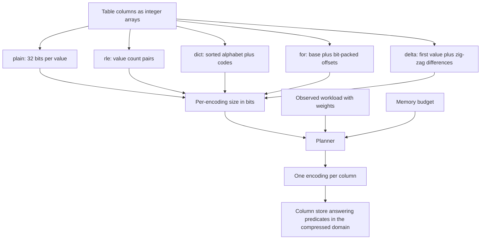
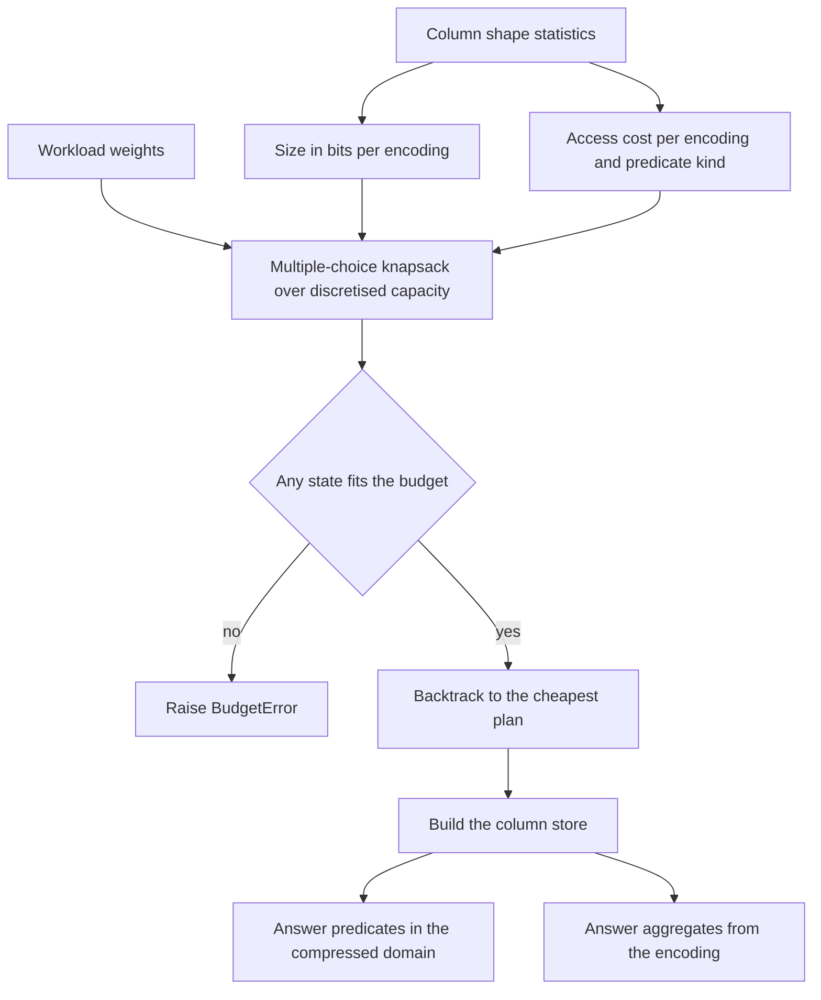
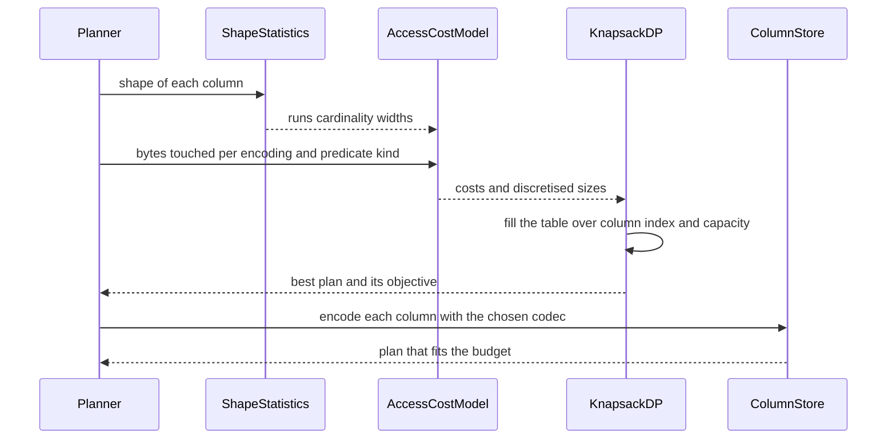

# 887 — Implement query-aware in-memory compression scheme (column-store).

> **Tier:** Master · **CTCI chapter:** Ch 14 — Databases
> **Task spec:** [887-implement-query-aware-in-memory-compression-scheme-column-store.md](../../../tasks/master/887-implement-query-aware-in-memory-compression-scheme-column-store.md)
> **Solutions:** [Python](../../../solutions/python/master/887-implement-query-aware-in-memory-compression-scheme-column-store/solution.py) ·
> [Java](../../../solutions/java/master/887-implement-query-aware-in-memory-compression-scheme-column-store/Solution.java) ·
> [JavaScript](../../../solutions/javascript/master/887-implement-query-aware-in-memory-compression-scheme-column-store/solution.js) ·
> [C#](../../../solutions/csharp/master/887-implement-query-aware-in-memory-compression-scheme-column-store/Solution.cs)

## 1. Problem restatement

**Input:** a table as a mapping of column name to a list of 32-bit integers, plus an observed
*workload* — entries `(kind, column, weight)` where `kind` is `"eq"`, `"range"` or `"sum"` — and a
hard memory budget in bytes.

**Output:** one encoding per column drawn from `plain`, `rle`, `dict`, `for`, `delta`, such that the
weighted access cost of answering the workload is minimised while the compressed table fits the
budget; plus a column store that can answer rows predicates and aggregates **in the compressed
domain**, and that decodes back to exactly the original values.

**Modelling contract (what this file is and is not).** Each solution is a single-process simulation
of a column store's compression layer, not a storage engine:

* the five codecs are **real implementations** that round-trip exactly and evaluate predicates on the
  encoded payload, but the payload is a Python/Java/JS/C# value tuple, not a byte buffer;
* bit widths are **modelled, not executed**: `size_*` returns the number of bits the encoding would
  occupy (`32` per plain value, `48` per run, `32` for a base plus `width` bits per packed value),
  and nothing is actually packed into words;
* the cost model is an **analytic estimate of bytes touched** for a predicate kind, not measured
  bandwidth; there is no SIMD, no vectorised scanning and no cache-line reasoning beyond the
  constants;
* the memory budget is **discretised into `granularity = 256` byte blocks** before the knapsack, so
  the plan is optimal for the discretised problem;
* columns hold tens of thousands of values, not billions, and there is no disk, no spill and no
  concurrency.

Verified properties, from the assertions and the printed run:

| Check | Result |
| --- | --- |
| Round-trips over every codec | `45` round-trips across `9` column shapes and `5` encodings |
| Compressed-domain predicates and aggregates versus a brute-force scan | `440` predicates checked, all equal |
| Workload-driven plan for the mixed table | `clustered = rle`, `monotone = delta`, `ids = dict`, `noisy = for` |
| Knapsack versus exhaustive enumeration | equal objective on all `12` instances tried |
| Compression on a large table | `20000` rows: `50308` encoded bytes against `240000` raw bytes — `4.8x` |
| Infeasible budget | rejected with `BudgetError` rather than an over-full plan |
| Shape coverage | empty, single element, all-equal, clustered, strictly increasing and negative columns |

| Column shape | Example | Encoding that wins | Why |
| --- | --- | --- | --- |
| clustered | `[5, 5, 5, 5, 7, 7, 9, 9]` | `rle` | three runs instead of eight values |
| monotone | `[10, 11, 12, 13, ...]` | `delta` | successive differences are `1`, so two bits per value |
| low cardinality | ids drawn from a small alphabet | `dict` | equality becomes a binary search plus one code pass |
| noisy | uniform 32-bit samples | `for` | the range dominates, so bit-packing is the only saving |
| fallback | any | `plain` | never worse than raw, always available |

## 2. Intuition

A row store forces every column to share one layout; a **column store** keeps each attribute in its
own vertical array, so each column can pick the encoding that fits *its own* data shape. That is the
whole idea, and it turns compression into a per-column decision.

The naive decision is "compress the most", which is wrong on two counts. First, encodings are not
interchangeable: `dict` turns an equality predicate into a binary search over the alphabet plus a
single pass over the code array — `1 + log2(cardinality + 1)` bytes touched, effectively `O(1)` — but
a *range* predicate has to follow every code into the alphabet, which costs
`(dict_width + 32) / 8 * n` bytes and can be worse than bit-packing. Second, long runs make `rle`
tiny, but a scan over `rle` touches `6 * runs` bytes and a single equality predicate in a random
column cannot skip anything.

So the key insight is that the right encoding depends on the **query workload**, not on the data
alone. The planner therefore takes the observed workload with weights, computes for every
`(column, encoding, predicate kind)` triple an estimated access cost, and then solves a
**multiple-choice knapsack**: choose exactly one encoding per column to minimise the weighted access
cost subject to total bytes ≤ budget. That is a small dynamic program over `(column index,
discretised capacity)` — the reason a column-store cost-based compressor is tractable at all.

The second insight is that predicates must be answered **without decoding**: `select_dict` binary
searches the alphabet and then filters the code array; `select_rle` emits ranges straight from the
`(value, count)` pairs; `aggregate_rle` computes `sum(value * count)` without expanding the runs. The
file verifies each of those paths against a brute-force scan on `440` predicates, which is what makes
"compressed domain execution" a claim rather than a hope.

The third insight is that the optimal plan can be checked. The dynamic program is compared against an
exhaustive enumeration over all encoding combinations on small tables; the printed run shows the
objective is equal on every instance tried, so the discretisation and the DP do not lose anything
measurable.



## 3. Algorithm

1. Compute the shape statistics of every column once: `n`, `runs`, `cardinality`,
   `for_width = (max - min).bit_length()`, `delta_width` (the maximum bit length of the zig-zag
   encoded successive differences) and `dict_width = (cardinality - 1).bit_length()`.
2. For every column and every candidate encoding compute the encoded size in bits and the access
   cost for each predicate kind.
3. Discretise sizes into `256`-byte blocks and run the multiple-choice knapsack DP: state
   `(column index, used capacity)` holds the cheapest weighted access cost so far, with the choice
   recorded so the plan can be reconstructed; a tiny `1e-9 * size` term only breaks exact ties.
4. If no combination fits the budget, raise `BudgetError`.
5. Build the `ColumnStore` by encoding each column with its chosen codec.
6. Answer `select_rows` by evaluating predicates per column in the compressed domain and intersecting
   the row sets; answer `total_sum` with the encoding's aggregate primitive.
7. Decode on demand (`decode_column`) for callers that need raw values.

```text
function encoding_stats(values)
    return { n: length(values),
             runs: number of runs in values,
             cardinality: size of the distinct alphabet,
             for_width: bit_length(max(values) - min(values)),
             delta_width: width of the zig-zag packed differences,
             dict_width: bit_length(cardinality - 1) }
end

function access_cost(encoding, stats, predicate_kind)
    n = stats.n
    if n = 0 then return 0 end
    if encoding = "plain" then return 4 * n end
    if encoding = "for" then return max(1, stats.for_width) / 8 * n end
    if encoding = "delta" then return max(1, stats.delta_width) / 8 * n end
    if encoding = "dict" then
        if predicate_kind = "eq" then return 1 + log2(stats.cardinality + 1) end
        return (stats.dict_width + 32) / 8 * n
    end
    if encoding = "rle" then return 6 * stats.runs end
    raise error for an unknown encoding
end

function plan_objective(table, encodings, workload, stats)
    total = 0
    for (kind, column, weight) in workload do
        total += weight * access_cost(encodings[column], stats[column], kind)
    end
    total += 1e-9 * sum of the encoded size in bits of every column
    return total
end

function plan_encodings(table, workload, budget_bytes, granularity)
    reject a non-positive budget and workload columns absent from the table
    sizes[column][encoding] = size in bits rounded up to `granularity` byte blocks
    costs[column][kind][encoding] = access_cost(...)
    capacity = budget_bytes / granularity
    dp[0][0] = 0, every other entry is infinity
    for index, column in order do
        for used from 0 to capacity do
            if dp[index][used] is finite then
                for encoding in the codec order do
                    extra = sizes[column][encoding] / granularity
                    if used + extra <= capacity then
                        step = sum of weight * cost for workload entries on this column
                             + 1e-9 * size in bits
                        if dp[index][used] + step < dp[index + 1][used + extra] then
                            update the table and record the choice
                        end
                    end
                end
            end
        end
    end
    if no finite state exists then raise BudgetError end
    walk back through the recorded choices to build the plan
end
```

The compressed-domain primitives that the planner's cost model is betting on:

```text
function select_dict(payload, predicate)
    if predicate is eq then
        start = binary search for the value in the alphabet
        end = start + 1 when the alphabet entry equals the value, else start
    else
        start = first alphabet entry at or above the low bound
        end = first alphabet entry above the high bound
    end
    if the matching code range is empty then return empty end
    return the positions whose code falls in the range
end

function select_rle(payload, predicate)
    positions = empty list
    position = 0
    for (value, count) in payload.runs do
        if matches(value, predicate) then append the whole position range end
        position += count
    end
    return positions
end

function aggregate_for(payload)
    return payload.base * length(payload.packed) + sum(payload.packed)
end
```



## 4. Worked example

Take the clustered column `values = [5, 5, 5, 5, 7, 7, 9, 9]` (`n = 8`) and evaluate every codec by
hand:

| Codec | Encoded form | Size in bits | Size in bytes | Bytes touched: `eq` | Bytes touched: scan/`sum` |
| --- | --- | --- | --- | --- | --- |
| `plain` | `8` raw values | `32 * 8 = 256` | `32` | `32.0` | `32.0` |
| `rle` | `(5,4), (7,2), (9,2)` — `3` runs | `48 * 3 = 144` | `18` | `18.0` | `18.0` |
| `dict` | alphabet `(5,7,9)`, `dict_width = 2` | `32 * 3 + 2 * 8 = 112` | `14` | `1 + log2(4) = 3.0` | `(2 + 32) / 8 * 8 = 34.0` |
| `for` | base `5`, `for_width = (9-5).bit_length() = 3` | `32 + 3 * 8 = 56` | `7` | `3.0` | `3.0` |
| `delta` | first `5`, zig-zag diffs `0,0,0,4,0,4,0`, width `3` | `32 + 3 * 7 = 53` | `7` | `3.0` | `3.0` |

Three lessons fall out of that table:

1. **Size and access cost disagree.** `dict` is not the smallest (`14` bytes versus `7`), but on an
   equality workload it touches only `3.0` bytes — the binary search plus one pass over the codes —
   while `for` and `delta` must scan every packed value. That is why the workload decides.
2. **`delta` beats `for` on a monotone column.** For `[10, 11, 12, ...]` the differences are all `1`,
   so `zigzag(1) = 2` and the width drops to `2` bits, while `for_width` grows with the column
   length; a strictly increasing column collapses to a couple of bits per value.
3. **`rle` is only cheap for scans if runs are long.** Its access cost is `6 * runs`, so it wins on a
   clustered column with few long runs and loses immediately on a random one where `runs ≈ n`.

The planner's answer for the four-shape table the solutions generate is exactly what the theory
predicts — `clustered = rle`, `monotone = delta`, `ids = dict`, `noisy = for` — and the dynamic
program is verified against an exhaustive enumeration over all encoding combinations on `12`
instances with an equal objective every time. On a `20000`-row table the resulting plan occupies
`50308` bytes against `240000` raw bytes, a `4.8x` reduction under a hard budget.



## 5. Complexity

| Step | Time | Space | Reason |
| --- | --- | --- | --- |
| `encoding_stats` on a column of `n` values | `O(n)` | `O(1)` beyond the alphabet | one pass for runs, cardinality, extremes and differences |
| `encode_*` / `decode_*` | `O(n)` | `O(n)` | each codec is a single pass; `dict` sorts the alphabet once |
| `select_plain`, `select_for`, `select_delta` | `O(n)` | `O(matches)` | packed values must be decoded to be compared |
| `select_dict` | `O(log cardinality + n)` | `O(matches)` | binary search in the alphabet, then one pass over codes |
| `select_rle` | `O(runs)` | `O(matches)` | one decision per run, positions expanded from counts |
| `aggregate_rle` | `O(runs)` | `O(1)` | `sum(value * count)` without expanding |
| `aggregate_dict` | `O(n)` | `O(1)` | one alphabet lookup per code |
| `plan_encodings` | `O(columns * capacity * encodings)` | `O(columns * capacity)` | the DP has one state per (column prefix, used capacity) |
| `exhaustive_plan` (the oracle) | `O(encodings^columns * columns)` | `O(columns)` | only usable on small tables; equal objective on `12` instances |
| Memory after planning | `50308` bytes for `20000` rows versus `240000` raw | — | `4.8x` compression, measured by encoding every column and summing |

The DP is pseudo-polynomial in the *budget* (through the discretised capacity), which is fine because
the budget is a fixed container size, not part of the data: `capacity = budget_bytes / 256` is a
constant for a given machine.

## 6. Pitfalls and edge cases

* **Empty columns.** Every `size_*` returns `0` for an empty payload and `access_cost` returns `0.0`
  for `n = 0`; `encode_dict` must not divide by an empty alphabet, and `decode_dict` of an empty
  alphabet returns an empty list.
* **Single element.** `for` and `delta` store a base/first value and no packed values, so their size
  is `0` bits by the `if not packed` branch — the value itself is still recoverable.
* **All-equal columns.** One run; `rle` wins outright because `6 * 1` bytes beats every scan.
* **Negative values.** `for` uses `min(values)` as the base, so a column of negatives packs on
  `max - min`; `delta` handles negative differences through zig-zag, which is exactly what
  `unzigzag` inverts.
* **Range versus equality on `dict`.** A range predicate cannot use the `O(log n)` equality path: it
  follows every code into the alphabet, which is why the cost model charges the full scan and why
  `for` often wins a range-heavy workload.
* **Budget infeasibility.** If even the smallest combination exceeds the budget the planner raises
  `BudgetError`; it never returns an over-full plan, and a non-positive budget is rejected up front. A
  workload entry naming a column that is not in the table raises rather than being silently ignored —
  otherwise the plan would look optimal for a query it cannot serve.
* **Duplicate codecs, discretisation and ordering.** The codec order is fixed so ties resolve
  deterministically, and the `1e-9 * size` tie-break ensures equal access costs still prefer the
  smaller plan. Sizes are rounded up to `256`-byte blocks, so the DP optimises a slightly coarser
  problem than the true byte counts; the exhaustive comparison shows the objective is unaffected on
  the tested instances.
* **Predicate results and reproducibility.** Every `select_*` returns row positions in ascending order
  and the store intersects positions across columns, so a multi-column predicate is an intersection of
  compressed-domain selections rather than a decode-everything scan; column generation is seeded, so
  every plan and every compressed size replays exactly.

## 7. Variants and follow-ups

* **Incremental maintenance over a compressed store.** Once columns are encoded, updates have to patch
  the encodings; [888](../../../tasks/master/888-implement-incremental-view-maintenance-with-delta-propagation-an.md)
  maintains materialised views from signed deltas with bounded staging memory.
* **Choosing a layout end to end.** Encoding choice is one axis of storage design;
  [896](../../../tasks/master/896-implement-joint-optimization-of-storage-layout-access-patterns-u.md)
  optimises layout *and* access patterns jointly with reinforcement learning.
* **Replacing the DP with a search, and packing for real.** The multiple-choice knapsack is exact but
  depends on few columns and encodings, so a production store replaces it with a heuristic or learned
  chooser — [884](../../../tasks/master/884-implement-autotuner-that-explores-kernel-block-grid-parameters-a.md)
  is the same "cost model plus search plus cache" pattern in a compiler. Executing the modelled bit
  widths (word-aligned packing, SIMD scans, zone maps that skip whole blocks) changes the constants in
  the cost model, not the shape of the decision.

## 8. Check yourself

<details><summary>Show answer</summary>

**Q1. Why is `dict` the best codec for an equality-heavy workload but a poor one for a range
workload?**

Equality resolves against the *alphabet*: a binary search finds the code and one pass over the codes
emits the matching positions, costing `1 + log2(cardinality + 1)` bytes. A range has many matching
alphabet entries, so every code has to be looked up, and the model charges
`(dict_width + 32) / 8 * n` — the same as a plain scan of `for` or `delta`, which are smaller in bits
and therefore win.

</details>

<details><summary>Show answer</summary>

**Q2. Why does the plan depend on the workload at all — isn't the smallest encoding always best?**

No. On the clustered example `dict` is smaller than `plain` but larger than `delta` (`14` bytes versus
`7`), while touching fewer bytes for equality. The greedy "compress as much as possible" rule ignores
the *access* term, and the file's own measurement shows the workload drives the choice: the same table
gets `rle` for the clustered column and `dict` for the ids.

</details>

<details><summary>Show answer</summary>

**Q3. What is the knapsack's state, how is compressed-domain execution verified, and where does the
simulation stop?**

The state is `(column prefix index, used capacity in 256-byte blocks)` holding the cheapest weighted
access cost reachable there, with the chosen encoding recorded for backtracking; it is "multiple
choice" because exactly one encoding per column must be chosen from a mutually exclusive set, which is
what a 0/1 knapsack over groups solves and an unbounded knapsack does not. Compressed-domain execution
is verified by comparing every `select_*` and `aggregate_*` against a brute-force scan of the decoded
values — `440` predicates, no differences — with `select_dict` filtering codes against the matching
alphabet range, `select_rle` emitting whole ranges from `(value, count)` pairs and `aggregate_rle`
computing `sum(value * count)` without expanding the runs. What is simulated: bit packing is modelled
rather than executed, the cost model is analytic rather than measured bandwidth, the budget is
discretised, and the data is small enough to generate in memory.

</details>
