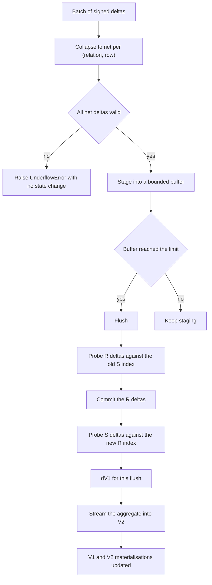
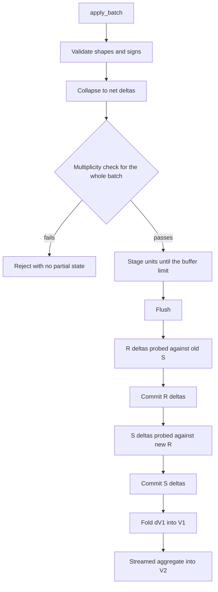
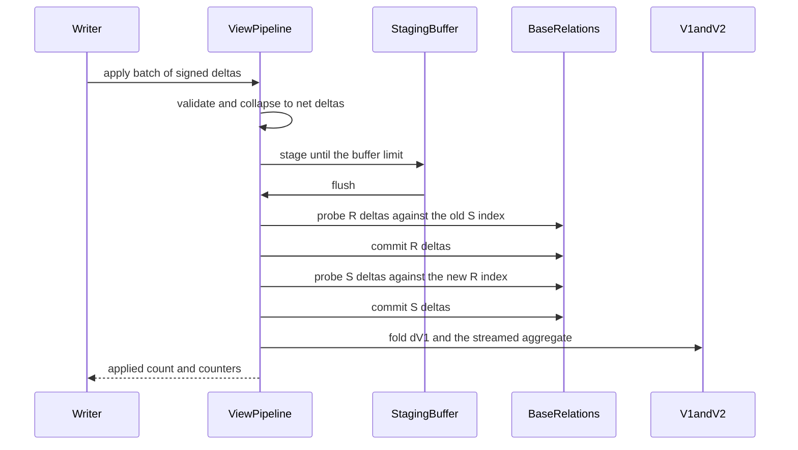

# 888 — Implement incremental view maintenance with delta propagation and bounded memory.

> **Tier:** Master · **CTCI chapter:** Ch 14 — Databases
> **Task spec:** [888-implement-incremental-view-maintenance-with-delta-propagation-an.md](../../../tasks/master/888-implement-incremental-view-maintenance-with-delta-propagation-an.md)
> **Solutions:** [Python](../../../solutions/python/master/888-implement-incremental-view-maintenance-with-delta-propagation-an/solution.py) ·
> [Java](../../../solutions/java/master/888-implement-incremental-view-maintenance-with-delta-propagation-an/Solution.java) ·
> [JavaScript](../../../solutions/javascript/master/888-implement-incremental-view-maintenance-with-delta-propagation-an/solution.js) ·
> [C#](../../../solutions/csharp/master/888-implement-incremental-view-maintenance-with-delta-propagation-an/Solution.cs)

## 1. Problem restatement

**Input:** two base relations with bag semantics — `R(key, a)` and `S(key, b)` — a predicate
`b >= b_min`, a staging buffer limit, and a stream of *batches*, each a list of signed deltas
`(relation, row, +1/-1)`.

**Output:** the two materialised views kept exactly in sync with the base relations:

```text
V1 = { (key, a, b) : (key, a) in R, (key, b) in S, b >= b_min }     (bag semantics)
V2 = { key : sum of a * b over V1 }
```

plus the counters a maintenance engine reports: flushes, delta probes, peak staged entries and peak
accumulator size.

**Modelling contract (what this file is and is not).** Each solution is a single-process simulation
of an IVM engine, not a database:

* **one aggregate type**: `sum` (and `count`, which is a special case) — split-additive aggregates
  only. `min`/`max`/`median` cannot be maintained from a delta without the whole group, and the file
  says so instead of pretending otherwise;
* **no recursive or outer joins**, no correlated subqueries, no SQL parser: the view chain is fixed
  at two levels over exactly two relations;
* **no concurrency**: one writer, one maintenance path, no snapshot isolation and no transaction log;
* **bounded memory is enforced by flushing, not by eviction or spilling**: the staging buffer holds
  at most `buffer_limit` distinct entries and is flushed when full, so the bound is on the *staging*
  structure rather than on total state;
* relations are small and fully resident (`3280` base rows producing `4913` V1 entries in the
  printed scale run).

Verified properties, from the assertions and the printed run:

| Check | Result |
| --- | --- |
| Differential maintenance over random batches | `140` batches, `30` delta equalities verified |
| Every batch versus a from-scratch rebuild and an independent list-based brute-force join | equal after every single batch |
| Bounded staging | with `buffer_limit = 3` the buffer never held more than `3` distinct entries across `119` flushes |
| Incremental versus full-rebuild cost | `724` delta probes against `44400` probes for `40` rebuilds — `61.3x` cheaper |
| Scale run | `4913` V1 entries derived from `3280` base rows, peak staging `1` |
| Deletes | bag multiplicities decrement exactly; an impossible delete is rejected without corrupting state |
| Reproducibility | every batch stream replays identically from its seed |

| Quantity | Value in the scale run |
| --- | --- |
| base rows | `3280` |
| V1 entries | `4913` |
| delta probes per maintenance pass | as low as `724` for a whole run of batches |
| probes a full rebuild would cost | `44400` for `40` rebuilds |
| peak staged distinct entries | `1` |

## 2. Intuition

The naive way to keep a materialised view fresh is to throw it away and rebuild after every batch.
That is correct and simple, and it costs `O(|R| * |S|)` per batch: the printed run shows `40`
rebuilds costing `44400` probes, while maintaining the same views incrementally costs `724` — a
`61.3x` gap. Incremental view maintenance is the difference between those two numbers.

The key insight is that the join is **bilinear**, so its delta has a closed form:

```text
dV1 = dR |> S_old  +  dS |> R_new
```

`dR` joined against the *old* `S`, plus `dS` joined against the *new* `R`. Those two terms cover the
cross term `dR x dS` exactly once each way — which is why the order matters and why the file is
careful: it probes the `R` deltas against the current (pre-flush) `S` index, *commits* the `R` deltas,
and only then probes the `S` deltas against the updated `R` index. Doing it the other way is not just
inelegant, it is wrong: the second half of this tutorial computes a concrete case where the wrong
order produces `10` where the answer is `0`.

The second insight is that the second level is a *streamed* aggregate. `V2` does not need a new
materialisation of `V1`: while walking `dV1`, accumulate `weight * a * b` into a small per-key
dictionary (the `peak_accumulator` counter tracks its size) and add the result into `V2`, deleting a
group whose total reaches zero. Memory therefore stays proportional to the number of *groups touched
by the delta*, not to the size of `V1`.

The third insight is that the memory bound belongs to the *staging* buffer. Deltas are buffered as
net counts per `(relation, row)` and flushed when the buffer reaches `buffer_limit` distinct entries;
a batch that cancels out (`+1` then `-1` on the same row) collapses to nothing before it is ever
staged. The printed bound run shows a limit of `3` holding exactly `3` distinct entries across `119`
flushes, so "bounded memory" is a property the harness measures rather than a hope.



## 3. Algorithm

1. Build the base relations as bag dictionaries keyed by `(key, value)` with per-key indexes, and
   materialise `V1` and `V2` from scratch once.
2. `apply_batch` normalises the batch: validate every entry's shape (`(relation, row, delta)` with
   `delta` in `{+1, -1}` and a two-element row), collapse duplicates into net counts, and check the
   whole batch against current multiplicities *before* touching any state — a batch that would drive
   a multiplicity negative raises `UnderflowError` with nothing staged.
3. Stage each unit: update the net staged count for `(relation, row)` and flush when the number of
   distinct staged entries reaches `buffer_limit`.
4. `flush` splits the staged deltas by relation, probes the `R` deltas against the current `S` index
   accumulating `dV1` contributions, commits the `R` deltas, probes the `S` deltas against the
   updated `R` index, commits those, clears the buffer and folds `dV1` into both views.
5. Folding is streamed: add each delta entry into the `V1` bag and accumulate `weight * a * b` per
   key, then apply the per-key totals to `V2`, removing groups that reach zero.
6. `full_rebuild` exists as the oracle: throw the materialisation away and re-derive it from the base.

```text
class Bag
    counts        # item to multiplicity

    procedure add(item, delta)
        total = counts[item] + delta
        if total < 0 then raise UnderflowError end
        if total = 0 then remove item else counts[item] = total end
    end
end

class BaseRelation
    procedure apply_delta(row, delta)
        bag.add(row, delta)
        adjust the per-key index so the key points at the row and its count
    end
end

procedure stage(pipeline, relation, row, delta)
    if relation is unknown then raise SchemaError end
    if delta is not +1 and not -1 then raise SchemaError end
    validate the row against the relation schema
    pending = staged[(relation, row)] or 0
    if bag_count(row) + pending + delta < 0 then raise UnderflowError end
    staged[(relation, row)] = pending + delta
    peak_staged = max(peak_staged, number of staged entries)
    if number of staged entries >= buffer_limit then flush(pipeline) end
end

function flush(pipeline)
    if staged is empty then return 0 end
    split staged into left_deltas and right_deltas by relation
    delta_v1 = empty map

    for ((key, a), weight) in left_deltas do
        for (b, count_b) in right.index[key] do
            incremental_probes += 1
            if b < min_right then continue end
            delta_v1[(key, a, b)] += weight * count_b
        end
    end
    for ((key, a), weight) in left_deltas do left.apply_delta((key, a), weight) end

    for ((key, b), weight) in right_deltas do
        for (a, count_a) in left.index[key] do      # the updated left index
            incremental_probes += 1
            if b < min_right then continue end
            delta_v1[(key, a, b)] += weight * count_a
        end
    end
    for ((key, b), weight) in right_deltas do right.apply_delta((key, b), weight) end

    staged.clear()
    flushes += 1
    fold_delta_v1(pipeline, delta_v1)
    return number of delta_v1 entries
end

procedure fold_delta_v1(pipeline, delta_v1)
    aggregate = empty map
    for ((key, a, b), weight) in sorted(delta_v1) do
        v1.add((key, a, b), weight)
        aggregate[key] += weight * a * b
    end
    peak_accumulator = max(peak_accumulator, size of aggregate)
    for (key, weight) in aggregate do
        total = v2[key] or 0 + weight
        if total != 0 then v2[key] = total else remove key from v2 end
    end
end

procedure apply_batch(pipeline, batch)
    for entry in batch do validate the relation, the delta sign and the row shape end
    net = collapsed deltas keyed by (relation, row)
    for ((relation, row), weight) in net do
        if bag_count(relation, row) + weight < 0 then raise UnderflowError end
    end
    for ((relation, row), weight) in net do
        stage the unit `weight` times so the buffer bound still applies
    end
    flush(pipeline)
end
```



## 4. Worked example

Take `R = {(k1, 2)}` with multiplicity `1`, `S = {(k1, 3), (k1, 5)}` with multiplicity `1`, and
`b_min = 0`. The materialised state is:

| Level | Value | Derivation |
| --- | --- | --- |
| `V1` | `{(k1,2,3): 1, (k1,2,5): 1}` | the join of the single `R` row with both `S` rows |
| `V2` | `{k1: 16}` | `2 * 3 + 2 * 5` |

Now apply the batch `[("R", (k1, 2), -1), ("S", (k1, 5), +1)]` and trace the flush ordering:

| Step | Action | `dV1` after the step | `V2` after the step |
| --- | --- | --- | --- |
| 1 | Stage `R` delta `(k1, 2)` with weight `-1` | — | `16` |
| 2 | Probe it against the **old** `S` index, which still holds `3` and `5` | `(k1,2,3): -1`, `(k1,2,5): -1` | `16` |
| 3 | Commit the `R` delta, so the `R` index for `k1` becomes empty | unchanged | `16` |
| 4 | Stage the `S` delta `(k1, 5)` with weight `+1` | unchanged | `16` |
| 5 | Probe it against the **new** `R` index (empty for `k1`) | no contributions | `16` |
| 6 | Commit the `S` delta, clear the buffer | unchanged | `16` |
| 7 | Fold `dV1`: `V1` loses both entries; the aggregate is `-1 * 2 * 3 - 1 * 2 * 5 = -16` | `{}` | `{k1: 0}` → group removed, `V2 = {}` |

The final state is what a from-scratch rebuild produces: `R` has no `k1` row, so the join is empty and
`V2` is empty. The `-16` aggregate is exactly `new V2 - old V2`.

Now reorder the two halves — probe the `S` delta first against the *old* `R`, then commit `S`, then
probe the `R` delta against the *new* `S` — and the arithmetic changes:

| Wrong order | `dV1` | Aggregate | `V2` |
| --- | --- | --- | --- |
| `S` first, then `R` | `(k1,2,5): +1` from `S`; then `(k1,2,3): -1`, `(k1,2,5): -1` from `R` | `+1 * 2 * 5 - 1 * 2 * 3 - 1 * 2 * 5 = -6` | `16 - 6 = 10` (wrong) |

The lesson is that the *R-first* rule is not a stylistic choice: it is what makes
`dR |> S_old + dS |> R_new` equal the difference of the two full views, and the file's differential
harness (`140` batches, with the applied delta compared against the difference of two rebuilds)
catches exactly this class of bug.

Cost, from the printed scale run: `3280` base rows producing `4913` V1 entries are maintained in
`724` delta probes across the whole run, where `40` full rebuilds cost `44400` probes — `61.3x`
cheaper, because a delta of `k` rows probes only the rows sharing its key.



## 5. Complexity

| Step | Time | Space | Reason |
| --- | --- | --- | --- |
| `_materialise` (initial build) | `O(sum over keys of |R_k| * |S_k|)` | `O(|V1|)` | the full join, executed once |
| `apply_batch` validation | `O(batch size)` | `O(distinct staged entries)` | collapse then check multiplicities |
| `stage` | `O(1)` amortised | `O(buffer_limit)` | dictionary update plus a bound test |
| `flush` (delta probe) | `O(k * rows per key)` | `O(|dV1| + groups touched)` | each delta probes only its key's bucket, not the whole relation |
| `flush` (streamed aggregate) | `O(|dV1|)` | `O(groups touched)` | one dictionary accumulation per delta entry |
| `full_rebuild` (the alternative) | `O(|R| * |S|)` | `O(|V1|)` | the cost the incremental path avoids: `44400` probes for `40` rebuilds against `724` delta probes |
| Bounded staging | — | at most `buffer_limit` distinct entries | enforced by flushing; a limit of `3` held exactly `3` across `119` flushes |
| Scale | `3280` base rows → `4913` V1 entries | peak staging `1` | measured by the counters the pipeline reports |

The maintenance cost is proportional to the **delta**, not to the view: a one-row update touches one
key bucket on each side and one aggregate group, which is why IVM is the standard answer for
frequently-updated materialised views.

## 6. Pitfalls and edge cases

* **Deletes below zero.** `Bag.add` and `stage` both refuse to drive a multiplicity negative; the
  file asserts that an impossible delete raises `UnderflowError` and leaves the views unchanged.
* **Whole-batch validation.** `apply_batch` collapses the batch and checks every net delta against
  the current multiplicities *before* staging anything, so a bad batch cannot leave half its effect
  committed.
* **Delta signs and shapes.** `delta` must be `+1` or `-1`, the relation must exist and the row must
  be a two-element tuple; anything else raises `SchemaError` rather than corrupting an index.
* **Cancellation.** A batch containing `+1` and `-1` for the same row collapses to a zero net delta
  and stages nothing — which is also why the buffer bound is on *distinct* entries.
* **Flush ordering.** `R` deltas are probed against the old `S` and committed before the `S` deltas
  are probed against the new `R`; the worked example shows a swapped order producing `10` instead of
  `0`.
* **The predicate `b >= b_min`.** Filtered rows contribute nothing to `dV1`, so a delta row below the
  threshold still updates the base relation but never touches the views.
* **Group removal.** When a key's total reaches exactly zero the entry is deleted from `V2`; keeping
  a zero would make equality comparisons and `full_rebuild` disagree even though the numbers match.
* **Bag semantics.** A row with multiplicity `3` contributes `a * b * 3`; the join multiplies the two
  maintainers' counts (`left_count * right_count`) rather than assuming each row is unique.
* **Boundary conditions.** An empty batch flushes nothing and returns `0`; an empty flush returns `0`
  without incrementing the flush counter; a negative `buffer_limit` is rejected at construction.
* **No spilling.** The bound is on staging only: a flush propagates immediately rather than evicting
  to disk, which is what keeps `peak_accumulator` small (proportional to the groups a delta touches).
* **Determinism.** All relations and batches come from a seeded `splitmix64` stream, and the applied
  delta is computed in sorted order, so replays are bit-identical.

## 7. Variants and follow-ups

* **Compressed storage underneath.** Materialised views still have to be stored efficiently;
  [887](../../../tasks/master/887-implement-query-aware-in-memory-compression-scheme-column-store.md)
  chooses encodings per column from the query workload.
* **What sits above the views.** A storage-layout optimiser that also decides on indexes and
  materialised views is the subject of
  [896](../../../tasks/master/896-implement-joint-optimization-of-storage-layout-access-patterns-u.md),
  and [925](../../../tasks/master/925-implement-hybrid-transactional-analytical-processing-demo-htap-w.md)
  builds an HTAP demo in which the freshness of the analytical side is exactly what this file
  maintains.
* **Other aggregates, rebuild fallbacks and sharding.** `sum` and `count` are split-additive; `min`,
  `max` and distinct counts need per-group heaps or sketches instead, which is why the file restricts
  itself to one aggregate family. When a delta is large relative to the relation, a rebuild is cheaper
  than propagation — the same verified-fallback pattern as
  [895](../../../tasks/master/895-implement-learned-index-replacement-for-b-tree-with-fallback-cor.md).
  Sharding would route deltas by key and propagate the cross term across nodes: the bilinearity
  argument carries over, the bookkeeping does not.

## 8. Check yourself

<details><summary>Show answer</summary>

**Q1. Why is `dV1 = dR |> S_old + dS |> R_new` exact rather than an approximation?**

Because the join is bilinear in its two inputs: `(R + dR) |> (S + dS) = R |> S + dR |> S + R |> dS +
dR |> dS`. The formula takes the first two correction terms, and the cross term `dR |> dS` is counted
once by each — `dR |> S_old` covers it if the `R` delta arrives before the `S` delta is applied, and
`dS |> R_new` covers it if it arrives after. Probing `R` first against the unmodified `S` and
committing before probing `S` is what makes that guarantee hold for every flush.

</details>

<details><summary>Show answer</summary>

**Q2. The worked example produces `10` if the halves are swapped. Why doesn't the code ever do
that?**

Because `flush` fixes the order structurally: it iterates `left_deltas` against `right.index`, then
applies the left deltas, then iterates `right_deltas` against `left.index` (now updated). The
differential harness would catch a regression: after every batch the applied delta is compared with
`new rebuild - old rebuild`, and a swapped order breaks that equality immediately.

</details>

<details><summary>Show answer</summary>

**Q3. Where is the memory bound actually enforced, why does the second level need no join, and what
does the simulation leave out?**

The bound is on the staging buffer: at most `buffer_limit` distinct `(relation, row)` entries, checked
after every stage, and the printed bound run shows a limit of `3` holding exactly `3` across `119`
flushes. Total state is not bounded by that limit — `V1` and `V2` grow with the data — and the file
flushes rather than evicting or spilling, so this bounds maintenance latency and staging footprint,
not memory overall. `V2` needs no join because the aggregate is split-additive: each `dV1` entry
contributes `weight * a * b` to its key, accumulated in a small per-key dictionary (tracked by
`peak_accumulator`) and applied at the end of the fold. Left out compared with a production engine:
recursive and outer joins, a delta algebra over arbitrary operators, SQL planning, a DAG of views,
transactional visibility between base and view, and disk-resident storage with eviction.

</details>
