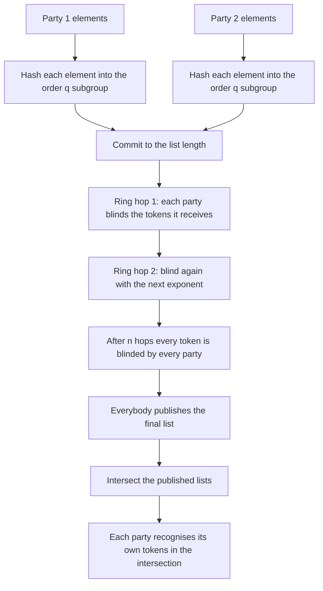
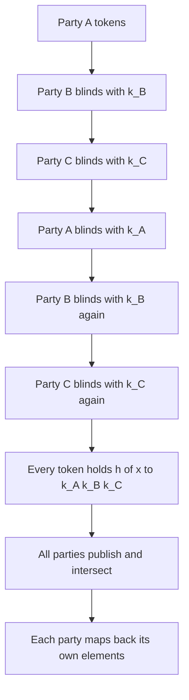
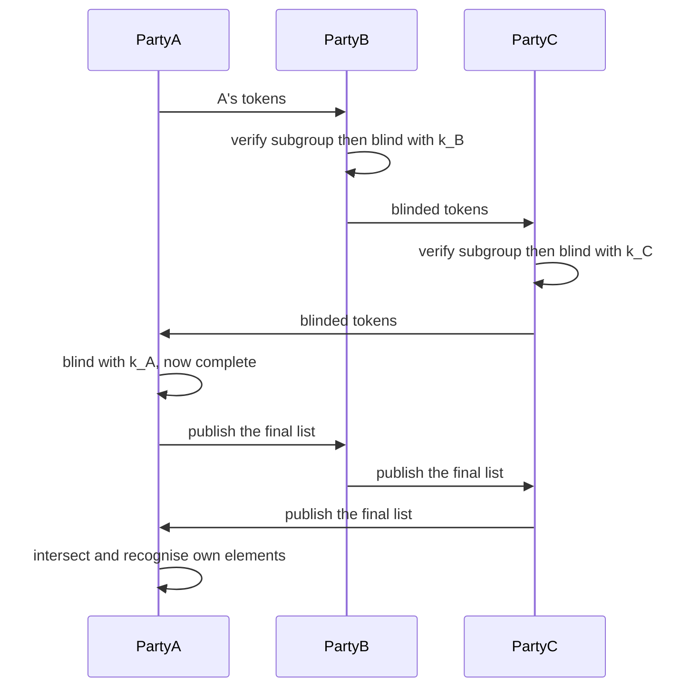

# 889 — Implement secure multiparty computation for private set intersection at scale.

> **Tier:** Master · **CTCI chapter:** Beyond — Security & Privacy
> **Task spec:** [889-implement-secure-multiparty-computation-for-private-set-intersec.md](../../../tasks/master/889-implement-secure-multiparty-computation-for-private-set-intersec.md)
> **Solutions:** [Python](../../../solutions/python/master/889-implement-secure-multiparty-computation-for-private-set-intersec/solution.py) ·
> [Java](../../../solutions/java/master/889-implement-secure-multiparty-computation-for-private-set-intersec/Solution.java) ·
> [JavaScript](../../../solutions/javascript/master/889-implement-secure-multiparty-computation-for-private-set-intersec/solution.js) ·
> [C#](../../../solutions/csharp/master/889-implement-secure-multiparty-computation-for-private-set-intersec/Solution.cs)

## 1. Problem restatement

**Input:** `n >= 2` parties, each holding a set of string elements and a secret exponent, and a
network that carries messages between them. No party may learn anything about another party's set
beyond the `n`-way intersection.

**Output:** for every party, the list of *its own* elements that belong to the intersection — and
nothing else. The blinded protocol state (a set of group elements that all parties can compute but
only the owners can interpret) is an intermediate, not an output.

**Modelling contract (what this file is and is not).** Each solution is an in-process *simulation* of
the classical commutative-encryption PSI protocol:

* the group is a real `257`-bit safe prime `p` with `q = (p - 1) / 2`, the subgroup of quadratic
  residues of order `q`, and a generator of order `q` — not a 2048-bit deployment group;
* elements are hashed into the subgroup by squaring a `SHA-256` digest (`hash_to_group`), so the map
  is a bijection on the subgroup and exponentiation commutes there;
* each party owns a secret exponent `k_i` and blinds a token by `t -> t^{k_i}`, so after every party
  has touched a token exactly once it holds `h(x)^{k_1 * ... * k_n}` regardless of the order of the
  hops;
* **no OT and no garbled circuits**, **no zero-knowledge proofs of correct exponentiation**, and only
  **honest-but-curious** security: a party that silently replaces tokens while preserving the count
  is outside what the checks can catch, and the file says so;
* exponents come from a **seeded PRNG**, not a CSPRNG, and there is **no network**: messages travel
  through an in-process transcript with an injectable fault hook, and there is no offline/online
  phase separation.

Verified invariants, from the assertions and the printed run:

| Check | Result |
| --- | --- |
| Intersection versus the plaintext oracle | `30` random configurations matched, including empty, full, single-shared-element and empty-party cases |
| Cost formula | `300` modexps for `60` elements over `4` parties — `|elements| * (n + 1)` |
| Message count formula | `24` messages for `4` parties — `n^2` ring hops plus `n` commits and `n` publications |
| Bandwidth formula | `n * total elements * 32` bytes of group elements |
| Transcript secrecy | no plaintext element of the `40`-term secret corpus appears in the transcript |
| Subgroup discipline | every received and published token satisfies `t^q = 1 mod p` |
| Fault detection | an injected small-order token, a dropped token and a duplicated token are all rejected |
| Scale run | `5` parties, `984` elements, `120` shared elements, `5904` modexps |
| Reproducibility | every configuration replays from its seed |

## 2. Intuition

The naive way for `n` parties to intersect their sets is to send them to each other — which is
exactly the privacy the task forbids. A naive fix, hashing every element, is no better: hashes are
deterministic, so a party that guesses a candidate can test it against the published digest.

The key insight is **commutative blinding**. Work in a prime-order group where exponentiation
commutes: if every party raises a token to its own secret exponent, then after all `n` parties have
touched it the token holds `h(x)^{k_1 k_2 ... k_n}` — and the same value regardless of the order in
which the parties did so. Two consequences follow immediately:

* a party cannot recognise a token it did not originate, because it never sees `h(x)^{k_j}` alone;
* a party *can* recognise its own tokens after the full blinding, because it knows which blinded
  value corresponds to which of *its* elements — so the intersection is computable locally.

The ring protocol turns that into a distributed algorithm with no leader and no per-party
reveal: every payload starts at its owner, is handed to the next party in the ring, is blinded by
that party, and is forwarded; after `n` hops each payload is back with its owner, blinded by all `n`
parties. Every party then publishes its final list, the intersection of those published lists is
computed by everybody, and each party maps the survivors back to its own elements. The owner of a
token is the only party that can invert the map, so the protocol is "everybody learns the
intersection, nobody learns anything else".

The second insight is that a real deployment *checks* things, and those checks are what the file
implements: every received and published token must satisfy `t^q = 1 mod p` (which rejects a
small-order element, the classic attempt to leak information through the group structure), every
party commits to its list length before the ring starts (so a relayer that drops or duplicates a
token is caught by a length mismatch), and every party must compute the *same* final intersection (a
disagreeing publication is a protocol violation).

The third insight is cost accounting: the protocol's expense is modular exponentiation, and it is
exactly `|elements in| * (n + 1)` — one exponentiation per element to hash it into the group, plus one
per element per ring hop. That is why the file can assert the count rather than describe it.



## 3. Algorithm

1. Set up the group: `p` a `257`-bit safe prime, `q = (p - 1) / 2`, and a generator of order `q`;
   hash each element into the subgroup by squaring its digest.
2. Every party commits to the length of the list it will feed into the ring.
3. Ring phase: for `n` rounds, each party sends its current payload to the next party in the ring;
   the recipient verifies subgroup membership of every token it receives (`t^q = 1`) and blinds the
   whole payload with its exponent before forwarding.
4. After `n` hops every payload has come home blinded by all `n` parties. Each party checks that its
   final list has the length it committed to, then publishes it.
5. Every party re-verifies the length and the subgroup membership of every published list, computes
   the blinded intersection, and maps it back to its own elements.
6. If the parties' answers disagree, or any check fails, raise `ProtocolViolation`.

```text
function hash_to_group(element)
    digest = sha256("psi-889" + element)
    candidate = (integer from digest) mod (p - 3) + 2
    return candidate^2 mod p            # squaring lands in the order-q subgroup
end

function in_subgroup(value)
    return value is an integer and 1 < value < p and value^q mod p = 1
end

procedure commit(party)
    broadcast (party.name, "commit", party.declared_length)
end

procedure accept(party, sender, tokens)
    for token in tokens do
        if not in_subgroup(token) then
            raise ProtocolViolation("token outside the order-q subgroup from " + sender)
        end
    end
end

function blind_many(tokens, exponent)
    return [ token^exponent mod p for token in tokens ]
end

function run_psi(parties, network)
    require at least two parties and unique names
    for party in parties do commit(party) end
    flight = the token lists owned by each party

    for hop in 1 to number of parties do
        outgoing = copy of flight
        for index in 0 to parties - 1 do
            sender = parties[index]
            recipient = parties[(index + 1) mod parties]
            delivered = network.send(sender.name, recipient.name, outgoing[index])
            accept(recipient, sender.name, delivered)
            flight[(index + 1) mod parties] = blind_many(delivered, recipient.exponent)
        end
    end

    for index in 0 to parties - 1 do
        party = parties[index]
        if length(flight[index]) != party.declared_length then
            raise ProtocolViolation("ring length changed in flight")
        end
        publish(party, flight[index])
    end

    for party in parties do
        for other in parties do
            if length(other.published) != other.declared_length then raise ProtocolViolation end
            accept(party, other.name, other.published)
        end
    end

    blinded_intersection = intersection of every published set
    answers = [ party.recognise(blinded_intersection) for party in parties ]
    if not all answers are equal then raise ProtocolViolation("parties disagree") end
    return blinded_intersection, answers[0], modexps, message count
end

function recognise(party, blinded_intersection)
    return [ element for index, element in party.elements
             if party.final[index] is in blinded_intersection ]
end
```



## 4. Worked example

Trace a three-party run where `A = {alpha, beta, gamma}`, `B = {beta, gamma, delta}` and
`C = {gamma, epsilon}`, so the plaintext intersection is `{gamma}`.

| Step | Value | Note |
| --- | --- | --- |
| Hash | `h(alpha), h(beta), h(gamma), h(delta), h(epsilon)` | each is a square modulo `p`, hence of order dividing `q` |
| Commit | `A -> 3`, `B -> 3`, `C -> 2` | `n = 3` commitments, checked again at publication time |
| Hop 1 | `A` sends its `3` tokens to `B`; `B` blinds all `3` with `k_B` | `B` cannot recognise any of them |
| Hop 2 | those `3` tokens go to `C`, which blinds them with `k_C` | now `h(x)^{k_A k_B k_C}` for `A`'s elements |
| Hop 3 | they return to `A`, which blinds them with `k_A` | the payload is complete |
| Same for `B` and `C` | each payload takes exactly `n = 3` hops | every party touches every token once |
| Publish | three lists, each of the committed length | a dropped or duplicated token would break the equality |
| Intersect | exactly one token appears in all three lists | namely `h(gamma)^{k_A k_B k_C}` |
| Recognise | `A` maps it to `gamma`, `B` to `gamma`, `C` to `gamma` | only the owner of a token can invert it |
| Answer | `["gamma"]` for every party | equals `plaintext_intersection(parties)` |

Cost accounting for the printed costed run — `60` elements over `4` parties:

| Quantity | Formula | Value |
| --- | --- | --- |
| modexps | `|elements| * (n + 1)` = `60 * 5` | `300` |
| ring messages | `n^2` = `16` | plus `n` commits and `n` publications |
| total messages | `n^2 + 2n` = `16 + 8` | `24` |
| group-element bandwidth | `n * total elements * 32` = `4 * 60 * 32` | `7680` bytes |
| transcript blob | serialised message log | `24230` bytes, containing no plaintext element |

The scale run keeps the same formulas with different constants: `5` parties and `984` elements give
`984 * 6 = 5904` modexps and an intersection of `120` shared elements.



## 5. Complexity

| Step | Time | Space | Reason |
| --- | --- | --- | --- |
| `hash_to_group` per element | `O(1)` modexp | `O(1)` | one squaring after a digest |
| `in_subgroup` per token | `O(1)` modexp | `O(1)` | `t^q mod p = 1` |
| `blind_many` | `O(k)` modexps | `O(k)` | one exponentiation per token |
| Ring phase | `n` hops, `O(n * k)` modexps | `O(k)` per party | each party blinds the whole payload once per hop |
| Whole protocol modexps | `|elements| * (n + 1)` | — | `300` for `60` elements and `4` parties; `5904` for `984` elements and `5` parties |
| Messages | `n^2 + 2n` | — | `n^2` ring sends plus `n` commits and `n` publications |
| Bandwidth | `n * |elements| * 32` bytes | `O(k)` | one group element per token per hop |
| Recognition | `O(k)` set lookups per party | `O(k)` | the intersection is a hash set lookup against each party's final list |

The protocol's cost is `O(n * k)` modular exponentiations — linear in the number of parties and in the
set size — and the *privacy* is what costs the extra factor: a plaintext intersection would be `O(k)`
hashing and no cryptography at all.

## 6. Pitfalls and edge cases

* **Small-order tokens.** An attacker injecting a token outside the order-`q` subgroup can leak
  information through the group structure; `accept` rejects anything failing `t^q = 1`, and the file
  injects exactly such a token through the network fault hook and asserts `ProtocolViolation`.
* **Dropped or duplicated tokens.** Commitments to list length are checked after the ring and again
  after publication, so a relayer that drops or duplicates a token is caught — both cases are
  exercised by injected faults.
* **The honest-but-curious boundary.** A party that replaces tokens while preserving the count is
  *not* detected; without zero-knowledge proofs of correct exponentiation, that is a documented
  limitation rather than an oversight.
* **Fewer than two parties.** `run_psi` raises immediately; intersection is meaningful only with
  `n >= 2`.
* **Duplicate party names.** Names must be unique, otherwise the published-list bookkeeping would map
  two parties onto one entry.
* **Order invariance.** Permuting the parties does not change the blinded output, because the group is
  abelian; the file asserts that the ring's result equals the direct two-party composition.
* **Degenerate set shapes.** Empty sets, one party holding everything, a single shared element, and an
  empty party among non-empty ones are all tested against the plaintext oracle — the intersection can
  legitimately be empty.
* **Permutation of published lists.** Publishing is a *set* intersection, so the order of tokens in a
  list does not matter, but the *count* does, which is why `recognise` indexes into the party's final
  list positionally.
* **Group parameters.** The safe prime must be genuine and the generator must have order exactly `q`;
  the file runs a Miller-Rabin style primality check on `p`, and verifies the generator by
  `g^q = 1 mod p` with `g != 1`.
* **Exponents.** Drawn from a seeded PRNG for reproducibility, which is a simulation choice: a
  deployment needs a CSPRNG, and the file says so explicitly.
* **Transcript hygiene.** The plaintext elements never enter the transcript — the file scans the
  serialised log for every one of `40` secret terms and asserts absence, and only subgroup elements
  may be published.

## 7. Variants and follow-ups

* **Intersection without an agreed modulus.** Where the parties want mutual privacy without a shared
  group, PSI via oblivious transfer backs the same functionality:
  [839](../../../tasks/master/839-implement-oblivious-transfer-based-protocol-for-private-set-inte.md)
  and the sketch variant in
  [712](../../../tasks/expert/712-implement-privacy-preserving-set-intersection-via-hashing-sketch.md).
* **Hiding which record was fetched, and computing on shared data.** PSI answers "what is common"; a
  lookup that hides *which* record is wanted needs PIR —
  [890](../../../tasks/master/890-implement-private-information-retrieval-scheme-practical-demo-pi.md).
  Beyond intersection, evaluating a function on jointly held data starts from the XOR-sharing core in
  [758](../../../tasks/expert/758-implement-secure-multiparty-computation-basic-xor-sharing-demo.md)
  and the aggregation protocol in
  [838](../../../tasks/master/838-implement-secure-multi-party-aggregation-for-machine-learning-ad.md).
* **Malicious security and larger groups.** Adding zero-knowledge proofs of correct exponentiation,
  verifiable payload commitments and a blame phase is what turns honest-but-curious PSI into a
  malicious-secure protocol — the checks here are the skeleton of that — while the `257`-bit group that
  keeps this run fast would become 2048-bit or larger in a deployment, at a couple of orders of
  magnitude per exponentiation and identical structure.

## 8. Check yourself

<details><summary>Show answer</summary>

**Q1. Why does the protocol work in the subgroup of quadratic residues rather than in the whole
multiplicative group?**

Because that subgroup has prime order `q`, so every element except the identity has order exactly `q`
and re-randomisation cannot fall into a small subgroup. Squaring a hash (`candidate^2 mod p`) lands in
it deterministically, which makes the map a bijection onto the subgroup, and the membership test
`t^q = 1` then rejects any injected element that is not in the subgroup.

</details>

<details><summary>Show answer</summary>

**Q2. Why is the ring shape important — why not just have every party publish and intersect?**

Because publishing the hashed elements would let any party test guesses: the digest is deterministic
and public. The ring means each token is blinded with *every* party's exponent, so a published token is
`h(x)^{k_1 ... k_n}` — unguessable even with the entire candidate space — and only the party that owns
`h(x)` knows which of its own tokens that is.

</details>

<details><summary>Show answer</summary>

**Q3. What do the length commitments buy, where does the cost formula come from, and what security
level does this simulation provide?**

A commitment to the list length before the ring starts makes a relayer that drops or duplicates a token
detectable: after the ring each party re-checks its own length, and after publication every party
checks the others'. They do *not* stop a party from swapping one token for another of the same count —
that needs proofs of correct exponentiation. The cost is one exponentiation per element to map it into
the group plus one blinding per ring hop, so `|elements| * (n + 1)`: `300` for `60` elements over four
parties, `5904` for `984` over five; the message count `n^2 + 2n` comes from `n^2` ring sends plus `n`
commits and `n` publications. The security level is honest-but-curious in a `257`-bit group with PRNG
exponents, an in-process network, no OT or garbled circuits and no zero-knowledge proofs.

</details>
