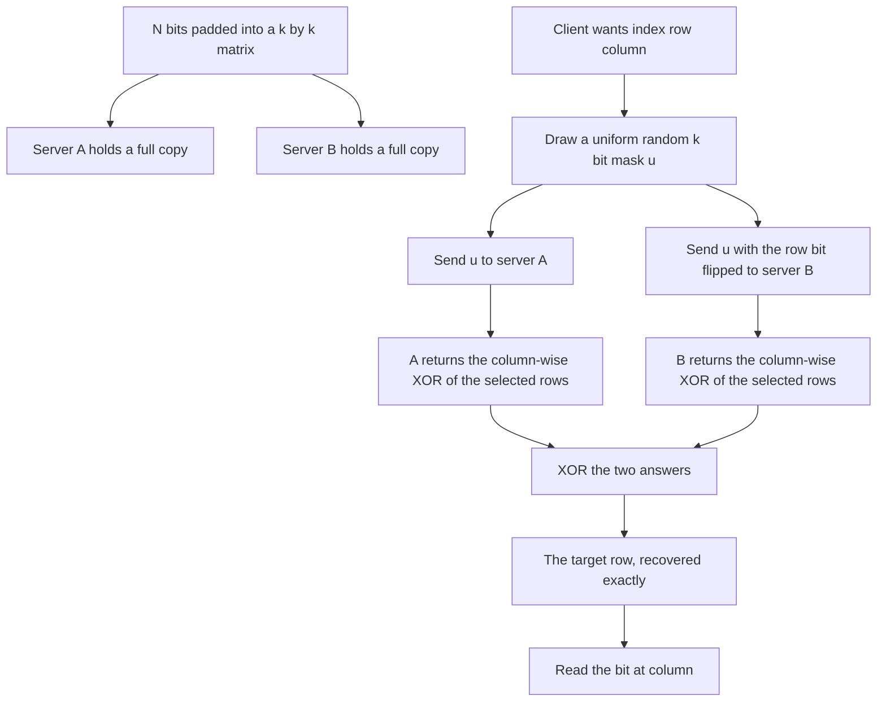
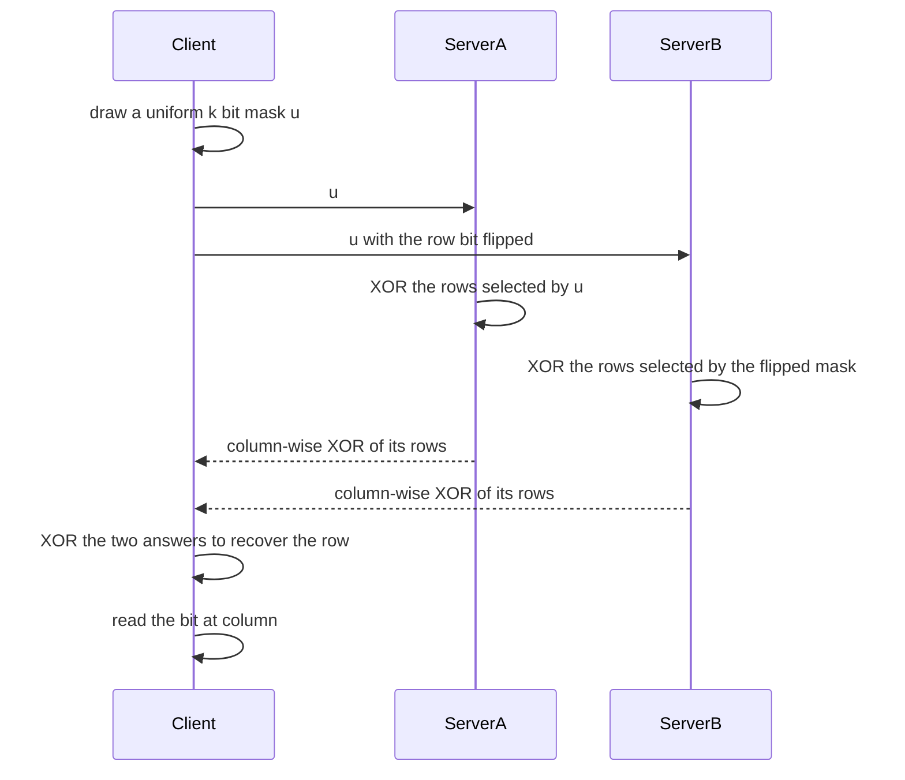

# 890 — Implement private information retrieval scheme practical demo (PIR).

> **Tier:** Master · **CTCI chapter:** Beyond — Security & Privacy
> **Task spec:** [890-implement-private-information-retrieval-scheme-practical-demo-pi.md](../../../tasks/master/890-implement-private-information-retrieval-scheme-practical-demo-pi.md)
> **Solutions:** [Python](../../../solutions/python/master/890-implement-private-information-retrieval-scheme-practical-demo-pi/solution.py) ·
> [Java](../../../solutions/java/master/890-implement-private-information-retrieval-scheme-practical-demo-pi/Solution.java) ·
> [JavaScript](../../../solutions/javascript/master/890-implement-private-information-retrieval-scheme-practical-demo-pi/solution.js) ·
> [C#](../../../solutions/csharp/master/890-implement-private-information-retrieval-scheme-practical-demo-pi/Solution.cs)

## 1. Problem restatement

**Input:** a database of `N` symbols, laid out as a `k x k` matrix with `k = ceil(sqrt(N))` and
zero-padded, an index `i` the client wants to read, and two non-colluding servers each holding an
identical copy.

**Output:** the value of cell `i` at the client, with neither server able to learn which cell was
requested — not even probabilistically, because the privacy here is *information theoretic*: no
computational assumption is used at all.

**Modelling contract (what this file is and is not).** Each solution is an in-process *simulation* of
the classic two-server PIR of Chor, Goldreich and Kushilevitz, in its matrix (one-round) form:

* the two servers are **in-process objects**, not separate administrative domains;
* bit work is **counted, not measured**: `bits_scanned` accumulates `popcount(mask) * width` per
  query, and there is no vectorised XOR kernel;
* there is **no offline/online split** and no batching of many queries into one round;
* sizes go up to `65536` bits (`256 x 256` matrices) rather than billions of cells;
* a server that lies about its answer is **not** caught in general — the file notes that a repeated
  query can expose inconsistency, but no malicious-security machinery is implemented.

The scheme itself, in one line: the client draws a uniformly random `k`-bit mask `u`, sends `u` to
server A and `u` with the *target row bit flipped* to server B; each server XORs the rows its mask
selects; the two answers differ exactly in the target row, so the client XORs them and reads the
column bit off the recovered row. No second round is needed — the whole row comes back.

Verified invariants, from the assertions and the printed run:

| Check | Result |
| --- | --- |
| Retrieval sweep | `221` cells across `11` database sizes, every one exact |
| Server view distribution | for every target index, each server's view is uniform over all `2^k` masks and independent of the index |
| Single-server privacy | a single view leaves all `k^2` targets possible — the row and the column are both hidden |
| Collusion boundary | the pair `(u, u xor e_row)` reveals the row index, hence the non-collusion assumption is visible |
| Cost for a `64`-bit database | `k = 8`, so `16` query bits and `16` answer bits per cell — `2k + 2k` |
| Scale | `65536` bits read with `40` probes using `40960` bits of communication — `64x` better than shipping rows |
| Work per server | half the database scanned (`popcount(u) * k` bits on average) |
| Record variant | `w`-bit records retrieved exactly, amortising the mask over the payload |

## 2. Intuition

The naive private read is to download the whole database and index it locally: perfectly private,
absurdly expensive — `O(N)` communication for one bit. At the other extreme, asking for cell `i`
leaks exactly `i`. The matrix PIR scheme sits in between with `O(sqrt(N))` communication and
information-theoretic privacy against a single server.

The key insight is to split the index into a **row** and a **column** and to hide them separately. Lay
the `N` bits out as a `k x k` matrix with `k = ceil(sqrt(N))`. A uniformly random mask `u` selects a
subset of rows; server A returns the column-wise XOR of those rows. Server B gets `u` with the target
row's bit flipped, and returns the XOR of *its* selection. XOR-ing the two answers cancels every row
that both servers selected and leaves exactly the target row — because the flip is the only difference
between the two selections.

Why that is private is the whole point of the construction:

* server A sees `u`, a uniform random `k`-bit string, independent of the index;
* server B sees `u xor e_row`, which is also uniform `k`-bit, because `u` is uniform and the flip is a
  fixed permutation of the mask space;
* the **column is never mentioned in any message**, so nobody can infer it from the query at all;
* the row is hidden from each *individual* server because the mask was uniform before the flip.

The second insight is that the column-freedom is what makes the scheme single-round: since the whole
row comes back, the client just reads the bit at position `column`. That costs `k` extra answer bits
compared with a two-round scheme that would hide the column with a second mask, and it buys a protocol
with one round trip and no second mask to justify to a privacy reviewer.

The third insight is the honest statement of the limit: the *pair* of views is not private. Given both
`u` and `u xor e_row`, an XOR reveals `e_row` — i.e. which row — so colluding servers localise the
target to `k` cells. The file makes that boundary mechanical: `collusion_information` enumerates the
behaviour and asserts that the difference is a unit vector, so the non-collusion assumption is
*measured* rather than hand-waved.



## 3. Algorithm

1. Choose `k = ceil(sqrt(N))` (`isqrt(N - 1) + 1`) and lay the database out as `k` rows of `k` bits,
   zero-padded.
2. Both servers hold identical copies of that layout.
3. The client computes `row = index / k` and `column = index mod k`, then draws a uniform random `k`-bit
   mask `u`.
4. Query A with `u`; query B with `u` with bit `row` flipped.
5. A server validates its query vector (correct length, entries in `{0, 1}`), accumulates its scanned
   bit count, and returns the column-wise XOR of the rows its mask selects.
6. The client XORs the two answers column by column, recovering the target row, and reads
   `target_row[column]`.
7. The record variant stores `w`-bit cells, so the same mask recovers a whole record and the answer
   size grows by the payload factor.

```text
function matrix_size(size)
    if size <= 0 then raise error end
    return isqrt(size - 1) + 1
end

function pad_rows(bits, width)
    require length(bits) <= width * width
    padded = bits followed by zeros up to width * width
    return [ padded[row * width : (row + 1) * width] for row in range(width) ]
end

function row_xor(rows, mask)
    out = zeros of length width(rows)
    for index, selected in enumerate(mask) do
        if selected then
            for column in range(width(rows)) do
                out[column] = out[column] xor rows[index][column]
            end
        end
    end
    return out
end

procedure server_answer(server, query)
    require length(query) = server.width
    for value in query do require value is 0 or 1 end
    server.queries += 1
    server.bits_scanned += popcount(query) * server.width
    return row_xor(server.rows, query)
end

function retrieve(client, index)
    require 0 <= index < client.size
    row = index / client.width
    column = index mod client.width
    mask = client.rng.bits(client.width)
    second = copy of mask
    second[row] = second[row] xor 1
    client.query_bits += 2 * client.width
    first_answer = server_answer(client.servers[0], mask)
    second_answer = server_answer(client.servers[1], second)
    client.answer_bits += 2 * client.width
    target_row = [ a xor b for a, b in zip(first_answer, second_answer) ]
    return target_row[column], target_row, mask, second
end
```

```text
function record_retrieve(client, index)
    row = index / client.width
    column = index mod client.width
    mask = client.rng.bits(client.width)
    second = mask with bit `row` flipped
    query_bits += 2 * client.width
    left = record_server_answer(servers[0], mask)
    right = record_server_answer(servers[1], second)
    answer_bits += 2 * client.width * payload_bits
    target_row = [ cell_left xor cell_right for each cell pair ]
    return target_row[column], target_row
end

function view_distribution(size, width, server_index)
    distribution = empty map
    for index in 0 to size - 1 do
        row = index / width
        seen = empty list
        for mask in 0 to (1 shl width) - 1 do
            vector = bits of mask
            if server_index = 1 then vector[row] ^= 1 end
            append vector to seen
        end
        distribution[index] = sorted(seen)
    end
    return distribution
end
```



```mermaid
flowchart TD
    S["Start: client has index"] --> W["k is the ceiling square root of N"]
    W --> M["Draw uniform mask u"]
    M --> QA["Query A with u"]
    M --> QB["Query B with u xor e_row"]
    QA --> AB["A scans popcount of u rows"]
    QB --> BB["B scans popcount of u xor e_row rows"]
    AB --> XR["Client XORs the two k bit rows"]
    BB --> XR
    XR --> E{"Does the XOR equal the target row"}
    E -- yes --> OK["Return bit at column"]
    E -- no --> BAD["Malformed query or wrong layout"]
```

## 4. Worked example

Take a `16`-bit database (`k = 4`) with rows

```text
row 0: 1 0 1 1
row 1: 0 1 1 0
row 2: 1 1 0 0
row 3: 0 0 1 1
```

and let the client read index `6`, so `row = 6 / 4 = 1` and `column = 6 mod 4 = 2`. The expected
answer is `row 1, column 2 = 1`.

| Step | Value | Note |
| --- | --- | --- |
| Mask | `u = 1 1 0 1` (random) | selects rows `0`, `1` and `3` |
| Query A | `1 1 0 1` | server A sees a uniform random vector |
| Query B | `1 0 0 1` (bit `1` flipped) | also uniform random, independent of the index |
| A's answer | `row0 xor row1 xor row3 = 1 0 1 1 xor 0 1 1 0 xor 0 0 1 1` | column-wise XOR |
| A's answer value | `1 1 1 0` | `2` of the `4` rows scanned |
| B's answer | `row0 xor row3 = 1 0 1 1 xor 0 0 1 1` | only rows `0` and `3` |
| B's answer value | `1 0 0 0` | `2` rows scanned |
| XOR | `1 1 1 0 xor 1 0 0 0` | every row selected by both cancelled |
| Recovered row | `0 1 1 0` | exactly `row 1` |
| Read | `recovered[2] = 1` | matches the database |

Privacy accounting for that same step:

| Statement | Evidence |
| --- | --- |
| A's view is uniform over `2^4 = 16` masks | `view_distribution(size, 4, 0)` lists exactly `16` vectors per index, and the lists are identical for every index |
| B's view is uniform over `16` masks too | the flip `u xor e_row` is a bijection on the mask space, so B's distribution is also the full cube |
| A single view leaves all `k^2 = 16` targets possible | each index maps to the same set of views, so no target is excluded |
| The pair reveals the row | `collusion_information` XORs the two vectors and finds a single set bit at position `row` — for index `6` that is bit `1` |
| The column is never sent | neither query contains any information about `column` at all |

Cost, from the printed run: a `64`-bit database gives `k = 8`, so each query costs `2k = 16` query
bits and `2k = 16` answer bits — `2k + 2k` per cell, i.e. `O(sqrt(N))` communication. At scale the
numbers are `65536` bits read with `40` probes using `40960` bits of communication: `1024` bits per
query for `k = 256`, which is `64x` cheaper than shipping the rows the naive way.



## 5. Complexity

| Quantity | Bound | Reason |
| --- | --- | --- |
| Layout | `k = ceil(sqrt(N))`, `k^2` bits | the matrix is square and zero-padded |
| Query size | `2k` bits per cell | one `k`-bit mask per server |
| Answer size | `2k` bits per cell (bit variant) | each server returns `k` bits, the whole row |
| Communication | `O(sqrt(N))` | `4k` bits against `N` bits stored: `64x` better at `N = 65536` (`1024` versus `65536` bits) |
| Server work | `O(k^2) = O(N)` bits scanned per query | each server touches the rows its mask selects: `popcount(mask) * k` bits, about half the database on average |
| Client work | `O(k)` XORs | one XOR per column across the two answers |
| Privacy verification | `O(size * 2^k)` | exhaustively enumerating every view per index, feasible only for small `k` — which is the point |
| Record variant | same query cost, `2k * w` answer bits | the mask is amortised over a `w`-bit payload per cell |

The trade-off is explicit: PIR replaces `O(N)` communication with `O(sqrt(N))` while leaving
`O(N)` *server-side* work per query, because each server still scans a large fraction of the database.
Reducing server work further requires preprocessing or computationally secure schemes, which is
outside this simulation.

## 6. Pitfalls and edge cases

* **Database size zero.** `matrix_size(0)` raises; there is no sensible matrix for an empty database,
  and the layout functions would divide by a zero width.
* **Over-full matrix.** `pad_rows` raises if the bit string does not fit the `k x k` layout, and the
  layout itself is chosen as the ceiling square root so padding is always `< 2k + 1` cells.
* **Malformed queries.** A server rejects a query whose length is not `k` and any entry that is not a
  bit (`QueryError`), so a client cannot smuggle extra information in an out-of-range token.
* **Out-of-range index.** `retrieve` rejects negative indices and indices `>= N` before sending
  anything, so no query is issued for a cell that does not exist.
* **The flip is load-bearing.** Without `second[row] ^= 1` both servers return the same XOR and the
  client would recover *nothing* about the target row; the file asserts the flip is what makes the two
  answers differ in exactly the target row.
* **Padding bits leak nothing.** Padded cells are zero and appear in the returned row only if the
  target column is beyond `N`, which the index check already forbids.
* **Average scan cost.** `bits_scanned` counts `popcount(mask) * k`, not `k^2`, because only the
  selected rows are XORed — the file asserts the counter matches the mask, and on average it is half
  the database.
* **Collusion.** The scheme is private only against *non-colluding* servers; the two views together
  reveal the row index, which is asserted mechanically by checking that the XOR of the two vectors is
  a unit vector.
* **Repeated queries.** Two identical queries with different masks give the same answer even if one
  server lies: the consistency check catches a *persistent* lie but not a coordinated one, and the
  file states that no malicious-security machinery is present.
* **Bit versus record cells.** In the record variant the server answer is a whole record of `w` bits
  per cell, so the communication is `2k * w` bits of answer; the query size stays `2k` bits, which is
  the amortisation that makes the scheme practical.
* **Reproducibility.** Masks come from a seeded `splitmix64` stream, so a retrieval sweep replays bit
  for bit and the exhaustive view enumeration is deterministic.

## 7. Variants and follow-ups

* **Hiding the intersection rather than the index.** PIR protects *which row was read*;
  set-intersection protocols protect *which elements are shared* —
  [889](../../../tasks/master/889-implement-secure-multiparty-computation-for-private-set-intersec.md),
  with the OT-based variant in
  [839](../../../tasks/master/839-implement-oblivious-transfer-based-protocol-for-private-set-inte.md)
  and the sketch variant in
  [712](../../../tasks/expert/712-implement-privacy-preserving-set-intersection-via-hashing-sketch.md).
* **Single-server PIR and oblivious storage.** Where two non-colluding servers cannot be assumed,
  privacy needs a computational assumption — homomorphic encryption, starting from the toy Paillier
  demo in [711](../../../tasks/expert/711-implement-homomorphic-encryption-simple-operations-demo-paillier.md) —
  and where the `O(N)` server work per query is the problem, an ORAM rearranges storage so a *sequence*
  of accesses looks uniform
  ([757](../../../tasks/expert/757-implement-oram-oblivious-ram-sketch-for-simple-access-patterns.md)).
* **Searchable corpora and smaller communication.** Where the client wants to query documents rather
  than read cells, the blind-index design in
  [886](../../../tasks/master/886-implement-end-to-end-encrypted-search-for-large-document-corpus.md)
  trades information-theoretic privacy for searchability plus a per-query epsilon; the `O(sqrt(N))`
  bound can be improved with multi-dimensional layouts (`O(N^{1/d})` per query for `d` dimensions) or
  by batching queries, both of which keep the same mask-plus-flip core.

## 8. Check yourself

<details><summary>Show answer</summary>

**Q1. Why do the two answers differ in exactly the target row?**

Server A XORs the rows in the random set `S = {j : u_j = 1}`; server B XORs the rows in
`S' = S xor {row}`. XOR-ing two selections cancels every row that appears in both and leaves the rows
in the symmetric difference — which is exactly `{row}`. The client therefore recovers the target row
with no other information at all.

</details>

<details><summary>Show answer</summary>

**Q2. What is each server's view, and why is it independent of the index?**

Server A sees `u`, uniform over the `2^k` masks. Server B sees `u xor e_row`, and since `u` is uniform
and the flip is a fixed bijection, that is also uniform over the `2^k` masks and — crucially — the
*same* distribution for every index. The file proves this exhaustively for small `k` by enumerating the
entire view set per index and asserting the sets are identical.

</details>

<details><summary>Show answer</summary>

**Q3. What exactly does collusion buy, why return the whole row, and where does the simulation stop?**

Given both vectors, `u xor (u xor e_row) = e_row`, so a colluding pair learns the target *row* and
nothing more — the column was never in any message; the demo computes the difference of the two views
and asserts it is a unit vector. Returning the whole row costs `k` extra answer bits (half of the
`2k + 2k` total at `k = 8`) but keeps the protocol single-round and keeps the privacy argument
elementary, since hiding the column would need a second mask and a second round trip. What is
simulated: two in-process servers instead of distinct administrative domains, counted bit work instead
of vectorised XOR kernels, no offline preprocessing or batching, databases of at most `65536` bits, and
no malicious-security guarantees beyond a repeated-query consistency check.

</details>
