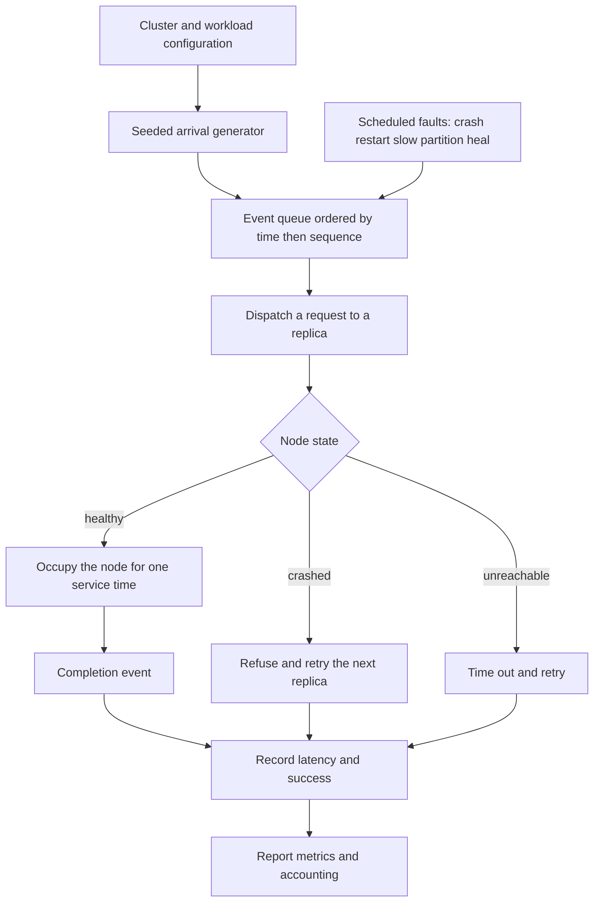
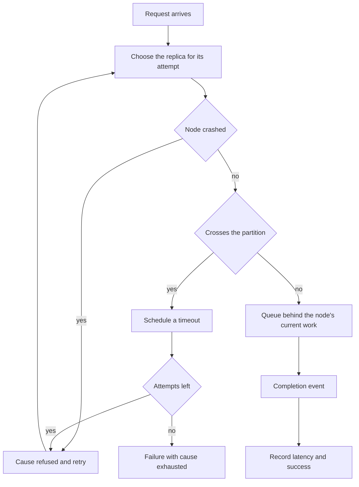
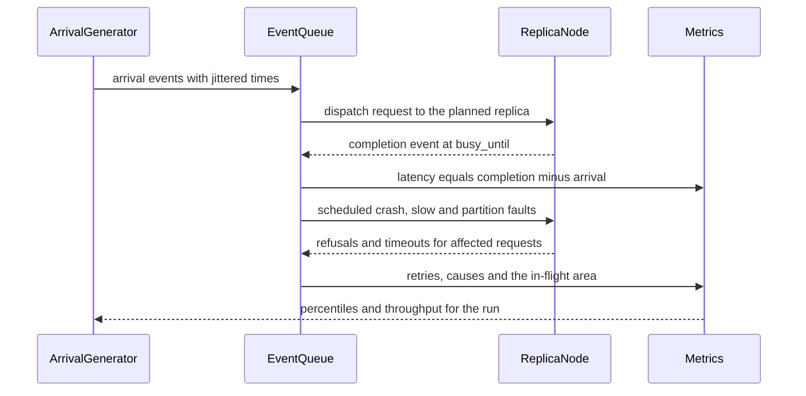

# 891 — Implement benchmarking harness for large distributed systems with failure injection.

> **Tier:** Master · **CTCI chapter:** Beyond — Software Engineering & Tooling
> **Task spec:** [891-implement-benchmarking-harness-for-large-distributed-systems-wit.md](../../../tasks/master/891-implement-benchmarking-harness-for-large-distributed-systems-wit.md)
> **Solutions:** [Python](../../../solutions/python/master/891-implement-benchmarking-harness-for-large-distributed-systems-wit/solution.py) ·
> [Java](../../../solutions/java/master/891-implement-benchmarking-harness-for-large-distributed-systems-wit/Solution.java) ·
> [JavaScript](../../../solutions/javascript/master/891-implement-benchmarking-harness-for-large-distributed-systems-wit/solution.js) ·
> [C#](../../../solutions/csharp/master/891-implement-benchmarking-harness-for-large-distributed-systems-wit/Solution.cs)

## 1. Problem restatement

**Input:** a cluster configuration (node count, service time, replication factor, timeout, maximum
attempts), a workload configuration (request count, mean inter-arrival interval, jitter, key space),
a list of scheduled faults, and a seed.

**Output:** a metrics report — successes and failures with their causes, retries, per-node load,
exact latency percentiles (`p50`, `p90`, `p99`, max, mean), throughput, and the number of events
processed — produced by a simulation whose every number is *recorded*, never estimated.

**Modelling contract (what this file is and is not).** Each solution is a deterministic
discrete-event simulator of a replicated key-value cluster:

* **virtual time only**: no threads, no sockets, no sleeping and no wall clock. Every state change is
  an event in a priority queue ordered by `(time, sequence number)`, so a run is a pure function of
  the configuration and the seed, and the simulated clock is what every latency and throughput number
  refers to;
* the modelled system is a **replicated key-value store**: a client sends requests whose arrival times
  come from the seeded generator, each request is routed to one of `replication` replicas of its key,
  each node serialises work with a **FIFO single-server queue**, and a request that is refused,
  silently dropped or takes too long is retried against the next replica up to `max_attempts` times;
* **failure injection is scheduled on the same clock**: node crashes and restarts, per-node slowdown
  factors, a network partition that splits the cluster into two groups (cross-group messages are
  silently dropped), and healing — which is just another scheduled fault, so "recovery" is measured
  rather than assumed;
* there is **no real network, no real node, no disk and no clock skew**; the cluster is an object graph
  in one process.

Verified invariants, from the assertions and the printed run:

| Check | Result |
| --- | --- |
| Event ordering | events are processed in nondecreasing time, asserted inside the loop |
| Unloaded latency | equals the configured service time exactly |
| FIFO queueing | `n` simultaneous requests to one node end at `n` service times — the closed form |
| Percentiles | the helper matches hand-computed nearest-rank values, cross-checked against a second implementation over a property sweep |
| Latency bookkeeping | the area under the in-flight curve equals the sum of all latencies: `598 == 598` over `120` requests |
| Fault isolation | with `replication = 1`, a crash of the only replica causes `15` failures; with `replication = 3`, `0` failures |
| Slow node | inflates latencies by exactly its factor |
| Partition | `46` requests dropped while the cluster is split, `34` recovered after healing |
| Degenerate faults | a total outage injects zero successes, a no-op fault injects zero failures |
| Steady state | `p50 4`, `p90 6`, `p99 9`, max `9`, throughput `0.295` requests per unit of time |
| Scale run | `2000` arrivals, `6167` events, `237` retries, `1958` successes, `p99 120` |
| Reproducibility | the `2000`-request run replays from its seed |

## 2. Intuition

The naive way to benchmark a distributed system is to start processes, send real traffic and time the
responses. That measures the *machine* as much as the system: results drift with load, they are not
reproducible, and a failure scenario (kill a leader mid-write, split the network for a while) is
painful to arrange. Worse, the interesting questions — what happens to p99 when a node slows by `3x`,
how many requests a partition costs — need many repetitions under controlled variation.

The key insight is to model the system as a **queue of timestamped events** rather than a set of
threads. If every state change is an event with a virtual timestamp, and the queue is a priority queue
that breaks ties by insertion sequence, then the simulation is a pure function of
`(configuration, seed)`: the same run can be replayed, bisected and unit-tested. Latency is then not
"measured from a clock" but *computed* as `completion_time - arrival_time`, and throughput as
`successes / duration`. The printout `598 == 598` — the integral of the in-flight count across time
equalling the sum of every request's latency — is exactly the proof that this bookkeeping is
consistent.

The second insight is that the failures are the interesting part of the workload. Because faults are
events too, they can be scheduled and reasoned about precisely: crash a node, slow another by a factor,
split the network into two groups, heal it later. Retries then interact with fault injection in ways
that are measurable: the printed run shows a crash under `replication = 1` costing `15` failures while
the same crash under `replication = 3` costs `0`, because the remaining replicas serve the key and the
retry succeeds. A partition is not "an outage" but a specific number of dropped requests (`46`) and a
specific number of recovered ones (`34`) once the cluster heals.

The third insight is that a harness needs its own oracles. The queueing results are checked against
closed forms the simulation has no business disagreeing with (one request is one service time, two
simultaneous requests to one node finish at `1` and `2`, `n` finish at `n`), the percentile helper is
implemented twice in different arithmetic and cross-checked, and the latency accounting is validated
against an independent integral. Without those, a simulator that is subtly wrong looks exactly like a
system that is slow.



## 3. Algorithm

1. Build the cluster: `node_count` nodes, each with a service time (scaled by any active slowdown
   factor), a FIFO `busy_until` stamp, a crash flag and a partition group.
2. Generate the workload: arrival times from the seeded generator with jitter, each tagged with a key
   from the key space; the replica plan for a key is a deterministic replication factor of node
   indices.
3. Run the event loop: pop the earliest event; assert its time is not before the previous event's
   time; integrate the in-flight area up to this time; then handle the event.
4. `ARRIVAL`: create the request, increment in-flight, dispatch it.
5. `COMPLETION`: mark the request done, record its latency, decrement in-flight, count success.
6. `TIMEOUT`: if the request is not done, retry it against the next replica; after `max_attempts`,
   finish it as a failure with the accumulated cause.
7. `FAULT`: apply the scheduled fault (crash, restart, slow, normal, partition, heal, freeze).
8. Aggregate: exact nearest-rank percentiles, throughput, per-node load, failure causes by label, and
   the in-flight area.

```text
class Simulator
    events, sequence, clock, processed, last_processed

    procedure schedule(delay, kind, payload)
        require delay >= 0
        sequence += 1
        push (clock + delay, sequence, kind, payload) onto the heap
    end

    procedure run(on_event)
        while the heap is not empty do
            (time, _, kind, payload) = pop the smallest entry
            assert time >= last_processed
            last_processed = time
            clock = time
            processed += 1
            on_event(kind, payload, time)
        end
    end
end

procedure handle(harness, kind, payload, time)
    area += in_flight * (time - previous_time)
    previous_time = time
    if kind is ARRIVAL then arrive(payload, time)
    else if kind is COMPLETION then complete(payload, time)
    else if kind is TIMEOUT then timeout(payload, time)
    else apply_fault(payload, time)
end

procedure arrive(harness, key, time)
    request = new request with start = time, attempt = 0
    in_flight += 1
    dispatch(request, time)
end

procedure dispatch(harness, request, time)
    node = replica_plan(request.key)[request.attempt mod replication]
    if node is crashed then
        refused += 1
        retry(request, time, REFUSED)
        return
    end
    if not in_same_group(node) then
        crossed += 1
        schedule(timeout, TIMEOUT, request.id)
        return
    end
    start = max(busy_until[node], time)
    busy_until[node] = start + service_of(node)
    schedule_at(busy_until[node], COMPLETION, (request.id, node))
    schedule(timeout, TIMEOUT, request.id)
end

procedure retry(harness, request, time, cause)
    request.attempt += 1
    if request.attempt >= max_attempts then
        finish(request, time, cause, success = false)
        return
    end
    retries += 1
    dispatch(request, time)
end

function percentile(samples, percent)
    require 0 < percent <= 100
    ordered = sorted(samples)
    rank = ceil(percent / 100 * length(ordered))
    return ordered[max(1, rank) - 1]
end
```



## 4. Worked example

Two closed-form checks and one accounting identity, all from the printed run.

**FIFO queueing at one node** (service time `1`, three requests arriving at `t = 0`):

| Request | Arrival | Starts | Completes | Latency |
| --- | --- | --- | --- | --- |
| first | `0` | `0` | `1` | `1` |
| second | `0` | `1` | `2` | `2` |
| third | `0` | `2` | `3` | `3` |

The simulation reports exactly that: one request takes one service time, two simultaneous requests to
one node end at `1` and `2` service times, and `n` simultaneous requests end at `n`. This is the test
that catches a queue that does not actually serialise.

**The in-flight area identity** over the `120`-request steady-state run:

| Quantity | Meaning | Value |
| --- | --- | --- |
| in-flight area | integral of the number of in-flight requests over virtual time, accumulated between consecutive event times | `598` |
| sum of latencies | `completion_time - arrival_time` summed over every finished request | `598` |
| requests | arrivals in the run | `120` |
| steady state | nearest-rank percentiles of the recorded latencies | `p50 4`, `p90 6`, `p99 9`, max `9` |
| throughput | `successes / duration` | `0.295` requests per unit of time |

Little's-law-style bookkeeping is what makes the identity hold: at every event the in-flight count is
multiplied by the time since the previous event and added to the area, and the same count is
incremented on arrival and decremented on completion. A single missed increment shows up as a
mismatch between `598` and `598` — which is why the harness checks it instead of trusting it.

**Fault injection, side by side:**

| Scenario | Replication `1` | Replication `3` |
| --- | --- | --- |
| Crash of one node | the only replica, so requests fail | the other two replicas serve the key |
| Failures caused by the crash | `15` | `0` |
| Why | no alternative replica to retry against | the retry lands on a live replica and completes |
| Partition (separate run) | `46` requests dropped while the cluster is split | same, but `34` of them recover after healing |

The partition row is the reason healing is a scheduled fault rather than a reset: the run continues
through the split, requests that cannot cross are dropped and retried, and once the heal event fires
the pending work gets through — `34` recovered requests, counted rather than assumed.



## 5. Complexity

| Quantity | Bound | Reason |
| --- | --- | --- |
| Event loop | `O(E log E)` | `E` events pushed and popped from a binary heap; `6167` events for `2000` arrivals |
| Requests | `O(1)` amortised each | arrival, dispatch, completion and timeout are all constant work |
| Retries | `O(max_attempts)` per request | each attempt is one dispatch; `237` retries in the scale run |
| Percentiles | `O(n log n)` | one sort of the recorded latencies; nearest-rank selection, exact rather than approximate |
| Metrics aggregation | `O(n + nodes)` | one pass over the latencies and one over the per-node counters |
| Fault injection | `O(1)` per fault | an event that mutates a flag, a factor or a partition pair |
| Memory | `O(requests + events)` | the latency list dominates; nothing is sampled away |
| Scale | `2000` arrivals, `6167` events, `1958` successes, `p99 120` | the harness's own measurement of a larger run |

Simulated virtual time is not the same as wall-clock cost: the harness's runtime is dominated by the
heap operations and the final sort, both polynomial in the number of events, and the whole 2000-request
run finishes in-process.

## 6. Pitfalls and edge cases

* **Events in the past.** `schedule` and `schedule_at` reject a negative delay or a timestamp before
  the current clock (`ConfigError`) — a queue that accepts them silently produces impossible
  latencies.
* **Non-monotone event order.** `Simulator.run` asserts that no event is popped with a time earlier
  than the previously processed one; ties break on the insertion sequence so ordering is total.
* **Double completion.** A request that timed out and then completed must not be counted twice; both
  handlers check `request["done"]` and ignore the second event.
* **Retry exhaustion.** After `max_attempts` the request finishes as a failure with the cause that
  exhausted it (`refused`, `dropped` or `exhausted`), and the causes are counted separately so the
  report can distinguish "the node was down" from "the network ate the request".
* **Replication factor versus node count.** A replication factor larger than the cluster is a
  configuration error; a factor of `1` is legal and is exactly the fragile case the isolation check
  uses.
* **Crashed nodes still receive events.** A completion or timeout may arrive for a node that has just
  crashed; the handler tolerates it because the request-level state decides what happens next.
* **Partitions are symmetric.** Cross-group traffic is dropped in both directions, so a partition
  cannot be "half-healed" by the direction a request happens to travel.
* **Slowdowns compose with queueing.** A `3x` slow node inflates its service time, and because the
  node is FIFO the inflation propagates to every request queued behind it — the assertion checks the
  factor is applied exactly.
* **Degenerate faults.** A total outage must produce zero successes and a no-op fault zero failures;
  both are asserted so that a fault hook that silently does nothing cannot pass.
* **Empty sample sets.** `percentile` raises on no samples and on a percentile outside `(0, 100]`;
  `metrics` reports `None` for latencies rather than inventing zeros.
* **Determinism.** Everything — arrival times, jitter, fault draws — comes from the seeded
  `splitmix64` stream, so the 2000-request run replays exactly.

## 7. Variants and follow-ups

* **Injecting faults into a real protocol.** This harness crashes and partitions nodes; the chaos
  monkey in [892](../../../tasks/master/892-implement-chaos-monkey-style-fault-injection-and-recovery-valida.md)
  injects the same classes of faults into a replicated log and validates the durability invariants
  round by round.
* **Following a request through the cluster.** A benchmark tells you *that* latency rose; causal
  tracing tells you *where* — [893](../../../tasks/master/893-implement-causal-trace-capture-across-microservices-for-latency.md)
  reconstructs spans across services and finds the critical path.
* **Explaining a regression automatically.** Once traces exist, the next step is to attribute the
  slowdown to a service: [894](../../../tasks/master/894-implement-automated-root-cause-analysis-heuristics-using-depende.md)
  ranks suspects on the dependency graph.
* **Benchmarking a real store.** The cluster model here is deliberately generic; plugging in the
  transaction semantics of [802](../../../tasks/master/802-implement-fully-acid-transactional-key-value-store-with-mvcc-and.md)
  would add commit protocols and conflict retries to the service time.
* **Continuous benchmarking.** Running the same seeded workload on every commit turns the harness into
  a regression gate: the percentile comparisons are exact, so a `p99` change is either a real
  regression or a configuration change, never noise.

## 8. Check yourself

<details><summary>Show answer</summary>

**Q1. Why is a discrete-event simulation the right shape for a system benchmark?**

Because it removes the machine from the measurement. With virtual time and a `(time, sequence)`-
ordered queue, a run is a pure function of the configuration and the seed: latencies are computed, not
clocked, so results are exactly reproducible and a failure scenario — a crash mid-flight, a partition,
a `3x` slowdown — can be scheduled rather than arranged. The price is that the model is only as good as
its service-time and fault assumptions.

</details>

<details><summary>Show answer</summary>

**Q2. What does the identity "in-flight area equals the sum of latencies" prove?**

That the request accounting is internally consistent. The area is accumulated as
`in_flight * (time - previous_time)` at every event, while in-flight is incremented on arrival and
decremented on completion; summing the areas telescopes to `sum(completion - arrival)`. The printed
run shows `598` on both sides over `120` requests, so no request was double-counted or dropped from
the books.

</details>

<details><summary>Show answer</summary>

**Q3. Why does the same crash cause `15` failures at replication `1` and `0` at replication `3`?**

At replication `1` the crashed node is the only replica of the affected keys, so every request that
maps to it and exhausts its retries fails — `15` of them. At replication `3` the replica plan has two
more candidates, so the retry is dispatched to a live node, the request completes, and the crash costs
availability only for the duration of the retry. The harness measures the difference rather than
arguing it.

</details>

<details><summary>Show answer</summary>

**Q4. Why implement the percentile helper twice?**

Because an off-by-one in nearest-rank is invisible in a single number but shifts every percentile in
the report. One implementation uses `ceil(percent / 100 * n)`, the other works in integer arithmetic
(`-(-percent * n // 100)`), and both are compared against hand-computed values and against each other
across a sweep of sizes and percentiles. The same reasoning explains the closed-form queueing checks:
an oracle the simulator cannot legitimately disagree with.

</details>

<details><summary>Show answer</summary>

**Q5. Where does the simulation stop, and what would you add for a real deployment?**

No threads, sockets, disks or wall clock; a FIFO single-server queue per node as the entire latency
model; two-group partitions with no per-link loss model; a small cluster and no clock skew. A real
harness adds measured service-time distributions, network delay and loss models, disk and fsync
latency, coordinator/leader election protocols, Byzantine behaviour, and a way to run the same
scenario against the real system so the model can be validated against it.

</details>
