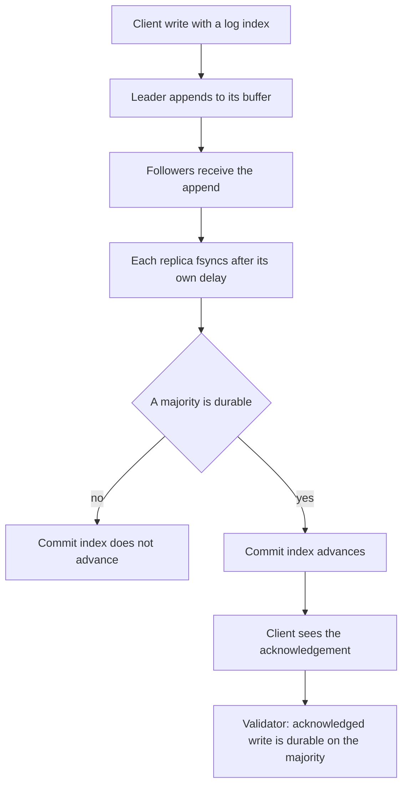
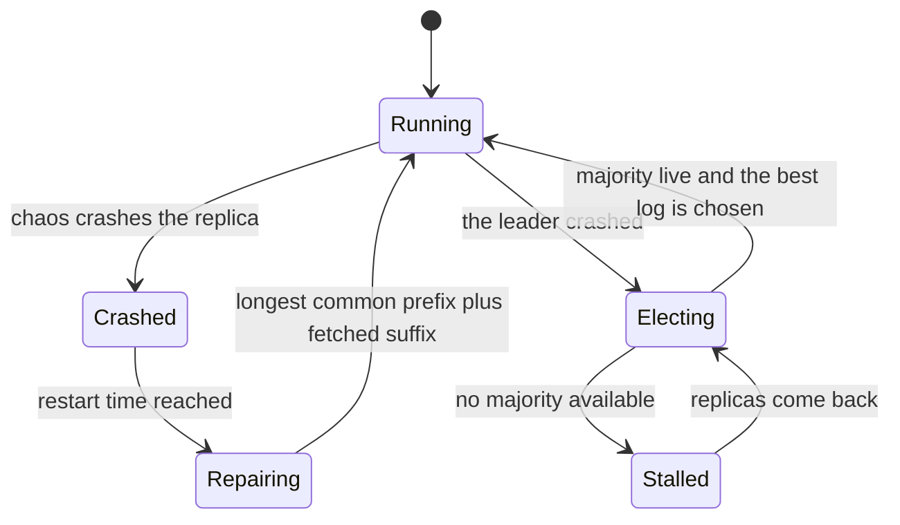
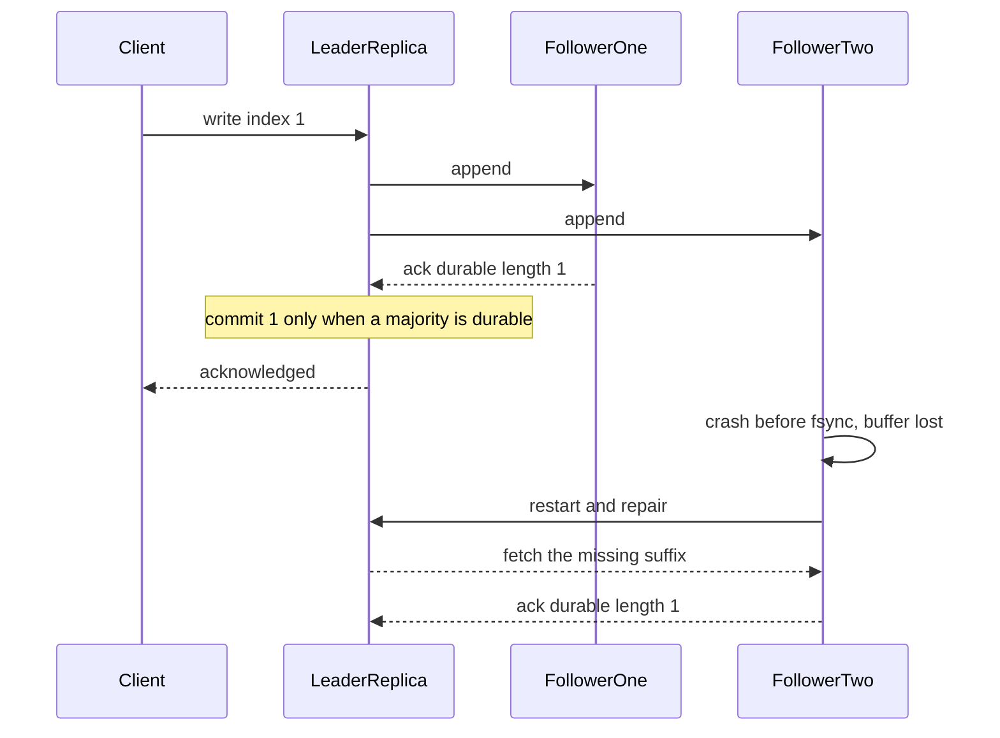

# 892 — Implement chaos-monkey style fault injection and recovery validation.

> **Tier:** Master · **CTCI chapter:** Beyond — Software Engineering & Tooling
> **Task spec:** [892-implement-chaos-monkey-style-fault-injection-and-recovery-valida.md](../../../tasks/master/892-implement-chaos-monkey-style-fault-injection-and-recovery-valida.md)
> **Solutions:** [Python](../../../solutions/python/master/892-implement-chaos-monkey-style-fault-injection-and-recovery-valida/solution.py) ·
> [Java](../../../solutions/java/master/892-implement-chaos-monkey-style-fault-injection-and-recovery-valida/Solution.java) ·
> [JavaScript](../../../solutions/javascript/master/892-implement-chaos-monkey-style-fault-injection-and-recovery-valida/solution.js) ·
> [C#](../../../solutions/csharp/master/892-implement-chaos-monkey-style-fault-injection-and-recovery-valida/Solution.cs)

## 1. Problem restatement

**Input:** a cluster size, a per-replica `fsync` delay, a chaos configuration (per-message drop,
duplicate, delay and corrupt percentages, plus crash and restart behaviour), and a number of client
writes.

**Output:** the system's final state under a randomised fault stream, and — the actual deliverable — a
**validator verdict**: whether the replica invariants held in every single round, which faults fired,
how many writes were acknowledged, and how long convergence took after the fault stream stopped.

**Modelling contract (what this file is and is not).** Each solution is an in-process *simulation* of a
chaos experiment:

* the system under test is a **replicated write-ahead log**: one leader plus followers, each follower
  `fsync`ing its tail after a per-replica delay, and a write being acknowledged to the client **only
  once a majority of replicas have durably stored it**;
* faults are injected into an **in-process message queue**: a message can be dropped, duplicated,
  delayed or corrupted (checksum failure), and every round the monkey may crash a replica — which
  destroys that replica's un-fsynced tail, i.e. exactly the torn write a real crash produces — and
  restart it later. Crashes also hit the leader;
* when the leader is down a new one is elected from the live replicas, and a restarted replica
  performs a log repair by finding its longest common prefix with the leader, truncating and pulling
  the missing suffix;
* **no real processes, no real network, no disk-error model beyond "the un-flushed tail is lost at
  crash time"**, a synchronous round-based loop instead of a continuous event loop, no clock skew and
  small clusters.

Verified invariants and measurements, from the assertions and the printed run:

| Check | Result |
| --- | --- |
| Fault injection fires | `238` injected faults: `64` duplicates, `26` corrupted messages, `8` crashes, `10` repairs |
| Durability | `60` acknowledged writes, each durably held by at least `3` replicas (a majority of the five-node cluster) |
| Torn tail | a crashed replica loses its un-fsynced tail, and the repair restores it without losing an acknowledged write |
| Log matching | every log is a prefix of the issued history — no phantom entries, no divergence |
| Idempotence | duplicated messages are absorbed as duplicates, not appended twice |
| Corruption | corrupted messages are rejected and counted |
| Leader crash | acknowledged writes survive a leader crash and re-election |
| Lost quorum | a cluster without a majority *stalls* acknowledgements instead of losing them |
| Non-vacuity | the checker rejects a deliberately corrupted replica |
| Convergence | `2` rounds to converge after the fault stream stopped |
| Scale run | `300` writes, `300` acknowledged, `1553` fault events, convergence in `1` round |
| Reproducibility | every run replays from its seed |

## 2. Intuition

Chaos engineering is easy to do badly: you kill a process, everything still answers, and you declare
success — without knowing whether the experiment was capable of failing at all. The interesting
question is not "did the system survive?" but "which invariant would have been violated if it had
not?". That reframing is the whole design of this task, and it is why the validator, not the fault
injector, is the deliverable.

The key structural insight is *when* a write becomes acknowledged. A replica holds a **durable** log
plus a **buffer** of appended entries not yet `fsync`ed. A crash destroys the buffer — that is what a
torn write is — so acknowledged writes must not depend on any buffer. Because the leader waits for a
durable majority before acknowledging, the invariant is a *consequence of the protocol*: any minority
of replicas can lose their buffers without touching an acknowledged write, since a majority already
holds it durably.

The second insight is that recovery is a **log repair**, not a restart: a restarted replica computes
its longest common prefix with the leader, truncates anything past it (which is how divergence is
removed) and pulls the missing suffix. That makes log matching — "every log is a prefix of the issued
history" — maintainable across arbitrary crash and partition patterns, and it is checked after *every*
round, not just at the end.

The third insight is about the faults that are hardest to reason about. Duplicates are handled by
idempotent append (`accept` recognises an entry already at that index), corruption is a checksum
rejection, and a lost quorum *stalls* the log rather than committing on whoever is left: the commit
index is the value held durably by a majority of the cluster, computed from sorted durable lengths
where down replicas contribute zero. A harness that skipped that step would happily acknowledge writes
that a later election would erase, and the whole exercise would be theatre.



## 3. Algorithm

1. Build `node_count` replicas, each with an `fsync` delay; the leader is replica `0`.
2. Client round: if the leader is down, try to elect a new one; the leader appends the entry to its
   own log if it does not already have it, and sends appends to the followers.
3. Delivery round: drain the injected message queue in `(time, sequence)` order; corrupted messages
   are dropped and counted, duplicates are delivered twice (where they hit the idempotent append),
   delayed messages wait.
4. Flush round: every live replica moves buffer entries whose `fsync` deadline has passed into its
   durable log and acks the leader with the new durable length and term.
5. Commit round: the commit index is the largest index held durably by a majority of the cluster,
   where a down replica contributes `0`. Acknowledged writes are those at or below the commit index.
6. Fault round: crash replicas (losing their un-fsynced tails), restart those whose restart time has
   come (running a log repair against the leader), and elect when the leader is gone.
7. Validate every round: log matching, durability, quorum durability, commit monotonicity, no
   duplicate indices.
8. After the fault stream stops: run to convergence and record how many rounds it took.

```text
class Replica
    durable, buffer, pending, down, restart_at

    function log()
        return durable followed by the buffered entries
    end

    procedure accept(entry, step)
        index = entry.index
        if index <= length(durable) + length(buffer) then
            if the entry already at `index` equals `entry` then
                duplicates += 1
                return duplicate
            end
            conflicts += 1
            return conflict
        end
        if index = length(durable) + length(buffer) + 1 then
            append (entry, step + fsync_delay) to buffer
            absorb_pending(step)                  # release entries held behind the gap
            return accepted
        end
        append entry to pending                   # a gap: hold it until the prefix arrives
        held += 1
        return held
    end

    procedure flush(step)
        if down then return 0 end
        while buffer is not empty and buffer[0].due <= step do
            append buffer[0].entry to durable
            remove it from buffer
        end
    end

    procedure crash(step, restart_delay)
        lost = length(buffer)
        buffer = empty; pending = empty       # the un-fsynced tail is gone
        down = true; restart_at = step + restart_delay
        return lost
    end

    procedure truncate_to(index)
        durable = durable up to `index`
        drop buffered entries past `index`
    end
end

procedure elect(store)
    candidates = the live replicas
    if length(candidates) < majority then return false end      # no quorum, no safe leader
    best = the live replica with the longest log, ties by id
    if best.length < commit then return false end               # never elect a replica that lost data
    if best is not the current leader then
        change the leader and increment the term
        reset the per-follower match index
    end
end

procedure repair(store, replica)
    leader = the current leader
    common = the length of the longest common prefix of the two logs
    if common < replica.length then truncate_to(replica, common) end
    for index from common + 1 to leader.length do
        accept(replica, leader.entry_at(index), step)
        entries_fetched += 1
    end
end

procedure update_commit(store)
    lengths = sorted of (durable length of a replica, or 0 when it is down)
    candidate = lengths[node_count - majority]
    if candidate > commit then commit = candidate end
end
```



## 4. Worked example

Trace a three-node cluster (`R0` leader, `R1` and `R2` followers) with `fsync` delays `0`, `1` and `2`,
so a majority is `2` of `3`.

| Step | Event | Durable lengths | Commit | Acknowledged |
| --- | --- | --- | --- | --- |
| `0` | write index `1`; leader and both followers accept; leader's buffer is due immediately | `R0 = 1`, `R1 = 0`, `R2 = 0` | `0` | no |
| `0` | commit computation: sorted live lengths `[0, 0, 1]`, take the value at position `node_count - majority = 1` | — | `0` | the write is **not** acknowledged yet |
| `1` | `R1` reaches its `fsync` deadline and flushes | `R0 = 1`, `R1 = 1`, `R2 = 0` | `1` | yes — a durable majority now holds index `1` |
| `2` | `R2` is crashed before its own deadline: its buffer is destroyed | `R0 = 1`, `R1 = 1`, `R2 = 0`, down | `1` | still yes — the majority that holds it is `R0` and `R1` |
| `5` | `R2` restarts; repair finds the longest common prefix (`0`) and pulls index `1` | `R2` fetches `1` entry | `1` | yes |
| `7` | `R2`'s `fsync` delay elapses, the fetched entry becomes durable | `R0 = 1`, `R1 = 1`, `R2 = 1` | `1` | converged: every replica holds exactly the acknowledged log |

The point of row 4 is that the crash *did* destroy a write attempt — `R2` lost its un-fsynced tail —
but it did not destroy the acknowledged write, because acknowledgement waited for the durable majority
and that majority was already in place. Reversing the acknowledgement rule (acking on append instead
of on durable majority) makes row 4 lose an acknowledged write, which is exactly the failure the
validator is built to catch.

The printed chaos run exercises the same reasoning at scale:

| Measurement | Value |
| --- | --- |
| injected faults | `238` — `64` duplicates, `26` corrupted messages, `8` crashes, `10` repairs |
| acknowledged writes | `60`, each durably held by at least `3` replicas (a majority of the five-node cluster) |
| convergence after the fault stream stopped | `2` rounds |
| scale run | `300` writes, `300` acknowledged, `1553` fault events, convergence in `1` round |

The validator runs after **every** round, and it is checked for non-vacuity by feeding it a
deliberately corrupted replica: a checker that never fires is worthless, so the same code path must
reject an artificially broken log.



## 5. Complexity

| Step | Time | Space | Reason |
| --- | --- | --- | --- |
| `accept` per message | `O(1)` amortised | `O(log length)` | an index lookup, an append, and absorption of any held entries |
| `absorbs_pending` | `O(p log p)` once per release | `O(p)` | pending entries are sorted and drained in index order |
| `flush` | `O(moved)` | `O(1)` | the buffer is drained in deadline order, one entry at a time |
| `update_commit` | `O(node_count log node_count)` | `O(node_count)` | one sort of the durable lengths per round |
| `repair` | `O(common prefix + suffix)` | `O(suffix)` | prefix comparison plus suffix fetch; `10` repairs in the chaos run |
| `validate` | `O(node_count * log length)` | `O(1)` | five structural checks per round |
| Whole run | `O(writes * rounds_per_write * node_count)` | `O(writes)` | the round loop dominates: `300` writes and `1553` fault events in the scale run |
| Convergence | bounded by `settle(limit = 40)` rounds | `O(node_count)` | measured as `1`–`2` rounds once faults stop |

## 6. Pitfalls and edge cases

* **Acknowledgement before durability.** The single most damaging bug: acking on append rather than on
  a durable majority means a crash inside the minority can erase a write the client believes is safe.
  The validator's durability check is what makes this visible in a failing test rather than in
  production.
* **A lost quorum must stall, not commit.** With fewer than a majority of replicas live, the commit
  index must not advance; `update_commit` counts a down replica as `0`, and the file asserts a stalled
  log rather than a lost one.
* **Leader election safety.** A replica below the commit index must never be elected; `elect` refuses
  candidates whose log is shorter than the commit index, and it refuses to proceed at all without a
  quorum.
* **Torn tails.** A crash truncates the buffer and the pending list, and `truncate_to` is used by
  repair to remove divergence — after which the suffix is fetched. The file asserts an acknowledged
  write survives this round trip.
* **Duplicates.** Delivered twice, an entry already present at its index is counted as a duplicate and
  ignored; without idempotent append a duplicate would corrupt the log.
* **Corruption.** A corrupted message fails its checksum and is rejected and counted; it must not be
  delivered as if it were intact.
* **Gaps in delivery.** An entry that arrives before its predecessor is *held* in `pending` and
  released once the gap is filled, so out-of-order delivery does not stall the log permanently.
* **Conflicting entries at the same index.** `accept` distinguishes a duplicate from a conflict, which
  is what allows repair to detect divergence (a conflicting entry at an index means the longest common
  prefix ends there).
* **Commit monotonicity.** The commit index must never decrease, even across leader changes; the
  validator checks it round by round.
* **Non-vacuity.** Every invariant checker is exercised against a deliberately corrupted replica, so a
  validator that cannot fail is caught immediately.
* **Configuration errors.** A negative `fsync` delay and an unknown action raise `ChaosConfigError`
  rather than being clamped — a silently clamped experiment would report the wrong thing.
* **Reproducibility.** Every fault decision comes from the seeded PRNG, so a chaotic run replays bit
  for bit, which is what makes a reproduced bug debuggable.

## 7. Variants and follow-ups

* **Measuring the same faults.** This task validates invariants round by round; the discrete-event
  harness in [891](../../../tasks/master/891-implement-benchmarking-harness-for-large-distributed-systems-wit.md)
  schedules the same crashes and partitions but reports latency percentiles and throughput, so the two
  together give both correctness and performance under failure.
* **Consensus across trust domains.** Replacing the single leader with a replicated consensus protocol
  — as in
  [833](../../../tasks/master/833-implement-consensus-over-heterogeneous-trust-federated-consensus.md)
  — moves the election and repair machinery into the protocol itself.
* **Transactional storage under chaos.** Fault injection against an MVCC store
  ([802](../../../tasks/master/802-implement-fully-acid-transactional-key-value-store-with-mvcc-and.md))
  adds commit protocols, conflict retries and garbage collection to the failure surface.
* **From a stall to a diagnosis.** A stalled log is a symptom; finding which node caused it needs
  traces, which is what
  [893](../../../tasks/master/893-implement-causal-trace-capture-across-microservices-for-latency.md)
  and [894](../../../tasks/master/894-implement-automated-root-cause-analysis-heuristics-using-depende.md)
  provide.
* **Longer chaos campaigns.** Running millions of randomised schedules with the same invariants turns
  this validator into a model checker of sorts, which is how real chaos platforms (and Jepsen-style
  tests) find the rare interleavings.

## 8. Check yourself

<details><summary>Show answer</summary>

**Q1. Why is a crash implemented as "destroy the un-fsynced tail"?**

Because that is the failure a real crash produces: entries that were appended but never made durable
can be lost, while everything already `fsync`ed survives. Modelling it any other way — say, losing the
whole log — would make the durability invariant trivially false, and keeping the buffer would make it
trivially true; the interesting middle is exactly the torn write.

</details>

<details><summary>Show answer</summary>

**Q2. Why does the acknowledgement wait for a durable majority?**

Because a minority of replicas can be lost without the cluster losing a majority, so any write held
durably by a majority survives an arbitrary crash inside the minority. That argument is the entire
durability proof, and the validator checks its consequence after every round: every acknowledged write
is on every live replica, and a majority holds each committed prefix.

</details>

<details><summary>Show answer</summary>

**Q3. What does the longest-common-prefix repair actually remove?**

Divergence. A restarted replica may hold entries past the point where its history agrees with the
leader's — written before it crashed, or fetched from a stale leader. `repair` computes the common
prefix, `truncate_to` drops everything after it, and the suffix is pulled from the leader. Truncation
is safe precisely because the commit index never exceeds what a majority durably holds, so no
committed entry is ever truncated.

</details>

<details><summary>Show answer</summary>

**Q4. How can you tell the validator is not vacuous?**

By feeding it a deliberately corrupted replica and requiring it to raise. The file does exactly that,
and it also asserts that the fault injector actually fired — `238` injections in the chaos run,
including `64` duplicates, `26` corrupted messages and `8` crashes. An experiment that injects no
faults and an experiment whose checker never fires would both look like success.

</details>

<details><summary>Show answer</summary>

**Q5. Where does the simulation stop, and what would a real chaos platform add?**

Faults are injected into an in-process queue rather than a real network, the loop is round-based rather
than event-driven, there is no clock skew, no process isolation, no disk-error model beyond tear-off
at crash, and repair fetches from the leader rather than probing candidates like Raft. A real platform
adds process supervision and real process kills, network-level fault injection, disk fault modes, long
randomised campaigns with a shrinking tool for failures, and the same invariants checked continuously
against production-like workloads.

</details>
