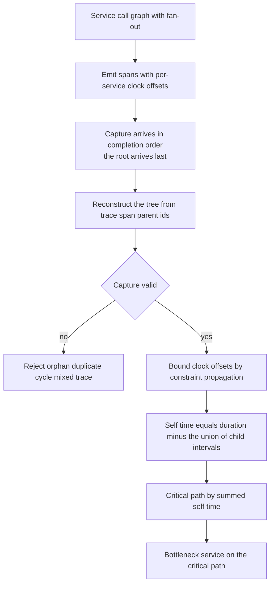
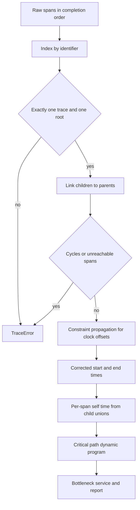
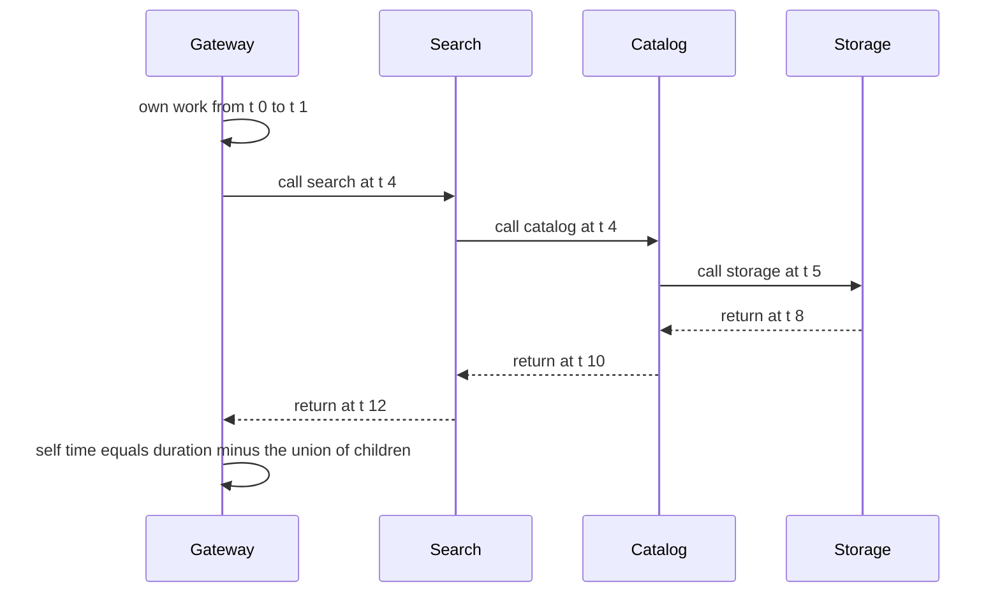

# 893 — Implement causal trace capture across microservices for latency debugging.

> **Tier:** Master · **CTCI chapter:** Beyond — Distributed Systems & Storage
> **Task spec:** [893-implement-causal-trace-capture-across-microservices-for-latency.md](../../../tasks/master/893-implement-causal-trace-capture-across-microservices-for-latency.md)
> **Solutions:** [Python](../../../solutions/python/master/893-implement-causal-trace-capture-across-microservices-for-latency/solution.py) ·
> [Java](../../../solutions/java/master/893-implement-causal-trace-capture-across-microservices-for-latency/Solution.java) ·
> [JavaScript](../../../solutions/javascript/master/893-implement-causal-trace-capture-across-microservices-for-latency/solution.js) ·
> [C#](../../../solutions/csharp/master/893-implement-causal-trace-capture-across-microservices-for-latency/Solution.cs)

## 1. Problem restatement

**Input:** a capture — a list of spans, each carrying `(trace, span, parent, service, start, end)`,
where times are integers reported by **per-service clocks with an injected offset** — together with
the service call graph that generated it.

**Output:** the reconstructed trace tree, the per-service clock-offset intervals, the critical path
with each span's self time, the bottleneck service, and a verdict from the capture validator.

**Modelling contract (what this file is and is not).** Each solution is an in-process *simulation* of
a tracing pipeline, generated from a fixed eleven-service topology (some services fan out
sequentially, some in parallel):

* **no network and no agent**: spans travel in an in-process list, and the deliberate ordering
  property is that they arrive in *completion order*, so the root arrives **last** — reconstruction
  must use identifiers and never arrival order;
* clocks are **integer offsets with no drift and no jitter**, so skew is a constant per service
  rather than a wandering quantity;
* **no span links and no asynchronous continuations**: the causal structure is a tree, one child edge
  per remote call, so there are no joins that are not parent/child;
* sampling is **deterministic head sampling**, not adaptive tail sampling;
* the "collector" is a class that keeps samples per trace, not a service with buffering, retries or
  back-pressure.

What the analyser does on top of those spans is the real content: reconstruction, skew bound
estimation, self time and critical path, the self-time sum identity, bottleneck identification,
sampling fidelity, and validation of the capture itself.

Verified invariants, from the assertions and the printed run:

| Check | Result |
| --- | --- |
| Reconstruction | `20` traces reassembled, `220` spans, independent of arrival order |
| Critical path | `20` dynamic programs matched exhaustive path enumeration |
| Skew bounds | all `220` service offsets bounded; widest interval `27` for a trace of length `28`; mean width `19.1` |
| Containment | `68` raw parent/child violations corrected by the estimated clock offsets |
| Self-time sum | the self times sum to at least the root duration (`>=`), with equality on a purely sequential trace |
| Bottleneck | the reported bottleneck is the service that was deliberately slowed |
| Validation | five classes of broken capture are rejected: orphaned, duplicated, cyclic and mixed-trace captures, plus a missing root |
| Scale | `3300` spans over `300` traces, collector work `6600` |
| Reproducibility | every trace replays from its seed |

## 2. Intuition

The naive way to analyse a distributed trace is to sort the spans by start time and read them in
order. That fails immediately, for two independent reasons, and understanding them is the whole task.

The first reason is that **arrival order is not causal order**. Spans are reported when they finish,
so the root — the span that encloses everything — is always reported last. The only reliable
structure is the identifier triple `(trace, span, parent)`: the tree is rebuilt by grouping children
under parents, requiring exactly one root, requiring every span to be reachable from it, and rejecting
cycles. The file asserts order independence: whether the same capture arrives in completion order or
in any other permutation, the reconstructed tree, the self times and the critical path are identical.

The second reason is **clock skew**. Each service has its own clock, so the timestamps of two services
are not directly comparable: the printed run shows `68` parent/child containment violations in the
raw capture — a child apparently starting before its parent — that are pure clock artefacts. The fix
is not to pick one service as "the truth" (offsets are only identifiable up to a common constant,
which the file states rather than hides) but to *bound the differences*. For a parent/child pair the
reported times imply

```text
end_child - end_parent  <=  offset_child - offset_parent  <=  start_child - start_parent
```

Propagating those difference constraints along every root-to-service path yields an interval per
service that is guaranteed to contain the true offset. For the generated traces the widest interval is
`27` for a trace of length `28`, and the mean width is `19.1` — wide, because the constraints are
sound but not tight, which is exactly why the file calls them *bounds*.

With times corrected, the analysis becomes possible. **Self time** of a span is its duration minus the
exact measure of the *union* of its children's intervals — a union, not a sum, because parallel
children overlap and counting them twice would double-charge latency. The **critical path** is the
root-to-leaf path maximising summed self time, found by a dynamic program over the tree. The
completeness check is that the self times sum to *at least* the root duration: every span's own work
is counted once by its own self time, and overlapping parallel subtrees push the total above the root's
wall-clock length. On a purely sequential trace the sum equals the root duration exactly, and the file
asserts the `>=` bound over every generated trace.



## 3. Algorithm

1. Index the capture by span id, rejecting duplicates; require exactly one trace id.
2. Build the tree: collect children per parent, require exactly one span with no parent, walk parent
   chains to reject cycles, and verify that every span is reachable from the root.
3. Estimate skew: for every parent/child pair form the constraint
   `[end_child - end_parent, start_child - start_parent]` on the offset difference, keep the tightest
   constrain per service pair, and propagate lower and upper bounds from the root (fixed at `0`).
4. Correct the reported times with a feasible offset assignment (shortest paths over the constraint
   graph, normalised so the root service is `0`).
5. Compute self times: duration minus the union length of the child intervals.
6. Run the critical-path dynamic program and cross-check it against exhaustive path enumeration.
7. Identify the bottleneck as the service contributing the most self time along the critical path.
8. Sample, and validate every capture before analysis.

```text
function build_tree(spans)
    by_id = index spans by identifier, rejecting duplicates
    require the capture holds exactly one trace
    children = empty list per span
    roots = empty list
    for (span_id, span) in by_id do
        if span.parent is none then append span_id to roots
        else if span.parent is not in by_id then raise TraceError("missing parent")
        else append span_id to children[span.parent]
        end
    end
    require exactly one root
    for span_id in by_id do
        walk the parent chain collecting visited ids
        if a repeat occurs then raise TraceError("cycle") end
    end
    walk from the root; require every span to be reachable
    return children, root, by_id
end

function union_length(intervals)
    sort the intervals by start
    total = 0
    current = the first interval
    for (start, end) in the remaining intervals do
        if start > current.end then
            total += current.end - current.start
            current = (start, end)
        else
            current.end = max(current.end, end)
        end
    end
    return total + current.end - current.start
end

function self_times(spans, tree)
    child_intervals = empty list per span
    for span in spans do
        if span.parent is not none then
            append (span.start, span.end) to child_intervals[span.parent]
        end
    end
    for span in spans do
        self_time[span] = (span.end - span.start) - union_length(child_intervals[span])
    end
    return self_time
end

function constraint_edges(tree)
    for each parent/child pair do
        low = child.end - parent.end
        high = child.start - parent.start
        keep the tightest (max low, min high) for the service pair
    end
end

function estimate_skew(tree)
    lower[root service] = 0; upper[root service] = 0
    for each propagation round do
        for ((parent_service, child_service), (low, high)) in the constraints do
            lower[child_service] = max(lower[child_service], lower[parent_service] + low)
            upper[child_service] = min(upper[child_service], upper[parent_service] + high)
        end
    end
    return one interval per service
end

function critical_path(tree, self_time)
    best[span] = self_time[span] + max over children of best[child]
    remember the child that achieved the maximum
    return the path from the root that reconstructs the maximum
end
```



## 4. Worked example

Take one generated trace from the fixed eleven-service topology and follow the analysis. The generator
gives each service `lead = base / 3` units of work *before* it calls its children, then the children
(sequential ones chained by their ends, parallel ones all starting at the same instant), then the
remaining `base - lead` units; every parallel sibling therefore begins at its parent's cursor, which is
why the union of sibling intervals equals the waiting window exactly.

True times for a skew-free capture:

| Span | Service | Parent | Start | End | Duration | Union of children | Self time |
| --- | --- | --- | --- | --- | --- | --- | --- |
| gateway | gateway | — | `0` | `20` | `20` | `[1, 4] ∪ [4, 12] ∪ [12, 18]` = `17` | `3` |
| auth | auth | gateway | `1` | `4` | `3` | `[1, 2]` = `1` | `2` |
| session | session | auth | `1` | `2` | `1` | none | `1` |
| search | search | gateway | `4` | `12` | `8` | `[4, 10] ∪ [4, 6]` = `6` | `2` |
| catalog | catalog | search | `4` | `10` | `6` | `[5, 8]` = `3` | `3` |
| storage | storage | catalog | `5` | `8` | `3` | none | `3` |
| index | index | search | `4` | `6` | `2` | none | `2` |
| cart | cart | gateway | `12` | `18` | `6` | `[12, 16] ∪ [12, 15]` = `4` | `2` |
| pricing | pricing | cart | `12` | `16` | `4` | `[13, 14]` = `1` | `3` |
| rules | rules | pricing | `13` | `14` | `1` | none | `1` |
| inventory | inventory | cart | `12` | `15` | `3` | none | `3` |

**Step 1 — reconstruction.** The capture arrives in completion order, so `storage` is reported before
`catalog` and `gateway` arrives last. Sorting by start time would mis-nest nothing here but would
mis-order the sequential chain; the tree is instead built from `(trace, span, parent)`, giving
`gateway` with children `auth`, `search`, `cart`, `search` with children `catalog`, `index`, and so on.
The file asserts the analysis is identical for any arrival permutation.

**Step 2 — skew constraints.** Suppose the capture was reported with `offset_search = +7` relative to
the gateway. The edge `gateway -> search` then reports `search` at `[11, 19]` instead of `[4, 12]`,
and the constraint is `low = 19 - 20 = -1`, `high = 11 - 0 = 11`, i.e.
`offset_search ∈ [-1, 11]` — which contains the true `+7`, but is `12` units wide, illustrating why the
file reports *bounds*. Adding the deeper edges (for instance `search -> index` with an offset of `-3`
gives another range) narrows each interval, and propagation from the root produces one interval per
service; across the printed run all `220` service offsets are bounded, the widest interval is `27` wide
on a `28`-unit trace, and the mean width is `19.1`.

**Step 3 — self times.** The table above is the result: `gateway` does `3` units of its own work,
`search` `2`, `catalog` `3`, `storage` `3`, and so on. Note the parallel rows: `search` has two
children whose intervals are `[4, 10]` and `[4, 6]`, so their *union* is `6` — summing them would
double-count the overlap and overstate what `search` waited for. The completeness check is the sum:
`3 + 2 + 1 + 2 + 3 + 3 + 2 + 2 + 3 + 1 + 3 = 25` against a root duration of `20`. The sum exceeds the
wall-clock length because overlapping parallel subtrees each contribute their own work, which is
exactly the `>=` relation the file asserts.

**Step 4 — critical path.** The dynamic program maximises summed self time along root-to-leaf paths:
going through `search` gives `3 + 2 + max(catalog: 3 + 3, index: 2) = 11`, through `auth` gives
`3 + 2 + 1 = 6`, and through `cart` gives `3 + 2 + max(3 + 1, 3) = 9`. The chosen path is
`gateway -> search -> catalog -> storage` with `11` units, cross-checked against exhaustive enumeration
of every root-to-leaf path for all `20` generated traces, and the reported bottleneck is the service
with the largest self time on that path — `catalog` and `storage` at `3` units each in this trace.



## 5. Complexity

| Step | Time | Space | Reason |
| --- | --- | --- | --- |
| `index_spans` | `O(spans)` | `O(spans)` | one hash insert per span, duplicates rejected |
| `build_tree` | `O(spans * depth)` | `O(spans)` | child lists plus a parent-chain walk per span for cycle detection |
| Reachability check | `O(spans)` | `O(spans)` | one traversal from the single root |
| `self_times` | `O(spans log children)` | `O(spans)` | sorting each span's child intervals for the union |
| `union_length` | `O(c log c)` | `O(1)` | a sweep over `c` sorted intervals |
| `constraint_edges` | `O(spans)` | `O(services^2)` | one constraint per edge, tightened per service pair |
| `estimate_skew` | `O(services * edges)` | `O(services)` | bound propagation, a Bellman-Ford-shaped relaxation |
| `critical_path` | `O(spans)` | `O(spans)` | one dynamic program over the tree |
| Exhaustive path check (the oracle) | `O(paths)` | `O(depth)` | enumeration of every root-to-leaf path; used only for verification |
| Full analysis | `O(spans log spans)` | `O(spans)` | `220` spans in `20` traces, `3300` spans over `300` traces at scale |
| Collector | `O(1)` per span | `O(sampled spans * samples_per_trace)` | `6600` units of collector work for the scaled run |

The reported linear-in-spans bound is what makes a collector viable: analysis is
`O(spans log spans)` once per trace, dominated by the sort inside each union.

## 6. Pitfalls and edge cases

* **Arrival order.** Spans arrive in completion order, so the root is last; any analysis that sorts by
  start time will mis-nest spans. The file asserts the capture is order independent by shuffling the
  span list.
* **Broken captures.** The validator rejects a duplicate span id, a missing parent (orphan), a
  capture mixing two trace ids, a cycle, and a capture without exactly one root — five classes of
  broken input — instead of silently analysing something wrong.
* **Absolute offsets are not identifiable.** Only *differences* between clocks are; fixing the root
  service at offset `0` is a convention, and the reported intervals are sound bounds rather than exact
  values. The widest interval (`27` of a `28`-unit trace) shows how loose they can be.
* **Union, not sum, of child intervals.** Parallel children overlap, so summing them can exceed the
  parent's duration — the exact union is what makes self time meaningful.
* **Zero self time is legitimate.** A span that only waits on children has self time `0` and is not on
  the critical path through its own work.
* **Nested windows.** A child must lie inside its parent's window *after* correction; the raw capture
  violates this `68` times, and those violations are the diagnostic that skew exists at all.
* **Sampling.** Head sampling is deterministic and must stay faithful to the latency distribution: the
  file asserts the sampled counts and quantiles match, so sampling cannot quietly bias toward fast
  traces.
* **Bottleneck versus slowest span.** The bottleneck is the largest *self* time on the critical path,
  not the largest total duration — a span can be slow only because its children are.
* **Single-span traces.** A trace with one root and no children is valid; its self time is its whole
  duration and it is trivially the critical path.
* **Clock drift is out of scope.** Offsets are constant, so a service that drifts within a trace is
  not modelled; real systems need piecewise offset estimation, and the file says so.
* **Reproducibility.** Trace generation, skews and slow-service selection all come from the seeded
  `splitmix64` stream, so every capture replays exactly.

## 7. Variants and follow-ups

* **From a trace to a diagnosis.** This task finds *where* the latency sits; attributing it to a root
  cause across the whole topology is the next step —
  [894](../../../tasks/master/894-implement-automated-root-cause-analysis-heuristics-using-depende.md)
  ranks suspects on the dependency graph.
* **Measuring the same latency without tracing.** A discrete-event benchmark can report the same
  percentiles under scheduled faults —
  [891](../../../tasks/master/891-implement-benchmarking-harness-for-large-distributed-systems-wit.md)
  crashes and partitions nodes and reports throughput rather than span trees, and
  [892](../../../tasks/master/892-implement-chaos-monkey-style-fault-injection-and-recovery-valida.md)
  is what produces the partial, out-of-order captures the validator has to reject.
* **Adaptive sampling and long traces.** Tail sampling keeps the slow traces head sampling discards,
  and the quantile-fidelity checks here are the ground truth it must preserve; asynchrony and span
  links turn the tree into a DAG, where the critical path becomes a longest-path computation over the
  join structure and the self-time identity becomes an interval decomposition statement.

## 8. Check yourself

<details><summary>Show answer</summary>

**Q1. Why must the tree be rebuilt from identifiers rather than from timestamps?**

Because spans are reported when they complete, so the root of a trace always arrives last — sorting by
start time would put leaf spans before their ancestors. Worse, the timestamps come from different
clocks, so they are not even mutually comparable before skew correction. The identifier triple
`(trace, span, parent)` is the only ordering information that is causally sound, and the file asserts
the analysis is identical for any arrival permutation.

</details>

<details><summary>Show answer</summary>

**Q2. Why can't the analyser simply compute each service's true clock offset?**

Because a constant offset added to *every* service's clock produces exactly the same capture: only
differences are identifiable. Fixing the root service at offset `0` is a convention, and the honest
statement is an interval per service derived from the containment constraints — for the generated
traces the widest is `27` wide on a `28`-unit trace, mean `19.1` — which is sound but not tight.

</details>

<details><summary>Show answer</summary>

**Q3. Why is self time defined with a union of child intervals, and why is the completeness check an
inequality?**

Because children can overlap: two parallel calls under the same parent run concurrently, so their
intervals intersect and summing them can exceed the parent's duration (in the worked example `6` units
of union for children spanning `[4, 10]`). The exact union is what the parent actually spent waiting,
so subtracting it leaves the parent's own work. Summing self times then counts every service's own work
once — including work happening concurrently in other branches — so the total is at least the root's
wall-clock duration (`25` against `20` in the worked example) and equals it on a purely sequential
trace. That `>=` is the strongest statement the file can assert for both shapes.

</details>
