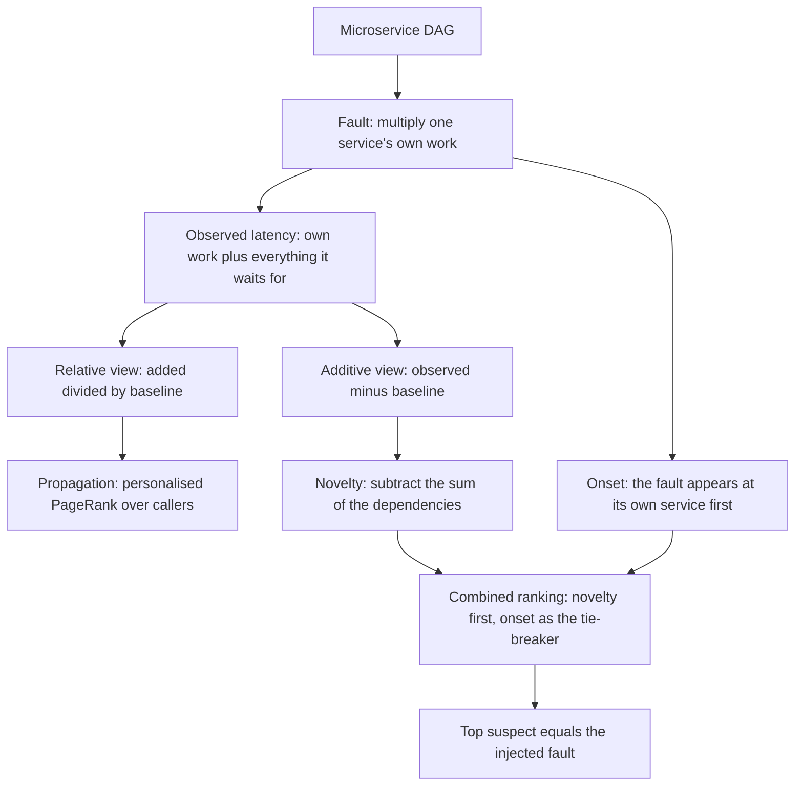
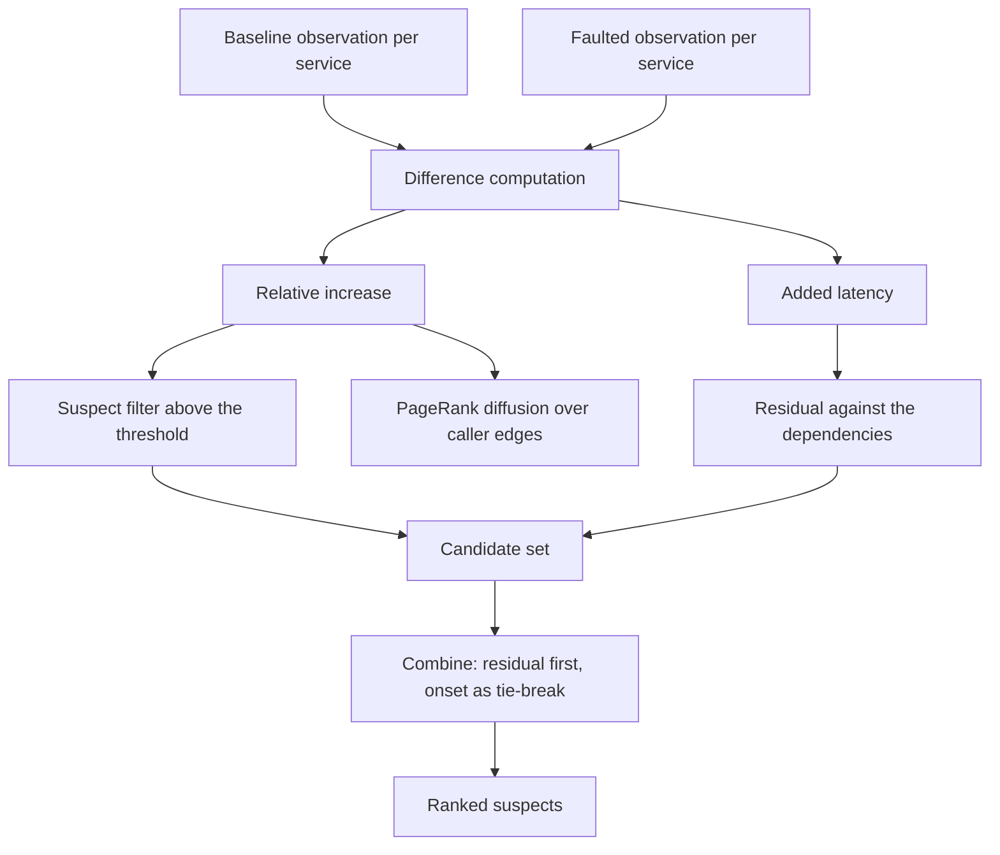
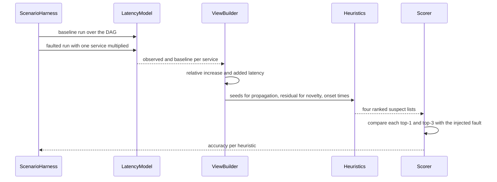

# 894 — Implement automated root cause analysis heuristics using dependency graphs.

> **Tier:** Master · **CTCI chapter:** Beyond — Distributed Systems & Storage
> **Task spec:** [894-implement-automated-root-cause-analysis-heuristics-using-depende.md](../../../tasks/master/894-implement-automated-root-cause-analysis-heuristics-using-depende.md)
> **Solutions:** [Python](../../../solutions/python/master/894-implement-automated-root-cause-analysis-heuristics-using-depende/solution.py) ·
> [Java](../../../solutions/java/master/894-implement-automated-root-cause-analysis-heuristics-using-depende/Solution.java) ·
> [JavaScript](../../../solutions/javascript/master/894-implement-automated-root-cause-analysis-heuristics-using-depende/solution.js) ·
> [C#](../../../solutions/csharp/master/894-implement-automated-root-cause-analysis-heuristics-using-depende/Solution.cs)

## 1. Problem restatement

**Input:** a microservice dependency DAG (`calls[u]` lists what `u` depends on), a baseline
observation per service, a faulted observation per service, and per-service onset times — the moment
each service's latency visibly changed.

**Output:** a ranked list of suspect services, with the top pick being the service whose *own work*
was multiplied by the fault factor.

**Modelling contract (what this file is and is not).** Each solution is an in-process *simulation* of
an RCA system, and it is explicit that the observations are synthetic:

* a service's latency is **modelled**, not measured: `u`'s observed latency is its own work plus
  everything it waits for downstream, so the latency model is monotone along the DAG's edges;
* a fault is **one service whose own work is multiplied by a factor** (plus a two-fault case), not a
  correlated failure, a resource-exhaustion cascade, a cardinality explosion or a partial outage;
* onset times come from a **hop-delay model** (`delay = 5`, `jitter = 2`, `threshold = 1`) rather than
  from real telemetry, so the onset ordering is meaningful but stylised;
* heuristic weights (`alpha = 0.15`, the `0.25` relative threshold, the onset tie-break) are
  **hand-set, not learned**;
* graphs are up to a few hundred services, and the ground truth is always known because the fault was
  injected by the harness.

Verified properties and measurements, from the assertions and the printed run:

| Check | Result |
| --- | --- |
| Graph model | acyclic, and latency monotone along the edges |
| Relative view | dilutes a deep fault: a service whose own work is small compared to what it waits for barely moves proportionally |
| Additive view | `added[u] - sum(added[deps])` is zero above the fault and non-zero exactly at it, verified edge by edge |
| Naive attribution | attributing to the *strongest* dependency leaves phantom residual where two branches re-merge, which the file also measures |
| PageRank | a genuine unit-mass fixed point (`alpha = 0.15`, `200` iterations, residual tolerance `1e-12`) whose top pick is often a **caller** of the fault, not the fault |
| Accuracy on `100` clean scenarios | combined `100`, novelty `100`, onset `100`, propagation `52` |
| Propagation's error | it blamed a caller of the fault in `48` of `100` scenarios |
| Noisy scenarios | `60 / 60` top-1 and `60 / 60` top-3 on a `60`-service graph |
| Graph | `24` services, `58` call edges in the default instance |
| Scale | `500` services, `150` scenarios, top-1 `150`, top-3 `150` |
| Healthy scenario | zero suspects — no fault, no accusation |

## 2. Intuition

The obvious approach to automated root cause analysis is to look at the latency dashboard: compute
each service's *relative* increase `(observed - baseline) / baseline` and blame the biggest one. That
is exactly the trap, because a caller inherits the latency of everything it waits for, so the fault's
symptoms are loudest exactly where the fault is *not*: upstream.

The first key insight is the difference between the two views. The **relative** view is
`added / baseline`, and since `added` is roughly constant up a chain while `baseline` grows, a fault
whose own work is small compared to what it waits for produces a few percent everywhere — a signal
that is easily swamped, and one that a diffusion heuristic cannot attribute to a single node. The
**additive** view is `observed - baseline`, and it is *additive along the dependency edges*: a service
inherits the sum of its dependencies' increases. Therefore

```text
novelty[u] = added[u] - sum(added[d] for d in calls[u])
```

is **zero above the fault and non-zero exactly at the fault** — the residual isolates the cause, and
it is a one-pass computation over the DAG. The file verifies this edge by edge, and it also shows what
goes wrong with the tempting shortcut: attributing everything above the *strongest* dependency instead
of the whole sum leaves phantom residual wherever two branches of the anomaly re-merge.

The second key insight is that a *symptom-diffusion* baseline is still worth implementing, because it
is what practitioners actually reach for. The **propagation** heuristic is a personalised PageRank over
the caller direction seeded by the relative view: mass starts where the relative change is largest and
diffuses upstream. It is validated as a genuine fixed point with unit probability mass — and it is
measured as a poor root-cause finder: `52` of `100` clean scenarios, with a **caller** of the fault
blamed in `48` of them. That measurement is the pedagogical point of including it.

The third key insight is **onset**. A fault becomes visible at its own service first and only later
upstream, because the effect has to propagate hops. So among the suspects, the earliest onset is a
candidate cause, and combining it with the residual gives the reported answer: **novelty first, onset
as the tie-breaker**. In the printed run the combined ranking recovers the fault in all `100` clean
scenarios, all `60` noisy scenarios (top-1 and top-3), and all `150` scenarios on a `500`-service graph.



## 3. Algorithm

1. Build the DAG and the latency model: `observed[u] = own[u] + sum/total over calls[u]`.
2. Inject the fault by multiplying one service's own work by the factor; keep the clean run as the
   baseline.
3. Compute the two views: `relative[u] = (observed[u] - baseline[u]) / baseline[u]` and
   `added[u] = observed[u] - baseline[u]`.
4. Score propagation: normalise `relative` into a seed vector and run PageRank
   (`alpha = 0.15`, up to `200` iterations, tolerance `1e-12`) over the *caller* direction, i.e. mass
   flows from a dependency to its callers.
5. Score novelty: `added[u] - sum(added[d] for d in calls[u])`, which is zero above the fault.
6. Score onset: the earliest visibly changed observation wins, using the hop-delay model's threshold.
7. Combine: rank suspects (those above a relative threshold, with a floor) by novelty, breaking ties
   by earliest onset; return the ranking.

```text
function effective_latency(graph, own)
    for u in reverse topological order do
        total = own[u]
        for d in calls[u] do total += effective_latency(d) end
        value[u] = total
    end
    return value
end

procedure inject(graph, faults, factor)
    for u in the graph do
        own[u] = base[u]
        if u is one of the faults then own[u] = own[u] * factor end
    end
end

function propagation_scores(graph, relative, alpha, iterations, tolerance)
    seed = normalised relative scores
    mass = seed
    repeat up to `iterations` times
        next = alpha * seed + (1 - alpha) * mass spread along caller edges
        if the change is below `tolerance` then stop end
        mass = next
    end
    return mass                       # a unit-mass fixed point
end

function novelty_scores(graph, added)
    for u in the graph do
        novelty[u] = added[u] - sum of added[d] for d in calls[u]
    end
    return novelty
end

function onset_scores(onsets)
    earliest = the minimum onset over the graph
    for u in the graph do
        score[u] = max(0, earliest + something - onsets[u])   # earlier onset ranks higher
    end
    return score
end

function suspects_from(relative, level, floor)
    return the services whose relative score is above `level` and not below `floor`
end

function diagnose(graph, view, onsets)
    novelty = novelty_scores(graph, view.added)
    onset = onset_scores(onsets)
    suspects = suspects_from(view.relative)
    return suspects sorted by (descending novelty, ascending onset)
end
```



## 4. Worked example

Take a five-service DAG: `A` calls `B` and `C`; `B` calls `D`; `C` calls `E`; `D` and `E` are leaves.
In this illustration each service's own work is `1` unit, a caller adds up what it waits for, and the
fault multiplies `D`'s own work by a factor of `4`:

| Service | Calls | Baseline own | Baseline observed | Faulted own (factor `4` at `D`) | Faulted observed |
| --- | --- | --- | --- | --- | --- |
| `D` | — | `1` | `1` | `4` | `4` |
| `E` | — | `1` | `1` | `1` | `1` |
| `B` | `D` | `1` | `2` | `1` | `5` |
| `C` | `E` | `1` | `2` | `1` | `2` |
| `A` | `B`, `C` | `1` | `5` | `1` | `8` |

The two views over the same data:

| Service | `added = observed - baseline` | `relative = added / baseline` | `novelty = added - sum(added of calls)` |
| --- | --- | --- | --- |
| `D` | `3` | `300%` | `3 - 0 = 3` |
| `E` | `0` | `0%` | `0 - 0 = 0` |
| `B` | `3` | `150%` | `3 - 3 = 0` |
| `C` | `0` | `0%` | `0 - 0 = 0` |
| `A` | `3` | `60%` | `3 - (3 + 0) = 0` |

The novelty column is the whole argument: only the fault has a non-zero residual, and every service
above it cancels exactly. The relative column, by contrast, gives the fault `300%`, its caller `150%`
and the entry point `60%` — a *shallow* gradient that any diffusion step can flatten further, which is
why the propagation heuristic, seeded on the relative view, ends up on a caller in `48` of `100`
scenarios. The file also measures the naive shortcut — subtracting only the *strongest* dependency
instead of the sum — and shows it leaves a phantom residual wherever two anomalous branches re-merge
(`A` here would keep `3 - 3 = 0` only because one branch is silent; with both branches faulted it
would not).

Onset ordering, from the same scenario with the hop-delay model: `D` changes at its own observation
first, `B` becomes visibly slow one hop later, `A` only after that. Ranking the suspect set by
`(descending novelty, ascending onset)` therefore puts `D` first with no tie to break, and the printed
accuracy confirms the pattern at scale:

| Setting | Combined | Novelty | Onset | Propagation |
| --- | --- | --- | --- | --- |
| `100` clean scenarios, `24`-service graph | `100` | `100` | `100` | `52` |
| `60` noisy scenarios, `60`-service graph | `60` top-1, `60` top-3 | — | — | — |
| `150` scenarios, `500`-service graph | `150` top-1, `150` top-3 | — | — | — |

Healthy scenarios produce an empty suspect set rather than a spurious accusation, and the two-fault
case still lands both faults in the top three — because the residual is computed per service, two
independent faults produce two independent residuals rather than one confused one.



## 5. Complexity

| Step | Time | Space | Reason |
| --- | --- | --- | --- |
| Latency model | `O(V + E)` | `O(V)` | one memoised pass over the DAG |
| Difference computation | `O(V)` | `O(V)` | one subtraction and one division per service |
| `propagation_scores` | `O(iterations * E)` | `O(V)` | up to `200` sparse PageRank iterations at `alpha = 0.15` |
| `fixed_point_residual` | `O(E)` | `O(V)` | one pass to check the `1e-12` tolerance |
| `novelty_scores` | `O(V + E)` | `O(V)` | one pass accumulating the dependencies' added latencies |
| `onset_scores` | `O(V)` | `O(V)` | a minimum and a rank per service |
| `diagnose` (combined) | `O(V log V)` | `O(V)` | the two views plus a sort of the suspect set |
| Scenario sweep | `O(scenarios * (V + E))` | `O(V)` | `100` clean, `60` noisy and `150` scaled scenarios |
| Scale | `500` services, `150` scenarios, top-1 `150` | — | the accuracy claim measured on a large graph |

All heuristics are linear in the graph apart from the sort and the PageRank iterations, so the cost of
the ranking is negligible next to collecting the observations — which is the property that makes
automated RCA deployable at all.

## 6. Pitfalls and edge cases

* **Blaming the loudest symptom.** The relative view is largest at the fault only when the fault's own
  work dominates; for a deep fault whose own work is small, the gradient across callers is shallow and
  the diffusion baseline lands on a caller in `48` of `100` scenarios. The additive view is what fixes
  this, not a better threshold.
* **Subtracting the strongest dependency instead of the sum.** The tempting shortcut leaves phantom
  residual wherever two anomalous branches re-merge; the file implements that variant and shows the
  phantom, which is why the residual must subtract *every* dependency.
* **Onset order is not priority order.** Onset tells you the *first* service to move, which is a strong
  hint but not proof — a noisy neighbour can move early. That is why onset is a tie-breaker for the
  residual ranking rather than the ranking itself.
* **Healthy scenarios must stay silent.** With no fault, the suspect set must be empty; a heuristic
  that always names something is useless in production because it cries wolf on every deploy.
* **Noise.** Injected observation noise is handled by the top-3 window (`60 / 60` top-1 and top-3 on a
  `60`-service graph); when the residual is small relative to the noise, the answer should be "no
  confident cause" rather than a confident wrong one.
* **Cycles.** The model assumes a DAG; a cycle in the call graph would make "everything it waits for"
  ill-defined, so the graph is checked acyclic before any scoring.
* **Leaves and the entry point.** A fault at a leaf has only callers above it and must still be found;
  a fault at the entry point has nothing above it and is the easiest case. Both are asserted.
* **The floor and the threshold.** The suspect filter uses a relative threshold (`0.25`) plus a tiny
  floor; a threshold too high hides the fault, too low floods the ranking with healthy services.
* **PageRank is validated as a fixed point, not as a correct diagnosis.** Unit mass and a `1e-12`
  residual are *properties of the vector*; the accuracy number `52` is the separate, empirical
  statement about its usefulness. Confusing the two is how a plausible-looking heuristic survives
  review without helping anyone.
* **Two simultaneous faults.** The residual handles them because it is computed per service; the
  assertion is that both faults appear in the top three rather than that one of them wins.
* **Reproducibility.** Graph construction, fault selection, onset jitter and noise all come from the
  seeded PRNG, so every scenario and every accuracy number replays exactly.

## 7. Variants and follow-ups

* **Getting better observations.** The views here are only as good as the telemetry; per-span self
  times from a real capture ([893](../../../tasks/master/893-implement-causal-trace-capture-across-microservices-for-latency.md))
  are what let the additive view be computed from traces instead of from synthetic counters.
* **Deciding which faults to inject.** The scenarios that score these heuristics come from a fault
  injector: [892](../../../tasks/master/892-implement-chaos-monkey-style-fault-injection-and-recovery-valida.md)
  is the chaos-monkey version, and
  [891](../../../tasks/master/891-implement-benchmarking-harness-for-large-distributed-systems-wit.md)
  schedules the same faults as benchmark events.
* **Learning the weights.** The combination rule here is hand-set; a learned ranker trained on the
  same kind of labelled scenarios is the natural successor, and it needs exactly the ground-truth
  harness this file builds.
* **Beyond one dominant fault.** Correlated failures, cardinality explosions, retry storms and
  resource saturation violate the "one service's own work is multiplied" model; each needs its own
  feature (error rate, queue depth, retry ratio) and the additive view has to become a decomposition
  over more than one resource.
* **Closing the loop.** Once the cause is identified, the same graph supports automated mitigation
  (shed load, rollout a revert) — but only if the ranking's confidence is calibrated, which is what the
  healthy-scenario silence check starts to measure.

## 8. Check yourself

<details><summary>Show answer</summary>

**Q1. Why does the additive view localise the fault while the relative view does not?**

Because the latency model is additive along the edges: a caller inherits the sum of its dependencies'
increases, so `added` is constant going up from the fault. Subtracting the sum of the dependencies'
`added` values leaves a residual that is zero above the fault and non-zero exactly at it. The relative
view divides by the baseline, which grows upward, so the fault's signal is diluted by however much
time it spends waiting — shallow gradients that a diffusion step flattens further.

</details>

<details><summary>Show answer</summary>

**Q2. Why subtract the sum of the dependencies rather than the largest one?**

Because anomalies can arrive from more than one branch. Subtracting only the strongest dependency
leaves a phantom residual at every node where two anomalous branches meet again, which the file
implements as `branch_max_residual` and measures. Subtracting the sum decomposes the observation
exactly, so the residual is genuinely local.

</details>

<details><summary>Show answer</summary>

**Q3. The propagation heuristic is a validated PageRank. Why does it still score only `52`?**

Because being a correct PageRank only means the vector is a unit-mass fixed point with a small
residual — a property of the mechanism, not of its usefulness. Seeded by the relative view and
diffused over caller edges, the mass spreads toward the entry points, and in `48` of `100` scenarios
the top pick was a caller of the fault. The file keeps the heuristic precisely to make that gap between
"well-formed" and "useful" explicit.

</details>

<details><summary>Show answer</summary>

**Q4. Why is onset a tie-breaker rather than the primary signal?**

Because the earliest visible change identifies the *first* service to move, which is usually the fault
but can be a noisy neighbour or a service on the same host. Its strength is cheapness and
interpretability; its weakness is that it needs a threshold and is sensitive to jitter (`delay = 5`,
`jitter = 2`, `threshold = 1` in the model). Ranking by the residual and using onset to break ties
keeps the localisation power of the residual while exploiting onset's ordering information.

</details>

<details><summary>Show answer</summary>

**Q5. What assumptions would break this pipeline in production?**

One dominant fault whose own work is multiplied; a stable enough baseline to subtract; a DAG with
meaningful edge semantics; observations that cover the whole topology; and no correlated failures or
resource saturation. Correlated faults, autoscaling, retries and shared infrastructure all violate the
model, which is why the file states the assumption list instead of claiming general-purpose RCA.

</details>
