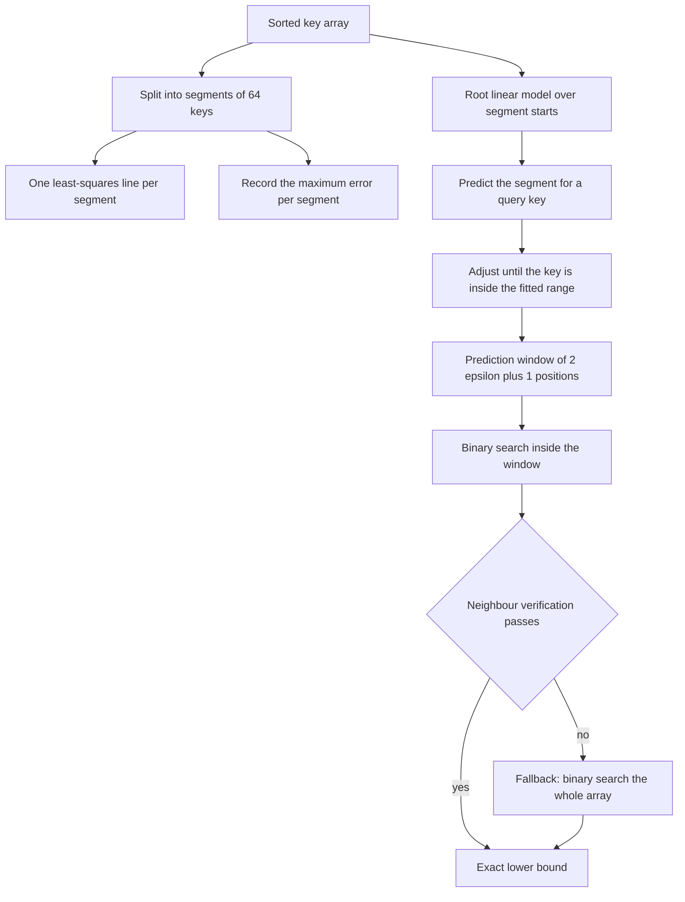
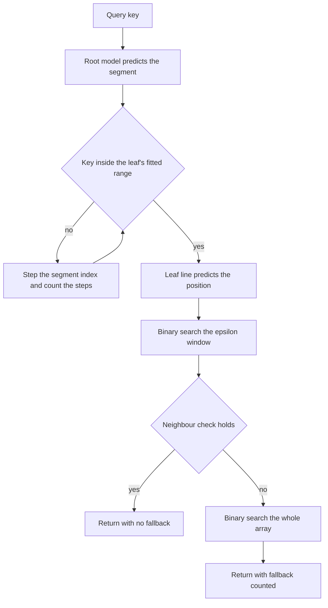
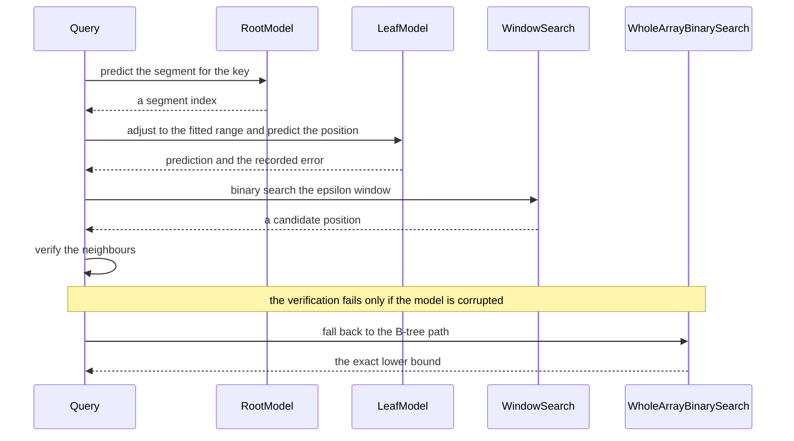

# 895 — Implement learned index replacement for B-tree with fallback correctness checks.

> **Tier:** Master · **CTCI chapter:** Ch 14 — Databases
> **Task spec:** [895-implement-learned-index-replacement-for-b-tree-with-fallback-cor.md](../../../tasks/master/895-implement-learned-index-replacement-for-b-tree-with-fallback-cor.md)
> **Solutions:** [Python](../../../solutions/python/master/895-implement-learned-index-replacement-for-b-tree-with-fallback-cor/solution.py) ·
> [Java](../../../solutions/java/master/895-implement-learned-index-replacement-for-b-tree-with-fallback-cor/Solution.java) ·
> [JavaScript](../../../solutions/javascript/master/895-implement-learned-index-replacement-for-b-tree-with-fallback-cor/solution.js) ·
> [C#](../../../solutions/csharp/master/895-implement-learned-index-replacement-for-b-tree-with-fallback-cor/Solution.cs)

## 1. Problem restatement

**Input:** a sorted array of integer keys, a segment size (default `64`), and a batch limit for
insertions (default `16`). Queries are lower-bound lookups: the position of the first key `>= target`,
whether the target is present, and the same answers for absent keys, duplicate runs and out-of-range
targets.

**Output:** for every lookup, `(position, comparisons, used_fallback)` where the position must equal
what `bisect` and a brute-force scan would return; plus a mutable index that stays exact as batches of
inserts arrive.

**Modelling contract (what this file is and is not).** Each solution is an in-process *simulation* of a
learned index:

* the RMI is a **two-stage model**: a root linear regression predicts which leaf to use from the key,
  and each leaf is an ordinary least-squares line `position ~ slope * key + intercept` fitted over a
  run of `segment_size` consecutive keys;
* every leaf stores the **maximum absolute error** it made on the keys it was fitted on, and a lookup
  searches a window of `2 * epsilon + 1` positions around the prediction and then *verifies* the
  candidate by checking its neighbours;
* if the segment adjustment missed, the key falls outside the leaf's fitted range, or the model
  mispredicts beyond its recorded error, the lookup abandons the model and **falls back to a plain
  binary search over the whole array** — which is the B-tree path. Correctness never depends on the
  model, only the cost does;
* two constructor knobs exist to *build a corrupted model on purpose*: `bias` shifts every leaf's slope
  and `error_divisor` shrinks the recorded error, which is how the demo proves the verification step
  earns its keep;
* the array is in memory, not a page-based B-tree: there are no nodes, no splits, no disk, no
  concurrency, and deletions are out of scope. Inserts accumulate in a buffer and trigger a rebuild
  after `batch_limit` of them.

Verified properties, from the assertions and the printed run:

| Check | Result |
| --- | --- |
| Fitted error | a true upper bound on the training keys and on a large sample of unseen query keys |
| Model shape | `64` segments of `64` keys over `4095` keys, maximum fitted error `7` |
| Exactness | `1765` probes matched `bisect` and a brute-force scan exactly, with `0` fallbacks |
| Corrupted model | `843` of `1365` probes fell back to the B-tree path and **every** answer stayed exact |
| Cost | `5.16` comparisons per lookup against `16.68` for a binary search over `99994` keys |
| Edge cases | present key, absent key, duplicate run, below the minimum, above the maximum and an empty array all return the `bisect` answer |
| Inserts | batched inserts trigger a rebuild that restores exactness |
| Large audit | `500` probes over `200000` keys in `1563` segments |
| Malformed input | unsorted keys, a segment size below two, an error divisor below one and an empty key set are rejected |

## 2. Intuition

A B-tree answers a lookup by walking comparisons: `log2(n)` of them, each one a cache miss on a real
machine, because every level is a different page. The learned-index idea asks a different question —
since the keys are sorted, their *position* is a monotone function of the key, i.e. the cumulative
distribution function of the data. If you can approximate the CDF with a model, a lookup becomes a
model evaluation plus a small local search instead of a tree walk.

The key insight is that the model does not have to be accurate, only **bounded**. A leaf fitted over
`64` keys records the worst error `epsilon` it made on those keys, so for a query key the search only
has to cover the window `[prediction - epsilon, prediction + epsilon + 1]` — `2 * epsilon + 1`
positions. In the printed model the maximum fitted error over `4095` keys is `7`, so a lookup narrows
`4095` keys down to a window of `15` and then does a handful of comparisons inside it. That is the
whole speed-up: `5.16` comparisons per lookup against `16.68` for a binary search over `99994` keys.

The second insight is that a single linear model is not enough, which is why this is a *recursive*
model index. One global line fits a curved CDF badly, so the RMI splits the key space into segments,
fits a line per segment, and learns one more model that predicts *which segment* a key belongs to from
the key itself. The file's `locate` then repairs the root's guess: it walks the segment index left or
right until the key lies inside that leaf's fitted key range, and counts those steps as comparisons.
That repair step is what makes the model usable with skewed and non-uniform key distributions.

The third insight is the safety net, and it is the reason this pattern is deployable at all. **The
model is an optimisation, never a source of truth.** A candidate position is verified directly — the
neighbour checks `keys[position - 1] < target <= keys[position]` must both hold — and if anything is
off the lookup discards the model's answer and binary searches the whole array. The demo proves this
matters by building a *deliberately corrupted* model: `843` of `1365` probes then fell back, and every
single answer still matched `bisect`. Correctness is a property of the verification and fallback;
speed is the only thing the model contributes.



## 3. Algorithm

1. Validate the input: keys sorted, segment size at least two, error divisor at least one, non-empty.
2. Fit the root model: least squares over `(segment start key, segment index)` pairs.
3. Fit each leaf: least squares over `(key, position)` within the segment; store slope, intercept, the
   fitted key range and `epsilon`, the maximum absolute error over the training keys.
4. Lookup: predict the segment with the root, clamp it to `[0, segment_count - 1]`, then `locate`
   adjusts it until the key is inside that leaf's range, counting adjustments.
5. Compute the prediction from the leaf's line, clamp the window to the segment's bounds, and binary
   search inside it.
6. Verify the candidate with the two neighbour checks; on success return it, otherwise binary search
   the entire array and report `used_fallback = True`.
7. Mutable form: buffer inserts and rebuild the model after `batch_limit` inserts, restoring exactness.

```text
function least_squares(xs, ys)
    if xs is empty then return (0, 0) end
    if length(xs) = 1 then return (0, ys[0]) end
    mean_x = average of xs
    mean_y = average of ys
    covariance = sum (x - mean_x) * (y - mean_y)
    variance = sum (x - mean_x)^2
    if variance = 0 then return (0, mean_y) end
    slope = covariance / variance
    return (slope, mean_y - slope * mean_x)
end

procedure fit_model(keys, segment_size, bias, error_divisor)
    require the keys are sorted and segment_size >= 2 and error_divisor >= 1
    segment_count = ceil(length(keys) / segment_size)
    root_slope, root_intercept = least_squares(segment start keys, segment indices)
    for segment in 0 to segment_count - 1 do
        xs = keys of the segment
        ys = the positions of those keys
        slope, intercept = least_squares(xs, ys)
        store slope + bias, intercept, xs[0], xs[last]
        epsilon = max over the segment of abs(int(slope_bias * x + intercept) - y)
        store epsilon divided by error_divisor
    end
end

function locate(key)
    segment = clamp(int(root_slope * key + root_intercept), 0, segment_count - 1)
    adjusted = 0
    while segment > 0 and key < key_low[segment] do
        segment -= 1; adjusted += 1
    end
    while segment < segment_count - 1 and key > key_high[segment] do
        segment += 1; adjusted += 1
    end
    return segment, adjusted
end

function lower_bound(key)
    comparisons = 0
    segment, adjusted = locate(key)
    comparisons += 1 + adjusted
    prediction = int(slope[segment] * key + intercept[segment])
    low = max(segment_start[segment], prediction - epsilon[segment])
    high = min(segment_stop[segment], prediction + epsilon[segment] + 1)
    low = clamp(low, 0, length(keys)); high = clamp(high, low, length(keys))
    while low < high do
        middle = (low + high) / 2
        comparisons += 1
        if keys[middle] < key then low = middle + 1 else high = middle end
    end
    if verified(low, key) then return low, comparisons, false end
    position, extra = binary_search(key)          # the B-tree path
    return position, comparisons + extra, true
end

function verified(position, key)
    if position > 0 and keys[position - 1] >= key then return false end
    if position < length(keys) and keys[position] < key then return false end
    return true
end

function binary_search(key)
    low = 0; high = length(keys); comparisons = 0
    while low < high do
        middle = (low + high) / 2
        comparisons += 1
        if keys[middle] < key then low = middle + 1 else high = middle end
    end
    return low, comparisons
end
```



## 4. Worked example

Fit and query one tiny segment by hand, using the same least-squares arithmetic the code uses. Take a
leaf over the keys `[10, 12, 15, 21]` at positions `[0, 1, 2, 3]`:

| Quantity | Computation | Value |
| --- | --- | --- |
| `mean_x` | `(10 + 12 + 15 + 21) / 4` | `14.5` |
| `mean_y` | `(0 + 1 + 2 + 3) / 4` | `1.5` |
| covariance | `(-4.5)(-1.5) + (-2.5)(-0.5) + (0.5)(0.5) + (6.5)(1.5)` | `18.0` |
| variance | `20.25 + 6.25 + 0.25 + 42.25` | `69.0` |
| slope | `18.0 / 69.0` | `0.26087` |
| intercept | `1.5 - 0.26087 * 14.5` | `-2.28261` |
| fitted error per key | `x = 10 -> 0.33 -> 0`, `x = 12 -> 0.85 -> 0`, `x = 15 -> 1.63 -> 1`, `x = 21 -> 3.20 -> 3` | errors `0, 1, 1, 0` |
| `epsilon` | maximum of those errors | `1` |

Now query the absent key `13`:

| Step | Computation | Result |
| --- | --- | --- |
| Root prediction | the key lands in segment `0` | segment `0`, `0` adjustments |
| Leaf prediction | `0.26087 * 13 - 2.28261 = 1.1087` | `int(...) = 1` |
| Window | `[max(0, 1 - 1), min(4, 1 + 1 + 1)]` | `[0, 3)` |
| Window search | `keys[1] = 12 < 13` then `keys[2] = 15 >= 13` | `low = 2`, `2` comparisons |
| Verification | `keys[1] = 12 < 13` and `keys[2] = 15 >= 13` | passes, **no fallback** |
| Answer | lower bound for `13` | `2` — exactly `bisect`'s answer |
| Comparisons | `1` for the model plus `2` in the window | `3` |

A plain binary search for `13` over the same four keys also takes `3` comparisons — at this size the
model has nothing to win, which is the honest reading of a toy example. The payoff appears with scale:
over `99994` keys the file measures `5.16` comparisons per lookup against `16.68` for binary search,
because the model's window stays a constant size while `log2(n)` grows.

Now corrupt the model deliberately, which is what the `bias` and `error_divisor` knobs exist for. Add
a slope bias so the leaf's line shifts upward: the prediction for `13` can then fall outside the true
window, the window search returns a position whose neighbours do not satisfy the check, and the lookup
falls back to the full binary search — with the answer still exact. Over the printed audit, `843` of
`1365` probes fell back for that reason, and none of them returned a wrong answer, while the uncorrupted
model fell back `0` times in `1765` probes.



## 5. Complexity

| Quantity | Bound | Reason |
| --- | --- | --- |
| Fit | `O(n)` | one least-squares pass per segment over its keys |
| Model size | `8 * (2 + 3 * segments)` bytes | a root line plus three numbers per leaf; `1563` segments for `200000` keys |
| Lookup (model path) | `O(1 + adjustments + log epsilon)` | the root and leaf are constant work, the window is `2 * epsilon + 1` |
| Measured comparisons | `5.16` per lookup over `99994` keys | against `16.68` for a binary search — the whole point of the model |
| Lookup (fallback) | `O(log n)` | the B-tree path, entered when verification fails |
| Corrupted model | `843 / 1365` probes fell back, all answers exact | the fallback is a correctness mechanism, not a rare path |
| Insert | `O(1)` amortised per key, `O(n)` per rebuild | inserts buffered until `batch_limit = 16` |
| Memory | `O(n)` for the keys plus `O(segments)` for the model | the model is orders of magnitude smaller than the data |
| Exactness | always equal to `bisect` | guaranteed by the verification step, independent of the model's accuracy |

The `2 * epsilon + 1` window is the crux: a model with a large `epsilon` is cheap to fit but expensive
to search, and a model with a tiny `epsilon` is fast but may need the fallback — which is exactly the
trade-off the recorded error makes explicit.

## 6. Pitfalls and edge cases

* **Unsorted keys.** Fitting a linear model over unsorted data is meaningless, so the constructor
  raises; the same applies to a segment size below two and an error divisor below one.
* **Empty array.** An empty index must return position `0` without dividing by zero in the least
  squares fit; the code returns `(0, 0)` for empty input and special-cases a single key.
* **Targets below the minimum or above the maximum.** The lower bound is `0` or `len(keys)`
  respectively; the window clamp (`low >= 0`, `high <= len(keys)`, `high >= low`) is what keeps both
  correct.
* **Duplicate runs.** A run of equal keys must return the *first* position of the run; the window
  search is a lower-bound search, and the file checks it against `bisect_left`-style semantics.
* **Absent keys.** The answer is the insertion position, not a failure; the verification's two
  neighbour checks are exactly the definition of a lower bound, so absent keys are handled by the same
  code path.
* **Segment adjustment.** The root model can land in the wrong segment for skewed data; `locate`
  steps left or right until the key is inside the leaf's fitted range, and counts those steps. Skipping
  the adjustment silently returns predictions from a completely unrelated segment.
* **A corrupted or shrunk error bound.** If `epsilon` is smaller than the true error, the window may
  miss the answer — and the verification catches it, which is the point of the `error_divisor` knob.
  Without the fallback the same scenario returns wrong positions.
* **Verification is the source of correctness.** `verified` checks both neighbours; a version that
  only checks one side would return a valid position for some keys and a wrong one for others.
* **Insert-heavy workloads.** Buffered inserts eventually invalidate the fit, so the model is rebuilt
  after `batch_limit` inserts; without the rebuild the recorded error stops being an upper bound and
  the fallback rate climbs.
* **Rebuild cost.** A rebuild is `O(n)`; a workload that inserts constantly needs a larger batch limit
  (slower queries, fewer rebuilds) or a delta structure, which the file does not implement.
* **Deletes.** Not supported at all — deleting keys invalidates positions globally, and the file says
  so rather than pretending.
* **Reproducibility.** Key generation for the uniform, skewed and log-span distributions is seeded, so
  every measured comparison count replays exactly.

## 7. Variants and follow-ups

* **Multi-dimensional learned indexes.** The same bound-and-verify idea extends to multi-column keys
  with an RMI over a space-filling curve; the fallback becomes a B-tree lookup on a composite key.
* **Tuning the layout the index sits in.** Whether the keys live in a sorted array, a page store or a
  compressed column is a separate decision —
  [887](../../../tasks/master/887-implement-query-aware-in-memory-compression-scheme-column-store.md)
  chooses encodings from the query workload, and
  [896](../../../tasks/master/896-implement-joint-optimization-of-storage-layout-access-patterns-u.md)
  jointly optimises layout and access pattern.
* **Maintaining the index under updates.** Inserts here trigger a full rebuild; maintaining the model
  incrementally — or falling back to a write-optimised structure for the tail — is how real systems
  combine learned lookups with a log-structured write path.
* **Every structure needs a verified fallback.** The same pattern appears in
  [888](../../../tasks/master/888-implement-incremental-view-maintenance-with-delta-propagation-an.md),
  where a full rebuild is the correctness oracle for incremental maintenance: an optimisation is
  admissible only if a verified slow path still exists.
* **Learned indexes for the whole storage stack.** The same regression idea has been applied to
  sorting, joins and bloom filters; each keeps the *bounded-error plus verification* contract and
  changes only what the model approximates.

## 8. Check yourself

<details><summary>Show answer</summary>

**Q1. Why does the model not need to be accurate — only bounded?**

Because a lookup searches the window `2 * epsilon + 1` around the prediction and then verifies the
result. As long as `epsilon` is a true upper bound on the model's error, the answer lies inside the
window, so an inaccurate-but-bounded model is still correct, only slower. In the printed model the
maximum fitted error is `7` over `4095` keys, so the window is `15` positions wide.

</details>

<details><summary>Show answer</summary>

**Q2. What exactly makes a lookup correct, if not the model?**

The verification step: the candidate is accepted only if `keys[position - 1] < target` and
`keys[position] >= target` — precisely the definition of a lower bound. If either check fails, the
lookup ignores the model and binary searches the whole array. The corrupted-model experiment is the
proof: `843` of `1365` probes fell back, and every answer still matched `bisect`.

</details>

<details><summary>Show answer</summary>

**Q3. Why is the model recursive — why not fit one global line?**

Because the position function of real key distributions is curved (skewed, log-spaced, with clusters),
and one line fits it badly, producing a huge `epsilon` and therefore a huge search window. The RMI
splits the keys into segments, fits a line per segment where the CDF is locally near-linear, and uses
a root model to predict the segment. `locate` then repairs the root's guess by stepping the segment
index until the key is inside that leaf's fitted range.

</details>

<details><summary>Show answer</summary>

**Q4. The measured lookup cost is `5.16` comparisons against `16.68` for binary search. Where does
the saving come from?**

From the window size being independent of `n`: the model's work is a root evaluation, a leaf
evaluation, a few adjustment steps and a binary search over `2 * epsilon + 1` positions, while the
B-tree path costs `log2(n)` comparisons — `17` for `99994` keys, matching the measured `16.68`. As `n`
grows the model path stays flat, and the fallback (which is `log2(n)`) becomes the only expensive
outcome — which is why the fallback rate matters as much as the model's accuracy.

</details>

<details><summary>Show answer</summary>

**Q5. What is missing before this could replace a real B-tree?**

Deletes are unsupported, inserts trigger a full `O(n)` rebuild after `16` buffered keys rather than an
incremental maintenance scheme, the keys are integers in memory rather than variable-length records on
pages, there is no concurrency control, no crash safety and no cache-aware layout of the segment
boundaries. A production learned index needs all of that plus a strategy for the tail of a
log-structured write path — but it keeps the same contract: bounded error, verified answers, and a
B-tree fallback that is always right.

</details>
