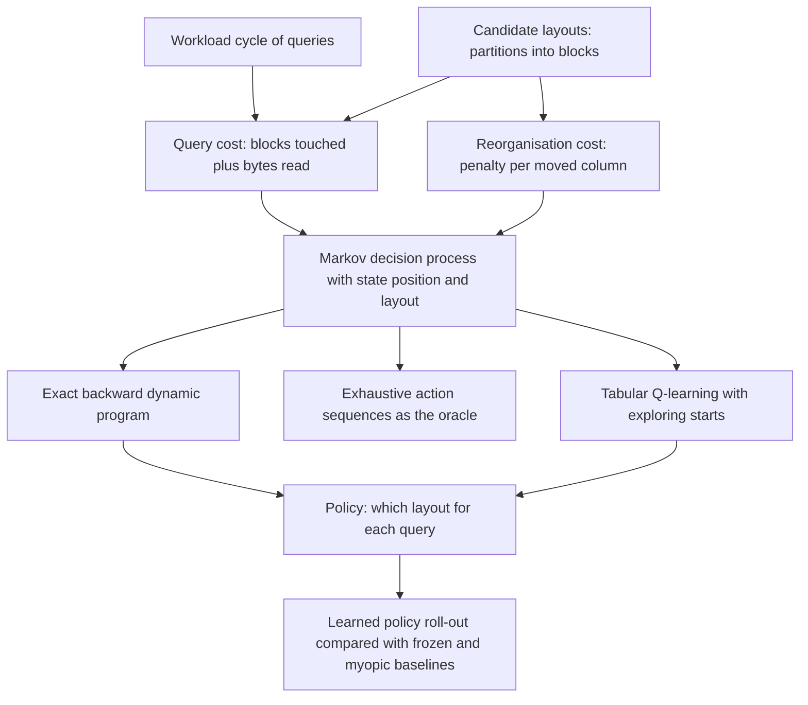
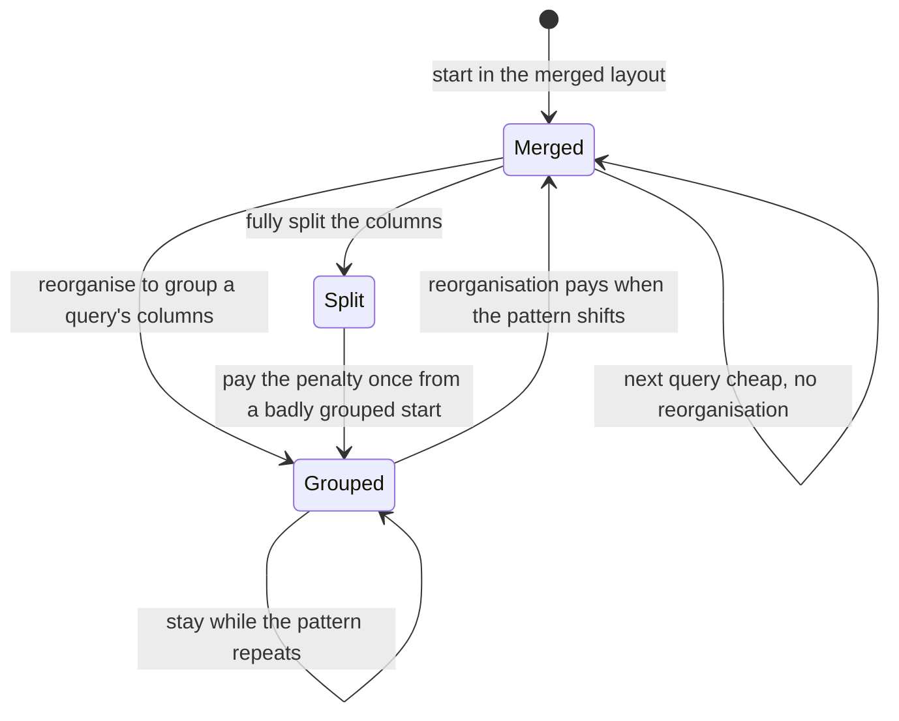
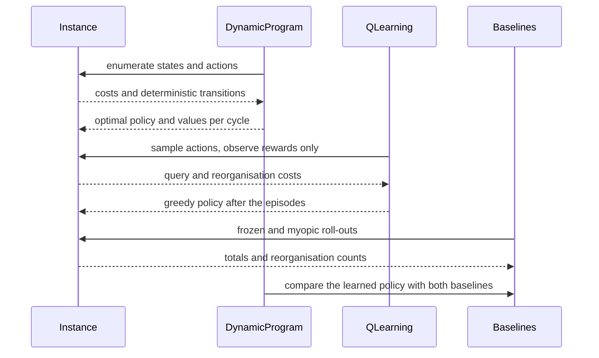

# 896 — Implement joint optimization of storage layout + access patterns using reinforcement learning.

> **Tier:** Master · **CTCI chapter:** Ch 14 — Databases
> **Task spec:** [896-implement-joint-optimization-of-storage-layout-access-patterns-u.md](../../../tasks/master/896-implement-joint-optimization-of-storage-layout-access-patterns-u.md)
> **Solutions:** [Python](../../../solutions/python/master/896-implement-joint-optimization-of-storage-layout-access-patterns-u/solution.py) ·
> [Java](../../../solutions/java/master/896-implement-joint-optimization-of-storage-layout-access-patterns-u/Solution.java) ·
> [JavaScript](../../../solutions/javascript/master/896-implement-joint-optimization-of-storage-layout-access-patterns-u/solution.js) ·
> [C#](../../../solutions/csharp/master/896-implement-joint-optimization-of-storage-layout-access-patterns-u/Solution.cs)

## 1. Problem restatement

**Input:** a column store instance — `C` columns with byte widths, a workload *cycle* of `P` queries
(each query a non-empty set of columns), a candidate set of layouts (partitions of the columns into
physical blocks), and a reorganisation `penalty` per moved column.

**Output:** a policy that decides, for every `(position in the cycle, current layout)` state, which
layout to use for the next query — minimising the total cost of a cycle, where a query costs one unit
per block it touches plus the bytes of the columns it reads, and a reorganisation costs `penalty` per
column whose block membership changed.

**Modelling contract (what this file is and is not).** Each solution is an in-process *simulation* of a
layout advisor, framed as a finite-horizon Markov decision process:

* the state is `(position, current layout)`, an action selects the layout for the next query, and the
  reward is `-(query_cost + reorg_cost)`. The horizon is one workload cycle, after which the process
  restarts — so the "joint" optimisation is exactly the choice between *grouping the columns a query
  co-accesses* and *paying to rearrange when the pattern changes*;
* the cost model is analytic: **one unit per block touched plus the bytes of the queried columns**, and
  `penalty * number of columns whose block membership changed` for a switch. There is no device, no
  measured I/O, no cache simulation and no page prefetching;
* the candidate layout set is **hand-built and small** — the merged layout, the fully split layout,
  one layout grouping each query, plus random partitions — truncated to `max_layouts`, not the full
  Bell-number space except on tiny instances;
* three solvers are compared: an **exact backward dynamic program**, an **exhaustive enumeration of
  action sequences** (the oracle, only feasible for tiny horizons), and **tabular Q-learning** with
  exploring starts and an averaging learning rate, which knows nothing about the transition function
  or the reward model beyond the rewards it observes;
* instances are synthetic, single-process and static in their workload cycle, and there is no
  concurrency, durability or multi-tenant interference.

Verified properties and measurements, from the assertions and the printed run:

| Check | Result |
| --- | --- |
| Bellman optimality | the dynamic program satisfies the optimality equation at every state |
| Oracle agreement | the dynamic program matches exhaustive action-sequence enumeration bit for bit |
| Reorg accounting | `reorg_cost(row_store, column_store) == 2 * 3` for a penalty of `2` and three columns; keeping a layout is free |
| Clustering pays | a query over co-located columns touches one block, over split columns it touches several |
| Learning | the greedy roll-out of the learned policy matches the dynamic program's optimal cycle cost |
| Baselines | `frozen 48`, `myopic 48`, `learned 48` over four cycles on the tiny instance — all coincide because the run starts in the merged layout |
| Divergent case | from a badly grouped start the optimal policy pays a one-time reorganisation and strictly beats freezing wherever the penalty is low enough |
| Learning curve | `[12, 23, 15, 15, 15, 12, 12, 12, 12, 12, 12]` — noisy early, then exactly optimal |
| Tiny instance | `3` columns, `3` queries per cycle, `5` candidate layouts (the Bell number), penalty `2`, optimum `12.0` per cycle, policy moves `0` |
| Scale | `20` columns, `25` queries, `12` layouts, `300` states, optimum `1204.0` per cycle |
| Medium instance | learned `116` versus optimal `116` (gap `0`) after `6000` episodes |
| Degenerate instances | singleton column, single query and "reorganisation forbidden" reduce to their closed forms |

## 2. Intuition

Physical layout and access pattern are the two halves of one decision, and optimising either alone is
wrong. Grouping the columns a query co-accesses reduces the number of blocks the query opens — that is
the layout half. But a different query may want a different grouping, and switching costs I/O — that is
the access-pattern half. The naive answer "cluster what is queried together" ignores the second half
entirely: if the pattern alternates quickly, the reorganisation cost can exceed everything it saves.

The first key insight is that this is a **finite-horizon MDP**, and a very small one. The state is
`(position in the cycle, current layout)`; the action picks the layout for the next query; the reward
is the negated query cost *plus* the negated reorganisation cost of getting there. Because the horizon
is one cycle and the transitions are deterministic, an **exact backward dynamic program** solves it: for
each position from the end of the cycle backwards, and each candidate layout, take the cheapest action
including the continuation value. On the printed tiny instance that yields `12.0` per cycle with `0`
moves; the DP is verified against brute-force enumeration of every action sequence and against the
Bellman residual at every state.

The second key insight is *why* reorganisation can be worth it at all — and where it is not. Freezing
is a legitimate policy ("stick to whatever layout you have"), and if you already sit in the merged
layout then freezing is optimal, which is exactly why the printed baselines all read `48` over four
cycles: from the merged start, freezing, the myopic policy and the learned policy agree. The
interesting regime is a *badly grouped start*: a frozen split layout pays the split-block cost on
every cycle, and the optimal policy pays the penalty once and then collects the cheaper cycle forever
after. The file asserts that divergence explicitly, which is what "joint optimisation" means in
practice: reorganisation is an investment, and the penalty decides whether it pays back.

The third key insight is what reinforcement learning adds, and what it does not. Tabular Q-learning
discovers the same policy **without being told the transition or reward functions** — it sees only the
rewards of the actions it tries, uses deterministic exploring starts to visit every state, and an
averaging learning rate `1 / visits(state, action)` to converge. It needs no more than
`episodes * period * layouts` updates, and on the medium instance its greedy roll-out matches the
exact optimum (`116` versus `116`, gap `0`) after `6000` episodes. What it does *not* buy is
correctness: the DP already had the answer, so the learning experiment is a demonstration that a
model-free method finds it, not a replacement for the model on small instances where one exists.



## 3. Algorithm

1. Validate the instance: at least one column and one query, no negative penalty, every query
   non-empty and naming existing columns, layouts distinct and each covering every column exactly
   once.
2. Define the cost model: `query_cost(layout, query) = blocks touched + sum of widths`,
   `reorg_cost(before, after) = penalty * columns whose containing block changed`.
3. Build the state space `(position, layout index)` and the deterministic transition
   `(position, layout) -> (position + 1, action)` with reward
   `-(query_cost + reorg_cost)`; the process ends after `period` steps.
4. Solve exactly by backward induction over the horizon, recording the greedy action per state.
5. Verify: recompute the Bellman residual at every state, and compare the DP's value with exhaustive
   enumeration of action sequences.
6. Learn with tabular Q-learning: deterministic exploring starts over the layouts, epsilon-greedy
   action selection with a decaying exploration rate, reward target
   `reward + max over actions of Q(next state)`, and an averaging learning rate.
7. Roll out the learned greedy policy, the frozen policy and the myopic policy for a few cycles and
   compare the totals and the number of reorganisation moves.

```text
function query_cost(instance, layout, query)
    touched = the set of block indices holding a column of `query`
    return length(touched) + the sum of the widths of the query's columns
end

function reorg_cost(instance, before, after)
    moved = 0
    for column in instance.columns do
        if the block of before containing `column` != the block of after containing `column` then
            moved += 1
        end
    end
    return instance.penalty * moved
end

function step(instance, state, action)
    position, index = state
    target = instance.layouts[action]
    reward = -(query_cost(instance, target, instance.queries[position])
               + reorg_cost(instance, instance.layouts[index], target))
    if position + 1 = instance.period then return none, reward end
    return (position + 1, action), reward
end

function dynamic_program(instance)
    values = zero table of size (period + 1) by number of layouts
    for position from period - 1 down to 0 do
        for index, layout in enumerate(instance.layouts) do
            best = none
            for action, target in enumerate(instance.layouts) do
                total = query_cost(instance, target, instance.queries[position])
                      + reorg_cost(instance, layout, target)
                      + values[position + 1][action]
                if best is none or total < best then best = total; best_action = action end
            end
            values[position][index] = best
            policy[(position, index)] = best_action
        end
    end
    return values, policy
end

function exhaustive_optimum(instance)
    for every action sequence of length `period` do
        total = 0
        layout = instance.layouts[0]
        for position, action in enumerate(sequence) do
            total += query_cost(instance, instance.layouts[action], instance.queries[position])
            total += reorg_cost(instance, layout, instance.layouts[action])
            layout = instance.layouts[action]
        end
        keep the cheapest sequence
    end
end

function q_learning(instance, seed, episodes)
    q_values[state][action] = 0 for every state and action
    for episode in 1 to episodes do
        epsilon = max(floor, start * (1 - episode / episodes))
        layout = episode mod number of layouts            # deterministic exploring starts
        for position in 0 to period - 1 do
            state = (position, layout)
            action = random action with probability epsilon else the argmax of q_values[state]
            reward = -(query_cost(instance, layouts[action], queries[position])
                       + reorg_cost(instance, layouts[layout], layouts[action]))
            visits[state][action] += 1
            learning_rate = 1 / visits[state][action]
            next_state = (position + 1, action) if position + 1 < period else none
            target = reward if next_state is none else reward + max(q_values[next_state])
            q_values[state][action] += learning_rate * (target - q_values[state][action])
            layout = action
        end
    end
    return q_values
end

function rollout(instance, policy, cycles, start)
    index = start
    total = 0; moves = 0
    for each cycle do
        for position in 0 to period - 1 do
            action = policy[(position, index)]
            total += query_cost(instance, layouts[action], queries[position])
            total += reorg_cost(instance, layouts[index], layouts[action])
            if action != index then moves += 1 end
            index = action
        end
    end
    return total, moves
end
```



## 4. Worked example

Take three columns of width `1`, the query cycle `{0,1}`, `{1,2}`, `{0,2}`, a penalty of `2`, and all
five partitions of three columns as the candidate layouts (the Bell number `B3 = 5`, which the file
asserts).

| Layout | Partition | `query_cost` for `{0,1}` | `{1,2}` | `{0,2}` | Cycle total |
| --- | --- | --- | --- | --- | --- |
| `P1` merged | `(0,1,2)` | `1 + 2 = 3` | `1 + 2 = 3` | `1 + 2 = 3` | `9` |
| `P2` | `(0,1)(2)` | `1 + 2 = 3` | `2 + 2 = 4` | `2 + 2 = 4` | `11` |
| `P3` | `(0,2)(1)` | `2 + 2 = 4` | `2 + 2 = 4` | `1 + 2 = 3` | `11` |
| `P4` | `(0)(1,2)` | `2 + 2 = 4` | `1 + 2 = 3` | `2 + 2 = 4` | `11` |
| `P5` column store | `(0)(1)(2)` | `2 + 2 = 4` | `2 + 2 = 4` | `2 + 2 = 4` | `12` |

Reorganisation costs, computed the way the code does — a column counts as moved unless the *set* of
columns sharing its block is unchanged:

| Switch | Columns whose block set changed | Cost at penalty `2` |
| --- | --- | --- |
| `P1 -> P1` | none | `0` |
| `P1 -> P2` | `0`, `1` (from `(0,1,2)` to `(0,1)`) and `2` (from `(0,1,2)` to `(2)`) | `3 * 2 = 6` |
| `P5 -> P1` | all three | `3 * 2 = 6` |

Now compare the policies over four cycles:

| Policy | Behaviour | Cost over four cycles |
| --- | --- | --- |
| Frozen at `P1` | never reorganises; cycle cost `9` | `36` |
| Frozen at `P5` | never reorganises; cycle cost `12` | `48` |
| Optimal from `P5` | pays `6` once to reach `P1`, then `9` per cycle | `6 + 3 * 9 = 33` |
| Cycle the layouts every query | pays `6` at each of three switches plus query costs | `> 33` |

That table is the whole trade-off: from a *badly grouped* start the optimal policy invests `6` units
once and then collects `9` per cycle forever, beating freezing by `15` units over four cycles — while
from the merged start the same policy is exactly the frozen policy, because `P1` is already optimal for
every query in this cycle. The printed tiny instance behaves the same way and reports `12.0` per cycle
with `0` moves, giving `frozen 48`, `myopic 48` and `learned 48` over four cycles.

The learning curve from the printed run shows what model-free learning looks like on this MDP:

| Episode checkpoint | `1` | `2` | `3` | `4` | `5` | `6` | `7` | `8` | `9` | `10` | `11` |
| --- | --- | --- | --- | --- | --- | --- | --- | --- | --- | --- | --- |
| Greedy roll-out cost | `12` | `23` | `15` | `15` | `15` | `12` | `12` | `12` | `12` | `12` | `12` |

The early entries are noisy because the table is still being explored — `23` is worse than both
baselines — and the sequence settles on the exact optimum. The final assertion is a comparison, not a
curve shape: the greedy policy's roll-out must equal the dynamic program's value, which on the medium
instance is `116` versus `116` (gap `0`) after `6000` episodes, and on the scaled instance solves
`300` states (`25` queries × `12` layouts) with an optimum of `1204.0` per cycle.



## 5. Complexity

| Quantity | Bound | Reason |
| --- | --- | --- |
| State space | `period * layouts` = `300` on the scaled instance | `25` queries × `12` candidate layouts |
| `query_cost` | `O(query size)` | a block-set lookup plus a sum of widths |
| `reorg_cost` | `O(columns)` | one membership comparison per column |
| `dynamic_program` | `O(period * layouts^2)` | for every state, one pass over the candidate actions |
| `exhaustive_optimum` | `O(layouts^period * period)` | every action sequence; only feasible for tiny horizons |
| `q_learning` | `O(episodes * period * layouts)` | one update per state visit; `6000` episodes on the medium instance |
| `rollout` | `O(cycles * period)` | one policy lookup and two cost evaluations per query |
| Medium instance | learned `116` equals optimal `116` (gap `0`) | the correctness claim for the learned policy |
| Scaled instance | optimum `1204.0` per cycle | the DP's exact answer on `300` states |

The DP is exact and cheap because the MDP is finite and the horizon is one cycle; Q-learning's cost is
linear in the state space but multiplied by however many episodes convergence needs, and it is the only
option when the transition or reward model is unknown — which is the situation a real storage advisor
faces.

## 6. Pitfalls and edge cases

* **Counting moved columns correctly.** A column counts as moved unless the *set of columns sharing its
  block* is unchanged, so merging two blocks marks every column in the merged block as moved: the file
  asserts `reorg_cost(row_store, column_store) == 2 * 3`, not `0`. A cheaper-looking "did the block
  index change" test would under-count and make reorganisation look artificially attractive.
* **Freezing is a legitimate policy.** `{state: state[1]}` never reorganises; the assertions require
  zero moves and a strictly positive cost, and every learned or optimal policy must be compared against
  it rather than against a straw man.
* **The myopic policy can tie the optimum.** Choosing the cheapest layout for the *next* query ignores
  the future; where one layout is best for everything (here the merged layout) the myopic choice
  coincides with the optimum, which is why all three printed baselines read `48`.
* **The divergence needs a bad start.** The interesting regime is a split starting layout: frozen pays
  the split-block cost every cycle while the optimum pays the penalty once. Assertions that only ever
  start from the merged layout would never see the difference.
* **Invalid instances.** No columns, no queries, a negative penalty, a duplicate layout, a layout that
  does not cover every column exactly once, or a query naming a missing column all raise `ModelError`.
* **Exploration and candidate sets.** `layout = episode mod layouts` guarantees that every state is
  visited as an episode start, without which an unusual starting layout may never be explored and its
  Q-values stay at zero; and the optimum is optimal only *within the candidate layouts*, so a
  truncated or random set (`max_layouts`) can exclude the true best partition.
* **Non-monotone learning curve.** The printed history starts at the optimum (`12`), rises to `23`, and
  returns to `12` — early episodes are noise, and only the *final* comparison against the DP is a
  correctness claim.

## 7. Variants and follow-ups

* **Choosing the encoding per column.** Layout decides which columns share a block; encoding decides
  how each column's values are stored — [887](../../../tasks/master/887-implement-query-aware-in-memory-compression-scheme-column-store.md)
  solves that half with a workload-driven multiple-choice knapsack under a memory budget.
* **Cost models that need searching.** Where the objective cannot be written down (real hardware,
  noisy kernels), the exact DP is unavailable and a search with a cache is used instead —
  [884](../../../tasks/master/884-implement-autotuner-that-explores-kernel-block-grid-parameters-a.md)
  is the same decision problem in compiler form, and
  [895](../../../tasks/master/895-implement-learned-index-replacement-for-b-tree-with-fallback-cor.md)
  is the same pattern for the access path on top of a layout.
* **Unknown or drifting workloads.** The cycle here is fixed and known; a production advisor estimates
  the next cycle from history, and several tenants sharing one cluster turn the reward into a sum over
  workloads and the action space into a shared resource.

## 8. Check yourself

<details><summary>Show answer</summary>

**Q1. Why is the problem framed as an MDP rather than as a per-query optimisation?**

Because the two halves trade off against each other over time. Choosing the best layout for the *next*
query ignores that switching costs a penalty and that the same layout may serve several following
queries. Making the current layout part of the state is what lets the value function express "pay once
now, collect cheaper cycles afterwards", and the exact DP over that state space produces the joint
answer.

</details>

<details><summary>Show answer</summary>

**Q2. When does reorganisation actually pay off, and what decides it?**

It pays when the current layout is badly grouped for the workload and the penalty is small relative to
the recurring savings. In the worked example, moving from the fully split layout to the merged one costs
`6` once and then saves `3` per cycle, so it wins after two cycles; from an already merged layout it
never pays, which is why the printed baselines all coincide at `48`. The penalty is the knob that
decides whether the optimal policy is "reorganise once" or "never".

</details>

<details><summary>Show answer</summary>

**Q3. What does Q-learning demonstrate that the dynamic program does not, and where does the
simulation stop?**

That the same policy is discoverable *model-free*: Q-learning never sees the transition function or the
reward formula, only the rewards of the actions it samples, and with deterministic exploring starts and
a `1 / visits` learning rate its greedy roll-out matches the exact optimum (`116` versus `116`). That
matters because a real storage advisor has no correct cost model — the DP is available here only
because the instance is small and analytic. Beyond that, the workload is a fixed synthetic cycle, the
candidate set is hand-built and truncated, and there is no concurrency, measured I/O or downtime-free
layout change.

</details>
