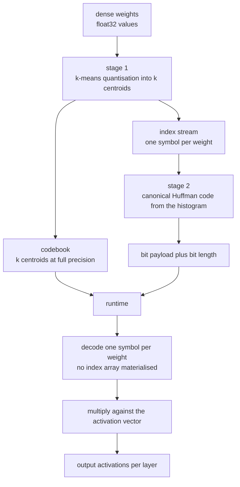
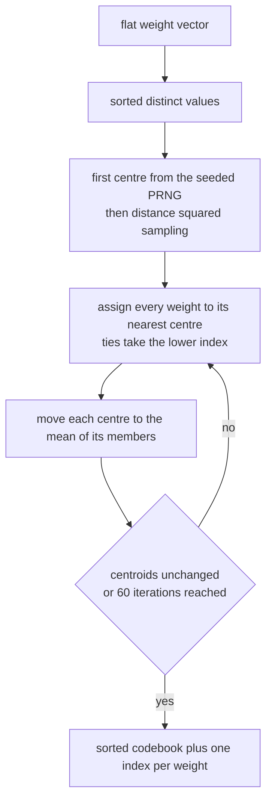
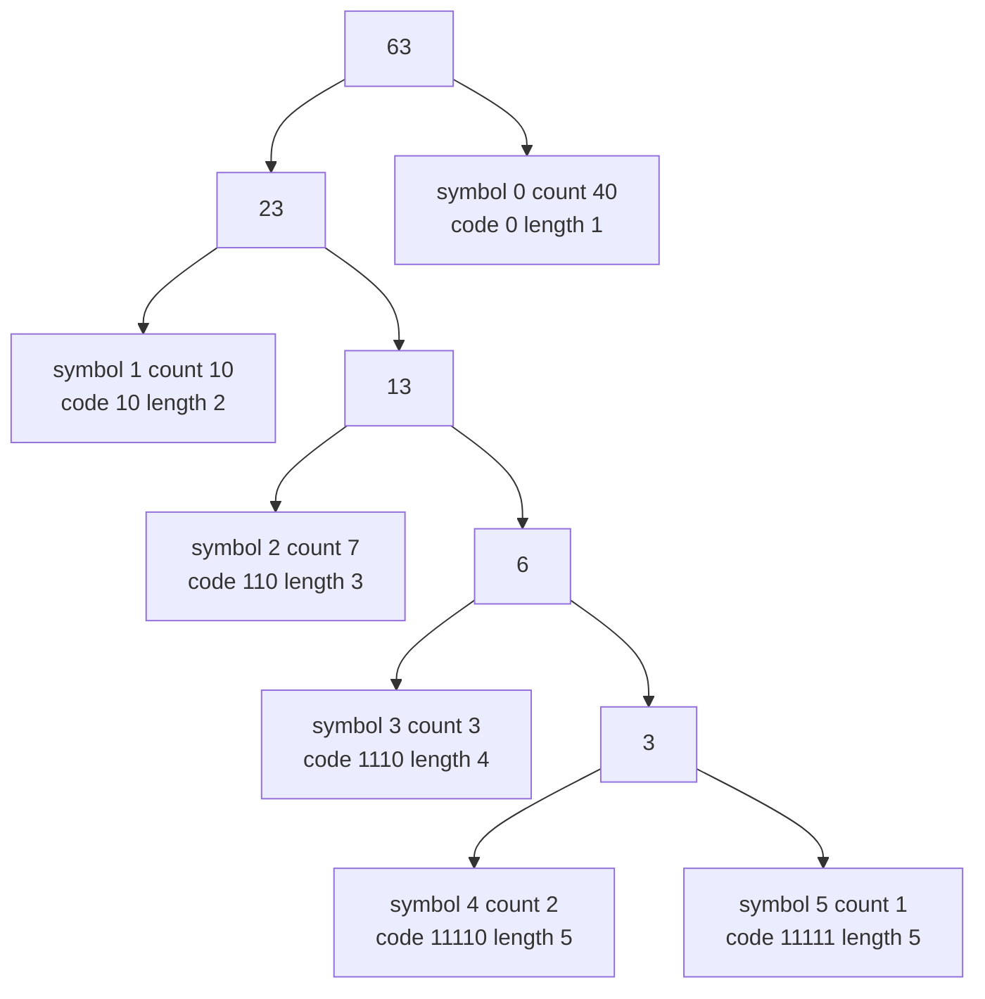
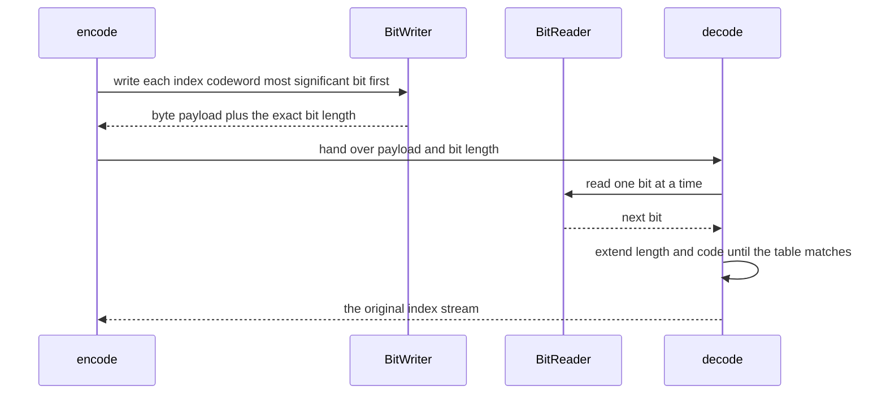

# 897 — Implement compressed neural network runtime with weight sharing and Huffman coding.

> **Tier:** Master · **CTCI chapter:** Beyond — Machine Learning & AI
> **Task spec:** [897-implement-compressed-neural-network-runtime-with-weight-sharing.md](../../../tasks/master/897-implement-compressed-neural-network-runtime-with-weight-sharing.md)
> **Solutions:** [Python](../../../solutions/python/master/897-implement-compressed-neural-network-runtime-with-weight-sharing/solution.py) ·
> [Java](../../../solutions/java/master/897-implement-compressed-neural-network-runtime-with-weight-sharing/Solution.java) ·
> [JavaScript](../../../solutions/javascript/master/897-implement-compressed-neural-network-runtime-with-weight-sharing/solution.js) ·
> [C#](../../../solutions/csharp/master/897-implement-compressed-neural-network-runtime-with-weight-sharing/Solution.cs)

## 1. Problem restatement

**Input:** a dense, fully connected ReLU network — a list of layer sizes plus a seed that generates
the weights — and a cluster count `k`.

**Output:** a *compressed model* smaller than the raw weight tensor — a **codebook** of at most `k`
centroids (the only values kept at full precision) plus a **Huffman-coded bit stream** of one index
per weight — together with a runtime that performs inference *out of that compressed form* instead of
decompressing it into a float tensor first.

The modelling contract, which the four solutions spell out in their file headers, is deliberately
fixed: this is an **in-process simulation** of a compression runtime, not a deployment of one.

| Language | where the weights come from | what the runtime is |
| --- | --- | --- |
| Python | `build_network(sizes, seed)` — Gaussian draws from a seeded splitmix64 stream | `forward_quantised` reads the index list through the codebook |
| Java | a deterministic weight generator for a 12-16-3 MLP | a Java loop with a clamped fixed-point ReLU |
| JavaScript | an 8-12-3 MLP **trained** by full-batch gradient descent on a synthetic 3-class problem | dequantise-on-the-fly inference plus a prediction-agreement report |
| C# | a deterministic dense model, quantised with quantile-initialised Lloyd | inference over codebook indices, with a sparse exception list for outliers |

There is no GPU, no batching, no wall-clock latency claim, and in Python and Java the network is
never trained — the literature's *trained weights* are replaced by a reproducible generator, because
what is under test is the compression pipeline and its error accounting, not generalisation.

Concrete behaviour the solutions assert:

| Call | Result |
| --- | --- |
| `kmeans([], 4, 1)` | raises `CompressionError("there is nothing to quantise")` |
| `kmeans([2.5] * 100, 4, 897502)` | `centroids == [2.5]`, every index `0` — no fake clusters |
| `huffman_lengths({0: 1})` | `{0: 1}` — one bit per symbol; the Kraft sum is `0.5`, not `1` |
| `kmeans(flat, 16, 897002)` on the demo net | 16 sorted centroids that are a **fixed point** of the Lloyd iteration |

`k` is only a request: `kmeans` first clamps it with `clusters = min(clusters, len(set(values)))`,
so asking for 8 clusters over a tensor with one distinct value yields a one-entry codebook.

## 2. Intuition

The naive way to ship the demo network is to store the weight tensor as 32-bit floats. The naive
*compression* of that is to quantise and store the indices at fixed width: with `k = 16` centroids
each weight costs `log2(16) = 4` bits, an 8x saving that ignores the skew of the index histogram —
after Lloyd's algorithm a handful of centroids absorb most weights.

The key insight is that the two problems are **independent and therefore composable**:

- **value space** — quantisation answers "how many distinct weight values do we need?", and
  k-means with `k` centres minimises the squared reconstruction error for that answer;
- **index space** — the index stream is just a sequence of symbols, so any entropy coder applies.
  Huffman coding gives an average length `L` with `H(X) <= L < H(X) + 1`, i.e. within one bit per
  weight of the true entropy, and it is *provably optimal among prefix codes*;
- **runtime** — the decoder is a state machine over bits, so the index array never has to exist: one symbol
  per weight is pulled and multiplied straight against the activation vector.

Put together, that is exactly the shape of production weight-compression pipelines: codebook +
entropy-coded indices + a decode-while-you-compute kernel.



## 3. Algorithm

The pipeline has three stages plus a runtime; each stage is verified independently before the next
one consumes its output.

1. **Quantise.** Flatten the per-layer weight matrices into one vector. Fix the seed, take the
   sorted distinct values, seed the first centroid from the PRNG, then add the remaining centres by
   sampling the squared-distance distribution (k-means++ style). Run at most 60 Lloyd iterations of
   *assign to nearest centre* / *move each centre to the mean of its members*, stopping early when
   the centroid vector stops changing. Ties in `nearest` go to the lower index, so the result is
   deterministic. Sort the codebook and return the index per weight.
2. **Share.** The index *is* the shared representation: `log2(k)` bits per weight instead of 32,
   and in training a single gradient would be accumulated per centre (`k` updates instead of `n`).
   The demo runs the forward pass, where this simply means one table lookup per weight.
3. **Entropy code.** Histogram the indices, build a Huffman tree with an explicit tie-break
   (heap key = weight, then an increasing counter), read the code length of each leaf, and turn the
   lengths into a **canonical** code (shorter codes first, then by symbol). Canonical assignment is
   what makes the code reproducible and decodable from lengths alone.
4. **Run.** Bit-read the stream one bit at a time, extending `(length, code)` until it matches a
   table entry, and multiply each decoded centroid into the accumulating dot product.

```text
procedure quantise(values, k, seed)
    clusters ← min(k, number of distinct values in values)
    ordered ← sorted distinct values
    centroids ← first centre drawn from the seeded PRNG over ordered
    while fewer than clusters centres do
        add the value sampled from the squared distances to the nearest centre
    end
    for at most 60 iterations do
        assignments ← index of the nearest centre per weight, ties to the lower index
        updated ← mean of the members of each cluster, unchanged where a cluster is empty
        if updated = centroids then stop
        centroids ← updated
    end
    return sorted centroids, assignments
end

procedure huffman_lengths(frequencies)
    push one leaf per symbol keyed by frequency then by symbol order
    while more than one node remains do
        pop the two lightest nodes and push their merged parent
    end
    walk the tree depth first and record each leaf depth as its code length
end

procedure canonical_codes(lengths)
    order symbols by length then by symbol
    code ← 0; previous ← 0
    for each symbol in that order do
        code ← code shifted left by length minus previous
        emit code with its length
        code ← code + 1; previous ← length
    end
end

procedure run_compressed(codebook, indices, biases, inputs, layers)
    activation ← inputs; cursor ← 0
    for each layer do
        for each output row do
            total ← bias of that row
            for each column do
                total ← total + codebook[indices[cursor]] * activation[column]
                cursor ← cursor + 1
            end
        end
        activation ← relu of the row totals
    end
    return activation
end
```



## 4. Worked example

**Trace A — the Huffman stage on a skewed histogram.** The Python solution runs every one of these
frequency tables; take `{0: 40, 1: 10, 2: 7, 3: 3, 4: 2, 5: 1}` (63 symbols) and follow the merge
order, where the heap pops the lightest pair and breaks ties by insertion order:

| Step | Popped | Merged weight | Heap afterwards (weights) |
| --- | --- | --- | --- |
| 1 | symbols 5 (1) and 4 (2) | 3 | 3, 3, 7, 10, 40 |
| 2 | symbol 3 (3) and merge (3) | 6 | 6, 7, 10, 40 |
| 3 | merge (6) and symbol 2 (7) | 13 | 10, 13, 40 |
| 4 | symbol 1 (10) and merge (13) | 23 | 23, 40 |
| 5 | merge (23) and symbol 0 (40) | 63 | root |

Leaf depths give the lengths `{0: 1, 1: 2, 2: 3, 3: 4, 4: 5, 5: 5}`; the canonical assignment then
produces `0`, `10`, `110`, `1110`, `11110`, `11111`. The bookkeeping the solution checks:

| Quantity | Value | Check |
| --- | --- | --- |
| Kraft sum `Σ 2^-length` | 0.5 + 0.25 + 0.125 + 0.0625 + 0.03125 + 0.03125 = **1.0** | equality, so the code is complete |
| Cost `Σ count * length` | 40 + 20 + 21 + 12 + 10 + 5 = **108 bits** | equals the exhaustive `brute_force_optimal_lengths` optimum |
| Average length | 108 / 63 ≈ **1.714 bits** | `H ≤ L < H + 1`, with `H ≈ 1.652` |
| Fixed-width baseline | `log2(6)` = 2.585 bits | cannot go below the entropy |



**Trace B — the demo network.** `build_network([4, 8, 6, 2], 897001, scale=0.7)` gives
8x4 + 6x8 + 2x6 = **92 weights**; quantising with `k = 16` yields a sorted 16-entry codebook whose
assignment survives recomputation unchanged (the fixed-point check). Encoding the 92 indices yields
a payload whose bit length equals the sum of the codeword lengths, and `decode` reproduces the exact
index stream; the run also asserts the payload is far below the 92 x 32 = 2944 dense bits, and that
it never exceeds the fixed-width bound `log2(k) * 92` bits. Feeding `inputs = [0.5, -0.25, 0.75, 1.0]`
to both paths gives two 2-vectors; the deviation is asserted to satisfy

`total += weight_error * columns * spread * gain` accumulated backwards over the layers, where
`spread` is the largest activation magnitude entering a layer and `gain` folds in the largest weight
magnitude times the row count of each layer above it.
At scale, `build_network([16, 48, 32, 10], 897400, scale=0.6)` has 2624 weights, averages under five
bits per weight after coding, keeps the mean quantisation error below a quarter of the mean weight
magnitude, and stays within both the rigorous bound and half the reference output scale.



## 5. Complexity

Let `n` be the weight count, `k` the codebook size, `A` the number of *used* centroids, and `T` the
capped number of Lloyd iterations (60 in the Python and JS files).

| Stage | Time | Space | Why |
| --- | --- | --- | --- |
| k-means, best/average | `O(T * n * k)` | `O(n + k)` | early stop when the centroid vector is a fixed point; the demo usually converges well before the cap |
| k-means, worst | `O(60 * n * k)` | `O(n + k)` | the cap is the only guarantee — Lloyd's algorithm can cycle in theory |
| Huffman lengths | `O(A log A)` | `O(A)` | binary heap over at most `k` leaves, then a depth-first walk |
| Canonical assignment | `O(A log A)` | `O(A)` | one sort by (length, symbol) |
| Encode / decode | `O(n log k)` bits, i.e. one pass over the stream | `O(k)` table | each symbol is written or matched bit by bit; the decoder never stores the index array |
| Compressed forward pass | `O(Σ rows * columns)` | `O(max layer width)` | same multiply count as the float path, plus one table lookup per weight |
| Naive dense storage | — | `O(32n)` bits | the baseline every stage is measured against |

Error is the other resource: with a per-weight error `e`, the output deviation is bounded by the
backward propagation of `e` through the layers (Section 4) — conservative, because ReLU clipping can
only shrink a perturbation.

**What is simulated.** The networks are tiny (`[4, 8, 6, 2]` and `[16, 48, 32, 10]`), the runtime is
an in-process loop rather than a compiled kernel, `k` stops at 32 in the sweep, and no wall-clock
latency is claimed — C# reports cost as bits and operations. The compression stages are *not*
simplified: k-means, the canonical code, the bit-level coder and the size accounting are exact.

## 6. Pitfalls and edge cases

- **Empty input.** `kmeans([], 4, 1)` and `huffman_lengths({})` both raise `CompressionError`; an
  empty stream must be rejected rather than silently producing a zero-length payload.
- **`k` larger than the alphabet.** `kmeans` clamps `clusters` to the number of distinct values, so a
  constant tensor collapses to one centroid with every index `0`, and a one-weight model round-trips
  exactly (`len(tiny_centroids) == 1`).
- **Single-symbol alphabet.** `huffman_lengths({0: 1})` returns `{0: 1}`, giving a Kraft sum of 0.5:
  prefix-free but *not* complete. The Python file asserts `kraft_sum(degenerate) == 0.5` explicitly,
  and `encode([7] * 9, ...)` costs exactly 9 bits.
- **Zero frequencies.** `huffman_lengths({0: 0, 1: 1})` raises; a symbol that never occurs must not
  appear in the tree or it steals a codeword.
- **Truncated stream.** `decode(payload, 0, ..., 1)` raises `CompressionError("the bit stream ran
  out")`, and a stream that never matches a codeword raises after exceeding the longest length.
- **Ties and local minima.** `nearest` keeps the lower index on equal distance, the Huffman heap
  breaks ties with an insertion counter, and `canonical_codes` sorts by `(length, symbol)` — remove
  any of the three and the pipeline stops being reproducible. Lloyd's algorithm only guarantees
  non-increasing distortion, which is why the tests check the *fixed point* and *finer codebook,
  smaller error* instead of the global optimum.
- **Padding handled, accounting honest.** The final byte is padded and the stored size is
  `k * (bytes per centroid) + len(payload)`; forgetting the codebook would overstate the saving. All
  four files compare against the dense float32 (and in C# also float64) baseline.

## 7. Variants and follow-ups

- **Product / per-channel quantisation.** Cluster each layer (or each output channel) with its own
  codebook instead of one global vector. C# keeps one codebook but adds a *sparse residual* list for
  weights whose error exceeds a threshold, which drives the outlier reconstruction error to exactly
  zero at the cost of a few stored values.
- **Arithmetic or range coding.** Replacing Huffman with an arithmetic coder removes the one-bit
  slack and approaches the entropy exactly; the encoder/decoder interface (bit writer, exact bit
  length) stays the same.
- **Resource-constrained search.** Choosing `k` (and the layer widths) to trade accuracy against
  bytes is the same constrained-objective problem as
  [898 — neural architecture search with a resource-constrained objective](../../../tasks/master/898-implement-neural-architecture-search-pipeline-with-resource-cons.md).
- **Certified error.** The propagation bound here is a worst case; a distribution-free interval is
  [908 — certified ML predictions with conformal prediction](../../../tasks/master/908-implement-certified-ml-predictions-with-conformal-prediction-int.md).
- **Merging sketches.** The mergeable, error-guaranteed counters used to track heavy indices at
  scale are covered by
  [911 — probabilistic data structure for heavy hitters](../../../tasks/master/911-implement-probabilistic-data-structure-for-heavy-hitters-with-er.md).

## 8. Check yourself

**Q1.** Why does the Haskell-style claim "average code length is at most entropy + 1" hold for the
Huffman code, and why can no prefix code beat the entropy?

<details><summary>Show answer</summary>

Huffman builds a full binary tree over the symbols; a leaf at depth `d` has probability `p` and code
length `d`, so the expected length is the tree's path length. Shannon's source coding theorem gives
`H ≤ L` for any uniquely decodable code, and constructing lengths `ceil(-log2 p)` costs strictly less
than `H + 1`; Huffman is optimal among prefix codes, so it cannot exceed that. The solution checks both
sides (`average >= entropy - 1e-9` and `average <= entropy + 1.0 + 1e-9`) and verifies optimality
directly against an exhaustive search over Kraft-feasible length assignments.

</details>

**Q2.** The demo network's codebook is verified to be a *fixed point*. Why is that a weaker claim
than "the codebook is the global k-means optimum", and why is the weaker claim the right one to test?

<details><summary>Show answer</summary>

A fixed point only says that re-assigning every weight to its nearest centroid changes nothing —
Lloyd's algorithm can sit in a local minimum. The global optimum is NP-hard for general `k`, so a
test cannot demand it; instead the file pins down what *is* guaranteed: the assignment is
nearest-centroid optimal for the produced centroids, distortion never increases across iterations, and
a finer codebook (24 centres) has strictly smaller maximum error than a coarse one (4 centres).

</details>

**Q3.** A weight tensor has four distinct values but you request `k = 16`. What comes out, and how
many bits per weight does fixed-width coding use?

<details><summary>Show answer</summary>

`clusters = min(16, 4) = 4`, so the codebook has four sorted centroids (possibly fewer if the distance
sampling finds no new distinct value) and indices in `0..3`; fixed-width coding would cost
`log2(4) = 2` bits per weight. The solution's sweep asserts exactly this shape
(`average <= log2(len(centroids)) + 1.0` for `k` in 4, 8, 16, 32).

</details>

**Q4.** The forward pass multiplies decoded centroids instead of original weights. Why does the
assertion compare against a *bound* rather than requiring equality with the float reference?

<details><summary>Show answer</summary>

Quantisation is lossy by construction — the Python file asserts that quantisation moves at least one
weight and that the maximum per-weight error is below the codebook span. Equality is therefore
impossible; what can be proven is a propagation bound: each layer can amplify a per-weight error by at
most (number of inputs) x (largest input magnitude) x (largest weight magnitude) x (rows), accumulated
backwards. The test asserts `deviation <= bound`, and separately that a finer codebook deviates no
more than a coarse one. C# takes the complementary approach — a sparse residual list — to make the
outliers *exactly* right, and then asserts bit-identical inference.

</details>
