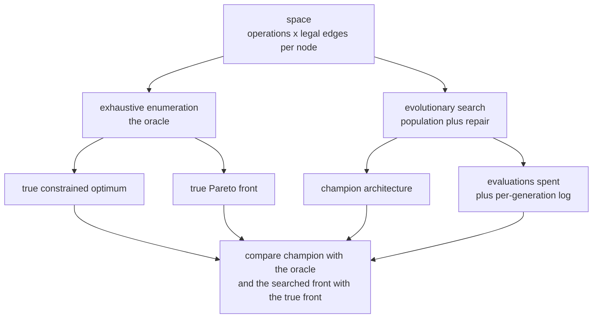
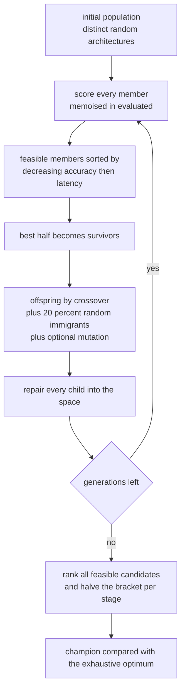
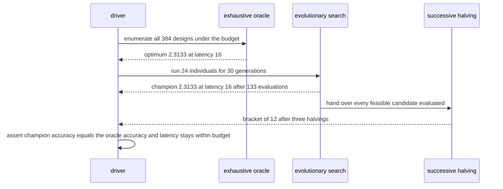

# 898 — Implement neural architecture search pipeline with resource-constrained objective.

> **Tier:** Master · **CTCI chapter:** Beyond — Machine Learning & AI
> **Task spec:** [898-implement-neural-architecture-search-pipeline-with-resource-cons.md](../../../tasks/master/898-implement-neural-architecture-search-pipeline-with-resource-cons.md)
> **Solutions:** [Python](../../../solutions/python/master/898-implement-neural-architecture-search-pipeline-with-resource-cons/solution.py) ·
> [Java](../../../solutions/java/master/898-implement-neural-architecture-search-pipeline-with-resource-cons/Solution.java) ·
> [JavaScript](../../../solutions/javascript/master/898-implement-neural-architecture-search-pipeline-with-resource-cons/solution.js) ·
> [C#](../../../solutions/csharp/master/898-implement-neural-architecture-search-pipeline-with-resource-cons/Solution.cs)

## 1. Problem restatement

**Input:** a discrete design space and a resource budget.

- A *cell* has `nodes` nodes; node `i` chooses one **operation** from a fixed set and one **input
  edge** from the nodes before it plus the stem, so an architecture is a tuple of
  `(operation, input)` pairs.
- An evaluator maps an architecture to `(accuracy, latency)`.
- The budget is a hard upper bound on latency.

**Output:** the architecture with the highest accuracy whose latency is within budget — never an
over-budget design, not even "close to" the budget — plus the audit trail that makes the claim
checkable: the exhaustive optimum, the Pareto front, the number of evaluations spent, and the search
log per generation.

The modelling contract differs per language, and each file documents it in its header:

| Language | space | evaluator | simplification |
| --- | --- | --- | --- |
| Python | 3 nodes x 4 operations x legal edges = **384** architectures | analytic surrogate: operation tables plus an edge-coupling term | tables instead of training |
| Java | chain of 4 stages x 3 operators x 3 widths = **6561** | analytic cost model (parameters, MACs, latency with per-stage overhead) plus a coupled accuracy surrogate | formula instead of a profiler trace |
| JavaScript | 3 layers x 3 map types x 3 widths = **729** | **actually evaluated**: deterministic layer matrices, features on a synthetic 3-class data set, ridge head fitted in closed form | random features instead of learned ones |
| C# | 480 convolutional designs (depth, width, kernel, resolution, depthwise) | synthetic ground-truth accuracy with a saturating curve plus per-architecture jitter, and a ridge surrogate refit each generation | no training at all |

None of the four uses a supernet, weight sharing or early stopping. Concrete behaviour:

| Call | Result |
| --- | --- |
| `Space(3, ("skip", "conv3", "conv5", "pool")).size` | `384`, matching the closed form |
| `Space(0)` or `Space(3, ())` | raises `SearchError` |
| `exhaustive_search(space, -1)` | `(None, None, 0)` — infeasible budgets are reported, not clamped |
| `exhaustive_search(space, 10**9)` | `(2.4748, 25, 384)` — the budget stops binding and all 384 designs are feasible |

## 2. Intuition

The naive pipeline is: enumerate every architecture, evaluate it, keep the best feasible one. For 384
architectures that is trivial and *exactly right* — which is why the Python solution keeps the
enumeration as an **oracle**. It is also the reason the demo cannot stop there: the space grows as
`Π (|operations| * |legal inputs|)` per node, and Java's 4-stage chain already reaches 6561 while a
real cell search reaches `10^18`. Enumeration is the ground truth, not the product.

Three insights turn the oracle into a search:

1. **The objective is a constraint, not a penalty.** Maximising `accuracy` subject to
   `latency ≤ budget` has no single best point: the interesting answer is the **Pareto front** of
   non-dominated `(accuracy, latency)` pairs, and the search must demonstrate it reproduces the true
   front.
2. **Feasibility can be structural.** Instead of hoping that a good design survives, candidates are
   *repaired* into the space (unknown operation to the first known one, illegal edge index modulo the
   allowed set) and the budget is re-checked before the winner is returned. Java simultaneously
   shrinks the widths of infeasible children, so no evaluation is ever spent on a design it must throw
   away.
3. **Evaluations are the currency.** The search must reach the optimum while touching a fraction of
   the space: Python runs an evolutionary loop plus successive halving, C# additionally refits a
   ridge surrogate on everything evaluated so far and only pays the expensive ground-truth call for
   its top candidates.



## 3. Algorithm

1. **Build the space.** `inputs_per_node[i]` is the sorted set of earlier node indices plus the stem
   index `nodes`; `size` is the product of `|operations| * |inputs_per_node[i]|`. Reject an empty
   operation set or a cell with no nodes.
2. **Seed the population** with up to `population` distinct random architectures, sampled from the
   seeded PRNG.
3. **Per generation:** score every member (memoised in an `evaluated` dictionary), split into
   feasible and infeasible, sort the feasible ones by `(-accuracy, latency)`, keep the best half as
   survivors, and fill the rest with offspring — 20% random immigrants, otherwise crossover of two
   survivors at a random cut followed by a 50% chance of a single-node mutation, each child repaired
   into the space.
4. **Track the champion** across generations with `(accuracy, -latency)` ordering.
5. **Successive halving.** Rank *all* feasible candidates evaluated so far and halve the bracket once
   per stage; the best survivor competes with the champion.
6. **Audit.** Enumerate the whole space for the true optimum and the true front, and assert the
   champion matches the optimum in accuracy, respects the budget, and costs fewer evaluations than
   the space size.

```text
procedure evolutionary_search(space, budget, seed, population, generations, stages)
    rng ← seeded generator
    evaluated ← empty map
    population_now ← distinct random architectures until population or space size is reached
    champion ← none
    for generation in 1 .. generations do
        scored ← evaluate every member, cached in evaluated
        feasible ← members with latency not above budget
        pool ← feasible sorted by decreasing accuracy then increasing latency
        if pool is not empty then update champion from the head of pool
        survivors ← first half of pool, at least two
        offspring ← empty
        while offspring is shorter than population minus survivors do
            if a fresh random draw is below 0.2 then append a random architecture
            else
                child ← repair of a prefix of one survivor joined to a suffix of another
                with probability 0.5 mutate one node of the child and repair again
                append child
            end
        end
        population_now ← survivors followed by offspring
    end
    bracket ← feasible candidates from evaluated, ranked by the objective
    for stage in 1 .. stages do
        bracket ← first half of bracket, at least one
    end
    if bracket is not empty then update champion from its head
    return champion, evaluated, history, size of bracket
end

procedure pareto_front(candidates)
    for each candidate do
        mark it dominated when another candidate has accuracy at least as high and latency at
        most as low, with strict improvement in one of them
    end
    return the non dominated candidates
end

procedure exhaustive_search(space, budget)
    best ← none; feasible_count ← 0
    for each architecture in enumerate(space) do
        accuracy, latency ← evaluate the architecture
        skip when latency exceeds the budget
        feasible_count ← feasible_count + 1
        keep it when it beats the incumbent on accuracy, or ties on accuracy with lower latency
    end
    return best, its latency, feasible_count
end
```



## 4. Worked example

**Trace A — the surrogate itself.** For `Space(3, ("skip", "conv3", "conv5", "pool"))` the legal inputs
are `node 0: (3)`, `node 1: (0, 3)`, `node 2: (0, 1, 3)` (3 is the stem). Accuracy adds
`OP_ACCURACY[op] * (1 + 0.05 * node)` per node plus `0.04 * OP_ACCURACY[source op]` when the edge
points at an earlier node, or `0.02` for the stem; latency adds `OP_LATENCY[op]` plus 1 per internal
edge and 2 per stem edge. Three concrete designs:

| Architecture | Accuracy | Latency | Feasible at budget 18 | Feasible at budget 12 |
| --- | --- | --- | --- | --- |
| all `skip`, all stem edges | 1.7945 | 8 | yes | yes |
| `conv5` then `conv3` then `skip` | 2.1809 | 17 | yes | no |
| all `dilated`, edges to earlier nodes | 2.5717 | 34 | no | no |

The last row is the lesson of the task: the most accurate operation (`dilated`, 0.79) is also the
most expensive (10 latency units), so the unconstrained winner is unusable.

**Trace B — the audit.** Running the oracle over all 384 designs:

| Budget | Optimum accuracy | Its latency | Feasible designs |
| --- | --- | --- | --- |
| `10**9` (unconstrained) | 2.4748 | 25 | 384 |
| 18 | 2.3133 | 16 | 300 |
| 12 (binding) | 2.1429 | 12 | 102 |
| -1 (infeasible) | none | none | 0 |

The true Pareto front has **19** non-dominated designs spanning latencies 7 to 25, from 1.7965 up to
2.4748 accuracy, and it contains the unconstrained optimum — the solution asserts both.

**Trace C — the search.** `evolutionary_search(space, 18, 898001)` with 24 individuals over 30
generations returns `(2.3133, 16, ((conv3, 3), (conv3, 0), (conv3, 0)))`, identical in accuracy to the
oracle, after **133 of 384** evaluations (34.7%). Restricting the budget to 12 makes the constraint
bind: seed 898002 finds `(2.1429, 12, ((pool, 3), (pool, 0), (conv3, 1)))`, again exactly the
constrained optimum, in 151 evaluations. The searched subset's own Pareto front reproduces 14 of the
19 true points and reaches the same best accuracy. Three halving stages leave a bracket of 12
candidates, and each generation logs one entry.



## 5. Complexity

With `S` the space size, `P` the population, `G` the generations, `m` the number of distinct
architectures evaluated and `F` the true front size:

| Step | Time | Space | Reason |
| --- | --- | --- | --- |
| Enumerating the space | `O(S)` architectures | `O(S)` if materialised | `S` is the product over nodes of the operation count times the legal edge count; the Python demo materialises it, the search only samples |
| Evaluator (Python/Java/C#) | `O(nodes)` per architecture | `O(1)` | closed-form surrogate, no training |
| Evaluator (JavaScript) | one closed-form ridge fit per architecture | `O(width²)` | normal equations solved by Gaussian elimination with partial pivoting |
| Evolutionary loop | `O(P * G)` memoised evaluations, `133` of `384` measured | `O(P + m)` | worst case equals the space size, which is why the budget is counted |
| Successive halving | `O(m log m)` sort plus `O(stages)` halvings | `O(m)` | each stage discards half the bracket |
| Pareto front | `O(F * m)` with the naive double loop | `O(F)` | every candidate compared with every other |
| Exhaustive oracle | `O(S)` evaluations | `O(1)` beyond the enumeration | the baseline every other row is measured against |

**What is simulated.** In Python, Java and C# the accuracy is an *analytic function* — tables and
coupled terms — so "accuracy" is a surrogate score, not a validation metric, and there is no supernet
or weight-sharing NAS. Java's latency is a formula with per-stage overhead, not a profiler trace, and
C# represents hardware cost by FLOPs. Only the JavaScript file actually fits something per candidate
(a ridge head in closed form, cross-checked against 600 gradient-descent steps), and even there the
features come from random matrices. What is *not* simulated is the search itself: the space is
enumerated exactly, the budget is a hard constraint, the Pareto dominance is checked pairwise, and
the evaluation count is reported.

## 6. Pitfalls and edge cases

- **Ill-formed space.** `Space(0)` and `Space(3, ())` raise `SearchError`; a cell with no nodes or no
  operations has nothing to search.
- **Degenerate space.** `Space(1, ("skip",))` has size 1 and enumerates exactly once; the search still
  runs (population 2, two generations) and returns the only feasible design.
- **Infeasible budget.** A budget of `-1` yields `(None, None, 0)` from the oracle and no champion
  from the search — the empty bracket is returned explicitly instead of the cheapest over-budget
  design. Note that a negative budget is *not* an error: it is simply infeasible.
- **Budget above every design.** With `10**9` the whole space is feasible (384 of 384) and the
  optimum equals the unconstrained optimum (2.4748 at latency 25); the file asserts this stability.
- **Repair, not rejection.** `space.repair((("unknown", 99), ("conv3", 0), ("skip", 5)))` returns
  `(("skip", 3), ("conv3", 0), ("skip", 3))`: unknown operations map to the first operation and
  illegal edge indices are clamped modulo the allowed set. Every architecture returned by the search
  must satisfy both invariants.
- **Ties.** The champion comparison uses `(accuracy, -latency)`, and the survivor sort breaks ties by
  the candidate tuple itself, so equal-accuracy designs resolve deterministically.
- **Where the front is computed.** The Python front is taken over *all* enumerated architectures and
  the search's front over *everything evaluated*, including designs that violate the budget — that is
  why the searched front can contain the unconstrained optimum (2.4748 at latency 25) even when the
  budget is 18. Filtering by budget would hide it.
- **Wasted evaluations.** Java and C# enforce the constraint *before* the expensive evaluation, and
  shrink or repair an infeasible child, so the budget is never spent on a design that will be
  discarded.
- **Reproducibility.** Every stage runs off one seeded splitmix64 stream, so replaying a seed
  reproduces the champion, the evaluation count and the bracket size exactly; a different seed may
  not converge to the same design.

## 7. Variants and follow-ups

- **Random-search baseline.** Java and JavaScript run random search under the *same evaluation
  budget* and require the evolutionary search to be no worse, which is what makes the
  "search beats sampling" claim falsifiable.
- **Surrogate-assisted search.** C# refits a ridge regression on everything evaluated so far, predicts
  the un-evaluated candidates, and spends ground-truth evaluations only on its top predictions. The
  same idea at the *simulation* level (cheap low-fidelity runs first, expensive high-fidelity runs
  last) is [906 — multi-fidelity simulation orchestration with surrogate models](../../../tasks/master/906-implement-multi-fidelity-simulation-orchestration-with-surrogate.md).
- **Weight sharing / supernet NAS.** Replacing the per-candidate evaluation with a shared supernet is
  the standard way to afford bigger spaces; the compression side of that trade-off is
  [897 — compressed neural network runtime with weight sharing and Huffman coding](../../../tasks/master/897-implement-compressed-neural-network-runtime-with-weight-sharing.md).
- **Differentiable search.** Relaxing the discrete choice to a continuous parameter and fitting the
  design by gradients is [907 — differentiable programming for physical simulation parameter
  fitting](../../../tasks/master/907-implement-differentiable-programming-demo-for-physical-simulatio.md);
  the same reverse-mode machinery applies, but the search space becomes continuous.
- **Serving the winner.** Once a design is chosen, honouring per-tenant latency targets at runtime is
  the scheduling problem of
  [905 — real-time SLA-aware scheduler for multi-tenant inference](../../../tasks/master/905-implement-real-time-sla-aware-scheduler-for-multi-tenant-inferen.md).

## 8. Check yourself

**Q1.** Why does the solution keep an exhaustive enumeration that re-evaluates all 384 architectures
when the search only needs 133 of them?

<details><summary>Show answer</summary>

Because a search result is only meaningful relative to the truth. The enumeration supplies the true
constrained optimum (so "the search found the optimum" is a fact, not a hope), the true Pareto front
(so the searched front can be compared point by point), and the exact evaluation count of the baseline
(so the search's 133 evaluations can be called a fraction of the space). The demo's whole point is
that a search claiming optimality must be auditable — and the file asserts the champion's accuracy
equals the oracle's to within `1e-9` while using fewer than `S` evaluations.

</details>

**Q2.** Why is "maximise accuracy subject to latency ≤ budget" not a single-objective problem, and
what does the solution return for a budget no architecture can meet?

<details><summary>Show answer</summary>

Because the trade-off curve matters: the Pareto front here has 19 non-dominated designs from latency 7
to 25, and a practitioner may want any of them. A constrained scalarisation picks one point but hides
the rest. For an unmeetable budget (`-1`) the oracle returns `(None, None, 0)` and the search returns
no champion with an empty bracket — the code explicitly refuses to hand back the closest over-budget
design.

</details>

**Q3.** The champion for budget 18 has latency 16, but the file also asserts
`champion[1] >= optimum_latency - 1e-9`. What is that check protecting against?

<details><summary>Show answer</summary>

It guards a scoring bug rather than a search bug: if the evaluator drifted, the search could report an
accuracy value higher than any real architecture can reach, or claim a latency below the optimum's.
Since the oracle is exact, its `(accuracy, latency)` pair is achievable and *optimal in accuracy*; any
champion with the same accuracy must have latency at least that of the oracle's optimum (a strictly
lower latency with the same accuracy would be a new optimum, contradicting the enumeration). The
check keeps the two implementations of the objective honest with each other.

</details>

**Q4.** The search's Pareto front contains a point that violates the budget. Is that a bug?

<details><summary>Show answer</summary>

No — deliberately so. The front is a property of the *objective landscape*, computed over every
architecture the search evaluated, while the budget is enforced where an answer is returned
(`champion`). Filtering the front by budget would hide the unconstrained optimum (2.4748 at latency
25) and would break the assertion that the reported front reaches the true front's best accuracy.
Feasibility is checked on the returned design, never on the diagnostic frontier.

</details>
