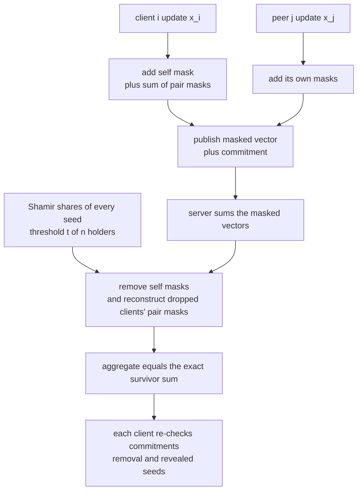
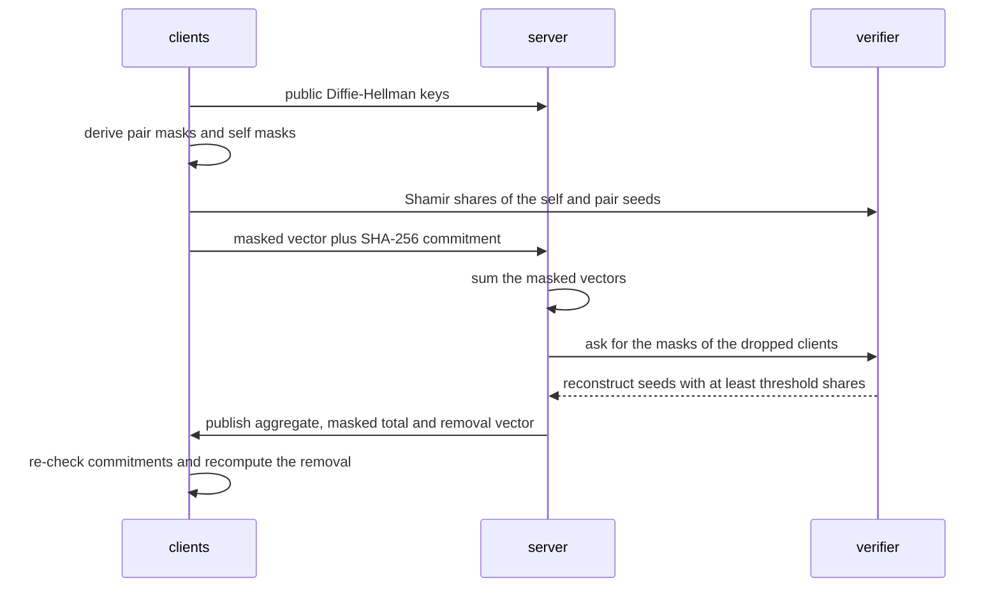
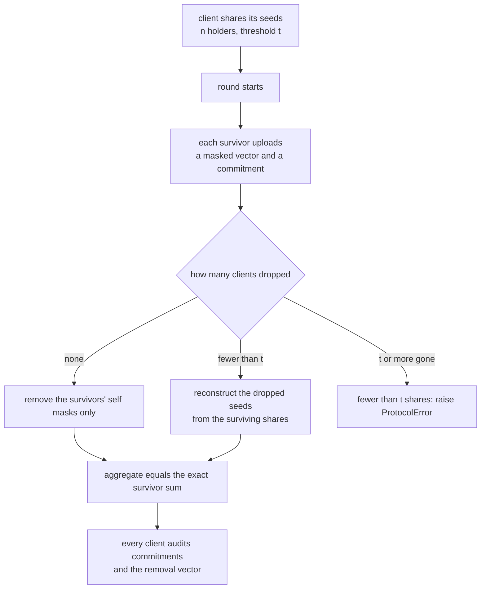

# 899 — Implement end-to-end encrypted collaborative machine learning with secure aggregation and model aggregation proofs.

> **Tier:** Master · **CTCI chapter:** Beyond — Security & Privacy
> **Task spec:** [899-implement-end-to-end-encrypted-collaborative-machine-learning-wi.md](../../../tasks/master/899-implement-end-to-end-encrypted-collaborative-machine-learning-wi.md)
> **Solutions:** [Python](../../../solutions/python/master/899-implement-end-to-end-encrypted-collaborative-machine-learning-wi/solution.py) ·
> [Java](../../../solutions/java/master/899-implement-end-to-end-encrypted-collaborative-machine-learning-wi/Solution.java) ·
> [JavaScript](../../../solutions/javascript/master/899-implement-end-to-end-encrypted-collaborative-machine-learning-wi/solution.js) ·
> [C#](../../../solutions/csharp/master/899-implement-end-to-end-encrypted-collaborative-machine-learning-wi/Solution.cs)

## 1. Problem restatement

**Input:** `n` clients, each holding a private integer update vector of dimension `d`; a drop-out set
(a subset of clients that never upload); a Shamir threshold `t`.

**Output:** the **exact** sum of the update vectors of the clients that uploaded, computed by a server
that never learns any individual update, plus a transcript that lets every client audit the result:

- each client's masked vector and its commitment,
- the server's aggregate, the masked total and the mask-removal vector,
- the revealed mask seeds, enough to recompute the removal independently.

The modelling contract is spelled out in each header, and the field choice differs per language:

| Language | field | masks | proofs | documented simplification |
| --- | --- | --- | --- | --- |
| Python | 257-bit prime `P = 2Q + 1` (`Q` prime), generator 2 of order `Q` | real Diffie-Hellman: `pow(peer.public, secret, P)` plus `splitmix64` masks | SHA-256 commitment per client, full transcript audit | no authenticated channels, no ZK proof beyond hash commitments, no quantisation, one synchronous round |
| Java | 61-bit Mersenne field `GF(2^61-1)` | shared pairwise seeds | Merkle tree over commitments, inclusion proofs | clients and server are objects; the "network" is a method call, so nothing is encrypted on the wire |
| JavaScript | 61-bit Mersenne modulus | pairwise masks plus self masks | SHA-256 commitments and a Merkle root with inclusion proofs | the privacy claim is verified by algebraic invariants and bijection arguments, not a cryptographic proof |
| C# | fixed 128-bit prime | SHA-256-derived PRG over pair and session | Merkle inclusion proofs | no real key agreement; updates are integer vectors, not float tensors |

Concrete behaviour (all numbers below come from the Python file's own assertions):

| Case | Result |
| --- | --- |
| 5 clients, dimension 6, no dropouts | aggregate equals `plaintext_sum` **exactly**, and is not an off-by-one artefact |
| 6 clients, dimension 5, clients 1 and 4 dropped, `t = 3` | exact sum over the four survivors, which **differs** from the naive sum over all six |
| 30 clients, dimension 12, `t = 5`, 8 dropouts | still exact; 22 survivors |
| 4 clients, dimension 3, 3 dropped, `t = 1` | aggregate equals the single survivor's update |
| 2 survivors, `t = 3` | raises `ProtocolError` — too few shares must abort, never return a wrong model |
| `build_clients(0, 3)` / `build_clients(2, 0)` | raises `ProtocolError` |

## 2. Intuition

The naive approach — let every client upload its update and let the server sum them — reveals each
update to the server. Encrypting each upload under a server key does not help either: the server can
decrypt, so it still sees every individual vector. The task needs *aggregation that hides the
summands*, which single-key encryption cannot provide.

The key insight is **mask algebra with cancellation**:

1. For every pair `(i, j)` both sides derive the *same* secret `z_ij = g^(s_i · s_j)` from a
   Diffie-Hellman exchange and expand it into the same pseudorandom mask vector. The lower-indexed
   client **adds** it, the higher-indexed one **subtracts** it. Each mask is huge and uniformly
   random to the server, yet the two contributions cancel inside any sum.
2. Each client additionally adds a **self mask** from its own private seed, so its published vector is
   dominated by randomness rather than by the update it hides.
3. When a client drops mid-round its masks are still sitting in the survivors' published vectors, so
   somebody must remove them. The client cannot be asked, so the seeds behind both its self mask and
   its pairwise masks are **Shamir-shared** with threshold `t`: any `t` survivors can reconstruct
   exactly the missing seeds and subtract exactly the missing masks. That is the property the whole
   design exists for, and it is why `t` shares must reconstruct while `t - 1` must not.
4. Finally, **commitments** make the server accountable: each client commits to its masked vector
   before the aggregate is published, and every client re-derives the aggregate from the commitments,
   the published removal vector and the revealed seeds. A contribution altered after committing, a
   shifted aggregate, or a shortened reveal all fail the audit.



## 3. Algorithm

1. **Setup.** Generate each client's secret `s_i`, publish `public_i = g^s_i`, and give every client its
   own self seed. Split the self seed and every pairwise seed it owns into `n` Shamir shares and hand
   each holder exactly its own share pair.
2. **Mask.** Client `i` computes `masked_i = x_i + self_mask_i + Σ_j pair_mask(i, j)`, where the pair
   contribution is added when `i < j` and subtracted when `i > j`.
3. **Commit.** `commitment_i = SHA-256(masked_i)` is published before aggregation.
4. **Aggregate.** The server sums the masked vectors of the uploaders, then removes every mask that is
   still inside that sum: the self masks of the survivors (revealed once the round is closed — the
   pairwise masks still cover their updates) and, for each absentee, the pairwise masks it shares with
   each survivor, whose seeds the survivors reconstruct by Lagrange interpolation.
5. **Verify.** A client re-hashes every contribution, recomputes the masked total, checks
   `aggregate + removal == masked_total`, recomputes the removal from the revealed seeds with their
   signs, and rejects any mismatch.

```text
procedure round(clients, dimension, dropped, threshold)
    survivors ← clients not in dropped
    for each client in survivors do
        masked ← update + self mask + every pair mask with the right sign
        commitment ← hash of masked
    end
    masked_total ← sum of the survivors' masked vectors
    removal ← zero vector
    revealed ← empty list
    for each survivor do
        removal ← removal + its self mask
        record its self seed with sign +1
    end
    for each absent client do
        for each survivor do
            seed ← reconstruct the pair seed from the surviving shares above threshold
            combine the pair mask into removal with the sign that undoes its contribution
            record the seed and the sign
        end
    end
    return aggregate ← masked_total − removal, plus survivors, absentees, masked_total,
           removal and the revealed seeds
end

procedure reconstruct_seed(owner, key, survivors, threshold)
    collect the surviving holders' own shares for the pair (owner, key)
    if fewer than threshold shares survived then raise ProtocolError
    return the Lagrange interpolation of the collected points at zero
end

procedure verify_aggregate(contributions, result)
    recompute every commitment and the masked total
    require the recomputed total to equal the published masked total and aggregate + removal
    recompute the removal from the revealed seeds, honouring each sign
    require it to equal the published removal
end
```



## 4. Worked example

**Trace A — a clean round.** `build_clients(5, 6, 899001)` produces five 6-dimensional updates, the
first being `[99, 10, 851, 711, 199, 667]`. Client 0's published vector begins
`[34082995067060715910, 36523670916088108535, 60311866541635547548]` — the mask dominates the update
(99 against `3.4e19`). Consequences the file asserts:

| Check | Value |
| --- | --- |
| `mask_consistency(clients, 6)` | the zero vector: every pairwise contribution cancels exactly |
| `aggregate(clients, 6)["aggregate"]` | `[2868, 1495, 2795, 1802, 1890, 2656]` |
| `plaintext_sum(clients)` | `[2868, 1495, 2795, 1802, 1890, 2656]` — equal, so the protocol is lossless |
| correlation of update differences against masked differences | `-0.069`, well below the `0.5` threshold |
| spread between an update entry and its masked value | above `10^12` |
| transcript scan | no client's secret, self seed or raw update appears as a substring |

**Trace B — a dropout round.** Six clients of dimension 5, `prepare_shares(..., threshold=3)`, clients 1
and 4 dropped. The published result carries 12 revealed entries: 4 self masks (one per survivor) and 8
pair seeds — one for each `(absent, survivor)` pair, each reconstructed from at least three surviving
shares.

| Quantity | Value |
| --- | --- |
| survivors | clients 0, 2, 3, 5 |
| aggregate | `[1875, 2956, 2123, 2060, 2205]` |
| plaintext sum over the survivors | `[1875, 2956, 2123, 2060, 2205]` — exact |
| naive sum over all six clients | `[1953, 3837, 2976, 2850, 2766]` — different, so recovery is load bearing |

**Trace C — scale and the abort path.** 30 clients of dimension 12 with `t = 5` and every fourth client
dropped (8 absentees) still returns the exact survivor sum with 22 survivors. With only two survivors
and `t = 3`, `aggregate` raises `ProtocolError` instead of returning a wrong model, and with a single
survivor and `t = 1` the aggregate is exactly that client's update.



## 5. Complexity

With `n` clients, dimension `d`, `f` dropouts and threshold `t`:

| Step | Time | Space | Reason |
| --- | --- | --- | --- |
| Setup: secret sharing | `O(n * (n + 1) * (t))` field operations | `O(n^2)` share pairs | each client shares its self seed plus one seed per higher-indexed peer, over `n` holders |
| Masking (per client) | `O(n * d)` | `O(d)` | one mask vector per peer, expanded with a PRF |
| Server aggregation | `O(n * d)` | `O(d)` | the whole point: the server's work is linear in the payload, not in training |
| Dropout recovery | `O(f * (n - f) * t^2)` | `O(t * f * n)` | one Lagrange interpolation per `(absent, survivor)` pair, over `t` shares |
| Verification (per client) | `O(n * d)` hashing plus `O(rev)` mask expansions | `O(d)` | re-hash every contribution and recompute the removal |
| Naive alternative | `O(n * d)` but leaks every `x_i` | `O(n * d)` on the server | the privacy cost, not the running time, is what changes |

The protocol's cost is dominated by the pairwise masks: `O(n^2)` mask material exists in principle,
while the *transcript* stays `O(n d)` — only the masked vectors travel.

**What is simulated.** Java says it plainly: clients, the server and the "network" are objects and
methods, so nothing is encrypted on the wire, and the security argument is structural rather than
cryptographic. Python uses a 257-bit group, skips authenticated channels and real zero-knowledge
proofs, quantises nothing and runs a single synchronous round; C# derives its PRG from SHA-256 over
pair and session instead of a real key agreement and uses a fixed 128-bit prime. The *algorithms* are
not simplified: modular arithmetic, Diffie-Hellman mask derivation, exact mask cancellation, Shamir
split and Lagrange reconstruction, the dropout path, commitments, Merkle inclusion proofs (Java, JS,
C#) and the verification routine are all implemented and checked against a plaintext oracle. The
learning loop is real in Java (fixed-point logistic-regression SGD) and JavaScript (sharded synthetic
linear regression, loss compared with centralised training); Python's updates are seeded integers.

## 6. Pitfalls and edge cases

- **Off-by-one sham.** Recovering the exact sum is not enough — the file also asserts
  `aggregate != [value + 1 for value in expected]` so a constant shift cannot pass as success.
- **Threshold semantics.** `shamir_split(secret, 3, 4, ...)` is rejected (threshold above the holder
  count), `shamir_split(secret, 0, 1, ...)` is rejected (no holders), `shamir_reconstruct([])` is
  rejected, and duplicate holder indices `[(1, 5), (1, 9)]` are rejected — interpolating through a
  repeated `x` is a division by zero waiting to happen.
- **Degenerate thresholds.** With `t = 1` every share *is* the secret
  (`shamir_split(secret, 3, 1, ...)` returns three copies), which is a valid but trivial regime; with
  one survivor and `t = 1` the aggregate reduces to that client's update.
- **Below-threshold dropouts.** `t` or more dropouts leave too few shares: `reconstruct_seed` raises
  `ProtocolError`, and the round must fail loudly rather than return a plausible but wrong model.
- **Sign discipline.** The pair contribution is added by the lower index and subtracted by the higher
  one; when a client is missing, the sign must be derived from the *pair*, not from the uploader, or
  the removal doubles the mask instead of cancelling it.
- **The survivors' self masks.** They are revealed after the round closes, and that is safe only
  because the pairwise masks still cover those updates — a re-implementation that reveals self masks
  *before* the sum leaks every survivor's update.
- **Empty or degenerate clients.** `build_clients(0, 3)` and `build_clients(2, 0)` raise; a
  zero-dimensional mask is the empty vector (`mask_vector(7, 0) == []`).
- **Non-determinism is the enemy.** Every random draw comes from one seeded splitmix64 stream, and the
  file asserts that replaying a seed reproduces the aggregate, the commitments and the revealed seeds
  exactly, while a different seed changes the updates.
- **Parameter-regime honesty.** Cryptographic strength is *not* claimed: 257 bits (Python), 61 bits
  (Java, JavaScript) and 128 bits (C#) are demonstration-sized fields, which the headers document.

## 7. Variants and follow-ups

- **Wire-level security.** Authenticating the channels and replacing hash commitments with real
  zero-knowledge proofs is the obvious hardening step; the algebraic core in this task is unchanged.
- **Robust aggregation.** Medians, trimmed means or norm bounds defend against *poisoned* updates,
  which masks cannot: masking hides a malicious update as well as an honest one.
- **Differential privacy on top.** Secure aggregation protects the input; adding noise from a privacy
  budget protects the *output*. The budget bookkeeping is the subject of
  [912 — privacy-preserving analytics with DP budgeting](../../../tasks/master/912-implement-end-to-end-pipeline-for-privacy-preserving-analytics-w.md).
- **Verifiable logs.** Replacing Merkle *inclusion* proofs over one round with an append-only,
  tamper-evident log of many rounds is
  [902 — self-verifying distributed logs with Merkle trees and authenticated queries](../../../tasks/master/902-implement-self-verifying-distributed-logs-with-merkle-trees-and.md).
- **Replicated training state.** Surviving a node loss without a client-visible dropout window, as
  [903 — adaptive replication factoring hot keys and node load](../../../tasks/master/903-implement-adaptive-replication-factoring-hot-keys-and-node-load.md)
  does for data, is the storage-side counterpart of dropout recovery.

## 8. Check yourself

**Q1.** Why must the pairwise mask be *added* by one client and *subtracted* by the other, instead of
both adding a shared random vector that the server later removes?

<details><summary>Show answer</summary>

Because the server must not be able to remove it. If both sides added the same mask and the server
could subtract it, the server would need the mask, and one mask shared by two clients reveals the
difference of their two updates to anyone who knows the sum of the rest. With a signed pair term the
mask cancels *inside* the sum, so the server never needs to know it, and it never learns it: computing
`z_ij` from the two published Diffie-Hellman keys is exactly the Diffie-Hellman problem. The Python
file asserts the algebraic consequence directly: `mask_consistency(clients, d) == vector_zero(d)`, and
that both sides of a pair derive the same secret while publishing only the mask.

</details>

**Q2.** What exactly does the Shamir layer buy, and what happens when too many clients drop?

<details><summary>Show answer</summary>

It buys *recoverability* of mask material without giving the server the material up front. Each client
shares both its self seed and every pairwise seed it owns; a client that drops has not uploaded, but
its masks are inside the survivors' published vectors, so they must be removed. Any `t` holders of a
share reconstruct the seed exactly (verified by `shamir_reconstruct(shares[:4]) == secret` and by the
assertion that `t - 1` shares do **not** reconstruct it), and the file checks the reconstruction on a
real dropout round. With `t` or more dropouts too few shares remain, so `reconstruct_seed` raises
`ProtocolError` and the round aborts — the alternative (returning the masked total as if it were the
aggregate) would silently include the dropouts' mask residue.

</details>

**Q3.** The transcript audit asserts the correlation between update differences and masked differences
is below `0.5`, and that at least 5 of the 10 client pairs fall below `0.6`. Why those two thresholds
rather than, say, requiring zero correlation?

<details><summary>Show answer</summary>

Because a finite-sample correlation never lands exactly on zero, and the assertion has to be
meaningful for a 6-dimensional pooled sample. In the trace the measured first pair is `-0.069`. The
*real* claim is information-theoretic and comes from the algebra: because the mask is uniform in the
field and the update is fixed, the published vector is uniformly distributed and independent of the
update — the JavaScript file makes this exact by showing that every input vector sharing the same sum
yields the identical masked transcript. Correlation is only a proxy for that independence, so the test
uses thresholds that a decorrelated pair clearly passes and an unmasked leak clearly fails, plus the
much stronger structural checks (mask spread above `10^12`, no raw update in the transcript).

</details>

**Q4.** What does the commitment/verification step defend against that mask cancellation does not?

<details><summary>Show answer</summary>

Cancellation is about *privacy*: it makes the sum correct while hiding the summands. Commitments are
about *integrity*: a server (or a client) could otherwise change a contribution, drop a contribution,
or publish an aggregate that does not match what was uploaded, and the sum would still look plausible
(indeed every field is a random-looking huge number). Every client re-hashes the published
contributions, recomputes the masked total, checks `aggregate + removal == masked_total`, and
recomputes the removal from the revealed seeds. The file tampers with a contribution, with each of the
`aggregate`, `removal` and `masked_total` fields, and with the reveal list, and requires all four to
be rejected.

</details>
