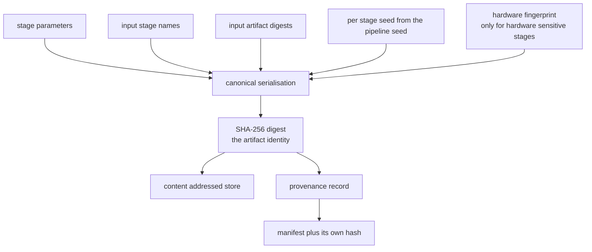
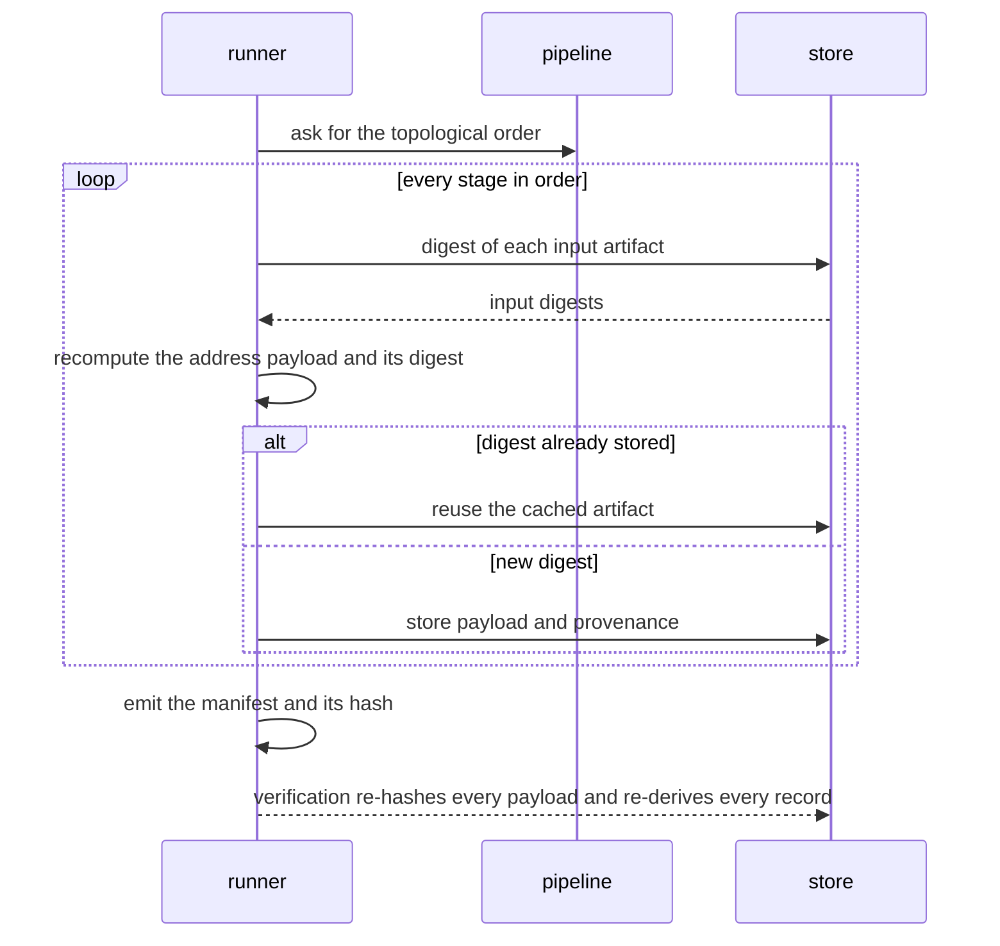
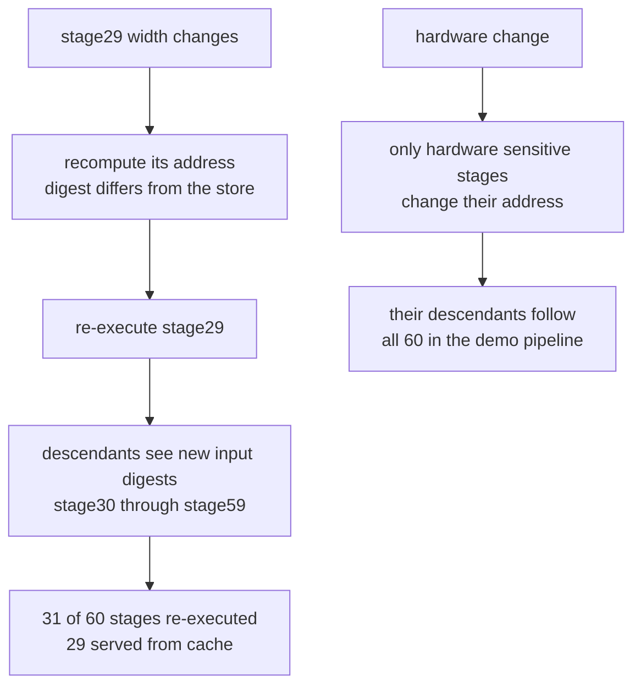

# 900 — Implement full-featured reproducible research platform with hardware config capture.

> **Tier:** Master · **CTCI chapter:** Beyond — Software Engineering & Tooling
> **Task spec:** [900-implement-full-featured-reproducible-research-platform-with-hard.md](../../../tasks/master/900-implement-full-featured-reproducible-research-platform-with-hard.md)
> **Solutions:** [Python](../../../solutions/python/master/900-implement-full-featured-reproducible-research-platform-with-hard/solution.py) ·
> [Java](../../../solutions/java/master/900-implement-full-featured-reproducible-research-platform-with-hard/Solution.java) ·
> [JavaScript](../../../solutions/javascript/master/900-implement-full-featured-reproducible-research-platform-with-hard/solution.js) ·
> [C#](../../../solutions/csharp/master/900-implement-full-featured-reproducible-research-platform-with-hard/Solution.cs)

## 1. Problem restatement

**Input:** a directed acyclic graph of experiment stages, where each stage declares its parameters, its
input stages, whether its result depends on the hardware, and (optionally) that it consumes unseeded
entropy; plus a **captured hardware profile** and a pipeline seed.

**Output:** a run that (a) executes only the stages whose content address changed, (b) records an
artifact per stage under the SHA-256 of its *address payload*, and (c) emits a manifest that pairs each
artifact digest with its **provenance** (stage, parameters, inputs, input hashes, fingerprint, seed), so
that a later run can be audited in three distinct modes:

| Mode | What it does | What it proves |
| --- | --- | --- |
| normal run | topologically ordered execution with cache reuse | incremental work is exactly the dirty set |
| reproduction | discards the cache, re-runs everything, compares hashes against a recorded manifest | a nondeterministic stage is *caught*, not hidden by the cache |
| verification | re-hashes stored payloads and re-derives every artifact from its provenance | tampering and doctored manifests fail loudly |

The address of a stage is `H(stage name, canonical params, sorted inputs, input hashes, stage seed,
hardware fingerprint if the stage is hardware sensitive)`. What the four solutions simplify:

| Language | address inputs | what is simulated |
| --- | --- | --- |
| Python | name, params, sorted inputs, input digests, per-stage seed, fingerprint | payloads are canonical serialisations of the record; nothing is actually computed |
| Java | stage, revision, canonical params, input addresses, fingerprint | "stages are content-addressed, not executed"; costs are declared constants, never measured time |
| JavaScript | step implementation, parameters, input hashes, code revision, numerics policy, hardware | the numeric policy is real: `fixed-order` sums in canonical order and is bit-identical across core counts, `hardware-order` is not |
| C# | stage name, parameters, environment fingerprint, input hashes | stage compute functions are deterministic string derivations; there is no filesystem, remote store or containerisation |

Concrete behaviour (the Python file's own numbers):

| Call | Result |
| --- | --- |
| `build_pipeline()` (6 stages, seed 900001) | order `stage00 … stage05`; `stage05` takes **two** inputs (`stage00`, `stage04`) — a diamond |
| first `runner.run()` | executes all 6 stages, reuses none |
| second `runner.run()` | executes **0** stages, reuses 6, identical manifest hash |
| `run(overrides={"stage02": {"learning_rate": 0.9}})` | re-executes exactly `stage02, stage03, stage04, stage05` |
| `run(fingerprint=hardware.with_field("driver", "545.29").fingerprint)` | re-executes all 6, because `stage00` is hardware sensitive and an ancestor of everything |
| `Pipeline([Stage("a", {}, ("b",)), Stage("b", {}, ("a",))], ...)` | raises `PipelineError` at construction: a cycle |
| `hardware.with_field("flops", 1)` | raises `PipelineError`: unknown hardware field |

## 2. Intuition

The naive way to make research reproducible is a log: record the command line, the config file, the git
SHA and the machine, then hope. It fails for structural reasons — a log is *written*, not *derived*, so
it can be stale, partial or simply wrong, and "reproducing" a run becomes a manual diff hunt.

The key insight is to make the log unnecessary by making the artifact identity **content addressed over
everything that can influence the result**:

1. **Serialise canonically.** `canonical` sorts dictionary keys and renders only primitives, so
   `{"epochs": 15, "learning_rate": 0.15}` has exactly one representation; without it, two identical
   configurations hash differently (Python dict order, `repr` of floats, object addresses).
2. **Fold in the environment that matters.** A hardware-sensitive stage includes the *fingerprint* of a
   captured profile (`cpu`, `cores`, `gpu`, `driver`, `memory_gb`, `os`), so a different machine is a
   different result rather than a mysterious numeric difference. A stage that is not hardware sensitive
   deliberately omits it.
3. **Derive rather than record.** Provenance is a by-product of computing the address: the payload
   *is* the tuple (params, inputs, input hashes, seed, fingerprint), so verification can re-derive it
   and any mismatch is a hard error.
4. **Cross-check the schedule.** Two independent topological sorts (Kahn with a name tie-break and a
   depth-first walk) must agree, and the dirty set is checked against an independent reverse
   reachability computation — the platform audits its own bookkeeping.



## 3. Algorithm

1. **Validate the graph.** Unique stage names, every declared input exists, a hardware profile is
   captured, then order the stages with Kahn's algorithm (ready stages sorted by name for a
   deterministic sequence) and cross-check with a depth-first traversal. A cycle, a dangling input or a
   duplicate name raises at construction time.
2. **Address a stage.** Derive a per-stage seed from `SHA-256(name | pipeline seed)`, build the record
   with sorted inputs and their digests, add the fingerprint only for hardware-sensitive stages,
   canonicalise, and hash.
3. **Run.** Walk the order; for each stage recompute its address from the current parameters and the
   digests of its inputs. If the store already holds an artifact under that digest, count a cache hit
   and skip execution; otherwise store the payload with its provenance and record an execution.
4. **Reproduce.** Build a fresh runner with an empty store, re-run with the recorded fingerprint, and
   diff the fresh digests against the recorded manifest. A deliberately nondeterministic stage mixes a
   counter into its payload, so it produces a different digest on re-run and is *named* in the report,
   together with its descendants.
5. **Verify.** For every stored artifact re-hash the payload, require each provenance field, require
   the provenance digest to match, and re-derive the payload from the provenance (skipped for stages
   that are declared nondeterministic, whose address cannot be reproduced by design).

```text
procedure canonical(value)
    if value is a map then emit keys in sorted order with canonical values
    if value is a list then emit the canonical items in order
    otherwise emit the primitive representation
end

procedure payload_for(pipeline, name, params, input_hashes, fingerprint)
    record ← stage name, params, sorted inputs, their hashes, per stage seed
    if the stage is hardware sensitive then record adds the fingerprint
    return canonical(record) as bytes
end

procedure run(runner, overrides, fingerprint)
    executed ← empty list; reused ← empty list
    for each name in the topological order do
        params ← stage params merged with the override for this stage
        input_hashes ← digest of every input artifact
        payload ← payload_for(pipeline, name, params, input_hashes, fingerprint)
        digest ← SHA-256 of payload
        if the store already holds this name under this digest then
            record a cache hit and continue
        end
        if the stage consumes unseeded entropy then mix in an increasing counter and re-hash
        store the payload and its provenance under the digest
        record the execution
    end
    return executed, reused and the manifest
end

procedure reproduce(runner, recorded)
    fresh ← runner with an empty store
    run(fresh, fingerprint of the recorded manifest)
    return the names whose fresh digest differs from the recorded digest
end

procedure verify(runner)
    problems ← empty list
    for each stored artifact do
        report when the payload does not hash to the recorded digest
        report when a required provenance field is missing or the digest disagrees
        re-derive the payload from provenance unless the stage is nondeterministic and compare
    end
    return problems
end
```



## 4. Worked example

**Trace A — the demo pipeline.** `build_pipeline(seed=900001)` builds six stages. Hardware:
`x86-64`, 16 cores, `A100`, driver `535.104`, 256 GB, `linux-6.5`, whose fingerprint begins
`20c3361feefac9a0`. Stages `stage00` and `stage03` are hardware sensitive (`index % 3 == 0`), and
`stage05` consumes both `stage00` and `stage04`, so the graph is a chain with a diamond at the end.

| Run | Executed | Reused | Why |
| --- | --- | --- | --- |
| first | `stage00 … stage05` (6) | 0 | cold store |
| second | none | 6 | every recomputed digest matches the stored one; the manifest hash is unchanged |
| `overrides = {"stage02": {"learning_rate": 0.9}}` | `stage02, stage03, stage04, stage05` (4) | 2 | the changed stage plus everything downstream; `stage00` and `stage01` keep their digests |
| driver changed to `545.29` | all 6 | 0 | `stage00` is hardware sensitive and an ancestor of every stage |
| back to `535.104` | all 6 again | 0 | the original addresses are recomputed, but the *sensitivity set* is the same |

The address of `stage00` for this configuration hashes to `a00ac8ed50309339…`, its seed is
`6611480019281258169`, and its payload is 181 bytes of canonical text — the payload of `stage05`
carries **two** input hashes because the diamond gives it two inputs. The `overrides` case is checked
against `pipeline.descendants({"stage02"})`, an independent reachability computation, and the file also
verifies that the *ancestors* of the change (`stage00`, `stage01`) keep their digests.

**Trace B — tampering and flakiness.** Appending a byte to `stage01`'s payload makes `verify()` report
`stage01`; flipping a single bit (`original[0] ^ 1`) is still detected; restoring the payload clears the
report. A pipeline built with `nondeterministic=2` re-runs `stage02` with a counter mixed into its
payload, so `reproduce` returns `reproduced = False` and names exactly `stage02, stage03, stage04,
stage05` — the flaky stage and its descendants.

**Trace C — scale.** A 60-stage pipeline (chain plus skip edges that appear every 7 stages from stage
10, `hardware_sensitive` every 10th stage) executes 60 stages cold; after changing `stage29`'s width the
cache re-executes **31** of 60 stages, saving 29 recomputations, and the total work of two passes stays
below two full runs.



## 5. Complexity

With `S` stages, `E` dependency edges and `b` the canonical payload size:

| Step | Time | Space | Reason |
| --- | --- | --- | --- |
| Graph validation and ordering | `O(S log S + E)` | `O(S + E)` | Kahn's algorithm with a sorted ready set, cross-checked by an `O(S + E)` depth-first walk |
| Address derivation | `O(b)` per stage | `O(b)` | canonical serialisation plus one SHA-256 |
| Cold run | `O(S)` executions, `O(S (b + E))` hashing | `O(S b)` | every stage is a cache miss |
| Repeat run | `O(S)` hashes, **0** executions | `O(1)` extra | measured: 0 of 6 and 0 of 60 executed |
| Incremental run | `O(|dirty|)` executions plus `O(S)` hashing | `O(1)` extra | dirty set = changed stage plus descendants; 4 of 6 and 31 of 60 measured |
| Descendant closure | `O(S E)` for the iterative sweep in the Python file | `O(S)` | each sweep relaxes every edge until no new stage is added; a worklist queue makes it `O(S + E)` |
| Verification | `O(S b)` | `O(S)` | re-hash each payload and re-derive each record |
| Reproduction | `O(S)` executions | `O(S b)` | deliberately throws the cache away, which is what detects a flaky stage |

The interesting comparison is not against a bigger `O` but against the naive policy: always re-run.
A repeat pass costs 6 executions instead of 0, and a one-parameter edit costs 60 instead of 31 on the
wide pipeline.

**What is simulated.** Python and Java never execute a stage — the payload is a canonical record, so
"execution" means "compute an address and store it"; Java's stage costs are declared constants and the
header says explicitly that "at scale" means typed parameters, never measured time. C#'s stage
functions are deterministic string derivations, and it has no filesystem, remote store, container or
real hardware probe ("hardware" is a captured record). JavaScript goes furthest, actually summing values
under two numerics policies, which is what makes its core-count claim testable. What is *not*
simplified in any of them: canonicalisation, content addressing, the topological cross-check, cache
semantics, provenance, reproduction and tamper detection.

## 6. Pitfalls and edge cases

- **Cycles and dangling inputs.** `Pipeline([Stage("a", {}, ("b",)), Stage("b", {}, ("a",))], …)`
  raises, and so does an input naming a stage that does not exist — both at construction, before
  anything is cached.
- **Duplicate stage names.** `[Stage("a", {}), Stage("a", {})]` raises instead of silently keeping one.
- **Missing hardware capture.** A pipeline without a hardware profile raises; a profile cannot be
  edited with an unknown field (`with_field("flops", 1)` raises), so the fingerprint set is closed.
- **Canonicalisation drift.** Any serialisation that depends on key order, object identity or
  non-deterministic float formatting breaks cache hits and makes verification report false alarms —
  hence `canonical` sorts keys and renders primitives only.
- **Non-determinism must be declared and reported.** A flaky stage is *mixed with a counter* so it
  cannot accidentally look reproducible, `verify` skips re-deriving its payload, and `reproduce` names
  it. Papering over it with a cache hit is exactly the failure mode this mode exists to expose.
- **The dirty set includes descendants — and ancestors matter too.** A hardware change to `stage00`
  touches all six stages because `stage05` depends on it; the file asserts the complement stays
  untouched, which is the real test of the address formula.
- **Sensitivity is opt-in.** Only stages that declare themselves hardware sensitive fold the
  fingerprint in, so a driver upgrade does not invalidate stages whose results cannot change; the
  JavaScript file takes this further with an explicit `fixed-order` versus `hardware-order` numerics
  policy, where a core-count change is a *non-event* under the former and a *detected divergence* under
  the latter.
- **Tampering, byte-level and structural.** Verifying a payload's hash catches edits; re-deriving the
  payload from the provenance catches a doctored *manifest* even when the bytes are intact.
- **Degenerate pipelines.** An empty pipeline has an empty order, executes nothing and verifies
  cleanly; a single-stage pipeline executes once and then caches; `descendants({"nothing"})` is
  `{"nothing"}` rather than an error.

## 7. Variants and follow-ups

- **Lockfiles and drift reports.** C# turns a run into a `name -> hash` lockfile that can be compared
  with a previous run, which is how "the numbers moved and nobody knows why" becomes a diff.
- **Remote and shared caches.** Because addresses are pure content, the store can be swapped for a team
  cache or an object store; only the digest matters, so a machine that never ran the stage can still
  reuse it.
- **Controlling randomness.** A platform can only cache what is deterministic; bounding the
  error of deliberately randomised algorithms (and testing those bounds) is
  [901 — provable bounds for randomized algorithms](../../../tasks/master/901-implement-provable-bounds-for-randomized-algorithms-used-in-your.md).
- **Tamper-evident history.** Extending an append-only, Merkle-verified record over many runs rather
  than one manifest is
  [902 — self-verifying distributed logs with Merkle trees and authenticated queries](../../../tasks/master/902-implement-self-verifying-distributed-logs-with-merkle-trees-and.md).
- **Reproducible simulation at scale.** The same content-addressing discipline applied to multi-fidelity
  runs (low fidelity first, high fidelity last, with a budget) is
  [906 — multi-fidelity simulation orchestration with surrogate models](../../../tasks/master/906-implement-multi-fidelity-simulation-orchestration-with-surrogate.md).

## 8. Check yourself

**Q1.** Why does the run engine recompute every stage's digest on every pass instead of trusting the
stored artifact?

<details><summary>Show answer</summary>

Because the digest *is* the correctness condition of the cache. A stage's artifact is only valid if its
address — which folds in parameters, input digests, the per-stage seed and (for sensitive stages) the
hardware fingerprint — is unchanged. Recomputing the digest costs one canonicalisation plus a SHA-256
over the provenance record (181 bytes for `stage00` in the demo), while re-executing the stage may cost
minutes; the whole design trades a cheap hash for an expensive recomputation. That is also why a repeat
run executes 0 of 6 stages *and* produces an identical manifest hash: both statements are consequences
of the same recomputation.

</details>

**Q2.** The demo's driver change re-executes all six stages. Is the hardware fingerprint therefore
useless?

<details><summary>Show answer</summary>

No — it is exact. Only `stage00` and `stage03` are declared hardware sensitive, so only their addresses
change; but `stage00` is an ancestor of the diamond, so every downstream stage sees a new input digest
and re-executes. The JavaScript file isolates the same phenomenon more sharply: under the `fixed-order`
numerics policy a core-count change alters *no* artifact hash (the sums are bit-identical), while under
`hardware-order` the same change is detected and reported. The fingerprint does not make results depend
on hardware; it makes the dependency *explicit*.

</details>

**Q3.** Why is `reproduce` a separate mode that discards the cache, rather than a flag on the normal
run?

<details><summary>Show answer</summary>

Because the cache is precisely what hides non-determinism. If reproduction reused cached artifacts, a
flaky stage would return the stored digest from the first run and the comparison would trivially pass.
`reproduce` constructs a *fresh* runner with an empty store, re-runs with the recorded fingerprint, and
diffs — and the platform's nondeterministic stages mix an execution counter into their payload, so they
cannot pass by accident. The Python file demonstrates both sides: the honest pipeline reproduces with an
empty difference list, while the pipeline with `nondeterministic=2` reports `reproduced = False` and
names `stage02, stage03, stage04, stage05`.

</details>

**Q4.** Verification checks both "the payload hashes to the recorded digest" and "the payload follows
from its provenance". Why are these two different checks?

<details><summary>Show answer</summary>

The first catches tampering with the *bytes*: change an artifact and its digest no longer matches. The
second catches a doctored *manifest* or a broken bookkeeping chain: if the recorded parameters, input
hashes, seed or fingerprint are edited (or if the store's artifacts changed under a different stage), the
re-derived payload no longer hashes to the recorded digest even though the stored bytes are self
consistent. The file exercises both directions — a payload edit, a single flipped byte, and restoring the
original — and requires `verify()` to return exactly the offending stage names.

</details>
