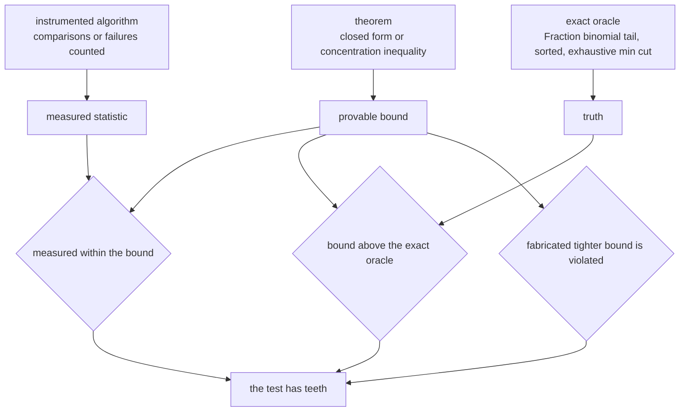
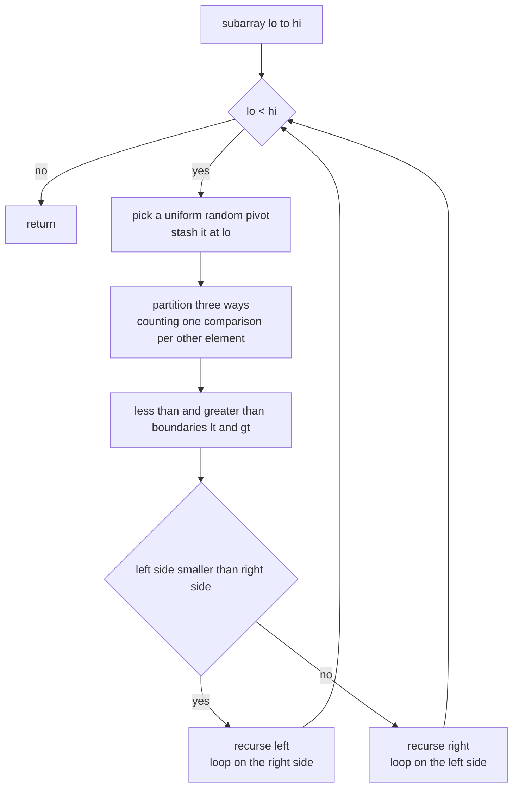
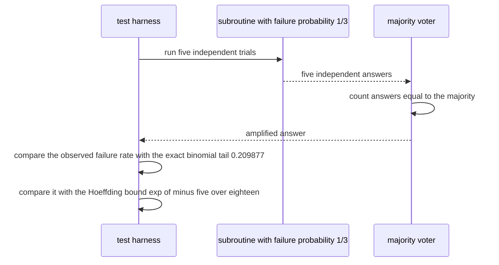

# 901 — Implement provable bounds for randomized algorithms used in your projects, with tests.

> **Tier:** Master · **CTCI chapter:** Beyond — Software Engineering & Tooling
> **Task spec:** [901-implement-provable-bounds-for-randomized-algorithms-used-in-your.md](../../../tasks/master/901-implement-provable-bounds-for-randomized-algorithms-used-in-your.md)
> **Solutions:** [Python](../../../solutions/python/master/901-implement-provable-bounds-for-randomized-algorithms-used-in-your/solution.py) ·
> [Java](../../../solutions/java/master/901-implement-provable-bounds-for-randomized-algorithms-used-in-your/Solution.java) ·
> [JavaScript](../../../solutions/javascript/master/901-implement-provable-bounds-for-randomized-algorithms-used-in-your/solution.js) ·
> [C#](../../../solutions/csharp/master/901-implement-provable-bounds-for-randomized-algorithms-used-in-your/Solution.cs)

## 1. Problem restatement

**Input:** randomized algorithms — randomized quicksort, quickselect, Karger's contraction min cut,
randomized rounding, majority amplification — a size parameter, and seeds.

**Output:** not a benchmark, but a **proof obligation discharged by tests**. For each algorithm the
solution pairs the theorem with a measurement and requires that:

1. the algorithm is *correct* (Las Vegas), checked against an independent oracle (`sorted()`, the
   exhaustive bipartition minimum, the sorted-array k-th element);
2. the empirical statistic sits **inside** the proved bound (mean within a stated tolerance of the
   closed form; tail rate below the inequality);
3. the bound itself is above an **exact** oracle where one exists (rational binomial tail, exhaustive
   enumeration) rather than above a re-implementation of the same formula;
4. a **negative control** fails — a fabricated tighter bound must be visibly violated, so the test has
   teeth.

The modelling contract, per the file headers:

| Language | algorithms | bounds proved | simplification |
| --- | --- | --- | --- |
| Python | three-way quicksort, quickselect, Chernoff, Hoeffding, majority amplification | `E[C_n] = 2(n+1)H_n - 4n`, `E[C] = O(n)`, `exp(-mu d^2/3)`, `2exp(-2nt^2)` | the "random" subroutine is a PRNG-driven quicksort; tail checks are exhaustive in a small model; the `4n lg n` bound is validated by a seed sweep, not the pairwise-independence induction |
| Java | Karger min cut, quickselect, Bernoulli estimator, union bound, Markov | `2/(n(n-1))`, `4n`, `2exp(-2Ne^2)`, `sum P`, `1/t` | graphs have `n <= 10` so the oracle is exhaustive; a few thousand trials; fixed-seed splitmix64 |
| JavaScript | quicksort, Karger with restarts, Hoeffding vs Chebyshev, median-of-means | `E[C_n]`, `exp(-2k/(n(n-1)))`, `2exp(-2m eps^2)`, `exp(-k D(1/2 || p))` | three-way partition costs one extra comparison per subproblem, so the measured mean must land in `[E, E+n]`; empirical rates get a three-sigma binomial slack |
| C# | Karger min cut, randomized rounding | `2/(n(n-1))`, `exp(-np d^2/3)`, `exp(-np d^2/2)`, Hoeffding | graphs have `n <= 8`; the binomial tail is computed exactly by dynamic programming |

Concrete behaviour (all figures produced by the Python file):

| Call | Result |
| --- | --- |
| `expectation_closed_form(2)` / `(3)` | `1` / `8/3` — the closed form and the indicator sum agree exactly, as `Fraction`s |
| `expectation_closed_form(64)` | `360.706` comparisons, against a high-probability bound of `4 * 64 * lg 64 = 1536` |
| `randomized_quicksort([7] * 40, Rng(3))` | sorted, with exactly `39` comparisons — one partition, `n - 1` comparisons |
| `randomized_select(perm(200), 100, ...)` over 100 seeds | mean `648.12`, max `1090` comparisons (`<= 6n` mean, `<= 16n` max) |
| `chernoff_upper(10, 0.5)` | `0.434598` |
| `hoeffding_two_sided(0.25, 40)` | `0.013476` |
| majority vote, `m = 5`, `p = 1/3` | exact tail `0.209877`; the Hoeffding bound `exp(-5/18) = 0.757465` holds above it |

## 2. Intuition

The naive way to justify a randomized algorithm is to run it and report the average — "about
`n log n` comparisons on my machine". That number is unverifiable, machine-dependent (the seed, the
compiler and the clock all enter), and says nothing about the tail, which is where randomized
algorithms actually fail.

The key insight is to make the *cost model* part of the algorithm and the *theorems* part of the test:

1. **Count comparisons, not seconds.** One unit is charged per non-pivot element per partition, so a
   partition of a size-`m` subarray costs exactly `m - 1`. The instrument is deterministic even though
   the pivot is random, which is what makes an exact expectation derivable at all.
2. **Two independent derivations of the mean.** The indicator identity `C_n = sum_{i<j} X_ij` with
   `E[X_ij] = 2/(j - i + 1)` gives `E[C_n] = 2(n+1)H_n - 4n`. Computing the same quantity two ways in
   exact rational arithmetic is a proof check, not a test of the code's arithmetic: if the two agree
   for every `n` in a range, the algebra is right.
3. **Bound the tail with the right inequality.** Chernoff gives `exp(-mu d^2/3)` for the upper tail of
   a sum, Hoeffding gives `2exp(-2nt^2)` two-sided without needing the variance, and the union bound
   converts many small failures into one; the exact rational binomial tail decides whether the bound
   is actually valid at that parameter.
4. **Amplify by voting.** A `2/3`-correct subroutine repeated `2k+1` times and decided by majority has
   failure probability bounded by the binomial tail — the same machinery, applied to the *result*
   rather than the runtime.



## 3. Algorithm

1. **Instrument.** Partition three ways around a uniformly random pivot; stash the pivot at `lo` and
   compare every other element exactly once, so the comparison counter *is* the textbook quantity.
2. **Recurse on the smaller side, loop on the larger**, which caps the recursion depth at `O(log n)`
   in expectation while keeping the same comparison count.
3. **Compute the mean two ways.** Sum `2/(j - i + 1)` over all pairs, and evaluate `2(n+1)H_n - 4n` in
   exact rational arithmetic; they must be equal.
4. **Measure.** Run the algorithm over many seeds at several sizes, compute the empirical mean, and
   require it to be within a stated fraction of the analytic mean and each run below the
   high-probability bound.
5. **Bound the tail.** Compare each inequality with the exact rational binomial tail, and check the
   empirical deviation rate against the inequality.
6. **Amplify.** Take the majority of `2k+1` runs of a `2/3`-correct subroutine and compare the observed
   failure rate with both the exact binomial tail and the Hoeffding bound.

```text
procedure partition_three_way(items, lo, hi, pivot_index, counter)
    pivot ← items[pivot_index]; move pivot to lo
    lt ← lo; gt ← hi; i ← lo + 1
    while i <= gt do
        counter ← counter + 1                       one comparison per non pivot element
        if items[i] < pivot then swap items[lt] with items[i]; lt ← lt + 1; i ← i + 1
        else if items[i] > pivot then swap items[i] with items[gt]; gt ← gt - 1
        else i ← i + 1
    end
    return lt, gt
end

procedure randomized_quicksort(items, rng)
    counter ← 0
    sort(0, length(items) - 1)
    procedure sort(lo, hi)
        while lo < hi do
            lt, gt ← partition_three_way(items, lo, hi, lo + rng.below(hi - lo + 1), counter)
            if lt - lo < hi - gt then sort(lo, lt - 1); lo ← gt + 1
            else sort(gt + 1, hi); hi ← lt - 1
        end
    end
    return items, counter
end

procedure expected_comparisons_closed_form(n)
    return 2 * (n + 1) * harmonic(n) - 4 * n
end

procedure expected_comparisons_indicator_sum(n)
    total ← 0
    for j ← 1 to n do
        for i ← 1 to j - 1 do
            total ← total + 2 / (j - i + 1)
        end
    end
    return total
end

procedure majority_amplify(runs, correct_probability, rng)
    votes ← 0
    for each of the odd number of runs do
        if the subroutine answers correctly with probability correct_probability then votes ← votes + 1
    end
    return votes greater than half the runs
end
```



## 4. Worked example

**Trace A — the mean, two ways.** At `n = 2` the pairs are `(1,2)` with `2/(2) = 1`, so
`E[C_2] = 1`; at `n = 3` the pairs give `1 + 2/3 + 1 = 8/3`; at `n = 64`,
`2 * 65 * H_64 - 256 = 360.706` (where `H_64` is the 64th harmonic number). The closed form and the
indicator sum are compared as exact `Fraction`s for every `n` from 1 to 64, so the equality is asserted,
not approximated.

**Trace B — measured versus proved.** Runs are generated by `permutation(n, Rng(1000 + t))` with the
sorting PRNG seeded by `t`, 300 runs per size:

| Size `n` | Analytic `E[C_n]` | Measured mean | Max run | High-probability bound `4n lg n` | Runs above `2n` (negative control) |
| --- | --- | --- | --- | --- | --- |
| 16 | 50.94 | 51.25 (within 10%) | 89 | 256 | 300 of 300 |
| 32 | 139.86 | 138.46 (within 10%) | 183 | 640 | 300 of 300 |

The last column is the point of the negative control: a fabricated bound of `2n` comparisons is not
just slightly wrong, it is violated by every single run, so the harness would catch a bound that is too
tight. Degenerate inputs behave exactly as the analysis predicts: an array of 40 equal elements is
partitioned once, costing `n - 1 = 39` comparisons.

**Trace C — quickselect.** For `n = 200` and `k = 100` over 100 seeds the comparison count has mean
`648.12` and maximum `1090`, comfortably inside the asserted `mean <= 6n` and `max <= 16n`, and the
returned value equals `sorted(base)[k]` for every `k` at `n = 17`.

**Trace D — tail inequalities and amplification.** Each inequality is checked against the exact rational
tail on a grid of parameters (for example `(n, p, delta) = (40, 1/2, 1/2)`, `(100, 1/4, 1/4)`,
`(60, 3/5, 1/5)`, `(25, 1/10, 1/2)`), and the empirical deviation rate over 2000 trials of 40 Bernoulli
draws at `t = 0.25` must stay below `0.013476`. For amplification with `m = 5` and a `1/3` failure
probability, the exact tail is `0.209877` and the Hoeffding bound `exp(-5/18) = 0.757465`; over 3000
trials the observed failure rate must be within `0.05` of the exact value, below the bound, and the
success rate must exceed `0.6`.



## 5. Complexity

Costs are **comparisons**, the quantity the theorems bound.

| Quantity | Best | Average | Worst | Reason |
| --- | --- | --- | --- | --- |
| Partition of `m` elements | `m - 1` | `m - 1` | `m - 1` | exactly one comparison per non-pivot element |
| Randomized quicksort | `n log n`-ish | `2(n+1)H_n - 4n` (`360.706` at `n = 64`) | `O(n^2)` | tails: the random pivot splits badly with probability `1/n^(m-1)` per level, so the total stays `4n lg n` with high probability |
| Quickselect | `n` | `~3.2n` measured at `n = 200` | `< 16n` asserted | each level shrinks the subproblem by a constant factor in expectation |
| Recursion stack | `O(log n)` | `O(log n)` | `O(1)` explicit | recursing into the smaller side and looping on the larger bounds the depth |
| Exact binomial oracle | `O(n)` terms | `O(n)` | `O(n)` | the rational tail sums `n - k + 1` terms with `Fraction` arithmetic |
| Naive alternative (uninstrumented timer) | — | unprovable | machine-dependent | wall-clock time is not a random variable the analysis controls |

**What is simulated.** The randomness is a *seeded* stream (splitmix64 in Python, Java and C#,
xorshift32 in JavaScript), so every figure above is reproducible and the tests exercise the arithmetic
of a PRNG rather than a system entropy source; the header of the Python file states this and adds that
the tail-probability checks are exhaustive in a small model (binomial draws) rather than over an
unbounded family, and that the `4n lg n` comparison bound is validated by a seeded seed sweep instead
of the pairwise-independence induction that proves it. Java and C# keep their graphs tiny (`n <= 10` and
`n <= 8`) so the exhaustive oracle is affordable, and Java's header notes that the whole program aims to
stay under a second. What is *not* simulated: the counting model, the analytic means, the exact
rational tails, and the requirement that every measured statistic lie inside every proved bound.

## 6. Pitfalls and edge cases

- **Degenerate sizes.** `n = 0` returns the empty list with 0 comparisons; `n = 1` costs 0; the
  expectation is defined as `0` at `n = 0` rather than raising a division error in `H_0`.
- **All-equal input.** The three-way partition handles duplicates in one pass, so 40 equal elements cost
  exactly `n - 1 = 39` comparisons. A two-way partition would need many passes and would break the
  `m - 1` counting convention the analysis relies on.
- **Out-of-range select.** `randomized_select` raises with an assertion naming `k` and `n` instead of
  returning a wrong element.
- **Float versus rational.** Tail comparisons use exact `Fraction` arithmetic for the oracle and
  `limit_denominator(10**12)` for exponential bounds, so the inequality direction is decided by
  rationals, never by floating-point rounding.
- **Bounds must be checked against truth, not against themselves.** Each inequality is compared with the
  exact binomial tail; re-implementing the same approximation on both sides would make the test vacuous.
- **Tests need teeth.** The negative control asserts that more than a tenth of the runs exceed the
  fabricated `2n` bound (in fact all of them do), so a bound that is too tight cannot pass silently.
- **Statistical slack.** A random measurement must be *consistent* with the bound, not equal to it: the
  JavaScript file gives empirical rates a three-sigma binomial slack, and the Python file allows the
  empirical mean to differ from the analytic mean by 10%.
- **Seed sensitivity.** With a fixed stream, "random" is a specific sequence; the tests therefore sweep
  seeds (`range(24)` and 300-run sweeps) and additionally assert that different seeds produce different
  runtimes, so the measurement is not one lucky instance.
- **Preconditions.** Chernoff needs `delta` in `(0, 1]` and independent summands; the amplification
  routine needs `p <= 1/2`, and Java's header records that a routine violating that precondition must be
  rejected rather than silently returning a bound larger than 1.

## 7. Variants and follow-ups

- **Karger's min cut.** Replace the sorting cost by "probability of returning the minimum", which is at
  least `2/(n(n-1))`; restarts give failure probability `exp(-2k/(n(n-1)))`, and the result is
  cross-checked against exhaustive bipartition on tiny graphs (Java and C#).
- **Median-of-means.** More robust than a plain mean when only bounded variance is available; its
  failure probability is bounded by the Chernoff tail `exp(-k D(1/2 || p))` (JavaScript).
- **Union bound and Markov.** When many small bad events must all be avoided, `P(union) <= sum P` is the
  workhorse; Markov's `P[X >= t E[X]] <= 1/t` is exact but weak, and Java computes it from the pmf.
- **Reproducible random experiments.** Every measurement here depends on a seed stream, which is exactly
  the discipline
  [900 — reproducible research platform with hardware config capture](../../../tasks/master/900-implement-full-featured-reproducible-research-platform-with-hard.md)
  enforces for whole pipelines.
- **Distribution-free guarantees.** Conformal prediction turns a bound into a prediction interval with a
  finite-sample coverage guarantee rather than a concentration inequality:
  [908 — certified ML predictions with conformal prediction intervals](../../../tasks/master/908-implement-certified-ml-predictions-with-conformal-prediction-int.md).
- **Budgeted randomness.** Privacy budgets are composed with the same concentration arithmetic;
  [912 — privacy-preserving analytics with DP budgeting](../../../tasks/master/912-implement-end-to-end-pipeline-for-privacy-preserving-analytics-w.md)
  spends a total epsilon across queries the way this task spends a comparison budget.

## 8. Check yourself

**Q1.** Why does the file check the analytic mean against an indicator sum in exact rational arithmetic,
instead of just asserting the closed form looks reasonable?

<details><summary>Show answer</summary>

Because the closed form is an *identity*, not an approximation: `C_n = sum_{i<j} X_ij` with
`E[X_ij] = 2/(j - i + 1)` telescopes into `2(n+1)H_n - 4n`. Deriving it a second time by direct
summation over pairs and comparing as `Fraction`s for `n = 1..64` verifies the algebra behind the
implementation (including the harmonic-number routine) independently of the implementation's own
formula. Boundary values are pinned too: `E[C_2] = 1`, `E[C_3] = 8/3`.

</details>

**Q2.** The measured mean at `n = 16` is `51.25` while the bound is `50.94`. Does that falsify the
theorem?

<details><summary>Show answer</summary>

No. `50.94` is an *expectation*, and an empirical mean of 300 independent runs is itself a random
variable with a standard deviation of order `sigma / sqrt(300)`. The file therefore asserts that
`|mean - analytic| <= analytic / 10`, i.e. that the measurement is consistent with the theorem within
sampling error, and separately that every individual run stays below the high-probability bound
`4n lg n` (256 at `n = 16`; the maximum observed is 89). The JavaScript file expresses the same idea as
a three-sigma binomial slack for empirical rates.

</details>

**Q3.** Why is the comparison count of the three-way partition exactly `m - 1` per partition, and what
goes wrong if the analysis charges `m` or `2m`?

<details><summary>Show answer</summary>

The pivot is stashed at `lo` and every *other* element is compared with it exactly once — less-than,
greater-than or equal — so a partition of `m` elements performs `m - 1` comparisons. That convention is
what makes the indicator analysis exact: each pair `(i, j)` contributes `E[X_ij] = 2/(j - i + 1)`, and
the sum over pairs equals `2(n+1)H_n - 4n`. Charging a different constant would shift the expectation and
the tests would either fail the analytic identity or pass a bound that no longer matches the algorithm;
the negative control (`2n` runs above the observed maximum) shows how a mis-charged bound reveals itself.

</details>

**Q4.** The tail inequalities are also compared against the *empirical* rate. Why is a single
measurement not enough to validate an inequality?

<details><summary>Show answer</summary>

Because an inequality bounds a probability, and a finite sample only estimates it: the empirical rate
can sit above the bound by chance, especially when the bound is small (Hoeffding gives `0.013476` at
`n = 40, t = 0.25`). The checks are designed so that a *violation* is decisive in one direction only:
the exact rational tail must be below the inequality (a mathematical fact, checked on a parameter grid),
while the empirical rate is compared with a slack so that a random fluctuation does not fail the build.
This is why the file sweeps seeds and parameter grids instead of resting on one run — and why the
empirical checks are described as consistency, not proof.

</details>
