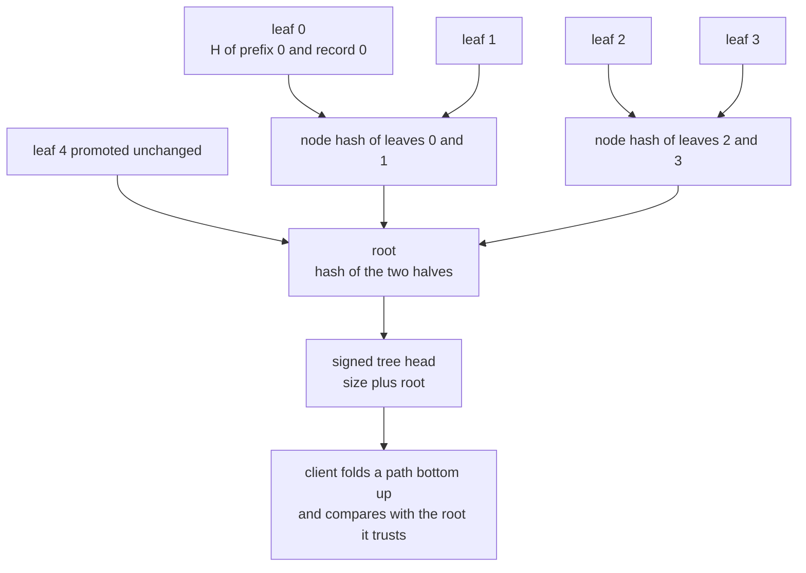
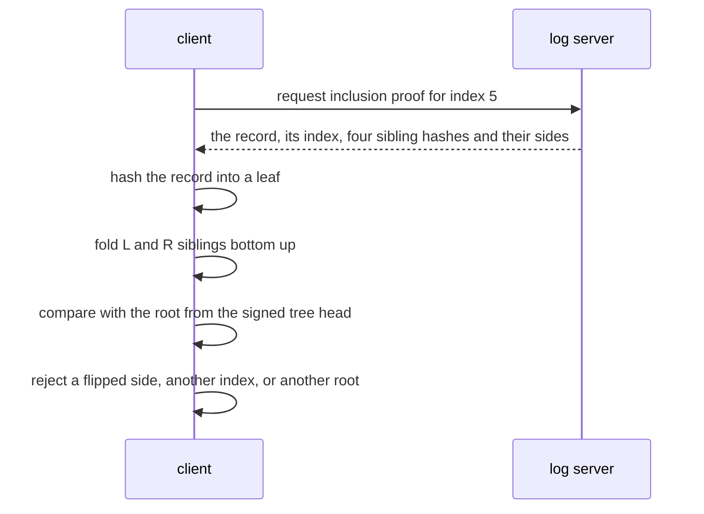
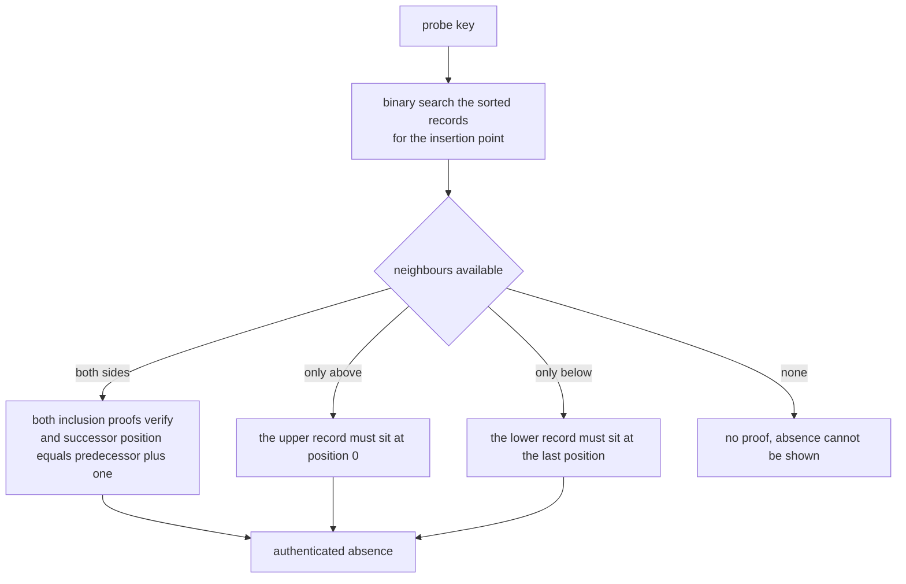

# 902 — Implement self-verifying distributed logs with Merkle trees and authenticated queries.

> **Tier:** Master · **CTCI chapter:** Beyond — Security & Privacy
> **Task spec:** [902-implement-self-verifying-distributed-logs-with-merkle-trees-and.md](../../../tasks/master/902-implement-self-verifying-distributed-logs-with-merkle-trees-and.md)
> **Solutions:** [Python](../../../solutions/python/master/902-implement-self-verifying-distributed-logs-with-merkle-trees-and/solution.py) ·
> [Java](../../../solutions/java/master/902-implement-self-verifying-distributed-logs-with-merkle-trees-and/Solution.java) ·
> [JavaScript](../../../solutions/javascript/master/902-implement-self-verifying-distributed-logs-with-merkle-trees-and/solution.js) ·
> [C#](../../../solutions/csharp/master/902-implement-self-verifying-distributed-logs-with-merkle-trees-and/Solution.cs)

## 1. Problem restatement

**Input:** an append-only sequence of records, a leaf index, a signed tree head (size plus root), and a
probe key for the authenticated map.

**Output:** the root commitment plus three authenticated answers a client can check **without trusting
the server**:

| Query | Server returns | Client checks |
| --- | --- | --- |
| inclusion `(record, index)` | the `O(log n)` sibling hashes on the path to the root | folding the path bottom-up reproduces the root it already trusts |
| consistency `(m, n)` | proof that the `m`-entry log is a prefix of the `n`-entry log | re-derives *both* roots from the ranges — nothing was rewritten or removed |
| audit `(tamper)` | — | the log re-derives every root from its own leaves and refuses to publish a root its recomputation contradicts |

Plus an **authenticated map** over a sorted log: membership is an inclusion proof, and absence is
proved by the two records adjacent to the probe key plus their log positions.

The construction is RFC 6962: `leaf = H(0x00 || record)`, `node = H(0x01 || left || right)`, an unpaired
trailing node is **promoted unchanged**, and the empty log hashes to `H("")`. The two domain-separation
prefixes are not decoration: they stop a leaf hash from being reinterpreted as an interior node
(a second-preimage confusion that would let a forger present a fabricated subtree as a leaf).

| Language | hashing and signing | documented simplification |
| --- | --- | --- |
| Python | real SHA-256; tree heads signed with HMAC under an in-file key; an independent recursive `reference_root` as the shape oracle | HMAC instead of asymmetric signatures; consistency is checked by re-deriving the prefix root rather than shipping an `O(log n)` consistency proof |
| Java | 64-bit splitmix64 mix; no signing key | "collisions are only absence-of-evidence, not a security statement"; no network, no persistence — the cluster is three in-memory replicas |
| JavaScript | SHA-256; inclusion, consistency and fork detection between two replicas | the demo sends explicit per-piece audit paths (`O(log^2 n)`) instead of RFC 6962's `O(log n)` consistency proof, but derives the ranges instead of trusting them |
| C# | SHA-256 from the BCL; compact frontier for verified appends | the "distributed" aspect is a server holding the log and clients verifying in process |

Concrete behaviour (Python's own figures):

| Call | Result |
| --- | --- |
| `MerkleLog([]).root` | `e3b0c44298fc1c14…` — `SHA-256("")`, height 0, empty audit path |
| 1 record | the root *is* the leaf hash; `audit_path(0) == []` |
| 13 records | height 5, `audit_path(5)` has 4 steps (`L, R, L, R`), root begins `7a72d085f091186c` |
| 257 records | height 10, longest path 9; all 257 inclusion proofs verify and match the oracle |
| perfect power-of-two size | path length is exactly `log2(n)` (`3` at `n = 8`) |
| `verify_tree_head(size + 1, root, head)` | rejected — a stale size is not a valid head |
| `table.member_proof("k007")` | `(49, 7, path of 5 hashes)` for a 24-key sorted map |
| `absence_proof("a")` / `("zzz")` | a single neighbour at position 0 / at position 23 |

## 2. Intuition

The naive self-verifying log stores the records and hands them out, so a client that wants to check one
entry re-reads the whole log and recomputes everything — `O(n)` work per query, and only meaningful if
the client trusts the storage it just read from.

The key insight is that a hash tree lets a client **recompute the commitment from a logarithmic slice**:

1. **Fold instead of rebuild.** The client starts from the leaf hash and folds sibling hashes upward,
   choosing `H(sibling || node)` or `H(node || sibling)` from the side marker. If the fold lands on the
   root the client already trusts, the record was in the tree — no matter what the server says.
2. **Shape must be canonical.** A tree where a lone node could be duplicated *or* promoted would admit
   two different valid proofs for the same record. Fixing the shape (a promoted trailing node, splitting
   at the largest power of two) means the root of a given prefix is unique, which is why the file keeps
   an **independent recursive construction** as an oracle and compares roots for every size.
3. **Size is part of the commitment.** Two different log sizes cannot share a root: the file asserts
   `MerkleLog(["same","same"]).root != MerkleLog(["same","same","same"]).root`, which is what makes the
   signed head's size field meaningful.
4. **Absence needs adjacency, not just two proofs.** Two valid inclusion proofs say "these two records
   are in the log"; they only say "nothing lies between them" if their *positions* are consecutive. That
   single extra condition turns a pair of proofs into an authenticated negative answer.



## 3. Algorithm

1. **Build the levels.** Level 0 holds the leaf hashes; each higher level pairs neighbours into
   `node_hash`, appending an unpaired tail node *promoted unchanged*. The root is the single hash of the
   top level, or `SHA-256("")` for an empty log.
2. **Prove inclusion.** Starting at the leaf index, take the sibling (`index ^ 1`) at each level — unless
   it lies beyond the level, which means the node was promoted and contributes nothing — and record the
   side (`L` when the sibling is on the left). Halve the index and continue; the result has `O(log n)`
   steps.
3. **Verify inclusion.** Independently, hash the record, fold every `(side, sibling)` pair, and compare
   with the root. The verifier needs nothing but the record, the index, the path and the root.
4. **Cross-check the shape.** Recompute the same root with a recursive construction that splits the
   range at the largest power of two below its length; the two must agree at every size.
5. **Authenticate a tree head.** Sign `size || root` and reject any head whose size or root has changed,
   including a single flipped signature bit.
6. **Answer map queries.** Membership is an inclusion proof for the record holding `key=value`. Absence
   is the predecessor/successor pair with their indices: both must verify, and the positions must be
   adjacent — degenerating, at the ends, to "the record at position 0 exists" or "the record at position
   `size - 1` exists".

```text
procedure build_levels(records)
    levels ← list with the leaf hash of every record
    while the top level holds more than one hash do
        next ← pair neighbours into node hashes
        if the level length is odd then append the last hash unchanged     promotion, never duplication
        append next to levels
    end
    return levels
end

procedure audit_path(log, index)
    require index within range
    path ← empty list
    for each level except the top one do
        sibling ← index xor 1
        if sibling is within the level then append the side and the sibling hash
        index ← index divided by 2
    end
    return path
end

procedure verify_inclusion(record, index, path, root)
    node ← leaf hash of the record
    for each (side, sibling) in path do
        node ← node hash of sibling then node when side is L, otherwise node then sibling
    end
    return node = root
end

procedure reference_root(records)
    split [lo, hi) at lo plus the largest power of two below hi - lo
    recurse until a range holds one leaf
    return the root hash, or the empty root for no records
end

procedure verify_absence(key, window, root, size)
    require the window to be non empty
    every entry in the window must pass verify_inclusion
    let lower be the entries whose key is below the probe, upper the entries above
    if both sides are present then require the successor position to equal the predecessor position + 1
    if only the upper side is present then require its position to be 0
    if only the lower side is present then require its position to be size - 1
end
```



## 4. Worked example

**Trace A — one proof, checked three way.** With 13 records (`entry-0000 … entry-0012`) the log has
height 5 and the path for index 5 is `L, R, L, R` — four steps, because a leaf in a 13-leaf tree sits in
an 8-leaf complete subtree that contributes three foldings plus the level where the promotion happens.
Each row is an assertion in the file:

| Attempt | Outcome | Why |
| --- | --- | --- |
| honest proof, index 5, honest root | verifies | the fold reproduces the root |
| rewrite `entry-0005` to `entry-0005!` | old proof rejects it, and the rewritten record's own root changes | the root commits to the content |
| flipping every side marker to `L↔R` | rejected | side markers are part of the path, not cosmetic |
| proof for index 5 presented at index 6 | rejected | index selects the fold order |
| honest proof against a 14-record root | rejected | a proof is bound to one tree |
| `audit_path(13)` | raises `"audit index 13 out of range"` | out-of-range requests fail loudly |

**Trace B — shape, growth and duplicates.** Roots agree with the independent recursive oracle for every
size from 0 to 33, and at 257 records the tree has height 10 with a longest path of 9. Appending four
records to an 8-record log leaves the complete-subtree hashes `levels[k][0]` untouched — the prefix
commitment property — and every old inclusion proof still verifies. Three identical records hash
identically at the leaf level and each still proves at its own position, yet a two-record log of `"same"`
and a three-record log of `"same"` have different roots.

**Trace C — signed heads and authenticated queries.** A valid head verifies; incrementing the size,
swapping in a forged root, or flipping one signature bit all fail. Over the 24-key sorted map
(`k000 … k023`, value `i²`), the key `k007` proves as `(49, 7, 5 hashes)`, `k999` has no membership
proof, and the probes `k007a` (inside the key space), `a` (below every key) and `zzz` (above every key)
all verify their absence. The negative cases are the interesting ones: a value edited by one fails, a
window whose indices were shifted by one fails (the brackets are no longer adjacent), an empty window
fails, and a window that proves the neighbours of `k007a` cannot prove the absence of `a`.



## 5. Complexity

With `n` records, `h = ceil(log2 n)` and `p` the number of range pieces in a consistency proof:

| Operation | Time | Space | Reason |
| --- | --- | --- | --- |
| Building the levels | `O(n)` hashes | `O(n)` | level `k` holds `ceil(n / 2^k)` hashes, and the geometric sum is below `2n` |
| Inclusion proof (server) | `O(log n)` | `O(log n)` | one sibling per level, skipping promoted nodes |
| Inclusion verification (client) | `O(log n)` | `O(1)` extra | `h` foldings and one comparison, no access to the other records |
| Consistency proof, Python | `O(n)` to re-derive the prefix root | `O(n)` | the documented simplification: re-derive rather than ship / verify an `O(log n)` proof |
| Consistency proof, JavaScript | `O(p)` audit paths of length `O(log n)` | `O(p log n)` | the demo sends explicit per-piece paths, so `O(log^2 n)` on the parameter ranges it uses |
| Append | `O(1)` new subtree hashes | `O(log n)` frontier | existing complete subtrees keep their hashes; C# keeps the frontier explicitly |
| Map membership | `O(log n)` | `O(log n)` | binary search plus one inclusion proof |
| Map absence | `O(log n)` | `O(log n)` | the two neighbours plus their paths |
| Naive alternative | `O(n)` per query | `O(n)` | rehash the whole log for every query, and trust the storage it was read from |

The asserted bounds are the small ones: paths of `1..h` steps, exactly `log2(n)` in a perfect tree
(`3` at `n = 8`), an empty path for a single-leaf log, and a maximum of `9` steps at 257 records.

**What is simulated.** There is no network, no persistence and no cluster: Java's header says the
"cluster" is three in-memory replicas and that it mixes with a 64-bit splitmix64 instead of SHA-256, so
collision resistance is absence-of-evidence rather than a security statement; Python signs tree heads
with an HMAC under an in-file key instead of asymmetric signatures and checks consistency by
re-deriving the prefix root; C# models the distributed part as a server plus in-process client
verifiers on small entries below 64 leaves. What is *not* simplified: the RFC 6962 shape including
promotion, domain-separated leaf and node hashing, the audit-path construction with its promotion
skips, inclusion verification, the independent recursive oracle, absence-by-adjacency, and the
tamper checks.

## 6. Pitfalls and edge cases

- **Empty log.** The root is `SHA-256("")`, the height is 0 and the audit path is empty; a single-record
  log's root is exactly its leaf hash. Both boundaries are asserted.
- **Promotion, not duplication.** An unpaired trailing node climbs unchanged, which is why
  `audit_path` skips a sibling that is out of range. Duplicating the last leaf instead (the older
  Bitcoin-style choice) yields a different tree shape and breaks agreement with the oracle.
- **Domain separation.** Dropping the `0x00` / `0x01` prefixes would let a 64-byte interior node be
  presented as a leaf, so a forged record could be "proved" against a real root.
- **Out-of-range indices.** `audit_path(13)` on a 13-record log raises with the offending index in the
  message; a verifier that silently accepted index 13 would fold a path that means nothing.
- **Proof coupling.** A valid path verifies only for its own record, its own index and its own root —
  the file tests all three mismatches explicitly.
- **Stale or forged heads.** Changing the size alone, changing the root alone, or flipping one signature
  bit must all be rejected; a signed head that is not checked for *both* fields is worthless.
- **Only checked contents verify, not convenient ones.** A rewritten record verifies against the
  rewritten tree's root (proving the tree is consistent) but never against the original root — the two
  facts must not be confused.
- **Absence needs adjacency.** Two inclusion proofs without the position check prove nothing about what
  lies between the neighbours; the ends degenerate to a single neighbour at position 0 or at `size - 1`.
- **Duplicates and size.** Identical records hash identically and each index proves separately, while
  different sizes cannot share a root, so "how many entries" is authenticated too.
- **Cost honesty.** RFC 6962's `O(log n)` consistency proof is replaced here by prefix re-derivation
  (Python) or explicit per-piece paths (JavaScript); both are documented, and neither weakens the
  verified invariant — changing a record or a sibling changes the root and every dependent proof fails.

## 7. Variants and follow-ups

- **Compact frontier for appends.** Keeping the complete-subtree frontier lets a client that knows only
  the old root and the newly appended entries recompute both roots and accept the extension (C#); the
  frontier is what makes appending `O(log n)` instead of `O(n)`.
- **Consistency proofs as RFC 6962 defines them.** Sending `O(log n)` hashes instead of re-deriving the
  prefix keeps verification cheap for large logs; the JavaScript demo shows the range derivation that a
  real proof would need anyway.
- **Real signatures.** Replacing the HMAC with an asymmetric signature over the tree head is what makes
  the head verifiable by a party that does not share a key; the Python header lists this as the main
  simplification.
- **Fork detection between replicas.** Two replicas claiming the same size with different roots are
  forking; that is the distributed-systems use of this structure, and it is checked in JavaScript.
- **Tamper-evident experiments.** The same commitment discipline — every artifact bound to a hash that
  changes when anything upstream changes — underlies
  [900 — reproducible research platform with hardware config capture](../../../tasks/master/900-implement-full-featured-reproducible-research-platform-with-hard.md).
- **Aggregation proofs over a masking protocol.** Merkle inclusion of client commitments, rather than
  log entries, is the proof layer of
  [899 — end-to-end encrypted collaborative machine learning](../../../tasks/master/899-implement-end-to-end-encrypted-collaborative-machine-learning-wi.md).
- **Replicated, self-verifying state.** Replicas that re-hash their own state and refuse to serve an
  inconsistent view are the storage-side analogue of
  [903 — adaptive replication factoring hot keys and node load](../../../tasks/master/903-implement-adaptive-replication-factoring-hot-keys-and-node-load.md).

## 8. Check yourself

**Q1.** Why must the tree shape be canonical, and how does the file check that it is?

<details><summary>Show answer</summary>

Because verification works by *recomputing* the root: if a lone node could be either duplicated or
promoted, the same set of records would admit two different roots depending on the construction, and a
proof produced under one shape could fail under another (or, worse, a forger could pick whichever
collision the shape allows). The file fixes the shape by construction — promotion, with rounding
implicit in `levels` — and then verifies it against a completely independent recursive construction that
splits a range at the largest power of two below its length, at every size from 0 to 33 and again at 257.
Agreement of two independent implementations at every size is the evidence that the shape is canonical.

</details>

**Q2.** An absence proof contains two valid inclusion proofs. Why are they not enough on their own?

<details><summary>Show answer</summary>

Because inclusion only binds a record to a position in the tree, not to the *ordering* of the log. Two
records that are both genuinely included might be far apart, with other entries between them. The extra
condition is `successor_position == predecessor_position + 1`, which certifies that no record lies
between the neighbours — for a sorted log that is what "the key cannot be present" means. The file tests
both directions: a forged value fails, and *shifting* the reported positions by one fails, which is the
adjacency check doing the work. At the ends the proof degenerates: a probe below every key must show the
record at position 0, and a probe above every key must show the record at the last position.

</details>

**Q3.** The file asserts that a rewritten record verifies against the *rewritten* tree's root but not
against the original root. Why is that pair of assertions important?

<details><summary>Show answer</summary>

The first half proves the verification routine is not simply "always reject" — a correct implementation
must accept a consistent tree, and the file shows the rewritten log is internally consistent. The second
half proves the routine is bound to the trusted root, so an attacker who rewrites history cannot present
the rewritten proof to a client that holds the original signed head. Together they pin the property we
actually want: a client can verify inclusion against a root it trusts, and an inconsistent tree cannot be
made to match that root.

</details>

**Q4.** The Python header says the `O(log n)` consistency proof is replaced by re-deriving the prefix
root. What does that cost, and why is the invariant still tested?

<details><summary>Show answer</summary>

Re-deriving the prefix root costs `O(n)` hashing instead of `O(log n)` hashes on the wire, which is
why the file documents it as a simplification rather than a design. The tested invariant is unaffected:
the tree is append-only and canonical, so the prefix root recomputed from the first `m` records *is* the
root a real consistency proof would attest to, and any rewrite of an earlier entry changes it. The
JavaScript variant shows the other extreme — explicit per-piece audit paths derived from `(m, n)` alone,
costing `O(log^2 n)` in the demo's ranges — so the tutorial's reader can see both ends of the trade-off.

</details>
