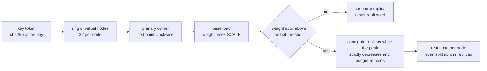
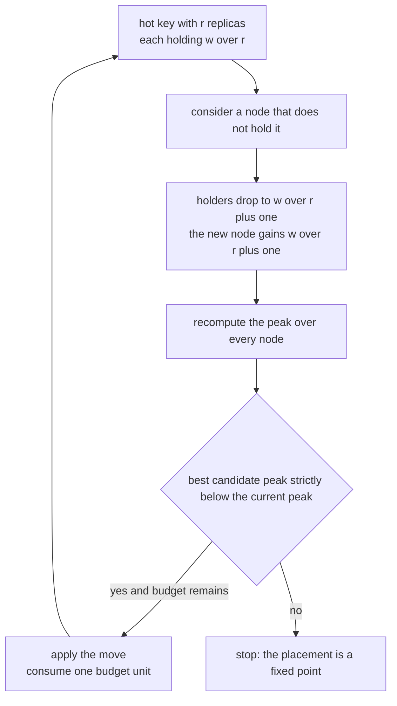
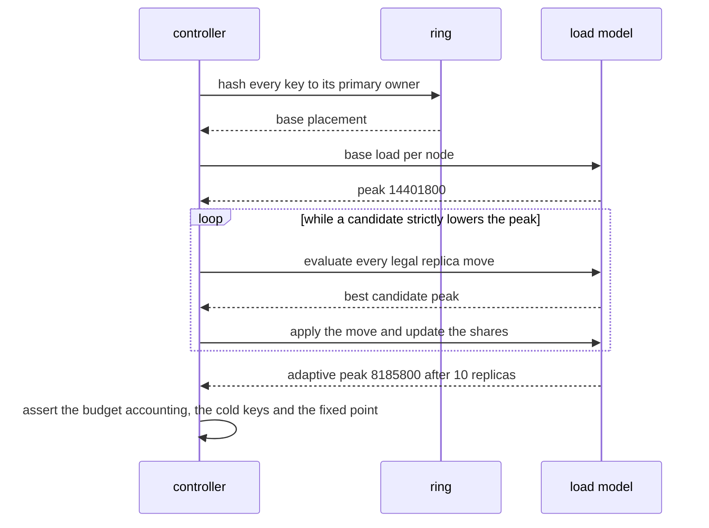

# 903 — Implement adaptive replication factoring hot keys and node load.

> **Tier:** Master · **CTCI chapter:** Ch 9 — System Design and Scalability
> **Task spec:** [903-implement-adaptive-replication-factoring-hot-keys-and-node-load.md](../../../tasks/master/903-implement-adaptive-replication-factoring-hot-keys-and-node-load.md)
> **Solutions:** [Python](../../../solutions/python/master/903-implement-adaptive-replication-factoring-hot-keys-and-node-load/solution.py) ·
> [Java](../../../solutions/java/master/903-implement-adaptive-replication-factoring-hot-keys-and-node-load/Solution.java) ·
> [JavaScript](../../../solutions/javascript/master/903-implement-adaptive-replication-factoring-hot-keys-and-node-load/solution.js) ·
> [C#](../../../solutions/csharp/master/903-implement-adaptive-replication-factoring-hot-keys-and-node-load/Solution.cs)

## 1. Problem restatement

**Input:** a cluster of nodes, a per-key access weight (a skewed, Zipf-like trace), a hot threshold, a
replica cap and a global replica budget.

**Output:** a placement `key -> set of nodes` plus the resulting per-node read load and the number of
replicas added, such that:

- every key has between 1 and `min(replica_cap, nodes)` **distinct** replicas on real nodes;
- a key below the hot threshold keeps exactly one replica (its primary owner);
- replicas are granted **only while the peak read load strictly decreases**, subject to the budget;
- the achieved peak cannot beat a theoretical lower bound, and on a tiny instance it is compared with
  the exhaustive optimum.

Placement uses consistent hashing with virtual nodes: a key is owned by the first ring point clockwise
of its token. Load is modelled as an even split of a key's traffic over its replicas,

`load(n) = sum over keys holding n of weight(key) / |replicas(key)|`,

computed in integers after scaling weights by `SCALE = 2520` (divisible by 1, 2, 3 and 4) so the report
is exact and reproducible.

| Language | replication policy | documented simplification |
| --- | --- | --- |
| Python | greedy: grow a hot key's replica set while the peak strictly decreases, under a budget | nodes are modelled purely by read load — no topology, no failure detection, no concurrent churn; the access weights are a fixed deterministic trace |
| Java | two heat thresholds: hot to `MAX_RF`, warm to 2, cold to 1, placed with capacity awareness | 24 keys, 8 nodes, 32 virtual nodes, 4000 simulated requests; reads assumed to spread uniformly |
| JavaScript | hot keys get `hotFactor`, others `baseFactor`; each replica goes to the least loaded of `d = exploration` random candidates, spilling to the global least loaded only at the capacity ceiling `ceil((1+eps) * replicas / nodes)` | bounded-load construction, so the guarantee is `maxLoad <= (1+eps) * avgLoad + 1` |
| C# | target factor `clamp(ceil(rate * nodes / totalRate), minRF, maxRF)`, replicas on least loaded nodes, cooled keys demoted, at most `budget` changes per round | throttled migration spread over rounds; safety invariants re-checked after every single change |

Concrete behaviour (Python's own run):

| Quantity | Value |
| --- | --- |
| trace | 240 keys, weights `spread / rank` with `spread = 4000`; top weights `4000, 2000, 1333, 1000, 800`, minimum `16` |
| mean weight, hot threshold (`4x` the mean) | `100.5`, `402` — so exactly `9` keys are hot |
| base peak (no replication) | `14,401,800` scaled units |
| adaptive peak | `8,185,800` — a `43.2%` drop with `10` replicas added inside a budget of 60 |
| replicated keys | `6`, each with at most `3` replicas |
| join a ninth node | `23` of 240 keys move (expected `26.7`, allowed `[13.3, 40]`) |
| leave (remove `node-3`) | `25` keys move, and every moved key was owned by the departing node |
| tiny instance (`{a: 900, b: 300, c: 120, d: 40}`, 3 nodes) | greedy `1,167,600` versus exhaustive optimum `1,142,400` — within 25% |

## 2. Intuition

The naive policy is a fixed replication factor: everything gets three copies. That is simple and
uniformly wrong for a skewed trace — the cold keys (most of them, weight `16` against a top weight of
`4000`) pay three times the memory and three times the write amplification while the few hot keys still
overload whichever node owns them.

The second naive idea is to raise the factor of hot keys without watching the nodes — which merely
relocates the hotspot to whichever node received the new copy.

The key insights in the implemented plan:

1. **Load is a share, so a replica always dilutes.** If a key with weight `w` is held by `r` nodes, each
   holder carries `w / r`. Adding a replica therefore *reduces* the load of every existing holder, but
   *adds* `w / (r + 1)` to the new one — so the benefit depends on where the peak currently is.
2. **Accept a replica only on a strict improvement of the peak.** The search evaluates every legal
   `(key, node)` move, computes the resulting peak, takes the best, and stops when no move lowers it.
   That single rule produces the three properties the tests check: cold keys are never replicated,
   replicas spread out, and the converged placement is a **fixed point** of the search.
3. **Exact arithmetic.** Using integer shares (`SCALE = 2520`, divisible by 1, 2, 3 and 4) makes the
   comparison of two candidate peaks exact and the whole run reproducible — no float tie-breaking.
4. **Audit against oracles.** A tiny instance is solved by brute force, so "the greedy plan is good" is a
   measurement against the true optimum, and the theoretical floor
   `max(total / nodes, largest key / nodes)` is used as a sanity bound the reported peak may not
   undercut.



## 3. Algorithm

1. **Build the ring.** For every node and every virtual node, hash `salt | node | v` with SHA-256 and
   keep the first 8 bytes as a token; sort the points. `primary(key)` hashes the key and takes the
   first point at or after the token, wrapping around.
2. **Base placement.** Give every key exactly `{primary(key)}` and compute the base load.
3. **Grow adaptively.** Repeatedly evaluate every `(hot key, candidate node)` pair that respects the cap
   and the budget: recompute the peak load as it would be after the move; take the best pair; apply it
   only if the new peak is **strictly lower** than the current peak; otherwise stop. Each applied move
   consumes one budget unit.
4. **Report** the placement, the load vector and the number of replicas added.
5. **Audit.** Compare with the exhaustive optimum on a tiny instance, and with a negative control
   (budget 0, cap 1, or a threshold above every weight must reproduce the base placement exactly).

```text
procedure primary(cluster, key)
    token ← first 8 bytes of SHA-256 of the key as an integer
    position ← binary search for the first ring token at or after the token
    return the node owning that point, wrapping to the first point when past the end
end

procedure base_load(cluster, weights)
    load ← zero for every node
    for each key do load[primary(cluster, key)] ← load of that node + weight of the key times SCALE
    return load
end

procedure plan(cluster, weights, hot_threshold, replica_cap, extra_budget, placement)
    cap ← the smaller of replica_cap and the node count
    placement ← one replica per key unless a starting placement is given
    load ← every key's weight times SCALE divided evenly over its holders
    added ← 0
    while added < extra_budget do
        best ← none
        for each key in sorted order do
            if the key is below the threshold or already at the cap then continue
            share ← its current scaled share per holder; grown ← its share with one more holder
            for each node not already holding the key do
                peak ← the largest load once the holders drop to grown and the node grows by grown
                keep (peak, key, node) when it is smaller than the best candidate so far
            end
        end
        if no candidate exists or its peak is not strictly below the current peak then stop
        apply the best candidate, update the load, record the replica, added ← added + 1
    end
    return placement, load, added
end

procedure brute_force_optimum(nodes, weights, replica_cap)
    for every key enumerate every subset of nodes of size 1 up to the cap
    for every combination of those subsets do
        compute the peak load with the same even split rule
        keep the smallest peak seen
    end
    return the smallest peak
end
```



## 4. Worked example

**Trace A — the main run.** Eight nodes, 240 keys, `spread = 4000`, so the weights form a Zipf-like
ladder `4000, 2000, 1333, 1000, 800, …, 16`. The mean is `100.5`; `HOT_RATIO = 4` sets the threshold at
`402`, which makes exactly nine keys hot. Without replication the peak node carries `14,401,800` scaled
units of read load; the greedy plan adds ten replicas (spending 10 of its 60 budget units) across six
keys and brings the peak down to `8,185,800`, a `43.2%` reduction, while the sum-of-squares spread
measure also falls. Cold keys are untouched: for every key below `402`, the placement is exactly its
primary.

| Check the file asserts | Meaning |
| --- | --- |
| `sum(load) == sum(weights) * SCALE` | every unit of traffic is accounted for exactly once |
| `sum(len(replicas) - 1) == added` | one budget unit per extra replica |
| `all(weights[key] >= threshold for key in replicated)` | no budget is spent on cold keys |
| `peak <= base_peak * 0.85` | the peak drops by at least 15% (measured 43.2%) |
| `lower <= peak` | the reported peak never undercuts the theoretical floor |
| `resume from the converged placement adds 0` | the plan is a fixed point of the search |

**Trace B — minimal disruption on membership change.** Joining a ninth node moves 23 of the 240 keys
(about `1/9 = 26.7` expected, inside the asserted `[0.5x, 1.5x]` band). Removing `node-3` moves 25 keys,
and every one of them was previously owned by `node-3` — a property the file asserts directly, because
it distinguishes "the ring rebalanced" from "the ring scrambled". A cluster built from the reversed node
list produces the same plan, so node ordering cannot leak into the result.

**Trace C — the oracle.** On three nodes with weights `{a: 900, b: 300, c: 120, d: 40}`, the greedy plan
reaches a peak of `1,167,600` against the exhaustive optimum of `1,142,400`, and the resulting placement
is `a: {n0, n2}`, `b: {n1}`, `c: {n1}`, `d: {n0, n1, n2}` — hot `a` spread over two nodes, small `c`
left alone, and the tiny `d` replicated to three simply because it costs nothing. The file asserts both
directions: greedy cannot beat the optimum (`greedy_peak >= optimum`) and must stay within 25% of it.

**Trace D — the controls.** A replica cap of 1 leaves the placement untouched and reproduces the base
peak exactly (and the assertion `base_peak > peak * 1.15` proves the trace really is skewed, so the
comparison is meaningful); a zero budget reproduces the base placement; a threshold above every weight
replicates nothing; a single-node cluster clamps the cap to 1 and carries all traffic on that node; an
empty key set yields an empty plan with all loads zero.



## 5. Complexity

With `N` nodes, `v` virtual nodes each, `K` keys, `B` the replica budget and `cap` the clamped cap:

| Step | Time | Space | Reason |
| --- | --- | --- | --- |
| Ring construction | `O(N v log(N v))` | `O(N v)` | `N v` SHA-256 tokens, one sort |
| `primary(key)` | `O(log(N v))` | `O(1)` | binary search on the sorted ring |
| Base placement and load | `O(K log(N v) + N)` | `O(K + N)` | one lookup and one integer add per key |
| One greedy step | `O(K N)` | `O(N)` | every hot key is paired with every node and the peak is recomputed |
| Whole plan | `O(B K N)` | `O(K N)` | at most `B` accepted moves, each an `O(K N)` scan |
| Exhaustive oracle | `O(prod over keys of sum_{s<=cap} C(N, s))` | `O(K N)` | every legal assignment combination; only affordable on tiny instances |
| Uniform-replication baseline | `O(K log(N v))` | `O(K)` | no adaptivity, so it cannot lower the peak at all |

The interesting comparison is not asymptotic: the baseline places the same total traffic with no
adaptation and keeps a `14,401,800` peak, while the adaptive plan reaches `8,185,800` for `10` extra
copies, i.e. a 43.2% reduction for 10 of 60 budget units.

**What is simulated.** Nodes are modelled purely by read load: there is no network topology, no failure
detection, no concurrent membership churn, and the load model assumes a key's traffic splits *evenly*
across its replicas (Java's header states the uniform-read assumption explicitly). The access weights
come from a fixed deterministic Zipf-like trace rather than a live measurement, the "randomness" is
SHA-256-derived ring tokens, and the oracle is affordable only because the instance is tiny (three
nodes, four keys). What is *not* simulated: the consistent-hash ring with virtual nodes, the minimal
disruption property on join and leave, the integer share arithmetic, the greedy improvement rule with
its fixed-point property, the budget and cap accounting, and the comparison against the exhaustive
optimum.

## 6. Pitfalls and edge cases

- **The cap must clamp to the cluster size.** `cap = min(replica_cap, len(nodes))`, so on a single-node
  cluster nothing is replicated; the solo run asserts `solo_added == 0` and that the only node carries
  all traffic.
- **Cold keys must stay cold.** A key below the threshold keeps exactly its primary replica. The check
  is per key, not aggregate, so "most keys are fine" cannot pass.
- **Budget accounting must be exact.** `sum(len(replicas) - 1) == added`, and `added <= extra_budget`
  with a bound of 60 in the main run; the reported `added` is 10.
- **Never add a replica that does not help.** The acceptance rule is *strictly* lower peak, which is why
  a converged plan resumed from its own output adds nothing (`added_again == 0` and the load map is
  identical). Without the strictness the search could oscillate.
- **Exact arithmetic, not floating point.** Shares are `weight * SCALE // holders` with `SCALE = 2520`
  divisible by 1, 2, 3 and 4; float shares would make candidate peaks compare inconsistently and could
  break the fixed-point property.
- **Distinct replicas on real nodes.** Every holder set is a subset of the node list with size between 1
  and the cap; the file asserts both, per key.
- **Negative control.** A cap of 1 (or a zero budget) must reproduce the base placement *and the base
  peak*, so a "replication improves everything" claim cannot pass on an algorithm that silently changes
  placements without reducing the peak.
- **The measurement needs a skewed trace.** The file asserts `base_peak > peak * 1.15` before trusting
  the improvement, so the result cannot be an artefact of an accidentally uniform workload.
- **Boundary workloads.** An empty key set gives an empty plan, `added == 0` and all-zero loads; a
  threshold above every weight replicates nothing; a single key still gets up to `cap` replicas if it is
  hot enough.
- **Ordering must not leak.** A cluster built from the reversed node list produces the same plan, and
  the ring is rebuilt from scratch in the reproducibility check rather than cached.

## 7. Variants and follow-ups

- **Bounded-load placement (d-choice).** JavaScript sends each replica to the least loaded of a small
  random candidate set and only spills to the globally least loaded node when every candidate is at the
  ceiling `ceil((1+eps) * replicas / nodes)`, which buys `maxLoad <= (1+eps) * avgLoad + 1` without
  global coordination.
- **Capacity-aware placement and honest failure.** Java refuses a replica on a node without spare
  capacity and reports an undersized cluster instead of silently dropping a copy.
- **Throttled, reversible changes.** C# changes at most `budget` placements per round (so a large
  migration is spread over several safe rounds), re-checks the invariants after every single change, and
  *demotes* keys whose traffic has cooled back to the minimum factor.
- **Self-verifying replicas.** Replication that must also be tamper-evident (any replica able to prove
  its copy matches the committed root) is the log-side counterpart of
  [902 — self-verifying distributed logs with Merkle trees and authenticated queries](../../../tasks/master/902-implement-self-verifying-distributed-logs-with-merkle-trees-and.md).
- **Moving data safely.** Relocating replicas across tiers while respecting an SLO is
  [904 — automated SLO-driven tiered storage migration with safety](../../../tasks/master/904-implement-automated-slo-driven-tiered-storage-migration-with-saf.md).
- **Serving the hot set.** Once the placement is right, per-tenant latency targets at request time are
  the scheduling problem of
  [905 — real-time SLA-aware scheduler for multi-tenant inference](../../../tasks/master/905-implement-real-time-sla-aware-scheduler-for-multi-tenant-inferen.md).

## 8. Check yourself

**Q1.** Why does adding a replica to a hot key reduce the load of its existing holders, and what does
that imply about the acceptance rule?

<details><summary>Show answer</summary>

Because the load model splits a key's traffic across its replicas: holders go from `w / r` to
`w / (r + 1)`, so every existing holder loses `w / (r (r + 1))` while the new node gains `w / (r + 1)`.
The total is unchanged and the *peak* may or may not fall, depending on where the peak sits — which is
exactly why the plan evaluates every `(key, node)` candidate and accepts one only when the recomputed
peak is strictly lower. That rule is also why cold keys are never replicated: diluting a weight of `16`
across four nodes cannot lower the peak, and the greedy step can always find a better move.

</details>

**Q2.** The plan is asserted to be a *fixed point*. Why is that property more useful than claiming the
plan is optimal?

<details><summary>Show answer</summary>

Optimality is not achievable here — the exhaustive oracle is exponential, and the main instance has 240
keys and 8 nodes, so the true optimum is unknown. A fixed point is checkable: resuming the search from
the converged placement must add nothing (`added_again == 0`) and reproduce the same load map, which
proves that no single replica move can lower the peak further. Combined with the small-instance oracle
(greedy `1,167,600` against the true optimum `1,142,400`, within the asserted 25%), the plan is shown to
be locally unimprovable and globally competitive — two claims that can be tested, unlike "optimal".

</details>

**Q3.** Joining a node moves 23 of 240 keys instead of the expected 26.7. Is the ring wrong?

<details><summary>Show answer</summary>

No. Consistent hashing guarantees *minimal disruption in expectation*, not an exact count: which keys
move depends on where the new node's virtual points land relative to the key tokens. The file therefore
asserts a band, `expected * 0.5 <= moved <= expected * 1.5`, rather than an exact number. The sharper
assertions are structural: on a leave, every key that moved was owned by the departing node (25 keys,
all from `node-3`, within the `1.5x` band), and a cluster described in reversed order produces an
identical plan.

</details>

**Q4.** Why does the implementation scale weights by `2520` and use integer division instead of
floating-point shares?

<details><summary>Show answer</summary>

Because candidate moves are compared by their resulting peak, and floating-point shares make that
comparison fragile: two algebraically equal loads could compare differently depending on summation
order, which would break both the deterministic report and the fixed-point property (a move could look
like an improvement, then a re-evaluation could look like a regression). `SCALE = 2520` is the least
common multiple of 1, 2, 3 and 4, so the even split over up to four replicas is exact in integers, and
every figure in this tutorial — `14,401,800` down to `8,185,800`, the `1,167,600`/`1,142,400` oracle
comparison — is an exact integer rather than a rounded float.

</details>
