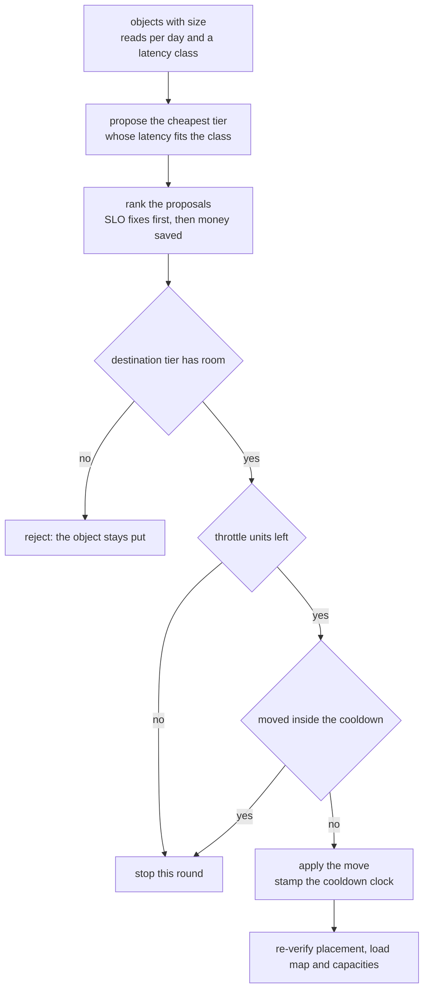
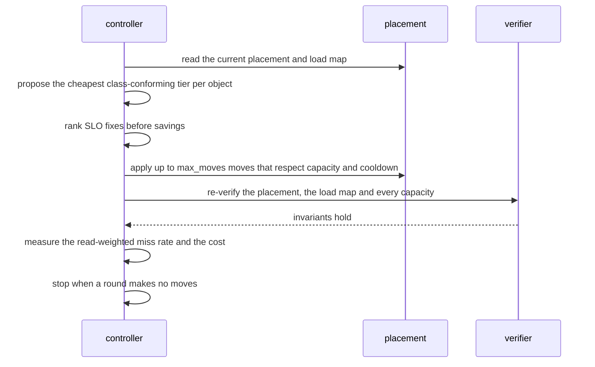
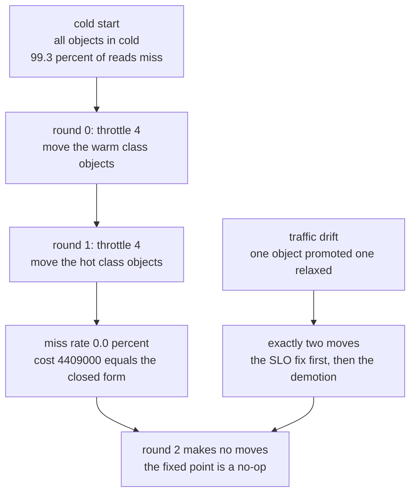

# 904 — Implement automated SLO-driven tiered storage migration with safety.

> **Tier:** Master · **CTCI chapter:** Beyond — Software Engineering & Tooling
> **Task spec:** [904-implement-automated-slo-driven-tiered-storage-migration-with-saf.md](../../../tasks/master/904-implement-automated-slo-driven-tiered-storage-migration-with-saf.md)
> **Solutions:** [Python](../../../solutions/python/master/904-implement-automated-slo-driven-tiered-storage-migration-with-saf/solution.py) ·
> [Java](../../../solutions/java/master/904-implement-automated-slo-driven-tiered-storage-migration-with-saf/Solution.java) ·
> [JavaScript](../../../solutions/javascript/master/904-implement-automated-slo-driven-tiered-storage-migration-with-saf/solution.js) ·
> [C#](../../../solutions/csharp/master/904-implement-automated-slo-driven-tiered-storage-migration-with-saf/Solution.cs)

## 1. Problem restatement

**Input:** a set of storage tiers, each with a capacity in MB, an access latency and a cost rate per MB;
a set of objects, each with a size, a daily read count and the latency class its traffic demands; a
read-weighted SLO budget; and safety parameters — a per-round move throttle and a cooldown.

**Output:** a placement `object -> tier`, produced one **round** at a time, that

- places every object exactly once and never exceeds a tier's capacity (re-checked after every mutation);
- puts each object in the cheapest tier whose latency satisfies its class (or, if capacity blocks that,
  leaves it where it is and shows the tier as full);
- migrates at most `max_moves` objects per round, never re-touching an object that moved inside the
  cooldown window;
- ends with the read-weighted miss rate inside the SLO budget, at the closed-form minimum cost, and with
  a no-op round at the fixed point.

The three rails — capacity, throttle, cooldown — are what separate this from a naive "rebalance
everything now" script: a plan that violates capacity loses data, one that ignores the throttle
saturates the network, and one that ignores the cooldown oscillates between two tiers forever.

| Language | tiers and cost model | documented simplification |
| --- | --- | --- |
| Python | hot (4000 MB, 5 ms, 1000), warm (9000 MB, 30 ms, 200), cold (40000 MB, 500 ms, 30), all integers | "storage" is a dictionary, migration is instantaneous (only throttle and cooldown model its cost), traffic is a deterministic trace, no clock and no I/O |
| Java | hot SSD, warm disk, cold object store, with dual writes and a byte budget per round | latencies and prices are small integers, not measured p99s; the fleet is a few in-memory maps |
| JavaScript | hot 1 ms / 1.0, warm 5 ms / 0.2, cold 25 ms / 0.02, SLO "at least `sloFraction` of reads within 10 ms" | the controller keeps the smallest share-carrying prefix of the decayed-rate ranking rather than solving an assignment problem |
| C# | HOT 2 µs, WARM 8 µs, COLD 40 µs, unit-sized items, most-constrained-first placement | no jitter or queueing model; the access prediction is a supplied EWMA; items are unit sized |

Concrete behaviour (the Python run, all integers):

| Checkpoint | Result |
| --- | --- |
| workload | 12 objects, 16,700 MB, 13,503 reads/day |
| cold start | all 12 objects in `cold`: `13,420` of `13,503` reads miss their class (`99.3%`) at cost `501,000` |
| round 0 | 4 moves (`obj-104 … obj-107` to `warm`), miss rate falls to `83.6%`, cost `1,402,000` |
| round 1 | 4 moves (`obj-100 … obj-103` to `hot`), miss rate `0.0%`, cost `4,409,000` |
| rounds 2-7 | **no moves**, cost unchanged — the planner stops instead of thrashing |
| closed form | `4,409,000` — the converged cost equals the cheapest-class placement computed object by object |
| tiny instance | greedy `507,000` equals the exhaustive optimum `507,000` |
| traffic drift | promote `obj-104` to the hot class and relax `obj-100`: exactly 2 moves, the SLO fix first |
| boundaries | empty workload → empty round; a tier exactly filled → the last object is accepted; an oversized object → `rejected`, never dropped |

## 2. Intuition

The naive workflow is a human running a script: move the hot data to flash, wait, notice the cache is
screaming, move something back. It fails on three axes — it has no notion of a *budget* (it either does
too little or saturates the fleet), it has no protection against capacity overruns, and it ping-pongs
objects across tiers because nothing remembers what just moved.

The implemented controller fixes all three with one round function and three rails:

1. **Propose by class, order by damage.** For every object compute the cheapest tier whose latency is
   inside its class. Then rank the proposals so that *fixing an SLO violation comes first* and, among
   non-fixing moves, the one that saves the most money comes first. The Python ranking key is literally
   `(0 if fixes else 1, -saved, oid)`, which makes the whole round deterministic.
2. **Apply only what is safe.** A proposal is granted only if the destination tier has room
   (`loads[target] + size <= capacity`) and the round still has throttle units left. Rejections are
   *reported* rather than silently retried forever, and a rejected object keeps its current tier — data
   is never dropped or duplicated.
3. **Remember recent moves.** A move stamps `last_moved[oid] = round_no`, and a proposal for an object
   whose stamp is inside `cooldown` rounds is skipped. That is the anti-oscillation rail: without it, a
   workload sitting on a capacity boundary would move the same object every round.
4. **Converge rather than churn.** The loop stops when a round makes no moves; the file then asserts that
   another round is a strict no-op (no moves *and* no rejections) and that the achieved cost equals the
   closed-form cheapest-class cost — so "converged" means "locally optimal", with the remaining
   non-conformances explained by full destination tiers.



## 3. Algorithm

1. **Describe the world.** Tiers carry `(name, capacity_mb, latency_ms, rate_milli)`; objects carry
   `(oid, size_mb, reads_day, max_latency_ms)`. Order tiers by `(rate_milli, name)` so "cheapest" is
   well defined and ties break by name.
2. **Propose.** For each object, walk the tiers in that order and take the first whose latency is within
   the object's class (falling back to the fastest tier if none qualifies, which cannot happen here).
3. **Rank.** A proposal is `(0 if it fixes an SLO violation else 1, -saved_milli, oid, target)`; the
   tuple sorts SLO fixes first, then savings, then object id.
4. **Apply with rails.** Stop at `max_moves`; skip proposals whose destination lacks capacity (recording
   them as rejected); move the rest, updating the load map and stamping the cooldown clock.
5. **Verify.** After every round, check that each object is placed exactly once, that the load map equals
   a recomputation from the placement, and that no tier is over capacity or negative.
6. **Repeat** until a round makes no moves, then assert no-op behaviour and the closed-form cost.

```text
procedure plan_round(tiers, objects, placement, last_moved, round_no, max_moves, cooldown)
    loads ← size of every object summed per tier
    proposals ← empty list
    for each object in sorted order do
        target ← cheapest tier whose latency is within the object's class
        if target equals the current tier then continue
        if the object moved inside the cooldown window then continue
        fixes ← 0 when the current tier violates the class, otherwise 1
        saved ← size times the current rate minus size times the target rate
        append (fixes, negative saved, object id, target)
    end
    sort the proposals
    moves ← empty list; rejected ← empty list
    for each proposal in order do
        if the round already used max_moves moves then stop
        if loads[target] + size exceeds the capacity of the target then
            record a rejection and continue
        end
        loads[current tier] ← loads[current tier] − size
        loads[target] ← loads[target] + size
        placement[object] ← target
        last_moved[object] ← round_no
        append the move
    end
    return moves, rejected, loads
end

procedure violation_reads(tiers, placement, objects)
    total ← sum of every object's reads per day
    bad ← sum of reads per day over objects whose tier latency exceeds their class
    return bad, total
end

procedure exhaustive_optimum(tiers, objects, names, slo_budget_milli)
    for every assignment of objects to tiers do
        skip when any tier exceeds its capacity
        skip when the read weighted miss rate exceeds the budget
        keep the smallest total cost seen
    end
    return the smallest feasible cost
end
```



## 4. Worked example

**Trace A — from a cold start to the SLO, two rounds at a time.** The workload has 12 objects totalling
16,700 MB and 13,503 reads/day, and the hot tier holds 4000 MB (5 ms, `1000` milli/MB), the warm tier
9000 MB (30 ms, `200`), the cold tier 40,000 MB (500 ms, `30`). The SLO budget is 10 milli = 1% of reads
which may land in a tier slower than the object's class.

| Round | Moves (throttle 4) | Miss rate | Cost | Note |
| --- | --- | --- | --- | --- |
| start | — | 99.3% | 501,000 | negative control: cold-only breaches the budget |
| 0 | `obj-104, obj-106, obj-105, obj-107` to `warm` | 83.6% | 1,402,000 | the four 30 ms objects |
| 1 | `obj-103, obj-101, obj-100, obj-102` to `hot` | 0.0% | 4,409,000 | the four 5 ms objects, in rating order |
| 2-7 | none | 0.0% | 4,409,000 | fixed point; the file asserts `moves == [] and rejected == []` |

The interesting assertion is the cost one: `final_cost > initial_cost`, because meeting the SLO *trades
money for latency* — and `final_cost == closed_form`, where the closed form is the sum over objects of
`size * rate(cheapest conforming tier)`. The planner does not merely improve; it lands exactly on the
per-object cheapest conforming placement.

Note the ordering inside round 0: the four `warm` moves come out in the rank order the sort produces,
and each stamps `last_moved` with its round number, which is why round 2 cannot reconsider them.

**Trace B — local optimality, drift and re-convergence.** At the fixed point, every object either sits in
its class-conforming tier or finds its destination tier exactly full — the file asserts
`placement[oid] == wanted or final_loads[wanted] == capacity`. Then a deterministic traffic drift
promotes `obj-104` into the 5 ms class and relaxes `obj-100` to the 30 ms class: the next round produces
exactly two moves, `("obj-104", hot)` *first* and `("obj-100", warm)` second, proving the ranking rule
(every SLO fix outranks every cheap demotion).

**Trace C — the oracle and the boundaries.** On a tiny instance the greedy cost `507,000` equals the
exhaustive optimum over every capacity-feasible placement, with `greedy_cost >= optimum` asserted
directly. The boundary cases are where migration code usually breaks: an empty workload yields an empty
round with all loads zero; a hot tier of exactly 2700 MB accepts two objects of 1200 + 1500 MB, filling
it to the byte; an object of 3000 MB against a 2700 MB tier is *refused and reported*
(`rejected == [("z", HOT)]`) instead of being dropped or placed in violation; and `max_moves = 0` blocks
every move while leaving the state consistent.



## 5. Complexity

With `K` objects, `T` tiers and `R` rounds until convergence:

| Step | Time | Space | Reason |
| --- | --- | --- | --- |
| Load map | `O(K)` | `O(T)` | one addition per object |
| Proposals | `O(K T)` | `O(K)` | each object scans the tiers in cheapest-first order |
| Ranking | `O(K log K)` | `O(K)` | one sort on a fixed key tuple |
| Applying moves | `O(K)` | `O(K)` | the loop stops at `max_moves` and each accepted move is `O(1)` |
| One round | `O(K (T + log K))` | `O(K + T)` | propose, rank, apply, verify |
| Convergence | `O(R)` rounds, `R <= ceil(K / max_moves) + 1` | — | each round moves at most `max_moves` objects and the last round is a no-op |
| Verification | `O(K + T)` per round | `O(T)` | recompute the load map and compare with the placement |
| Exhaustive oracle | `O(T^K)` | `O(K)` | only affordable on tiny instances (3 tiers, 3 objects) |
| Naive alternative | one unbounded round | `O(K)` | no throttle, no cooldown: capacity overruns and oscillation |

In the trace, 8 objects move in 2 rounds under a throttle of 4, then 6 rounds are no-ops — the throttle
turns "migrate 8 objects" into "2 safe batches", and the cooldown is what keeps the later rounds empty
even though the objects sitting on the capacity boundary still have a cheaper tier in principle.

**What is simulated.** The Python header is explicit: the "storage" is a dictionary, migration is
instantaneous — only the throttle and the cooldown model migration cost — and the read traffic is a
deterministic trace rather than a live measurement, with no wall clock and no I/O; every number is an
integer MB or milli-unit so results are exact and replayable. Java keeps latencies and prices as small
integers instead of measured p99s and its "fleet" is a few in-memory maps, though it does model
dual writes (copy, then switch the source of truth, verified after every single move). C# makes items
unit sized, uses plain integer latencies with no jitter or queueing model, and takes the access
prediction as a supplied EWMA. What is *not* simulated: capacity accounting, the SLO accounting, the
three safety rails, the cost comparison against the closed form, and the exhaustive oracle.

## 6. Pitfalls and edge cases

- **The cold start must actually breach the budget.** The file asserts the cold-only placement violates
  the SLO (`bad * 1000 > total * budget`), so the improvement measured later is not the improvement of a
  placement that was already fine.
- **Capacity is a hard rail, not a preference.** A proposal whose destination lacks room is *rejected*
  and recorded; the object keeps its tier. `verify_state` re-checks after every round that each tier is
  within capacity and non-negative, and that the load map matches a from-scratch recomputation.
- **Exactly-full tiers are allowed, slightly-over is not.** `loads[target] + size <= capacity` means a
  tier of 2700 MB accepts 1200 + 1500 MB and then refuses everything else; an object larger than the
  entire tier is refused with a recorded rejection rather than dropped.
- **Throttle semantics.** `max_moves = 0` must block every move, and every round may move at most
  `max_moves`; the file asserts `len(moves) <= 4` in each of the eight rounds.
- **Cooldown stamps.** Every recorded move must appear in `last_moved` with the round it happened in, and
  the stamps must be non-decreasing when sorted; without the rail, an object alternating between two
  tiers on a capacity boundary would move every single round.
- **Convergence is not just "no moves".** The converged round must be a *strict* no-op — no moves **and**
  no rejections — and the cost must equal the closed-form minimum. A planner that kept proposing
  impossible moves would still be "stable" but not converged.
- **Honest trade-off.** `final_cost > initial_cost` is asserted explicitly: conforming to the SLO costs
  money. A test that demanded cheaper *and* compliant would be unsatisfiable here.
- **Local optimality has an excuse.** A non-conforming object is acceptable only when its destination is
  exactly full; the file checks that condition object by object, so "we tried" is not good enough.
- **Traffic drift is handled in priority order.** After a class change, the SLO fix must be the first
  move of the round, even though a demotion might save more money.
- **Empty workloads and determinism.** An empty object set yields an empty round with zero loads, and
  replaying the whole trace from the cold start reproduces the exact placement.

## 7. Variants and follow-ups

- **Dual writes and atomic cut-over.** Java copies the block, verifies its checksum on both sides, then
  switches the source of truth — so a block is readable at every intermediate step, and the copy set plus
  the source of truth are re-derived after each single move.
- **Byte budgets instead of object counts.** Throttling by bytes copied per round makes the number of
  rounds predictable from the plan size (`ceil(bytes_needed / budget)`); Java takes this route.
- **Share-based SLOs.** JavaScript states the SLO as "at least `sloFraction` of reads within 10 ms" and
  keeps the smallest share-carrying prefix of the decayed-rate ranking, which is a bandwidth-style
  controller rather than a per-object class.
- **Flagging instead of misplacing.** C# refuses to store an item in a tier that violates its SLO when
  the compliant tiers are full, and *flags* the shortfall for capacity planning or load shedding.
- **Hot-key replication.** Deciding which keys deserve extra copies in the fast tier, given node load, is
  the placement problem of
  [903 — adaptive replication factoring hot keys and node load](../../../tasks/master/903-implement-adaptive-replication-factoring-hot-keys-and-node-load.md).
- **Serving under deadlines.** Once data sits in the right tier, per-tenant latency targets at request
  time are enforced by
  [905 — real-time SLA-aware scheduler for multi-tenant inference](../../../tasks/master/905-implement-real-time-sla-aware-scheduler-for-multi-tenant-inferen.md).
- **Fidelity versus cost.** Choosing *which* computation or dataset to move first under a budget is the
  same trade-off the multi-fidelity orchestrator of
  [906 — multi-fidelity simulation orchestration with surrogate models](../../../tasks/master/906-implement-multi-fidelity-simulation-orchestration-with-surrogate.md)
  makes per experiment stage.

## 8. Check yourself

**Q1.** Why is the proposal ranking `(fixes SLO violation, savings, object id)` rather than simply "the
largest saving first"?

<details><summary>Show answer</summary>

Because the SLO budget is a *correctness* constraint while cost is an objective, and the throttle means
the planner can only do a few moves per round. If money came first, a round could spend all its moves on
cheap demotions while latency-sensitive objects keep missing their class — the system would get cheaper
and stay broken. Ranking a violation fix as `0` and everything else as `1` guarantees every round does
the urgent work first. The drift trace demonstrates it: with one object promoted and one relaxed, the
round emits `("obj-104", hot)` first and only then `("obj-100", warm)`, and exactly two moves happen.

</details>

**Q2.** The converged cost is *higher* than the starting cost. Isn't that a regression?

<details><summary>Show answer</summary>

It is the honest price of the SLO. The cold-only start is cheap (`501,000`) and serves 99.3% of reads
from a tier slower than their class; the converged placement costs `4,409,000` and misses 0.0%. The file
asserts this direction deliberately (`final_cost > initial_cost`) so the tutorial's reader cannot confuse
"the migration lowers cost" with "the migration meets the SLO": what the planner minimises is cost
*subject to* the read-weighted SLO, and it lands exactly on the closed-form minimum
(`final_cost == closed_form`), which is the cheapest placement that satisfies every class constraint at
all.

</details>

**Q3.** Why do rounds 2-7 make no moves even though the greedy rule could still cheaply demote a hot
object?

<details><summary>Show answer</summary>

Because two rails stop it: the cooldown, which pins every object that moved in the previous `cooldown`
rounds, and the class constraint itself — a `5 ms` object cannot be demoted to a `30 ms` tier without
violating its own class, so no legal cheaper tier exists for it. What remains are the objects sitting on
a capacity boundary, and their target tiers are exactly full: the file asserts
`placement[oid] == wanted or final_loads[wanted] == capacity`, so the no-op round reflects local
optimality rather than a bug.

</details>

**Q4.** An object of 3000 MB is proposed for a 2700 MB tier. What does the implementation do, and why is
that the right behaviour?

<details><summary>Show answer</summary>

It records a *rejection* (`rejected == [("z", HOT)]`), leaves the object in its current tier, and reports
it. The alternatives are both worse: placing it anyway would break the capacity invariant and lose data;
dropping it would silently discard the object. The same discipline appears in C#, which flags an item
that cannot be placed in any compliant tier as needing capacity or load shedding rather than storing it
in a violating tier. Rejections are visible output, so the operator can add capacity — and a converged
plan must produce no rejections at all, which is what makes "converged" a strong statement.

</details>
