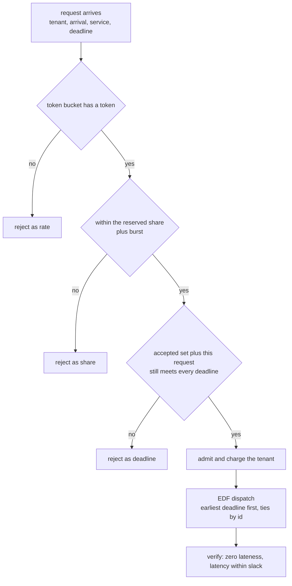
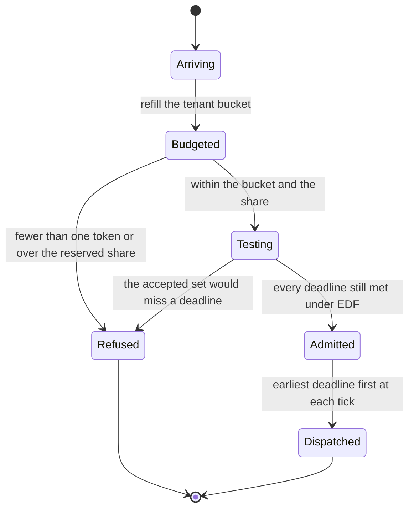
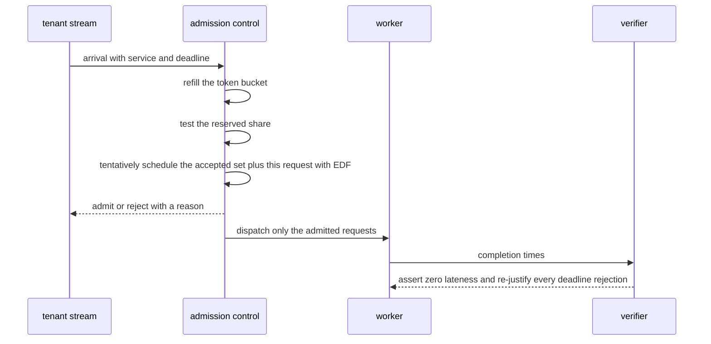

# 905 — Implement real-time SLA-aware scheduler for multi-tenant inference.

> **Tier:** Master · **CTCI chapter:** Ch 9 — System Design and Scalability
> **Task spec:** [905-implement-real-time-sla-aware-scheduler-for-multi-tenant-inferen.md](../../../tasks/master/905-implement-real-time-sla-aware-scheduler-for-multi-tenant-inferen.md)
> **Solutions:** [Python](../../../solutions/python/master/905-implement-real-time-sla-aware-scheduler-for-multi-tenant-inferen/solution.py) ·
> [Java](../../../solutions/java/master/905-implement-real-time-sla-aware-scheduler-for-multi-tenant-inferen/Solution.java) ·
> [JavaScript](../../../solutions/javascript/master/905-implement-real-time-sla-aware-scheduler-for-multi-tenant-inferen/solution.js) ·
> [C#](../../../solutions/csharp/master/905-implement-real-time-sla-aware-scheduler-for-multi-tenant-inferen/Solution.cs)

## 1. Problem restatement

**Input:** one inference worker, a stream of requests `(tenant, arrival, service, deadline)`, and one SLA
per tenant: a period, a slack (deadline = arrival + slack), a reserved share in permille, a token-bucket
refill rate and a burst allowance.

**Output:** an **accepted set** plus a per-request rejection reason, such that:

- every accepted request completes **on or before** its deadline under the emitted schedule;
- a rejection is *justified* — no scheduler could have served the request together with the accepted set;
- each tenant is capped by its token bucket and its reserved share (plus a burst), and no tenant is
  starved below its reservation;
- the schedule is deterministic: the same stream yields the same accepted ids and the same reasons.

The scheduler is the classic combination: **preemptive EDF** for the dispatch decision (optimal for
feasible single-machine workloads, Jackson's rule for a batch released together), **per-tenant token
buckets and reserved shares** for fairness, and **admission control** that refuses work it cannot
promise to finish inside the deadline rather than letting it miss silently.

| Language | dispatch | admission / fairness | documented simplification |
| --- | --- | --- | --- |
| Python | preemptive EDF stepped one unit at a time | token bucket, reserved share plus burst, and a feasibility re-simulation of the accepted set | one worker with unit quanta, no preemption cost, no replica migration, arrivals from a deterministic periodic stream |
| Java | one tick executes one unit of the earliest deadline, ties by id | deadline-monotone prefix feasibility over the remaining backlog; a per-tenant in-flight quota that never blocks a lone request | integer ticks, 40 requests over 3 tenants from a fixed seed |
| JavaScript | 10 ms rounds; EDF batches formed from the earliest-deadline prefix | drops already-infeasible requests and bounded-queue overflow; batching cost `max(cost) + 0.1 * (size - 1)` ms | batching amortisation is a fixed overhead model, not a queueing model |
| C# | EDF over the accepted set, ties broken by tenant virtual time (weighted deficit round robin) | admission decided by *simulating* EDF over the accepted set, so a rejection cannot be served by any scheduler; bounded pending window | unit-cost jobs on one machine, integer ticks |

Concrete behaviour (the Python run at `horizon = 200`, seed 2024):

| Quantity | Value |
| --- | --- |
| stream | 218 requests, 420 units of demand against 200 units of capacity — deliberately oversubscribed |
| tenants | A (period 2, reserved 400‰), B (3, 300‰), C (6, 200‰), D (12, 100‰), all with slack 12 |
| outcome | 126 accepted, 92 rejected: `share` 42, `rate` 29, `deadline` 21 |
| accepted per tenant | A 52, B 40, C 25, D 9 (offered 100, 67, 34, 17) |
| served units | A 83, B 64, C 43, D 19 — total 209, against entitlements A 86, B 66, C 46, D 26 |
| lateness | maximum `0`, i.e. no accepted request misses; maximum latency `12`, exactly the slack |
| EDF versus FIFO on one batch | EDF lateness `0`, brute-force optimum `0`, FIFO `5` |
| boundary | a request finishing exactly at its deadline has lateness `0`; an infeasible one reports `2` |

## 2. Intuition

The naive service is a queue: serve in arrival order, and count the SLA violations afterwards. On an
oversubscribed worker that loses on two fronts — FIFO is not deadline-optimal (in the trace it misses by
5 units where EDF misses by 0), and a queue that accepts everything turns an *unavoidable* rejection into
a *visible* miss, which is the same thing for the tenant but much worse for the system: the worker
spends capacity on requests it will fail anyway.

The implemented design separates three questions that are usually conflated:

1. **In what order does the worker run work?** EDF: at every tick, run the admitted request with the
   earliest deadline. This is the optimality guarantee, and the file checks it against
   `brute_force_batch`, an exhaustive search over all orderings of a batch — EDF must attain the minimum
   maximum lateness, and FIFO must not.
2. **What may a tenant consume?** A token bucket refills at the tenant's rate up to a burst, and a
   reserved-share entitlement caps cumulative work at `reserved_permille * elapsed / 1000 + burst`. The
   bucket absorbs bursts without letting a heavy tenant lock out a sparse one, and the entitlement
   guarantees the *floor*: the same expression bounds the maximum, and a starved tenant is detected by
   comparing served work against two thirds of that allowance.
3. **What should never be admitted?** Admission control re-schedules the accepted set *including* the
   candidate and refuses it if any deadline would fail. Rejections are categorised (`rate`, `share`,
   `deadline`), and each deadline rejection is re-justified afterwards by an independent re-simulation —
   *maximality*, not just safety.



## 3. Algorithm

1. **Generate the stream.** For each tenant, emit a request every `period` units with a small
   deterministic jitter, a random service in `1..3` and a deadline at `arrival + slack`; sort by
   `(arrival, rid)`.
2. **Offer each request to the rails in order.** Refill the tenant's bucket to the arrival time; reject
   as `rate` if fewer than 1000 milli-units are available; reject as `share` if the tenant's cumulative
   service would exceed `reserved_permille * arrival / 1000 + burst_units`; otherwise tentatively add it
   to the accepted set and reject as `deadline` if `worst_lateness(accepted + [request]) > 0`.
3. **Dispatch.** Step a unit-time simulation: at every tick, among admitted requests that have arrived
   and are unfinished, run the one with the smallest `(deadline, rid)`; record its completion time.
4. **Verify.** Re-simulate the accepted set independently and assert `max(finish - deadline) <= 0` and
   that the achieved latency never exceeds the requested slack.
5. **Re-justify rejections.** For a deadline rejection, assert that adding it to the accepted set really
   does produce a positive lateness under EDF.

```text
procedure edf_schedule(requests, limit)
    remaining ← the service time of every request; finish ← empty map; clock ← 0
    while some request remains and clock is within the limit do
        ready ← arrived requests with remaining service above zero
        if ready is not empty then
            pick ← the ready request with the smallest deadline, ties broken by id
            decrement its remaining service
            if it reaches zero then record its completion time as clock + 1
        end
        clock ← clock + 1
    end
    return finish
end

procedure worst_lateness(requests)
    finish ← edf_schedule(requests)
    if some request never finished then return a very large value
    return the largest completion minus deadline over the requests
end

procedure jackson_lateness(batch)
    clock ← 0; worst ← very small
    for each request in the batch sorted by deadline then id do
        clock ← clock + its service
        worst ← the larger of worst and clock minus its deadline
    end
    return worst
end

procedure run(scheduler, stream)
    for each request in arrival order do
        refill the tenant bucket up to the arrival time
        if the bucket holds less than one token then reject as rate; continue
        if the tenant's spent service plus this service exceeds its entitlement then
            reject as share; continue
        end
        if the worst lateness of the accepted set plus this request exceeds zero then
            reject as deadline; continue
        end
        charge the token and the spent counter; admit the request
    end
    return the accepted and rejected lists
end
```



## 4. Worked example

**Trace A — EDF against its oracle and its negative control.** A batch of three requests released at
`t = 0` with services `5, 5, 5` and deadlines `5, 20, 10` is scheduled by Jackson's rule (sort by
deadline, run in order) with lateness `0`, which equals the exhaustive optimum over every ordering; FIFO
in arrival order gives `5`. The file also checks the boundary cases: a single request with service 4 and
deadline 4 is on time (lateness exactly `0`, not a miss), and a request with service 5 and deadline 3
reports lateness `2` — an infeasible request is not magically fixed, it is *rejected*.

**Trace B — the oversubscribed stream.** With `period` 2/3/6/12 and slack 12, the stream carries 218
requests and 420 units of work in a 200-unit horizon, so the worker is offered more than twice its
capacity. Every arrival is decided in order:

| Rail | Count | What it means here |
| --- | --- | --- |
| `share` | 42 | the tenant's cumulative service would exceed `reserved_permille * arrival / 1000 + 6` |
| `rate` | 29 | the bucket was empty at arrival after refilling at the tenant's rate |
| `deadline` | 21 | admitting it would push *some* accepted request past its deadline |
| accepted | 126 | dispatched by EDF with maximum lateness `0` |

Note the shape of the outcome: A is throttled from 100 offered to 52 accepted while D keeps 9 of 17 —
the reserved-share rail converts "whoever shouts first" into "whoever paid for the capacity". Served
units are A 83, B 64, C 43, D 19 against entitlements A 86, B 66, C 46, D 26, so every tenant lands
inside its allowance and above two thirds of it, and the total 209 units leaves the worker nearly
saturated (`> 4/5` of the horizon). Maximum latency is `12` — exactly the slack, as it must be, since a
deadline is a hard bound and the EDF order fills it.

**Trace C — justification and determinism.** Each `deadline` rejection is re-checked by adding it back
to the accepted set and confirming the EDF lateness becomes positive, so the rejection is a property of
the workload rather than a policy choice. Running the scheduler twice on the same stream reproduces the
accepted ids *and* the ordered `(rid, reason)` pairs; an empty stream is a no-op.



## 5. Complexity

With `R` admitted requests, `A` arrivals, `C` the clock horizon and `k` the batch size:

| Step | Time | Space | Reason |
| --- | --- | --- | --- |
| EDF simulation | `O(C R)` | `O(R)` | each tick rescans the ready set; a priority queue gives `O(R log R)` |
| `worst_lateness` | `O(C R)` | `O(R)` | one EDF run plus a maximum |
| Admission decision | `O(C R)` per arrival | `O(R)` | the accepted set is re-simulated for each candidate |
| Whole stream | `O(A C R)` | `O(R)` | 126 admissions out of 218 arrivals in the demo |
| Jackson's rule (batch) | `O(k log k)` | `O(k)` | sort by deadline and accumulate |
| Exhaustive batch oracle | `O(k!)` | `O(k)` | only used for `k = 6` in the tests |
| FIFO baseline | `O(C R)` | `O(R)` | same simulation, no admission control; misses by 5 where EDF misses by 0 |

The cost that actually matters in production is the admission test, which is `O(R log R)` with an
incremental schedulability test (Java sorts the backlog by deadline and checks that every prefix fits)
instead of re-simulating the whole accepted set per arrival.

**What is simulated.** The clock is a unit-time simulation with no wall clock and no threads; arrivals,
services and deadlines come from a seeded splitmix64 stream, so the workload is a deterministic periodic
stream rather than a live load; there is one worker, no preemption cost, no replica migration and no
queueing beyond the accepted set. Java keeps the workload at 40 requests over 3 tenants from a fixed
seed with integer ticks; JavaScript models batching with a fixed cost formula
`max(cost) + 0.1 * (size - 1)` ms per batch, which is an amortisation model rather than a measured
kernel; C# uses unit-cost jobs on one machine. What is *not* simulated: the EDF optimality guarantee
(checked against an exhaustive oracle), the token-bucket and reserved-share accounting, admission
soundness and maximality, and the lateness invariant re-checked after every event.

## 6. Pitfalls and edge cases

- **Deadline met exactly is met.** `worst_lateness([service 4, deadline 4]) == 0` — the boundary must be
  inclusive, otherwise every on-time request is treated as a miss.
- **Infeasible requests.** A request whose own service exceeds its window (service 5, deadline 3, lateness
  2) cannot be saved by ordering; admission control refuses it so the worker is not wasted on it.
- **Rejection ordering.** The rails are tried in a fixed order (`rate`, then `share`, then `deadline`), so
  the *reason* is deterministic and a tenant can act on it: buy more rate, buy more share, or shed load.
- **Rejections must be justified, not arbitrary.** Every deadline rejection is re-tested by adding the
  request back to the accepted set and confirming a positive lateness; otherwise the scheduler would be
  pessimistically dropping work that the worker could have served.
- **No starvation and no monopoly.** Served units must be at most the entitlement and at least two thirds
  of it, per tenant, and the over-demanding tenants must be accepted *less* often than they are offered
  (A 52 of 100, B 40 of 67) — a fairness check in both directions.
- **Capacity accounting.** `sum(served) <= horizon + 12` and `> 4/5 * horizon`: the worker may not be
  oversubscribed by the bookkeeping, and it may not be left idle either.
- **Latency cannot exceed the slack.** `max(finish - arrival) <= max(deadline - arrival)` is asserted on
  the accepted set, and the p99 latency must stay within the 12-unit slack — a tail check, not just a
  maximum.
- **A tenant that cannot pay gets nothing.** A tenant configured with rate 0 and burst 0 is refused
  everything; an empty stream returns empty accepted and rejected lists.
- **Ties must be broken deterministically.** EDF ties are broken by request id (and in C#, by tenant
  virtual time for fairness), which is what makes the whole run reproducible: the same stream yields the
  same accepted ids and the same ordered rejection reasons.
- **FIFO is the control, not the default.** The file asserts `fifo_lateness(batch) > jackson_lateness(batch)`
  so the EDF claim has a genuinely worse baseline to beat on the same data.

## 7. Variants and follow-ups

- **Incremental schedulability tests.** Java replaces "re-simulate the accepted set" with a
  deadline-monotone prefix test (sort by deadline; every prefix must finish before its own deadline),
  which is `O(R log R)` per admission and equivalent for this model.
- **Batching.** JavaScript amortises a batch with `max(cost) + 0.1 * (size - 1)` ms, trading latency for
  throughput; the same trace shows EDF batches dominating FIFO while admission control converts
  unavoidable misses into counted rejects.
- **Weighted fairness among equal deadlines.** C# breaks EDF ties with tenant virtual time (a weighted
  deficit round robin), so tenants of equal weight get equal service even when they contend for the same
  slots.
- **Maximum feasible subset oracle.** C# compares its admission decisions against a brute-force search for
  the largest feasible subset, which is the strongest form of the "the rejection was necessary" claim.
- **Placement and tiering.** Which node holds the work and which tier holds its data are
  [903 — adaptive replication factoring hot keys and node load](../../../tasks/master/903-implement-adaptive-replication-factoring-hot-keys-and-node-load.md)
  and
  [904 — automated SLO-driven tiered storage migration with safety](../../../tasks/master/904-implement-automated-slo-driven-tiered-storage-migration-with-saf.md).
- **Spending a budget across stages.** Choosing how much work to admit at which fidelity under a budget
  is the orchestrator's version of admission control in
  [906 — multi-fidelity simulation orchestration with surrogate models](../../../tasks/master/906-implement-multi-fidelity-simulation-orchestration-with-surrogate.md).

## 8. Check yourself

**Q1.** Why is admission control better than letting the worker serve everything and reporting the
violations afterwards?

<details><summary>Show answer</summary>

Because work spent on a request that will miss is wasted capacity that a *servable* request could have
used. In the trace, 420 units of demand compete for 200 units of capacity; serving in arrival order
(FIFO) misses a deadline by 5 units on a batch where EDF misses by 0, and it still fails the requests it
displaced. Admission control makes the failure explicit and early (`rate`, `share`, `deadline`), keeps
the accepted set schedulable by construction, and lets the tenant act on a reason instead of watching
latency creep. The proof that the accepted set is fine is a re-simulation: `max(finish - deadline) <= 0`
over all 126 accepted requests.

</details>

**Q2.** The file asserts served units are at most the entitlement *and* at least two thirds of it. Why
both directions?

<details><summary>Show answer</summary>

The upper bound is the SLA's guarantee to *other* tenants: no tenant may take more than its reserved
share of capacity plus its burst, otherwise a heavy tenant could monopolise the worker (A is offered 100
requests and accepted 52; without the rail it would take far more). The lower bound is the guarantee to
*this* tenant: reservation is worthless if a tenant can be starved by contention. Together they mean the
reserved share is a real allocation — served A 83, B 64, C 43, D 19 against allowances 86, 66, 46, 26,
which is inside and above the two-thirds floor for every tenant.

</details>

**Q3.** EDF is optimal on one machine — so why does the design need token buckets and shares at all?

<details><summary>Show answer</summary>

EDF answers "in what order", not "what to admit" or "who is entitled to what". Given a *feasible* set,
EDF meets every deadline; the difficulty is that the offered set is not feasible (420 units of demand in
a 200-unit horizon), and EDF alone would simply be late for someone. Token buckets and reserved shares
decide *which* work exists — they turn an overload into a bounded, predictable admission pattern — while
admission control guarantees that whatever is admitted remains feasible. The three mechanisms stack:
buckets shape demand, shares allocate capacity, EDF executes the result.

</details>

**Q4.** A deadline rejection is re-checked by adding the request back to the accepted set. Why is that
necessary if admission control already did a feasibility test?

<details><summary>Show answer</summary>

Because the two checks are different statements: the admission test says "this request would break
feasibility" (safety of the rejection), while the re-check says "no scheduler could have served it
together with the accepted set" (maximality — the rejection was unavoidable, not a policy artefact). The
second is what a tenant can argue with, and it is also a cross-check on the feasibility routine itself:
if a re-simulation with the same EDF code disagreed with the admission test, the mismatch would expose a
bug in one of them. The same spirit drives the C# variant, which compares its decisions against a
brute-force maximum feasible subset.

</details>
