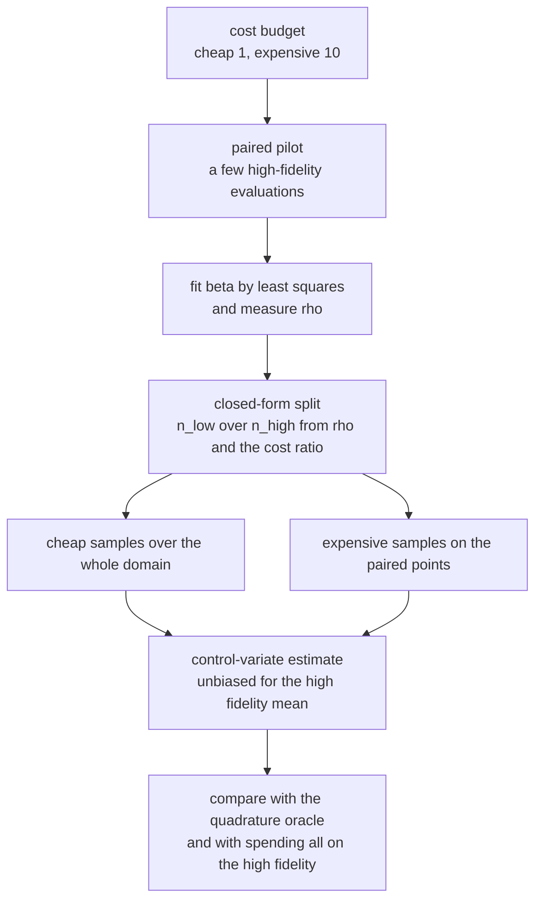
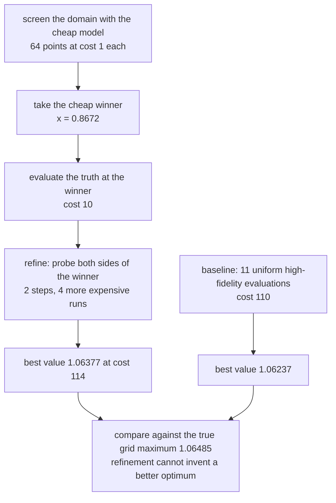
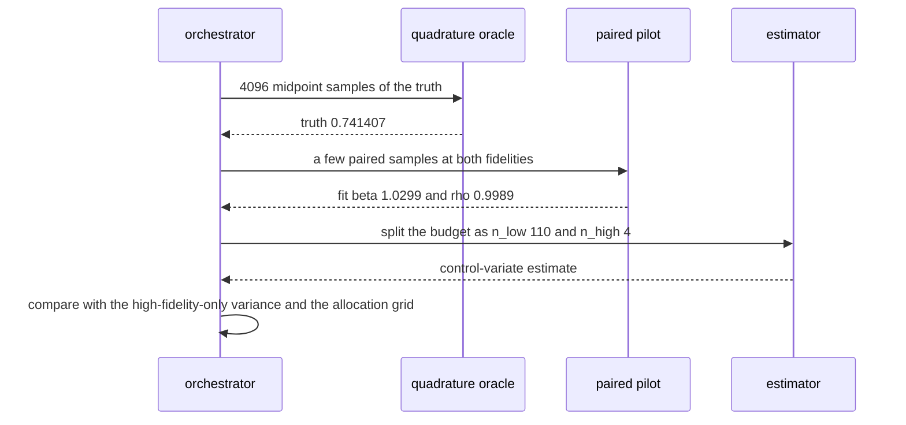

# 906 — Implement multi-fidelity simulation orchestration with surrogate models.

> **Tier:** Master · **CTCI chapter:** Beyond — Software Engineering & Tooling
> **Task spec:** [906-implement-multi-fidelity-simulation-orchestration-with-surrogate.md](../../../tasks/master/906-implement-multi-fidelity-simulation-orchestration-with-surrogate.md)
> **Solutions:** [Python](../../../solutions/python/master/906-implement-multi-fidelity-simulation-orchestration-with-surrogate/solution.py) ·
> [Java](../../../solutions/java/master/906-implement-multi-fidelity-simulation-orchestration-with-surrogate/Solution.java) ·
> [JavaScript](../../../solutions/javascript/master/906-implement-multi-fidelity-simulation-orchestration-with-surrogate/solution.js) ·
> [C#](../../../solutions/csharp/master/906-implement-multi-fidelity-simulation-orchestration-with-surrogate/Solution.cs)

## 1. Problem restatement

**Input:** two simulators of the same physics — an expensive high-fidelity model and a cheap low-fidelity
model — their unit costs (`C_LOW = 1`, `C_HIGH = 10` in Python), a scalar target (here
`E[f_high]` over `[0, 1]`), and a cost budget.

**Output:** an estimator of the target plus a cost ledger, such that:

- the estimator is **unbiased** where a surrogate-only estimate is measurably biased;
- the budget is split between fidelities by an allocation that no grid search can beat by more than 10%;
- the multi-fidelity estimator beats spending the same budget on high-fidelity samples alone;
- a poorly correlated surrogate is *dropped* rather than trusted;
- for optimisation, screening with the cheap model and refining with the expensive one beats spreading
  the same budget uniformly.

The reference answer is midpoint quadrature of the truth on a fine grid, and the file checks the oracle's
own convergence (4096 versus 2048 points) before trusting it.

| Language | estimator | allocation | documented simplification |
| --- | --- | --- | --- |
| Python | control variate `mean(f_h) - beta * (mean(f_l paired) - mean(f_l all))` with `beta` fitted by least squares | closed form `n_low / n_high = sqrt(rho^2 / (1 - rho^2) * c_h / c_l)`, with at least 4 paired samples to fit `beta` | deterministic van-der-Corput quadrature instead of Monte Carlo; a fixed smooth bias; two fidelities, one worker |
| Java | unbiased control-variate estimator with a pilot that estimates the two variances | solves the Lagrange condition `sqrt(10a)(p + m) = sqrt(b)(p + R - 10m)` for the number of paired samples `m` | analytic functions plus Gaussian noise instead of PDE solvers; the pilot is billed inside the budget |
| JavaScript | difference estimator `mean_Nl(f_low) + mean_Nh(f_high - f_low)` | `N_l / N_h = (sigma_low / sqrt(c_low)) / (sigma_diff / sqrt(c_high))` from pilot sigmas | a few hundred thousand `exp()` calls is the whole "cluster" |
| C# | linear correction surrogate `a + b * low_fidelity(x)` fitted by least squares | budget spent on high-fidelity runs of a jittered stratified design, then a dense cheap run | 1-D scalar responses, declared costs (`HF = 100`, `LF = 1`), analytic simulators |

Concrete behaviour (the Python run, all numbers reproducible):

| Quantity | Value |
| --- | --- |
| truth (quadrature, 4096 points) | `0.741407`, with the 2048-point value within `1e-4` |
| fidelities | `f_high(x) = sin(2x) + 0.1 x^2`; `f_low = f_high - (0.06 sin(3x) + 0.02)` |
| correlation | `rho = 0.998892` |
| fitted versus theoretical `beta` | `1.0299` versus `rho * sigma_h / sigma_l = 1.0239` (within `0.08`) |
| allocation at budget 150 | `n_low = 110`, `n_high = 4`; predicted variance `0.00104573` |
| the same budget on the high fidelity only | variance `0.00724356` — a `5.820x` reduction |
| brute-force grid optimum | the same `(110, 4)` point, so the closed form is exact here |
| weak surrogate `f_high + 2 sin(11x)` | `rho = -0.0354`, allocation `(0, 15)` — awarded **no** cheap samples |
| orchestrated search | `1.06377` at cost `114` versus uniform sampling `1.06237` at cost `110`; true grid maximum `1.06485` |
| budget guard | a budget of `5.0` raises `ValueError` naming "cannot afford" |

## 2. Intuition

The naive use of a budget is to spend it all on the expensive code: with `C_HIGH = 10`, a budget of 150
buys 15 high-fidelity evaluations, and their sample mean has variance `sigma_h^2 / 15`. The naive use of
a surrogate is worse in a subtler way — replacing the truth by the cheap model everywhere introduces a
*systematic* bias (`bias(x) = 0.06 sin(3x) + 0.02`), so the estimate is confidently wrong.

The key insight is that the two can be combined so the cheap model cancels variance while a few expensive
runs remove the bias:

1. **Control variate.** Estimate `E[f_h]` as `mean(f_h) - beta * (mean(f_l on the paired points) -
   mean(f_l over all points))`. The correction term is an estimate of the surrogate's *mean discrepancy*,
   so the estimator stays unbiased for `E[f_h]` while absorbing most of the variance through `rho`.
2. **Fit `beta`, do not guess it.** The least-squares choice is `beta = cov(h, l) / var(l)`, whose
   theoretical value is `rho * sigma_h / sigma_l`; the file asserts the fitted value tracks that
   theoretical optimum, and at least four paired samples are enforced so the fit is possible at all.
3. **Spend where the variance falls fastest.** With `n_h` paired samples and `n_l` cheap samples the
   estimator's variance is approximately `sigma_h^2 (1 - rho^2) / n_h + sigma_h^2 rho^2 / n_l`, so
   minimising under the cost constraint gives `n_l / n_h = sqrt(rho^2 / (1 - rho^2) * c_h / c_l)`. A
   strongly correlated surrogate therefore earns a *ratio* of cheap samples, not a fixed number.
4. **The allocation is a verdict on the surrogate.** With `rho` near zero the same formula returns zero
   cheap samples — the surrogate is dropped and the budget goes to the high fidelity. That is the negative
   control: `f_low_weak = f_high + 2 sin(11x)` measures `rho = -0.0354` and is awarded `(0, 15)`.



## 3. Algorithm

1. **Verify the oracle.** Compute the truth by midpoint quadrature at 4096 points and confirm the 2048
   point value agrees within `1e-4`.
2. **Measure the fidelity relationship.** On a fine grid compute the means, variances and the correlation
   `rho` of the two models; assert `rho` is strongly positive for the good surrogate.
3. **Estimate.** Draw a nested van-der-Corput design of `n_low` points; evaluate the truth on the first
   `n_high` of them (paired) and the surrogate on all of them; fit `beta` and return
   `mean(f_h) - beta * (mean(f_l paired) - mean(f_l all))`.
4. **Allocate.** Apply `n_low / n_high = sqrt(rho^2/(1-rho^2) * c_h/c_l)` under the budget, with at least
   `min_high = 4` paired samples and the *affordable* high-fidelity count as an upper bound; reject a
   budget that cannot afford one high-fidelity sample.
5. **Check against the grid oracle.** Compare the predicted variance of the chosen split with the best
   point of the brute-force allocation grid, and with the high-fidelity-only split.
6. **Orchestrate the search.** Screen the domain with the cheap model, then spend the remaining budget
   refining around the winner with the expensive model, and compare with uniform high-fidelity sampling of
   the same budget.

```text
procedure mf_estimate(function, n_high, n_low, offset)
    n_low ← the larger of n_low and n_high          paired points are always included
    points ← nested design of n_low points shifted by offset
    high ← truth evaluated on the first n_high points
    low ← the surrogate evaluated on every point
    if n_high is one then return mean(high) with beta zero
    beta ← covariance of the paired samples divided by their variance
    return mean(high) − beta times (mean(low over the pairs) − mean(low over all points)), beta
end

procedure closed_form_allocation(budget, rho, min_high)
    affordable ← floor of budget divided by the expensive cost
    if affordable is below one then raise an error naming the budget
    if rho is not positive then return zero cheap samples and every affordable expensive sample
    ratio ← square root of rho squared over one minus rho squared times c_high over c_low
    n_high ← the larger of the smaller of affordable and min_high, and floor(budget / (c_high + ratio * c_low))
    n_low ← floor((budget − n_high * c_high) / c_low)
    return n_low, n_high
end

procedure orchestrate_search(screen_points, refine_steps, function)
    score every midpoint of the cheap grid; take the winner
    step ← one over screen_points
    best ← the expensive value at the winner
    for k from 1 to refine_steps do
        probe the winner minus and plus k * step / 2 when inside the domain
        keep the better expensive value
    end
    cost ← (2 * refine_steps + 1) * c_high + screen_points * c_low
    return best, cost, the screen winner
end
```



## 4. Worked example

**Trace A — the estimator and its bias correction.** The truth is `0.741407`. Evaluating the surrogate on
a coarse design and stopping there yields the surrogate's own mean, which differs from the truth by the
mean bias; the control-variate estimator with `n_high = 16` paired samples out of `n_low = 200` gives
`0.736897`, and the fitted `beta = 1.0299` sits within `0.08` of the theoretical optimum `1.0239`. The
degenerate case is asserted too: with a single high-fidelity sample `beta` is 0 and the estimator is
exactly that sample, because a line cannot be fitted to one point.

**Trace B — the allocation verdict.** Three budgets, each compared against the brute-force allocation grid
and against the high-fidelity-only split:

| Budget | Closed form `(n_low, n_high)` | Chosen variance | Grid optimum | High-fidelity only |
| --- | --- | --- | --- | --- |
| 60 | `(20, 4)` | `0.00548079` | same point | `0.0181089` |
| 150 | `(110, 4)` | `0.00104573` | same point | `0.00724356` |
| 400 | `(350, 5)` | `0.00035787` | same point | `0.00271634` |

Two things are worth reading off the table. The closed form and the exhaustive grid search agree exactly
at these budgets (the file still asserts the weaker "no grid point may beat the chosen one, and the chosen
one is within 10% of the best"), and the split beats the equal-cost high-fidelity-only estimator by
roughly `3x` to `7x` in predicted variance — `5.820x` at budget 150. Notice how the ratio grows with the
budget while the number of paired samples barely moves: with `rho = 0.9989` almost all the variance is in
the *bias*, and the bias is a scalar, so four to five paired samples suffice.

**Trace C — the negative controls.** The weak surrogate `f_high + 2 sin(11x)` has `rho = -0.0354`; the
allocation formula returns `(0, 15)` — no cheap samples at all — and a deliberately anti-correlated
surrogate (`rho = -0.5`) also returns `(0, 15)`, consuming every affordable high-fidelity sample. On a
64-run error ensemble the well-correlated surrogate's squared error is lower than the weak one's at the
same split, so the verdict is not merely theoretical.

**Trace D — orchestration.** Screening 64 cheap points localises the peak region at `x = 0.8672` (the
file asserts the winner is within `0.06` of `0.8359`), then two refinement steps probe both sides of it.
The result is `1.06377` at a cost of `114`, beating the `1.06237` obtained by spending a comparable budget
(`110`) on 11 uniform high-fidelity evaluations — and both stay below the true grid maximum `1.06485`,
which is the sanity check that refinement cannot invent a better optimum than the grid contains.



## 5. Complexity

With `n` samples, `n_h` paired samples, `n_l` cheap samples, `B` the budget in cost units and `G` the
grid size of the oracle:

| Step | Time | Space | Reason |
| --- | --- | --- | --- |
| Quadrature oracle | `O(n)` evaluations | `O(1)` | the sum is accumulated, the points are generated on the fly |
| Moments on a fine grid | `O(G)` | `O(G)` | one pass for the means, variances and covariance |
| Paired pilot and `beta` fit | `O(n_h)` | `O(n_h)` | one pass over the paired samples |
| Estimator | `O(n_l)` | `O(n_l)` | the cheap model is evaluated on every point of the design |
| Closed-form allocation | `O(1)` | `O(1)` | one square root and two divisions |
| Allocation grid oracle | `O(B / c_h)` | `O(1)` | one predicted-variance evaluation per affordable high-fidelity count |
| Orchestrated search | `O(screen_points * c_l + (2 * refine + 1) * c_h)` | `O(1)` | in the trace, `64 * 1 + 5 * 10 = 114` cost units |
| High-fidelity-only baseline | `O(B / c_h)` evaluations | `O(1)` | 15 evaluations at budget 150 |
| Naive uniform baseline | `O(B / c_h)` | `O(1)` | 11 evaluations at cost 110, dominated in the trace |

The unit of comparison is *cost*, not samples: the multi-fidelity estimator may use 114 samples where the
baseline uses 15, and still win, because 110 of them cost 110 units and the expensive correction is what
buys the accuracy.

**What is simulated.** The header states it plainly: the sample design is a deterministic quadrature
(van-der-Corput) rather than Monte Carlo, the fidelity gap is a fixed smooth bias
(`0.06 sin(3x) + 0.02`), and only two fidelities and one worker are modelled. Java's fidelities are
analytic functions plus Gaussian noise rather than PDE solvers, with a pilot billed inside the budget; the
JavaScript file notes its whole workload is a few hundred thousand `exp()` calls; C# uses 1-D scalar
responses with declared costs (`HF = 100`, `LF = 1`) and a jittered stratified design from a seeded
splitmix64. What is *not* simulated: the unbiasedness argument, the least-squares `beta`, the
variance-optimal allocation, the budget ledger, the grid oracle, the weak-surrogate rejection, and the
screen-then-refine comparison against a uniform baseline.

## 6. Pitfalls and edge cases

- **The oracle must not be trusted blindly.** The truth is compared at 4096 and 2048 quadrature points
  (agreement within `1e-4`) before it is used as a reference for anything else.
- **A surrogate without correlation must be dropped.** `f_low_weak = f_high + 2 sin(11x)` has
  `rho = -0.0354` and is allocated zero cheap samples; a `rho` of `-0.5` also returns `(0, 15)`. Clamping
  a negative correlation to "a few samples" would silently waste budget.
- **`beta` needs at least two paired samples — and the allocator keeps four.** With `n_high = 1` the
  estimator degenerates to that single sample (`beta = 0`); the closed form enforces `min_high = 4` so the
  fit is possible and stable.
- **The budget is a hard ledger, not a target.** `n_high * c_high + n_low * c_low <= budget`, and the
  orchestrated search's cost (`64 * 1 + 5 * 10 = 114`) is asserted against its stated bound.
- **Budgets smaller than one expensive sample are refused.** `closed_form_allocation(5.0, rho)` raises a
  `ValueError` whose message contains "cannot afford", so the caller cannot silently receive an empty
  plan; C# handles the mirror-image boundary (budget 0/1) by falling back to an offset-only correction.
- **Nested designs.** `design(4) == design(8)[:4]`, so increasing the cheap-sample count reuses the
  existing points — otherwise every re-allocation would discard the pilot.
- **Screening cannot beat the grid.** The orchestrated `1.06377` is asserted to be at most the true grid
  maximum `1.06485`; a refinement that reported more would be interpolating noise, not physics.
- **The baseline must be comparable.** The orchestrated search is compared with a uniform high-fidelity
  search at *comparable* cost (`114` vs `110`) and with an equal-cost estimator, so the win is not an
  artefact of spending more.
- **Degenerate and repeatable runs.** Identical arguments reproduce identical estimates
  (`mf_estimate(f_low, 8, 64) == mf_estimate(f_low, 8, 64)`), and the whole pipeline runs off a fixed
  design plus one seeded stream.

## 7. Variants and follow-ups

- **Fit a correction surrogate instead of a scalar `beta`.** C# fits `a + b * low_fidelity(x)` by least
  squares from the normal equations, which transfers the cheap model's *shape* across the whole domain,
  with an offset-only fallback when the design has no spread.
- **Difference estimator with pilot-estimated sigmas.** JavaScript splits by
  `(sigma_low / sqrt(c_low)) / (sigma_diff / sqrt(c_high))` after a small pilot, which is the same
  optimum expressed in sample-size form and is what makes an unbiased surrogate-only estimator measurably
  worse.
- **Lagrangian allocation with a billed pilot.** Java solves the Lagrange condition for the number of
  paired samples, counts the pilot inside the budget, and verifies both estimators against a closed-form
  integral.
- **Multi-fidelity optimisation.** Screen-then-refine is the optimisation version of the same idea; the
  general form (cheap evaluations first, expensive ones last, under an evaluation budget) is the search
  strategy of
  [898 — neural architecture search with a resource-constrained objective](../../../tasks/master/898-implement-neural-architecture-search-pipeline-with-resource-cons.md).
- **Admission and budgets at serve time.** Deciding what to compute *now* under a deadline is the
  scheduler's version of the same budget question:
  [905 — real-time SLA-aware scheduler for multi-tenant inference](../../../tasks/master/905-implement-real-time-sla-aware-scheduler-for-multi-tenant-inferen.md).
- **Fidelity versus cost in storage.** Which data to keep in an expensive tier and which to relax into a
  cheap one is
  [904 — automated SLO-driven tiered storage migration with safety](../../../tasks/master/904-implement-automated-slo-driven-tiered-storage-migration-with-saf.md).

## 8. Check yourself

**Q1.** Why is `mean(f_high)` minus `beta` times a discrepancy term unbiased for `E[f_high]`?

<details><summary>Show answer</summary>

Because the correction is a difference of two estimates of the *same* quantity: `mean(f_l paired)` and
`mean(f_l all)` both estimate `E[f_l]`, so their difference estimates zero plus noise, whatever the
fidelity gap is. Consequently the whole term is a control variate with a known mean of zero, and the
estimator's expectation is exactly `E[f_high]` — no matter how biased the surrogate is. That is also why
the surrogate-only estimate is used as the contrast in the JavaScript variant: it is *measurably* biased
against the quadrature oracle, while the control-variate estimate is not.

</details>

**Q2.** With `rho = 0.9989` the allocation at budget 150 is `(110 cheap, 4 expensive)`. Why so few
expensive samples?

<details><summary>Show answer</summary>

Because almost all of the surrogate's error is the *bias*, and the bias is a single scalar quantity: one
good estimate of `mean(f_l paired) - mean(f_l all)` removes it, so the residual variance term
`sigma_h^2 (1 - rho^2) / n_h` is already tiny at `n_h = 4`. Meanwhile the cheap term
`sigma_h^2 rho^2 / n_l` still dominates the variance, so the formula
`n_l / n_h = sqrt(rho^2/(1-rho^2) * c_h/c_l)` pushes virtually the entire budget into cheap samples. The
predicted variances bear this out: `0.00104573` versus `0.00724356` for the high-fidelity-only split at
the same cost — a `5.820x` reduction.

</details>

**Q3.** The closed form and the exhaustive grid search agree exactly at budgets 60, 150 and 400. Why does
the file still assert only "within 10%"?

<details><summary>Show answer</summary>

Because the closed form is derived from a *continuous* relaxation — it assumes `beta` is known and that
sample counts are real numbers — while the implementation must round to integers, respect the budget and
keep at least four paired samples. The test asserts the two properties that must hold regardless of
rounding: no grid point may have a lower predicted variance than the chosen split, and the chosen split
may not be more than 10% worse than the grid optimum. Agreement at three budgets is evidence, not a
guarantee, and the assertions are written to be true for the reason the method is sound.

</details>

**Q4.** The orchestrated search returns `1.06377` while the true grid maximum is `1.06485`. Is the
orchestrator failing?

<details><summary>Show answer</summary>

No — the comparisons are different objects. `1.06485` is the best value over a dense 64-point grid, and
the file asserts `orchestrated <= grid_best`, i.e. refinement cannot manufacture a value the truth does
not take. The claim under test is *cost efficiency*: the orchestrated search reaches `1.06377` for `114`
cost units, beating `1.06237` from a uniform high-fidelity search costing `110`. A method that scored
above the dense grid's maximum would be the bug, because it would mean the "expensive" evaluations were
not actually the truth function.

</details>
