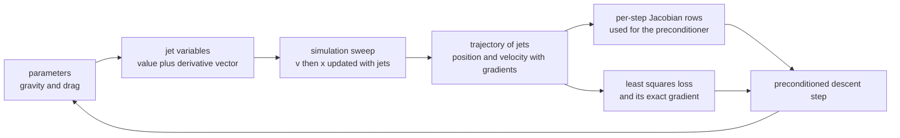
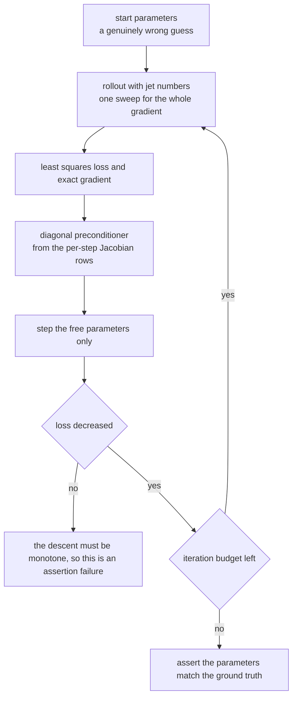
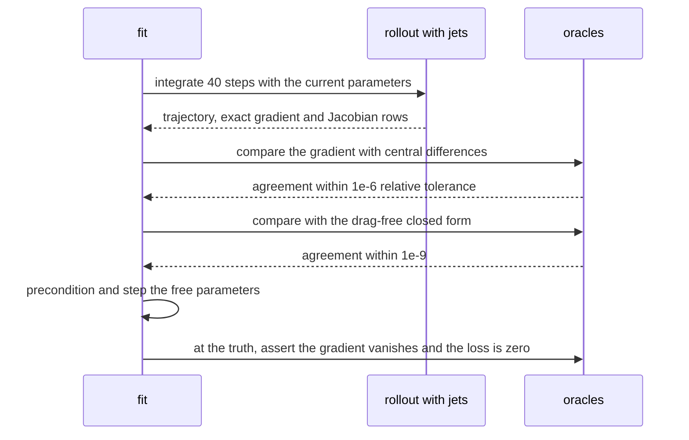

# 907 — Implement differentiable programming demo for physical simulation parameter fitting.

> **Tier:** Master · **CTCI chapter:** Beyond — Software Engineering & Tooling
> **Task spec:** [907-implement-differentiable-programming-demo-for-physical-simulatio.md](../../../tasks/master/907-implement-differentiable-programming-demo-for-physical-simulatio.md)
> **Solutions:** [Python](../../../solutions/python/master/907-implement-differentiable-programming-demo-for-physical-simulatio/solution.py) ·
> [Java](../../../solutions/java/master/907-implement-differentiable-programming-demo-for-physical-simulatio/Solution.java) ·
> [JavaScript](../../../solutions/javascript/master/907-implement-differentiable-programming-demo-for-physical-simulatio/solution.js) ·
> [C#](../../../solutions/csharp/master/907-implement-differentiable-programming-demo-for-physical-simulatio/Solution.cs)

## 1. Problem restatement

**Input:** an observed trajectory produced by a physical simulator run with known parameters — Python's
scenario is a projectile with quadratic drag integrated by explicit Euler with `g = 9.81`, `k = 0.05`,
initial height `20.0`, `dt = 0.02` and 40 steps — and a starting guess for those parameters.

**Output:** the fitted parameters, together with the evidence that the gradient came *through the
simulator* rather than from a black-box approximation:

- the gradient matches an independent oracle (central finite differences, in Java also the complex-step
  derivative, and in the drag-free limit a closed form `d x_n / d g = -dt^2 n(n+1)/2`);
- the gradient **vanishes at the parameters that generated the data** — first-order optimality;
- descent is monotone and the parameters are actually recovered, not merely "the loss got smaller";
- frozen parameters provably do not move, and degenerate rollouts (zero or one step) have a zero
  gradient.

| Language | differentiation | optimiser | documented simplification |
| --- | --- | --- | --- |
| Python | forward-mode *jet* numbers: value plus the partial derivative vector, arithmetic overloaded, so one sweep yields the whole gradient **and** the trajectory Jacobian | gradient descent with a diagonal preconditioner built from that Jacobian | one scalar parameter per constant, explicit Euler instead of a stiff integrator, no minibatch stochasticity |
| Java | reverse-mode **adjoint** recursion: one forward sweep, then `xbar`/`vbar` accumulate backwards, so cost is independent of the parameter count | descent from a wrong start to the ground truth | a one-degree-of-freedom linear oscillator over 200 Euler steps instead of a PDE solver |
| JavaScript | a tiny reverse-mode autodiff engine (`Var` nodes with value, accumulated gradient and a local backward rule) over a damped oscillator, semi-implicit Euler, 200 steps at `dt = 0.05` | gradient descent with a halving line search | scalars only, one ODE, a toy optimiser |
| C# | a hand-rolled forward-mode **dual number** (`value + derivative`) with chain-rule rules, two runs to get both components | backtracking steepest descent with a step-halving loop, convergence on the gradient norm | explicit Euler with a fixed step, two parameters, noiseless observations |

Concrete behaviour (Python's own scenario):

| Quantity | Value |
| --- | --- |
| observed trajectory | 40 points; first three `19.996076, 19.988229, 19.976461`, last `16.934539` |
| loss and gradient at the truth | loss `0.0` and gradient `[0.0, 0.0]` (asserted `< 1e-12`) |
| gradient at `(11.0, 0.2)` | `[0.002005112, -0.004090046]` — identical to finite differences |
| gradient at `(8.0, 0.0)` | `[-0.03397777, 0.160758006]` |
| gradient at `(20.0, 0.5)` | `[0.039500560, -0.555920946]` |
| fit from `(12.5, 0.35)`, 400 iterations | `(9.810000, 0.050000)`; loss `4.514e-03` → `4.600e-17` |
| parameter error | `2.99` → `2.6e-07` (asserted to shrink by more than 100x) |
| drag frozen | gravity recovered to `9.810000` while the frozen parameter does not move at all |

## 2. Intuition

The naive way to fit simulation parameters is finite differences: perturb `g`, re-run, perturb `k`,
re-run again, and divide. It works, but it costs one full simulation **per parameter per step** of
descent, it adds truncation error to every gradient, and it forces the optimiser to work with a
signal-to-noise ratio determined by the difference step `h`.

The key insight of differentiable programming is that the simulator is just arithmetic, so if the
arithmetic carries derivatives, the trajectory can carry them too:

1. **A jet is a number with a passenger.** `Jet(value, grad)` where `grad` is the partial derivative
   vector with respect to a fixed parameter list. Every operation applies the chain rule: products use
   the product rule, quotients the quotient rule, `exp` scales by its own value. `abs` is handled by the
   sign of the current value, which is enough here because the drag term `-k v |v|` only ever sees the
   down-going sign in this scenario.
2. **The simulator is written once.** `rollout` contains `v <- v + dt * (-g - k v |v|)` and
   `x <- x + dt * v` with no derivative code at all — gravity and the drag coefficient are differentiated
   exactly because the *same* loop runs over jets. That is what "writing the simulator generically"
   buys: no hand-derived adjoint to keep in sync with the physics.
3. **One sweep, all parameters.** Forward mode propagates the full derivative vector in the same pass, so
   a two-parameter gradient costs one rollout instead of two perturbed rollouts; reverse mode (Java,
   JavaScript) makes the cost independent of the parameter count entirely.
4. **Three independent gradient oracles.** Central finite differences, an analytic closed form in the
   drag-free limit, and the vanishing gradient at the truth — a gradient that passes all three is not a
   numerical accident.
5. **Precondition, then descend.** The diagonal preconditioner uses the per-step Jacobian rows the jet
   already produced: `sum(row[i]^2) / n`. That rescales gravity against drag, which differ by orders of
   magnitude, and it is why the fit converges monotonically.



## 3. Algorithm

1. **Generate the data.** Run the simulator with the true parameters and take the positions after the
   first step as observations, so the loss at the truth is exactly zero.
2. **Roll out with jets.** Seed `g` and `k` as variables with unit basis vectors, then integrate
   `v <- v + dt * (-g - k v |v|)`, `x <- x + dt * v` for the required number of steps, accumulating a
   loss `sum((x - observed)^2) / (2N)` as a jet.
3. **Extract the gradient.** The loss jet's `grad` is the exact gradient; its per-step `x.grad` rows are
   the trajectory Jacobian, which also supplies the diagonal preconditioner.
4. **Fit.** Repeatedly compute the loss, the gradient and the rows, divide each component by
   `sum(row[i]^2) / n + 1e-6`, step with the learning rate, and honour the `free` mask so a frozen
   parameter keeps its value exactly.
5. **Verify.** Compare with central differences, the closed form in the drag-free limit and the optimality
   condition `grad L = 0` at the truth; assert loss monotonicity and parameter recovery.

```text
procedure rollout(g, k, dt, steps, height)
    x ← jet constant value height
    v ← jet constant value zero
    xs ← [x]; vs ← [v]
    repeat `steps` times
        acceleration ← −g − k * v * abs(v)            jet arithmetic applies the chain rule
        v ← v + acceleration * dt
        x ← x + v * dt
        append x and v to the trajectories
    end
    return xs, vs
end

procedure loss_grad(observed, g_value, k_value, dt, steps, height, with_jacobian)
    g ← jet variable for gravity; k ← jet variable for drag
    xs ← rollout(g, k, dt, steps, height)
    total ← jet constant zero
    for each position and observation pair do
        residual ← position − observation
        total ← total + residual * residual
        record the position gradient row when the Jacobian is requested
    end
    return total.value / (2 * count), total.grad / (2 * count), and the rows
end

procedure fit(observed, dt, steps, height, start, iterations, learning_rate, free)
    g_value, k_value ← start; history ← [loss at the start]
    repeat `iterations` times
        loss, gradient, rows ← loss_grad(..., with_jacobian)
        for each component i do
            diagonal[i] ← average of row[i] squared over the rows plus a small epsilon
            if the component is free then value[i] ← value[i] − learning_rate * gradient[i] / diagonal[i]
        end
        append the loss at the new parameters to the history
    end
    return the parameters and the history
end

procedure finite_difference(observed, g_value, k_value, dt, steps, height, h)
    for each parameter do
        plus ← loss with that parameter increased by h
        minus ← loss with that parameter decreased by h
        gradient component ← (plus − minus) / (2 h)
    end
    return the gradient
end
```



## 4. Worked example

**Trace A — the gradient against its oracles.** With `dt = 0.02`, 40 steps and initial height `20.0`, the
observations begin `19.996076, 19.988229, 19.976461`. Evaluating the exact jet gradient at four points
and comparing with central differences:

| `(g, k)` | Jet gradient | Finite differences | Loss |
| --- | --- | --- | --- |
| `(9.81, 0.05)` | `[0.0, 0.0]` | `[-0.0, -0.0]` | `0.0` |
| `(11.0, 0.2)` | `[0.002005112, -0.004090046]` | identical | `9.937e-04` |
| `(8.0, 0.0)` | `[-0.033977770, 0.160758006]` | identical | `2.505e-02` |
| `(20.0, 0.5)` | `[0.039500560, -0.555920946]` | identical | `1.555e-01` |

The first row is the optimality check: the data was generated by the simulator at those parameters, so
the residual is zero and the gradient must vanish. The `(8.0, 0.0)` case is the drag-free limit, where the
file also checks an analytic closed form: explicit Euler with `k = 0` gives `x_n = h - g dt^2 n(n+1)/2`,
so `d x_n / d g = -dt^2 n(n+1)/2` exactly, and the accumulated loss derivative must match it to `1e-9`.

**Trace B — the fit.** From `(12.5, 0.35)` — a start whose loss is `4.514e-03`, i.e. genuinely wrong — 400
preconditioned steps converge to `(9.810000, 0.050000)` with a final loss of `4.600e-17`, cutting the loss
by fourteen orders of magnitude and reducing the parameter error from `2.99` to `2.6e-07`. Every
intermediate loss is non-increasing (asserted over the whole history), so the descent is verifiably
monotone rather than merely eventually successful. Freezing the drag via the `free` mask leaves `k`
untouched and still recovers `g = 9.810000`, which shows the two parameters are independently
identifiable; unfreezing both recovers `k` to within `1e-6`.

**Trace C — boundaries.** A zero-step rollout cannot depend on the parameters, so the loss is `0.0` and
the gradient is `[0.0, 0.0]`; a single step whose observation is exactly `height - g dt^2` has a vanishing
gradient too; and the truth is asserted to be a *strict* minimum in gravity, since increasing `g` by `0.5`
raises the loss. The gradient is reproducible bit for bit on repeated evaluation, and the simulator
reproduces the observations it generated (the trajectory with the true parameters equals
`[height] + observed`).



## 5. Complexity

With `S` integration steps, `W` parameters and `N = S` observations:

| Quantity | Time | Space | Reason |
| --- | --- | --- | --- |
| Forward-mode rollout | `O(S W)` | `O(S)` for the trajectory | each step propagates a length-`W` derivative vector alongside the value |
| Loss and gradient | `O(S W)` | `O(S)` | the loss accumulates as a jet while the trajectory is recorded |
| Trajectory Jacobian | `O(S W)` | `O(S W)` if materialised | the per-step rows come free from the same sweep |
| Reverse-mode (Java, JavaScript) | `O(S)` per pass, independent of `W` | `O(S)` | one forward sweep, then backward accumulation |
| Central finite differences | `2 W` *extra* rollouts | `O(S)` | one perturbed rollout per parameter and sign |
| Fitting, `I` iterations | `O(I S W)` | `O(S)` | in the trace, 400 iterations over 40 steps and 2 parameters |
| C#'s dual-number variant | `W` dual rollouts | `O(S)` | one run per parameter, since a dual carries a single derivative |
| Grid-search alternative | `O(G S)` for `G` grid points | `O(1)` | the JavaScript file uses it as a baseline the gradient beats |

The interesting contrast is the *gradient* cost: one jet sweep versus `2W` sweeps for finite differences,
and `O(1)` forward passes for reverse mode regardless of `W` — which is why a real differentiable
simulator uses the adjoint when the parameter count is large.

**What is simulated.** The Python header states the simplifications plainly: one scalar parameter per
physical constant, explicit Euler instead of a stiff integrator, no minibatch stochasticity, and the
observations come from the same simulator run with the true parameters (so they are noiseless and the loss
at the truth is exactly zero — which is *why* the optimality check can be asserted as `loss < 1e-24`).
Java replaces the projectile with a one-degree-of-freedom linear oscillator over 200 steps and adds a
complex-step derivative as a third oracle; the JavaScript engine is reverse-mode autodiff with a halving
line search over a damped oscillator; C# hand-rolls a dual number and uses a backtracking steepest
descent. None of them solves a PDE, and none uses a real optimiser. What is *not* simulated: the chain-rule
arithmetic, the differentiation through the integration loop, the three gradient oracles, monotone
descent, and the identifiability checks.

## 6. Pitfalls and edge cases

- **Zero-step rollouts have no gradient.** With `steps = 0` the trajectory is the initial height alone, so
  the loss is `0.0` and the gradient is `[0.0, 0.0]` — a fitting routine must not divide by a gradient that
  carries no information.
- **One precise step is also degenerate.** A single observation of `height - g dt^2` has an exact fit at
  any `k`, so the file asserts the loss and gradient vanish there rather than pretending the parameters
  were identified.
- **Non-differentiable `abs`.** The drag term `-k v |v|` uses `abs`, whose derivative is the sign of the
  current value; the implementation returns `a` when the value is positive and `-a` otherwise. At `v = 0`
  the subgradient choice matters, which is why the scenario keeps the projectile moving downward.
- **Scaling.** Gravity (`9.81`) and drag (`0.05`) differ by two orders of magnitude, so an unpreconditioned
  step size that works for one diverges for the other; the diagonal preconditioner from the Jacobian rows
  (plus a `1e-6` floor) fixes that.
- **Monotonicity is asserted, not hoped for.** `history[i+1] <= history[i] + 1e-12` over all 400 steps, and
  C# takes a different route to the same guarantee by halving the step until the loss decreases.
- **A small loss is not recovery.** The file compares parameters (`error_after < error_before / 100`) and
  asserts physicality (`g > 0`, `k >= 0`), because a shrinking loss on a badly scaled problem can hide a
  wrong parameter vector.
- **Frozen means frozen.** With `free = (True, False)` the drag coefficient must be *exactly* unchanged
  (`only_g[1] == k_true`), not merely close, because the mask is applied before the step.
- **Optimality needs exact data.** The truth test relies on observations generated by the same simulator;
  with measurement noise the gradient at the truth would not vanish, and the check would have to become a
  statistical one.
- **Reproducibility.** There is no PRNG in the Python file at all — the "noise" is the deterministic
  difference between parameters — so gradients and fits are bit-reproducible on repeat.

## 7. Variants and follow-ups

- **Reverse mode (adjoint) instead of jets.** Java accumulates `xbar`/`vbar` backwards so the gradient cost
  is independent of the parameter count, which is the standard choice when the simulator has many
  parameters and few outputs; the cross-check is a complex-step derivative, exact to machine precision.
- **Autodiff over a computation graph.** JavaScript builds `Var` nodes with local backward rules, which is
  mechanically the same as a framework tape and generalises beyond scalars.
- **Dual numbers with a line search.** C# pairs forward-mode duals with backtracking steepest descent,
  declaring convergence on the gradient norm rather than on the loss.
- **Differentiating a discrete search.** When the design space is discrete rather than continuous, gradients
  disappear and the tool becomes a resource-constrained evolutionary search, as in
  [898 — neural architecture search with a resource-constrained objective](../../../tasks/master/898-implement-neural-architecture-search-pipeline-with-resource-cons.md).
- **Fitting surrogates rather than physics.** A differentiable simulator supplies the truth that trains a
  cheaper model; which fidelity to query under a budget is the orchestrator's problem in
  [906 — multi-fidelity simulation orchestration with surrogate models](../../../tasks/master/906-implement-multi-fidelity-simulation-orchestration-with-surrogate.md).
- **Calibrated predictions.** Once a model is fitted, turning its residuals into a guarantee with finite
  samples is
  [908 — certified ML predictions with conformal prediction intervals](../../../tasks/master/908-implement-certified-ml-predictions-with-conformal-prediction-int.md).

## 8. Check yourself

**Q1.** Why does the file insist on a *vanishing* gradient at the true parameters, and what does that
prove?

<details><summary>Show answer</summary>

Because the observations were generated by the same simulator at those parameters, the residual is zero
there, so the least-squares loss is exactly `0.0` and its gradient must be `[0.0, 0.0]` — the
first-order optimality condition. It is a proof of the gradient's correctness that needs no numerical
oracle at all: a chain-rule mistake anywhere in the rollout would generally produce a non-zero gradient
at the exact minimiser, and the assertion `max(abs(v) for v in gradient) < 1e-12` is strict. The drag-free
variant sharpens it further by asserting the closed-form gradient `d x_n / d g = -dt^2 n(n+1)/2` matches
the jet gradient to `1e-9`.

</details>

**Q2.** Forward mode propagates one derivative vector per parameter; reverse mode propagates one backward
pass. Why does the file use forward mode, and what would change with more parameters?

<details><summary>Show answer</summary>

With `W = 2` parameters forward mode is trivially cheap: one sweep yields both components *and* the
per-step Jacobian rows needed for the preconditioner, so the jet is the simplest correct implementation.
Reverse mode's advantage grows with `W`: Java's adjoint recursion makes the gradient cost independent of
the parameter count, which is why real simulators with hundreds of parameters use it, while forward mode
(and C#'s dual numbers, which carry a single derivative per run) scale linearly. The tutorial's honest
summary is: forward mode when `W` is small and the Jacobian is wanted anyway, reverse mode when `W` is
large.

</details>

**Q3.** Why is the diagonal preconditioner built from the trajectory Jacobian instead of using a fixed
learning rate?

<details><summary>Show answer</summary>

Because the two parameters have wildly different sensitivities — gravity is `9.81` and drag is `0.05`, and
the loss curvature with respect to each differs accordingly. A fixed learning rate big enough for `g`
overshoots on `k` and vice versa, which shows up as a non-monotone loss history. The preconditioner
`sum(row[i]^2)/n + 1e-6` rescales each component by the sensitivity the jet already measured during the
same sweep, so no extra simulations are needed; the result is the asserted monotone descent from
`4.514e-03` to `4.600e-17` over 400 steps.

</details>

**Q4.** The observations are noiseless. What would break if they were not?

<details><summary>Show answer</summary>

Both of the sharpest checks. With measurement noise, the loss at the truth would be positive rather than
`0.0`, the gradient there would not vanish exactly, and the assertion `loss < 1e-24` would fail —
matching the true parameters is then a statistical statement, not an algebraic one. The file documents
this as a deliberate simplification ("the observations come from the same simulator run with the true
parameters") precisely so that optimality and the closed-form gradient comparisons can be asserted
exactly; a noisy variant would need an estimator, a confidence interval, and would have to give up the
`grad L = 0` test as a proof of correctness.

</details>
