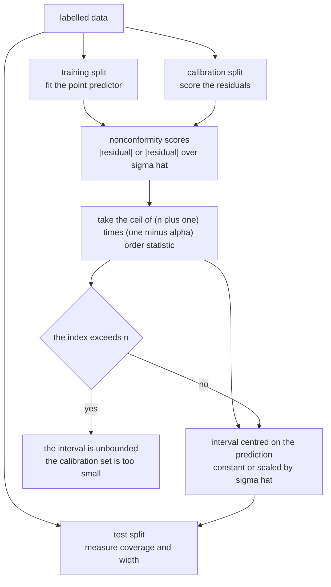
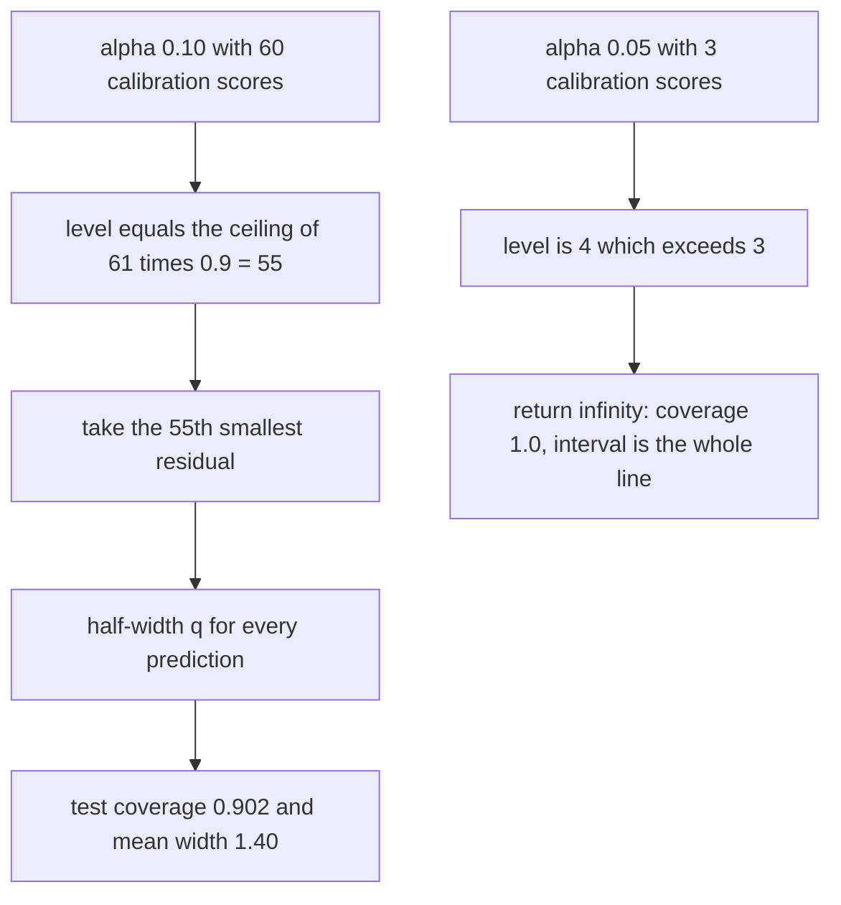
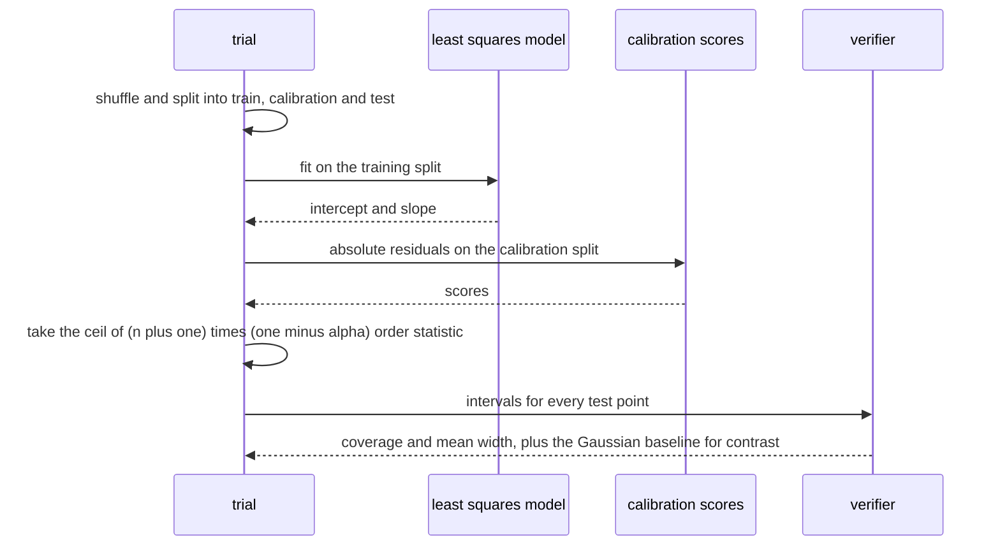

# 908 — Implement certified ML predictions with conformal prediction intervals.

> **Tier:** Master · **CTCI chapter:** Beyond — Software Engineering & Tooling
> **Task spec:** [908-implement-certified-ml-predictions-with-conformal-prediction-int.md](../../../tasks/master/908-implement-certified-ml-predictions-with-conformal-prediction-int.md)
> **Solutions:** [Python](../../../solutions/python/master/908-implement-certified-ml-predictions-with-conformal-prediction-int/solution.py) ·
> [Java](../../../solutions/java/master/908-implement-certified-ml-predictions-with-conformal-prediction-int/Solution.java) ·
> [JavaScript](../../../solutions/javascript/master/908-implement-certified-ml-predictions-with-conformal-prediction-int/solution.js) ·
> [C#](../../../solutions/csharp/master/908-implement-certified-ml-predictions-with-conformal-prediction-int/Solution.cs)

## 1. Problem restatement

**Input:** a labelled data set split three ways (train, calibration, test), a target miscoverage rate
`alpha`, and a point predictor `y_hat(x)`.

**Output:** an interval `[y_hat(x) - q, y_hat(x) + q]` — or the adaptive form
`y_hat(x) ± q * sigma_hat(x)` — with the **finite-sample, distribution-free guarantee** that a new
exchangeable point falls inside with probability at least `1 - alpha`, with no assumption about the
noise distribution, the model class or the number of parameters.

The rule is one order statistic of the calibration residuals:

`q = the ceil((n + 1)(1 - alpha))-th smallest nonconformity score`, and if that index exceeds the
calibration size the honest answer is an **infinite** interval, not a silent under-coverage.

| Language | scores and variants | documented simplification |
| --- | --- | --- |
| Python | absolute residual (constant width) and normalised residual `|y - y_hat| / sigma_hat(x)` (locally adaptive); a Gaussian `y_hat ± 1.96 sigma` baseline for negative controls | a one-feature linear model, a known scale function, i.i.d. exchangeable rows, fixed sample sizes |
| Java | normalised scores `|y - y_hat| / sigma_hat(x)` with a misspecified-base-model check | a 1-D least-squares model with Gaussian heteroscedastic noise `sigma(x) = 0.1 + 0.3x`, 200 calibration points |
| JavaScript | absolute residual scores plus a **Mondrian** (group-conditional) variant and the exact-coverage closed form `ceil((n+1)(1-alpha)) / (n+1)` | a toy linear base model; the point is the calibration layer, not the learner |
| C# | absolute residuals, and the guarantee is demonstrated for a deliberately bad predictor too | 1-D inputs, deterministic pseudo-random data, split (not full) conformal |

Concrete behaviour (Python, 200 random splits per level, 80 test points each):

| `alpha` | Measured coverage | Mean width | Gaussian baseline coverage |
| --- | --- | --- | --- |
| 0.05 | `0.951` | `1.80` | `0.917` — **under-covers** the 95% target |
| 0.10 | `0.902` | `1.40` | `0.917` — wider than necessary |
| 0.20 | `0.812` | `0.98` | `0.917` — wastes a lot of width |

The order-statistic rule on the sample `1, 2, …, 10`: `alpha = 0.1` gives `(10.0, level 10)`,
`alpha = 0.2` gives `(9.0, 9)`, `alpha = 0.5` gives `(6.0, 6)`, and `alpha = 0.05` gives
`(infinity, level 11)` — `ceil(11 * 0.95) = 11 > n = 10`, so the interval is the whole real line.
Adaptive widths correlate with `x` at `1.000`, and a covariate shift of `+0.25` in the test covariates
drops coverage to `0.544`.

## 2. Intuition

The naive way to get intervals is to assume the residuals are Gaussian: fit the model, estimate
`sigma_train`, and report `y_hat ± 1.96 sigma`. Every part of that is an assumption — symmetric noise,
constant variance, a well-specified model — and when one fails the interval lies. In the trace the
Gaussian baseline covers `0.917` at the 95% level (too narrow) while simultaneously being wider than
necessary at the 80% level (too blunt).

Conformal prediction replaces the assumptions with a *calibration* argument:

1. **Score, do not model.** Compute nonconformity scores on a held-out calibration set — the absolute
   residual, or the residual divided by a scale estimate. The scores are the only object the method
   needs, so the base model can be anything, including a bad one (C# demonstrates exactly that).
2. **One order statistic, exact finite-sample validity.** For exchangeable data, the rank of the new
   point's score among `n` calibration scores is uniform on `{1, …, n+1}`. Taking the
   `ceil((n+1)(1-alpha))`-th smallest calibration score therefore covers the new point with probability
   `>= 1 - alpha`, and the bound is tight: the exact coverage is
   `ceil((n+1)(1-alpha)) / (n+1)` for continuous scores, which the JavaScript file uses as an oracle.
3. **Under-sampling is visible.** If `ceil((n+1)(1-alpha)) > n`, no finite width can certify that level
   with this calibration set, and the rule returns infinity. That is a feature: a small calibration set
   that silently pretended to certify `alpha = 0.05` would be the classic way to ship a wrong guarantee.
4. **Adapt when the noise is heteroscedastic.** Dividing the residual by an estimate of the local scale
   makes the intervals wider where the noise is larger. With `sigma(x) = 0.05 + 1.5x` the adaptive width
   correlates with `x` at `1.000`, while the plain variant produces one constant half-width for the whole
   test set.



## 3. Algorithm

1. **Split.** Permute the data and cut it into training, calibration and test parts (the Python demo uses
   100 / 60 / 80 rows out of 240, recomputed from the split sizes so any row count works).
2. **Fit the point predictor.** Least squares by normal equations, with the slope cross-checked against
   the closed form `(n Σxy - Σx Σy) / (n Σx² - (Σx)²)`.
3. **Score the calibration set.** `|y - y_hat(x)|`, or `|y - y_hat(x)| / sigma_hat(x)` for the adaptive
   variant; sort the scores.
4. **Take the order statistic.** `level = ceil((n + 1) * (1 - alpha))`; return the `level`-th smallest
   score, or infinity when `level > n`.
5. **Predict intervals,** and measure coverage and mean width on the test split. Repeat over many splits
   to measure the *distribution* of coverage, not one lucky draw.
6. **Compare with the Gaussian baseline** for honest negative controls: it may over-cover (wasting width)
   at loose levels and under-cover at tight levels.

```text
procedure conformal_quantile(scores, alpha)
    n ← the number of calibration scores
    level ← the ceiling of (n + 1) times (1 − alpha)
    if level exceeds n then return infinity with that level
    return the level-th smallest score, sorted ascending, with that level
end

procedure run_trial(alpha, seed, normalized, shift, rows)
    shuffle the rows with the seeded generator
    split into training, calibration and test parts
    intercept, slope ← least squares on the training part
    sigma ← root mean square residual on the training part
    if normalized then scores ← absolute calibration residuals divided by the known scale
    else scores ← absolute calibration residuals
    half, level ← conformal_quantile(scores, alpha)
    for every test row do
        width ← half times the scale at x when normalized, otherwise half
        count a cover when the absolute residual of the shifted prediction is within the width
        count a Gaussian cover when the residual is within 1.96 times sigma
    end
    return coverage, mean width, Gaussian coverage, Gaussian width, half and the test abscissae
end
```



## 4. Worked example

**Trace A — the rule on a hand-checkable sample.** With calibration scores `1, 2, …, 10` (`n = 10`):

| `alpha` | `ceil((n+1)(1-alpha))` | Returned half-width | Why |
| --- | --- | --- | --- |
| 0.05 | `11` | `infinity` | the index exceeds `n`, so no finite width certifies 95% |
| 0.10 | `10` | `10.0` | the largest calibration score |
| 0.20 | `9` | `9.0` | the ninth score |
| 0.50 | `6` | `6.0` | the median score |
| any, all scores zero | — | `0.0` | a perfect calibration fit yields a zero-width interval |

**Trace B — the guarantee over 200 splits.** The data model is `y = 1 + 2x + 0.6x² + 0.8 * sigma(x) * e`
with `sigma(x) = 0.05 + 1.5x` and a deterministic heavy-tailed `e` bounded by about `1.25` in magnitude.

| `alpha` | Coverage | Mean width | Gaussian baseline |
| --- | --- | --- | --- |
| 0.05 | `0.951` (`>= 0.95 - 0.01` asserted) | `1.80` | `0.917` covered, so it fails the 95% target |
| 0.10 | `0.902` | `1.40` | `0.917` covered, wider than needed |
| 0.20 | `0.812` | `0.98` | `0.917` covered, wasting `~0.7` units of width |

Three assertions are doing the work here: coverage respects `1 - alpha` within a statistical tolerance;
mean width *shrinks monotonically* as `alpha` grows (`1.80 > 1.40 > 0.98`); and the Gaussian baseline is
either wider than the conformal interval (when it is valid) or demonstrably below the target — at
`alpha = 0.05` it covers only `0.917`, which is the negative control.

**Trace C — adaptivity, degeneracy and shift.** The normalised score keeps coverage (`>= 0.87` over 30
splits) while its width correlates with `x` at `1.000`, unlike the plain score whose half-width is
constant by construction (`mean width == 2 * q` for every test point). A calibration set of three scores
is too small for `alpha = 0.05`, so the trial returns `q = infinity` and coverage `1.0`; increasing the
data set makes the interval finite and coverage `>= 0.9`. Finally, shifting only the *test* covariates by
`+0.25` — leaving calibration untouched, so exchangeability fails — drops coverage to `0.544`, which the
file asserts and explains: the method is valid under exchangeability, not under arbitrary shift.



## 5. Complexity

With `N` rows, `n` calibration scores, `m` test points and `S` repeated splits:

| Step | Time | Space | Reason |
| --- | --- | --- | --- |
| Split | `O(N)` | `O(N)` | one Fisher-Yates permutation from the seeded stream |
| Least squares | `O(N)` | `O(1)` | means, `Sxx` and `Sxy` in one pass |
| Scoring | `O(n)` | `O(n)` | one residual per calibration row |
| Order statistic | `O(n log n)` sort, or `O(n)` with quickselect | `O(n)` | the file sorts; a selection would suffice |
| Prediction | `O(m)` | `O(m)` | one width per test point |
| One trial | `O(N log N)` | `O(N)` | dominated by the sort |
| `S` trials | `O(S N log N)` | `O(N)` | 200 splits per level, 30 for the adaptive comparison, 50 for the shift |
| Gaussian baseline | `O(m)` | `O(1)` | the same test path with a fixed `±1.96 sigma` |

The comparison that matters is not asymptotic but *efficiency at fixed validity*: at equal or better
coverage the conformal interval is narrower than the Gaussian one wherever the Gaussian happens to be
valid, and it is the only one of the two that still holds when it is not.

**What is simulated.** The data are synthetic and deterministic — the "noise" is
`scale(x) * noise_at(i) * 0.8` with a trigonometric hash rather than a PRNG — the model is a
one-feature line, the scale function is *known* to the normalised score (a real implementation estimates
it), and all splits are i.i.d. exchangeable rows of a fixed size. Java uses a 1-D model with Gaussian
heteroscedastic noise and explicit `sigma(x) = 0.1 + 0.3x`; C# notes that split conformal with
absolute-residual scores is what is implemented, on deterministic pseudo-random data. What is *not*
simulated: the order-statistic rule and its exact boundary behaviour, the finite-sample coverage measured
over hundreds of splits, the width monotonicity in `alpha`, the adaptive-width mechanism, the
calibration-set-too-small degeneracy, and the exchangeability failure under shift.

## 6. Pitfalls and edge cases

- **The index can exceed `n`.** `ceil((n+1)(1-alpha)) > n` means the required level is unattainable, and
  the rule returns infinity — with three calibration scores at `alpha = 0.05` the trial reports
  `q = infinity` and coverage `1.0`. Returning the largest finite score instead would under-cover
  silently.
- **Coverage is a guarantee, not a measurement.** Each trial's coverage is a random variable, so the test
  measures the *mean* over 200 splits and asserts it within `0.01` of `1 - alpha`; a single split passing
  or failing proves nothing.
- **Width must move the right way.** `0.98 < 1.40 < 1.80` as `alpha` goes `0.2 -> 0.1 -> 0.05`; a
  monotonicity violation means the quantile index is computed wrongly.
- **The baseline must be allowed to fail — and be caught.** The Gaussian interval covers `0.917` at every
  level: over-covering at `alpha = 0.20` (asserted `> 0.85`) is waste, and under-covering at
  `alpha = 0.05` (asserted `< 0.93`) is failure. The file only permits the baseline to fail at the
  tightest level, which is exactly where heteroscedastic noise bites.
- **The model can be wrong; the interval still holds.** Because calibration only uses residuals, a
  deliberately bad predictor produces wider intervals with the same guarantee (C# asserts this directly) —
  a property no analytic interval has.
- **Exchangeability is the fine print.** Shifting test covariates by `+0.25` drops coverage to `0.544`.
  The file asserts the *failure* rather than hiding it, and the Java variant shows the partial fix:
  normalised scores adapt width under heteroscedasticity, and the JavaScript Mondrian variant
  conformalises per variance group.
- **Adaptive widths need a scale estimate that is available at test time.** The trace uses the known
  `sigma(x)`; in production it must be modelled, and a bad scale estimate degrades adaptivity (though not
  validity, since the scores absorb it).
- **Determinism.** The same seed reproduces the interval and coverage (`run_trial(0.1, 42)[:5]` twice),
  so coverage numbers are stable across runs rather than being re-rolled each time.
- **Score choice changes efficiency, not validity.** Absolute and normalised scores both give coverage
  `>= 1 - alpha`; they differ in *width*, which is the whole reason to prefer the normalised score on
  heteroscedastic data.

## 7. Variants and follow-ups

- **Mondrian (group-conditional) conformal.** Split the calibration set by a known grouping (a variance
  band, a segment) and calibrate each group separately, so a heteroscedastic model still covers the quiet
  group after grouping — implemented in JavaScript.
- **Exact-coverage oracle.** For continuous scores the exact coverage of the split-conformal interval is
  `ceil((n+1)(1-alpha)) / (n+1)`, a closed form the JavaScript checks against the simulated rate instead
  of merely bounding it.
- **Full conformal and cross-conformal.** Reusing the training data for calibration removes the split's
  data cost at the price of refitting per candidate label; the split variant here trades data for
  simplicity, which C# documents.
- **Certified error of a compressed model.** The same certificate applied to a quantised or pruned network
  turns its worst-case bound into a distribution-free interval, as in
  [897 — compressed neural network runtime with weight sharing and Huffman coding](../../../tasks/master/897-implement-compressed-neural-network-runtime-with-weight-sharing.md).
- **Bound-calibrated policies.** When the interval drives a decision (admit, migrate, defer), the budget
  accounting follows the same logic as
  [912 — privacy-preserving analytics with DP budgeting](../../../tasks/master/912-implement-end-to-end-pipeline-for-privacy-preserving-analytics-w.md).
- **Continuous adaptation.** A model that keeps learning after deployment needs intervals that stay valid
  under distribution change, which is the drift problem of
  [909 — continuous learning with catastrophic forgetting mitigation](../../../tasks/master/909-implement-continuous-learning-with-catastrophic-forgetting-mitig.md).

## 8. Check yourself

**Q1.** Why is `ceil((n+1)(1-alpha))` the right index rather than `ceil(n(1-alpha))`?

<details><summary>Show answer</summary>

Because the new test point's score is exchangeable with the `n` calibration scores, so its rank among the
`n + 1` values is uniform on `{1, …, n+1}`. To cover the new point at level `1 - alpha` you need its rank
to be at most `ceil((n+1)(1-alpha))`, which makes the required half-width the corresponding *order
statistic* of the calibration scores. Using `n` instead of `n + 1` loses exactly the small-sample
correction that makes the bound finite-sample valid rather than asymptotic, and it is the difference
between a guarantee and a hope. The hand-checked table shows the arithmetic: `ceil(11 * 0.9) = 10`,
`ceil(11 * 0.5) = 6`.

</details>

**Q2.** The Gaussian baseline covers `0.917` at `alpha = 0.05` and also `0.917` at `alpha = 0.20`. Why is
that single number both a failure and a waste?

<details><summary>Show answer</summary>

Because a fixed `±1.96 sigma` interval cannot respond to `alpha` at all. At `alpha = 0.05` it misses the
95% target (`0.917 < 0.93`, asserted), so it under-covers — the noise is heavy-tailed and heteroscedastic,
exactly the regime where the Gaussian assumption fails. At `alpha = 0.20` the same interval over-covers
(`0.917 > 0.85`), meaning it is far wider than a valid 80% interval needs to be — conformal gets `0.98`
mean width against the Gaussian's much larger fixed width. One baseline, two different mistakes, because
it is ignorant of both the target level and the local noise scale.

</details>

**Q3.** Adaptive (normalised) intervals correlate their width with `x` at `1.000`. What breaks if the
scale estimate is wrong?

<details><summary>Show answer</summary>

Validity survives, efficiency does not. Coverage comes from the *scores*, not from the scale: dividing by a
mis-specified `sigma_hat(x)` changes which order statistic is picked, but the exchangeability argument
still holds, so coverage stays at least `1 - alpha` — the intervals simply get wider or narrower than
necessary. In the trace the adaptive variant keeps coverage `>= 0.87` while fitting the true
`sigma(x) = 0.05 + 1.5x` closely; the Java variant demonstrates the same effect with normalised scores
under a covariate shift, where a fixed-width interval loses coverage entirely.

</details>

**Q4.** A covariate shift drops coverage to `0.544`. Is the implementation buggy?

<details><summary>Show answer</summary>

No — it is the assumption being violated on purpose. Split conformal's guarantee requires exchangeability
between calibration and test points; the file shifts only the *test* covariates by `+0.25`, leaves
calibration intact, and asserts that coverage falls below `0.9`. That is precisely why the check exists:
it shows the certificate is conditional on a stated assumption, and it is the reason practitioners either
restrict to an exchangeable window, re-calibrate after a shift, or use group-conditional (Mondrian)
calibration so within-group exchangeability is closer to holding.

</details>
