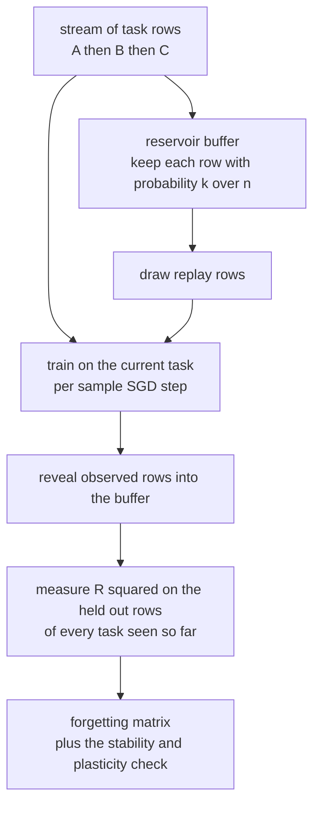
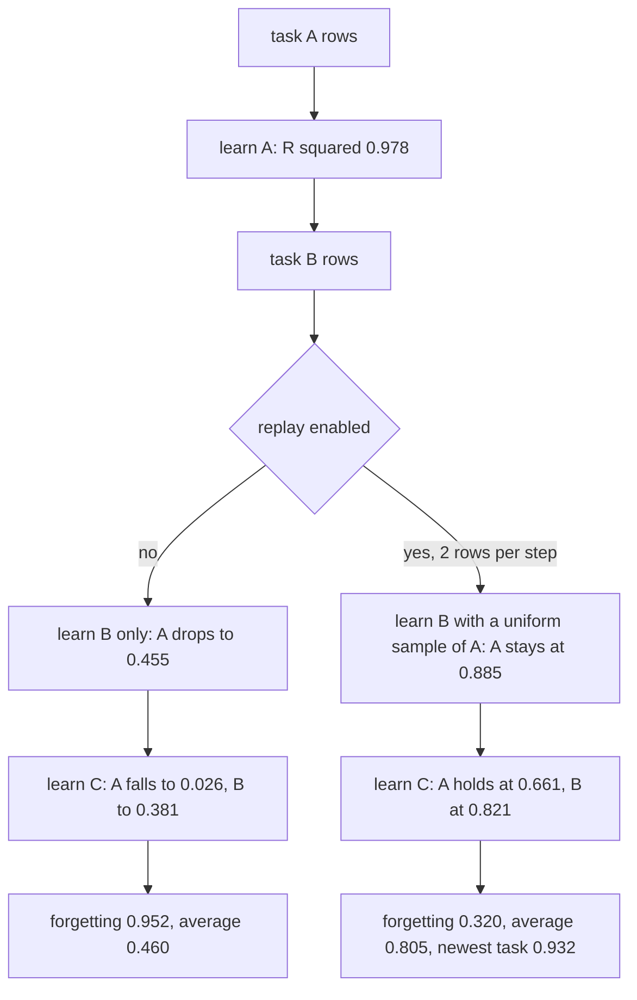
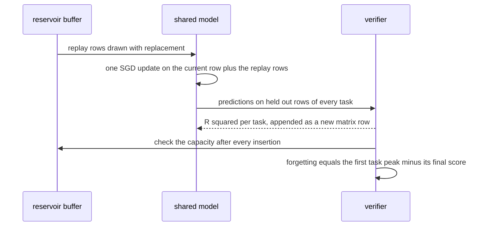

# 909 — Implement continuous learning with catastrophic forgetting mitigation (replay buffers).

> **Tier:** Master · **CTCI chapter:** Beyond — Software Engineering & Tooling
> **Task spec:** [909-implement-continuous-learning-with-catastrophic-forgetting-mitig.md](../../../tasks/master/909-implement-continuous-learning-with-catastrophic-forgetting-mitig.md)
> **Solutions:** [Python](../../../solutions/python/master/909-implement-continuous-learning-with-catastrophic-forgetting-mitig/solution.py) ·
> [Java](../../../solutions/java/master/909-implement-continuous-learning-with-catastrophic-forgetting-mitig/Solution.java) ·
> [JavaScript](../../../solutions/javascript/master/909-implement-continuous-learning-with-catastrophic-forgetting-mitig/solution.js) ·
> [C#](../../../solutions/csharp/master/909-implement-continuous-learning-with-catastrophic-forgetting-mitig/Solution.cs)

## 1. Problem restatement

**Input:** a stream of tasks presented one after another to **one shared model**, a bounded memory budget
for past examples, and a replay ratio.

**Output:** a trained model plus the evidence that memory bought retention:

- a **forgetting matrix**: the held-out `R^2` of every task seen so far, measured after each stage;
- the forgetting metric — how much an early task degrades by the end of the stream;
- the stability/plasticity trade-off: the newest task must still be learnt;
- hard invariants on the memory: the buffer never exceeds its capacity, and every stream item is kept with
  probability `capacity / n` (reservoir sampling is a uniform sample of the whole stream).

The setting is the classic one: the tasks want different weights, so plain sequential fine-tuning
overwrites earlier tasks — catastrophic forgetting — while replaying a uniform sample of the past in every
update keeps the old regions of the input space alive without unbounded memory.

| Language | model and tasks | buffer | documented simplification |
| --- | --- | --- | --- |
| Python | one linear model over six quadratic features, trained online by per-sample SGD on three tasks with different weights and input regions | `ReservoirBuffer` with `k / n` replacement, bounded by `capacity` | a two-feature linear model instead of a network, fixed task order, no task-boundary feedback, fixed replay ratio |
| Java | single-head linear model on three 3-D tasks, deterministic batch sampling | bounded replay buffer with a per-task quota; capacity zero degenerates to plain fine-tuning | three linear tasks, 100 examples each, 60 epochs |
| JavaScript | a shared two-layer `tanh` network on four regression tasks; the pooled multi-task fit is the upper bound | reservoir buffer mixed into every minibatch | a small network, four tasks, no architectural isolation |
| C# | a hinge-loss perceptron on rotating two-class boundaries | a fixed-capacity **FIFO ring** buffer, cross-checked against an independent ring model | clean labels, linearly separable tasks, a handful of epochs |

Concrete behaviour (Python, seed 7, three tasks A → B → C, 120 training rows and 60 held-out rows each):

| After stage | Plain fine-tuning `R²(A, B, C)` | Replay, 2 rows per step `R²(A, B, C)` |
| --- | --- | --- |
| A | `0.978, -8.243, -2.085` | `0.981, -8.608, -2.166` |
| B | `0.455, 0.978, -0.520` | `0.885, 0.935, -21.649` |
| C | `0.026, 0.381, 0.974` | `0.661, 0.821, 0.932` |

So `forgetting_plain = 0.978 - 0.026 = 0.952` against `forgetting_replay = 0.981 - 0.661 = 0.320` (a
two-thirds reduction), while the newest task still reaches `0.932` versus `0.974` for plain fine-tuning —
above the asserted `0.8x` floor. The average over all three tasks is `0.460` without replay and `0.805`
with it, and a heavier replay (capacity 200, 6 rows per step) lifts the first task's final `R²` to `0.67`.

## 2. Intuition

The naive continuous learner is "keep training on whatever arrives". With one shared model and tasks that
want different weights, every gradient step on the new task moves the weights away from what the old tasks
required — the trace shows the first task collapsing from `0.978` to `0.026`, and the middle task's
`R^2` becoming deeply negative while it is *unlearned* on the way. Retraining on everything is not an
option: the stream is unbounded, so storing all of it is exactly what a bounded system cannot do.

The two mechanisms that make the bound work:

1. **Reservoir sampling keeps a uniform sample of an unbounded stream in bounded memory.** Item `n` is
   kept with probability `k / n`: when the buffer is full, draw a slot uniformly from `0 .. n-1` and
   overwrite it if the slot is below `k`. Every item ends up with the same inclusion probability `k / N`,
   which the file *measures* over 2000 independent trials against the exact `k / N` — for `k = 8` and
   `N = 60` the expected rate is `0.1333` and the worst per-item deviation must stay below `0.05`.
2. **Replay dilutes the current task's gradient.** Each update on a new row is followed by updates on
   `replay_per_step` rows drawn from the buffer, so the effective gradient is a mix of "learn the present"
   and "keep the past". Because the buffer is uniform over the stream, older tasks get no more weight than
   their share of the stream — the mix is unbiased rather than a hand-tuned curriculum.

The trade-off is explicit and measured, not assumed: replay must reduce forgetting *and* leave the newest
task above `0.8x` of its plain-fine-tuning score. The trace satisfies both (`0.661` vs `0.026` on task A,
`0.932` vs `0.974` on task C), which is what makes replay a mitigation rather than a different failure
mode.



## 3. Algorithm

1. **Build the tasks.** Each task draws inputs from its own region and uses its own weight vector; the
   quadratic feature map `[1, x0, x1, x0^2, x1^2, x0 x1]` lets one linear model express all three.
2. **Feed every observed row to the buffer** *before* training on it, so the buffer is a sample of
   everything seen (including the current task).
3. **Train with replay.** For each epoch and each row of the current task: one SGD update on that row, then
   `replay_per_step` updates on rows sampled with replacement from the buffer.
4. **Measure after every stage.** Compute `R^2 = 1 - SSE/SST` on held-out rows of *all* tasks, giving one
   row of the forgetting matrix per stage.
5. **Derive the metrics.** Forgetting is `matrix[0][0] - matrix[-1][0]` (task A's peak minus its final
   score); retention is the mean of the final row; the newest-task check is `matrix[-1][-1]`.
6. **Check the boundaries.** Capacity 0 or `replay_per_step = 0` must reproduce plain fine-tuning;
   a single-task stream must still report a full-width matrix; an untrained model must score negative
   `R^2` on a task it never saw, and a constant predictor exactly zero.

```text
procedure add(buffer, row)
    buffer.seen ← buffer.seen + 1
    if the buffer holds fewer rows than its capacity then append the row
    else
        slot ← a uniform draw from zero up to buffer.seen − 1
        if slot is below the capacity then replace that slot with the row
    end
    require that the buffer never exceeds its capacity
end

procedure sample(buffer, count)
    if the buffer is empty or count is not positive then return nothing
    return `count` independent uniform draws with replacement from the stored rows
end

procedure run_stream(order, capacity, replay_per_step, seed, samples, epochs)
    generate the training rows for every task and the held out rows for every task
    model ← a linear model over the quadratic feature map; buffer ← a reservoir of the given capacity
    for each task in the given order do
        for every row of that task do add(buffer, row)
        for each epoch do
            for every row of that task do
                update the model on that row
                for each of `replay_per_step` replay rows do update the model on it
            end
        end
        append the R squared of the model on every task's held out rows to the matrix
    end
    return the model, the matrix, the buffer, the held out rows and the replay count
end

procedure r_squared(model, rows)
    mean ← the mean target over the rows
    return one minus the sum of squared errors divided by the total sum of squares
end
```



## 4. Worked example

**Trace A — the forgetting matrix.** Reading the table in Section 1 as a matrix (rows = stages, columns =
tasks) shows the mechanism directly. Without replay, learning B pushes A from `0.978` to `0.455`; learning
C pushes A to `0.026` and B from `0.978` to `0.381`. With two replay rows per step, the diagonal behaves
the same (each task is still learnt: `0.981`, `0.935`, `0.932`) while the off-diagonal collapse is much
gentler: A ends at `0.661`, B at `0.821`.

| Metric | Plain | Replay (2/step) | Asserted condition |
| --- | --- | --- | --- |
| Forgetting of A | `0.952` | `0.320` | plain `> 0.5`; replay `< 0.5 x plain` |
| Newest task C | `0.974` | `0.932` | replay `> 0.8 x plain` |
| Average of the final row | `0.460` | `0.805` | replay `>` plain |

The intermediate rows are worth reading too: with replay, task C's `R^2` after stage B is `-21.649` — the
model has not yet seen C at all, and a *negative* `R^2` is the honest score of a model that is worse than
predicting the mean. The file leans on that fact in its boundary test: an untrained model must score
negative on a held-out task, and a constant predictor must score exactly `0`.

**Trace B — memory behaviour.** Reservoir sampling is validated independently of the learning: 2000 trials
of a 60-item stream into a capacity-8 buffer, counting how often each item survives. Every trial ends with
exactly 8 rows, the measured inclusion rate matches `k / n = 8/60 = 0.1333` with a worst per-item deviation
below `0.05`, and a separate long run (5000 insertions into a capacity-16 buffer) keeps `len == 16`,
`max_seen == 16` — with the capacity re-asserted after *every* insertion, not just at the end.

**Trace C — the boundaries.** A `replay_per_step` of `0` reproduces plain fine-tuning and a capacity of
zero does the same in Java, so the mitigation is genuinely responsible for the difference. A single-task
stream still reports a full `1 x 3` matrix (with non-target entries around `-8.6` and `-2.2`, since the
model never saw those tasks). Heavy replay (`capacity = 200`, `6` rows per step) pushes task A's final
`R^2` to `0.67` — more memory and a higher replay ratio retain more — and the whole stream replays exactly
from its seed, weights included.



## 5. Complexity

With `R` rows per task, `E` epochs, `p` replay rows per step, `T` tasks, capacity `k` and `N` stream items:

| Step | Time | Space | Reason |
| --- | --- | --- | --- |
| Buffer insertion | `O(1)` amortised | `O(k)` | one draw, one comparison, at most one replacement |
| Buffer draw | `O(1)` | `O(1)` | a direct index from the seeded stream |
| One SGD update | `O(F)` for `F` features (`F = 6` here) | `O(F)` | dot product, error, weight update |
| Training one task | `O(E R (1 + p) F)` | `O(F)` | replay multiplies the work per row by `1 + p` |
| Evaluation | `O(T * held)` | `O(T * held)` | `R^2` on every task's held-out rows, recomputed from scratch |
| Whole stream | `O(T E R (1 + p) F)` | `O(k + F)` | the learning cost dominates; memory is bounded by `k` |
| Retraining on everything (alternative) | `O(T^2 E R F)` | `O(T R)` | the baseline that a stream cannot afford — memory grows with the stream |
| Uniformity check | `O(trials * N)` | `O(N)` | 2000 trials of 60 insertions |

The crucial column is memory: the buffer is `O(k)` *regardless of stream length* — `seen == 5000` with 16
rows retained — while the "store everything" alternative grows without bound.

**What is simulated.** Python's header lists the simplifications: a two-feature linear model instead of a
network, a fixed task order, no task-boundary feedback and a fixed replay ratio; there is no wall clock, no
threads and no filesystem. Java uses three linear tasks with a 3-D feature vector and batch sampling;
JavaScript trains a small two-layer `tanh` network and uses a pooled multi-task fit as an upper bound;
C# uses a hinge-loss perceptron on clean linearly separable two-class tasks with a FIFO ring buffer. What
is *not* simulated: reservoir uniformity (measured against the exact `k / n`), the bounded-memory
invariant (re-checked after every insertion), the forgetting matrix measured on held-out data with an
independently coded `R^2`, the reduction replay actually buys, the plasticity floor on the newest task, and
the capacity-zero and single-task boundaries.

## 6. Pitfalls and edge cases

- **The buffer must be bounded at every moment.** `add` asserts `len(rows) <= capacity` after each
  insertion; a 5000-item stream into a capacity-16 buffer ends with exactly 16 rows and `max_seen == 16`.
- **Uniform, not "recent".** Reservoir sampling replaces a uniform slot with probability `k / n`, so no
  era of the stream is privileged; a FIFO ring (C#) is the opposite choice — recent-biased but cheap —
  and the two must not be confused when reasoning about retention.
- **Capacity zero or no replay must degrade exactly to fine-tuning.** Otherwise the measured improvement
  could come from something other than replay.
- **Replay must not starve the present.** The newest task is asserted above `0.8x` its plain score
  (`0.932` vs `0.974`) and above `0.5` in absolute terms; a mitigation that only preserves the past would
  fail here.
- **Negative `R^2` is normal and useful.** A model worse than the mean scores below zero (`-8.6`, `-21.6`
  in the matrix), which is why an untrained model is asserted to be negative on an unseen task and a
  constant predictor to be exactly zero — that pair pins the metric itself.
- **Sampling with replacement is intended.** `sample(count)` draws independently from the buffer, so a
  small buffer may repeat rows within one step; drawing *without* replacement would silently reduce the
  effective replay weight near the capacity bound.
- **Empty buffer, zero request.** `sample(0)` and sampling from an empty buffer must return nothing rather
  than raise — the first task has no past to replay.
- **A single-task stream is a valid stream.** It must still report a full matrix (the `1 x 3` row above),
  so the reporting code cannot assume at least two tasks.
- **Determinism.** Buffers, task data and replay draws all come from seeded streams, so the matrix, the
  weights and the metrics reproduce exactly: `again_matrix == replay_matrix` and `again.weights ==
  model.weights`.

## 7. Variants and follow-ups

- **FIFO ring instead of reservoir.** C# keeps a ring buffer whose eviction order is cross-checked against
  an independent list-based model of the ring — cheaper sampling, recent-biased retention.
- **Prior-anchored regularisation.** Java implements an EWC-style penalty and tests its defining property
  (zero at the anchor, quadratic in the distance from it), which retains old tasks without storing their
  data — at the cost of a curvature estimate.
- **Pooled multi-task oracle.** JavaScript trains on all tasks together and uses that accuracy as an upper
  bound, which is the honest way to say "replay narrows the gap to joint training" rather than "replay
  wins".
- **Drift-aware certificates.** Once the model keeps changing, the conformal guarantee of
  [908 — certified ML predictions with conformal prediction intervals](../../../tasks/master/908-implement-certified-ml-predictions-with-conformal-prediction-int.md)
  must be re-calibrated, which is exactly the exchangeability condition that task's shift test violates.
- **Learned surrogates that must stay valid.** A replayed model is often a surrogate for a simulator; how
  to spend the fidelity budget that keeps it current is the orchestrator's problem in
  [906 — multi-fidelity simulation orchestration with surrogate models](../../../tasks/master/906-implement-multi-fidelity-simulation-orchestration-with-surrogate.md).
- **Structured reasoning over changing facts.** A model that must keep old skills while acquiring new ones
  is the neural half of
  [910 — neural-symbolic hybrid pipeline for structured reasoning](../../../tasks/master/910-implement-neural-symbolic-hybrid-pipeline-for-structured-reasoni.md).

## 8. Check yourself

**Q1.** Why is reservoir sampling the right structure for replay, instead of keeping the most recent `k`
examples?

<details><summary>Show answer</summary>

Because retention has to be *uniform over the stream* to be unbiased: reservoir sampling keeps each item
with probability `k / N` whatever `N` is, so a replayed batch is an unbiased sample of everything the model
has ever seen. A FIFO ring instead over-weights the recent past and forgets the early tasks more quickly —
which is precisely the failure mode replay is supposed to fix. The cost of uniform sampling is that it
replaces rows at random (an early task may thin out), which is why the implementation keeps drawing with
replacement and measures the result rather than assuming it; C# keeps a FIFO ring deliberately and
cross-checks it against an independent ring model so the difference is visible.

</details>

**Q2.** The trace shows `forgetting_plain = 0.952` and `forgetting_replay = 0.320`. Is that "solved"?

<details><summary>Show answer</summary>

It is a *measured reduction*, not a solved problem: replay cuts forgetting to a third of the baseline, and
the average over all tasks rises from `0.460` to `0.805`, but the model still loses a third of task A's
`R^2` (`0.981 -> 0.661`). The file asserts exactly the two things replay claims: it at least halves
forgetting, and it keeps the newest task above `0.8x` of its plain score. A heavier setting does better on
the old task (`capacity = 200`, `6` rows per step lifts A's final `R^2` to `0.67`) at the cost of more
memory and more compute per step — the classic stability/plasticity dial, and the tutorial keeps the
numbers on both sides of it.

</details>

**Q3.** Why is a negative `R^2` value reported in the forgetting matrix rather than clipped to zero?

<details><summary>Show answer</summary>

Because `R^2 = 1 - SSE/SST` compares the model to the best constant predictor, and a model that has not
seen a task can be *much* worse than a constant — `-8.6` for task B and `-21.6` for task C at the stages
before those tasks are seen. Clipping would hide the real magnitude of interference: the jump from `0.455`
to `-21.6` is the model actively moving away from a task it never learnt, which is exactly the
catastrophic interference the task is about. The file uses the same property as a metric test: an untrained
model must score negative, and a constant predictor must score exactly zero.

</details>

**Q4.** Replay costs `(1 + p)x` the compute per row and holds `k` examples in memory. How does that compare
to just training on everything?

<details><summary>Show answer</summary>

Training on everything is `O(T^2 E R F)` compute and, critically, `O(T R)` *memory that grows with the
stream* — impossible for a continuous learner. Replay is `O(T E R (1 + p) F)` compute with `O(k)` memory
that is constant in the stream length (`5000` insertions retained 16 rows in the trace). The trade is
therefore memory and, in principle, exactness: pooled training would reach the joint optimum that
JavaScript uses as an upper bound, whereas replay only approximates it while never letting the model
become purely local to the current task.

</details>
