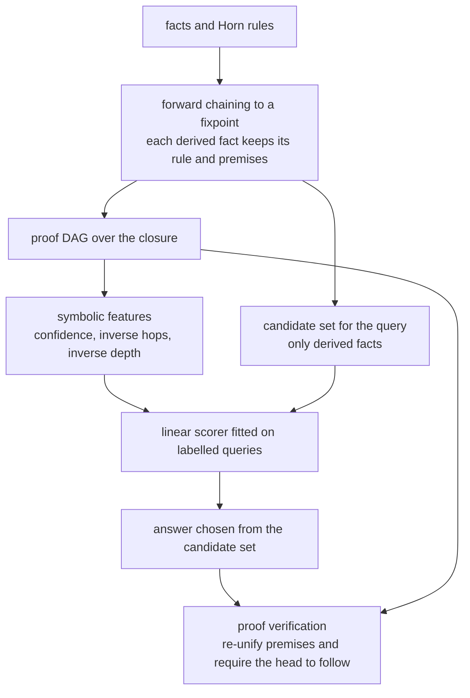
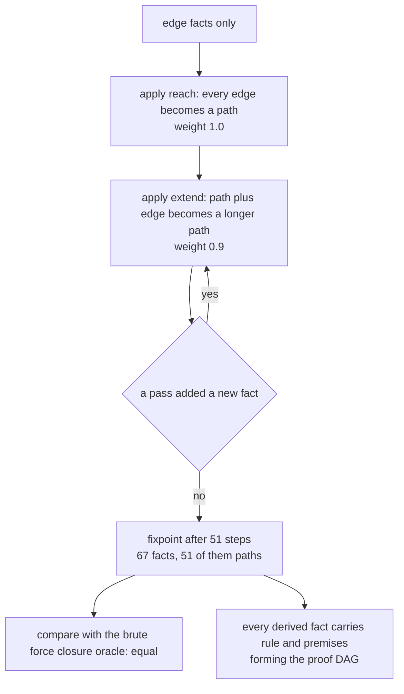
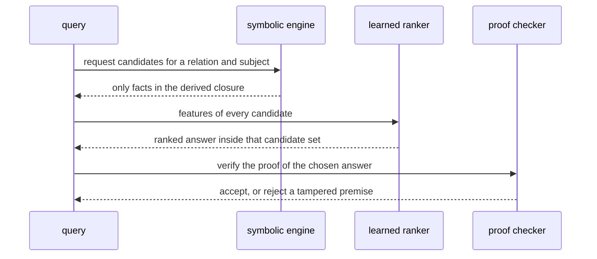

# 910 — Implement neural-symbolic hybrid pipeline for structured reasoning tasks.

> **Tier:** Master · **CTCI chapter:** Beyond — Software Engineering & Tooling
> **Task spec:** [910-implement-neural-symbolic-hybrid-pipeline-for-structured-reasoni.md](../../../tasks/master/910-implement-neural-symbolic-hybrid-pipeline-for-structured-reasoni.md)
> **Solutions:** [Python](../../../solutions/python/master/910-implement-neural-symbolic-hybrid-pipeline-for-structured-reasoni/solution.py) ·
> [Java](../../../solutions/java/master/910-implement-neural-symbolic-hybrid-pipeline-for-structured-reasoni/Solution.java) ·
> [JavaScript](../../../solutions/javascript/master/910-implement-neural-symbolic-hybrid-pipeline-for-structured-reasoni/solution.js) ·
> [C#](../../../solutions/csharp/master/910-implement-neural-symbolic-hybrid-pipeline-for-structured-reasoni/Solution.cs)

## 1. Problem restatement

**Input:** a knowledge base (facts plus conjunctive Horn rules), a query relation, and a small labelled set
of queries whose *preferred* answer is known.

**Output:** an answer drawn from a set the logic derives, chosen by a learned score, together with the
evidence that the hybrid is safe:

- **soundness** — every answer is entailed by the symbolic closure, and carries a proof the checker
  accepts (a tampered, invented or missing premise is rejected);
- **completeness of the symbolic layer** — the derived facts equal a brute-force transitive-closure oracle;
- **ranking gain** — the learned scorer does not do worse than the symbolic prior, and must reach an
  accuracy floor on held-out queries;
- **open world** — a query with no derivation returns *nothing*, and absence of a proof is what makes an
  answer "unknown" rather than "false".

The division of labour is the point of a neuro-symbolic pipeline: the symbolic engine defines and
certifies the candidate space, and the learned model only *re-orders* it, so it can never invent an answer.

| Language | symbolic layer | learned layer | documented simplification |
| --- | --- | --- | --- |
| Python | first-order forward chainer over binary relations; every derived fact stores its rule and premises, forming a proof DAG | linear scorer over `[1, confidence, 1/hops, 1/depth]`, fitted by normal equations | one toy domain (reachability on a weighted DAG), linear scorer instead of a network, no embeddings |
| Java | depth-first subset enumeration with pruning (subset-sum domain) — sound **and** complete against a bitmask oracle | linear scorer over subset features trained with a softmax cross-entropy loss; it ranks candidates but never creates them | a combinatorial domain rather than logic programming; precision 1 *by construction* |
| JavaScript | Datalog-style forward chaining (unification, fixpoint) | perceptron over four features ranks *rule instantiations*; a budgeted proposer tries only the top `k` | Horn rules without function symbols, naive (non-semi-naive) evaluation |
| C# | forward-chaining fixpoint over a **grounded** rule set on an ancestry domain, cross-checked against a naive saturation oracle | linear scorer over `[1, head predicate matches query, head shares the query's first constant, 1/(1+body size)]` ranks applicable rules for goal-directed chaining | rules are grounded over a fixed constant set before search (no lifted unification) |

Concrete behaviour (Python, a 12-node weighted DAG):

| Quantity | Value |
| --- | --- |
| closure | `67` facts (12 nodes, the given edges plus 51 `path` facts) derived in `51` steps, against an oracle of `51` reachability pairs |
| agreement | derived `path` facts **equal** the brute-force transitive closure |
| proofs | the first 60 facts all verify; a replaced premise, an invented premise and a removed premise are all rejected |
| confidences | each in `(0, 1]`; a chain of `h` hops is at most `0.9^(h-1)` confident, and proof depth stays below the node count |
| queries | at least 6 multi-candidate queries, split 2/3 train and 1/3 test |
| ranker | weights `[1.8979, -3.5156, 1.3058, 1.3058]`; prior hits `3/3`, hybrid hits `3/3` |
| boundaries | an unknown source returns `[]` (not `False`); an empty KB derives nothing; a single fact derives exactly one path; a cyclic fact set terminates in `< 20` steps |

## 2. Intuition

A purely learned model asked "which derivation is right?" can answer with something that is not derivable
at all — Java's header puts it plainly: a neural model is free to emit answers that do not sum to the
target. A purely symbolic engine has the opposite problem: it derives everything that follows, but with
many derivations of the same fact it has no principled way to say which one a human would prefer.

The hybrid splits the two roles:

1. **The symbolic layer defines the answer space.** Forward chaining runs to a fixpoint over a monotone
   fact set — monotonicity is why a cyclic rule set still terminates — and every derived fact records the
   rule instance and the premises that produced it, so the closure is a *proof DAG* rather than a set.
2. **The candidate set is closed.** An answer is only ever selected from the derived facts
   (`engine.query` filters the proofs), which is exactly why the hybrid cannot hallucinate: soundness is
   structural, not statistical.
3. **The learned layer supplies the preference.** Symbolic features — the product of the rule confidences
   along the proof, the inverse hop count, the inverse proof depth — are combined linearly by weights
   fitted on labelled queries where the *fewest-hop* derivation is the truth. The scorer is a re-ranker,
   so a bad fit costs accuracy, never validity.
4. **Every proof is independently checkable.** `verify_proof` re-unifies the stored premises against the
   rule, requires the head to follow, and recurses — three distinct act of tampering are tested (a
   replaced premise, an invented premise, a deleted premise) and all must fail.



## 3. Algorithm

1. **Load the facts and rules.** Facts are binary tuples; rules are conjunctive implications over
   variables with a confidence weight; `is_variable` marks `?x`-style terms.
2. **Saturate.** Repeatedly join each rule's premise patterns against the current fact set with
   depth-first unification; whenever a head instantiates to a fact not yet known, record
   `(rule, premises)` as its proof, append the fact, and mark progress. The loop stops when a pass adds
   nothing or the step limit is hit.
3. **Derive metrics in one pass.** Confidence is the product of the rule weights along the proof, depth is
   the longest premise chain plus one, and hops is the number of `edge` facts the proof rests on. All three
   are computed recursively with memoisation.
4. **Score candidates.** For each candidate fact build `[1, confidence, 1/hops, 1/depth]` and fit a linear
   ranker on labelled queries (1 for the fewest-hop derivation, 0 otherwise) using the normal equations
   with a tiny ridge term.
5. **Answer.** Re-rank the candidate set by `(score, fact)` and return the top; assert it lies in the
   candidate set and that its proof verifies.
6. **Check the boundaries.** Unknown sources, empty knowledge bases, singletons, cyclic fact sets, and a
   rule that only re-derives known facts.

```text
procedure run(engine, limit)
    repeat until nothing changes or the step limit is reached
        for every rule do
            for every binding of that rule's premises over the current facts do
                head ← instantiate the rule head with the binding
                if the head is not already known then
                    record the proof as (rule, instantiated premises); append the head; mark progress
                end
            end
        end
    end
    return the proofs
end

procedure metrics(engine, fact, memo)
    if the fact is given then return (1, 0, one when it is an edge fact, otherwise zero)
    rule, premises ← the recorded proof of the fact
    compute the metrics of every premise
    return (rule weight times the product of the premise confidences,
            1 plus the largest premise depth,
            the sum of the premise hop counts)
end

procedure verify_proof(engine, fact, trail)
    if the fact is already on the trail then reject
    if the fact is given then accept
    rule, premises ← the recorded proof; reject when the rule is unknown or the arity differs
    binding ← fold unification of every pattern against its premise, rejecting on failure
    require that instantiating the rule head with the binding equals the fact
    recurse on every premise with the fact added to the trail
end

procedure fit_ranker(rows, labels)
    build the Gram matrix of the feature rows and the right hand side against the labels
    add a small ridge to the diagonal and solve by Gaussian elimination with partial pivoting
    return the weight vector
end
```



## 4. Worked example

**Trace A — closure and proofs.** The domain is 12 nodes with forward edges (step 1 or 2) and one skip
edge every two nodes, weighted `0.55 + 0.05 * ((index * 7) % 9)` for unit steps and
`0.6 + 0.04 * ((index * 5) % 10)` for skips. Two rules do the work: `reach` turns an `edge` into a `path`
with weight `1.0`, and `extend` joins a `path` with an `edge` at weight `0.9`. Saturation derives 67 facts
in 51 steps, and the 51 derived `path` facts match the brute-force transitive closure exactly — the
symbolic layer is sound *and* complete on this domain.

| Tampering | Checker outcome | Why |
| --- | --- | --- |
| replace a premise with `("edge", "n00", "n99")` | rejected | the instantiated head no longer follows from the binding |
| invent a premise `("path", "n11", "n11")` | rejected | the premise is not a known fact |
| delete the first premise | rejected | the arity no longer matches the rule |
| ask for `("path", "n99", "n00")` | no proof | absence of a derivation is what "unknown" means |

**Trace B — symbolic features and the ranker.** For each candidate the features are
`[1, confidence, 1/hops, 1/depth]`, and the truth label is "this is a fewest-hop derivation". The fitted
weights are `[1.8979, -3.5156, 1.3058, 1.3058]`: the large negative weight on raw confidence is the
interesting one — with `extend` at `0.9` per hop, the *most confident* derivation is the *shortest*, and
the ranker learns to lean on the hop count instead. On the held-out third of the queries both the symbolic
prior (highest confidence, ties by name) and the learned ranker hit `3/3`, which satisfies the asserted
floor of `0.8` and the "must not do worse than the prior" condition.

The confidence bound is checked structurally as well: a chain of `h` hops cannot be more confident than
`0.9^(h-1)`, because every extension multiplies by `0.9` and every path rests on at least one edge.

**Trace C — boundaries.** `engine.query("path", "n99")` returns `[]` for an unconnected source, and the
file asserts `verify_proof` returns `False` for the same fact — the pipeline distinguishes "no derivation
exists" from "the derivation is false". An empty knowledge base derives nothing; a single `edge` fact
derives exactly one `path` (two facts total); a cyclic pair of edges terminates in fewer than 20 steps and
still derives the reverse path, which is the payoff of monotone saturation; and adding a rule that only
re-derives facts it already knows leaves the closure set untouched.



## 5. Complexity

With `F` facts, `R` rules, `p` premise patterns per rule and `c` candidates per query:

| Step | Time | Space | Reason |
| --- | --- | --- | --- |
| One saturation pass | `O(R * F^p)` in the worst case | `O(F)` | a naive depth-first join over the current fact set per rule |
| Fixpoint | `O(F)` passes, so `O(R F^(p+1))` worst case | `O(F)` | each pass must add at least one fact; the demo converges in 51 steps |
| Proof metrics | `O(F)` amortised with memoisation | `O(F)` | each fact's metrics computed once from its premises |
| Proof verification | `O(proof size)` | `O(depth)` | recursive re-unification along the proof DAG |
| Feature build per query | `O(c)` | `O(c)` | three metrics per candidate |
| Ranker fit | `O(c F^2 + F^3)` for `F` features | `O(F^2)` | normal equations plus Gaussian elimination (4 features here) |
| Answering | `O(c F)` | `O(c)` | one dot product per candidate |
| Learned-only alternative | `O(c F)` with **no** soundness guarantee | `O(c)` | Java shows such a run proposing invalid answers |

The symbolic layer is exponential in the worst case — naive first-order evaluation always is — but the
interesting complexity here is the *guarantee*: the neural step is `O(c)` per query and cannot widen the
answer space by even one fact.

**What is simulated.** Python's header lists the simplifications: one toy domain (reachability over a
weighted DAG), a linear scorer instead of a network, no embeddings; everything runs in process and
deterministically. Java replaces logic with subset-sum enumeration plus pruning and a softmax-trained
linear scorer; JavaScript implements Datalog-style chaining with a perceptron over rule instantiations and
a budgeted top-`k` proposer; C# grounds the rules over a fixed constant set before searching (no lifted
unification) and compares goal-directed chaining against unguided FIFO. What is *not* simulated: the
fixpoint semantics, the proof DAG with its verification, closure equality against an independent oracle,
the feature computation, the fitted re-ranker inside a closed candidate set, and the open-world and cyclic
boundaries.

## 6. Pitfalls and edge cases

- **Soundness must be structural.** The answer is always selected *from* the derived facts, so any bug in
  the scorer shows up as a worse answer, never as an unsupported one; the file asserts the choice lies in
  the candidate set and that its proof verifies.
- **Proofs must be checked, not trusted.** Three tampering modes are tested — a replaced premise, an
  invented premise and a deleted premise — and each must fail, as must a fact with no derivation.
- **Confidence is not the answer.** A long chain is systematically *less* confident, so a ranker that only
  maximises confidence prefers short proofs (which happens to be the truth here) and can be beaten by a
  feature that measures hops directly; the fitted weights expose this.
- **Cycles must terminate.** The cyclic `a -> b -> a` fact set converges in fewer than 20 steps because
  the fact set is monotone and facts are never removed; a non-monotone rule set would need a different
  argument.
- **Idempotent rules are no-ops.** Adding a rule that re-derives known facts leaves the closure unchanged —
  asserted by comparing proof sets, which also proves the engine does not grow spuriously.
- **Open world.** An unconnected source yields an empty candidate list, and the absence of a proof is the
  definition of "unknown" here; conflating that with "false" would be a modelling error the test catches.
- **Degenerate knowledge bases.** An empty fact set derives nothing; a single fact derives exactly one
  path; the `1 x 1` case still verifies.
- **Feature scale.** Raw confidences live in `(0, 1]` and inverse hop counts in `(0, 1]` too, but their
  influence is very different, which is why the ranker fits weights rather than thresholds, and why the
  fitted magnitude (a five-fold span between `confidence` and `1/hops`) is worth reading off.
- **Incomplete derivation is allowed when the proposer is budgeted.** JavaScript's top-`k` proposer can
  miss derivations, so its claim is only "sound, sometimes incomplete" — and the exhaustive `k = infinity`
  run must reproduce the closure byte for byte. A pipeline must state which of the two it uses.
- **Determinism.** Rules, joins and the fit are deterministic, so re-running produces the same closure and
  the same proof names; the file checks exactly that.

## 7. Variants and follow-ups

- **Combinatorial domains.** Java's subset-sum version enumerates candidates with pruning and rejects any
  proposal that does not sum to the target, giving precision `1` by construction and a contrast against a
  deliberately unconstrained neural run.
- **Budgeted proposers.** JavaScript lets the learned scorer rank rule instantiations and only tries the
  top `k`, so derivation may be incomplete but never unsound — the standard neuro-symbolic operating point
  when the closure is too large.
- **Goal-directed chaining.** C# scores applicable rules by how well their head matches the query, so the
  query is reached in far fewer applications than unguided FIFO, while both remain complete.
- **Learned features instead of hand-built ones.** Replacing `[1, confidence, 1/hops, 1/depth]` with learned
  embeddings is the natural upgrade; the pipeline's guarantee (answer inside the closure) survives because
  it never depended on the features.
- **Ranking with certified intervals.** Turning the ranker's score into a calibrated preference is the same
  problem as
  [908 — certified ML predictions with conformal prediction intervals](../../../tasks/master/908-implement-certified-ml-predictions-with-conformal-prediction-int.md).
- **Knowledge that changes.** A symbolic base whose facts keep arriving needs the retention machinery of
  [909 — continuous learning with catastrophic forgetting mitigation](../../../tasks/master/909-implement-continuous-learning-with-catastrophic-forgetting-mitig.md),
  and derivations that must stay verifiable over time need the log discipline of
  [902 — self-verifying distributed logs with Merkle trees and authenticated queries](../../../tasks/master/902-implement-self-verifying-distributed-logs-with-merkle-trees-and.md).

## 8. Check yourself

**Q1.** Why is the hybrid *sound by construction* rather than sound by measurement?

<details><summary>Show answer</summary>

Because the learned component never proposes — it only re-orders a set the symbolic engine produced. The
answer space is the derived closure, and `engine.query` returns only facts that are in the proof map, so
whatever the scorer does with its weights, the returned answer is entailed. The measurement that matters
is therefore not "did it hallucinate" but "did the symbolic layer derive the right set at all", which is
checked against the brute-force transitive-closure oracle (`51` facts, exact equality) and by verifying the
proof of every returned answer. Java makes the contrast concrete with an unconstrained neural run that is
*shown* to propose invalid subsets.

</details>

**Q2.** The fitted ranker gives raw confidence a large *negative* weight (`-3.5156`). Is the fit broken?

<details><summary>Show answer</summary>

No — it is compensating for a correlation. Every application of `extend` multiplies the proof confidence by
`0.9` and adds a hop, so confidence and hop count are almost perfectly anti-correlated in this domain, and
the truth label ("fewest hops") is *increasing* in `1/hops` and *decreasing* in confidence. The linear fit
therefore puts a negative weight on confidence and a positive one on `1/hops` and `1/depth`; the two
effects cancel appropriately for candidates with the same hop count. The check that guards against a
pathological fit is comparative, not structural: the hybrid must not do worse than the confidence-first
prior, and must reach an accuracy floor on the held-out queries.

</details>

**Q3.** Why does the task insist that a query with no derivation return nothing rather than `False`?

<details><summary>Show answer</summary>

Because the knowledge base is *open*: it states what is derivable, not what is true in the world. Returning
`False` for `("path", "n99", "n00")` would assert that the path does not exist, which the facts do not
support — the node may simply be absent from the model. The file encodes this as a pair of assertions
(`query(...) == []` and `verify_proof(...) is False`): there is no candidate, and there is no proof, so
the honest answer is "unknown". Downstream consumers that need a boolean must decide how to treat that
third state, and collapsing it early is a classic modelling bug.

</details>

**Q4.** The symbolic layer is exponential in the worst case. Why is that acceptable here, and what changes
at scale?

<details><summary>Show answer</summary>

Because the symbolic layer is the *guarantee*, not the performance mechanism, and the demo domain saturates
in 51 steps over 67 facts. At scale, three things change: the proposer becomes budgeted (JavaScript's top-`k`
over ranked rule instantiations, which trades completeness for cost), the search becomes goal directed
(C# ranks rules by their match to the query so FIFO's wasted applications disappear), and the evaluation
becomes semi-naive instead of naive per-rule joining. All of them keep the same safety property — a
candidate that is not entailed is never returned — which is why the architecture scales by weakening
*completeness* rather than soundness.

</details>
