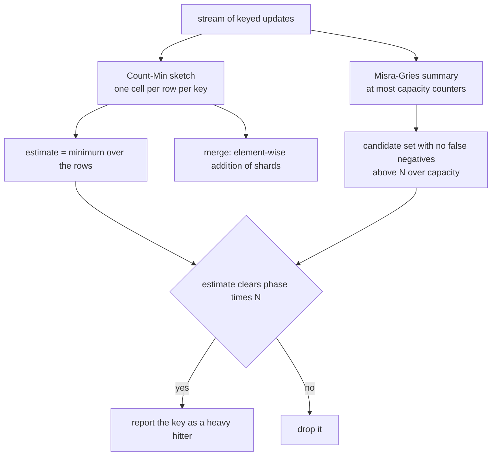
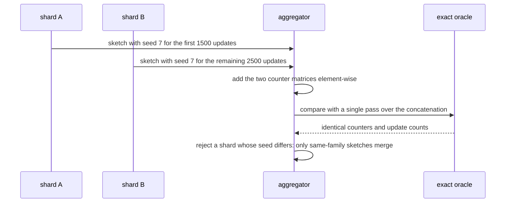
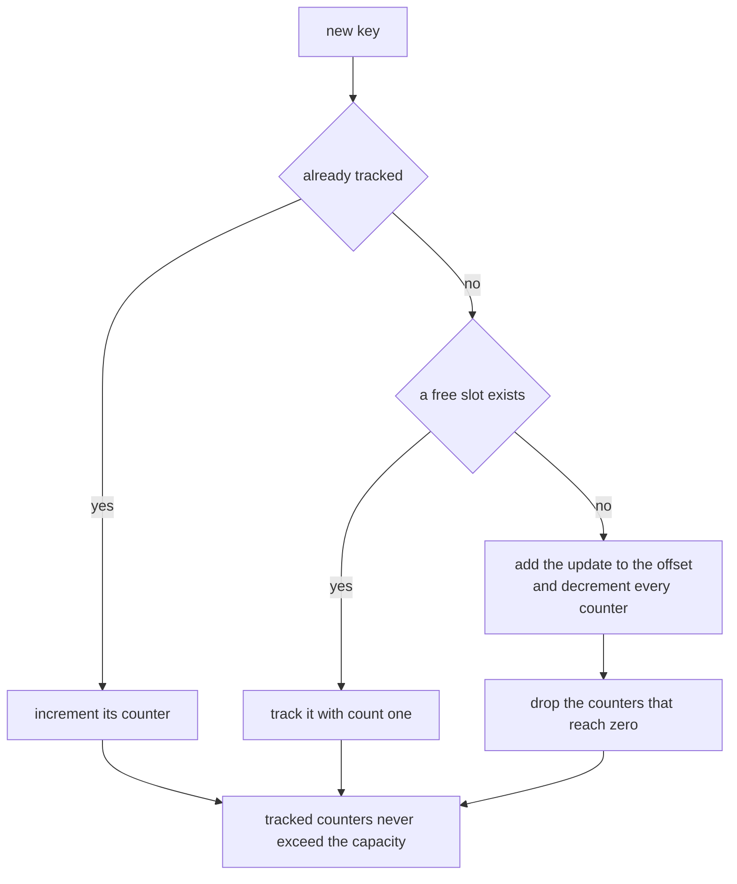

# 911 — Implement probabilistic data structure for heavy hitters with error guarantees and mergeability.

> **Tier:** Master · **CTCI chapter:** Beyond — Software Engineering & Tooling
> **Task spec:** [911-implement-probabilistic-data-structure-for-heavy-hitters-with-er.md](../../../tasks/master/911-implement-probabilistic-data-structure-for-heavy-hitters-with-er.md)
> **Solutions:** [Python](../../../solutions/python/master/911-implement-probabilistic-data-structure-for-heavy-hitters-with-er/solution.py) ·
> [Java](../../../solutions/java/master/911-implement-probabilistic-data-structure-for-heavy-hitters-with-er/Solution.java) ·
> [JavaScript](../../../solutions/javascript/master/911-implement-probabilistic-data-structure-for-heavy-hitters-with-er/solution.js) ·
> [C#](../../../solutions/csharp/master/911-implement-probabilistic-data-structure-for-heavy-hitters-with-er/Solution.cs)

## 1. Problem restatement

**Input:** a stream of keyed updates, a relative error `eps`, a failure probability `delta` (or, for the
summary, a capacity `k`), and a reporting threshold `phase`.

**Output:** a **bounded-memory** summary plus the set of heavy hitters — keys whose estimated count clears
`phase * N` — with guarantees that are checked rather than asserted:

- **one-sided error**: `true(x) <= estimate(x) <= true(x) + eps * N` with probability at least
  `1 - delta`, when `w >= e / eps` and `d >= ln(1 / delta)`;
- **no false negatives** for the summary's own guarantee — every key with a count above `N / capacity` must
  still be a candidate;
- **mergeability**: merging two shards' summaries equals summarising the concatenated stream, exactly for
  the sketch and within the same bound for the summary;
- **fixed memory**: the footprint is `d * w` counters forever, no matter how long the stream runs.

| Language | sketch | candidate summary | documented simplification |
| --- | --- | --- | --- |
| Python | `CountMinSketch` (`d x w` cells, `sha256`-derived cell index, estimate = min over rows) | `MisraGries` with capacity `max(8, 1/phase)` | single-threaded, integer counts, no conservative update, no decay window |
| Java | Misra-Gries as the primary structure, with the bound derived from the bookkeeping: `sum(est) = N - (m+1)D`, hence `D <= N/k` | the same table supplies candidates | string keys, a 5000-item synthetic Zipf stream, an exact `HashMap` oracle |
| JavaScript | Count-Min with `h_i(x) = (a_i * h(x) + b_i) mod p mod w`, plus a conservative-update variant that must never exceed the standard one | Misra-Gries with `k` counters, merged by subtracting `min(m_A, m_B)` from the non-common keys | counts are exact integers; the only randomness is which items the seeded stream draws |
| C# | Count-Min with deterministic splitmix64 hashes | Misra-Gries whose merge subtracts the `(k+1)`-th largest count | short string keys, a few thousand updates, fixed `epsilon`/`delta` |

Concrete behaviour (Python, `eps = delta = 0.01`, `phase = 0.05`):

| Quantity | Value |
| --- | --- |
| dimensions | `width = 512 >= e / eps = 271.83`, `depth = 5 >= ln(1/delta) = 4.61`, i.e. `2560` counters |
| stream | `4000` updates over `125` distinct keys, 60% of the mass on 5 hot keys |
| heaviest keys | `hot-0: 511`, `hot-2: 489`, `hot-3: 473` |
| worst over-count | `0` against a bound of `eps * N = 40` (`0` for every key, and no key is ever under-counted) |
| row mass | every row sums to exactly `4000` |
| failure rate | over 300 different hash seeds, the share of runs exceeding the bound is below `delta + 0.01` |
| heavy hitters | threshold `0.05 * 4000 = 200`; the 5 true hitters are exactly the 5 reported, from 19 candidates out of a capacity of 20 |
| merge | `merge(A, B)` equals a single pass over `A + B`, and equals a pass over `B + A` |
| boundaries | an empty sketch estimates `0`; a single insertion is estimated exactly; a capacity-2 summary over 5 distinct keys stays bounded at 2 |

## 2. Intuition

The naive heavy-hitter answer is a hash map of exact counts, which is exact and unbounded — one entry per
distinct key, which on a real stream is the memory the system does not have. Sampling or eviction fixes
the memory but destroys the guarantee: you can no longer say anything about what you might have missed.

Two structures, each with its own kind of guarantee, cover the problem:

1. **Count-Min gives one-sided additive error.** Each key increments exactly one cell per row, so rows are
   independent; the estimate is the *minimum* over the `d` rows, and since collisions only ever add, the
   estimate can never fall below the truth. With `w >= e / eps` columns and `d >= ln(1/delta)` rows,
   the chance that a given key's error exceeds `eps * N` is at most `delta`. One-sidedness is what makes
   the structure safe for thresholding: a key that clears the threshold in the sketch really did occur
   that often.
2. **Misra-Gries gives a bound with no probability.** `k` counters; a new key takes a free slot, and when
   the table is full every counter is decremented and the key is dropped. Counting updates yields
   `sum(est) = N - (k + 1) D` where `D` is the number of decrement rounds, so `freq(x) - est(x) <= N / k`
   for tracked keys, and — the useful direction — any key with `freq(x) > N / k` *must* still be tracked.
   That is a deterministic no-false-negative guarantee, and it supplies the candidate set.
3. **Composition is the deliverable.** Candidates come from the summary (deterministic recall), estimates
   come from the sketch (probabilistic accuracy), and the pipeline reports the intersection of "is a
   candidate" and "clears the threshold".
4. **Linearity makes it shardable.** The sketch is a sum of per-update indicators, so merging shards is
   element-wise addition — which the file checks against a single pass over the concatenated stream, in
   both orders, and rejects for sketches from different hash families.



## 3. Algorithm

1. **Dimension the structures.** `width = 2^ceil(log2(e / eps))` (a power of two, so the cell index is a
   mask) and `depth = ceil(ln(1 / delta))`; the summary gets `capacity = max(8, 1 / phase)`.
2. **Update.** For the sketch, hash `(seed, row, key)` and increment that cell in every row, keeping a
   running `updates` counter; for the summary, increment the key's counter, take a free slot, or decrement
   every counter and record the drop in `offset`.
3. **Estimate.** `min` over the rows for the sketch; for the summary, the tracked count plus the offset is
   always at least the true count.
4. **Report.** `heavy_hitters = {key in candidates : sketch.estimate(key) >= phase * N}`.
5. **Merge.** Sketch: element-wise addition after checking width, depth and seed match. Summary: add the
   common keys' counts, add the offsets, and prune to capacity while folding the dropped counts into the
   offset.
6. **Verify.** Compare against exact counts (one-sided error, no false negatives), merge against a single
   pass, and check the boundaries.

```text
procedure add(sketch, key, count)
    for each row do
        sketch.counters[row][cell(key, row, sketch.width, sketch.seed)] ← that cell + count
    end
    sketch.updates ← sketch.updates + count
    require that the footprint stays d times w
end

procedure estimate(sketch, key)
    return the smallest of the `depth` cells addressed by the key
end

procedure merge(sketch, other)
    require matching width, depth and seed
    add every cell of the other sketch into this one; add the update counts
end

procedure add(summary, key, count)
    summary.seen ← summary.seen + count
    if the key is tracked then increase its counter
    else if a slot is free then track the key with this count
    else
        add the count to the offset and decrement every tracked counter by the count,
        dropping any that reach zero
    end
    require that at most `capacity` counters are tracked
end

procedure heavy_hitters(sketch, summary, phase)
    threshold ← phase times sketch.updates
    return every candidate of the summary whose sketch estimate is at least the threshold
end
```



## 4. Worked example

**Trace A — the sketch on a skewed stream.** The generator puts 60% of 4000 updates on `hot-0 … hot-4`
and spreads the rest over 120 further keys, producing `125` distinct keys with the heaviest at `511`,
`489` and `473`.

| Check | Measured | Bound or expectation |
| --- | --- | --- |
| worst over-count across all 125 keys | `0` | `eps * N = 40` (one-sided bound) |
| under-counts | none | `estimate >= true` for every key |
| row mass | `4000` per row | the total mass of each row equals the number of updates |
| memory | `2560` counters | exactly `d * w`, unchanged after 4000 updates |
| failure rate over 300 seeds | below `delta + 0.01` | `delta = 0.01` |

The missing entries of `hot-0` (`511` against a bound of `40`) also show why the bound is one-sided: the
sketch can only over-count, so a key above the threshold is genuinely above it up to the additive term.

**Trace B — the pipeline.** With `phase = 0.05` the reporting threshold is `200`, exactly five keys satisfy
it in the exact counts, and the pipeline reports exactly those five — from 19 candidates out of a summary
capacity of 20. The summary's own guarantee is checked too: every key with a count above
`N / capacity = 200` is a candidate (`strong <= candidates`), and the tracked count plus the offset never
falls below the true count for any key.

**Trace C — merge and boundaries.** Splitting the stream into `1500 + 2500` and merging the two sketches
reproduces the single-pass counters exactly, in either order, and merging sketches with different seeds is
rejected with a message naming the hash family. Merging summaries keeps the capacity, accounts for the whole
stream, and does not lose any key above `N / capacity`. The boundaries are the ones that usually break such
code: an empty sketch estimates `0` everywhere, a single insertion is estimated exactly (no collision yet),
a capacity-2 summary over 5 distinct keys stays at 2 counters, an empty stream reports no hitters, and a
zero threshold keeps every candidate.



## 5. Complexity

With `d` rows, `w` columns, `N` updates, `U` distinct keys and `k` summary capacity:

| Operation | Time | Space | Reason |
| --- | --- | --- | --- |
| Sketch update | `O(d)` hashes and increments | `O(d w)` | exactly one cell per row |
| Sketch estimate | `O(d)` | `O(1)` | minimum over the rows |
| Sketch merge | `O(d w)` | `O(d w)` | element-wise addition |
| Summary update | `O(k)` worst case | `O(k)` | a full table triggers a decrement sweep over all counters |
| Summary merge | `O(k log k)` | `O(k)` | combine dictionaries, then prune to capacity |
| Reporting | `O(k d + k log k)` | `O(k)` | estimate each candidate and threshold it |
| Exact hash map (alternative) | `O(1)` per update | `O(U)` — **grows with the stream** | the reason sketches exist |
| Dimensions for the demo | `w = 512`, `d = 5` | `2560` counters | `w >= e/eps = 271.83`, `d >= ln(1/delta) = 4.61` |

The headline number is memory: `2560` counters for 4000 updates and 125 distinct keys — and the same
`2560` for four billion updates, which is the entire point.

**What is simulated.** The stream is synthetic and seeded (a 4000-item Zipf-like generator), the
structures are single-threaded with integer counts, there is no conservative-update comparison in Python
and no decay window anywhere in that file, and the "shards" are two sketches in one process rather than a
distributed aggregator. Java performs the same checks with a 5000-item synthetic Zipf stream and an exact
`HashMap` oracle; JavaScript adds the conservative-update variant and checks that it never exceeds the
standard sketch; C# uses deterministic splitmix64 hashes over short string keys. What is *not* simulated:
the dimensioning rules, the one-sided error and its failure rate measured over 300 hash seeds, exact merge
equivalence, Misra-Gries recall and error bounds, and the fixed-memory invariant re-checked after every
update.

## 6. Pitfalls and edge cases

- **The error bound is one-sided.** `estimate >= true` always, and `estimate <= true + eps * N` with
  probability `1 - delta` over the hash family. A test that demanded two-sided accuracy would fail for the
  wrong reason; the file asserts `all(estimate >= exact)` separately from the error bound.
- **Failure is probabilistic, so it must be measured over seeds.** Three hundred sketches with different
  seeds are run and the observed failure rate must sit at or below `delta + 0.01`; one lucky seed proves
  nothing.
- **Merging is only valid within one hash family.** `merge` checks `(width, depth, seed)` and rejects a
  mismatch with a message containing "same-family" — a merged sketch from different seeds is not a sketch
  of anything.
- **Order independence.** `merge(A, B)` and `merge(B, A)` must produce the same counters as a single pass
  over the concatenation; the file checks both orders (the operation is addition, so this is exact, not
  approximate).
- **Width must be a power of two.** The cell index is a bitwise mask (`& (width - 1)`), which is what makes
  the hash uniform over the columns; a non-power-of-two width raises at construction rather than silently
  biasing the distribution.
- **`N / capacity` is the summary's threshold, not `phase * N`.** Every key above `N / capacity` must be
  *a candidate*, and the pipeline's threshold decides which candidates are *reported* — conflating the two
  is the classic way to ship a heavy-hitter detector with false negatives.
- **Tracked count plus offset is a lower bound, never an upper bound.** The summary can only under-report
  (`counts + offset >= exact`), which is why the sketch's estimate is what gets thresholded.
- **Degenerate dimensions.** The sketch needs at least one row and two columns, and an empty sketch must
  estimate `0` for every key; a capacity-2 summary over 5 distinct keys must stay bounded at 2 counters.
- **Threshold edges.** A zero threshold reports every candidate; an empty stream reports nothing; a single
  insertion is estimated exactly because there is no collision yet. The file asserts all three.
- **Determinism.** With `sha256` cell addressing, re-running produces identical counters, and the stream
  generator is reproducible too — which is what makes the merge equality check meaningful.

## 7. Variants and follow-ups

- **Conservative update.** JavaScript also implements the conservative variant (raise a cell only to the
  minimum-plus-count), and asserts it never exceeds the standard sketch's estimate — strictly better error
  at the cost of an extra pass per key.
- **Space-saving / Misra-Gries as the primary.** Java derives the bound from the bookkeeping itself
  (`sum(est) = N - (m+1)D`, hence `D <= N/k`) and tests both directions: never overestimating, and
  recalling every key above `N/k`.
- **Distributed aggregation.** Because both structures merge, a network of aggregators can build the same
  summary as a central collector; the merge bounds are re-derived for the union of shards (JavaScript) and
  checked against exact table sums (C#).
- **Decay windows and per-window sketches.** Real systems want "heavy hitters in the last minute", which
  needs either exponential decay per cell or a ring of sketches merged over a sliding window.
- **Error-guaranteed counters beside error-guaranteed compression.** The same one-sided bound justifies
  the index histograms of
  [897 — compressed neural network runtime with weight sharing and Huffman coding](../../../tasks/master/897-implement-compressed-neural-network-runtime-with-weight-sharing.md).
- **Heavy hitters driving placement.** The hot-key detection that decides which keys deserve more replicas
  is the consumer of exactly this summary in
  [903 — adaptive replication factoring hot keys and node load](../../../tasks/master/903-implement-adaptive-replication-factoring-hot-keys-and-node-load.md).
- **Mergeable aggregates for privacy.** Sketching per-shard before adding is also the shape of
  [912 — privacy-preserving analytics with DP budgeting](../../../tasks/master/912-implement-end-to-end-pipeline-for-privacy-preserving-analytics-w.md).

## 8. Check yourself

**Q1.** Why is the Count-Min estimate the *minimum* over the rows rather than the average?

<details><summary>Show answer</summary>

Because collisions only ever *add* to a cell: any key that shares a cell with others inflates that cell, so
each row's value is an upper bound on the true count. Taking the minimum therefore keeps the tightest of the
`d` upper bounds, and it is what makes the error one-sided: `estimate(x) >= true(x)` always, with equality
in the common case of no collision. Averaging would mix inflated and clean cells and could drop below the
truth — an under-count that would then be amplified into false negatives at the reporting threshold. That
is also why the file asserts `all(estimate >= exact)` as a separate check from the `eps * N` bound.

</details>

**Q2.** Misra-Gries can *under*-report and Count-Min can only *over*-report. Why combine them?

<details><summary>Show answer</summary>

Because together they give the property neither has alone: no false negatives with bounded error. The
summary guarantees that any key with a count above `N / capacity` is still tracked, so the candidate set is
complete for the threshold the pipeline uses; the sketch guarantees that a candidate's count is at most
`eps * N` above the truth, so the threshold test reports essentially exactly the true heavy hitters. The
trace shows the pipeline reporting exactly the 5 true hitters (threshold `200`) from 19 candidates out of a
capacity of 20, and it also checks the two guarantees separately — `strong <= candidates` for the summary,
and the error bound for the sketch — so a regression in either is caught.

</details>

**Q3.** What exactly makes merging valid, and what breaks it?

<details><summary>Show answer</summary>

Linearity of the update: each update adds one unit to one cell per row, so the counter matrix is the sum of
per-update indicator matrices, and the sum of two shards' matrices is the matrix of the concatenated stream
— an identity, not an approximation, which the file verifies against a single pass and in both orders.
What breaks it is mixing hash families: if the two sketches use different seeds (or widths, or depths), the
same key is addressed differently in each and the sum is meaningless, which is why `merge` rejects a
mismatch. For the summary the argument is weaker — merging preserves the `N / (k + 1)` bound for the union
but may lose a key that each shard tracked, which is why the file checks that no key above `N / capacity`
disappears after a merge.

</details>

**Q4.** Why is the fixed-memory invariant asserted after *every* update rather than once at the end?

<details><summary>Show answer</summary>

Because a bug in the sketch would most likely appear as an accidentally growing structure — a new key
allocating a row, a summary keeping every key it sees, a merge appending instead of adding. Checking at the
end would still pass if the growth were bounded by the stream, so the assertion `len(self) == self.depth *
self.width` runs on every `add`, and the summary asserts `len(counts) <= capacity` after every insertion.
The point of these structures is precisely that memory does not depend on the stream, so the invariant
belongs on the hot path, where it costs one comparison.

</details>
