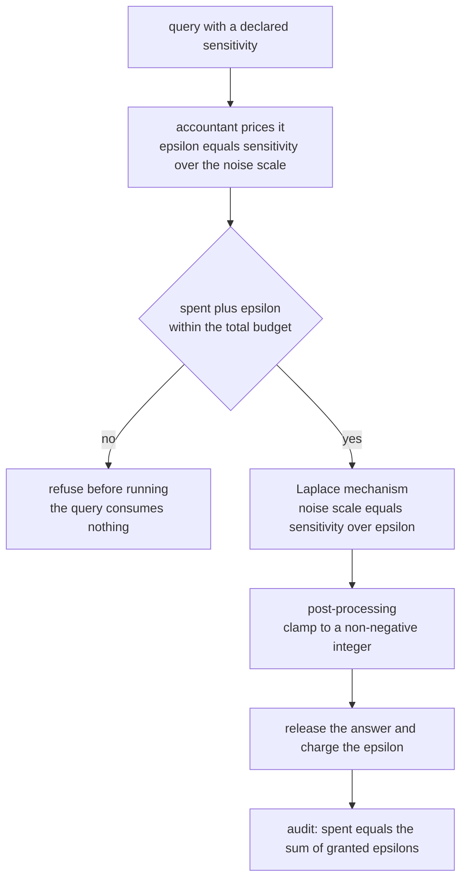
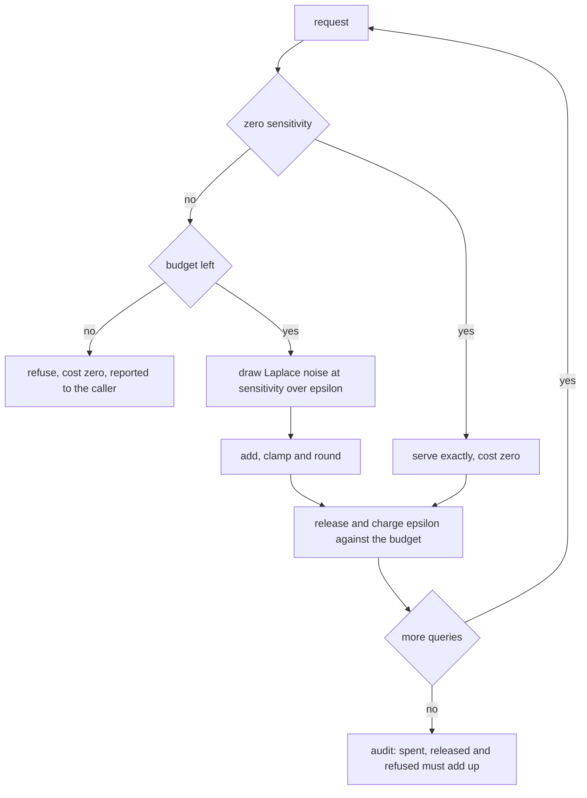
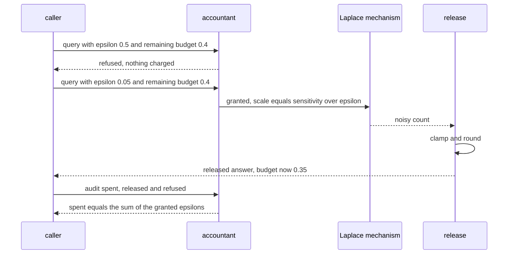

# 912 — Implement end-to-end pipeline for privacy-preserving analytics with DP budgeting.

> **Tier:** Master · **CTCI chapter:** Beyond — Security & Privacy
> **Task spec:** [912-implement-end-to-end-pipeline-for-privacy-preserving-analytics-w.md](../../../tasks/master/912-implement-end-to-end-pipeline-for-privacy-preserving-analytics-w.md)
> **Solutions:** [Python](../../../solutions/python/master/912-implement-end-to-end-pipeline-for-privacy-preserving-analytics-w/solution.py) ·
> [Java](../../../solutions/java/master/912-implement-end-to-end-pipeline-for-privacy-preserving-analytics-w/Solution.java) ·
> [JavaScript](../../../solutions/javascript/master/912-implement-end-to-end-pipeline-for-privacy-preserving-analytics-w/solution.js) ·
> [C#](../../../solutions/csharp/master/912-implement-end-to-end-pipeline-for-privacy-preserving-analytics-w/Solution.cs)

## 1. Problem restatement

**Input:** a dataset, a set of queries with declared sensitivity, a total privacy budget
`epsilon_total`, and a per-query cost.

**Output:** released answers that are *certified* differentially private, plus an audit trail:

- the **mechanism** is correct — for neighbouring inputs the ratio of output densities never exceeds
  `e^epsilon` (the definition of `epsilon`-DP, checked directly rather than cited);
- the **accountant** never overspends: a query that would breach the budget is refused *before* it runs,
  so it consumes nothing, and the spend is exactly the sum of the granted costs;
- **post-processing** produces valid answers (non-negative integers for counts) without spending budget;
- the **utility** claim is measured: the failure rate of the error bound must respect the union bound, and
  accuracy must be monotone in `epsilon`.

| Language | mechanisms | composition | documented simplification |
| --- | --- | --- | --- |
| Python | inverse-CDF Laplace sampling from the seeded stream; density-ratio check of `e^epsilon` | sequential (epsilons add) plus the advanced bound `sqrt(2k ln(1/delta')) eps + k eps (e^eps - 1)`, and a hard budget | counts only (no joins or means), one trust boundary, no amplification by sampling |
| Java | Laplace for count, sum, mean and histogram queries; noise moments and CDF measured | sequential plus parallel composition (disjoint partitions cost only the maximum) | deterministic splitmix64 sampling, 40 records, a handful of query types |
| JavaScript | Laplace and Gaussian mechanisms; the Gaussian violating region's probability is bounded by `delta` | three accountants — basic, advanced (`sum eps_i (e^{eps_i} - 1) + sqrt(2 ln(1/delta) sum eps_i^2)`) and zCDP (`rho = sum eps_i^2 / 2`, converted back) | a small count table; mechanisms are the point, not the workload |
| C# | Laplace counts over clamped contributors, with the sensitivity re-derived by brute force | basic sequential plus parallel composition; the refusal point is re-derived from the granted epsilons | Laplace only, integer counts, no amplification, no RDP/zCDP |

Concrete behaviour (Python):

| Quantity | Value |
| --- | --- |
| Laplace sampler, `scale = 3` | mean `0.018`, variance `18.293` against the theoretical `2 * 3^2 = 18`; tail failure `0.0515` against `beta = 0.05` (inside the 3-sigma sampling band) |
| density ratio at `epsilon = 0.1 / 0.5 / 1 / 2` | `1.105171 / 1.648721 / 2.718282 / 7.389056` — each `<= e^epsilon`, and the `epsilon = 2` case attains `e^2` exactly |
| budget run | 18 queries (`0.05 x 12`, `0.5`, `0.01 x 5`) against a budget of `1.0`: 17 served, 1 refused, spend `0.65`, remaining `0.35` |
| tight budget `0.3` | `spend(0.2) -> True`, `spend(0.2) -> False`, `spend(0.1) -> True`, spend exactly `0.3` |
| advanced composition | `k = 100`, `epsilon = 0.1`, `delta' = 1e-5` gives `5.8502` against the sequential `10.0` |
| utility | 8 bins at `epsilon = 0.25`; tolerance `23.07`, breaches `2 / 300` against `beta = 0.05` |
| boundaries | a zero budget refuses everything; a zero-sensitivity query costs nothing and returns the exact count; an empty histogram is a no-op; `laplace(rng, 0.0)` raises `"the Laplace scale must be positive"` |

## 2. Intuition

The naive analytics pipeline answers queries exactly and calls the result "aggregated, therefore
anonymous". It is not: differencing two near-identical releases, or publishing many overlapping counts,
reconstructs individual contributions. The naive fix — add noise to *one* answer — fails the other half of
the problem, because a system that keeps answering can spend an unbounded privacy budget across questions.

The implementation puts both halves in place, and makes each one checkable:

1. **Calibrate noise to sensitivity.** A single-record change moves a count by at most 1, so
   `Lap(sensitivity / epsilon)` makes neighbouring inputs indistinguishable up to a factor
   `e^epsilon` in density. The file checks the *definition* directly: `max_v p_c(v) / p_{c+1}(v)`, which is
   exactly `e^epsilon` for Laplace at the mode, and never exceeds it anywhere on a 200-point grid.
2. **Charge every answer, and refuse in advance.** Sequential composition says the epsilons add, so a
   budget of `1.0` with 18 requested costs simply runs out: 17 answers are served for `0.65` and the query
   that would have breached the limit is refused *before* it is executed, consuming nothing
   (`len(granted) + refused == len(asked)`).
3. **Post-process for free.** Clamping a noisy count to a non-negative integer cannot break DP, so it is
   applied freely; the file asserts the released values are non-negative integers.
4. **Say what composition actually costs.** Sequential composition is the worst case; the advanced bound
   for `k`-fold composition is `sqrt(2k ln(1/delta')) eps + k eps (e^eps - 1)`, which for `k = 100`,
   `eps = 0.1` gives `5.8502` instead of `10.0` — a real saving, and one the file checks for monotonicity
   in both `k` and `eps`.



## 3. Algorithm

1. **Sample noise from the mechanism.** Draw `u` uniform in `(0, 1)`, shift to `(-1/2, 1/2)`, and take
   `x = -scale * copysign(log(1 - 2|u|), u)` — the exact inverse CDF of `Lap(0, scale)`, with
   `scale = sensitivity / epsilon`.
2. **Price the query.** `epsilon` for the query is fixed by its sensitivity and the chosen scale; a
   zero-sensitivity query costs `0.0`.
3. **Filter on the budget.** `spend(epsilon)` returns `False` (and charges nothing) when
   `spent + epsilon > total`; otherwise it adds the cost and records it.
4. **Release.** Add noise, then post-process to a valid domain (clamp and round for counts).
5. **Report and audit.** Track the served list, the refused count, and the remaining allowance; assert
   `remaining + spent == total`.
6. **Check the theory.** Sampler moments against `2 * scale^2`, the tail against
   `P(|X| > b ln(1/beta)) <= beta`, the density ratio against `e^epsilon`, the advanced bound against
   sequential composition, and the utility failure rate against the union bound.

```text
procedure laplace(rng, scale)
    require that the scale is positive
    u ← a uniform draw in (0, 1) minus one half
    return −scale times the signed logarithm of one minus twice the absolute value of u
end

procedure spend(accountant, epsilon)
    require that epsilon is non-negative
    if the spent total plus epsilon exceeds the budget then return false and charge nothing
    add epsilon to the spent total and record the query
    return true
end

procedure release_histogram(accountant, histogram, epsilons, rng)
    released ← empty list; refused ← 0
    for every bin with its epsilon do
        if not spend(accountant, epsilon) then
            refused ← refused + 1; continue
        end
        if epsilon is zero then append the exact count and continue
        append the clamp of the rounded count plus Laplace noise at scale one over epsilon
    end
    return released, refused
end

procedure advanced_epsilon(count, epsilon, delta_prime)
    return the square root of twice the count times the log of one over delta_prime, times epsilon,
           plus the count times epsilon times (e^epsilon − 1)
end
```



## 4. Worked example

**Trace A — the mechanism, measured.** With `scale = 3` and 40 000 draws the sample mean is `0.018`
(centred, within four standard errors) and the variance is `18.293` against the theoretical `2 * 3^2 = 18`,
inside the asserted 15% band. The tail check is the useful one: `P(|X| > 3 ln(1/0.05))` should be at most
`0.05`, and the measured failure rate is `0.0515`, i.e. inside the 3-sigma sampling band of the test —
a good reminder that a probabilistic guarantee is validated statistically, with a band, not exactly.

**Trace B — the definition, checked directly.** For neighbouring count queries (`c` and `c + 1`) the
maximum density ratio over a 200-point output grid is:

| `epsilon` | measured ratio | `e^epsilon` |
| --- | --- | --- |
| 0.1 | `1.105171` | `1.105171` |
| 0.5 | `1.648721` | `1.648721` |
| 1.0 | `2.718282` | `2.718282` |
| 2.0 | `7.389056` | `7.389056` |

The file asserts both directions: the ratio may never exceed `e^epsilon`, and it must be at least half of
it (so the bound is tight rather than vacuous). At `epsilon = 2` the bound is attained exactly, because the
Laplace ratio peaks at the mode.

**Trace C — the budget.** Eighteen queries (`0.05` twelve times, then `0.5`, then `0.01` five times)
against a budget of `1.0`: the first twelve cost `0.6`, the `0.5` query is refused (it would reach `1.1`),
and the five `0.01` queries bring the spend to `0.65` with `0.35` remaining. The accounting assertions are
exact — `spent == sum(granted)`, `served + refused == asked`, `remaining + spent == total` — and the tiny
budget case spells out the refusal semantics: `spend(0.2)` succeeds, `spend(0.2)` fails and charges
nothing, `spend(0.1)` succeeds, leaving spend exactly `0.3`.

The advanced-composition comparison is the reason a real system does not simply add epsilons forever:
`k = 100` queries at `eps = 0.1` cost `10.0` sequentially but `5.8502` under
`sqrt(2k ln(1/delta')) eps + k eps (e^eps - 1)` with `delta' = 1e-5`, and the bound is monotone in both
`k` and `eps`.

**Trace D — utility.** Eight bins released at `epsilon = 0.25` each (a budget that covers all eight) with
tolerance `(1/0.25) * ln(2 * 8 / 0.05) = 23.07`: over 300 trials only `2` exceed it, inside the union-bound
target `beta = 0.05`, and the released total is unbiased for the true total. Accuracy is monotone in
`epsilon` as well: the mean worst-bin error falls as `epsilon` grows through `0.05`, `0.5` and `5.0`. The
boundaries close the loop: a zero budget refuses everything, a zero-sensitivity query returns the exact
count and costs nothing, an empty histogram is a no-op, and a zero noise scale is rejected with a message
naming the scale.



## 5. Complexity

With `B` bins, `Q` queries, `k` composed queries and `H` the density grid:

| Step | Time | Space | Reason |
| --- | --- | --- | --- |
| Laplace draw | `O(1)` | `O(1)` | one uniform draw, one logarithm |
| Budget check | `O(1)` | `O(1)` | compare and add; the query list is optional bookkeeping |
| Releasing a histogram | `O(B)` | `O(B)` | one noise draw per served bin |
| Advanced-composition bound | `O(1)` | `O(1)` | closed form in `k`, `eps`, `delta'` |
| Density-ratio check | `O(H)` | `O(1)` | evaluate both densities on the grid |
| Utility experiment | `O(trials * B)` | `O(B)` | 300 trials of 8 bins |
| Exact (non-private) alternative | `O(B)` | `O(B)` | infeasible: no privacy guarantee at any budget |

**What is simulated.** Python's header is explicit: counts only (no joins or means), a single trust
boundary, one mechanism and no privacy amplification by sampling; the only randomness is the seeded
splitmix64 stream, so the audit trail is reproducible. Java adds parallel composition and a CDF check over
four query types with 40 records; JavaScript implements Laplace *and* Gaussian mechanisms plus three
accountants (basic, advanced, zCDP) and checks the definition on a fine output grid; C# clamps contributors
so a single one can move a count by at most one, re-derives the sensitivity by brute force, and re-derives
its own refusal point from the granted epsilons. What is *not* simulated: the inverse-CDF sampler, the
density-ratio verification of `e^epsilon`, sequential and advanced composition arithmetic with hard budget
refusal, post-processing, and the measured utility/failure-rate trade-off.

## 6. Pitfalls and edge cases

- **Refuse *before* running.** A query that breaches the budget must consume nothing — the file asserts
  `len(granted) + refused == len(asked)` and that refused queries never appear in the granted list, so the
  budget cannot leak through a rejected attempt.
- **Charge exactly once and exactly the right amount.** `spent == sum(granted)` and
  `remaining + spent == total` are checked to `1e-12`; floating-point drift in an accountant silently
  invalidates every guarantee downstream.
- **Zero sensitivity is free and exact.** A query with `epsilon = 0.0` returns the true count and adds
  nothing to the spend — the correct treatment for a query whose answer cannot depend on an individual.
- **Zero budget refuses everything.** Not "answers with infinite noise", which would be a different (and
  useless) contract; the returned list is empty and every query is counted as refused.
- **Post-processing is free, but must be valid.** Clamping and rounding are applied without budget cost;
  the file asserts the results are non-negative integers, because releasing a negative count would be a
  correctness bug and a leakage vector in a histogram.
- **The tail check needs a statistical band.** `P(|X| > b ln(1/beta)) <= beta` measured over 40 000 draws
  came out at `0.0515` for `beta = 0.05`, which passes only because the assertion allows a 3-sigma band;
  a naive `<=` comparison on a finite sample would fail spuriously.
- **The bound must be tight, not vacuous.** Alongside `ratio <= e^epsilon` the file asserts
  `ratio > e^epsilon / 2`, so an implementation that simply added far too much noise would not pass.
- **Composition is not just addition.** Sequential composition is exact and easy, but the advanced bound
  must be *smaller* for `k = 100` (`5.8502 < 10.0`) and monotone in both `k` and `eps`; a bound that
  exceeded the sequential one would be an implementation bug.
- **Utility must move with `epsilon`.** Smaller `epsilon` costs accuracy: mean worst-bin error strictly
  decreases from `0.05` to `0.5` to `5.0`, which is the sanity check that the mechanism is actually
  calibrated and not, say, drawing noise of a fixed scale.
- **Determinism.** Seeded draws make the released histogram reproducible bit for bit, so the utility
  numbers in a report can be re-derived by a reviewer.

## 7. Variants and follow-ups

- **Parallel composition.** Java charges only the maximum over disjoint partitions instead of the sum, which
  is what makes per-tenant histograms affordable.
- **Advanced and zCDP accountants.** JavaScript tracks three bounds side by side and checks their ordering,
  with zCDP's `rho = sum eps_i^2 / 2` converted back to an `(eps, delta)` guarantee — the standard way to
  keep many small queries cheap.
- **Gaussian mechanism.** Appropriate when the query is high-dimensional or `delta > 0` is acceptable; the
  violating region's probability is bounded by `delta` and checked in JavaScript.
- **Sensitivity by construction.** C# clamps contributors so one individual moves a count by at most one,
  and re-derives that sensitivity by brute force over the clamped values — the property the noise scale
  depends on.
- **Private aggregation across clients.** Refusing to *see* individual updates is the other half of the
  story, implemented by masking in
  [899 — end-to-end encrypted collaborative machine learning](../../../tasks/master/899-implement-end-to-end-encrypted-collaborative-machine-learning-wi.md);
  DP then protects the released statistic on top of it.
- **Sketching under a privacy budget.** Counting heavy hitters within a budget uses the same accounting,
  with the error guarantees of
  [911 — probabilistic data structure for heavy hitters with error guarantees and mergeability](../../../tasks/master/911-implement-probabilistic-data-structure-for-heavy-hitters-with-er.md).
- **Certified releases.** Turning a private release into a calibrated interval is the conformal counterpart
  of
  [908 — certified ML predictions with conformal prediction intervals](../../../tasks/master/908-implement-certified-ml-predictions-with-conformal-prediction-int.md).

## 8. Check yourself

**Q1.** Why does the mechanism have to be verified with a density ratio instead of "we added Laplace
noise"?

<details><summary>Show answer</summary>

Because "we added Laplace noise" is a claim about code, while `epsilon`-DP is a claim about distributions:
for every pair of neighbouring inputs and every output set, the probability ratio is at most `e^epsilon`.
Computing `max_v p_c(v) / p_{c+1}(v)` on a grid checks that exact statement for the implementation as
written — including the noise scale, the sensitivity used in it and the direction of the shift. The
measured ratios hit `1.105171` at `epsilon = 0.1` and `7.389056` at `epsilon = 2`, i.e. `e^epsilon` exactly
at the mode, and the test additionally requires the ratio to be at least half the bound so a
"noise-everything" implementation cannot pass.

</details>

**Q2.** A query is refused for lack of budget. Why must it consume *nothing*, and how is that checked?

<details><summary>Show answer</summary>

Because the guarantee is about what the adversary can learn: an attempt that produced no answer, no timing
signal derived from data and no budget consumption reveals nothing about the data, whereas charging for
refused attempts (or worse, answering them anyway) either breaks the accounting or leaks information. The
file checks three identities to the `1e-12` level — `spent == sum(granted)`, `served + refused == asked`
and `remaining + spent == total` — and demonstrates the ordering on a budget of `0.3` where
`spend(0.2)` succeeds, `spend(0.2)` fails, and `spend(0.1)` succeeds, leaving the spend at exactly `0.3`.
C# goes further and re-derives its own refusal point from the granted epsilons rather than trusting the
accountant's state.

</details>

**Q3.** Sequential composition charges `k * eps = 10.0` for 100 queries, but the advanced bound gives
`5.8502`. Why keep the sequential rule at all?

<details><summary>Show answer</summary>

Because they make different trade-offs. Sequential composition is exact, needs no extra parameter and
composes with *any* mechanisms, but it is pessimistic for many small queries. The advanced bound
(`sqrt(2k ln(1/delta')) eps + k eps (e^eps - 1)`) saves a factor of about 1.7 here at the price of a failure
parameter `delta'` that must be folded into the pipeline's own delta and a derivation that assumes
independent mechanisms. The implementation keeps both: the budget filter uses the simple additive rule
(the conservative choice), and the advanced bound is computed and checked separately for
`k = 100`, including its monotonicity in `k` and `eps` and the requirement that it never exceed the
sequential value.

</details>

**Q4.** The utility check allows 5% of trials to exceed the error tolerance. Is that not just accepting
bad answers?

<details><summary>Show answer</summary>

It is the union bound doing its job. Each bin's noise has a tail probability of at most
`beta / (2 * bins)` for the tolerance `(1/eps) ln(2 * bins / beta)`, so the chance that *any* of the eight
bins exceeds the tolerance is at most `beta = 0.05`; the measured breach rate of `2/300 = 0.0067` is well
inside that. The design consequence is that a release is allowed to be occasionally wrong by more than the
tolerance, but not on average and not often — and the accompanying assertions (unbiasedness of the released
total, non-negativity, monotone accuracy in `epsilon`) pin the rest of the utility contract, so "5% can be
bad" is bounded rather than open-ended.

</details>
