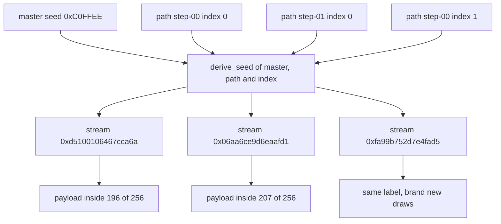
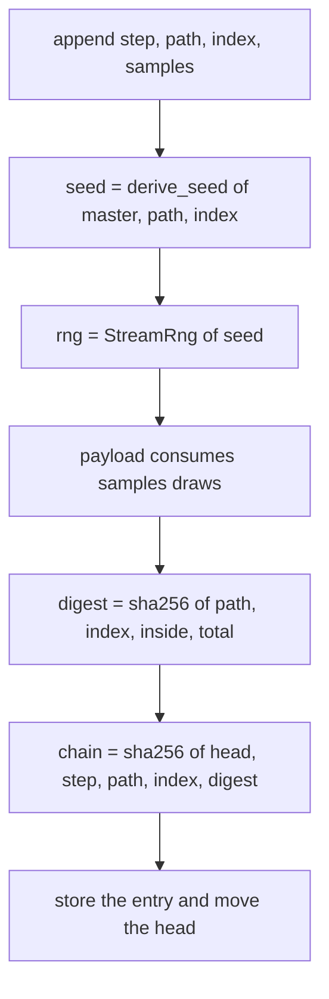
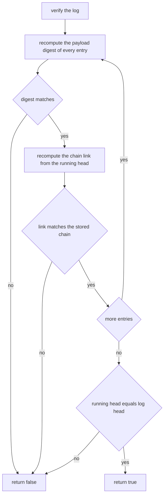
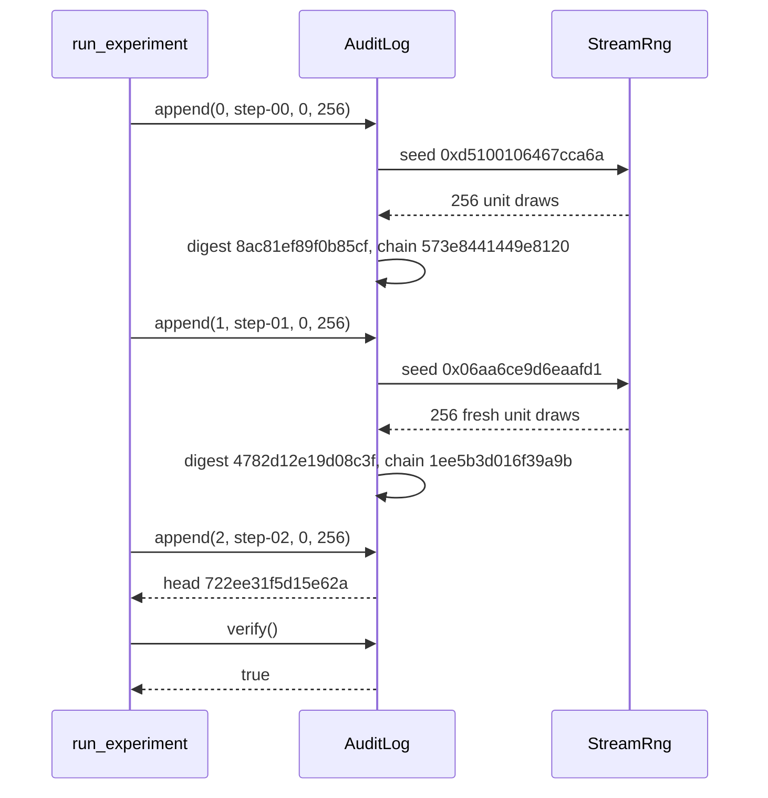

# 913 — Implement verified randomized algorithm reproducibility with seed management and audit logs.

> **Tier:** Master · **CTCI chapter:** Beyond — Software Engineering & Tooling
> **Task spec:** [913-implement-verified-randomized-algorithm-reproducibility-with-see.md](../../../tasks/master/913-implement-verified-randomized-algorithm-reproducibility-with-see.md)
> **Solutions:** [Python](../../../solutions/python/master/913-implement-verified-randomized-algorithm-reproducibility-with-see/solution.py) ·
> [Java](../../../solutions/java/master/913-implement-verified-randomized-algorithm-reproducibility-with-see/Solution.java) ·
> [JavaScript](../../../solutions/javascript/master/913-implement-verified-randomized-algorithm-reproducibility-with-see/solution.js) ·
> [C#](../../../solutions/csharp/master/913-implement-verified-randomized-algorithm-reproducibility-with-see/Solution.cs)

## 1. Problem restatement

**The modelling contract first.** What the four solutions build is an *in-process deterministic
simulation* of a reproducibility platform: there is no wall clock, no thread, no network and no
filesystem. Time does not exist; every random number comes from a **counter-based stream** seeded by
a hash, and the "audit log" is an in-memory append-only list whose integrity is a hash chain. That is
precisely what makes the platform verifiable — a run either reproduces bit for bit or it does not.

**Inputs.** A master seed, a list of step labels (paths), an optional derivation index per step, and a
sample budget per step.

**Outputs.** For every step a payload digest, and for the whole run a chain head digest that depends
on the master seed, the labels and the order of the steps. The log can be *verified* (integrity) and
*replayed* (the payloads are recomputed from the recorded labels).

| Call | Result | Source of the claim |
| --- | --- | --- |
| `run_experiment(0xC0FFEE, 8, 256)` twice | identical chain head and identical payloads | asserted in Python, Java, JS and C# |
| `run_experiment(0xC0FFEE + 1, 8, 256)` | a different chain head | asserted: the master seed must matter |
| `derive_seed(9, "a")` vs `derive_seed(9, "b")` | different 64-bit seeds, as are `derive_seed(10, "a")` | asserted: path and master both influence |
| `derive_seed(9, "a", 0)` vs `derive_seed(9, "a", 1)` | different seeds | the index separates repeated labels |
| 5000 labels derived from master 4242 | 5000 distinct seeds, mean 0.5013 of the 64-bit range | printed by the Python run |
| `plot`/payload tampered, reordered, dropped, forged or re-headed | `verify()` is false in all five cases | asserted in every implementation |
| `run_experiment(3, 0, samples)` | zero entries, head stays the genesis digest, `verify()` and `replay()` true | the empty boundary |

No input validation beyond "the master seed must not be empty" (the JavaScript file asserts that),
and the workloads themselves are random: a hit-or-miss `pi` estimate in Python and Java, a randomized
quicksort in JavaScript, and a sampled selection problem in C#.

## 2. Intuition

The naive design is one global generator — `rng = Random(master)` — handed to every step. It is
reproducible only if the steps run in exactly the same order: a parallel scheduler, a retry, or a
debugger that skips a step silently changes the numbers for *everybody downstream*, and you cannot
re-run step 7 alone because you would have to burn the same number of draws that steps 0-6 consumed.

The insight is to stop thinking of randomness as a *stream* and start thinking of it as a **named
function**. A step's randomness is `derive_seed(master, path, index)` — a hash of the master seed, the
step label and an index — so it is a pure function of the step's *name*, not of its position in a
schedule. Nothing is consumed, nothing is shared, and any step can be re-derived in isolation.



The second half of the insight is that the **log records the recipe, not the results**. An entry
stores the step label, the index, the payload digest and the digest of the previous entry. Verification
therefore does two independent things: it re-walks the chain (so a removed, reordered or edited entry
destroys the head), and it re-derives the payload from the recorded label (so a label that does not
match the digest is caught even if the chain was recomputed).

## 3. Algorithm

1. Derive a per-step seed: `seed = int(sha256("master|path|index")[:8])`, truncated to 64 bits.
2. Build a `StreamRng` from that seed — splitmix64: add the golden-ratio constant `0x9E3779B97F4A7C15`,
   then two xor-multiply-shift mixing stages. Each `unit()` draw is `(next_u64() >> 11) * 2^-53`.
3. Run the workload, producing a payload summarised by a small tuple — the `pi` estimator returns
   `(inside, samples)`.
4. Digest the payload together with its label: `sha256("path|index|inside|samples")`.
5. Chain the entry: `chain = sha256(head || "step|path|index" || digest)`; append and set `head = chain`.
6. `verify()` re-walks from `GENESIS = sha256("genesis")` recomputing both the digest and the chain
   link of every entry, and finally checks the recorded head.
7. `replay(subset)` re-derives the payload of the selected entries from their recorded labels and
   compares digests — this is what makes a single step reproducible on its own.

```text
procedure derive_seed(master, path, index)
    material ← decimal(master) + "|" + path + "|" + decimal(index)
    return first 8 bytes of sha256(material) as a big-endian integer
end

procedure append(log, step, path, index, samples)
    inside, total ← payload(path, samples, index, log.master)
    digest ← sha256(path + "|" + index + "|" + inside + "|" + total)
    chain ← sha256(log.head + "|" + step + "|" + path + "|" + index + "|" + digest)
    append (step, path, index, inside, total, digest, chain) to log.entries
    log.head ← chain
    return the appended entry
end

procedure verify(log)
    head ← GENESIS
    for each entry in log.entries do
        if entry.digest ≠ sha256(entry.path, entry.index, entry.inside, entry.total) then
            return false
        end
        head ← sha256(head + entry.step + entry.path + entry.index + entry.digest)
        if head ≠ entry.chain then
            return false
        end
    end
    return head = log.head
end

procedure replay(log, subset)
    for each entry in the selected subset do
        inside, total ← payload(entry.path, entry.total, entry.index, log.master)
        if sha256(entry.path, entry.index, inside, total) ≠ entry.digest then
            return false
        end
    end
    return true
end
```



Verification is a two-channel check, and that is the point: the **chain channel** protects order and
membership, the **payload channel** protects the content.



## 4. Worked example

`run_experiment(master=7, steps=3, samples=256)` — every number below is printed by the Python
solution, not estimated. First the seed derivation, which shows the three inputs pulling apart:

| `derive_seed` call | Seed (hex) |
| --- | --- |
| `derive_seed(7, "step-00", 0)` | `0xd5100106467cca6a` |
| `derive_seed(7, "step-01", 0)` | `0x06aa6ce9d6eaafd1` |
| `derive_seed(7, "step-00", 1)` | `0xfa99b752d7e4fad5` |

The first stream's first four `unit()` draws are `0.9216, 0.2623, 0.8440, 0.8745`, consumed as two
points: the first has `x² + y² = 0.9182 <= 1` and counts as a hit, the second has
`x² + y² = 1.4771` and does not. The remaining 252 draws of that substream are what lift the step 0
counter to 196. The log then looks like this:

| Step | Path | Inside of 256 | Payload digest | Chain link |
| --- | --- | --- | --- | --- |
| 0 | `step-00` | 196 | `8ac81ef89f0b85cf` | `573e8441449e8120` |
| 1 | `step-01` | 207 | `4782d12e19d08c3f` | `1ee5b3d016f39a9b` |
| 2 | `step-02` | 205 | `52eff5ff3af2f8b2` | `722ee31f5d15e62a` |

The head after three steps is `722ee31f5d15e62a`; the full twelve-step run with `master = 7` ends at
`b1feb9166579c021`. `verify()` walks the three rows from `GENESIS`, recomputes each digest from
`(path, index, inside, samples)` and each link from the running head, and returns true.



Tampering, all of it asserted to fail:

| Attack | Why `verify()` rejects it |
| --- | --- |
| `entries[5][3] += 1` (payload edit) | the stored digest no longer equals `digest_of` of the payload |
| swap entries 4 and 5 | each link was computed from the *previous* head, so both links mismatch |
| drop entry 3 | every later link shifts by one, and the final head never matches |
| append a copy of the last entry | the copy's link does not extend the recorded head |
| forge the head (`sha256(head + "x")`) | the re-walk ends at the real head, not the forged one |

`replay()` is a separate attack surface: rewriting an entry's path from `step-02` to `step-99` leaves
the chain untouched but changes the payload that the label derives, so `replay()` fails while a
naive "did the digests change" check would have missed it.

## 5. Complexity

Let `L` be the number of logged steps and `s` the per-step sample count. "Time" is counted in hash
compressions and RNG draws, not seconds — this is a simulation.

| Measure | Bound | Why it holds |
| --- | --- | --- |
| `derive_seed` | `O(1)` | one SHA-256 over a short string, eight bytes kept |
| One `unit()` draw | `O(1)` | splitmix64 is a fixed three-stage mix on 64-bit words |
| `append` | `O(s)` | the payload dominates: `s` hit-or-miss draws |
| `verify` | `O(L)` hashes | one digest plus one chain compression per entry |
| `replay` (full) | `O(L · s)` | every payload is recomputed from its label |
| `replay` (subset) | `O(k · s)` for `k` selected entries | substreams are independent, so no prefix is replayed |
| Space | `O(L)` entries plus `O(1)` RNG state | each entry is a label, a digest and two counters |
| Seed collisions over `k` labels | expected `k² / 2^65` | 64-bit derivation; the run checks that 5000 seeds are distinct |

The alternative design (one shared stream) has the same asymptotics and worse properties: `replay` of
step `i` costs `O(i · s)` because the stream must be burned forward, and it is *order sensitive*, so
parallel execution changes the answer. That trade — identical cost, strictly stronger guarantees — is
why the solutions never hand out the master seed itself.

## 6. Pitfalls and edge cases

- **A shared stream looks reproducible until it is parallelised.** The Python check consumes 1000
  draws of the substream `"shared"` between two reads of substream `"a"` and asserts the four draws of
  `"a"` are unchanged. Any implementation that caches "the next value" instead of re-deriving it fails
  here.
- **Repeated labels.** Two steps named `"same"` are the *same* substream unless the derivation index
  differs; the run asserts `twin.entries[0][2] != doubled.entries[0][2]` when the second call passes
  index 1, and that six indices give six distinct seeds.
- **Empty and single runs.** `run_experiment(3, 0, samples)` must keep `head == GENESIS` and verify
  vacuously; a single step must be labelled `step-00` (labels start at zero) and still verify.
- **The master seed must not be empty** (asserted in JavaScript) and a bare master seed is never used
  as a stream seed — only derived values are.
- **Truncation is a real decision.** Python keeps the high 8 bytes of the digest, JavaScript keeps a
  64-hex-character digest string and folds it into a 32-bit state; the *size* of the seed space is
  what the uniformity check probes (mean 0.5013, no high-nibble bucket outside 0.4x-1.6x of the
  expected 312.5).
- **Statistical claims need a tolerance, not equality.** The `pi` check is
  `|estimate - pi| < 4 · standard error`; with 40000 samples the run reports 3.1518 against
  3.14159 — an error of 0.0102 with a standard error of 0.0082. Asserting `estimate == pi` would be
  a bug, and asserting nothing would not verify anything.
- **Digesting counters, not floats.** The payload is summarised as `(inside, samples)` integers so the
  digest cannot depend on floating-point formatting; a payload that hashed `3.0625` printed as text
  would break across the four languages.

## 7. Variants and follow-ups

- **Wrapping the whole workload in a reproducibility platform.**
  [900-implement-full-featured-reproducible-research-platform-with-hard.md](../../../tasks/master/900-implement-full-featured-reproducible-research-platform-with-hard.md)
  adds the environment and artifact halves (pinned dependencies, dataset hashes) that a seed log alone
  cannot capture.
- **Proving things about the estimator itself.** The statistical check here is a sanity bound; 
  [901-implement-provable-bounds-for-randomized-algorithms-used-in-your.md](../../../tasks/master/901-implement-provable-bounds-for-randomized-algorithms-used-in-your.md)
  derives the concentration bounds that such a check is approximating.
- **A seed and a certified generator are different objects.**
  [945-implement-certified-random-number-generator-with-proof-of-unifor.md](../../../tasks/master/945-implement-certified-random-number-generator-with-proof-of-unifor.md)
  makes the uniformity claim a proof obligation rather than a bucket histogram.
- **Logs that prove their own history.**
  [902-implement-self-verifying-distributed-logs-with-merkle-trees-and.md](../../../tasks/master/902-implement-self-verifying-distributed-logs-with-merkle-trees-and.md)
  upgrades the linear hash chain to a tree so that single-entry inclusion can be proven without
  re-walking everything.

## 8. Check yourself

1. Why is `verify()` not enough on its own — what does `replay()` add?

<details><summary>Show answer</summary>

`verify()` only checks internal consistency: every digest is recomputed from data *stored in the same
entry*, so an edit that changes both a field and its digest, followed by a full chain rebuild, passes.
`replay()` closes that hole by re-deriving the payload from the recorded label and the master seed, so
the digest must match what the *algorithm* produces. The forged-path check in the Python file
(`step-02` rewritten to `step-99`, chain untouched) is rejected by `replay()` alone.

</details>

2. Two steps use the same label with the same index. What does the log contain, and is that a bug?

<details><summary>Show answer</summary>

Both entries get the identical seed, therefore identical payloads and identical payload digests — it
is a *collision by design*, not a bug: the label is the identity of the substream. The chain still
differentiates them because the step number and the previous head differ. The fix when you need
distinct streams for a repeated label is the derivation index, which is exactly what the
`twin`/`doubled` boundary check asserts.

</details>

3. The estimator returned 3.1518 for `pi` with 40000 samples. Would you accept a run that returned
3.20?

<details><summary>Show answer</summary>

No. The standard error of the hit-or-miss estimator at 40000 samples is about 0.0082, so 3.20 is
roughly seven standard errors away — the assertion `|estimate - pi| < 4 · standard error` rejects it.
That bound is the only reason "reproducible" also means "correct": a deterministically wrong
implementation would replay perfectly.

</details>

4. Order-independence of substream derivation costs one hash per step. What do you give up by paying
it?

<details><summary>Show answer</summary>

Only the ability to share a *sequence* of draws across steps, which is what you want to avoid anyway.
Random-access derivation means a step cannot be correlated with its neighbours, so an algorithm that
depends on the exact continuation of another step's stream (a shared shuffle, say) must have that
stream be its own labelled substream. In exchange, parallelism, retries and partial replay all become
free.

</details>
