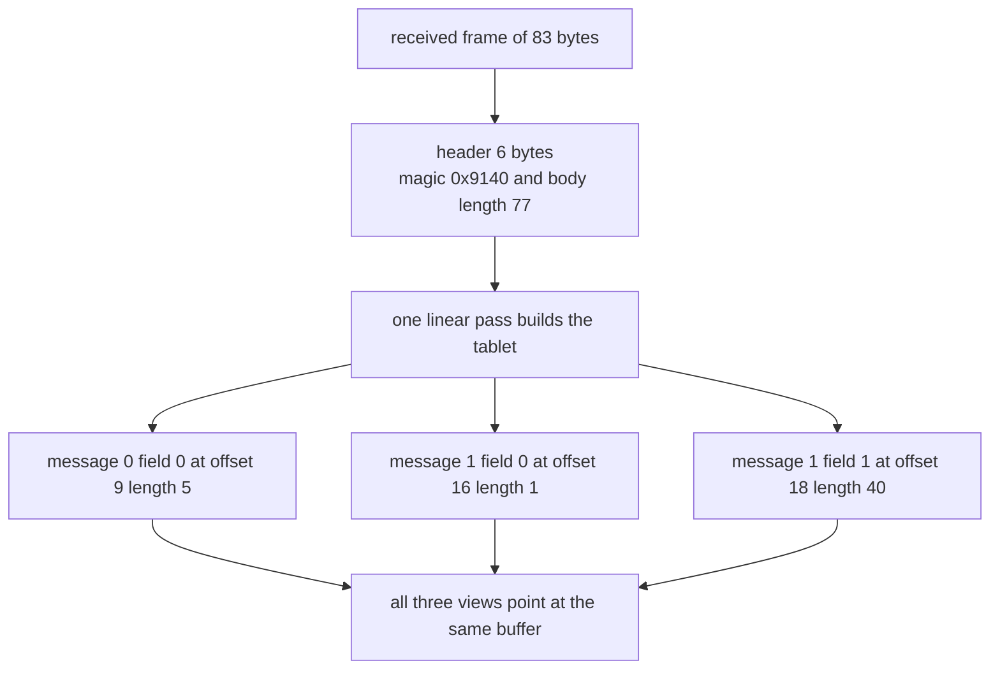
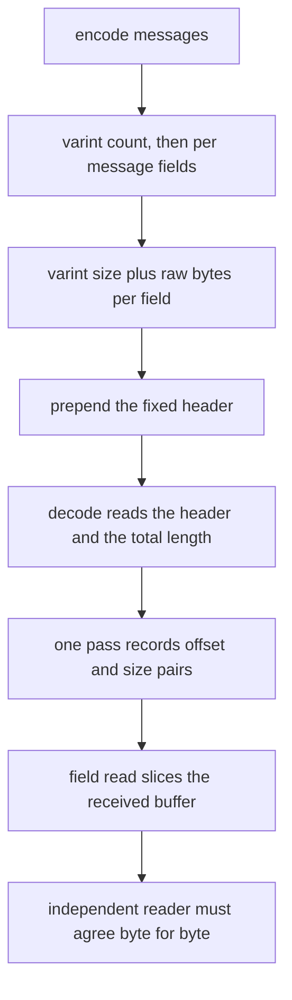
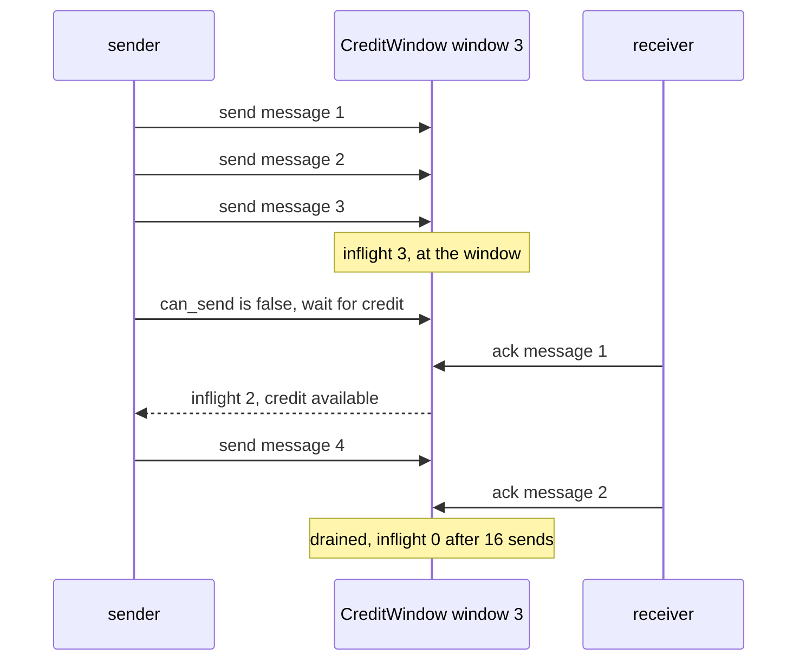

# 914 — Implement cross-language optimized RPC with zero-copy serialization and backpressure.

> **Tier:** Master · **CTCI chapter:** Beyond — Software Engineering & Tooling
> **Task spec:** [914-implement-cross-language-optimized-rpc-with-zero-copy-serializat.md](../../../tasks/master/914-implement-cross-language-optimized-rpc-with-zero-copy-serializat.md)
> **Solutions:** [Python](../../../solutions/python/master/914-implement-cross-language-optimized-rpc-with-zero-copy-serializat/solution.py) ·
> [Java](../../../solutions/java/master/914-implement-cross-language-optimized-rpc-with-zero-copy-serializat/Solution.java) ·
> [JavaScript](../../../solutions/javascript/master/914-implement-cross-language-optimized-rpc-with-zero-copy-serializat/solution.js) ·
> [C#](../../../solutions/csharp/master/914-implement-cross-language-optimized-rpc-with-zero-copy-serializat/Solution.cs)

## 1. Problem restatement

**The modelling contract first.** "RPC" here means a *single in-process link* driven by an explicit
schedule: no sockets, no threads, no congestion control beyond a credit window, and no compression.
The "second language" is a **second, independently written reader** of the same wire format — the
cross-language oracle — not a second runtime.

Two properties are the whole point of the exercise, and both are *asserted*, never assumed:

- **Zero copy.** Decoding produces a metadata tablet of `(offset, length)` pairs plus a view over the
  received buffer. The tests check identity, not intent: in Python `view.obj is frame` and
  `read_field(...).obj is frame`; in Java the `Slice`'s backing array is compared with the transport
  array; in C# the `ArraySegment`'s array is compared with the transport buffer; in JavaScript the
  `Buffer` subarray shares the frame's `ArrayBuffer`.
- **Backpressure.** A sender may only transmit while in-flight work is below the advertised window.
  The window invariant is re-checked after every send and every acknowledgement, so a violation is
  observed rather than argued away.

**Inputs.** A list of messages, each a list of byte-string fields; a credit window; an MTU. **Outputs.**
Frames (bytes), a decoded tablet, and a delivery schedule.

The four implementations share the contract but not the byte layout:

| Implementation | Frame header | Decoder view type |
| --- | --- | --- |
| Python | `magic u16` + `length u32`, little-endian, 6 bytes, then varints | `memoryview` slices |
| Java | `magic u32` + `version` + `flags` + `length u32` + `checksum u32`, big-endian, 14 bytes | `Slice(backing, offset, length)` |
| JavaScript | `type u8` + `length u32 little-endian`, 5 bytes (checked as `HEADER_BYTES`) | `Buffer` subarray |
| C# | `varint length` + `opcode` + payload + `crc32` | `ArraySegment` |

| Call | Result |
| --- | --- |
| `encode_frame([[b"hi"], [b"a", b"bc"]])` | the golden vector: 6-byte header over an 11-byte body |
| `varint(0), varint(127), varint(128), varint(16383), varint(16384), varint(2^21)` | 1, 1, 2, 2, 3, 4 bytes |
| `varint(300)` | `0xac 0x02` |
| `encode_frame(messages)` with the 4-message example | 83 bytes total, 77 of body |
| `batch(9 messages of 10 bytes, mtu=32)` | 5 frames with bodies `25, 25, 25, 25, 13`, nothing rejected |
| `batch([100-byte message], mtu=32)` | zero frames, one *reported* refusal — never split silently |

## 2. Intuition

The naive RPC hop allocates a decoded object graph per message: read the length, allocate a buffer,
copy the bytes, parse the fields, then pass the copy to the handler. On a hot path that is one
allocation and one full copy of every payload — and the copy is pure overhead, because the transport
buffer is already immutable-by-convention for the duration of the call.

The first insight is that **decoding is index arithmetic, not data movement**. If the format is
self-delimiting — a length in front of every message and every field — then one linear pass can record
*where* each field lives as `(offset, length)` and then interpret nothing. The payload never moves: a
field is a window onto the same bytes the socket delivered. As a bonus, a length-prefixed format is
trivially resumable from a byte stream, which is what lets the JavaScript receiver reassemble frames
from one-byte-at-a-time chunks.



The second insight is that **a fast producer must be slowed by data, not by hope**. A credit window
turns "don't overwhelm the receiver" into arithmetic: the sender may transmit only while
`inflight < window`, and an acknowledgement returns one credit. The invariant `inflight <= window`
can then be checked after every single step of the schedule, and the failure mode is a *stall* — the
schedule stops — rather than unbounded buffering. Batching is the same trade at a coarser grain:
coalesce small messages into a frame that fits the MTU, and refuse (explicitly report) a message that
cannot fit instead of splitting it.

## 3. Algorithm

1. **Encode.** Write the message count as a varint, then for each message the field count, then for each
   field its byte length and the raw bytes. Prefix the body with the language's fixed header.
2. **Decode.** Read and validate the header (magic, exact total length). Walk the varints once,
   recording `(cursor, size)` per field and advancing the cursor by `size`. Return `(tablet, view)`.
3. **Read a field.** `view[offset : offset + size]` — a slice of the received buffer, no allocation of
   payload bytes.
4. **Cross-check.** An independent reader parses the same bytes with a different library (Python
   `struct`, JavaScript's JSON oracle, C#'s second varint encoder) and must agree byte for byte.
5. **Backpressure.** While messages remain: if `can_send()` then `send()` and append to the delivery
   log; else `ack()` one message; assert `inflight <= window` after every step.
6. **Batch.** Probe `encode_frame(current + [message])`; if its body fits the MTU, keep it in the frame,
   otherwise flush and start a new frame; a message that cannot fit alone is reported as rejected.

```text
procedure put_varint(out, value)
    while true do
        chunk ← value AND 0x7F
        value ← value >> 7
        if value = 0 then
            append chunk to out
            return
        end
        append (chunk OR 0x80) to out
    end
end

procedure decode_frame(data)
    check magic and 6 + length = size of data
    cursor ← 6
    count, cursor ← get_varint(data, cursor)
    tablet ← empty list
    for each message index in 0 .. count - 1 do
        fields, cursor ← get_varint(data, cursor)
        row ← empty list
        for each field index in 0 .. fields - 1 do
            size, cursor ← get_varint(data, cursor)
            append (cursor, size) to row
            cursor ← cursor + size
        end
        append row to tablet
    end
    check cursor = size of data
    return tablet, view over data
end

procedure send_with_backpressure(window, messages)
    delivered ← empty list
    index ← 0
    while index < count(messages) or window.inflight > 0 do
        if index < count(messages) and window.can_send() then
            window.send()
            append messages[index] to delivered
            index ← index + 1
        else if window.inflight > 0 then
            window.ack()
        else
            window.stalled ← window.stalled + 1
            break
        end
        check window.inflight <= window.window
    end
    return delivered
end
```



The sender is a small state machine, and the interesting state is the stalled one: a zero window is
not an error, it is a schedule that never makes progress.

## 4. Worked example

The Python run encodes and decodes

```text
messages = [[b"hello"], [b"a", b"b" * 40], [], [b"unicode-\xe2\x9c\x93", bytes(range(10))]]
```

and reports `frame 83 bytes, tablet [[(9, 5)], [(16, 1), (18, 40)]]`. Working the layout by hand gives
the same numbers, which is what makes the tablet trustworthy:

| Bytes | Region | Value |
| --- | --- | --- |
| 0-1 | magic | `0x9140` (little-endian) |
| 2-5 | body length | 77 |
| 6 | message count varint | 4 |
| 7 | message 0 field count | 1 |
| 8 | field 0 length | 5 |
| 9-13 | message 0 field 0 | `hello` |
| 14 | message 1 field count | 2 |
| 15-16 | field 0 length and data | 1, then `a` |
| 17-57 | field 1 length and data | 40, then 40 `b` bytes |
| 58 | message 2 field count | 0, so no length bytes follow |
| 59-71 | message 3 field 0 | length 11, then `unicode-` plus the three UTF-8 bytes of `✓` |
| 72-82 | message 3 field 1 | length 10, then `bytes(range(10))` |

The tablet stores only the two fields of the first two messages above because that is what the run
prints (`tablet[:2]`); the full tablet has one row per message, and the empty message contributes an
empty row. The zero-copy assertion then reads each field twice and checks `len(frame)` is unchanged —
a decoder that copied would still pass the equality check but fail the identity checks
(`view.obj is frame`, `read_field(...).obj is frame`).



Over the full schedule of 16 messages (`messages * 4`) with `window = 3`, the Python run prints
`window 3: sent 16, delivered 16`; the same messages through `window = 2` also deliver all 16, just
with more stall/ack alternation, and `window = 0` delivers nothing at all — the schedule breaks out of
the loop on the first step with `stalled` incremented and `delivered` empty. Batching the nine
10-byte messages with `mtu = 32` produces frames with body sizes `25, 25, 25, 25, 13`: two messages
cost `1 + 2 · (1 + 1 + 10) = 25` bytes, a third would cost 37 and overflow the MTU.

## 5. Complexity

Let `b` be the payload bytes, `m` the messages, `f` the fields, `w` the window and `L` the number of
frames. These are cost counts, not benchmark timings — the transport is an in-memory queue.

| Measure | Bound | Why it holds |
| --- | --- | --- |
| `encode_frame` | `O(b + m + f)` | every byte is written once; a varint costs `O(1)` per field |
| `decode_frame` (tablet) | `O(m + f)` with `O(1)` memory touches per varint | the payload is never read during tablet construction |
| `read_field` | `O(1)` amortised, zero copies | it returns a `(offset, size)` window; the naive reader is `O(size)` per field |
| Round-trip equality | `O(b)` bytes touched once | the oracle reader visits the payload once to compare |
| `put_varint` | `O(log value)` bytes | 7 bits per byte; 10 bytes is the cap the decoder enforces |
| Backpressure schedule | `O(m + acks)` steps, at most `m` in flight | one send or one ack per iteration; the invariant check is `O(1)` |
| Space (decoder) | `O(m + f)` for the tablet, `O(1)` payload | this is the point: no second copy of the frame |
| `batch` | `O(L · (m + f))` encoding probes | each candidate frame is re-encoded to measure its body |

The alternative — copy-then-parse (the naive decoder) — has the same asymptotics on paper and one
extra full copy of `b` bytes plus one allocation per message, which is exactly the constant factor the
zero-copy path removes. Its identity checks also cannot be written at all: after a copy there is no
buffer to be identical to.

## 6. Pitfalls and edge cases

- **Truncated and lying frames.** The Python run rejects a frame with one byte removed, a frame whose
  message count was rewritten to 3, and a frame with a foreign magic. The generic `except` clause is
  deliberately broad (`AssertionError`, `IndexError`, `struct.error`) because a decoder must fail
  loudly on a short read rather than return a shorter tablet.
- **Varint boundaries.** `127 → 1 byte`, `128 → 2`, `16383 → 2`, `16384 → 3`, `2^21 → 4`, and
  `varint(300) = 0xac 0x02`. Off-by-one at 128 is the classic framing bug; the run checks the byte
  length against a table, and C# compares its varint encoder against a second independent one at every
  boundary.
- **Empty structures are not the same as missing ones.** `encode_frame([])` is header plus one varint
  (7 bytes in Python) and decodes to an empty tablet; `encode_frame([[]])` is a message with *zero*
  fields and must round-trip as `[[]]`, distinct from a message with one empty field.
- **A single zero byte** (`b"\x00"`) must survive the round trip — a decoder that treats zero as a
  terminator fails here.
- **Zero window versus empty queue.** `CreditWindow(0).can_send()` is false and `send()` must raise with
  "backpressure" in the message; the driver on a zero window stalls with nothing delivered. A
  one-message workload through a window of one must pass through with `inflight` back to zero.
- **Oversized messages are reported, not split.** With `mtu = 32` a 100-byte message yields zero frames
  and one refusal. Silently splitting it would break the "frames are self-delimiting" contract; silently
  dropping it would lose data.
- **Unicode payloads are bytes, not characters.** The example message carries `unicode-✓` as 11 bytes,
  and every length in the frame counts bytes. A JavaScript implementation that used string lengths
  would produce a frame that its own reassembly cannot parse.
- **Acks cannot create credit.** `ack` clamps to `min(count, inflight)`, and `inflight` is asserted
  non-negative — otherwise a peer could enlarge its own window.

## 7. Variants and follow-ups

- **Credit accounting in bytes instead of messages.** The Java and C# files meter a byte window and
  check the ledger identity `granted = consumed + available`; the message-counted window here is the
  simplification that makes the schedule easy to trace.
- **Framing inside a real state machine.**
  [924-implement-low-latency-replicated-state-machine-optimized-for-wan.md](../../../tasks/master/924-implement-low-latency-replicated-state-machine-optimized-for-wan.md)
  puts batching and pipelining behind a replicated log, where the frame layout decides how much of a
  round trip is spent on bytes rather than on agreement.
- **Proving two implementations agree.** The oracle reader here is a hand-written second decoder;
  [932-implement-differential-testing-between-cpu-gpu-implementations-f.md](../../../tasks/master/932-implement-differential-testing-between-cpu-gpu-implementations-f.md)
  turns that idea into a differential-testing harness with generated inputs.
- **What a stream of frames looks like under load.**
  [940-implement-high-fidelity-load-generator-with-correlated-user-beha.md](../../../tasks/master/940-implement-high-fidelity-load-generator-with-correlated-user-beha.md)
  produces the correlated arrival process that makes a credit window the binding constraint.

## 8. Check yourself

1. Why is a length prefix required for zero-copy decoding, when a delimiter byte would also let a
   reader find boundaries?

<details><summary>Show answer</summary>

Two reasons. First, a delimiter can appear inside the payload, so a delimiter-based reader must scan
and (in general) unescape — that is `O(b)` work per field and usually a copy. A length tells the reader
`(offset, size)` in `O(1)`, which is exactly the tablet. Second, varints mean the length is itself a
small variable-width field, so the format stays self-delimiting on a byte stream: the JavaScript
receiver can rebuild frames from one-byte-at-a-time chunks without guessing.

</details>

2. The run asserts `len(frame)` is unchanged after reading every field. What bug does that catch that
   `bytes(read_field(...)) == field` does not?

<details><summary>Show answer</summary>

Equality only proves the *content* is right; a decoder that copied the payload into a fresh buffer
would pass it. The identity checks (`view.obj is frame`) and the length check prove no second buffer
was created — a copy shows up as an extra allocation of the whole frame, which is the entire cost the
optimisation is meant to remove. Java's "write through the slice and watch the buffer change" is the
same test from the other direction.

</details>

3. With `window = 3` and 16 messages, how many `ack` steps does the schedule take, and why is the
   count different from the number of sends?

<details><summary>Show answer</summary>

Sixteen sends and sixteen acks — every message that is sent is eventually acknowledged, so the final
`inflight` is zero. The interleaving is different: the first three iterations send, then each
iteration either sends (if the window allows) or acks, so the schedule alternates send/ack once the
window is full, and the last three iterations only ack. With a smaller window the same 16
acknowledgements happen with more alternation; with `window = 0` no send ever happens and the schedule
stalls immediately.

</details>

4. Batching two 10-byte messages with `mtu = 32` costs 25 body bytes, and a third would cost 37. Where
   do the 3 bytes of overhead per message come from, and what happens to the 4 bytes left over?

<details><summary>Show answer</summary>

Each message contributes a one-byte field-count varint, each field a one-byte length varint and its
10 payload bytes: `1 + 1 + 10 = 12` per message, plus the frame's one-byte message count. Two messages
are `1 + 24 = 25`. The leftover 7 bytes cannot hold another 12-byte message, so the batcher flushes and
starts a new frame — the run reports body sizes `25, 25, 25, 25, 13`, and the nine messages are all
accounted for. Filling the gap would require splitting a message, which the contract forbids.

</details>
