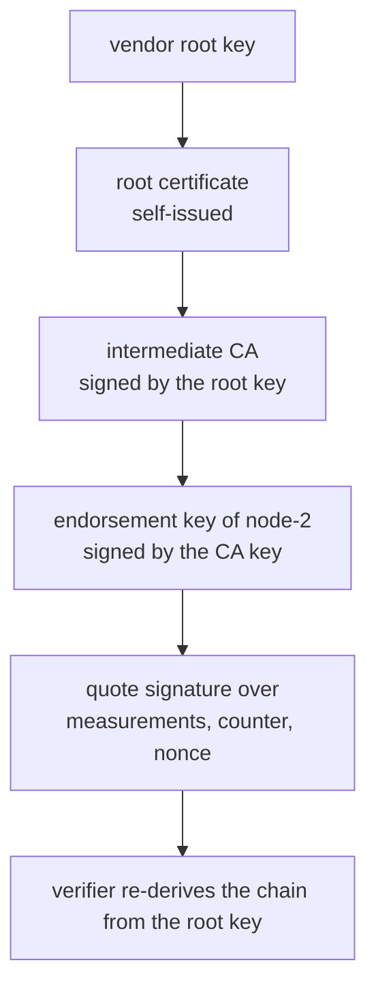
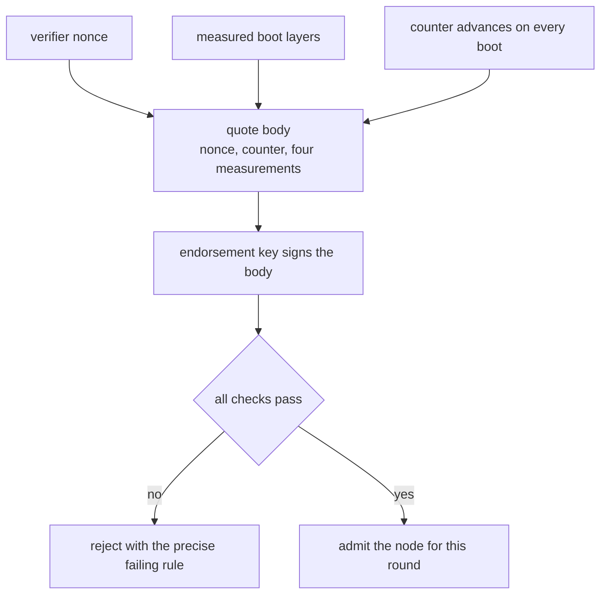
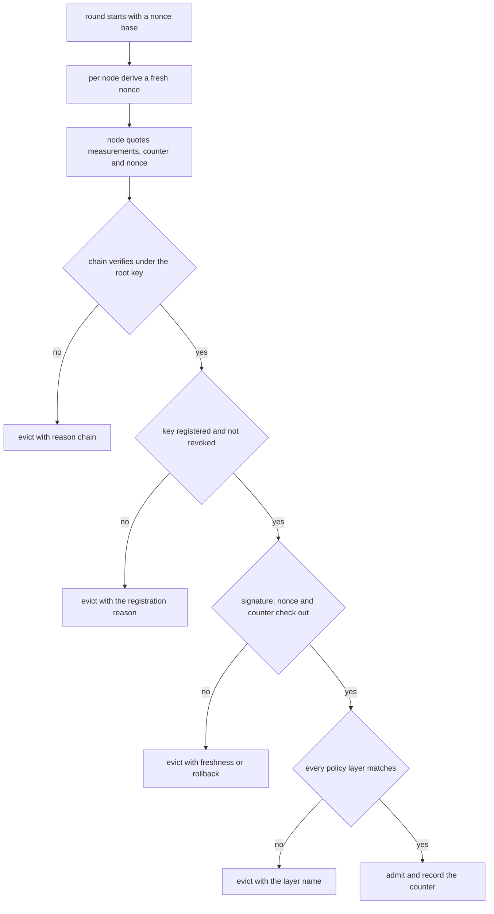
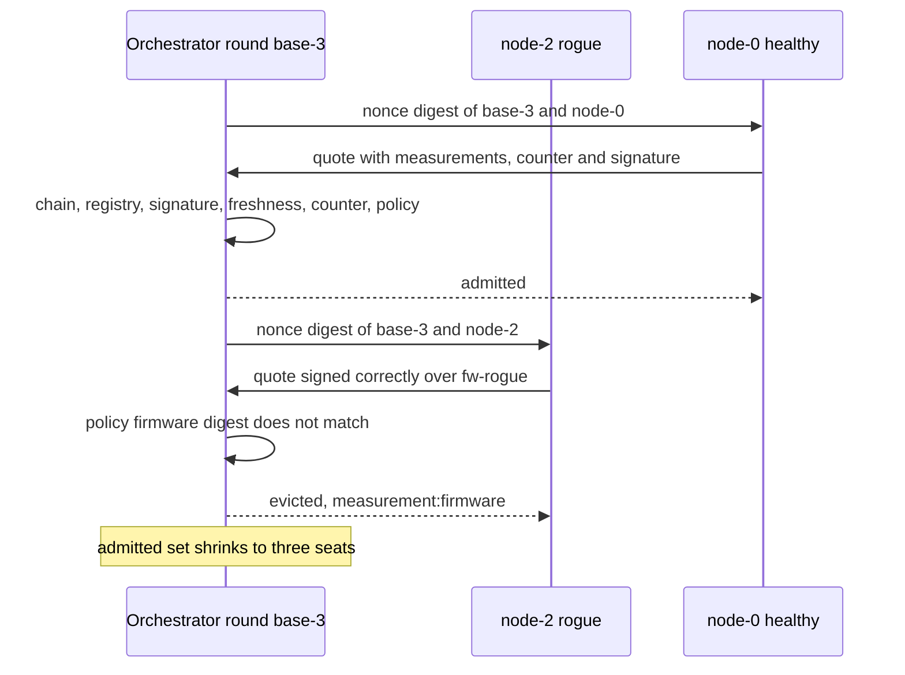

# 915 — Implement secure remote attestation flow integrated with orchestration for trust chain.

> **Tier:** Master · **CTCI chapter:** Beyond — Security & Privacy
> **Task spec:** [915-implement-secure-remote-attestation-flow-integrated-with-orchest.md](../../../tasks/master/915-implement-secure-remote-attestation-flow-integrated-with-orchest.md)
> **Solutions:** [Python](../../../solutions/python/master/915-implement-secure-remote-attestation-flow-integrated-with-orchest/solution.py) ·
> [Java](../../../solutions/java/master/915-implement-secure-remote-attestation-flow-integrated-with-orchest/Solution.java) ·
> [JavaScript](../../../solutions/javascript/master/915-implement-secure-remote-attestation-flow-integrated-with-orchest/solution.js) ·
> [C#](../../../solutions/csharp/master/915-implement-secure-remote-attestation-flow-integrated-with-orchest/Solution.cs)

## 1. Problem restatement

**The modelling contract first.** This is an *in-process, deterministic* attestation flow. There is no
TPM, no network, no wall clock and no real cryptography: HMAC-SHA256 under shared keys stands in for
the asymmetric signatures of a deployment (the Java file goes further and uses 64-bit splitmix64 tags,
the C# and JavaScript files use SHA-256 digests), so integrity is modelled but secrecy and key
distribution are not. Quotes are reproducible by construction: the Python run asserts that two nodes
with identical state produce the identical signature.

What is modelled faithfully is the *shape* of the protocol:

- **A trust chain** root → intermediate CA → the node's endorsement key. Each certificate is signed by
  its issuer's key, so a revoked or replaced link invalidates everything below it.
- **A measured boot.** Python and Java keep a per-layer measurement map
  (`firmware`, `bootloader`, `kernel`, `application`); JavaScript and C# fold the boot event log into a
  PCR with `pcr ← sha256(pcr ‖ digest)` starting from 32 zero bytes.
- **A quote** binding the measurements, a monotonic counter and the verifier's fresh nonce, signed by
  the endorsement key.
- **Admission control** in an orchestrator that admits only nodes whose quote verifies, re-attests every
  round, and evicts the moment a check fails.

| Call | Result | Reason string |
| --- | --- | --- |
| healthy node, matching nonce, matching policy | admitted | `ok` |
| application image downgraded to `app-v1` | rejected | `measurement:application` |
| kernel re-measured and re-signed with the same key | rejected | `measurement:kernel` |
| the previous round's nonce | rejected | `freshness` |
| the same quote presented again with `last_counter == counter` | rejected | `rollback` |
| an endorsement key that is not in the registry | rejected | `unregistered` |
| a key on the revocation list | rejected | `revoked` |
| a chain whose intermediate CA was replaced, or an empty chain | rejected | `chain` |

## 2. Intuition

The naive orchestrator asks the node "what are you running?" and believes the answer, or it checks a
signature over a self-reported measurement list. Both fail the same way: the node is the witness
*and* the defendant. A quote is only useful if the verifier can recompute the expected value from
something it trusts independently — a signed chain up to a root it already knows, and measurements
compared against a policy it wrote itself.



The second insight is that **freshness must be adversarial, not opportunistic**. A signature proves
*who* spoke and *what* they said; it says nothing about *when*. Two extra fields close that hole: a
nonce the verifier just generated (so a recorded quote cannot be replayed) and a monotonic counter that
must strictly increase (so the same quote presented twice, or an older healthy quote replayed after a
downgrade, is rejected even if the nonce were somehow reused).



The third insight is that the orchestrator's loop must be **stateless per round**. Keeping the admitted
set and only checking new nodes is how an evicted node sneaks back: it simply does not ask again. Every
round re-derives each node's nonce, re-quotes, re-verifies from the root key and rebuilds the admitted
list from scratch.

## 3. Algorithm

1. **Issue the chain.** `issue(issuer, issuer_key, subject, public_key)` returns a certificate whose
   signature is `sign(issuer_key, subject, public_key)`.
2. **Verify the chain.** The first link must be self-issued and valid under the operator's root key; each
   later link must be issued by the previous subject and verify under the previous public key; any
   revoked subject or issuer anywhere in the chain fails the whole chain.
3. **Measure the boot.** Each layer's digest is stored (or folded into a PCR by the JavaScript and C#
   variants); loading a different application image changes exactly that layer.
4. **Quote.** `signature = sign(node_key, nonce, counter, measurements)`; the quote carries the signature,
   the chain, the counter and the measurements.
5. **Verify the quote**, in this order, returning the first failing reason: chain, registry membership,
   revocation, signature, freshness, counter monotonicity, per-layer policy.
6. **Orchestrate.** For each round, derive `nonce = digest("nonce", nonce_base, node_name)` per node,
   quote and verify it, admit or evict with a reason, and remember each admitted node's counter for the
   next round's rollback check.

```text
procedure verify_quote(quote, nonce, policy, registry, revoked, last_counter, root_key)
    if quote.chain is empty or not verify_chain(quote.chain, root_key, revoked) then
        return (false, "chain")
    end
    if quote.key not in registry or registry[quote.key] <> quote.node then
        return (false, "unregistered")
    end
    if quote.key in revoked or quote.node in revoked then
        return (false, "revoked")
    end
    expected ← sign(quote.key, quote.nonce, quote.counter, all measurements)
    if not equal_time(expected, quote.signature) then
        return (false, "signature")
    end
    if quote.nonce <> nonce then
        return (false, "freshness")
    end
    if last_counter is not null and quote.counter <= last_counter then
        return (false, "rollback")
    end
    for each layer in LAYERS do
        if layer in policy and policy[layer] is not null and
           quote.measurements[layer] <> policy[layer] then
            return (false, "measurement:" + layer)
        end
    end
    return (true, "ok")
end

procedure round(nodes, nonce_base)
    admitted ← empty list
    evicted ← empty list
    for each node in nodes sorted by name do
        nonce ← digest("nonce", nonce_base, node.name)
        quote ← node.quote(nonce)
        ok, reason ← verify_quote(quote, nonce, policy, registry, revoked,
                                  counters[node.name], root_key)
        if ok then
            append node.name to admitted
            counters[node.name] ← quote.counter
        else
            append (node.name, reason) to evicted
        end
    end
    return admitted, evicted
end
```



## 4. Worked example

The Python run builds four nodes, a matching policy and a registry, then drives eight rounds; the
printed summary is

```text
reasons seen: {'ok': 28, 'measurement:firmware': 4}
admitted per round: [4, 4, 4, 3, 3, 3, 3, 4]
evicted per round: four non-empty rows, each [('node-2', 'measurement:firmware')]
```

| Round | Node set | Admitted | Why |
| --- | --- | --- | --- |
| 0, 1, 2 | four healthy nodes, each `boot()`ed | 4, 4, 4 | measurement, nonce and counter all match |
| 3 | `node-2` replaced by a rogue whose firmware digest is `fw-rogue` | 3 | its own signature is correct; the *policy* comparison is what fails |
| 4, 5, 6 | same swapped set | 3, 3, 3 | each round issues a new nonce, and the rogue is refused again |
| 7 | `node-2` healed, with `counter = rogue.counter` then one more `boot()` | 4 | fixing the measurement is enough because the counter advanced |

The counter bookkeeping is what makes round 7 work and round 4-6 non-negotiable: the orchestrator
stores `counters[node-2]` from the last *admitted* quote, so a node that heals must still present a
strictly larger counter — `quote.counter > last_counter`. A node that presents its old counter is
rejected with `rollback`, which the standalone checks exercise by passing `last_counter = counter` and
then `counter - 1`.



The standalone rejection table is equally concrete: the downgraded node quotes
`application = digest("app-v1")` and is refused with `measurement:application`; re-writing
`measurements["kernel"]` to `digest("evil-kernel")` without re-signing is refused as `signature`; the
same tampering *with* a valid re-signature by the endorsement key is still refused, now as
`measurement:kernel` — which is the case that proves the policy is doing the work and the signature
alone is not enough.

## 5. Complexity

Let `n` be the nodes in a round, `c` the length of a trust chain (3 here), `L` the measured layers (4)
and `R` the rounds driven. Work is counted in digests, not CPU time.

| Measure | Bound | Why it holds |
| --- | --- | --- |
| `issue(chain)` | `O(c)` signatures | one signature per link, each over two short fields |
| `verify_chain` | `O(c)` HMACs plus `O(c)` revocation lookups | one recomputation per link, root first |
| `Node.quote` | `O(L)` measurements + one signature | the signature covers exactly the layers plus the counter and nonce |
| `verify_quote` | `O(c + L)` | chain walk plus one signature recomputation plus one policy comparison per layer |
| `Orchestrator.round` | `O(n · (c + L))`, `n` quotes | each node is challenged, quotes and is verified exactly once |
| Space | `O(n · L)` for counters and verdicts | the orchestrator keeps one counter per node per round |
| Rounds to eviction | `1` | the failing node is refused in the round it fails, not eventually |
| Naive comparison point | `O(n · L)` still, but no chain check | a verifier trusting the node's own measurement report cannot bound who is speaking |

The asymptotic difference between this design and the naive one is small; the *security* difference is
the entire point. A verifier that skips the chain walk and the counter check does the same arithmetic
but admits a replayed quote from a downgraded node, which the run demonstrates is detectable in `O(1)`
extra comparisons.

## 6. Pitfalls and edge cases

- **A correct signature is not a correct platform.** The run's most important case is a quote whose
  measurements were tampered with *and re-signed* by the legitimate endorsement key: it verifies
  cryptographically and is still refused, because the policy comparison is independent of the signature.
- **Replay needs two independent guards.** Freshness (nonce equality) catches a quote from a previous
  round; monotonicity (`counter > last_counter`) catches a healthy quote replayed after a downgrade
  within the same nonce. Passing `last_counter = quote.counter` must fail as `rollback`, and
  `last_counter - 1` must pass.
- **Revocation propagates downward.** Revoking the intermediate CA invalidates every node beneath it
  (`verify_chain(chain, root, revoked=("intermediate-ca",))` is false), and a chain whose CA certificate
  was replaced — even with a well-formed certificate — no longer verifies.
- **Empty and truncated chains.** `verify_chain([], root)` is false and a chain presented *starting at*
  the intermediate (without the self-issued root) is false: the verifier anchors at the root, not at the
  first thing it was handed.
- **The registry maps keys to names, both directions.** An unregistered endorsement key is refused as
  `unregistered`, and a registered key whose quote names a *different* node is refused by the same check.
- **An empty policy is not a permissive policy by accident.** `verify_quote` with `policy = {}` accepts
  any measured value (the loop body never runs) — that is the documented boundary; an impossible policy
  (every layer mapped to a digest nothing produces) admits nobody, and an empty node set is a no-op
  returning `([], [])`.
- **Eviction must not be a cache.** The admitted set is rebuilt every round; the run drives three
  further rounds after eviction and asserts the rogue never returns until it *changes state*, and the
  reason histogram shows exactly four refusals, one per round.
- **Determinism is asserted, not assumed.** Two nodes constructed with identical name, key, chain and
  measurements produce byte-identical quote signatures, so any nondeterminism (a timestamp, a random
  nonce) would show up as a test failure rather than as an unexplained diff.

## 7. Variants and follow-ups

- **Proving who a key belongs to, not just that a key is trusted.**
  [837-implement-decentralized-identity-did-system-with-verifiable-cred.md](../../../tasks/master/837-implement-decentralized-identity-did-system-with-verifiable-cred.md)
  replaces the operator-issued chain with verifiable credentials and their own revocation semantics.
- **What the quote authorises once issued.**
  [923-implement-distributed-ledger-with-privacy-preserving-transaction.md](../../../tasks/master/923-implement-distributed-ledger-with-privacy-preserving-transaction.md)
  is where an attested node's assertions have to be aggregated with privacy guarantees rather than
  believed individually.
- **Attestation as a scheduler input.**
  [905-implement-real-time-sla-aware-scheduler-for-multi-tenant-inferen.md](../../../tasks/master/905-implement-real-time-sla-aware-scheduler-for-multi-tenant-inferen.md)
  places work only on admitted nodes, so the eviction policy here becomes a placement-safety constraint.
- **Where a broken check turns into an incident.**
  [983-implement-end-to-end-security-review-checklist-and-automated-sca.md](../../../tasks/master/983-implement-end-to-end-security-review-checklist-and-automated-sca.md)
  is the checklist form of "which of these eight checks is missing in my deployment".

## 8. Check yourself

1. The rogue node's quote is signed with the real endorsement key. Why is it still rejected, and which
   check does the rejecting?

<details><summary>Show answer</summary>

Because the verifier never trusts the node's *report* of what it runs — it compares the reported
measurements against its own policy. The signature check passes (the key really did sign these bytes),
the chain and registry checks pass, so the failing rule is `measurement:firmware`: the quoted firmware
digest is `digest("fw-rogue")` while the policy expects `digest("fw-v1")`. That is why the run also
tests "tamper and re-sign": it isolates the policy check from the signature check.

</details>

2. Why does the orchestrator need both a per-round nonce and a monotonic counter?

<details><summary>Show answer</summary>

The nonce defeats replay *across rounds*: a quote recorded in round 3 carries round 3's nonce and fails
`freshness` in round 4. The counter defeats replay *within a trust decision*: it proves the platform
booted again since the last good quote, so an attacker who captured a healthy quote and then downgraded
the image cannot present the old measured state as current. The run checks them separately —
`verify_quote(quote, other_nonce, ...)` gives `freshness`, and `last_counter = quote.counter` gives
`rollback`.

</details>

3. In the trace, `node-2` is admitted again in round 7. Why is that not a re-admission bug?

<details><summary>Show answer</summary>

Because the node's *state* changed: it was rebuilt with the good measurements and its counter was
advanced past the value the orchestrator remembers. The anti-sneak-back property is not "a node that
was evicted is banned forever" but "admission is re-derived from scratch every round", so the same node
name with a compliant quote is admitted and a non-compliant one is refused — the run asserts three
further refusals before the heal, and the strict counter comparison is what stops a stale-quote-based
return.

</details>

4. Which acceptance rule does the eight-round trace never exercise, and how does the suite still cover
   it?

<details><summary>Show answer</summary>

Revocation. Every node in the orchestration rounds is either healthy, rogue-but-unrevoked, or healed,
so no round produces the `revoked` reason; the revocation logic is covered by the standalone calls
instead — `verify_quote(quote, nonce, policy, registry, (quote["key"],), ...)` returns
`(False, "revoked")` for a revoked endorsement key, and
`verify_chain(chain, root_key, revoked=("intermediate-ca",))` is false for every node below a revoked
CA. Reading only the round-by-round trace would overstate what it proves; the case list is what
establishes coverage.

</details>
