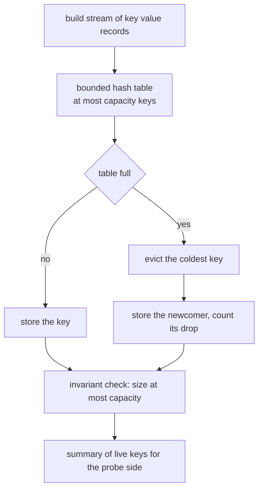
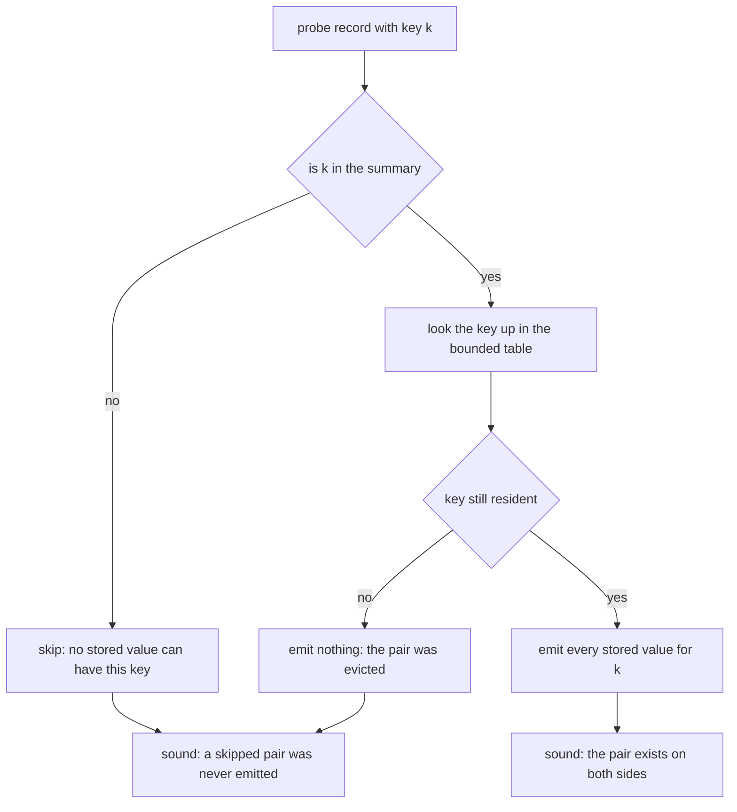
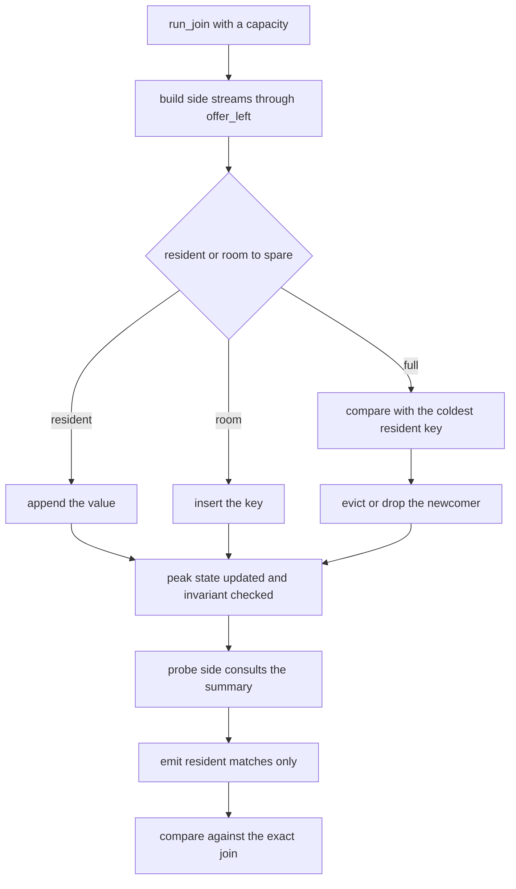
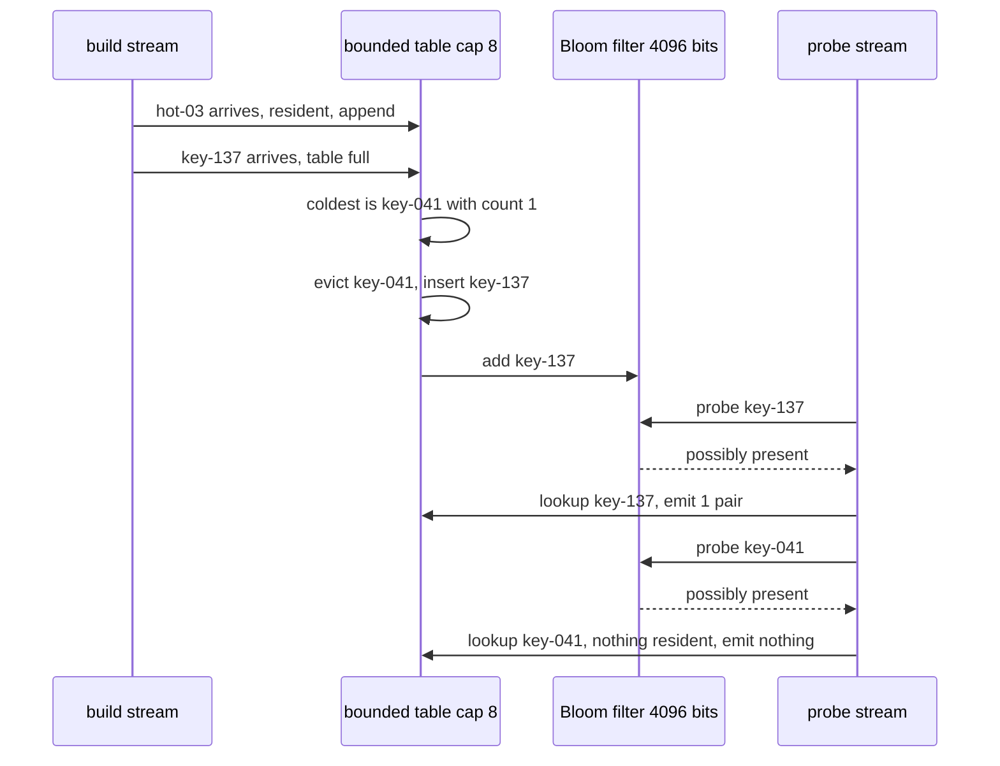

# 916 — Implement large-scale streaming joins with approximate state and bounded memory.

> **Tier:** Master · **CTCI chapter:** Ch 9 — System Design and Scalability
> **Task spec:** [916-implement-large-scale-streaming-joins-with-approximate-state-and.md](../../../tasks/master/916-implement-large-scale-streaming-joins-with-approximate-state-and.md)
> **Solutions:** [Python](../../../solutions/python/master/916-implement-large-scale-streaming-joins-with-approximate-state-and/solution.py) ·
> [Java](../../../solutions/java/master/916-implement-large-scale-streaming-joins-with-approximate-state-and/Solution.java) ·
> [JavaScript](../../../solutions/javascript/master/916-implement-large-scale-streaming-joins-with-approximate-state-and/solution.js) ·
> [C#](../../../solutions/csharp/master/916-implement-large-scale-streaming-joins-with-approximate-state-and/Solution.cs)

## 1. Problem restatement

**The modelling contract first.** An in-process, deterministic simulation of a streaming equijoin. The
two streams are generated from a seeded splitmix64 stream and therefore replay exactly; the "memory
bound" is an explicit counter (`capacity` keys in the build table, plus an optional bit array), not an
operating-system limit. There are no watermarks, no windows, no spill-to-disk, no parallelism and no
wall clock.

**Inputs.** A build-side stream and a probe-side stream of `(key, value)` records, a capacity, and an
optional Bloom filter size. **Outputs.** Emitted pairs `(probe_value, build_value)`, plus recall,
precision and peak state.

The contract that makes the whole exercise meaningful:

- the state never exceeds the cap — re-checked after **every** insertion, so a violation is observed;
- the join is **sound**: every emitted pair is a true pair (`precision == 1.0`, `emitted ⊆ truth`);
- recall is what degrades, monotonically better as the cap grows.

| Run | Result (printed by the Python solution) |
| --- | --- |
| exact oracle over the generated streams | **759526** pairs |
| `capacity = 206` (`alphabet + hot`) | exact: recall 1.0, precision 1.0, peak state 206 |
| `capacity = 4` | recall 0.418, precision 1.0 |
| `capacity = 8` | recall 0.994, precision 1.0 |
| `capacity = 16 / 32 / 64` | recall 0.995 / 0.996 / 0.996 |
| Bloom filter, 4096 bits, 3 hashes, 204 live keys | observed false-positive rate 0.0018 vs closed form 0.0027 |
| `run_join([], [], capacity=1)` | empty output, recall 1.0 by convention, peak state 0 |
| `StreamingJoin(capacity=0)` | rejected: "the join state must hold at least one key" |

## 2. Intuition

An exact streaming join keeps every build-side key for as long as the stream runs: `759526` output pairs
in this run come from a state that must hold all 206 distinct keys, and a production stream would keep
growing without bound. The naive fix — keep the first `capacity` keys — is worse than it looks: under
skew it evicts exactly the keys that carry most of the traffic, so recall collapses.

The first insight is that **the eviction policy is the algorithm**. Keeping the *hottest* keys (highest
observed frequency) is what preserves recall, because a hot key is the one that will be probed again.
The JavaScript implementation uses the classic Space-Saving variant: on overflow the least frequent key
is evicted and the newcomer *inherits its count*, so each estimate over-approximates by at most
`N / capacity` and every key whose true frequency exceeds `N / capacity` survives.



The second insight is the **semi-join pushdown**: a Bloom filter summarising the build side lets the
probe side skip keys that certainly cannot match. It has no false negatives, so it never removes a pair
the join would have emitted; it only adds false positives, which cost a wasted lookup but cannot create a
wrong output pair. That is precisely why the resulting join is *incomplete but never wrong*, and why
precision is asserted to be exactly 1.0 at every capacity while recall is free to move.



## 3. Algorithm

1. **Generate** the skewed streams (70% of keys drawn from `hot` hot keys, the rest from an alphabet of
   `alphabet` keys) from the seeded RNG, so both runs see identical input.
2. **Build.** For each build record: increment the key's counter; if the key is resident, append the
   value; otherwise store it if there is room, else find the coldest resident key (`min` over
   `(count, key)`), drop it if its count is below the newcomer's, and count a drop.
3. **Summarise.** Add the key to the Bloom filter (`k` hash probes into an `m`-bit array).
4. **Probe.** For each probe record: consult the Bloom filter; on a positive, emit
   `(probe_value, stored_value)` for every resident value under that key.
5. **Measure.** Compare the emitted set with the exact join: `recall = |emitted ∩ truth| / |truth|`,
   `precision = |emitted ∩ truth| / |emitted|`, plus peak state.
6. **Assert the invariants** after each mutation: `len(table) <= capacity`, `emitted ⊆ truth`.

```text
procedure offer_left(join, key, value)
    join.counts[key] ← join.counts.get(key, 0) + 1
    if key is in join.table then
        append value to join.table[key]
    else if count of join.table < join.capacity then
        join.table[key] ← [value]
    else
        coldest ← the resident key with the smallest (count, key)
        if join.counts[coldest] < join.counts[key] then
            remove coldest from join.table
            join.dropped ← join.dropped + 1
            join.table[key] ← [value]
        else
            join.dropped ← join.dropped + 1
        end
    end
    add key to join.bloom
    join.peak ← max(join.peak, count of join.table)
    check count of join.table <= join.capacity
end

procedure offer_right(join, key, value)
    if join.bloom is not null and key is not in join.bloom then
        return an empty list
    end
    return the pairs (value, other) for every other in join.table.get(key, ())
end

procedure run_join(left, right, capacity, policy)
    join ← StreamingJoin(capacity)
    if policy = "fifo" then
        join.offer_left ← the least-recently-inserted eviction policy
    end
    for each (key, value) in left do
        join.offer_left(key, value)
    end
    emitted ← empty set
    for each (key, value) in right do
        add every pair of join.offer_right(key, value) to emitted
    end
    truth ← exact_join(left, right)
    return emitted, recall, precision, join.peak
end
```



## 4. Worked example

Streams: `make_streams(seed=2025, length=3000, alphabet=200, hot=6)` — 3000 records per side, 70% of
them drawn uniformly from the six `hot-*` keys, the rest from 200 `key-NNN` values. The exact join over
those streams is **759526** pairs, and the run's printed summary is

```text
truth 759526 pairs; recall by capacity {4: 0.418, 8: 0.994, 16: 0.995, 32: 0.996, 64: 0.996}
bloom: observed fp 0.0018, theory 0.0027, keys 204
exact run: pairs 759526, peak state 206
```

| Capacity | Recall | Precision | Peak state | Reading |
| --- | --- | --- | --- | --- |
| 4 | 0.418 | 1.0 | 4 | smaller than the six hot keys, so hot keys fight each other in the table |
| 8 | 0.994 | 1.0 | 8 | all six hot keys fit, with two seats left for cold keys |
| 16 | 0.995 | 1.0 | 16 | the extra seats buy almost nothing: the traffic is already covered |
| 32 | 0.996 | 1.0 | 32 | the long tail of cold keys is where the last 0.4% lives |
| 64 | 0.996 | 1.0 | 64 | diminishing returns, still below exact |
| 206 | 1.0 | 1.0 | 206 | the whole alphabet fits, so the pipeline is the exact join |

The interesting row is capacity 4. Six hot keys compete for four seats, and the eviction compares
`(count, key)`, so the coldest of the hot keys is repeatedly displaced and its pairs are never emitted —
recall 0.418. At capacity 8 every hot key is resident the whole time, and recall jumps to 0.994; the
remaining 0.6% are cold-key pairs evicted while the long tail is being processed. Recall is asserted to
be monotone across `(4, 8)`, `(8, 16)`, `(16, 32)` and `(32, 64)`, which the printed values satisfy
(`0.418 <= 0.994 <= 0.995 <= 0.996 <= 0.996`).



The eviction policy comparison is exposed by overriding `offer_left` with a FIFO policy that evicts the
oldest insert. Both policies are run at capacities 4, 8 and 16 and the assertion is
`hot_recall >= fifo_recall` at each — the hot-key policy never loses, and at capacity 8 it is asserted to
keep at least half the pairs (the run reports 0.994).

## 5. Complexity

Let `nl` and `nr` be the stream lengths, `C` the capacity, `K` the distinct keys, `P` the number of
joined pairs, `m` the Bloom bits and `h` its hash count.

| Measure | Bound | Why it holds |
| --- | --- | --- |
| `offer_left` per record | `O(1)` amortised with room, `O(C)` on eviction | `min` scans the resident table, which is capped at `C` |
| Whole build pass | `O(nl)` amortised, `O(nl · C)` worst case | every record except the eviction cases is a dictionary update |
| `offer_right` per record | `O(h)` when skipped, `O(h + r)` with `r` resident matches | hash probes, then the resident value list |
| Whole probe pass | `O(nr · (h + r_max))` | matches are emitted, so the output size is a lower bound |
| State | `O(C + m)` keys/values plus the bit array | the cap is the entire design; the invariant is checked per insert |
| Exact oracle | `O(nl + nr)` time, `O(K + P)` space | it materialises every pair, which is what the bounded run avoids |
| Bloom false positives | `(1 - e^{-h·s/m})^h` | closed form, checked against the observed rate (0.0018 observed vs 0.0027 theory at `s = 204`, `m = 4096`, `h = 3`) |
| False negatives | `0` | a bit is only ever set, never cleared, so an inserted key always probes positive |

The alternative, an unbounded hash join, has the same `O(nl + nr)` time and answers exactly, but its
state grows with `K` — 206 keys here, unbounded in production — and its memory is the reason the
approximate operator exists. The design choice is therefore a strict trade of recall for footprint:
`O(C + m)` instead of `O(K + |truth|)` at the cost of `1 - recall` of the output.

## 6. Pitfalls and edge cases

- **Precision is the safety property, recall is the quality metric.** Every run asserts
  `precision == 1.0` and `emitted <= truth`; a semi-join that drops *duplicates* or reorders pairs is
  fine, one that invents a pair is a bug. The Bloom filter is the only approximation on the probe path,
  and its one-sided error is what keeps `precision` at 1.
- **Skew is the whole workload.** With uniform keys almost any eviction policy looks fine; the generator
  makes 70% of the traffic come from six keys, which is why capacity 4 loses 58% of the pairs while
  capacity 8 loses 0.6%.
- **Capacity one and capacity zero.** `StreamingJoin(capacity=0)` must be rejected with a message that
  explains the capacity; `capacity = 1` must hold exactly one key, and a single matching pair must still
  join (`{("b", "a")}`).
- **Empty and non-matching streams.** `run_join([], [], capacity=1)` emits nothing, has peak state 0,
  and recall **1.0 by convention** (`0/0` is defined as 1.0), while `run_join([("k","a")], [("other","b")], 1)`
  emits nothing and reports recall 1.0 for the same reason. Reporting recall 0.0 for a stream with no
  possible matches would make every recall comparison meaningless.
- **A tiny Bloom filter must remain sound.** `StreamingJoin(capacity=1, bloom_bits=8, bloom_hashes=1)`
  is allowed — 8 bits and one probe — and the suite checks that no offered key becomes a false negative;
  a filter so small that it saturates still cannot lose a match.
- **The theory check is one-sided.** The observed false-positive rate is compared with the closed form
  using `observed < theory * 3 + 0.01` and `observed < 0.5`. A two-sided equality would fail on seed
  noise for a 204-key filter — the printed 0.0018 against a 0.0027 theory is the expected kind of gap.
- **Probing must actually consult the summary.** The run counts `bloom.probes` and asserts it is
  positive; a probe path that silently skips the filter would look correct and save nothing.
- **Reproducibility is asserted, not hoped for.** `make_streams(2025, 3000, 200, 6)` must return the
  same two lists on a second call, and two `run_join(..., 16)` calls must emit the identical set.

## 7. Variants and follow-ups

- **Frequency estimation without a join.** [911-implement-probabilistic-data-structure-for-heavy-hitters-with-er.md](../../../tasks/master/911-implement-probabilistic-data-structure-for-heavy-hitters-with-er.md)
  is the same sketch-based idea applied to reporting the heavy hitters, where the error bound is the
  deliverable rather than a side effect of eviction.
- **The unordered-stream ancestor.** [849-implement-scalable-approximate-joins-in-streaming-sketch-based.md](../../../tasks/master/849-implement-scalable-approximate-joins-in-streaming-sketch-based.md)
  builds the sketch-based approximate join this operator specialises to a bounded build side.
- **Sizing the state from the workload.** [903-implement-adaptive-replication-factoring-hot-keys-and-node-load.md](../../../tasks/master/903-implement-adaptive-replication-factoring-hot-keys-and-node-load.md)
  reacts to hot keys by replicating them; here the same skew signal decides which keys stay resident.
- **Summaries that must not lie under adversarial input.** [949-implement-approximate-maximum-matching-in-huge-graphs-with-strea.md](../../../tasks/master/949-implement-approximate-maximum-matching-in-huge-graphs-with-strea.md)
  uses one-sided sketches the same way, but the error analysis has to survive a worst-case stream order.

## 8. Check yourself

1. Why can a Bloom filter never reduce recall, and how does that differ from eviction?

<details><summary>Show answer</summary>

A Bloom filter has no false negatives: bits are only set, never cleared, so any key that was inserted
still probes positive later. A negative answer is therefore a proof of absence, and skipping on it can
only drop pairs that had no matching build value anyway — it cannot remove a pair the join would have
emitted. Eviction is the opposite: it removes real state, so a pair that exists on both sides may be
lost. That is why recall is asserted to be monotone in capacity and precision is asserted to be exactly
1.0 in all runs.

</details>

2. At capacity 4 the run reports recall 0.418; at capacity 8 it reports 0.994. What is the structural
   reason for the jump?

<details><summary>Show answer</summary>

There are six hot keys and 70% of the traffic is on them. With four seats the table cannot hold all six,
and the eviction rule compares `(count, key)`, so the currently-coldest hot key is repeatedly displaced
by a hotter one and its pairs are never emitted. With eight seats every hot key is resident for the
whole stream, and only cold-key pairs — less than 1% of the traffic — are lost to eviction. Capacity
16/32/64 then buy only the long tail: 0.995, 0.996, 0.996.

</details>

3. Why does the run compare against `fifo` at capacities 4, 8 and 16 instead of trusting the hot-key
   claim?

<details><summary>Show answer</summary>

Because "keep the hottest keys" is a heuristic and heuristics need a counterexample hunt. The FIFO
policy evicts the oldest insert, which under skew systematically discards the keys that keep being
probed; the assertion `hot_recall >= fifo_recall` at each capacity makes the superiority a checked
property rather than a comment. It also documents the expected *shape*: at capacity 4 both policies
lose a lot, and the gap widens exactly where hot keys compete for seats.

</details>

4. `run_join([("k", "a")], [("other", "b")], capacity=1)` emits nothing, yet reports recall 1.0. Is that
   a bug in the metric?

<details><summary>Show answer</summary>

No — it is the `0/0` convention, and it is deliberate: recall is `matched / |truth|`, and `truth` is
empty here, so the ratio is defined as 1.0 (as `run_join([], [], 1)` also asserts). The alternative —
reporting 0.0 — would make an operator that correctly emits nothing look like it lost everything, and
would break the monotonicity assertions that compare recall across capacities. Precision 1.0 in the same
run confirms no pair was invented.

</details>
