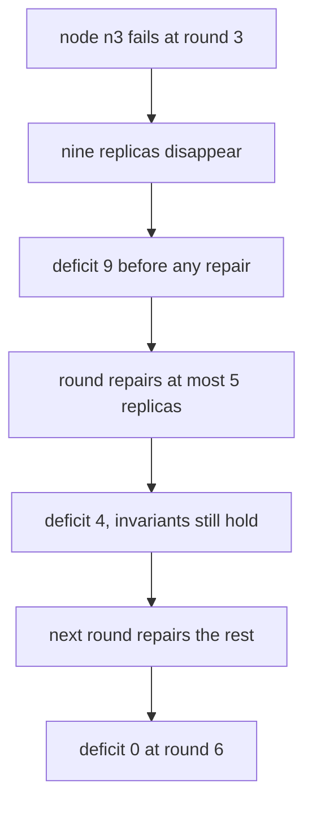
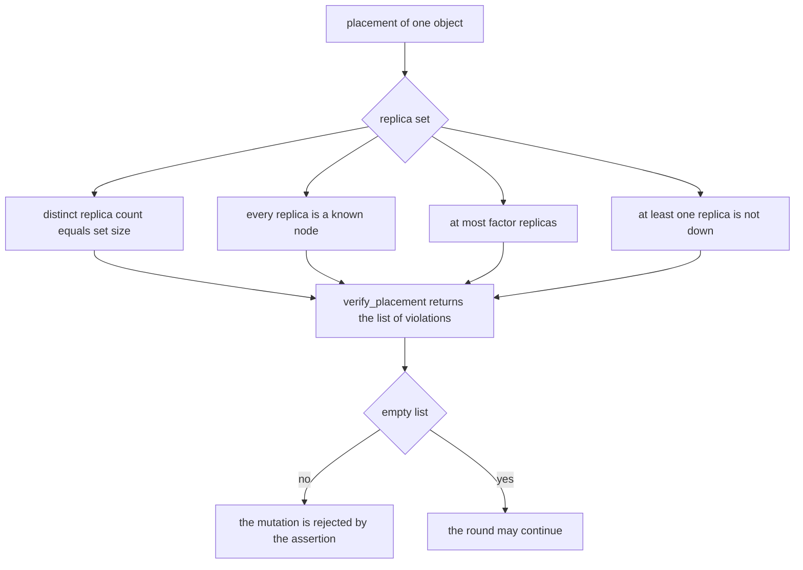
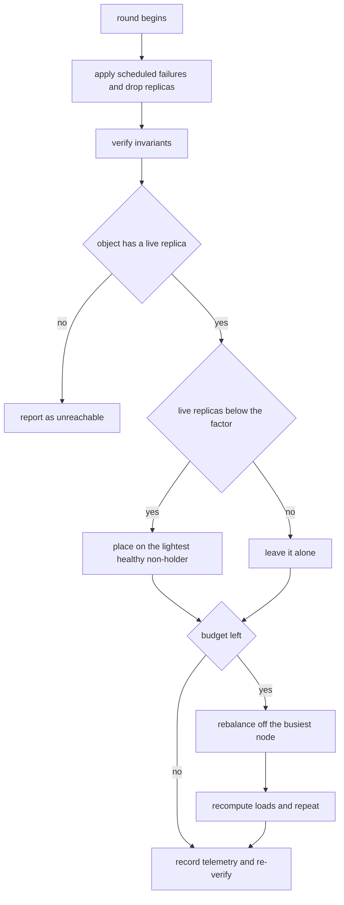
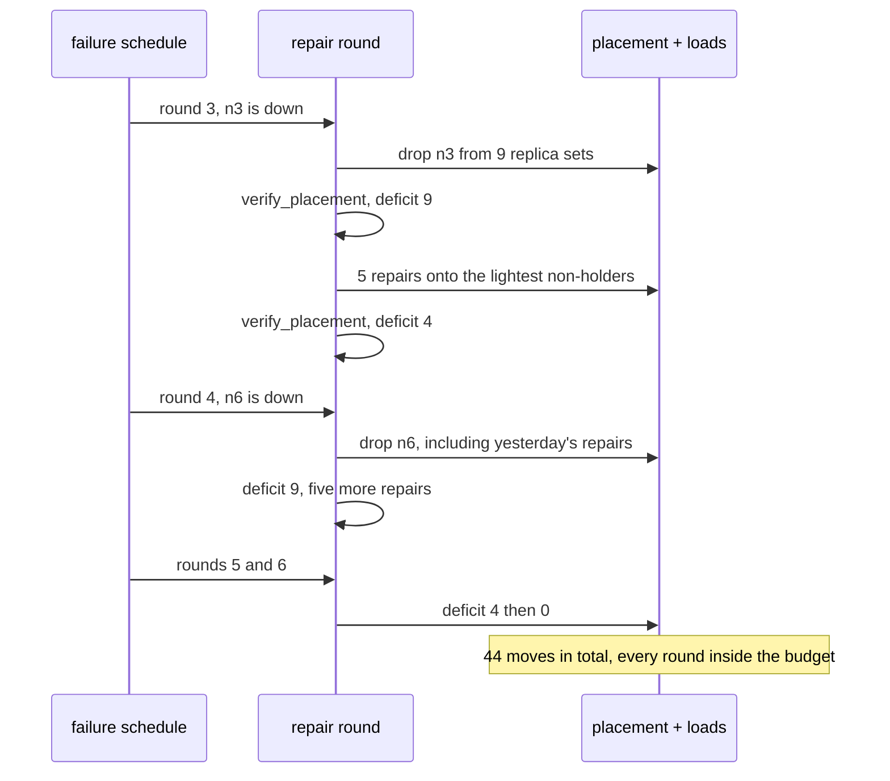

# 917 — Implement self-healing storage cluster with automatic rebalancing and throttled repairs.

> **Tier:** Master · **CTCI chapter:** Ch 9 — System Design and Scalability
> **Task spec:** [917-implement-self-healing-storage-cluster-with-automatic-rebalancin.md](../../../tasks/master/917-implement-self-healing-storage-cluster-with-automatic-rebalancin.md)
> **Solutions:** [Python](../../../solutions/python/master/917-implement-self-healing-storage-cluster-with-automatic-rebalancin/solution.py) ·
> [Java](../../../solutions/java/master/917-implement-self-healing-storage-cluster-with-automatic-rebalancin/Solution.java) ·
> [JavaScript](../../../solutions/javascript/master/917-implement-self-healing-storage-cluster-with-automatic-rebalancin/solution.js) ·
> [C#](../../../solutions/csharp/master/917-implement-self-healing-storage-cluster-with-automatic-rebalancin/Solution.cs)

## 1. Problem restatement

**The modelling contract first.** An in-process, deterministic simulation of a replicated store's
control plane. Failures arrive on a *fixed schedule* (`{3: ("n3",), 4: ("n6",), 9: ("n1", "n7"), 12: ("n3",)}`),
transfers are instantaneous, there are no network partitions, no rack awareness and no byte-level
data — only byte-*weighted* load. Every round is therefore replayable, and the whole incident can be
re-run and compared step by step.

**Inputs.** Nodes, objects with sizes, a replication factor, a per-round migration budget, and a failure
schedule. **Outputs.** A placement map (object → set of nodes), per-round telemetry (moves, deficit,
load ratio, unreachable objects), and an independent invariant report.

Four safety invariants are re-derived from the raw mapping after **every** mutation:

1. every object has at least one replica — a set that became empty is reported, never invented;
2. no duplicate replica (a set, so this is structural, but it is checked anyway);
3. every replica is on a known node;
4. at most `factor` replicas, and at least one *live* replica (not on a down node).

| Run | Result (printed by the Python solution) |
| --- | --- |
| 8 nodes, 24 objects (32..216 bytes), factor 3, budget 5, 14 rounds | 44 moves, final deficit 0, moves by round `[0,0,0,5,5,5,4,0,0,5,5,5,5,5]` |
| skewed cluster, budget 200 | peak/average ratio 1.319 → 1.211 (bound `1 + ALPHA = 1.25`) |
| budget 0 on a cluster with a dead node | zero moves, deficit still visible, invariants intact |
| budget 2 with work outstanding | exactly 2 repairs issued — the throttle is a hard cap |
| single-node cluster with factor 3 | factor clamped to 1, invariants re-checked at factor 1 |
| object whose every replica is gone | reported as unreachable; no replica fabricated |

## 2. Intuition

The naive repair loop walks the object table and re-replicates everything that looks under-replicated,
in one pass. On a real cluster that is a self-inflicted outage: losing one big node can queue terabytes
of copies, and the repair traffic competes with the traffic that is still trying to serve reads. The
first insight is therefore **the work must be budgeted, not merely prioritised**: at most `budget`
placement changes per round, so the cluster is safe *after every round* and the drain takes a bounded,
predictable number of rounds.



The second insight is that the **invariant checker must be independent of the mutator**. `verify_placement`
recomputes distinctness, liveness and the factor bound from the placement dictionary alone and returns a
*list of problems*; both `simulate` and the repair path call it after every change. A repair that
accidentally places a replica on the node it just removed it from, or that pushes an object above the
factor, is caught by the checker rather than trusted from the mutator's own bookkeeping.



## 3. Algorithm

1. **Initial placement.** Sort objects by decreasing size and assign round-robin replica sets of
   distinct nodes, so the biggest objects are spread first and the starting layout is already balanced.
2. **Apply failures.** Move the scheduled nodes into `down` and drop them from every replica set; verify
   invariants after the whole batch.
3. **Repair.** In object order, count live replicas; when below the factor, pick the healthy node with
   the smallest `(load, name)` that does not already hold the object, add it, charge its size to the load
   and spend one unit of budget. An object with no live replica is recorded as unreachable.
4. **Rebalance** with the leftover budget: while the busiest healthy node is above
   `average · (1 + ALPHA)` and holds an object with more than one live replica, move that object's
   replica to the lightest healthy node that does not hold it, then recompute the average (one move per
   iteration, so each decision is based on fresh loads).
5. **Telemetry.** Record moves, total deficit, peak/average ratio and unreachable objects; assert
   `len(moves) <= budget` and re-verify the invariants.

```text
procedure repair_round(placement, nodes, down, objects, factor, budget, sizes)
    healthy ← nodes without the down ones
    loads ← byte loads over the live replicas
    moves ← empty list
    unreachable ← empty list
    left ← budget
    for each oid in sorted(objects) do
        live ← live replicas of oid
        if live is empty then
            append oid to unreachable
            continue
        end
        for _ in 1 .. max(0, factor - count(live)) do
            if left = 0 then break end
            candidates ← healthy nodes that do not hold oid
            if candidates is empty then break end
            target ← the candidate with the smallest (load, name)
            add target to placement[oid]
            loads[target] ← loads[target] + sizes[oid]
            append ("repair", oid, target) to moves
            left ← left - 1
        end
    end
    while left > 0 do
        average ← sum(loads) / count(healthy)
        busiest ← the healthy node with the largest (load, name)
        if loads[busiest] <= average * (1 + ALPHA) or loads[busiest] = 0 then break end
        moved ← false
        for each oid in sorted(objects) do
            if busiest does not hold oid or live replicas of oid <= 1 then continue end
            candidates ← healthy nodes that do not hold oid and are lighter than busiest
            if candidates is empty then continue end
            target ← the candidate with the smallest (load, name)
            remove busiest from placement[oid]
            add target to placement[oid]
            loads[busiest] ← loads[busiest] - sizes[oid]
            loads[target] ← loads[target] + sizes[oid]
            append ("rebalance", oid, target) to moves
            left ← left - 1
            moved ← true
            break
        end
        if not moved then break end
    end
    return moves, unreachable, loads
end
```



## 4. Worked example

The full incident: 8 nodes, 24 objects (`obj-00` = 32 bytes up to `obj-23` = 216 bytes), factor 3,
budget 5, 14 rounds. Total replica bytes are `2976 · 3 = 8928`, so a perfectly balanced cluster would
carry 1116 bytes per node. Per-round telemetry, recorded after each round's repairs:

| Round | Failure | Deficit after the round | Moves | Peak/average |
| --- | --- | --- | --- | --- |
| 0-2 | none | 0 | 0 | 1.161 |
| 3 | `n3` | 4 | 5 | 1.109 |
| 4 | `n6` | 9 | 5 | 1.054 |
| 5 | none | 4 | 5 | 1.084 |
| 6 | none | **0** | 4 | 1.038 |
| 7-8 | none | 0 | 0 | 1.038 |
| 9 | `n1`, `n7` | 20 | 5 | 1.014 |
| 10-12 | none (the round-12 `n3` failure is a no-op: the node never came back) | 15, 10, 5 | 5, 5, 5 | 1.035, 1.020, 1.068 |
| 13 | none | **0** | 5 | 1.050 |

Round 3 is worth reading closely. `n3` held 9 replicas (each node holds 3 replicas per 8 objects, so 9
of 24 objects), the round repairs 5 of them and the deficit that remains visible is 4 — a stalled
cluster is *safe* but visibly incomplete, which is exactly what the zero-budget boundary asserts. Round
4 loses `n6` **and** the replicas the previous round had just placed on it, which is why the deficit goes
up to 9 rather than down: throttled repair chooses targets by load, and a fresh, lightly loaded node is
the natural target.



The final loads are `n0 2232, n2 2152, n4 2200, n5 2344` over the four surviving nodes, with
`72 = 24 · 3` replicas still in the map: nothing was dropped, and the peak/average ratio is 1.050,
comfortably inside `1 + ALPHA = 1.25`. The separate rebalancing experiment skews four objects onto
`n0, n1, n2` and spends a 200-move budget: the ratio falls from 1.319 to 1.211, the replica count is
unchanged and `verify_placement` is clean afterwards.

## 5. Complexity

Let `O` be the objects, `N` the nodes, `R` the factor, `B` the budget and `P` the number of replicas
(`O · R` initially).

| Measure | Bound | Why it holds |
| --- | --- | --- |
| `initial_placement` | `O(O log O + P)` | the sort dominates; each object takes `R` slots |
| `verify_placement` | `O(P)` | one pass over every replica set with `O(1)` checks per replica |
| One repair | `O(N)` | the candidate list is scanned for the smallest `(load, name)` |
| One `repair_round` | `O(O · N + B · O)` | the deficit scan is `O(O · N)`; each rebalance move re-scans objects |
| Rounds to full repair | `ceil(deficit / B)` = `ceil(25 / 5) = 5` in the trace | the budget is a hard cap, so a deficit can shrink by at most `B` per round |
| Balance convergence | peak/average `<= 1 + ALPHA` up to one object's quantisation | each move strictly reduces the busiest node's load, and the loop stops at the bound |
| Space | `O(O · R)` replicas plus `O(N)` loads | the placement map is the state; telemetry is `O(rounds)` |
| Naive unthrottled repair | same asymptotics, unbounded per-round work | it repairs everything in one pass, which is `O(deficit)` moves in a single round |

The interesting comparison is not asymptotic but operational: an unthrottled repair does the same total
work and finishes sooner, at the cost of concentrating it into one round. The budget converts "how long
until healed" into a dial, and `ceil(deficit / B)` is the number the operator can predict — which is why
the trace's 25-unit deficit drains in exactly five rounds.

## 6. Pitfalls and edge cases

- **Throttling is what makes repair measurable.** The trace's deficit drops by at most `B = 5` per round
  and the assertion `drop <= budget` is checked for every consecutive pair; the second incident drains
  20 → 15 → 10 → 5 → 0.
- **A zero budget must stall safely, not cheat.** With `budget = 0` no move happens, no invariant breaks,
  and the deficit is still reported — a stall is a *state*, not a silent corruption. With `budget = 2`
  and outstanding work, exactly two repairs are issued.
- **Rectifying versus rebalancing share one budget.** If rebalancing could spend its own budget the
  cluster could postpone repairs; here repair has priority and rebalancing runs only with what is left.
- **A repaired replica can be lost in the very next round.** Round 4 loses the replicas that round 3
  placed on `n6`. Nothing is wrong: the repair is durable only as far as the node is, which is why the
  deficit is re-measured from the placement every round instead of being counted down arithmetically.
- **Never invent a replica.** An object whose replicas were all on down nodes is appended to
  `unreachable` and no placement is fabricated; `verify_placement` reports the same object as
  "no replica at all" if it is ever handed an empty set.
- **Clamping in a cluster that cannot satisfy the factor.** With one node and factor 3, the placement
  clamps to factor 1 and is verified at factor 1. The C# and Java files go further and report the whole
  cluster as degraded rather than claim a heal that is arithmetically impossible.
- **A no-op failure entry.** `n3` is listed as failing again in round 12, but `down` is monotone, so the
  round changes nothing — the deficit continues its 10 → 5 drain. Reading the schedule as "n3 returns and
  fails again" is the easy misreading.
- **Weights are bytes, not counts.** Loads add `sizes[oid]` per replica, so moving a 216-byte object
  counts for more than a 32-byte one; a count-based balancer would call the cluster balanced while the
  peak ratio is 1.33.
- **Determinism is asserted.** Re-running the whole incident produces the identical placement and the
  identical telemetry, which is what makes every number in this section a fact about the code.

## 7. Variants and follow-ups

- **Who decides the replication factor.** [903-implement-adaptive-replication-factoring-hot-keys-and-node-load.md](../../../tasks/master/903-implement-adaptive-replication-factoring-hot-keys-and-node-load.md)
  makes `factor` an output of hot-key and load signals rather than a constant, which changes the
  deficit arithmetic into a control loop.
- **Where the cold data should live.** [904-implement-automated-slo-driven-tiered-storage-migration-with-saf.md](../../../tasks/master/904-implement-automated-slo-driven-tiered-storage-migration-with-saf.md)
  adds the migration policy above this scheduler, where moving a replica also means choosing a tier.
- **Consistent hashing instead of a placement map.** The Java and JavaScript solutions derive replica
  sets from a hash ring with virtual nodes, which makes a joining node inherit about `1 / (N + 1)` of the
  keys and removes the need to store the map at all.
- **Snapshots across the same topology.** [807-implement-global-scale-consistent-snapshot-across-geographically.md](../../../tasks/master/807-implement-global-scale-consistent-snapshot-across-geographically.md)
  is the read-side counterpart: a snapshot must cope with replicas that are still being repaired.

## 8. Check yourself

1. Why is `verify_placement` a separate function that returns a list of problems instead of a method on
   the placement object?

<details><summary>Show answer</summary>

Because the checker must not share the mutator's assumptions. It takes the placement dictionary, the
node list, the down set, the factor and the object list and re-derives distinctness, node membership,
the factor bound and liveness from scratch, so it also works on hand-built states — the run uses it to
flag a deliberately impossible `{"obj-00": set()}` as "no replica at all". A method that consulted
internal counters could agree with a bug in the code that maintains those counters.

</details>

2. In the trace, the deficit rises from 4 to 9 between rounds 3 and 4 even though five repairs happened
   in between. Explain.

<details><summary>Show answer</summary>

Because the deficit is re-measured from the placement map after *every* round instead of being
decremented as repairs happen. Round 4 loses `n6`'s own nine replicas plus the replicas round 3 had just
placed on that freshly emptied node — a light node is the natural repair target — and then repairs five
of them, which leaves 9. Bookkeeping that only subtracted repairs ("4 remaining, five repaired, so the
deficit fell") would contradict the placement map, and the checker would not notice either way, because
the map is the truth.

</details>

3. What does the `ceil(deficit / budget)` rule predict for the second incident, and what does the trace
   show?

<details><summary>Show answer</summary>

Round 9 creates a deficit of 20 (two nodes go down at once), and `ceil(20 / 5) = 4` rounds are needed to
drain it. The trace shows 20 → 15 → 10 → 5 → 0 across rounds 9 to 13 — four repair rounds of five moves
each. The prediction holds only while no new failure arrives, which is exactly the operational caveat
the incident schedule demonstrates.

</details>

4. The rebalancing experiment reports 1.319 → 1.211 with a bound of 1.25. Why is 1.211 not simply 1.25?

<details><summary>Show answer</summary>

The loop stops as soon as the busiest node is within `1 + ALPHA` of the average, and moves are whole
objects: a 216-byte object cannot be split, so the achievable minimum ratio is quantised by object sizes
and the run overshoots the bound rather than landing on it. The assertions therefore check
`ratio <= 1 + ALPHA + 1e-9` (a bound) and `ratio_after < ratio_before` (a direction), not an equality —
and in the incident trace the converged ratio is 1.050, well inside the bound because the loads are more
even there.

</details>
