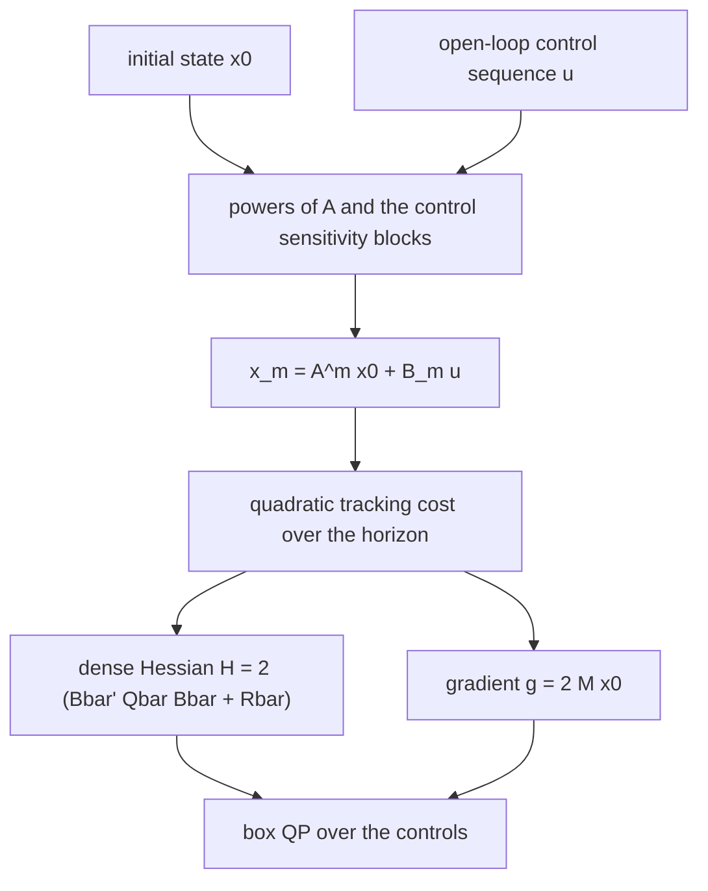
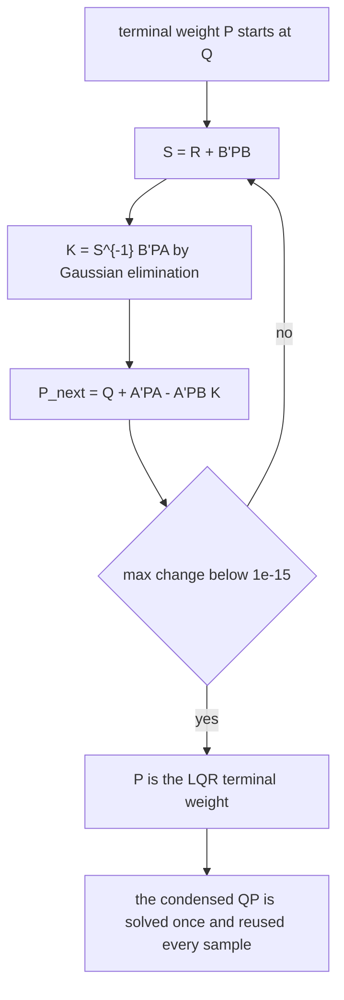
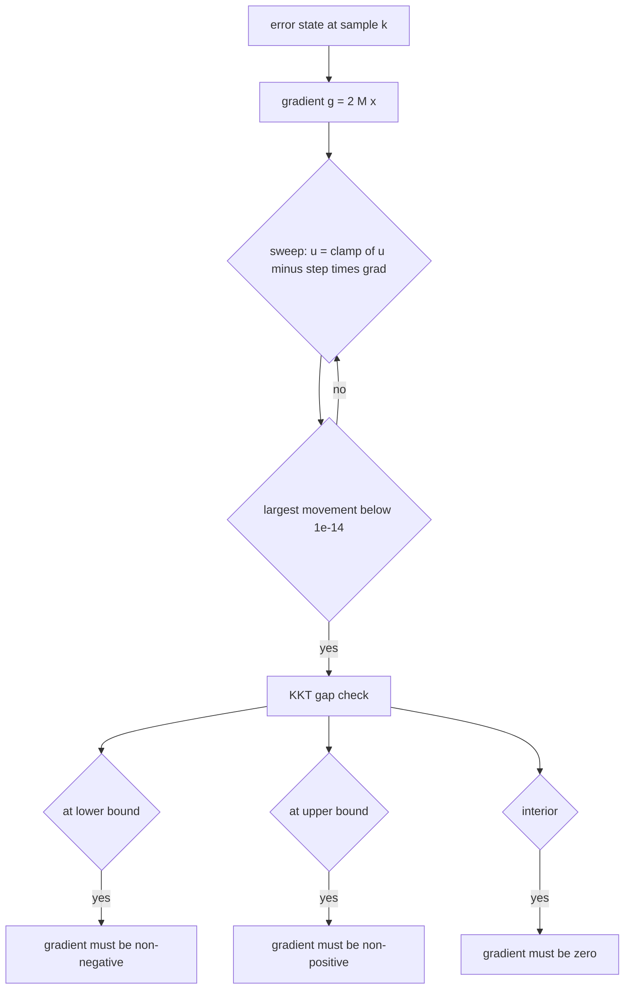
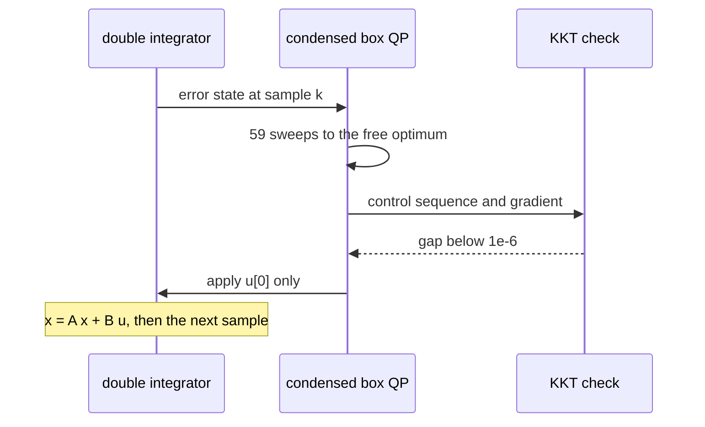

# 918 — Implement dynamic QP solver for real-time control in robotics (MPC small demo).

> **Tier:** Master · **CTCI chapter:** Beyond — Graphics, Geometry & Robotics
> **Task spec:** [918-implement-dynamic-qp-solver-for-real-time-control-in-robotics-mp.md](../../../tasks/master/918-implement-dynamic-qp-solver-for-real-time-control-in-robotics-mp.md)
> **Solutions:** [Python](../../../solutions/python/master/918-implement-dynamic-qp-solver-for-real-time-control-in-robotics-mp/solution.py) ·
> [Java](../../../solutions/java/master/918-implement-dynamic-qp-solver-for-real-time-control-in-robotics-mp/Solution.java) ·
> [JavaScript](../../../solutions/javascript/master/918-implement-dynamic-qp-solver-for-real-time-control-in-robotics-mp/solution.js) ·
> [C#](../../../solutions/csharp/master/918-implement-dynamic-qp-solver-for-real-time-control-in-robotics-mp/Solution.cs)

## 1. Problem restatement

**The modelling contract first.** A *small* MPC demo: a discrete double integrator with `DT = 0.1`,

```text
A = [[1, DT], [0, 1]]      B = [[0.5 * DT^2], [DT]]      Q = diag(1, 0.1)      R = [[0.5]]
```

a horizon of `N = 5` samples, box bounds `|u| <= 1` on the acceleration, and no state constraints, no
terminal set, no warm start and no wall-clock timing. Everything runs in-process on plain dense
matrices — the Java file solves the box QP with FISTA, the JavaScript file with FISTA plus monotone
restart, and the C# file with a primal log-barrier interior-point method — and every quantity quoted
below is printed by the Python run.

**Inputs.** The plant matrices, a horizon, the control bounds, the initial state and a setpoint.
**Outputs.** A control sequence (the QP solution), the first control applied to the plant, the closed-loop
trajectory, and the optimality certificate.

| Run | Result |
| --- | --- |
| Riccati recursion to the DARE fixed point | residual **8.9e-16** |
| condensed free solve vs `-H^{-1} g` | agreement to 1e-6 in **59 sweeps** |
| constrained solve vs exhaustive active-set oracle (4 instances, `N = 4`) | agreement to 1e-5, objective within 1e-6 |
| objective trace along the sweeps | never increases |
| equal bounds `lo = hi = 0.25` | every control pinned to 0.25 |
| zero-horizon QP (`N = 0`) | empty control vector, 0 sweeps |
| closed loop, 120 samples, setpoint 1.0 | final position **1.000038**, peak **1.034274**, final velocity **-0.000014** |

## 2. Intuition

The naive MPC loop re-derives the optimisation from scratch: simulate the plant inside a nested loop,
perturb the controls, evaluate the cost by rolling out the trajectory again, and take a gradient step.
That is `O(N²)` plant rollouts per iteration for an `N`-step horizon, and the only thing that changes
between iterations is the control sequence.

The first insight is **condensation**: because the plant is linear, the state at step `m` is
`x_m = A^m x_0 + Σ_{j<=m} A^{m-j} B u_j`, an affine function of the controls. Substituting that into the
quadratic cost turns the whole trajectory problem into a single box-constrained QP in the `N` controls,
`min 0.5 u'Hu + g'u` with `H = 2 (B̄' Q̄ B̄ + R̄)` and `g = 2 M x_0`. The `powers` table (`A^m`) and the
block rows `b_bar` are computed once, and the run asserts that the condensed prediction equals an honest
step-by-step rollout to 1e-12.



The second insight is the **terminal weight**. With a finite horizon the controller stops caring about
the state at the end, so it coasts into the setpoint with no braking plan; using the Riccati solution `P`
of the corresponding discrete algebraic Riccati equation as the terminal weight makes the unconstrained
finite-horizon problem equivalent to the infinite-horizon LQR, which is why the closed loop settles
rather than oscillates. The run iterates `P ← Q + A'PA - A'PB(R + B'PB)^{-1}B'PA` and asserts the
fixed-point residual is below 1e-12 (it reports 8.9e-16).



## 3. Algorithm

1. **Solve the Riccati equation** with 300 iterations of the recursion, returning `(P, residual)` so the
   residual can be asserted rather than assumed.
2. **Condense.** Build `powers[m] = A^m` for `m = 0..N`; for each horizon row `m`, the block
   `[A^{m-j} B for j <= m]` gives the sensitivity of `x_m` to the controls. Accumulate `H` from
   `B̄' Q̄ B̄` plus the control weight, and `M` from `B̄' Q̄ Ā`, so `g = 2 M x_0`.
3. **Solve the box QP** with projected gradient: step `1 / max_row_sum(H)` (the Gershgorin Lipschitz
   bound), then for each coordinate `u_i ← clamp(u_i - step · grad_i, lo_i, hi_i)`; stop when the largest
   coordinate movement is below 1e-14.
4. **Certify.** Compute the KKT gap — gradient zero in the interior, `>= 0` at the lower bound,
   `<= 0` at the upper bound — and, for small instances, compare with an exhaustive active-set oracle
   that enumerates every combination of free/at-lo/at-hi coordinates, solves the free block exactly and
   keeps the feasible KKT points.
5. **Close the loop.** At each sample, rebuild `g` from the current error state, solve, apply only the
   first control, and advance the plant.

```text
procedure solve_box_qp(H, g, lo, hi)
    step ← 1 / max over rows of sum of absolute values of H
    u ← clamp(0, lo, hi)
    for sweep ← 1 to max_iter do
        grad ← H u + g
        moved ← 0
        for i ← 0 to n - 1 do
            candidate ← clamp(u[i] - step * grad[i], lo[i], hi[i])
            moved ← max(moved, absolute value of (candidate - u[i]))
            u[i] ← candidate
        end
        if moved < tolerance then return u, sweep end
    end
    return u, max_iter
end

procedure kkt_gap(H, g, lo, hi, u)
    grad ← H u + g
    for i ← 0 to n - 1 do
        if u[i] is at lo then value[i] ← max(-grad[i], 0)
        else if u[i] is at hi then value[i] ← max(grad[i], 0)
        else value[i] ← absolute value of grad[i]
        end
    end
    return max of value
end

procedure simulate_mpc(A, B, H, M, bound, x0, reference, steps)
    lo ← -bound, hi ← bound
    state ← error state of x0 against the reference
    for each sample in 1 .. steps do
        control ← solve_box_qp(H, 2 M state, lo, hi)
        apply control[0]
        state ← A state + B control[0]
    end
end
```



The control loop itself is a two-step cycle: solve, then apply one control and re-solve. Only `u[0]` is
ever executed — this is what makes MPC robust to the model error that a full open-loop rollout would
accumulate.



## 4. Worked example

The Python run's printed summary is

```text
box QP: 5 controls, 59 sweeps to the free optimum, DARE residual 8.9e-16
final position 1.000038, peak position 1.034274, final velocity -0.000014
```

Start with the unconstrained solve, which is the case where every bound is loose (`±50`):

| Step | Quantity | Value |
| --- | --- | --- |
| Riccati | fixed-point residual | 8.9e-16 |
| Condensation | max absolute difference between the stacked prediction and the honest rollout over the probe `[0.3, -0.55, 0.11, 0.9, -1.0]` | below 1e-12 |
| Free solve | sweeps of projected gradient | 59 |
| Free solve | agreement with `-H^{-1} g` from Gaussian elimination | below 1e-6 |
| Tight bounds (`±0.35`) | KKT gap | below 1e-6 |
| Tight bounds | objective vs the clipped free optimum | no worse (within 1e-9) |

The interesting comparison is the tight-bounds row: the naive answer is to solve unconstrained and then
clip each coordinate into the box. That is feasible but generally **not optimal** — clipping can push two
coordinates to the same bound, and the solver's optimum is asserted to be no worse than the clipped
value, with equality only when no coordinate was actually clipped.

Closed loop, `bound = 1`, setpoint `reference = 1.0`, initial state `[0.0, 0.0]`, 120 samples:

| Quantity | Value | Meaning |
| --- | --- | --- |
| final position | 1.000038 | within 1e-3 of the setpoint |
| peak position | 1.034274 | less than `reference + 0.06`, so no meaningful overshoot |
| final velocity | -0.000014 | the plant is at rest, not merely near the setpoint |
| applied accelerations | inside `[-1, 1]` to 1e-9 | the actuator limit holds at every sample |

The closed-loop assertions are deliberately two-sided: reaching the setpoint alone could be satisfied by
overshooting and oscillating back, so the run also checks `max(position) < reference + 0.06`,
`min(position[50:]) > reference - 0.06` and that the last five samples are within 1e-3.

## 5. Complexity

Let `N` be the horizon, `n` the state dimension (2), `m` the control dimension (1) and `T` the number of
simulated samples.

| Measure | Bound | Why it holds |
| --- | --- | --- |
| Riccati recursion | `O(iterations · (n^3 + n^2 m + n m^2))` | one linear solve of an `m x m` system per fixed-point sweep |
| Condensation | `O(N^2 · n · m + N^2 · n^2)` | `N` block rows, each built from `A^{m-j} B` products |
| QP dimension | `N · m = 5` controls | the condensed problem is over the control sequence only |
| Projected gradient | `O(sweeps · N^2)` for the dense product, `O(N)` for the projection | the run needs 59 sweeps; each sweep is one mat-vec plus a clamped update |
| Optimality certificate | `O(N)` | one gradient evaluation and a per-coordinate branch |
| Oracle (active set) | `O(3^N · N^3)` | `3^N` coordinate states, each a linear solve of the free block — feasible only for `N <= 4` |
| Closed loop | `O(T · sweeps · N^2)` | `T = 120` samples in the run |
| Space | `O(N^2)` for `H`, `O(N · n)` for `M` | dense condensation, the documented simplification over banded structure |

Two comparisons matter. Against **naive rollout gradients**, condensation removes a factor of `N` from
every cost evaluation: the sensitivity of each state to each control is computed once, from the powers of
`A`, instead of being re-derived by perturbing a control and re-simulating the trajectory. Against
**unconstrained quadratic programming**, the box projection is `O(N)` per sweep and needs no
factorisation, but the resulting method is first-order, which is why 59 sweeps are needed for a
5-dimensional problem that a dense factorisation would solve in one step — the price paid for a solver
that handles the bounds.

## 6. Pitfalls and edge cases

- **A finite horizon without a terminal weight does not settle.** The Riccati solution is not decoration:
  it is what makes the truncated cost behave like the infinite-horizon LQR, and the run asserts the DARE
  residual (8.9e-16) rather than trusting the iteration count.
- **Clipping the unconstrained optimum is not the constrained optimum.** The run computes the clipped
  free solution and asserts the solver's objective is `<=` it (within 1e-9); with `±0.35` bounds the two
  differ, and a test that only compared to the clipped value would hide a solver that gave up early.
- **The step size must respect the Lipschitz bound.** `step = 1 / max_row_sum(H)` (Gershgorin) is what
  guarantees the objective never increases; the trace check asserts monotonicity across every sweep, so a
  step of `1.0` — fine for `R = 0.5` and this `H` — would be caught.
- **Degenerate sizes.** `N = 0` must return an empty control vector and zero sweeps without dividing by
  zero, and `lo = hi = 0.25` must pin every control at exactly 0.25 (within 1e-9) rather than oscillate
  around the single feasible point.
- **Box constraints are the only shape supported.** State constraints would need linear inequality rows
  and an active-set or interior-point method; the C# file's log-barrier handles the box, and the task
  explicitly documents "no terminal set, no state constraints, no warm start".
- **Only the first control is applied.** Reconciling the whole predicted trajectory is a classic MPC
  mistake: the run's loop applies `control[0]` and rebuilds the problem from the resulting error state,
  which is also why the error-state formulation lets one time-invariant condensed problem serve every
  sample.
- **The oracle is only for small `n`.** Enumerating `3^N` active sets is exact but exponential; the run
  uses `N = 4` for the four comparison instances and never pretends the brute force scales.
- **Determinism.** Two 120-sample closed-loop runs produce identical applied controls and identical
  positions, so the reported trajectory is a fact about the code and not about floating-point luck.

## 7. Variants and follow-ups

- **Planning instead of tracking.** [919-implement-motion-planning-under-differential-constraints-using-t.md](../../../tasks/master/919-implement-motion-planning-under-differential-constraints-using-t.md)
  adds obstacle and dynamics constraints to the same trajectory-optimisation skeleton, which is where the
  QP stops being a QP.
- **Differentiable models.** [907-implement-differentiable-programming-demo-for-physical-simulatio.md](../../../tasks/master/907-implement-differentiable-programming-demo-for-physical-simulatio.md)
  replaces the fixed `A`/`B` with a parameterised simulation and takes gradients through it, so the
  sensitivity blocks are computed rather than tabulated.
- **Estimating the state that MPC consumes.** [920-implement-end-to-end-slam-with-loop-closure-detection-and-pose-g.md](../../../tasks/master/920-implement-end-to-end-slam-with-loop-closure-detection-and-pose-g.md)
  is the other half of the robotics loop: the `x_k` this controller assumes is noisy and must be
  estimated and optimised alongside the map.
- **Solving the same QP at scale.** [946-implement-high-performance-external-memory-graph-traversal-with.md](../../../tasks/master/946-implement-high-performance-external-memory-graph-traversal-with.md)
  is the memory-hierarchy counterpart: what changes when the dense matrix no longer fits in cache.

## 8. Check yourself

1. Why is the Hessian `H = 2 (B̄' Q̄ B̄ + R̄)` positive definite even when `R` is small?

<details><summary>Show answer</summary>

Because either term can be positive semi-definite or positive definite, and the sum is positive definite
as long as one of them is. `B̄' Q̄ B̄` is positive semi-definite by construction and is positive definite
whenever the controls can move every weighted state independently; `R̄` is positive definite because the
control weight is positive. The run checks both symmetry and positivity explicitly by evaluating the
quadratic form along five probe directions, including all-ones and an alternating `±1` pattern, which are
the directions that expose a missing diagonal block.

</details>

2. The run compares the solver with `-H^{-1} g` under wide bounds and with a clipped version under tight
   bounds. Why are both comparisons needed?

<details><summary>Show answer</summary>

The wide-bounds comparison validates the *solver* against the exact algebraic answer for the unconstrained
problem, which is a strong check that the condensation is right. The tight-bounds comparison validates the
*projection*: clipping the unconstrained optimum is feasible but not optimal, so the assertion is
one-sided (`objective <= clipped + 1e-9`) and is complemented by the KKT gap check and, for small
instances, the exhaustive active-set oracle. Together the three checks cover the free minimum, the
closed-form projection rule and true bound-constrained optimality.

</details>

3. In the closed loop, why does the run check the *velocity* as well as the position?

<details><summary>Show answer</summary>

Because a controller can hover at the setpoint while still moving — or settle far away in position but
with zero velocity. The run asserts both `|final position - 1.0| < 1e-3` and a final velocity of about
1.4e-5, plus that the peak position stays below `reference + 0.06` and the tail stays above
`reference - 0.06`. Reaching the setpoint is the *goal*; arriving at rest without overshoot is the
*quality*, and with a terminal weight from the Riccati equation both hold for the same tuned cost.

</details>

4. Why does the loop re-solve every sample instead of computing an open-loop control sequence for the
   whole run once?

<details><summary>Show answer</summary>

Because MPC's advantage is feedback: the solved sequence assumes the measurement is exact, and any model
error, disturbance or initial-state error makes the later entries wrong. Applying only `u[0]` and
re-solving from the measured error state means each control is planned from the current reality — and
here it costs one `O(sweeps · N^2)` solve per sample, which is why the horizon is kept small and the
condensed matrices are built once.

</details>
