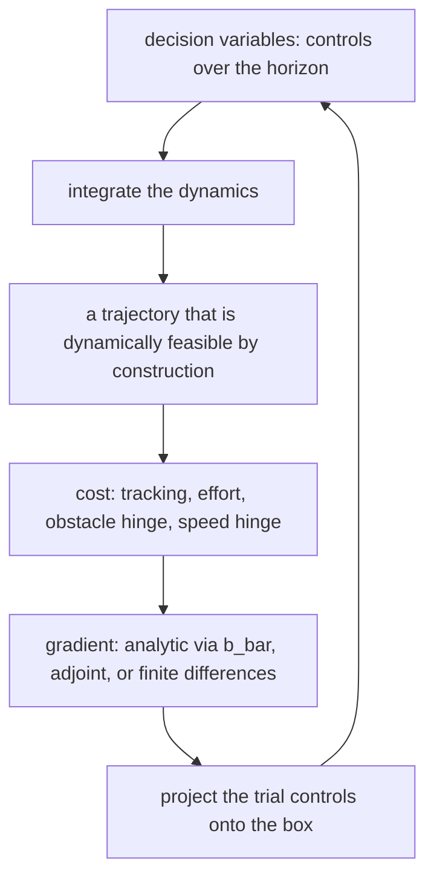
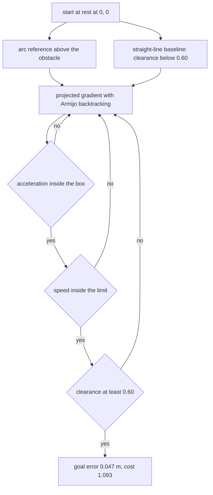
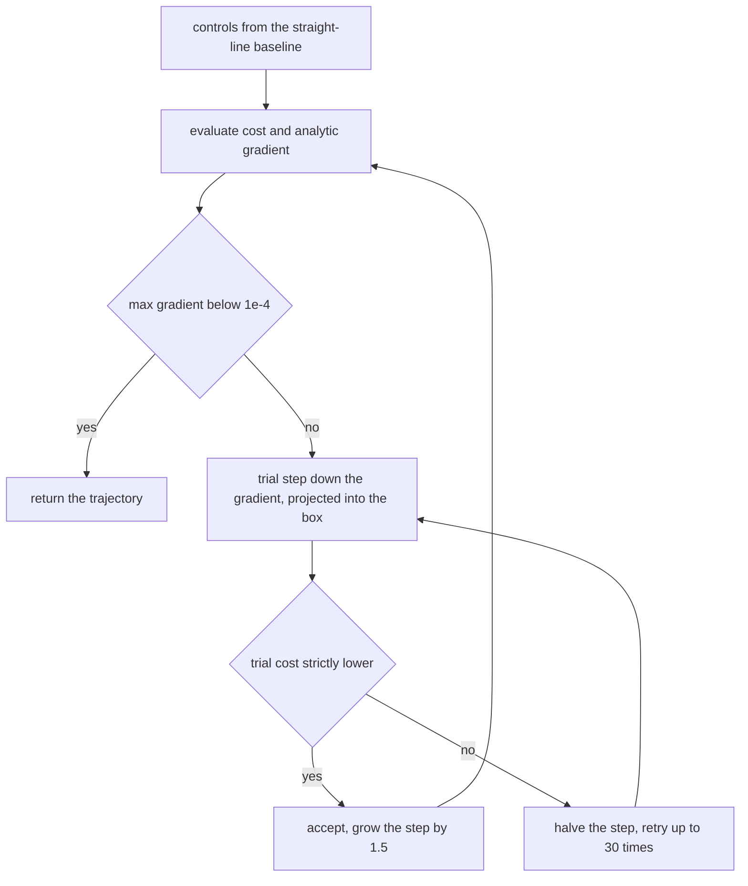
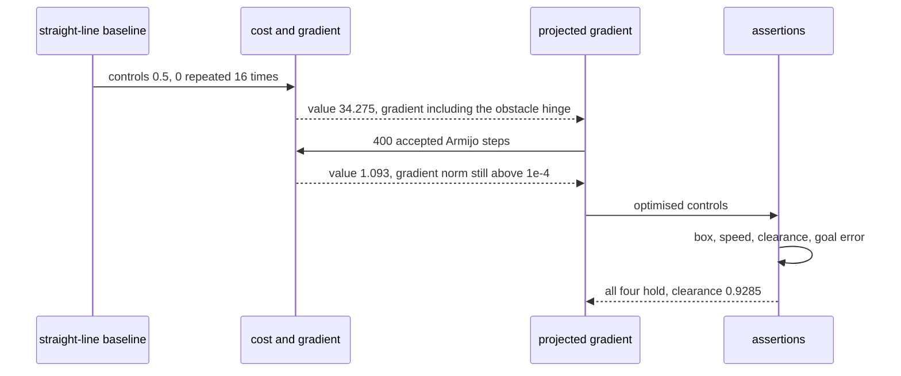

# 919 — Implement motion planning under differential constraints using trajectory optimization.

> **Tier:** Master · **CTCI chapter:** Beyond — Graphics, Geometry & Robotics
> **Task spec:** [919-implement-motion-planning-under-differential-constraints-using-t.md](../../../tasks/master/919-implement-motion-planning-under-differential-constraints-using-t.md)
> **Solutions:** [Python](../../../solutions/python/master/919-implement-motion-planning-under-differential-constraints-using-t/solution.py) ·
> [Java](../../../solutions/java/master/919-implement-motion-planning-under-differential-constraints-using-t/Solution.java) ·
> [JavaScript](../../../solutions/javascript/master/919-implement-motion-planning-under-differential-constraints-using-t/solution.js) ·
> [C#](../../../solutions/csharp/master/919-implement-motion-planning-under-differential-constraints-using-t/Solution.cs)

## 1. Problem restatement

**The modelling contract first.** Direct (single-shooting) trajectory optimisation in-process, with no
global planner, no roadmap, no sampling and no wall-clock budget. Each implementation picks its own
plant and its own feasible set; all of them share the same three-part contract:

- **dynamics are exact** — every candidate trajectory is produced by integrating the model, so no
  candidate is dynamically infeasible;
- **limits are respected** — the control box (and the curvature or speed limit) holds at the solution;
- **the path is collision free** — the obstacle clearance is asserted at the returned trajectory, and
  compared against a baseline that is shown to collide.

| Implementation | Plant | Decision variables | Constraint handling | Gradient |
| --- | --- | --- | --- | --- |
| Python | planar double integrator, `dt = 0.25`, `N = 16` | `(ax, ay)` per step | box `abs(u) <= A_MAX = 2.0`, soft speed hinge at `V_MAX = 1.8` | analytic through the condensed `b_bar` |
| Java | unicycle, `dt = 0.15` | `(v, omega)` per knot | projection enforcing `abs(v) <= 1.2`, `abs(omega) <= 2.0` and curvature `abs(omega) <= 1.5 · abs(v)` | central finite differences |
| JavaScript | unicycle, `dt = 0.2`, `N = 12` | `(v, omega)` per knot | projection onto the control box | exact adjoint backward pass |
| C# | unicycle, `T` samples | `(v, omega)` per sample | projection onto `abs(v) <= 1.5`, `abs(omega) <= 1.2` | central differences, adaptive step |

The Python scene: start `(0,0)` at rest, goal `(4, 0)`, a circular obstacle at `(2, 0)` with radius
`0.45` and a `0.15` margin, so the required clearance is **0.60 m**. The reference is the arc a global
planner would return — `x` ramps to the goal while `y` follows half a sine of amplitude
`0.45 + 0.15 + 0.35 = 0.95`.

| Run | Result (printed by the Python solution) |
| --- | --- |
| condensed map vs honest rollout | agreement below 1e-12 |
| analytic gradient vs central differences | agreement below 1e-4 |
| optimised cost | **1.093098** vs straight-line baseline **34.275469** |
| clearance at the solution | **0.9285 m** (required 0.60 m) |
| peak speed / goal error | **1.4273 m/s** (limit 1.8) / **0.04734 m** |
| zero horizon | empty controls, cost 0.0 |
| start already on a stationary reference | cost below 1e-12, controls below 1e-9 |

## 2. Intuition

The naive approach is a straight line to the goal with a constant acceleration chosen so the path
arrives on time — the Python baseline, `accel = 2 · (goal_x - start_x) / (N · dt)² = 0.5`. It is
dynamically valid, and it drives straight through the obstacle: its clearance is below the required
0.60 m, and its cost (34.28) is dominated by the obstacle hinge.

The first insight is that **the differential constraints live in the parameterisation, not in a
constraint list**. If the decision variables are the controls and the trajectory is produced by
integrating the dynamics, then the dynamics are satisfied by construction — there is nothing to
penalise and no equality constraint to enforce. The only constraints left are the box on the controls
and the hinge penalties on speed, clearance and tracking, all of which are cheap to evaluate and
differentiable (except at the hinge kink, which is where the Java and C# files switch to
finite differences).



The second insight is that **a soft hinge is enough when the cost is smooth and the weight is large**.
Obstacle clearance appears as `40 · max(0, r + margin - d)²`, which is exactly zero when the path is
clear and grows quadratically when it is not; the speed limit is the same construction with weight 60.
The optimiser therefore has no feasible set to search inside — the solver stays in the box (which is
projected) and the geometry is bought with penalty, which is why the returned clearance (0.93 m) is
comfortably above the requirement rather than exactly on it.



## 3. Algorithm

1. **Build the affine maps.** `powers[m] = A^m` and the block rows `b_bar[m] = [A^{m-j} B for j <= m]`,
   so `x_m = A^m x_0 + B_m u`: the state is an affine function of the controls.
2. **Define the cost.** Tracking `Σ_k ||p_k - ref_k||²`, effort `0.05 Σ_k ||u_k||²`, obstacle hinge
   `40 Σ_k max(0, r + margin - d_k)²` and speed hinge `60 Σ_k max(0, |v_k| - V_MAX)²`.
3. **Gradient.** Accumulate `grad_state[m]` from each penalty, then `grad_u = Σ_m B_m' grad_state[m]`;
   the control term adds `2 · 0.05 · u_j`.
4. **Optimise.** Projected gradient with Armijo backtracking: try `u - step · grad`, project into the
   box, accept only if the cost strictly decreases (halve the step up to 30 times), and grow the step by
   1.5 on success. Stop when `max |grad| < 1e-4` or after 400 iterations.
5. **Validate.** Compare the condensed map with an honest rollout, the analytic gradient with central
   differences, and the solution's cost and clearance with the straight-line baseline.

```text
procedure cost_and_grad(u, x0, refs, obstacle, N, powers, b_bar)
    states ← states_of(u, x0, N, powers, b_bar)
    value ← 0
    for each horizon step m do
        value ← value + w_track * ||position(m) - refs[m]||^2
        grad_state[m][position] ← 2 w_track (position(m) - refs[m])
        if obstacle is not null and distance(m) < clearance then
            value ← value + w_obs * (clearance - distance(m))^2
            grad_state[m][position] ← grad_state[m][position]
                                       - 2 w_obs (clearance - distance(m)) / distance(m)
                                         * (position(m) - obstacle)
        end
        for each velocity component do
            if absolute value of velocity > V_MAX then
                value ← value + w_speed * (speed - V_MAX)^2
                grad_state[m][velocity] ← 2 w_speed (speed - V_MAX) * sign(velocity)
            end
        end
    end
    gradient ← 0 for every control
    for each step m and control j do
        gradient[j] ← gradient[j] + sum over state rows i of b_bar[m][i][j] * grad_state[m][i]
    end
    value ← value + w_control * sum of u[j]^2
    gradient ← gradient + 2 w_control u
    return value, gradient
end

procedure optimize(u, x0, refs, obstacle, N, powers, b_bar, iterations)
    value, gradient ← cost_and_grad(u, x0, refs, obstacle, N, powers, b_bar)
    step ← 0.05
    for iteration in 1 .. iterations do
        if max absolute gradient < 1e-4 then break end
        trial_step ← step
        moved ← false
        for attempt in 1 .. 30 do
            candidate ← project(u - trial_step * gradient, A_MAX)
            trial_value ← cost_and_grad(candidate, ...)
            if trial_value < value - 1e-12 then
                u, value, gradient ← candidate, trial_value, new gradient
                step ← trial_step * 1.5
                moved ← true
                break
            end
            trial_step ← trial_step * 0.5
        end
        if not moved then break end
    end
    return u, value, trace of value per iteration
end
```



## 4. Worked example

The Python run's printed summary is

```text
optimised cost 1.093098 vs straight-line baseline 34.275469 (401 accepted steps)
clearance 0.9285 m, peak speed 1.4273 m/s, goal error 0.04734 m
```

The trace has 401 entries: one for the initial straight-line sequence plus one per iteration, so the
optimiser used all 400 iterations (the gradient threshold was not reached first) and every accepted step
strictly decreased the cost — the run asserts `trace[i+1] <= trace[i] + 1e-12` for every consecutive
pair and `trace[-1] < trace[0]`.

| Quantity | Baseline | Optimised | Assertion |
| --- | --- | --- | --- |
| cost | 34.275469 | 1.093098 | `value < 0.5 · baseline` |
| obstacle clearance | below 0.60 m (collides) | 0.9285 m | `clearance >= 0.60 - 1e-3` |
| peak speed | — | 1.4273 m/s | `speed <= V_MAX + 1e-6` |
| goal error | — | 0.04734 m | `|dx| < 0.05` and `|dy| < 0.08` |
| max control magnitude | 0.5 | inside the box | at most `A_MAX + 1e-9` |

The baseline's constant acceleration is `2 · (4 - 0) / (16 · 0.25)² = 0.5`, well inside the acceleration
box, so it is dynamically feasible and still wrong — which is the point of the comparison: the
differential constraints are satisfied by both trajectories, and only the optimised one clears the
obstacle. The optimiser's own trajectory trades tracking error (0.047 m of goal error, because the
horizon ends before the plant is exactly on the goal) for the clearance the obstacle hinge demands.



The gradient itself is checked before any of this: the analytic values at the probe sequence
`[0.4 - 0.05 j]` are compared with central differences (`h = 1e-6`) and must agree to 1e-4. The
condensed map is checked against an honest rollout on the alternating probe
`[-0.2, 0.3, -0.2, 0.3, ...]` to 1e-12, which is what licenses using `b_bar` inside the gradient.

## 5. Complexity

Let `N` be the horizon, `nx` the state dimension (4 here) and `nu` the control dimension (2).

| Measure | Bound | Why it holds |
| --- | --- | --- |
| `affine_maps` | `O(N² nx² nu)` | `N` block rows, each a product of a power of `A` with `B` |
| `states_of` (condensed) | `O(N · nx · N · nu)` | each state is one matrix-vector product against a block row |
| `rollout` (honest) | `O(N · nx · nu)` | one step per knot; used only as a cross-check |
| `cost_and_grad` | `O(N · (nx + nu) + N² nx nu)` | the penalty loop is linear; the gradient accumulates over `b_bar` |
| One Armijo iteration | `O(cost_and_grad)` per attempt, at most 30 attempts | each backtracking attempt re-evaluates both value and gradient |
| Whole optimisation | `O(iterations · attempts · N² nx nu)` | 400 iterations × 1 attempt on the trace's steps |
| Finite-difference gradient | `O(N nu)` evaluations, i.e. `32` here, instead of one analytic pass | the Java and C# files pay this; the Python and JavaScript files do not |
| Space | `O(N² nx nu)` for `b_bar`, `O(N nx)` for a trajectory | the Hessian is never formed: this is a first-order method |

The comparison that matters is against a **shooting method with a numerical gradient**: the Python run
computes 32 finite differences for its own verification at the cost of 33 `cost_and_grad` calls, while
one analytic gradient costs a single call — a factor of 33 at the same `N`. Central differences are what
the Java and C# files use in production; the analytic and adjoint variants exist here precisely so that
the two can be checked against each other.

## 6. Pitfalls and edge cases

- **A feasible baseline is not a good plan.** The straight-line sequence respects the acceleration box
  and still collides and costs 34.28 against 1.09. Any test that only asserts "the controls are legal"
  would pass on a planner that drives through walls.
- **Hinge penalties are not differentiable at contact.** `max(0, c - d)²` has a kink where `d = c`, so
  the Java and C# files use central differences and the Python file guards the gradient with
  `max(distance, 1e-9)`. Dropping that guard divides by zero exactly at the obstacle centre.
- **The optimiser is local.** The reference arc encodes the detour a global planner would return — the
  task explicitly documents "one fixed detour reference instead of a state-lattice search". Started from
  a sequence that already threads the wrong side of the obstacle, this method has no mechanism to escape.
- **Accepted steps must strictly decrease the cost.** The assertion is `trial_value < value - 1e-12`
  plus monotonicity of the whole trace; accepting a non-improving step "to make progress" is what turns
  a trace into noise and hides a step size that is too large.
- **Boundary cases.** `N = 0` must return an empty control sequence and cost 0.0 without touching the
  maps; a start that already sits on a stationary reference must yield cost below 1e-12 and controls
  below 1e-9, i.e. "no motion required" must be the returned plan, not a small wobble.
- **Differential constraints are more than a box.** The unicycle variants add the curvature limit
  `|omega| <= 1.5 |v|`, which couples the two controls; projecting each coordinate independently would
  violate it, so the projection is done on the pair. The task documents that the Python version keeps
  the speed limit *soft* (a hinge) while the acceleration box is hard — a deliberate asymmetry to keep
  the subproblem projection trivial.
- **Clearance is measured on the discretised trajectory.** `clearance_of` takes the minimum over the
  sampled knots, so a trajectory that passes between two samples can look clear; the discrete model is
  the model here, which is why the reported 0.9285 m is a fact about the samples and not about the true
  continuous path.
- **Determinism.** Re-running the optimiser produces byte-identical controls and cost — no random
  restart, no shuffled iteration order — so every number above is reproducible.

## 7. Variants and follow-ups

- **From trajectory optimisation back to control.** [918-implement-dynamic-qp-solver-for-real-time-control-in-robotics-mp.md](../../../tasks/master/918-implement-dynamic-qp-solver-for-real-time-control-in-robotics-mp.md)
  solves the same condensed structure as a box QP, which is the fast inner solver this method would use
  if the penalty terms became hard constraints.
- **Learning the model the planner differentiates.** [907-implement-differentiable-programming-demo-for-physical-simulatio.md](../../../tasks/master/907-implement-differentiable-programming-demo-for-physical-simulatio.md)
  makes the dynamics themselves differentiable objects, so the `b_bar` blocks are computed by
  autodiff instead of being derived by hand.
- **Where the state estimate comes from.** [920-implement-end-to-end-slam-with-loop-closure-detection-and-pose-g.md](../../../tasks/master/920-implement-end-to-end-slam-with-loop-closure-detection-and-pose-g.md)
  supplies the `x_0` that this planner treats as exact, and its `x_0` is a posterior.
- **Planning when a grasp is the goal.** [921-implement-robot-manipulation-planner-with-grasp-sampling-and-sco.md](../../../tasks/master/921-implement-robot-manipulation-planner-with-grasp-sampling-and-sco.md)
  adds the discrete choice of *what* to move to, on top of the continuous question of how.

## 8. Check yourself

1. Why does the Python version treat the acceleration box as a hard constraint and the speed limit as a
   penalty?

<details><summary>Show answer</summary>

Because projection onto a box is a per-coordinate clamp — `O(nu)` and exact — while the speed limit is a
nonlinear function of the *state*, which is not a decision variable. Enforcing it exactly would require
either putting the state into the decision vector (collocation) or adding an inequality row per knot and
handling an active set. The hinge instead keeps the cost smooth and pays `60 · (|v| - V_MAX)²` when the
limit is broken; the run asserts the resulting peak speed is 1.4273 m/s, inside the 1.8 m/s limit, so the
penalty is doing its job without the extra machinery.

</details>

2. The goal error at the solution is 0.047 m, not zero. Why is that acceptable, and what would you change
   to reduce it?

<details><summary>Show answer</summary>

Because the cost is a sum over the horizon with a modest tracking weight, so the optimiser balances
reaching the goal against clearing the obstacle and keeping the controls small; with 16 steps of 0.25 s
and a peak speed of 1.43 m/s the horizon is barely long enough for the required detour. Raising the
horizon, adding a terminal weight on `||p_N - goal||²` (which is what the Java, JavaScript and C# files
do with `60||p_N - goal||²` or `50||p_N - goal||²`), or increasing the tracking weight would all reduce
the residual. The assertions encode the negotiated outcome: `|dx| < 0.05` and `|dy| < 0.08`.

</details>

3. Why is the analytic gradient compared with central differences, when the analytic one already matches
   an honest rollout?

<details><summary>Show answer</summary>

Because they test different things. The rollout comparison validates the *condensed state map*
`x_m = A^m x_0 + B_m u`; the gradient comparison validates the chain rule applied to every penalty term —
tracking, the obstacle hinge with its `1 / distance` factor, and the speed hinge with its sign — plus the
accumulation `grad_u = Σ_m B_m' grad_state[m]`. An error in one penalty's derivative would leave the
forward map perfect and the descent direction wrong, which is exactly the bug class that finite
differences catch (agreement to 1e-4 with `h = 1e-6`).

</details>

4. Two implementations use projection and the Python one uses patience: 400 iterations of projected
   gradient. What determines the number of iterations, and when would you stop earlier?

<details><summary>Show answer</summary>

The stopping rule is `max |grad| < 1e-4`, and the trace shows 401 entries, so on this problem the
threshold is not reached and the horizon is the binding limit — the run records that honestly instead of
claiming convergence. In a real-time setting the budget comes from the control period, not from a
gradient threshold: you would cap wall-clock time, warm-start from the previous sample's solution, and
accept a suboptimal control for the next tick, which is the classic MPC trade the task documents as
"no warm start" here.

</details>
