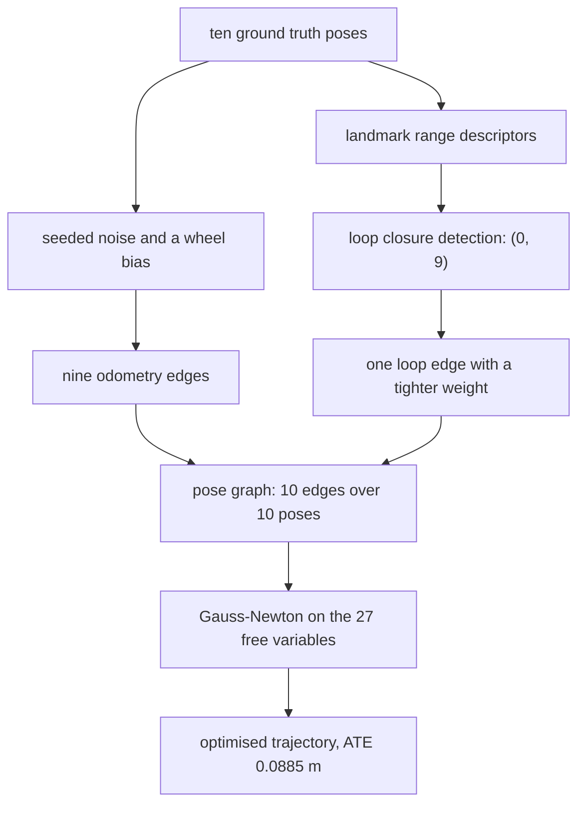
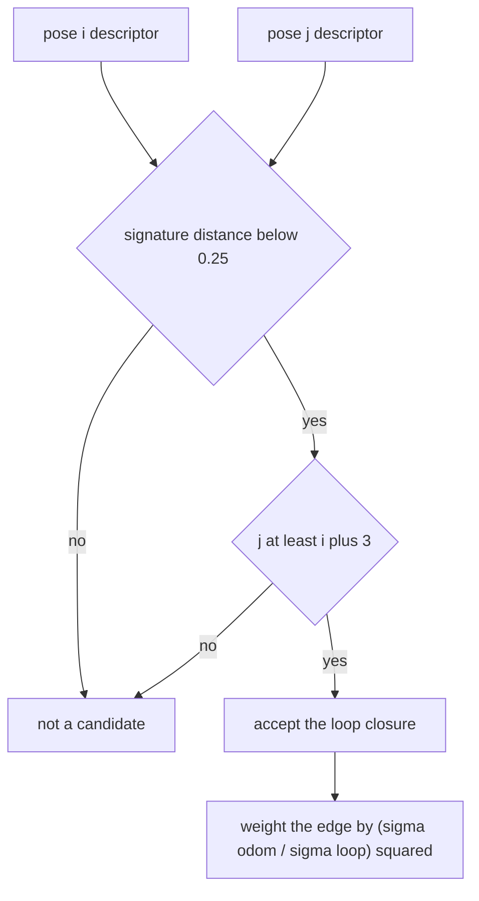
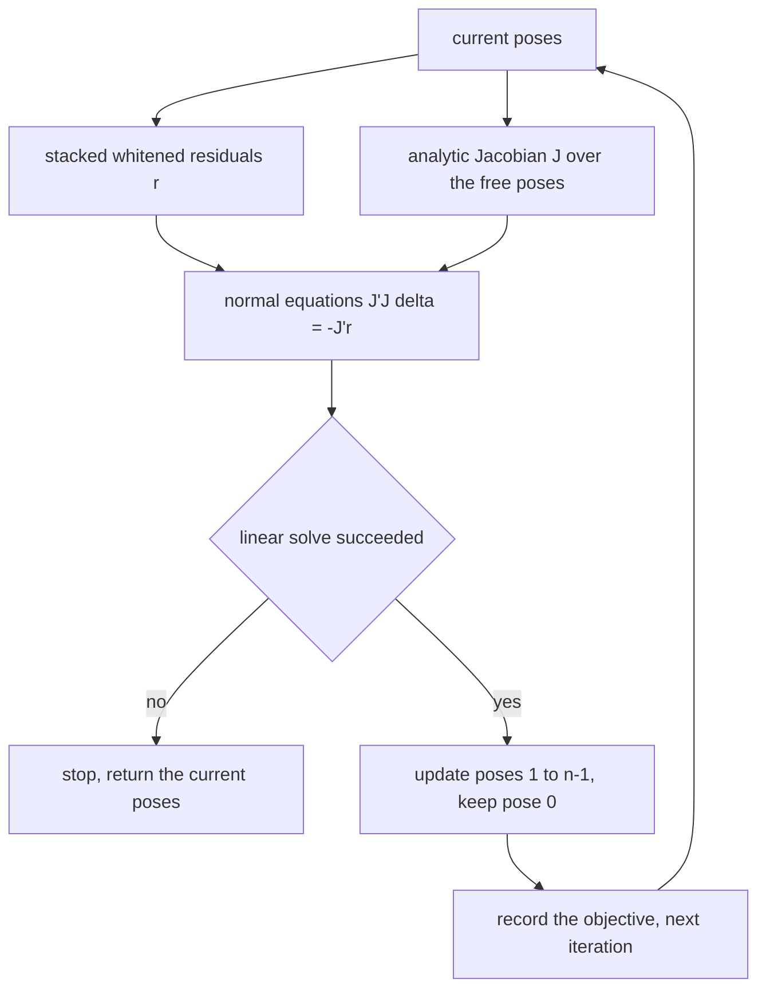
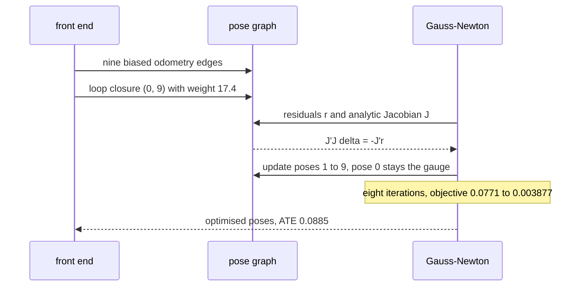

# 920 — Implement end-to-end SLAM with loop closure detection and pose graph optimization.

> **Tier:** Master · **CTCI chapter:** Beyond — Graphics, Geometry & Robotics
> **Task spec:** [920-implement-end-to-end-slam-with-loop-closure-detection-and-pose-g.md](../../../tasks/master/920-implement-end-to-end-slam-with-loop-closure-detection-and-pose-g.md)
> **Solutions:** [Python](../../../solutions/python/master/920-implement-end-to-end-slam-with-loop-closure-detection-and-pose-g/solution.py) ·
> [Java](../../../solutions/java/master/920-implement-end-to-end-slam-with-loop-closure-detection-and-pose-g/Solution.java) ·
> [JavaScript](../../../solutions/javascript/master/920-implement-end-to-end-slam-with-loop-closure-detection-and-pose-g/solution.js) ·
> [C#](../../../solutions/csharp/master/920-implement-end-to-end-slam-with-loop-closure-detection-and-pose-g/Solution.cs)

## 1. Problem restatement

**The modelling contract first.** An in-process, deterministic SLAM pipeline for a planar robot on a
closed loop of **ten** `SE(2)` poses. The front end is *simulated* rather than sensed: ground-truth
poses are turned into noisy relative measurements by a seeded splitmix64 stream, so a run is replayable
and the ground truth is available for scoring. The back end is a real pose-graph optimiser. The
documented simplifications: landmark-*range* descriptors instead of scan matching, exactly one loop
closure in the scene, and dense linear algebra instead of a sparse solver.

The scene: four landmarks at `(-1, 1)`, `(3, 1)`, `(1, -1)`, `(1, 3)`; ten ground-truth poses that walk
a rectangle and return to the start, ending at `(0, 0, 0)`; odometry noise `sigma = (0.05, 0.05, 0.025)`
with a deliberate wheel-calibration **bias** `(0.05, -0.03, 0.02)`; loop-closure noise
`sigma = (0.012, 0.012, 0.006)`.

| Run | Result (printed by the Python solution) |
| --- | --- |
| loop closure detection | exactly `[(0, 9)]` — no false positives |
| pose graph | 9 odometry edges + 1 loop edge = 10 |
| objective over 8 Gauss-Newton steps | **0.0771 → 0.003877** |
| analytic Jacobian vs central differences | worst error **3.42e-10** |
| ATE (odometry → optimised) | **0.1257 m → 0.0885 m** |
| three-pose chain closed form | `a = 3.4/3`, `b = 6.8/3` |
| one-pose graph / edge-free graph | unchanged, objective trace `[0.0]` |

## 2. Intuition

Dead reckoning integrates relative motion: each odometry edge is added to the previous pose. Because
the bias `(0.05, -0.03, 0.02)` is applied to every one of the nine edges, the error accumulates instead
of averaging out, so the chain comes back to a final pose visibly short of the start even though each
individual measurement looks precise. This is the "before" baseline of the pipeline: ATE 0.1257 m over
the trajectory, and a loop that does not close.

The first insight is that **a loop closure is a constraint, not a measurement of the world**. The pose
the robot believes it is at after nine steps is a *belief* built from nine noisy numbers; when the front
end recognises the start again, it supplies a tenth constraint that says "these two poses are close",
and the optimiser is free to violate every odometry edge a little in order to satisfy it. The residuals
are therefore expressed in the *local frame* of each edge — `r = R_i^T (t_j - t_i) - t_ij` for the
translation and a wrapped angle difference for the rotation — so each one is small exactly when the
relative geometry the sensor reported is reproduced by the current pose estimates.



The second insight is that **detection must be gated by both agreement and separation**. A descriptor
match alone produces false positives: two poses on the same corridor can have nearly identical landmark
ranges without being the same place. The Python detection therefore requires the signatures to agree
within `MATCH_TOL = 0.25` *and* the poses to be at least `MIN_SEPARATION = 3` apart in time; the
JavaScript version goes further and requires the post-alignment RMS residual of a closed-form 2D
Kabsch/Umeyama step over known landmark correspondences to fall below a tolerance. In this scene the
gate admits exactly one pair, `(0, 9)`.



## 3. Algorithm

1. **Simulate.** Walk the ground-truth poses; for each consecutive pair draw a noisy relative transform
   with the odometry sigma *and* the calibration bias; store it as an edge with weight 1.0.
2. **Describe.** For each pose, compute the rounded distances to the four landmarks; the signature is the
   descriptor.
3. **Detect.** For every pair `(i, j)` with `j >= i + MIN_SEPARATION`, accept when the `L1` distance
   between signatures is below `MATCH_TOL`; draw a noisy relative transform for it with the loop sigma
   and weight `(ODOM_SIGMA / LOOP_SIGMA)²` — the inverse-variance weighting a whitening step would give.
4. **Residuals.** For each edge, whiten by `sqrt(weight)` and evaluate
   `[R_i^T (t_j - t_i) - t_ij ; wrap(theta_j - theta_i - theta_ij)]`.
5. **Jacobian.** Fill the dense analytic Jacobian: the 3x3 block for pose `i` is
   `[[-R00, -R01, spin_x], [-R10, -R11, spin_y], [0, 0, -1]]` with `spin = J R t`, `J = [[0,1],[-1,0]]`,
   and the block for pose `j` is the same without the spin column and `+1` in the angle slot. Pose 0 is
   the gauge and has no columns.
6. **Solve.** Eight damped Gauss-Newton iterations: build `J'J` (plus `1e-9` on the diagonal), solve
   `J'J delta = -J'r` by Gauss-Jordan with partial pivoting, and add `delta` to the free poses, keeping
   pose 0 fixed.
7. **Score.** Compare the ATE of the dead-reckoned chain with the optimised trajectory, and check the
   final pose closes the loop.

```text
procedure detect_loop_closures(poses)
    signatures ← [descriptor of pose for pose in poses]
    found ← empty list
    for i ← 0 to count(poses) - 1 do
        for j ← i + MIN_SEPARATION to count(poses) - 1 do
            if sum of absolute signature differences < MATCH_TOL then
                append (i, j) to found
            end
        end
    end
    return found
end

procedure residuals(poses, edges)
    out ← empty list
    for each (i, j, measurement, weight) in edges do
        local ← transpose(poses[i].theta) applied to (t_j - t_i)
        scale ← square root of weight
        append (scale * (local[x] - measurement.dx),
                scale * (local[y] - measurement.dy),
                scale * wrap(poses[j].theta - poses[i].theta - measurement.dtheta)) to out
    end
    return out
end

procedure gauss_newton(poses, edges, iterations)
    trace ← [objective(poses, edges)]
    for iteration in 1 .. iterations do
        r ← residuals(poses, edges)
        J ← jacobian(poses, edges)
        normal ← J' J with 1e-9 added on the diagonal
        gradient ← J' r
        delta ← solve_linear(normal, -gradient)
        if delta is null then break end
        for index ← 1 to count(poses) - 1 do
            poses[index] ← poses[index] + delta for that pose
        end
        append objective(poses, edges) to trace
    end
    return poses, trace
end
```



## 4. Worked example

The Python run's printed summary is

```text
loop closures [(0, 9)], edges 10, objective 0.0771 -> 0.003877 in 8 Gauss-Newton steps
ATE odometry 0.1257 m -> optimised 0.0885 m, Jacobian error 3.42e-10
```

The ground-truth loop is a rectangle with a return leg: `(0,0,0) → (1,0,0) → (2,0,0) → (2,1,π/2) →
(2,2,π/2) → (1,2,π) → (0,2,π) → (0,1.4,-π/2) → (0,0.7,-π/2) → (0,0,0)`. Pose 0 and pose 9 have the same
landmark ranges by construction, which is why the descriptor gate fires on `(0, 9)` and on nothing else.

| Step | What happens | Number |
| --- | --- | --- |
| 1 | odometry edges with bias | 9 edges, weight 1.0 |
| 2 | descriptor gate over all pairs with `j >= i + 3` | 1 accepted pair, `(0, 9)` |
| 3 | loop edge weight `(0.05 / 0.012)²` | about 17.4, so it outvotes the odometry chain |
| 4 | Gauss-Newton objective | 0.0771 → 0.003877 |
| 5 | Jacobian check against central differences (`h = 1e-6`) | worst error 3.42e-10 |
| 6 | ATE before/after | 0.1257 m → 0.0885 m |
| 7 | maximum residual after optimisation | below 0.05 |

The weighting is what makes the result a *correction* rather than a compromise: the loop edge is
roughly 17 times more informative than each odometry edge, so the optimiser distributes the closure
error across all nine odometry edges — each moves a little, none is discarded. The remaining ATE
(0.0885 m) is the residue of that distribution: the odometry bias is systematic, so no set of poses can
satisfy both the biased chain and the unbiased loop, and the least-squares compromise sits between them.



The closed-form check pins the optimiser to hand arithmetic on a three-pose translation-only chain with
measurements `1.0`, `1.0` and an inconsistent loop of `2.4`: minimising
`(a - 1)² + (b - a - 1)² + (b - 2.4)²` gives `a = 3.4/3 ≈ 1.1333` and `b = 6.8/3 ≈ 2.2667`, and
Gauss-Newton reproduces both to 1e-6. Boundaries behave the same way: a one-pose graph and an edge-free
graph both return unchanged with an objective trace of `[0.0]`, so the optimiser does not invent motion
where there is no constraint.

## 5. Complexity

Let `n` be the number of poses, `m` the number of edges and `k = 3(n-1)` the number of free variables.

| Measure | Bound | Why it holds |
| --- | --- | --- |
| Simulation | `O(n · m_landmarks + m)` | one relative transform per edge, one descriptor per pose |
| Detection | `O(n² · L)` for `L` landmarks | all ordered pairs are compared, signatures are length `L` (4 here) |
| Residuals | `O(m)` | one 3-vector per edge |
| Analytic Jacobian | `O(m · k)` | each edge contributes 3 rows with at most 6 non-zero columns |
| Normal equations | `O(m · k²)` with dense assembly | `J'J` is `k x k`; the run forms it densely |
| Linear solve | `O(k³)` | Gauss-Jordan with partial pivoting on 27 x 27 in the trace |
| Gauss-Newton | `O(iterations · (m k² + k³))` | 8 iterations; the objective decreases monotonically |
| Detect + optimise, dense | `O(n² L + iterations · (m k² + k³))` | dominated by the `k³` solve for small `n` |
| Sparse alternative | `O(iterations · (m k + k))` with a sparse Cholesky | the graph is nearly a chain, so `J'J` is banded — the documented simplification is dense algebra |

The comparison that matters is **dead reckoning versus pose graph optimisation at fixed measurement
count**: integration is `O(n)` and produces ATE 0.1257 m, while the optimiser is superlinear and produces
0.0885 m. The extra cost is only worth paying because the loop edge exists; without it the same
machinery reduces to re-fitting an already-optimal chain.

## 6. Pitfalls and edge cases

- **A gate on agreement alone creates false positives.** Two different poses can have similar landmark
  ranges; the Python detector requires `j >= i + 3` as well, and the JavaScript file verifies the
  candidate with a closed-form 2D alignment (Kabsch/Umeyama over known landmark correspondences) before
  accepting it. The run asserts the detected set is exactly `[(0, 9)]`, not "at least".
- **Angles must be wrapped, in residuals and in Jacobian assembly.** `wrap` maps into `(-π, π]`; without
  it, a measurement near the `±π` boundary contributes a residual of nearly `2π` and the optimiser
  corrects in the wrong direction. Closed-form and wrapped chains are also why the trace starts at
  `0.0771` rather than `0`.
- **The gauge must be fixed.** Pose 0 is held exactly (`optimised[0] == fixed_pose`), and the normal
  matrix is damped by `1e-9` on the diagonal: the residual depends only on *relative* poses, so without
  a gauge the system is singular in three directions. Returning a different but equivalent trajectory
  would break the ATE comparison against the ground truth.
- **Bias is not noise.** Pure noise would average out over nine edges; the deliberate `(0.05, -0.03, 0.02)`
  bias is what makes dead reckoning fail visibly (`before > 0.08` is asserted) and gives the loop closure
  something to correct.
- **Damping is not optional.** `solve_linear` returns `None` when the pivot falls below `1e-12`, and
  `gauss_newton` then returns the current poses — a numerically singular system ends the iteration rather
  than producing NaNs.
- **Degenerate graphs.** A single pose must return unchanged with trace `[0.0]` (there are no free
  variables), and a graph with no edges must not be modified at all; both are asserted, and both are the
  cases where a naive implementation divides by `n - 1 = 0`.
- **The final pose is the headline metric.** The run checks both the mean ATE (`after < 0.8 · before`)
  and the endpoint drift (`optimised_end < 0.4 · drift_end`), because a loop closure can improve the
  average while leaving the closing pose wrong — which is exactly the failure the loop edge exists to fix.
- **Determinism.** Rebuilding the front end and re-solving reproduces identical poses and identical
  edges; the noise stream is seeded, so every number in this section is a property of the code.

## 7. Variants and follow-ups

- **When the trajectory is not yet fixed.** [919-implement-motion-planning-under-differential-constraints-using-t.md](../../../tasks/master/919-implement-motion-planning-under-differential-constraints-using-t.md)
  plans through known poses, whereas SLAM's poses are the unknowns; combined, they are the
  exploration-versus-exploitation loop of a real robot.
- **Poses that carry a controller.** [918-implement-dynamic-qp-solver-for-real-time-control-in-robotics-mp.md](../../../tasks/master/918-implement-dynamic-qp-solver-for-real-time-control-in-robotics-mp.md)
  consumes the estimate this pipeline produces and shows what changes when the state enters the
  optimisation instead of being assumed exact.
- **Matching as a separate discipline.** The descriptor gate here is deliberately crude;
  [950-implement-scalable-nearest-neighbor-with-multi-index-hashing-and.md](../../../tasks/master/950-implement-scalable-nearest-neighbor-with-multi-index-hashing-and.md)
  is the scalable nearest-neighbour machinery that real place recognition runs on.
- **Data association for manipulation.** [921-implement-robot-manipulation-planner-with-grasp-sampling-and-sco.md](../../../tasks/master/921-implement-robot-manipulation-planner-with-grasp-sampling-and-sco.md)
  is the same "which observation belongs to which model" question, answered with grasp candidates
  instead of pose pairs.

## 8. Check yourself

1. Why is the loop edge weighted by `(sigma_odom / sigma_loop)²` rather than by 1?

<details><summary>Show answer</summary>

Because that is the inverse-variance (whitening) factor: a measurement with half the standard deviation
deserves four times the weight. The odometry sigma is 0.05 and the loop sigma is 0.012, so the loop edge
is about 17 times more informative than any single odometry edge — the optimiser therefore prefers to
redistribute error across the nine biased chain edges instead of bending the closure. Using weight 1 for
everything produces a compromise between the loop and the bias, and a worse ATE.

</details>

2. The optimiser reduces ATE from 0.1257 m to 0.0885 m but does not drive it to zero. Why not?

<details><summary>Show answer</summary>

Because the odometry measurements carry a *systematic* bias: all nine edges are short in `x` by 0.05 and
rotated by 0.02. Least squares finds the pose set minimising the weighted sum of squared residuals; a
consistent set would need to satisfy the biased chain and the unbiased loop simultaneously, which is
impossible. The residual after optimisation is asserted to be below 0.05 per measurement, which is the
honest statement: the graph is as consistent as the measurements allow, not perfect.

</details>

3. What goes wrong without the time-separation requirement in loop closure detection?

<details><summary>Show answer</summary>

Adjacent poses have almost identical landmark ranges by construction — the robot has barely moved — so
agreement alone would propose edges `(i, i+1)` everywhere. Those are not loop closures but duplicates of
odometry, and with the tighter loop weight they would dominate the graph and effectively re-fit the
chain. `MIN_SEPARATION = 3` removes them; the JavaScript variant additionally requires the
alignment residual to be small, which rejects the subtler false positive of two *distant* poses with
similar ranges.

</details>

4. Why does the run compare the Jacobian with central differences when it also reports a decreasing
   objective?

<details><summary>Show answer</summary>

Because a wrong Jacobian can still decrease the objective for a few iterations while converging to the
wrong point — or converge much more slowly. The finite-difference check (`h = 1e-6`, worst error
3.42e-10) validates every entry, including the `spin` column that couples the translation residual to a
rotation of pose `i`, which is the term hand-derived Jacobians usually get wrong. Gauss-Newton's
quadratic convergence is a *consequence* of that correctness, not evidence for it.

</details>
