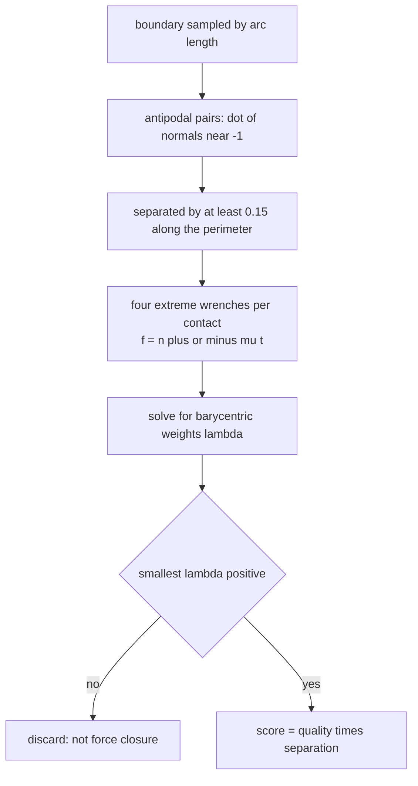
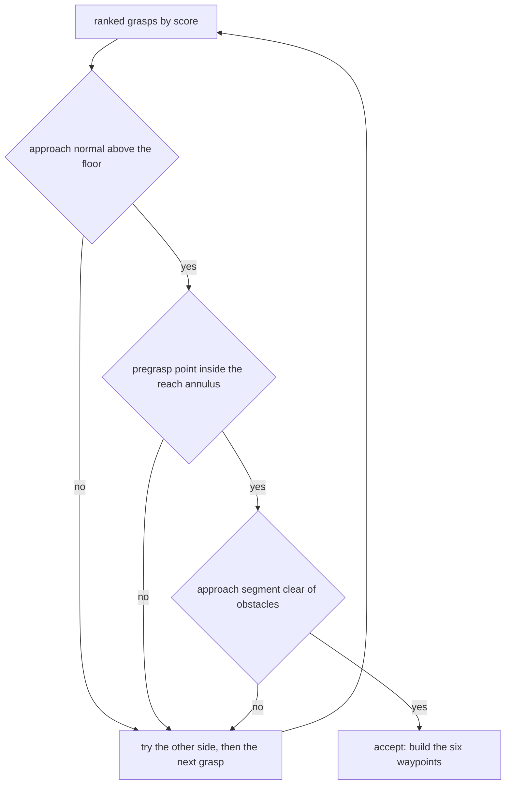
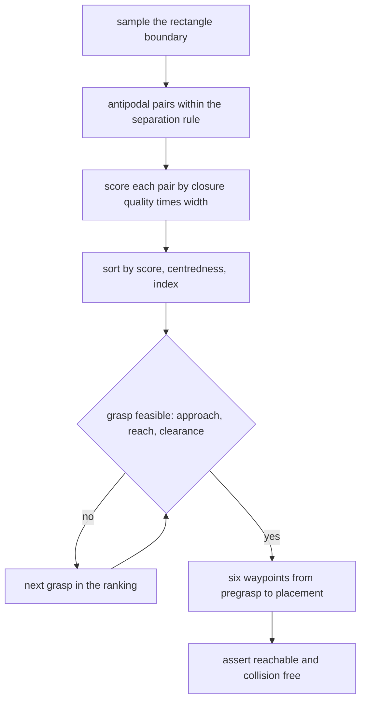
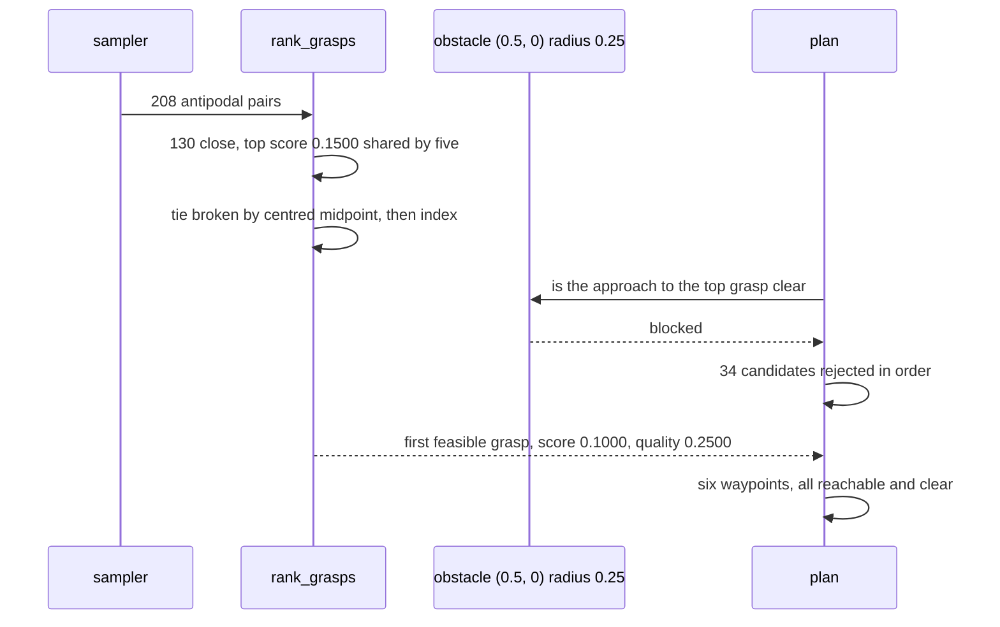

# 921 — Implement robot manipulation planner with grasp sampling and scoring.

> **Tier:** Master · **CTCI chapter:** Beyond — Graphics, Geometry & Robotics
> **Task spec:** [921-implement-robot-manipulation-planner-with-grasp-sampling-and-sco.md](../../../tasks/master/921-implement-robot-manipulation-planner-with-grasp-sampling-and-sco.md)
> **Solutions:** [Python](../../../solutions/python/master/921-implement-robot-manipulation-planner-with-grasp-sampling-and-sco/solution.py) ·
> [Java](../../../solutions/java/master/921-implement-robot-manipulation-planner-with-grasp-sampling-and-sco/Solution.java) ·
> [JavaScript](../../../solutions/javascript/master/921-implement-robot-manipulation-planner-with-grasp-sampling-and-sco/solution.js) ·
> [C#](../../../solutions/csharp/master/921-implement-robot-manipulation-planner-with-grasp-sampling-and-sco/Solution.cs)

## 1. Problem restatement

**The modelling contract first.** A planar grasp-and-place planner: a rectangular object with half
extents `(0.3, 0.2)` centred at `(0.9, 0.0)`, a two-finger gripper, a base at the origin with a reach
annulus `[0.25, 1.1]`, one disc obstacle at `(0.5, 0.0)` of radius `0.25`, and a target pose
`(0.6, 0.4, π/6)`. The documented simplifications: planar grasps, a rectangular object, one gripper
type, disc obstacles, and no arm kinematics beyond a reach test.

**Inputs.** A friction coefficient `mu = 0.5`, a boundary sample budget `K_SAMPLES = 40` (which yields
40 boundary points), a minimum finger separation `0.15`. **Outputs.** A ranked list of antipodal grasps
with scores, a chosen grasp, and a list of waypoints — or `None` when nothing is feasible.

| Run | Result (printed by the Python solution) |
| --- | --- |
| sampled antipodal grasps | **208** |
| pairs surviving the force-closure test | **130** |
| best score / chosen score | **0.1500 (blocked, tied with four others)** / **0.1000** |
| rank of the accepted grasp in the score order | **35** (34 rejected candidates) |
| waypoints | **6** |
| closure quality of the chosen grasp | **0.2500** |
| symmetric opposite-edge grasp, hand-built | quality exactly **0.25** |
| two contacts on the same face | not force closure (`quality <= 1e-9`) |
| friction ladder `mu = 0.1, 0.3, 0.7, 1.0` on a lateral-offset grasp | strictly increasing; needs enough friction to close |
| 3x finer sampling grid (120 samples) | best score 0.1500, so the coarse grid is not beaten |
| zero-size object / empty samples / fully blocked scene | no samples / `None` / `None` |

## 2. Intuition

The naive grasp search enumerates contact pairs and keeps the widest one, on the theory that a wider
grasp is a more stable one. Width is a bad proxy: two contacts on the *same* face of the object can be
arbitrarily far apart and cannot hold anything, because both finger forces push the object in the same
direction.

The first insight is that stability is a **force-closure** question, and in the plane it is a 4-point
convex-hull test. Each finger can push along its contact normal with any tangential component inside the
friction cone, so each contact contributes two extreme wrenches `f = n ± mu·t`, and the torque they
generate is `c_x f_y - c_y f_x` about the object's centre. The grasp is force closure exactly when the
origin lies inside the convex hull of those four wrenches — which is the linear system
`Σ λ_i w_i = 0`, `Σ λ_i = 1` having all `λ_i > 0`. Solving that 4x4 system gives both a yes/no answer
and a **quality**: the smallest `λ_i`, i.e. how far inside the hull the origin sits.



The second insight is that **planning is ranking plus rejection, not optimisation**. `rank_grasps`
sorts by `(-score, centring distance, index)`, and `plan` walks that order asking each grasp whether it
is executable: the approach normal must point mostly upward (`n_y >= -0.4`), the pregrasp point 0.1 m
along that normal must be inside the reach annulus, and the approach segment must be collision free
(checked at nine interpolation points). The run's trace is the argument for keeping the two concerns
apart: five grasps tie at the top score of 0.1500, the centredness tie-break orders them, and the
planner rejects 34 candidates before accepting one scoring 0.1000 — the ranking is a *preference*, and
feasibility is a veto.



## 3. Algorithm

1. **Sample the boundary.** Walk the four rectangle edges, allocating samples in proportion to edge
   length, and record each sample's outward normal.
2. **Form antipodal pairs.** Keep `(i, j)` with `dot(n_i, n_j) <= -0.999`, `i != j`, perimeter separation
   at least `MIN_SEPARATION` (accounting for the wrap-around), and one canonical ordering per unordered
   pair.
3. **Wrenches.** For each contact, take the tangent `(-n_y, n_x)` and build `f = n ± mu·t` with torque
   `c_x f_y - c_y f_x` relative to the object's centre.
4. **Closure quality.** Solve the 4x4 system with rows `(w_x, w_y, w_tau, 1)` against `(0, 0, 0, 1)`;
   `min(λ)` is the quality, `-1.0` when the system is singular, and `<= 0` means no closure.
5. **Score.** `quality · ||contact_a - contact_b||`, or `None` when the grasp does not close.
6. **Rank and plan.** Sort by descending score, preferring the most centred midpoint on ties; walk the
   order, try both approach sides, and accept the first pair that is reachable and collision free.
7. **Place.** Transform the object so its centre lands on the target: the midpoint carries onto
   `TARGET[:2]`, the placed contacts stay on the target boundary, and the grasp width is preserved.

```text
procedure closure_quality(grasp, mu)
    points ← four wrenches of the two friction cones about the object centre
    matrix ← rows (w_x, w_y, w_tau, 1) for the four wrenches
    weights ← solve_linear(matrix, (0, 0, 0, 1))
    if weights is null then return -1.0 end
    return the smallest weight
end

procedure rank_grasps(grasps, mu)
    scored ← empty list
    for index, grasp in enumerate(grasps) do
        quality ← closure_quality(grasp, mu)
        if quality > 1e-9 then
            separation ← distance between the two contacts
            centring ← distance of the grasp midpoint from the object centre
            append (quality * separation, centring, index, grasp) to scored
        end
    end
    sort scored by descending score, then ascending centring, then index
    return scored
end

procedure plan(grasps, mu)
    for each (score, index, grasp) in rank_grasps(grasps, mu) do
        for side in (0, 1) do
            contact ← world coordinate of the chosen contact
            normal ← outward normal of that contact
            pregrasp ← contact + 0.1 * normal
            clear ← no obstacle on any of the nine points along the approach segment
            if normal.y >= MIN_APPROACH_Y and reachable(pregrasp) and clear then
                midpoint ← world midpoint of the two contacts
                return the six waypoints around midpoint and TARGET
            end
        end
    end
    return null
end
```



## 4. Worked example

The Python run's printed summary is

```text
sampled 208 antipodal grasps, best score 0.1500 (blocked), chosen score 0.1000
waypoints 6, closure quality of the chosen grasp 0.2500
```

Hand-built cases pin the closure test before the sampler is used at all:

| Grasp | Contacts | Quality | Reading |
| --- | --- | --- | --- |
| symmetric opposite-edge | `(0, 0.2)` and `(0, -0.2)`, normals `(0,1)`, `(0,-1)` | exactly **0.25** | the ideal antipodal grasp: `1/4` is the barycentric weight of the origin |
| same face | `(0, 0.2)` and `(0.1, 0.2)`, both normals `(0,1)` | `<= 1e-9` | parallel normals cannot close, however wide the fingers open |
| lateral offset | `(0.1, 0.2)` and `(-0.1, -0.2)` | grows with `mu` | at `mu = 0.3` still not closing; at `mu = 0.7` closing |
| any two-contact antipodal grasp at `mu = 0` | — | `<= 1e-9` | without friction the wrench hull contains no origin |

The friction ladder is the monotonicity check: `closure_quality` for `mu = 0.1, 0.3, 0.7, 1.0` must be
strictly increasing, and the assertion `ladder[1] <= 0.0 < ladder[2]` states that the laterally offset
grasp is infeasible at `mu = 0.3` and feasible at `mu = 0.7` — the friction coefficient is not a
cosmetic parameter, it decides which grasps exist.



The ordering detail matters for reproducibility: five grasps share the maximum score of 0.1500, so
without the `(centredness, index)` tie-break the "best" grasp would be implementation-defined, and the
accepted grasp — position 35 in the ordering — would differ between runs. The accepted grasp's own
closure quality is exactly 0.2500, the same value as the hand-built symmetric grasp, which is the
sampling grid landing on an antipodal pair at the middle of two opposite faces.

Placement is checked as a rigid transform rather than a waypoint list: the grasp midpoint maps exactly
onto `(0.6, 0.4)` (to 1e-9), each placed contact satisfies
`max(|x| / 0.3, |y| / 0.2) = 1` in the target frame — i.e. it is still on the rectangle's boundary — and
the distance between the two contacts is preserved to 1e-9. The last two properties are what make the
choice of a *centred* grasp matter: a grasp whose midpoint is offset from the centre of mass would
place the object off-target or rotate it during the transfer.

## 5. Complexity

Let `S` be the boundary sample count, `G` the number of antipodal pairs actually formed, `W` the number
of waypoints (6) and `M` the interpolation points used for collision checking (9).

| Measure | Bound | Why it holds |
| --- | --- | --- |
| Boundary sampling | `O(S)` | one point per edge-length-proportional step; `S = 40` |
| Antipodal pairing | `O(S²)` | every ordered pair is tested for antipodal normals and separation; the run forms **208** pairs |
| Wrench construction | `O(1)` per pair | four wrenches from two normals |
| Closure quality | `O(1)` numeric solve, `O(W³)` in general | a fixed 4x4 Gauss-Jordan here |
| Scoring | `O(G)` | one quality solve plus one distance per pair; **130** pairs survive the closure test |
| Ranking | `O(G log G)` | the surviving pairs are sorted by (score, centredness, index) |
| Planning | `O(R · M)` for `R` rejected candidates and `M = 9` clearance samples | the accepted grasp sits at rank 35, so 34 candidates were examined and rejected |
| Fine-grid comparison | `O((3S)²)` = 9x the pairing work | the check only asserts the coarse best is within 20% of the fine best; both report 0.1500 |
| Space | `O(S + G)` | samples and pairs; the wrench algebra is constant-size |

Condensing the comparison: the exhaustive alternative — scoring *every* pair on a grid fine enough that
resolution is not the limiting factor — costs `O(S²)` with a constant 9x in practice. A 3x finer grid
(120 samples) reports the same 0.1500 best score, while the planner's own cost is dominated by the
ranking walk: 34 rejections at nine clearance samples each, which is cheap next to 208 wrench solves.

## 6. Pitfalls and edge cases

- **Wide is not stable.** The same-face pair is rejected by the wrench test even though its separation
  is positive; scoring by width alone would rank it high.
- **Friction decides feasibility.** With `mu = 0` no two-contact antipodal grasp is force closure, and a
  laterally offset grasp needs `mu > 0.3` in this scene. A test that only ever used `mu = 0.5` would not
  notice a hard-coded value.
- **Separation is arc length, not Euclidean distance.** The sampler measures the gap around the
  perimeter so that two contacts on adjacent, nearly-touching corners cannot pass as "far apart"; the
  Euclidean check is applied afterwards on the candidate pairs.
- **Ranking must be a total order.** Five grasps tie at the top score of 0.1500 in this scene, so ties
  are broken by (centred midpoint, index) to keep the planner deterministic; without it, "the best
  grasp" would be implementation-defined and the accepted grasp could differ between runs.
- **The best grasp may be infeasible.** The run asserts `chosen != ranked[0][1]`: the 0.1500 grasps are
  blocked by the obstacle at `(0.5, 0)` and the planner falls through 34 candidates to one scoring
  0.1000. Conflating "best" with "chosen" is the classic bug this check exists for.
- **Every waypoint must be verified, not just the contact.** The run asserts every waypoint is inside
  the reach annulus and outside every obstacle, because a legal grasp can still have an unreachable
  pregrasp or a path through the obstacle.
- **Degenerate geometry.** A zero-size object yields no samples (`sample_grasps((0, 0), 8, 0.05) == []`),
  an empty sample set makes `plan` return `None` rather than crash, and a scene with a huge obstacle
  makes every approach infeasible — again `None`.
- **The placement transform is the deliverable.** Midpoint-to-target, contacts-on-boundary and
  width-preservation are all asserted to 1e-9; a plan that merely *ends near* the target would fail all
  three.

## 7. Variants and follow-ups

- **Poses to grasp from.** [920-implement-end-to-end-slam-with-loop-closure-detection-and-pose-g.md](../../../tasks/master/920-implement-end-to-end-slam-with-loop-closure-detection-and-pose-g.md)
  estimates the object pose this planner assumes, and its covariance is what would turn "the grasp
  clears the obstacle" into a probabilistic question.
- **Motion to the pregrasp.** [919-implement-motion-planning-under-differential-constraints-using-t.md](../../../tasks/master/919-implement-motion-planning-under-differential-constraints-using-t.md)
  turns the waypoint list into a dynamically feasible trajectory, which is where the approach direction
  becomes a constraint on the planner rather than a filter.
- **Several robots, several objects.** [922-implement-multi-robot-coordination-with-conflict-resolution-and.md](../../../tasks/master/922-implement-multi-robot-coordination-with-conflict-resolution-and.md)
  allocates tasks across robots and resolves conflicts, so the question becomes which robot should do
  this pick rather than how.
- **Serving the resulting model.** [865-implement-transparent-model-serving-with-versioning-canary-shado.md](../../../tasks/master/865-implement-transparent-model-serving-with-versioning-canary-shado.md)
  is the deployment analogue: a scored candidate set that must be rolled out gradually.

## 8. Check yourself

1. Why does the closure test need all four wrenches, when two contacts generate two normals?

<details><summary>Show answer</summary>

Because friction means each finger does not push exactly along the normal: its force can be anywhere in
the cone spanned by `n + mu·t` and `n - mu·t`. The set of achievable total wrenches is the convex hull of
the four extreme ones, so force closure — the ability to resist any external wrench — is equivalent to
the origin being in the *interior* of that hull, i.e. all four barycentric weights strictly positive.
Using only the two normals would be the frictionless test, which rejects every two-contact grasp
(the run asserts exactly that at `mu = 0`).

</details>

2. The top-ranked grasp is blocked, yet the run reports it rather than discarding it early. Why?

<details><summary>Show answer</summary>

Because the ranking is a *quality* ordering and feasibility is a separate filter: an implementation that
removed infeasible grasps before scoring would hide the fact that the geometry offers a better grasp than
the one used, and the assertion `chosen != ranked[0][1]` is what documents the difference in the trace.
It also keeps the two concerns independently testable — `rank_grasps` is verified against a finer grid,
`plan` against waypoint feasibility.

</details>

3. What does the friction ladder tell you about a real gripper?

<details><summary>Show answer</summary>

That the set of achievable grasps is a function of the finger material: the same two contact points are
infeasible at `mu = 0.3` and feasible at `mu = 0.7`. The test asserts strict monotonicity of quality in
`mu` on a laterally offset grasp, so a planner that always returns the geometrically widest pair would
be wrong for a slippery gripper while looking right for a rubber one. It also explains why the quality
value (0.25 for the symmetric grasp) is reported rather than just a boolean.

</details>

4. Why is the sample count 40 per side and not, say, 400?

<details><summary>Show answer</summary>

Because the score is smooth in the contact positions and a 3x finer grid (120 samples) reports the same
best score of 0.1500, while the coarse grid already yields 208 antipodal pairs from 40 boundary points.
Sampling finer costs quadratically more closure solves (a 3x finer grid is 9x the pairing work) for no
improvement here, so the budget is spent where it matters: on the feasibility walk, which rejected 34
candidates before accepting a grasp whose score is two thirds of the best.

</details>
