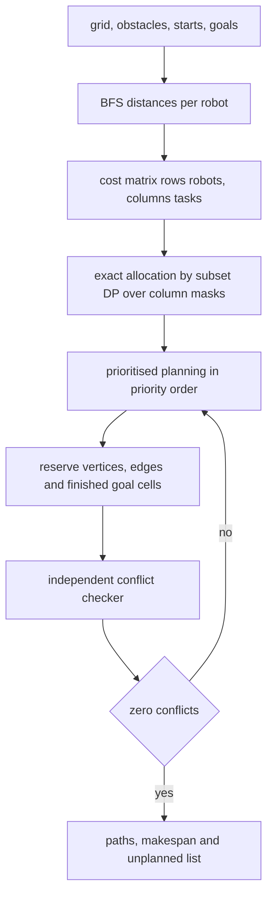
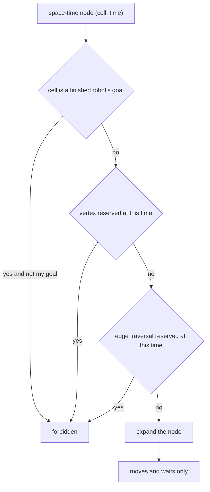
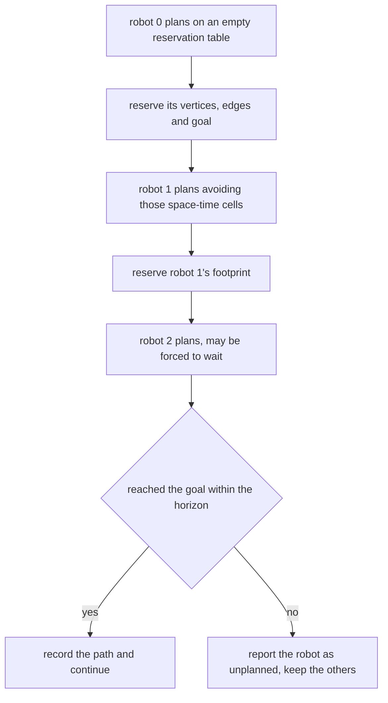
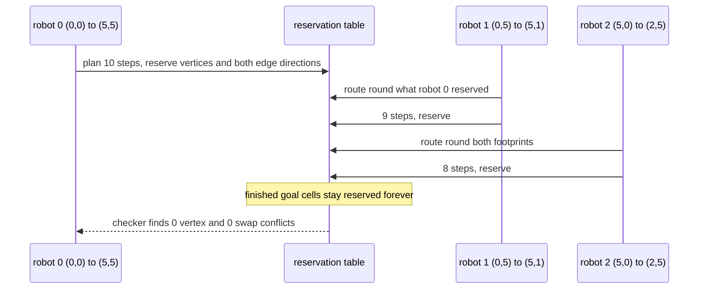

# 922 — Implement multi-robot coordination with conflict resolution and task allocation.

> **Tier:** Master · **CTCI chapter:** Beyond — Graphics, Geometry & Robotics
> **Task spec:** [922-implement-multi-robot-coordination-with-conflict-resolution-and.md](../../../tasks/master/922-implement-multi-robot-coordination-with-conflict-resolution-and.md)
> **Solutions:** [Python](../../../solutions/python/master/922-implement-multi-robot-coordination-with-conflict-resolution-and/solution.py) ·
> [Java](../../../solutions/java/master/922-implement-multi-robot-coordination-with-conflict-resolution-and/Solution.java) ·
> [JavaScript](../../../solutions/javascript/master/922-implement-multi-robot-coordination-with-conflict-resolution-and/solution.js) ·
> [C#](../../../solutions/csharp/master/922-implement-multi-robot-coordination-with-conflict-resolution-and/Solution.cs)

## 1. Problem restatement

**The modelling contract first.** A discrete simulation: a `6 x 6` grid, unit-speed holonomic robots,
integer time, static obstacles, static tasks, and a horizon of 40 ticks. There is no continuous
geometry, no acceleration model and no re-planning when something goes wrong. Two coupled layers are
modelled:

- **allocation** — which robot takes which task, minimising the total obstacle-aware travel distance;
- **coordination** — a conflict-free set of paths that respects the allocation.

Both are judged by *independent* routines: the allocator is compared against an exhaustive permutation
search, and the paths are checked by a separate `conflicts` routine that never looks at the reservations
used to build them.

The scene: obstacles `{(1,1), (1,2), (1,3), (1,4), (4,2), (4,3)}`, starts `(0,0)`, `(0,5)`, `(5,0)`, goals
`(5,5)`, `(5,1)`, `(2,5)`, and a fifth move `(0,0)` that means "wait in place".

| Run | Result (printed by the Python solution) |
| --- | --- |
| allocation optimum (subset DP) | **13** |
| makespan / single-robot lower bound / horizon | **10 / 10 / 40** |
| path lengths in steps | **10, 9, 8** |
| conflicts among the coordinated paths | **0** |
| uncoordinated shortest paths | contain a conflict (so there is something to resolve) |
| greedy assignment | never cheaper than the optimum (`greedy_assign(table) >= total`) |
| sealed-off robot (extra obstacles at `(4,5)`, `(5,4)`) | reported unplanned as index 0; the other two still coordinated, still conflict free |
| robot already on its goal | single-cell path |

## 2. Intuition

The naive plan is to route every robot along its own shortest path and hope. The run asserts that this
*does* collide in the default scene: two robots that meet on an edge would swap places, which no
controller can execute without collision.

The first insight is that **allocation and coordination are different optimisation problems and the
cheaper one should be exact**. Assignment is a small bipartite matching: with `r` robots and `t` tasks,
minimising `Σ cost[row][column]` over injective assignments is exactly solved by a subset DP over columns
(`dp[mask]` = best cost of filling the first `popcount(mask)` rows), and the run cross-checks it against
every permutation. Coordination, by contrast, is intractable in general, so it uses a *heuristic* —
prioritised planning — whose output is then verified by an independent checker.



The second insight is that **conflicts are of two kinds, and the second one is easy to forget**. A
*vertex* conflict is two robots in the same cell at the same time. An *edge* conflict is a swap: robot A
moves from `u` to `v` while B moves from `v` to `u` in the same tick. Both are forbidden, which is why
`reserve` records every traversed edge **in both directions** — reserving only `(u, v, t)` would leave
the swap legal from the other side. A third reservation exists as well: a robot that has finished
parking on its goal keeps that cell reserved forever, so later robots must route around a stationary
blocker rather than plan through it.



Prioritised planning is sequential by construction: robot 0 plans freely, robot 1 routes around robot
0's space-time footprint, and so on. That gives completeness per robot only under its own ordering,
which is why the makespan is asserted against a *lower bound* rather than an optimum.

## 3. Algorithm

1. **Free space.** `free_cells()` = the grid minus the obstacles.
2. **Distances.** One BFS per robot gives the travel cost to every reachable cell.
3. **Cost matrix.** `cost[r][t]` is robot `r`'s distance to task `t`, `inf` when unreachable.
4. **Exact allocation.** If there are more robots than tasks, transpose so the DP runs over the smaller
   side. `layer` maps a column mask to `(total cost, pairing)`; each row expands every mask with every
   unused column; the minimum over the final layer is the optimum.
5. **Prioritised planning.** For each robot in order, run a space-time BFS over `(cell, time)` — moves
   and waits only — skipping reserved vertices, reserved edges (both directions) and the permanent goal
   cells of finished robots; stop on reaching the goal or on exhausting the horizon.
6. **Reserve.** Record `(cell, time)` for every step, both directions of every traversed edge, and the
   goal cell as permanent.
7. **Verify.** Run the independent `conflicts` checker, `valid_path` for each robot, the makespan bound,
   and the resolute behaviour when a robot cannot be planned at all.

```text
procedure allocate(costs)
    table ← costs, transposed when it has more rows than columns
    layer ← { empty mask : (0, empty pairing) }
    for each row in table do
        nxt ← empty dictionary
        for each (mask, (total, pairing)) in layer do
            for each column in 0 .. columns - 1 do
                if bit column of mask is set then continue end
                candidate ← (total + table[row][column], pairing + (row, column))
                key ← mask with bit column set
                if key not in nxt or candidate.total < nxt[key].total then
                    nxt[key] ← candidate
                end
            end
        end
        layer ← nxt
    end
    return the best (total, pairing) in layer
end

procedure plan_robot(start, goal, reservations, horizon)
    reserved_cells, reserved_edges, permanent ← reservations
    queue ← ((start, 0))
    parent ← {(start, 0): null}
    for each (cell, time) in queue do
        if cell = goal then return the reconstructed path end
        if time >= horizon then continue end
        for each nxt in neighbours(cell, free_cells()) do
            node ← (nxt, time + 1)
            if node in parent or (nxt <> goal and nxt in permanent) then continue end
            if (time + 1) in reserved_cells.get(nxt, ()) then continue end
            if (cell, nxt, time + 1) in reserved_edges then continue end
            parent[node] ← (cell, time)
            append node to queue
        end
    end
    return null
end

procedure coordinate(starts, goals, horizon)
    reservations ← (empty map, empty set, empty set)
    for index, (start, goal) in enumerate(zip(starts, goals)) do
        path ← plan_robot(start, goal, reservations, horizon)
        if path is null then
            record index as unplanned
        else
            reserve(path, reservations)
        end
    end
    return paths, unplanned
end
```



## 4. Worked example

The Python run's printed summary is

```text
allocation optimum 13, makespan 10 (lower bound 10), horizon 40
path lengths [10, 9, 8], conflicts 0
```

| Layer | Quantity | Value |
| --- | --- | --- |
| Allocation | total cost of the optimal assignment | 13 |
| Allocation | oracle agreement | subset DP == exhaustive permutations on all three cases |
| Coordination | makespan | 10 ticks |
| Coordination | single-robot shortest-path lower bound | 10 ticks |
| Coordination | path lengths in steps | robot 0: 10, robot 1: 9, robot 2: 8 |
| Verification | conflicts between the three paths | 0 |
| Verification | conflicts between uncoordinated shortest paths | non-zero |

The makespan equals the lower bound exactly in this scene, which is a strong result: robot 0 needs 10
ticks on its own, and prioritised planning manages to schedule all three without extending the horizon
beyond that. The run asserts `lower <= makespan < HORIZON` — an inequality, because a different scene
could force waits, and asserting equality would encode this scene's luck as a property of the algorithm.



The independent checker is tested on hand-made inputs before it judges the coordinator: two robots
walking `(0,0) -> (1,0) -> (2,0)` and `(2,0) -> (1,0) -> (0,0)` must produce a conflict (they swap), and
three disjoint paths must produce none. The failure mode the coordinator must handle is then
demonstrated by mutating the world: adding obstacles at `(4,5)` and `(5,4)` walls robot 0 in, and the
run asserts `sealed_paths[0] is None` with `unplanned == [0]` while robots 1 and 2 are still planned,
still valid and still conflict free. A coordinator that threw an exception or gave up on the whole scene
would fail that check.

## 5. Complexity

Let `R` be the robots, `T` the tasks, `C = |free cells| = 30` here, `H` the horizon and `L` the makespan.

| Measure | Bound | Why it holds |
| --- | --- | --- |
| Free-space BFS | `O(C + E)` with `E <= 4C` | each cell is expanded once per robot |
| Cost matrix | `O(R (C + E))` | one BFS per robot over the same grid |
| Subset DP allocation | `O(min(R,T) · 2^max(R,T) · max(R,T))` | one transition per (row, mask, column) |
| Exhaustive oracle | `O(P(T, R))` permutations | only used in the checks, for up to four robots and three tasks |
| Greedy heuristic | `O(R · T)` | each row scans its still-free columns |
| One space-time BFS | `O(C · H)` nodes, `<= 5` successors each | moves plus wait, one node per (cell, tick) |
| Coordination | `O(R · C · H)` | a separate space-time search per robot in priority order |
| Reservation tables | `O(R · L)` entries | one vertex per tick plus two directed edges per step |
| Conflict checking | `O(R² · L)` | every pair of paths is scanned tick by tick |

The comparison points are deliberately included. The **exact allocator** beats or matches the greedy
heuristic on every case (asserted as `greedy_assign(table) >= total`) and its cost is exponential in the
smaller side, which is exactly why it is viable for a handful of robots and not for a warehouse.
The **uncoordinated shortest paths** are `O(R · (C + E))` — asymptotically cheaper than the coordinator —
and they collide, which is the trade the whole task is about: conflict-free schedules cost an extra
`O(H)` factor in the search space and buy executability.

## 6. Pitfalls and edge cases

- **Swap conflicts are not vertex conflicts.** Reserving `(u, v, t)` alone leaves the reverse move legal
  for the robot at `v`. `reserve` adds both `(u, v, t)` and `(v, u, t)`, and the checker independently
  tests `cell_a == previous_b and cell_b == previous_a` — the hand-made swap case proves the detector
  fires.
- **Finished robots keep blocking.** Its goal cell is added to `permanent`, and `plan_robot` refuses
  those cells except for the goal of the robot currently planning. Without this, a later robot would
  plan a path straight through a parked robot.
- **The conflict checker must hold a finished robot in place.** It indexes with
  `min(time, len(path) - 1)`, so a path that has ended counts as still occupying its last cell while the
  other robot is still moving — otherwise a collision with a parked robot would be invisible.
- **The horizon must be finite, and exhaustion must be reported.** A walled-in robot returns `None`
  after `HORIZON = 40` ticks rather than looping forever; the coordinator records its index in
  `unplanned` and keeps planning the rest. Losing one robot must not lose the scene.
- **Waiting is a move.** The step set includes `(0, 0)`; without it, a robot whose only free cell this
  tick is its own cell would be unplannable by construction.
- **Transposing the cost matrix.** When there are more robots than tasks, the DP runs on the transpose
  and the pairing is un-flipped afterwards (`sorted((column, row) ...)`); skipping this either explodes
  the mask space or returns pairs indexed the wrong way round.
- **Injective assignments only.** The checks assert the pairing uses distinct rows and distinct columns
  and covers `min(robots, tasks)` pairs, and that every assigned pair is mutually reachable (finite
  distance) — an `inf` in an assignment means the task is unreachable for that robot.
- **Empty inputs.** `allocate([])` and `allocate([[]])` both return `(0, [])`, and a robot already
  standing on its goal gets the single-cell path `[(5, 5)]`, which `valid_path` accepts because the
  start equals the goal.
- **Determinism.** Re-running the coordinator on the same scene returns identical paths: BFS order,
  priority order and tie handling are all deterministic, so the printed makespan is a property of the
  algorithm and not of a scheduler.

## 7. Variants and follow-ups

- **Continuous trajectories instead of grid paths.** [919-implement-motion-planning-under-differential-constraints-using-t.md](../../../tasks/master/919-implement-motion-planning-under-differential-constraints-using-t.md)
  turns a discrete path into a dynamically feasible trajectory, and the swap constraint becomes a
  continuous-time separation constraint.
- **The single-robot version of the same problem.** [921-implement-robot-manipulation-planner-with-grasp-sampling-and-sco.md](../../../tasks/master/921-implement-robot-manipulation-planner-with-grasp-sampling-and-sco.md)
  is one robot choosing *what* to do; this task is several robots sharing the space while doing it.
- **Scheduling resources rather than space.** [905-implement-real-time-sla-aware-scheduler-for-multi-tenant-inferen.md](../../../tasks/master/905-implement-real-time-sla-aware-scheduler-for-multi-tenant-inferen.md)
  is the same allocation-plus-conflict structure with compute nodes instead of grid cells.
- **Reallocation when a robot fails mid-task.** [903-implement-adaptive-replication-factoring-hot-keys-and-node-load.md](../../../tasks/master/903-implement-adaptive-replication-factoring-hot-keys-and-node-load.md)
  shows the adaptive reaction to load changing under a static plan, which is what a real fleet layer
  needs on top of this static allocator.

## 8. Check yourself

1. Why does `reserve` add both `(previous, cell, time)` and `(cell, previous, time)`?

<details><summary>Show answer</summary>

Because a later robot could traverse the same edge in the opposite direction in the same tick — a swap —
and that would mean the two robots pass through each other. Reserving only the direction the first robot
used leaves the reverse transition available in its own space-time search, so the second robot would
happily plan a head-on exchange. The independent `conflicts` checker tests for exactly this pattern
(`cell_a == previous_b and cell_b == previous_a`), so reserving one direction is a bug the verification
catches rather than a stylistic choice.

</details>

2. The makespan is exactly the lower bound (10) in this scene. Why is the assertion written as an
   inequality?

<details><summary>Show answer</summary>

Because prioritised planning has no guarantee of achieving the single-robot optimum for all robots: as
soon as two paths compete for the same corridor, one of them must wait, and the makespan can exceed
`max_r dist(start_r, goal_r)`. The lower bound is a *bound* — the run asserts
`lower <= makespan < HORIZON` — and reporting 10 == 10 here is a fact about this scene, not a theorem.
The other end of the inequality is the liveness guarantee: a plan is returned within the horizon or the
robot is reported unplanned.

</details>

3. What does the sealed-robot case prove about the coordinator's contract?

<details><summary>Show answer</summary>

That failure is per robot, not per scene. With `(4,5)` and `(5,4)` blocked, robot 0's escape route
disappears; the coordinator returns `None` for it and `unplanned == [0]`, while robots 1 and 2 are still
planned, still satisfy `valid_path`, and still have zero conflicts. The contract is "plan as much as
possible, report exactly what could not be planned" — not "fail the whole fleet", and not "return a
shortest path that ignores obstacles".

</details>

4. Why is the allocation solved exactly while the coordination is only heuristic?

<details><summary>Show answer</summary>

Because their sizes differ by orders of magnitude in tractability. Assignment with `R` robots and `T`
tasks is `O(2^max(R,T) · min(R,T) · max(R,T))` — exponential, but with three robots and three tasks the
DP has 8 masks and the exhaustive oracle checks it in a handful of permutations. Coordination is
multi-agent path finding, which is NP-hard, so the code uses prioritised planning and *verifies* the
result with an independent conflict checker instead of optimising it. Mixing them up would either waste
the exactness budget or lose the verification.

</details>
