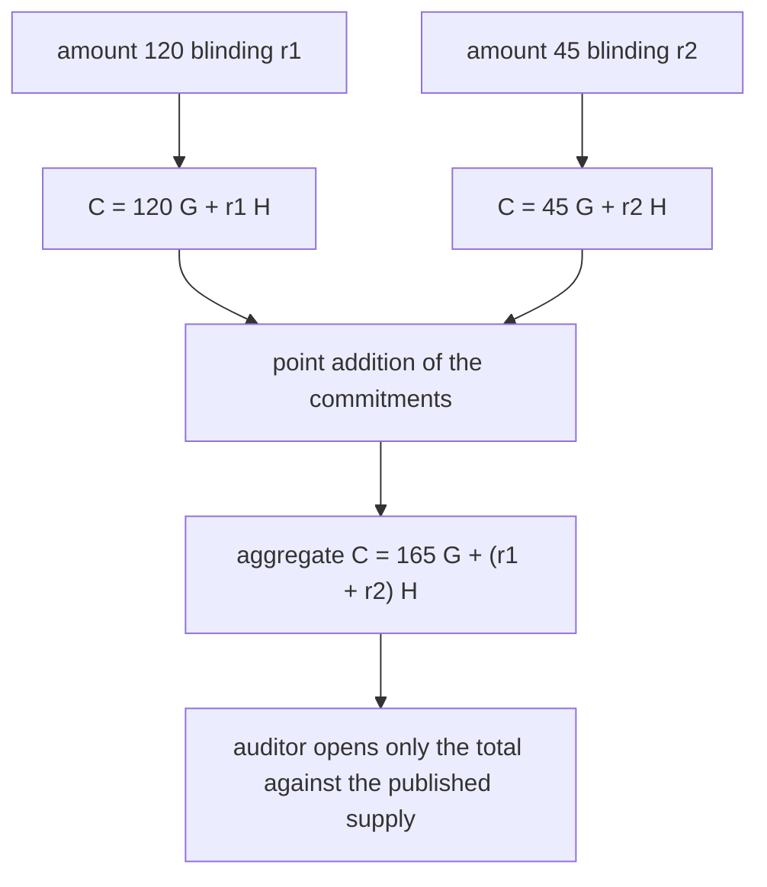
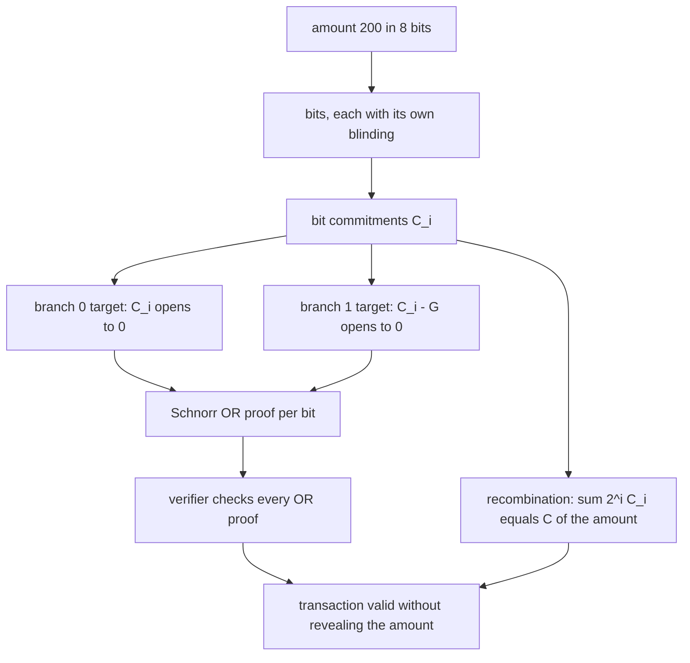
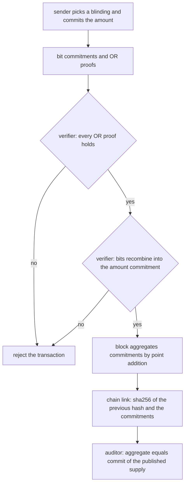
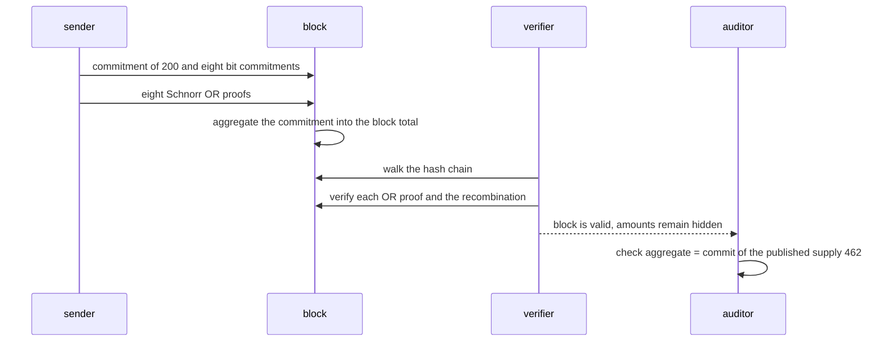

# 923 — Implement distributed ledger with privacy-preserving transaction aggregation.

> **Tier:** Master · **CTCI chapter:** Ch 9 — System Design and Scalability
> **Task spec:** [923-implement-distributed-ledger-with-privacy-preserving-transaction.md](../../../tasks/master/923-implement-distributed-ledger-with-privacy-preserving-transaction.md)
> **Solutions:** [Python](../../../solutions/python/master/923-implement-distributed-ledger-with-privacy-preserving-transaction/solution.py) ·
> [Java](../../../solutions/java/master/923-implement-distributed-ledger-with-privacy-preserving-transaction/Solution.java) ·
> [JavaScript](../../../solutions/javascript/master/923-implement-distributed-ledger-with-privacy-preserving-transaction/solution.js) ·
> [C#](../../../solutions/csharp/master/923-implement-distributed-ledger-with-privacy-preserving-transaction/Solution.cs)

## 1. Problem restatement

**The modelling contract first.** One elliptic curve, one proof system, no consensus layer, no network
and no peers: the "distributed ledger" is an in-process chain of blocks, and privacy is achieved by
**commitments plus proofs** rather than by encryption. Amounts are small (8-bit in the Python file) and
the curve is a toy 61-bit curve, so this is a demonstration of the algebra, not a deployable system.

The pieces:

- **curve** `y² = x³ + 7` over the Mersenne prime `p = 2^61 - 1`, affine point addition with the three
  exceptional cases (point at infinity, doubling, `P + (-P)`), double-and-add scalar multiplication,
  and negation for negative scalars — exponents are *never* reduced, so no group order is needed;
- **generators** `G = curve_point(1)` (the first `x >= 1` whose `x³ + 7` is a square) and
  `H = hash-to-curve("confidential-aggregation-lab")`, so nobody knows `log_G H`;
- **commitments** `C(v, r) = vG + rH`, additively homomorphic;
- **range proofs** a Schnorr OR proof (Fiat-Shamir over SHA-256) that each bit commitment opens to 0 or
  to 1, plus the recombination check `Σ 2^i C_i == C(v)`;
- **ledger** blocks of commitments linked by a SHA-256 chain, with an auditor's reserve proof that the
  aggregate commitment opens to the published supply.

| Run | Result (printed by the Python solution) |
| --- | --- |
| ledger with `values = [120, 45, 30, 7, 200, 60]` | **2 blocks**, 6 transactions, supply **462**, bit width 8 |
| serialised ledger | **160 bytes**, aggregate commitment `x = a7e56449d2a2bcc` |
| `C(30, ra) + C(12, rb)` vs `C(42, ra + rb)` | equal; `C(30, ra) != C(30, rb)` |
| boundary amounts `0`, `1`, `2^8 - 1 = 255` | all verify |
| shifted bit commitment / out-of-range claim `2^8` | both rejected |
| tampered amount / broken hash link | both detected |
| empty ledger / single-entry ledger | verifies against supply 0 / aggregates to its own commitment |

## 2. Intuition

The naive confidential ledger publishes amounts and encrypts them for the auditor. That fails twice:
the ledger itself is still a plaintext leak, and the auditor's key becomes a single point of failure.

The first insight is that **an amount can be represented without being revealed, and summed without
being revealed**. A commitment `C(v, r) = vG + rH` with a random blinding `r` hides `v`, and because
point addition is linear it is additively homomorphic: `C(a, ra) + C(b, rb) = C(a + b, ra + rb)`. A block
can therefore aggregate transactions by *adding points*, so the ledger stores one commitment per
transaction and the auditor only ever needs the aggregate. The run asserts the homomorphism and, just as
importantly, that `C(30, ra) != C(30, rb)` — equal values under different blindings are unlinkable.



The second insight is that **a hidden amount still needs a proof of its shape**. A commitment hides the
value, so a malicious sender could commit to `2^61` or to a negative balance and no verifier could tell.
The range proof closes that hole by committing to the amount bit by bit, `C(v) = Σ 2^i C_i`, and proving
for each bit that its commitment opens to **0 or 1** — a disjunction, proved with a Schnorr OR proof: the
prover knows the blinding of the true branch and simulates the other, and the Fiat-Shamir challenge
splits as `c0 + c1`. The verifier never learns which branch was real.



The third insight is that **verifiability and privacy are separate, composable checks**: the verifier
walks the hash chain, re-verifies every range proof, and finally checks
`published_amounts == commit(supply, total_blinding)`. Each gate is independent, so a failure pinpoints
whether the chain, a proof or the aggregate is wrong.

## 3. Algorithm

1. **Curve arithmetic.** `point_add` handles infinity, doubling and `P + (-P)`; `scalar_mul` is
   double-and-add and negates the point for negative scalars; `curve_point` scans `x` (or hashes a label)
   until `x³ + 7` is a quadratic residue, and takes the smaller `y`.
2. **Commit.** `commit(v, r) = v·G + r·H` with 61-bit blinding scalars from the seeded stream.
3. **Prove the bits.** For each bit: draw a nonce and simulated branch values, compute the shifted target
   `C_i - G`, build both witnesses, hash them with the commitment to get the Fiat-Shamir challenge, split
   it as `c0 + c1`, and answer the real branch with `s = nonce + c · blinding`.
4. **Aggregate.** `transaction` returns `(C(v), bit commitments and proofs, total blinding)` where the
   total blinding is `Σ 2^i r_i` — the same linear combination as the bits.
5. **Block.** Group `BLOCK_SIZE = 3` transactions, add their commitments into the running aggregate, and
   hash `(previous hash, commitments)` into the block hash.
6. **Verify.** `verify_transaction` checks every OR proof and the recombination; `verify_ledger` checks
   the chain, all proofs, and the aggregate opening against the published supply.

```text
procedure commit(value, blinding, generators)
    g, h ← generators
    return value * g + blinding * h
end

procedure or_bit_proof(bit, blinding, commitment, generators, state)
    g, h ← generators
    nonce ← random scalar
    other_challenge ← random scalar
    other_response ← random scalar
    shifted ← commitment - g
    other ← shifted when bit = 0, otherwise commitment
    simulated ← other_response * h - other_challenge * other
    real_witness ← nonce * h
    witness_0, witness_1 ← real and simulated, ordered by the bit
    digest ← sha256 of witness_0, witness_1 and the commitment
    real_challenge ← digest - other_challenge
    real_response ← nonce + real_challenge * blinding
    return the (witnesses, challenges, responses) tuple ordered by the bit
end

procedure verify_or_bit(commitment, proof, generators)
    shifted ← commitment - g
    if challenge(proof.w0, proof.w1, commitment) <> proof.c0 + proof.c1 then return false end
    return proof.s0 * h = proof.w0 + proof.c0 * commitment and
           proof.s1 * h = proof.w1 + proof.c1 * shifted
end

procedure verify_transaction(amount, bits, generators)
    weight ← 1
    total ← the point at infinity
    for each (commitment, proof) in bits do
        if not verify_or_bit(commitment, proof, generators) then return false end
        total ← total + weight * commitment
        weight ← weight * 2
    end
    return total = amount
end

procedure verify_ledger(ledger, generators, supply, blinding)
    previous ← "origin"
    for each block in ledger do
        if block.previous <> previous or block.hash <> block_hash(previous, block.commitments) then
            return false
        end
        for each (commitment, proof) in the block do
            if not verify_transaction(commitment, proof, generators) then return false end
        end
        previous ← block.hash
    end
    return published_amounts(ledger) = commit(supply, blinding, generators)
end
```



## 4. Worked example

The Python run builds a ledger over `values = [120, 45, 30, 7, 200, 60]` with `BLOCK_SIZE = 3` and
`BITS = 8`, and prints

```text
ledger blocks 2, transactions 6, supply 462, bit width 8
serialised ledger 160 bytes, aggregate commitment x=a7e56449d2a2bcc
```

| Stage | Input | Output |
| --- | --- | --- |
| Block 0 | `120, 45, 30` | three 8-bit range proofs, three amount commitments, chain link from `b"origin"` |
| Block 1 | `7, 200, 60` | three more proofs, chain link from block 0's hash |
| Aggregate | all six commitments | `x = a7e56449d2a2bcc`, opening to supply 462 |
| Auditor | `commit(462, total_blinding)` | equal to the aggregate, so the reserve proof holds |
| Serialisation | `ledger_bytes` | 160 bytes, containing none of the six plaintext amounts |

The verification chain has three independent gates, and the run tests each with a targeted mutation:

| Mutation | Gate that fires |
| --- | --- |
| `C_0` replaced by `C_0 + G` (a bit commitment shifted by one) | the OR proof for that bit fails |
| amount claimed as `2^8 = 256` while the bit commitments stay valid | the recombination check fails |
| one amount changed (`[120, 45, 30, 7, 200, 61]`) with the old supply | the aggregate opening fails |
| block 1's `previous` pointer rewritten | the hash-chain walk fails |
| published supply `463` instead of `462` | the aggregate opening fails |
| serialised ledger searched for each plaintext amount | none of the six appears |



Boundary values are checked explicitly: amounts `0`, `1` and `255` all verify, an empty ledger verifies
against supply 0, and a single-entry ledger aggregates to exactly its own commitment — for the empty
case the aggregate must start at the point at infinity and the total blinding must be 0.

## 5. Complexity

Let `n` be the number of transactions, `b` the bit width (8), `k` the block size (3) and `p` the field
modulus (61 bits for `2^61 - 1`).

| Measure | Bound | Why it holds |
| --- | --- | --- |
| `point_add` | `O(log p)` field multiplications | one modular inverse by Fermat exponentiation plus a few multiplies |
| `scalar_mul` | `O(log scalar)` point additions | double-and-add, one doubling per bit |
| `commit` | `O(log p + log value)` | one scalar multiplication per generator |
| `or_bit_proof` | `O(log p)` | four scalar multiplications and one SHA-256 |
| `verify_or_bit` | `O(log p)` | four scalar multiplications plus the challenge recomputation |
| One transaction | `O(b log p)` | `b` bit commitments and `b` OR proofs |
| Block | `O(k b log p)` | `k` transactions plus `k` point additions |
| `verify_ledger` | `O(n b log p)` | every proof is re-verified; the chain walk is `O(n)` hashes |
| Space | `O(n b)` points | each bit is a commitment plus a proof of five points |
| Naive plaintext ledger | `O(n)` integers | cheaper by a factor of `b log p`, and it reveals every amount |

The comparison is the point of the exercise. A plaintext ledger stores `n` integers and verifies in
`O(n)` integer comparisons; this design stores `O(n b)` curve points and runs `O(n b)` scalar
multiplications — thousands of times more work per transaction. What that buys is the two properties
the run actually asserts: no plaintext amount appears in the serialised bytes, and the total can be
verified against the published supply without any individual amount being opened.

## 6. Pitfalls and edge cases

- **Affine addition has three exceptional cases.** The point at infinity (`a is None`), doubling
  (`a == b`, which needs the tangent slope `3x² / 2y`), and `P + (-P)` which returns infinity. The run
  checks `P + None == P`, `-(-P) == P` and `P + (-P) is None`; a single-formula implementation would
  divide by zero in each case.
- **Exponents are never reduced.** Negative scalars negate the point (`scalar_mul(-3, g) == -scalar_mul(3, g)`)
  and blinding scalars are 61-bit integers taken modulo `p`. This is why the proof algebra needs no
  knowledge of the group order — a simplification worth naming, since a real system must reduce mod the
  curve order.
- **`H` must have an unknown discrete log.** `H = hash-to-curve(a fixed label)` and `G = curve_point(1)`
  are asserted distinct; if the prover knew `log_G H`, a commitment could be opened to any value.
- **The OR proof is a disjunction, not a conjunction.** Branch 0 proves `C_i` opens to 0, branch 1 proves
  `C_i - G` opens to 0, and the Fiat-Shamir challenge splits as `c0 + c1`; a verifier that only checked
  one branch would accept any commitment.
- **Range proofs bound the value, not the blinding.** `verify_transaction` checks every OR proof *and*
  that the bits recombine into `C(v)`; the run's forged case (`2^8` claimed, valid bit proofs) fails the
  recombination, and the shifted-commitment case fails the OR proof — two different bugs, two different
  gates.
- **Tampering must be caught per gate.** Changing one amount keeps every other proof valid, so only the
  aggregate opening fails; changing a `previous` pointer keeps every proof valid, so only the chain walk
  fails. Testing a single mutation would leave one gate unverified.
- **Privacy is a statement about bytes.** The run searches the 160 serialised bytes for each of the six
  amounts in 8-byte big-endian form and asserts none is present; it also asserts that `C(77, ra)` and
  `C(77, rb)` differ, so equal values are not linkable through identical commitments.
- **Empty and single-entry ledgers.** An empty ledger must verify against supply 0 (aggregate infinity,
  blinding 0) and a one-transaction ledger must aggregate to its own commitment; both are boundary cases
  that a "sum of a list" implementation gets wrong when the list is empty.

## 7. Variants and follow-ups

- **Anonymity instead of confidentiality.** [912-implement-end-to-end-pipeline-for-privacy-preserving-analytics-w.md](../../../tasks/master/912-implement-end-to-end-pipeline-for-privacy-preserving-analytics-w.md)
  answers the query side of the same tension: how to publish statistics without leaking the rows.
- **Composing guarantees.** [943-implement-composable-privacy-guarantees-across-combined-dp-mecha.md](../../../tasks/master/943-implement-composable-privacy-guarantees-across-combined-dp-mecha.md)
  is the differential-privacy counterpart — the budget bookkeeping that this commitment scheme
  deliberately does not attempt.
- **Proving more than a range.** [834-implement-zk-snark-circuit-for-a-simple-arithmetic-program-toy.md](../../../tasks/master/834-implement-zk-snark-circuit-for-a-simple-arithmetic-program-toy.md)
  generalises the OR proof to a circuit, which is what a real confidential-transaction system needs
  (membership, non-revocation, correct fee).
- **Logs that prove their own integrity.** [902-implement-self-verifying-distributed-logs-with-merkle-trees-and.md](../../../tasks/master/902-implement-self-verifying-distributed-logs-with-merkle-trees-and.md)
  replaces the linear SHA-256 chain with a Merkle tree, so a single block's inclusion can be proven
  without re-walking the ledger.

## 8. Check yourself

1. Why is an additively homomorphic commitment not enough on its own to build a confidential ledger?

<details><summary>Show answer</summary>

Because it hides the value from the verifier but says nothing about the value being *valid*. A sender can
commit to an out-of-range amount (`2^61 - 1`) or to a negative balance without breaking any algebraic
identity — the aggregate still adds up. The range proof supplies the missing statement: each bit
commitment opens to 0 or 1, and the weighted sum of the bit commitments equals the amount commitment.
The run demonstrates both halves: the recombination rejects an out-of-range claim built from *valid*
bit proofs, and the OR proofs reject a single shifted bit commitment.

</details>

2. What exactly does a Schnorr OR proof let a verifier conclude, and why does the challenge have to be
   split as `c0 + c1`?

<details><summary>Show answer</summary>

It concludes "the commitment opens to 0 or it opens to 1", without learning which. Splitting a single
Fiat-Shamir digest into two branch challenges is what makes the proof a *disjunction*: neither branch has
an independent challenge, so the prover cannot answer both branches honestly (it does not know both
witnesses), yet it can answer the true branch and simulate the false one because it chooses the simulated
challenge and response before hashing. If `c0` and `c1` were independently derived from the transcript,
each branch could be verified in isolation and the proof would be forgeable.

</details>

3. The ledger's verification has three gates. Why is it important that the tamper tests attack them
   separately?

<details><summary>Show answer</summary>

Because the gates are independent and a single mutation only trips one of them: changing one amount keeps
every OR proof valid and fails only the aggregate opening; rewriting a `previous` pointer keeps every
proof valid and fails only the chain walk; claiming `2^8` fails only the recombination. If the test only
flipped one field, an implementation could have a completely missing gate (say, no chain walk at all) and
still pass. The independence is also an operational property: a failure tells the auditor *which* of the
three guarantees broke.

</details>

4. In the trace the total blinding is `Σ 2^i r_i` per transaction and `Σ` over transactions for the
   ledger. Why must the same weights be used?

<details><summary>Show answer</summary>

Because the commitment is linear in both coordinates:
`Σ 2^i C_i = Σ 2^i (b_i G + r_i H) = vG + (Σ 2^i r_i) H`, which equals `C(v, Σ 2^i r_i)` only if the
same powers of two multiply the bits *and* the blindings. The code builds both levels with exactly that
recurrence (`total_blinding += weight * blinding; weight *= 2`), which is what lets the auditor open the
aggregate with a single blinding sum. Any mismatch makes the reserve proof fail even though every
individual transaction is valid.

</details>
