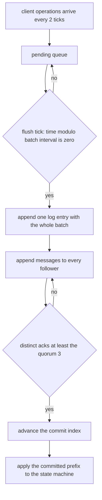
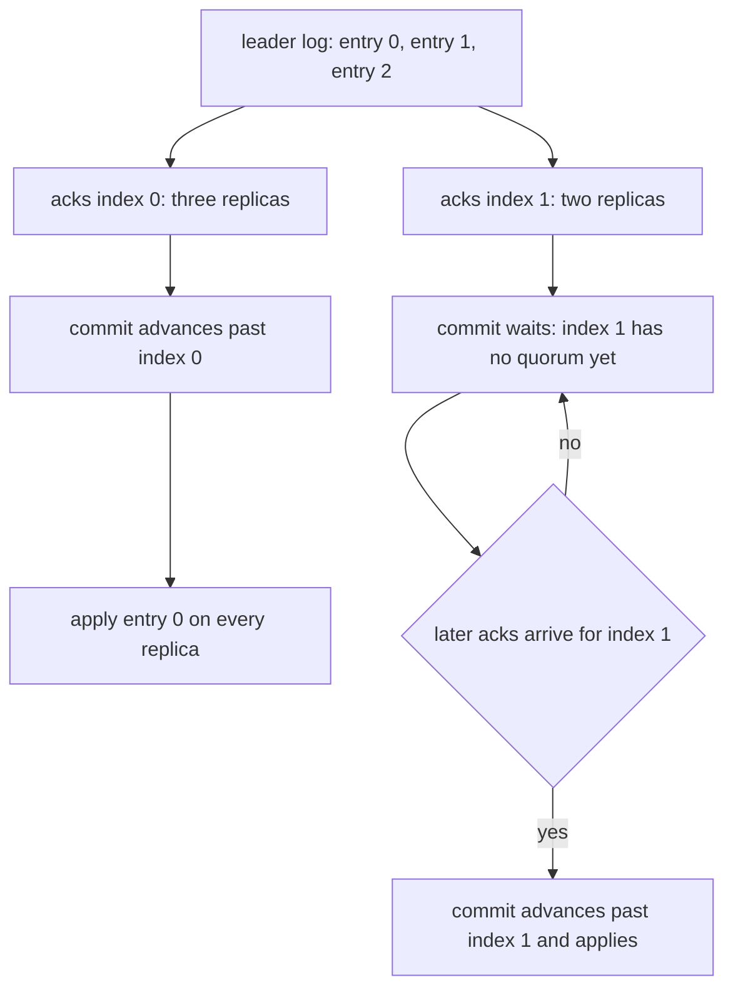
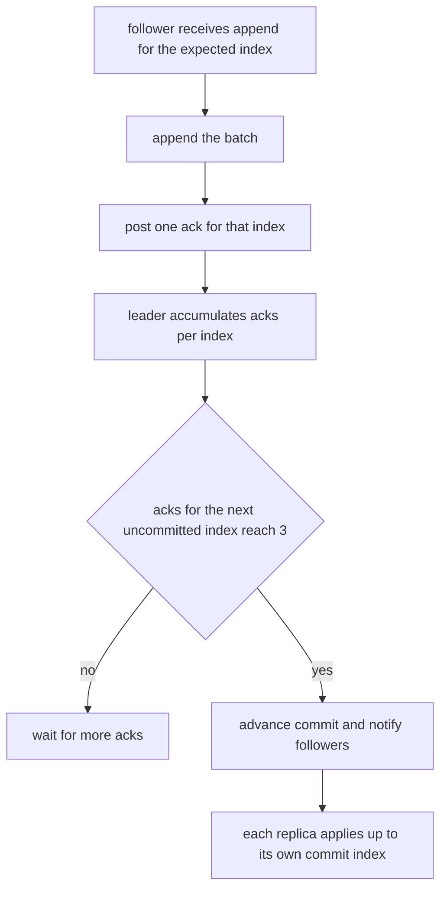
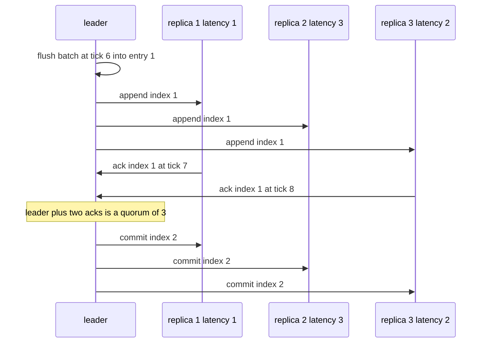

# 924 — Implement low-latency replicated state machine optimized for WANs with batching.

> **Tier:** Master · **CTCI chapter:** Ch 9 — System Design and Scalability
> **Task spec:** [924-implement-low-latency-replicated-state-machine-optimized-for-wan.md](../../../tasks/master/924-implement-low-latency-replicated-state-machine-optimized-for-wan.md)
> **Solutions:** [Python](../../../solutions/python/master/924-implement-low-latency-replicated-state-machine-optimized-for-wan/solution.py) ·
> [Java](../../../solutions/java/master/924-implement-low-latency-replicated-state-machine-optimized-for-wan/Solution.java) ·
> [JavaScript](../../../solutions/javascript/master/924-implement-low-latency-replicated-state-machine-optimized-for-wan/solution.js) ·
> [C#](../../../solutions/csharp/master/924-implement-low-latency-replicated-state-machine-optimized-for-wan/Solution.cs)

## 1. Problem restatement

**The modelling contract first.** An in-memory, deterministic discrete-event simulation of a
Raft-flavoured replicated state machine. Five replicas, a majority quorum of three, one leader per term,
and per-replica WAN latencies of `[1, 3, 2, 4]` ticks — deliberately asymmetric, because symmetric
latency hides ordering bugs. Messages are counted and priced at one each; there is no persistence, no
snapshotting, no network layer and only one scheduled failure. The Java, JavaScript and C# files model
the same pipeline with a static leader and their own latency tables.

**Inputs.** A batch interval (ticks between flushes), an optional failure tick, a tick budget
(60), an operation stream (12 operations on keys `k0..k3` arriving every 2 ticks), and the latency table.
**Outputs.** Per-replica logs, commit indices, applied state machines, and metrics (messages, elections,
batches proposed, per-commit latency).

| Run | Result (printed by the Python solution) |
| --- | --- |
| batched (`batch_interval = 6`) | **5 batches, 60 messages, 5.00 messages/op, mean commit wait 2.0 ticks** |
| unbatched (`batch_interval = 1`) | **144 messages, 12.00 messages/op, mean commit wait 2.0 ticks** |
| operations committed | all 12, in both runs, in the identical order |
| replica state machines | equal to an oracle application of the agreed batch order |
| leader failure at tick 20 | exactly one election, term 1, every committed entry survives, commits resume |
| zero ticks / no operations | 0 messages, 0 commits / 0 batches proposed, 0 messages |
| majority pairs of five | 10 majorities, every pair intersects |

## 2. Intuition

The naive replicated log sends one message round per operation, waiting for the quorum before sending the
next. On a WAN with 4-tick latencies, that serialisation makes throughput a function of round-trip time:
the run's unbatched configuration spends 144 messages on 12 operations, 12.00 messages per committed
operation, because each operation needs its own append broadcast plus acknowledgements.

The first insight is that **throughput and latency are different levers**: batch the operations that
arrive during an interval into one log entry and *pipeline* several entries in flight, so a message
carries many operations even though each individual operation still waits for the round trip it started
in. In the trace this is exactly a 2.4x reduction in messages (144 → 60) at an unchanged mean commit wait
of 2.0 ticks — the run asserts `mean >= mean_plain` rather than `>`, honestly reporting that this scene's
latency is dominated by the flush schedule, not by the batching itself.



The second insight is that **the commit rule must be prefix-based**. A follower's log can be longer than
its commit index, and a commit notification can overtake an append; the code therefore advances
`commit[leader]` only while the *next* index has a quorum of acks, and every replica applies
`min(commit[r], len(logs[r]))` entries in order. The run asserts that each replica's committed prefix
equals the leader's prefix at the same index, which is the property batching could plausibly break if
entries were applied out of order.



Safety of that rule rests on a property the run checks exhaustively: **any two majorities of five
intersect** (10 majorities, all 55 pairs non-disjoint). Without it, two commit decisions could be made
by disjoint quorums and the replicas would diverge.

## 3. Algorithm

1. **Schedule.** Operations arrive every `OP_INTERVAL = 2` ticks and are appended to a shared `pending`
   queue — the model of a client that retries against whatever replica is currently the leader.
2. **Flush.** On ticks where `time % batch_interval == 0` and `pending` is non-empty, append the whole
   queue as one log entry, reset `pending`, seed the ack set with the leader itself and post append
   messages to every follower.
3. **Deliver.** Each message is posted with `time + LATENCY[destination]` and a monotonically increasing
   sequence number, and delivered in `(time, sequence)` order. A follower that receives append for the
   index it expects appends the batch and posts a single ack back — not one per operation.
4. **Commit.** While `len(acks[index]) >= QUORUM`, advance the commit index, record the latency as
   `time - proposed_at[index]`, and post commit notifications; then apply the newly committed entries.
5. **Fail and recover.** At the failure tick the leader is excluded, the survivor with the longest log
   (ties to the lowest index) becomes leader for term + 1, the surviving log is shipped to every lagging
   replica, acks are reset to `{leader}` and commits resume.
6. **Verify.** Replica states against an oracle application, committed prefixes, the operation sequence
   against the unbatched run, message-per-operation counts, quorum intersection and determinism.

```text
procedure simulate(batch_interval, leader_failure, ticks, operations)
    logs ← five empty logs; commit ← five zeroes; applied ← five empty dictionaries
    events ← empty list; pending ← empty queue; leader ← 0; term ← 0
    for time ← 0 to ticks - 1 do
        sort events by (time, sequence)
        while events and events[0].time <= time do
            deliver the event: append, ack or commit
        end
        if leader_failure = time then
            leader ← the survivor with the longest log, ties to the lowest index
            term ← term + 1
            commit[leader] ← the largest commit among survivors
            ship the leader's log to every lagging replica
            reset acks to the leader alone, post append and commit messages
        end
        if an operation arrived at this tick then append it to pending end
        if pending is not empty and time modulo batch_interval = 0 then
            append the whole pending batch as one entry at index len(logs[leader])
            post an append message to every follower
        end
        index ← commit[leader]
        while index < len(logs[leader]) and count(acks[index]) >= QUORUM do
            commit[leader] ← index + 1
            record latency time - proposed_at[index]
            post commit notifications
            index ← index + 1
        end
        apply the committed prefix on the leader
    end
    return logs, commit, applied, metrics
end
```



## 4. Worked example

The Python run's printed summary is

```text
batched: 5 batches, 60 messages, 5.00 messages/op, mean commit wait 2.0 ticks
unbatched: 144 messages, 12.00 messages/op, mean commit wait 2.0 ticks
```

with 12 operations arriving one per 2 ticks, so operation `i` arrives at tick `2i`.

| Tick | Event | Effect |
| --- | --- | --- |
| 0 | operation 0 arrives; `0 % 6 == 0` | flush a batch containing only operation 0 |
| 1, 2, 3, 4 | latencies `[1, 3, 2, 4]` deliver append messages to replicas 1-4 | acks start arriving at tick 1 |
| 2 | third ack arrives (leader counts itself) | commit index 0 advances, commit wait 2 ticks |
| 6 | operations 1-3 have arrived | second batch of three operations |
| 12, 18, 24 | three more batches | 5 batches in total for 12 operations |
| 20 | scheduled failure | one election, term 1, longest surviving log wins, commits resume |
| 60 | run ends | all 12 operations committed on all 5 replicas |

The batching arithmetic is visible in the metrics: five flush messages broadcast to four followers plus
the acks coming back, versus the unbatched run where each of the 12 operations triggers its own round.
The decisive assertion is not the message count but the sequence:
`[op for batch in logs[0] for op in batch] == OPS` in both runs — batching may regroup operations, it may
not reorder or drop them.



Failure recovery is checked against the *pre-failure* run: the surviving leader's log must contain every
entry that was committed before the failure (a prefix comparison against the baseline trace), all 12
operations must still commit, and every replica's applied state must still equal the oracle. The election
rule is longest log first, ties to the lowest index, which is the simplification the docstring names —
there is no vote protocol, only a deterministic choice among survivors, and the run asserts exactly one
election occurred.

## 5. Complexity

Let `n` be the replicas (5), `q` the quorum (3), `m` the operations, `b` the batch interval and `T` the
tick budget.

| Measure | Bound | Why it holds |
| --- | --- | --- |
| Messages, batched | `O((m / batch_size) · n)` | one broadcast plus one ack per batch; the trace shows 60 for 12 operations |
| Messages, unbatched | `O(m · n)` | each operation pays its own round; the trace shows 144 |
| Messages per operation | **5.00 vs 12.00** in the trace | the ratio the run asserts to be strictly smaller when batched |
| Mean commit wait | `O(b + max latency)` | the flush schedule plus one round trip; 2.0 ticks in both configurations here |
| Commit bookkeeping | `O(entries · n)` | ack sets are per index, and commit advances while a quorum exists |
| Apply cost | `O(m)` total | every replica applies each operation exactly once, in order |
| Event loop | `O(T + events log events)` | events are delivered in `(time, sequence)` order |
| Quorum check | `O(2^n)` for the exhaustive intersection test | 10 majorities here, all pairs verified |
| Space | `O(n · entries)` batches plus `O(m)` state | the logs and the applied dictionaries dominate |

The trade the numbers make is explicit: batching cuts messages per operation by 2.4x here (and by
`batch_size` in the limit) while *not* reducing the mean commit wait — the run asserts
`mean >= mean_plain` so that a future change which quietly improves latency by dropping batching is
caught. The same tension appears in the failure path: shipping the surviving log to lagging replicas is
`O(entries)` messages, which is exactly the repair cost a real WAN replication protocol tries to avoid
with snapshots.

## 6. Pitfalls and edge cases

- **Quorum intersection is the safety proof.** Ten majorities of five exist and the run verifies that all
  pairs intersect; a protocol that committed on a *plurality* would pass a naive test suite and violate
  safety the moment two disjoint groups both believed they had committed.
- **Commits are prefixes, not sets.** Each replica's applied state is `logs[r][:commit[r]]`, and the run
  asserts that this prefix equals the leader's prefix — a commit index that jumped ahead of a gap would
  apply a batch out of order, which is invisible in the final state but wrong at every intermediate tick.
- **Ack accounting must happen once per index.** A duplicate append (the post-failure repair resends
  entries) must not double-count an ack; the ack set is keyed by index, and the leader counts itself, so a
  quorum of three is the leader plus two followers.
- **Batching must not change the operation sequence.** The suite compares the flattened batch order in
  both configurations against `OPS`; grouping is allowed, reordering is not.
- **Longer batch intervals can commit nothing.** With a batch interval longer than the tick budget no
  flush ever happens, so `ops_committed == 0` — a legitimate outcome the suite covers by construction
  (`simulate` with a large interval), and the reason the zero-operation and zero-tick cases are separate
  assertions.
- **Zero ticks and no operations are different cases.** `ticks = 0` runs no loop and must send nothing
  and commit nothing; `ops = []` runs the loop but proposes no batch and sends no messages at all. A
  leader that heartbeats unconditionally would fail the second check.
- **Latency must be asymmetric.** `LATENCY = [1, 3, 2, 4]` means different followers learn about an entry
  at different ticks, so the commit rule is exercised with partial quorums instead of every ack landing
  at once.
- **The failure election is deliberately minimal.** Longest log wins, ties to the lowest index, no vote
  protocol, one scheduled failure — the docstring says so, and the run asserts `elections == 1` and
  `term == 1` rather than pretending to exercise Raft's election safety.
- **Determinism.** Re-running the same schedule reproduces identical applied states and identical metrics
  because events are ordered by `(time, sequence)`; the sequence counter is what makes tie-breaking at the
  same tick deterministic.

## 7. Variants and follow-ups

- **The full consensus protocol.** [801-implement-production-grade-raft-library-replication-reconfigurat.md](../../../tasks/master/801-implement-production-grade-raft-library-replication-reconfigurat.md)
  replaces the deterministic longest-log election with real terms, vote requests and log-truncation rules,
  which is what this model deliberately stubs out.
- **Framing the batches on the wire.** [914-implement-cross-language-optimized-rpc-with-zero-copy-serializat.md](../../../tasks/master/914-implement-cross-language-optimized-rpc-with-zero-copy-serializat.md)
  is the layer below: how a batch becomes bytes, and how backpressure bounds how many are in flight.
- **A snapshot path for the repair cost.** [807-implement-global-scale-consistent-snapshot-across-geographically.md](../../../tasks/master/807-implement-global-scale-consistent-snapshot-across-geographically.md)
  is what a real system uses instead of shipping the whole log to a lagging replica.
- **What the replicated store serves.** [925-implement-hybrid-transactional-analytical-processing-demo-htap-w.md](../../../tasks/master/925-implement-hybrid-transactional-analytical-processing-demo-htap-w.md)
  consumes a commit stream like this one and shows why analytical readers need their own consistency
  story.

## 8. Check yourself

1. Batching cut messages from 144 to 60 but left the mean commit wait at 2.0 ticks. Why is the wait
   unchanged, and what does that say about the optimisation?

<details><summary>Show answer</summary>

Because the wait is measured from proposal to commit, and both configurations commit as soon as a quorum
of acks arrives — batching changes how many *messages* carry those acks, not how long the round trip
takes. In this scene the flush schedule dominates: with `batch_interval = 6` and operations every 2 ticks,
each batch is proposed at a multiple of 6 and commits a couple of ticks later, the same two ticks an
unbatched proposal needs. The run asserts `mean >= mean_plain`, deliberately not `>`, so the honest claim
is "same latency, far fewer messages" rather than a fabricated latency win.

</details>

2. Why does the commit loop require a quorum of acks for the *next* index specifically, rather than for
   any index?

<details><summary>Show answer</summary>

Because the state machine applies a prefix: committing index 2 while index 1 lacks a quorum would apply
batches out of order on some replicas and, worse, could be overturned later. The loop starts at
`commit[leader]` and advances one index at a time while `len(acks[index]) >= QUORUM`, so gaps stall the
commit index instead of being skipped — and the prefix assertion in the suite is the check that catches
a version which "commits" a higher index it has acks for.

</details>

3. What would a disjoint-quorum bug look like in this simulation, and which check rules it out?

<details><summary>Show answer</summary>

Two replicas could report different committed prefixes for the same index, because two groups each
believed they had a majority. The exhaustive check `all(set(a) & set(b) for a in majorities for b in
majorities)` over the 10 three-element subsets of five proves every pair intersects, which is the
property that makes a single commit decision unique. It is checked before any simulation runs, because it
is a fact about the quorum *arithmetic* rather than about the protocol implementation.

</details>

4. After the failure at tick 20, why is shipping the surviving log to lagging replicas necessary rather
   than merely convenient?

<details><summary>Show answer</summary>

Because a replica whose log is shorter would otherwise receive appends for indexes it cannot accept —
the append handler appends only when `index == len(logs[replica])`, and an ack is sent only for an index it
already holds. The new leader therefore sends the last entry of its own log to every replica with a
shorter log, resets the ack sets to itself and re-broadcasts; the run asserts the new leader holds every
entry committed before the failure, that all 12 operations still commit, and that all five replicas end up
with the oracle state.

</details>
