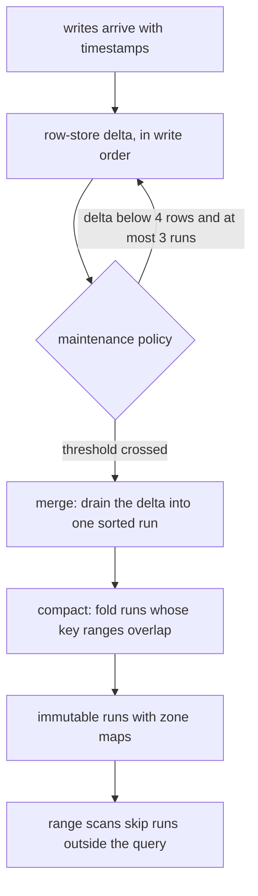
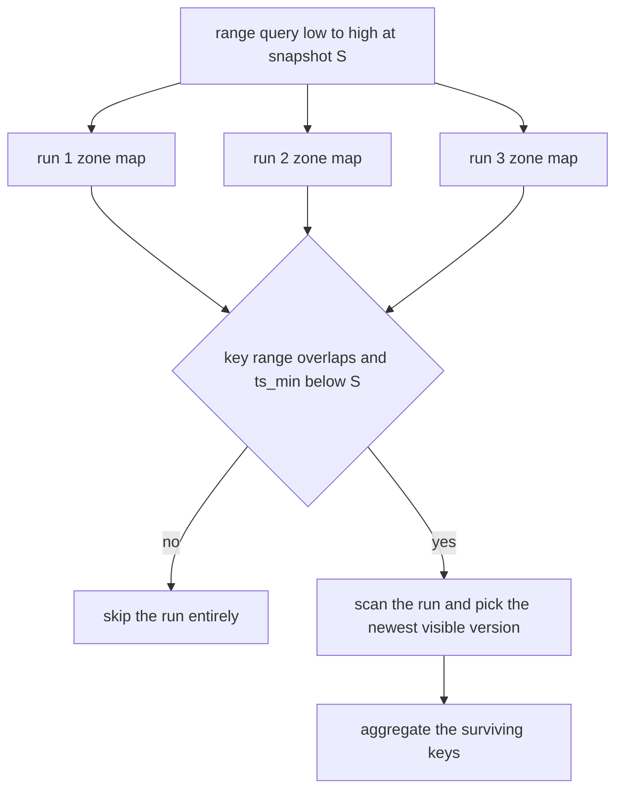
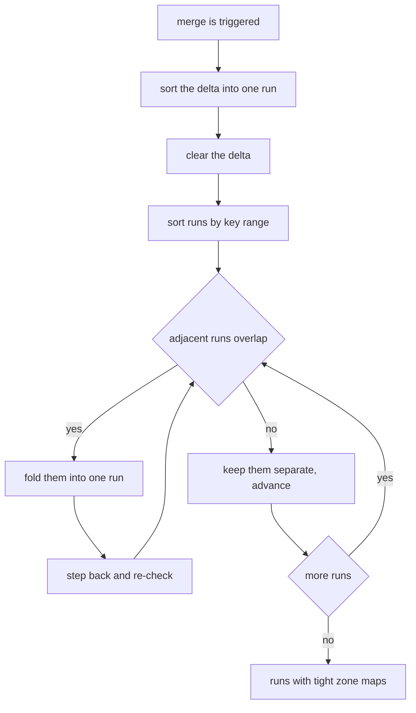
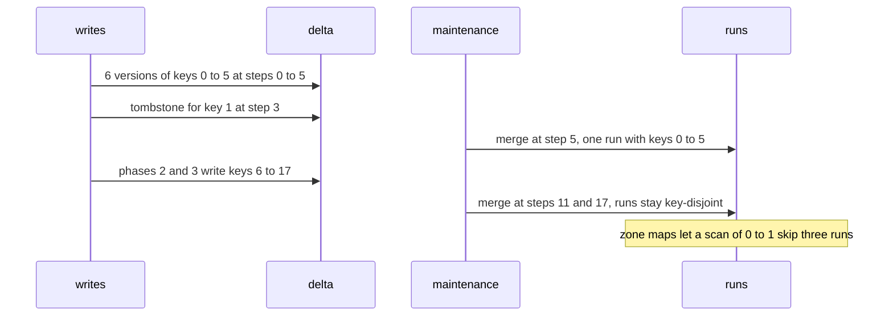

# 925 — Implement hybrid transactional/analytical processing demo (HTAP) with maintenance.

> **Tier:** Master · **CTCI chapter:** Ch 14 — Databases
> **Task spec:** [925-implement-hybrid-transactional-analytical-processing-demo-htap-w.md](../../../tasks/master/925-implement-hybrid-transactional-analytical-processing-demo-htap-w.md)
> **Solutions:** [Python](../../../solutions/python/master/925-implement-hybrid-transactional-analytical-processing-demo-htap-w/solution.py) ·
> [Java](../../../solutions/java/master/925-implement-hybrid-transactional-analytical-processing-demo-htap-w/Solution.java) ·
> [JavaScript](../../../solutions/javascript/master/925-implement-hybrid-transactional-analytical-processing-demo-htap-w/solution.js) ·
> [C#](../../../solutions/csharp/master/925-implement-hybrid-transactional-analytical-processing-demo-htap-w/Solution.cs)

## 1. Problem restatement

**The modelling contract first.** An in-memory engine serving both a transactional and an analytical
workload, with integer keys, no concurrency, no disk and a "newest version wins" merge policy. Two
structures coexist:

- a **row-store delta** — `key -> [(timestamp, value), ...]` in write order, holding everything written
  since the last merge; a delete writes a `None` tombstone;
- a **columnar run set** — immutable, key-sorted runs of `(key, timestamp, value)` rows, each carrying a
  **zone map** (`key_min`, `key_max`, `ts_min`, `ts_max`).

Point reads use MVCC snapshots (the newest version with `timestamp <= snapshot`); range aggregates visit
only the runs whose zone maps overlap the query. The documented simplification, stated in the docstring:
the aggregate still scans the rows *inside* a surviving run, so this is zone-map pruning, not a real
vectorised column scan.

| Run | Result (printed by the Python solution) |
| --- | --- |
| history | 24 workload steps with maintenance every 6, plus 6 overlapping rewrites |
| final store | **30 writes over 12 keys; 4 runs; 30 rows; 11 merges** |
| pruned range scan `[0, 1]` | examined **6 of 24 unpruned rows of 24 stored** |
| point-read sweep | every key at every snapshot 0..len(log)+2 agrees with an oracle replay (> 100 checks) |
| analytics sweep | 4 ranges x 3 predicates x 3 snapshots all equal the independent raw-log scan (> 30 checks) |
| merge | preserves every version, empties the delta, leaves the row count unchanged |
| tombstone on key 1 at step 3 | absent from later snapshots, still visible at snapshot 3, never resurrected |
| empty store / empty range / snapshot 0 / single row | `(0, 0, 0, 0)` for the scan of an empty store, and so on |

## 2. Intuition

The naive HTAP engine keeps one structure and makes the other workload pay. A pure row store answers
point reads in `O(1)` and every analytical range scan in `O(rows)`; a pure column store answers scans
fast and forces every write to rewrite a column. The engine here keeps writes cheap by landing them in a
small **mutable delta** and lets a background **merge** convert them into immutable, sorted, zone-mapped
runs that scans can skip wholesale.

The first insight is that **maintenance is a policy, not an afterthought**. `maintenance()` merges when
the delta has grown past `MERGE_THRESHOLD = 4` rows or when more than `RUN_LIMIT = 3` runs have piled up,
so the delta stays small enough for point reads and the run count stays small enough for scans. The trace
records 11 merges over the history, which is the cost side of the ledger: every merge sorts and rewrites
the delta, and in exchange the reads never touch a long list.



The second insight is that **zone maps prune only what is genuinely disjoint, and the compaction policy
decides how much**. `compact` folds two adjacent runs when their key ranges overlap and keeps disjoint
runs apart — precisely so the zone maps retain their power. The workload is built in four key-disjoint
phases, so successive merges produce runs that mostly do not overlap, and a scan of the narrow range
`[0, 1]` examines 6 rows out of 24 instead of all of them. The unpruned path is kept in the same function
behind a `prune=False` flag purely as the A/B baseline, which is why the win can be *measured* rather
than asserted.



## 3. Algorithm

1. **Write.** Append `(timestamp, value)` to the delta's list for the key, and record the same tuple in an
   audit log used by the oracles. A delete is a write of `None`.
2. **Point read.** Scan the delta's versions for the key and every run whose zone map brackets the key
   and whose `ts_min` is not newer than the snapshot; keep the newest version with `timestamp <= snapshot`.
3. **Range aggregate.** For each run: if pruning is enabled and the zone map is disjoint from the key
   range or entirely newer than the snapshot, skip the run (counting nothing). Otherwise scan its rows,
   keep the newest visible version per key, add the delta's contributions, then filter by the predicate
   and sum.
4. **Merge.** Sort the delta's entries into a fresh run with a new zone map, clear the delta, then
   compact.
5. **Compact.** Sort runs by `(key_min, key_max)` and fold neighbours whose key ranges overlap, restarting
   the scan one position back after each fold; disjoint runs stay separate.
6. **Maintenance.** Merge when the delta holds at least `MERGE_THRESHOLD` rows or the run count exceeds
   `RUN_LIMIT`.

```text
procedure aggregate(store, low, high, snapshot, predicate, prune)
    newest ← empty map
    examined ← 0
    total_rows ← 0
    for each run in store.runs do
        total_rows ← total_rows + count(run.rows)
        if prune and (run.key_max < low or run.key_min > high or run.ts_min > snapshot) then
            continue
        end
        for each (key, timestamp, value) in run.rows do
            examined ← examined + 1
            if low <= key <= high and timestamp <= snapshot then
                if key not in newest or timestamp > newest[key].timestamp then
                    newest[key] ← (timestamp, value)
                end
            end
        end
    end
    for each key, versions in store.delta do
        total_rows ← total_rows + count(versions)
        for each (timestamp, value) in versions do
            examined ← examined + 1
            if low <= key <= high and timestamp <= snapshot then
                if key not in newest or timestamp > newest[key].timestamp then
                    newest[key] ← (timestamp, value)
                end
            end
        end
    end
    live ← values where value is not null and predicate(value)
    return count(live), sum(live), examined, total_rows
end

procedure merge(store)
    entries ← every (key, timestamp, value) in the delta
    if entries is not empty then append zones(sorted(entries)) to store.runs end
    store.delta ← empty
    store.merges ← store.merges + 1
    compact(store)
    return count(entries)
end

procedure compact(store)
    ordered ← store.runs sorted by (key_min, key_max)
    index ← 0
    while index < count(ordered) - 1 do
        if ordered[index].key_max >= ordered[index + 1].key_min then
            merged ← zones(sorted(ordered[index].rows + ordered[index + 1].rows))
            replace the two runs by merged and step back one position
        else
            index ← index + 1
        end
    end
    store.runs ← ordered
end
```



## 4. Worked example

The Python run's printed summary is

```text
writes 30 over 12 keys; runs 4, rows 30, merges 11
pruned scan examined 6 of 24 unpruned rows of 24 stored
```

The workload is 24 steps in four key-disjoint phases (`4 · (step // 6) + (step % 6) // 2` gives keys in
`0..5`, then `6..11`, then `12..17`, then `18..23`), each key written twice, with a tombstone on key 1 at
step 3 and `maintenance()` called every 6 steps. Then `30 = 24 + 6` versions are in the store because the
last phase of the run rewrites key 2 six times to force overlapping runs.

| Query | Result | Source |
| --- | --- | --- |
| point read of key 2 at snapshot 3 | matches the oracle replay | newest visible version |
| point read of key 1 at snapshot 3 | the value written before the delete | MVCC keeps history |
| point read of key 1 at snapshot 31 | `None` | the tombstone hides it from later snapshots |
| aggregate `[0, 1]`, full snapshot, no predicate | pruned examined **6** rows, unpruned **24**, stored **24** | zone maps skip disjoint runs |
| aggregate over `(0, 7)`, `(2, 4)`, `(0, 0)`, `(6, 9)` | all equal the raw-log scan | per-range verification |
| aggregate of range `[50, 60]` | `(0, 0)` | no keys in a live-disjoint range |
| empty store | `point_read` returns `None`, aggregate `(0, 0, 0, 0)` | boundary |

The pruning numbers are the point of the A/B flag: the same query through the same code path examines
6 rows when zone maps are consulted and 24 when they are ignored, and both results are asserted equal to
the oracle. Measuring the reduction is the only honest way to claim pruning works — an implementation
that skipped a run it should have read would still be "faster".



Maintenance behaviour is checked directly, not inferred: a fresh store with one row returns
`maintenance() == 0` (a delta below the threshold is left alone), and after `MERGE_THRESHOLD` more writes
the same call returns a positive count and the delta is empty. That is the contract a background
maintenance thread would rely on: merging is *idempotent in effect* and never required for correctness.

## 5. Complexity

Let `w` be the number of delta rows, `R` the number of runs, `N` the total stored rows, `S` the rows in
surviving runs and `K` the distinct keys.

| Measure | Bound | Why it holds |
| --- | --- | --- |
| `write` | `O(1)` amortised | append to a per-key version list |
| `point_read` | `O(w)` versions plus the rows of each candidate run | scans the delta's versions and every run whose zone map brackets the key |
| `aggregate`, pruned | `O(S + w)` | only runs whose zone maps overlap are scanned; 6 rows here vs 24 |
| `aggregate`, unpruned | `O(N + w)` | the same code with the zone-map test disabled |
| `merge` | `O(w log w)` | the delta is sorted into a fresh run |
| `compact` | `O(R² log R)` worst case | each fold re-merges runs; the sorted sweep avoids re-sorting everything |
| `maintenance` | `O(1)` decision, `O(w log w)` when it fires | thresholds are counters; the trace records 11 merges |
| Space | `O(N)` versions plus `O(R)` zone maps | versions are immutable once in a run, so a merge copies rather than mutates |
| Row store only | `O(N)` per scan | the baseline the pruned scan is 4x better than on this query |
| Column store only | `O(1)` scan but `O(K)` rewrite per write | the cost this design avoids by keeping a delta |

The trade is explicit and measured: `11` merges of 30 versions buy scans that examine one quarter of the
stored rows for a narrow range. Push the merge threshold up and merges become rare while point reads
slow down; push it down and scans stay fast while writes pay more sort work. Neither end is "correct" —
the thresholds are the tuning knob, which is why they are constructor parameters rather than constants
baked into the logic.

## 6. Pitfalls and edge cases

- **Pruning must never drop a live row.** The zone map test uses `run["ts_min"] > snapshot` (the run is
  entirely newer than the snapshot) rather than looking at `ts_max`, and the suite compares the pruned and
  unpruned aggregates against the oracle for several ranges and predicates; equality with the oracle is
  what makes "fewer rows examined" a win rather than a bug.
- **Tombstones are versions, not deletions.** A delete appends `None` with a timestamp, so an older
  snapshot still sees the value before it (`point_read(1, 3)` is not `None`), a later one sees nothing,
  and a merge cannot resurrect it because the newest version still wins.
- **A snapshot before the first write sees nothing.** `point_read(keys[0], 0)` is `None`; the newest
  visible version search must not fall back to the oldest stored version.
- **Compaction must preserve zone-map power.** Folding *every* run into one would make each scan touch
  all rows; the sweep folds only overlapping neighbours, which keeps the four key-disjoint phase runs
  separate and the examined count at 6.
- **Merge must not lose versions.** `unmerged.stats()["rows"] == spread[3]` asserts the row count is
  unchanged by a merge, and the aggregate before and after is identical — the check uses a store without
  maintenance to have a delta to drain.
- **Empty store and empty range are different.** An empty store answers `(0, 0, 0, 0)` for any range;
  a range outside the key space (`[50, 60]`) answers `(0, 0)`; both must avoid indexing into an empty run.
- **Aggregate refers to the newest version per key, not to every row.** The oracle does the same: filter
  visible rows, keep the newest per key, then apply the predicate and sum. Summing all visible versions
  would double-count updated keys, and the sweep's predicate checks (`>= 20`, `% 3 == 0`) would not catch
  it — the oracle comparison would.
- **Maintenance is not required for correctness.** A store with `merge_threshold = 10 ** 6` answers the
  same aggregates as a merged one, just with a longer delta; the suite asserts that equality explicitly,
  so the merge is a performance feature rather than part of the query semantics.
- **Determinism.** Rebuilding the same history reproduces the same stats, the same point read and the
  same aggregate, so both the maintenance schedule and the run layout are reproducible.

## 7. Variants and follow-ups

- **Where the columns come from.** [927-implement-model-backed-materialized-views-updating-with-streamin.md](../../../tasks/master/927-implement-model-backed-materialized-views-updating-with-streamin.md)
  keeps an aggregated view current from a streaming change feed, which is what a real columnar side does
  instead of scanning runs at query time.
- **Caching the hot paths.** [926-implement-query-aware-caching-for-oltp-workloads-with-eviction-h.md](../../../tasks/master/926-implement-query-aware-caching-for-oltp-workloads-with-eviction-h.md)
  adds eviction hints on top of a store like this one, which is the next lever after pruning.
- **The transactional peer.** [802-implement-fully-acid-transactional-key-value-store-with-mvcc-and.md](../../../tasks/master/802-implement-fully-acid-transactional-key-value-store-with-mvcc-and.md)
  supplies real transactions over MVCC versions, where this demo has single-version writes.
- **Query planning over runs.** [803-build-a-small-sql-engine-with-parser-planner-and-executor-suppor.md](../../../tasks/master/803-build-a-small-sql-engine-with-parser-planner-and-executor-suppor.md)
  is the layer that would decide which runs to read and which predicates to push down.

## 8. Check yourself

1. Why does the zone map test use `ts_min > snapshot` and not `ts_max`?

<details><summary>Show answer</summary>

Because a run is skippable exactly when *no* row in it can be visible: all of its versions are newer than
the snapshot, which is `ts_min > snapshot`. Testing `ts_max` would skip runs that contain older visible
versions — silently losing rows. The suite catches this by comparing the pruned aggregate against the
independent raw-log scan across ranges, predicates and snapshots, so a too-aggressive prune fails on
correctness rather than on speed.

</details>

2. The pruned scan examines 6 rows, the unpruned one 24, and both return the same answer. Which of those
   two numbers is the "optimisation" and which is the guarantee?

<details><summary>Show answer</summary>

The guarantee is equality with the oracle — `pruned[:2] == unpruned[:2] == expected` — and the
optimisation is `pruned[2] < unpruned[2] <= total_rows`. Both are asserted, and the `prune=False` flag
exists so the same code path can produce the baseline; measuring 6 versus 24 keeps the claim about
pruning honest. Note also that `total_rows` (24) was captured before the last six rewrites, so the
"stored" number in the print is the store's size at that point, not at the end of the run.

</details>

3. Why does the workload deliberately write four key-disjoint phases?

<details><summary>Show answer</summary>

Because zone maps only help when runs do not overlap: four disjoint phases produce runs whose key ranges
are disjoint, so a query for keys 0-1 can skip three of them. With a random key distribution, every run
would span the whole key space, `compact` would fold them all together, and the pruning win would
vanish — which is exactly the layout sensitivity a real columnar store's partition key decides. The
final six rewrites of key 2 are there to force *overlapping* runs and prove compaction folds those.

</details>

4. What would break if maintenance merged only when the run count exceeded the limit, ignoring the delta
threshold?

<details><summary>Show answer</summary>

Point reads and unpruned scans would degrade: the delta is scanned on every query, so a large delta makes
`point_read` `O(w)` and the aggregate `O(N + w)` regardless of zone maps. The trace's 11 merges show the
policy firing on both conditions; the suite tests the delta-threshold path explicitly (one row does not
merge, `MERGE_THRESHOLD` rows do). Keeping both triggers is what bounds the worst case for *both*
workloads, which is the definition of HTAP maintenance.

</details>
