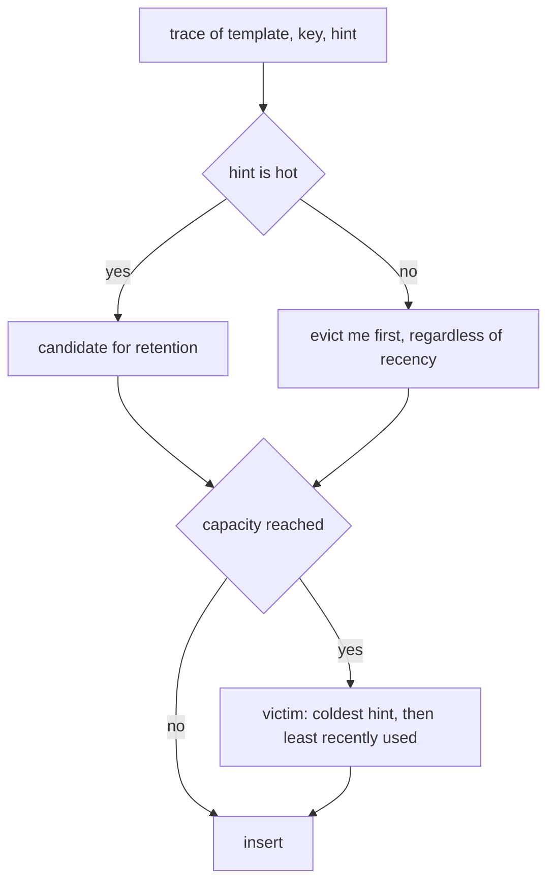
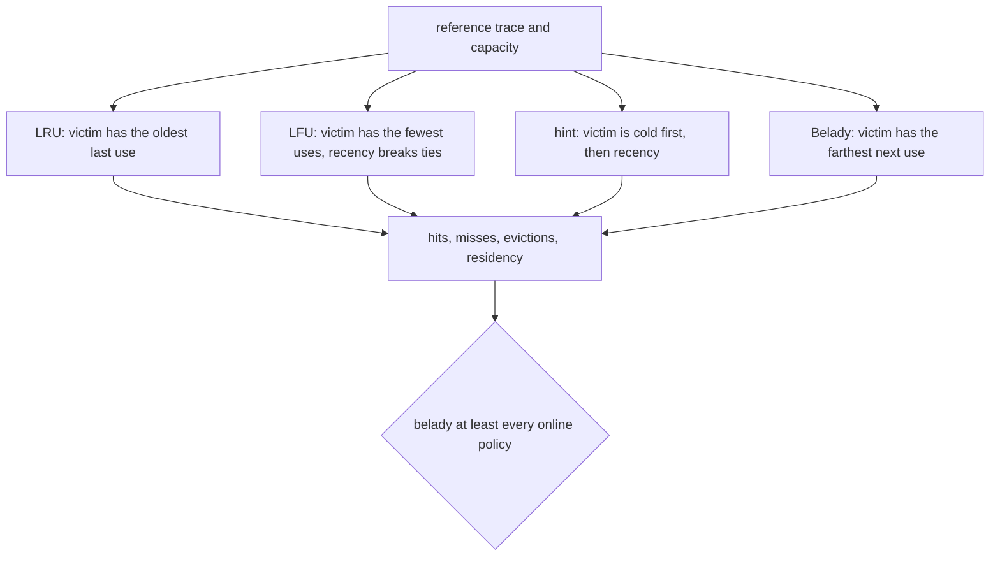
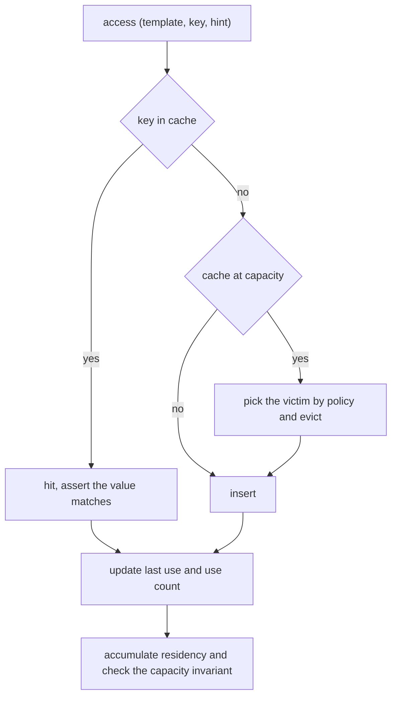
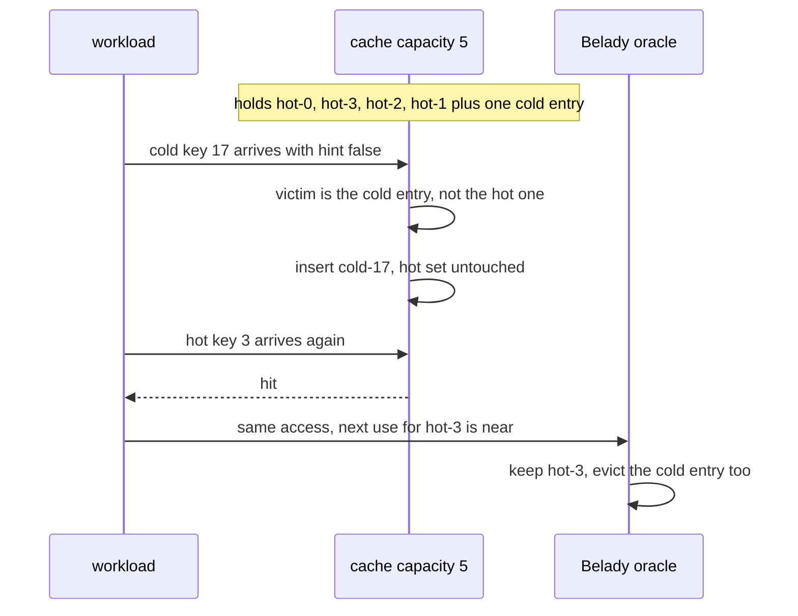

# 926 — Implement query-aware caching for OLTP workloads with eviction hints.

> **Tier:** Master · **CTCI chapter:** Ch 14 — Databases
> **Task spec:** [926-implement-query-aware-caching-for-oltp-workloads-with-eviction-h.md](../../../tasks/master/926-implement-query-aware-caching-for-oltp-workloads-with-eviction-h.md)
> **Solutions:** [Python](../../../solutions/python/master/926-implement-query-aware-caching-for-oltp-workloads-with-eviction-h/solution.py) ·
> [Java](../../../solutions/java/master/926-implement-query-aware-caching-for-oltp-workloads-with-eviction-h/Solution.java) ·
> [JavaScript](../../../solutions/javascript/master/926-implement-query-aware-caching-for-oltp-workloads-with-eviction-h/solution.js) ·
> [C#](../../../solutions/csharp/master/926-implement-query-aware-caching-for-oltp-workloads-with-eviction-h/Solution.cs)

## 1. Problem restatement

**The modelling contract first.** An in-memory, single-level result cache replayed over a deterministic
trace. No writes, no invalidation, no concurrency, no cost model beyond the hit ratio — the docstring
says so explicitly. The point is to compare four eviction policies on identical input, one of which is
an offline *oracle*.

**Inputs.** A trace of `(template, key, hint)` triples from `make_trace`, a capacity, and a policy name.
There are four policies: `lru` (recency), `lfu` (frequency), `hint` (the query-aware policy, which
evicts entries whose template hint is cold first and falls back to recency), and `belady` (Belady's MIN,
computable because the whole trace is known in advance).

The workload: two hot templates cycling through **4** hot keys (heavy reuse) interleaved with two cold
templates touching **40** keys that are never requested twice, at a hot ratio of `0.6`, 600 accesses, and
a capacity of 5 by default.

| Run | Result (printed by the Python solution) |
| --- | --- |
| hit ratio at capacity 5 | `lru = 0.392`, `lfu = 0.602`, `hint = 0.602`, `belady = 0.602` |
| residency under `hint` | hot entries resident **2394** access-slots, cold **592** |
| capacity 1 | hits equal the number of consecutive repeats, for **every** policy |
| capacity 16 | `lru = 0.595`, `lfu = 0.602`, `hint = 0.602`, `belady = 0.602`; the hint policy reaches the workload's ceiling |
| evictions | `misses - min(capacity, distinct keys)` for every policy |
| empty trace / oversized cache | empty result / zero evictions |

## 2. Intuition

LRU is the default answer to "what should I evict?" and it is exactly wrong for a mixed workload. A cold
template is a one-shot analytical lookup: it is never reused, but LRU treats its arrival as perfect
recency, so a stream of cold lookups flushes the hot working set out of a small cache. The trace makes
this quantitative: 0.392 hit ratio for LRU against 0.602 for the policies that protect the hot keys —
a 21-point gap on the same 600 accesses.

The first insight is that **the optimizer already knows what the cache needs**. A query template's
reuse class is metadata the planner can compute for free (an estimate of how often that template will be
re-executed), and the hint policy simply uses it as the primary eviction key: evict an entry whose
template hint is cold before touching anything hot, and only then fall back to recency. That is one extra
field in the entry's metadata and no per-query bookkeeping.



The second insight is that **an offline optimum turns "is this policy good?" into a measurement**. Because
the whole trace is known, Belady's MIN can evict the key whose next use lies farthest in the future —
provably optimal for hit count — and every online policy is then compared against it. On this trace
`belady = 0.602` is *equal* to `lfu` and `hint`, which says something concrete: the workload's structure
(a 4-key hot set plus never-reused cold keys) is simple enough that frequency and query-awareness both
reach the optimum, while plain recency does not.



## 3. Algorithm

1. **Generate the trace.** Draw a uniform number per step; below `HOT_RATIO = 0.6` emit a hot template
   with key `("hot", (step * 3) % 4)`, otherwise a cold template with key `("cold", cursor % 40, cursor)`
   — the cursor makes every cold key unique, so a cold key is never requested twice.
2. **Pre-compute the access schedule.** `key -> sorted list of access times`, which is what makes Belady
   computable and what `bisect_right` queries for "the next use after this time".
3. **Replay.** For each access: on a hit, assert the stored value is the key that was inserted; on a miss,
   if the cache is full choose a victim by policy, evict, then insert with metadata
   `(last_use, use_count, hot)`.
4. **Victim selection.** `lru`: minimum last use. `lfu`: minimum `(count, last use)`. `hint`: minimum
   `(hot, last use)`. `belady`: maximum next use, with last use breaking ties.
5. **Invariants per step.** `len(cache) <= capacity`, hits plus misses equal the number of accesses, and
   `evictions == misses - min(capacity, distinct keys)`.
6. **Measure.** Hit ratio, residency accumulated per hot/cold class over resident entries at each step,
   peak size, and eviction count.

```text
procedure simulate(trace, capacity, policy)
    schedule ← access times per key
    cache ← empty map; meta ← empty map
    hits ← 0; misses ← 0; evictions ← 0; residency ← (hot: 0, cold: 0)
    for time, (template, key, hot) in enumerate(trace) do
        if key in cache then
            hits ← hits + 1
            check cache[key].key = key
        else
            misses ← misses + 1
            if capacity > 0 and count(cache) >= capacity then
                if policy = "lru" then victim ← entry with the smallest last use
                else if policy = "lfu" then victim ← entry with the smallest (uses, last use)
                else if policy = "hint" then victim ← entry with the smallest (hot, last use)
                else victim ← entry with the largest next use
                end
                remove victim from cache and meta
                evictions ← evictions + 1
            end
            cache[key] ← (key, time)
        end
        previous ← meta.get(key, (0, 0, hot))
        meta[key] ← (time, previous.uses + 1, hot)
        check count(cache) <= capacity
        for each resident in meta.values() do
            residency[resident.hot] ← residency[resident.hot] + 1
        end
    end
    return hits, misses, evictions, residency, peak
end
```



## 4. Worked example

The Python run's printed summary is

```text
hit ratios at capacity 5: lru=0.392, lfu=0.602, hint=0.602, belady=0.602
hint-aware residency hot=2394 cold=592 accesses, capacity 16 ratios lru=0.595, lfu=0.602, hint=0.602, belady=0.602
```

with 600 accesses, 4 hot keys and 40 never-reused cold keys.

| Capacity | LRU | LFU | hint | Belady | Reading |
| --- | --- | --- | --- | --- | --- |
| 5 | 0.392 | 0.602 | 0.602 | 0.602 | the cache holds the 4 hot keys plus one slot; LRU gives the slot to each cold key as it arrives |
| 16 | 0.595 | 0.602 | 0.602 | 0.602 | room for the whole hot set; the remaining misses are the one-shot cold keys |

Two honest observations about this table. First, the hint policy *ties* LFU at both capacities, and the
assertion in the suite is `hint > lru + 0.05`, not `hint > lfu` — with a 4-key hot set and unique cold
keys, frequency counting is already enough to find the hot set, and the hint's advantage is that it does
not need a warm-up period to learn the frequencies. Second, the hint policy *reaches but never beats*
Belady (0.602 vs 0.602), which is the correctness of the oracle showing up as an inequality: the suite
asserts `belady >= best online`, never the reverse.



The residency counters are the mechanism behind the ratio: at capacity 5, hot entries under the hint
policy spend 2394 access-slots in the cache against 592 for cold ones — roughly four times the
population share of the hot class, which is exactly the protection the hint buys. With `capacity = 1`,
every policy collapses to the same behaviour, and the suite checks that no policy can do better than
serving consecutive repeats; with a cache larger than the working set (`trace[:5]` and capacity 64),
there are no evictions at all and the peak equals the number of distinct keys.

## 5. Complexity

Let `n` be the accesses, `D` the distinct keys, `c` the capacity and `T` the templates.

| Measure | Bound | Why it holds |
| --- | --- | --- |
| Trace generation | `O(n)` | one RNG draw per access |
| Access schedule (for Belady) | `O(n log n)` | each key's times are appended then sorted |
| One access, hit path | `O(1)` | a dictionary lookup plus a metadata update |
| Victim selection, LRU/LFU/hint | `O(c)` | `min` over the resident metadata; an intrusive list would make it `O(1)` |
| Victim selection, Belady | `O(c log n)` | a `bisect_right` over the key's access times per candidate |
| Whole simulation | `O(n · c)` for the online policies, `O(n · c log n)` for Belady | the trace is replayed once; the residency accounting adds `O(c)` per access |
| Space | `O(c + D + n)` | cache and metadata, the per-key schedule, and the trace itself |
| No cache (baseline) | `O(1)` work per access, `O(1)` space | every access misses: hit ratio 0, which is what the cache's `0.392` to `0.602` is buying |

The comparison that matters is **query-aware hints against a learned frequency policy**. LFU needs a
counter per key and a warm-up before its estimate is meaningful; the hint is available on the first
access of a template, so it is correct from step one. In this trace both reach 0.602, but the suite's
inequality is against LRU — the policy the hint is designed to replace — and the honest statement is that
the hint reaches the offline optimum here without learning anything online.

## 6. Pitfalls and edge cases

- **A hit must return the value that was inserted.** The simulation asserts `cache[key][0] == key` on
  every hit, so a stale or "phantom" hit aborts the run rather than inflating the ratio. In this trace
  the value equals the key because there is a single cache level and no invalidation — the invariant is
  the hook where a real invalidating cache would fail.
- **Eviction accounting must balance.** `evictions == misses - min(capacity, distinct)` for every policy:
  the first `min(capacity, distinct)` misses fill the cache, and every later miss evicts exactly one.
  This check catches a policy that forgets to evict (exceeding the capacity) or evicts twice.
- **The hint is metadata, not a guess.** It comes from `make_trace` as the template's reuse class — the
  thing an optimizer can supply — and the suite verifies its effect through residency
  (`hot_residency > cold_residency`), not by inspecting the policy's internals.
- **Capacity 1 removes all policy freedom.** With one slot, only consecutive repeats can hit, and the
  suite checks that all four policies produce exactly `sum(trace[i][1] == trace[i-1][1])` hits. A policy
  that beat that number would have to be serving a key it does not hold.
- **A cache bigger than the working set must never evict.** `trace[:5]` with capacity 64 has
  `peak == distinct keys` and `evictions == 0`; this is the case where an off-by-one in the fullness test
  (`>=` on a 0-indexed size) shows up.
- **An empty trace must not divide by zero.** `simulate([], 8, "hint")` returns zero counters and a ratio
  of 0.0 rather than raising, because the ratio is computed as `hits / n if n else 0.0`.
- **The ceiling is the hot ratio.** With capacity 16 the hint policy must satisfy
  `wide["hint"] > 0.95 * hots/len(trace)` and `<= ceiling + 1e-9` — it may serve every reusable access
  and no more, because the cold keys are never requested twice by construction.
- **Belady must not be beaten.** The assertion `belady >= best_online` holds at both capacities
  (0.602 == 0.602), and it is the check that would fail if the next-use schedule were computed wrongly
  (for example by including the current access time).
- **Determinism.** The workload generator is seeded, and replaying the same trace reproduces identical
  counters, so the printed table is reproducible rather than illustrative.

## 7. Variants and follow-ups

- **Where the hints come from.** [925-implement-hybrid-transactional-analytical-processing-demo-htap-w.md](../../../tasks/master/925-implement-hybrid-transactional-analytical-processing-demo-htap-w.md)
  keeps scans cheap with zone maps and maintenance; a real planner would hand the cache template
  frequencies derived from statistics like those.
- **Caching across replicas.** [924-implement-low-latency-replicated-state-machine-optimized-for-wan.md](../../../tasks/master/924-implement-low-latency-replicated-state-machine-optimized-for-wan.md)
  is the invalidation problem this demo excludes: a cache in front of a replicated log has to reason
  about commit order, not just recency.
- **Serving derived results instead of raw rows.** [927-implement-model-backed-materialized-views-updating-with-streamin.md](../../../tasks/master/927-implement-model-backed-materialized-views-updating-with-streamin.md)
  is the step from caching a lookup to caching an aggregate that updates with a stream.
- **Hints derived from measured cost.** [941-implement-continuous-profiling-pipeline-that-attributes-cpu-memo.md](../../../tasks/master/941-implement-continuous-profiling-pipeline-that-attributes-cpu-memo.md)
  is where the "how expensive is a miss" part of the JavaScript file's GreedyDual weight would come from.

## 8. Check yourself

1. Why does LRU lose 21 points of hit ratio to the other policies on this trace?

<details><summary>Show answer</summary>

Because 40% of the accesses are one-shot cold keys that arrive with perfect recency. LRU evicts the
least recently used entry, so each cold key entering a 5-slot cache pushes out whichever hot key has
gone longest without a request — even though that hot key will be requested again and the cold key never
will. Frequency and hints both protect the hot set: LFU because the hot keys have accumulated counts, the
hint because cold entries are chosen as victims before any recency comparison happens.

</details>

2. The hint policy ties LFU at 0.602 in the trace. Does that mean the hints add nothing?

<details><summary>Show answer</summary>

No — it means this workload is simple enough for frequency counting to also succeed. LFU needs a
per-key counter and a warm-up before its ranking is meaningful; the hint is available on the first
access of a template, so it is right from the start, and it also costs one bit of metadata rather than a
counter. The run's assertion is deliberately `hint > lru + 0.05` (0.602 vs 0.392), not `hint > lfu`, so
the comparison it makes is exactly the one the design claims: hints beat recency, the incumbent policy.

</details>

3. Why is `belady` included, if an offline optimum can never be deployed?

<details><summary>Show answer</summary>

Because it converts "this policy looks good" into a measured statement. Belady's MIN is provably optimal
for hit count on a known trace, so every online policy gets a ceiling to compare against; here the
ceiling is 0.602 and the hint policy reaches it, which is a much stronger claim than "hint beats LRU". It
also validates the schedule machinery: the assertion `belady >= best_online` fails immediately if the
next-use computation is off by one, so it is a test of the test's own apparatus.

</details>

4. What does the residency counter measure, and why is it more informative than the hit ratio alone?

<details><summary>Show answer</summary>

It accumulates, at every access, how many resident entries are hot and how many are cold — 2394 versus
592 access-slots under the hint policy. The hit ratio is the outcome; residency is the mechanism, and it
is what the suite asserts (`hot_residency > cold_residency`) because it separates a policy that protects
the hot set from one that merely got lucky with the trace's ordering. A policy could reach a similar hit
ratio by accident on a different trace while keeping the wrong entries resident.

</details>
