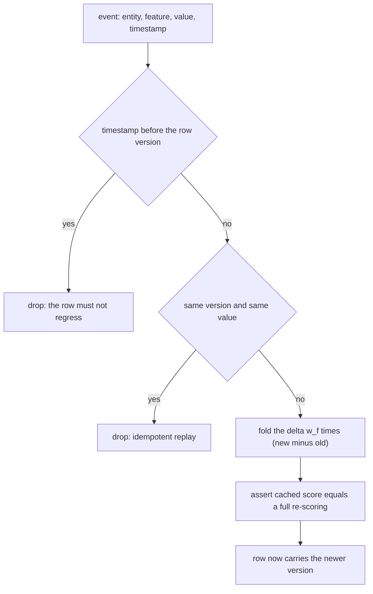
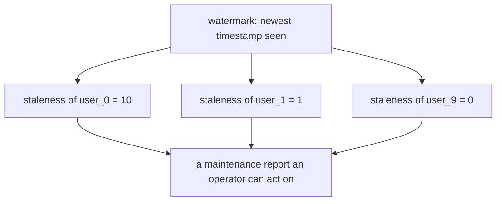
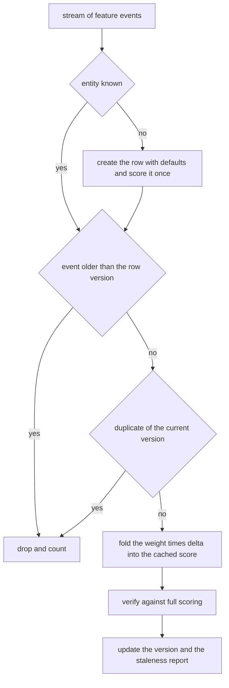
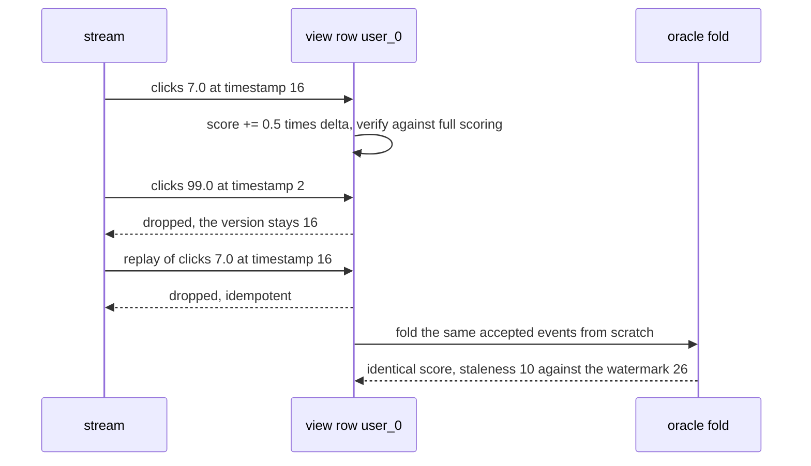

# 927 — Implement model-backed materialized views updating with streaming features.

> **Tier:** Master · **CTCI chapter:** Ch 14 — Databases
> **Task spec:** [927-implement-model-backed-materialized-views-updating-with-streamin.md](../../../tasks/master/927-implement-model-backed-materialized-views-updating-with-streamin.md)
> **Solutions:** [Python](../../../solutions/python/master/927-implement-model-backed-materialized-views-updating-with-streamin/solution.py) ·
> [Java](../../../solutions/java/master/927-implement-model-backed-materialized-views-updating-with-streamin/Solution.java) ·
> [JavaScript](../../../solutions/javascript/master/927-implement-model-backed-materialized-views-updating-with-streamin/solution.js) ·
> [C#](../../../solutions/csharp/master/927-implement-model-backed-materialized-views-updating-with-streamin/Solution.cs)

## 1. Problem restatement

**The modelling contract first.** A materialized view whose rows are **model scores**, maintained
incrementally from a feature stream. One linear model, in-memory rows, no persistence, no windowing and
no distributed fan-in — the docstring states each simplification. The four elements:

- **model** `y = bias + Σ_f w_f · x_f`, with `w = {clicks: 0.5, spend: 2.0, tenure: -0.25}` and
  `bias = 1.0`, so a single-feature change can be folded exactly into the cached score;
- **view row** the current feature vector, the cached score, the version timestamp, and the set of
  features still missing (defaulted to zero);
- **stream** `(entity, feature, value, timestamp)` events that arrive out of order, with a **watermark**
  rule: an event is applied only when `timestamp >= row.version`;
- **compaction** implicit — only the newest version per entity is stored, so rows equal distinct entities
  however long the stream runs.

| Run | Result (printed by the Python solution) |
| --- | --- |
| stream | 24 events: 20 in order, one exact duplicate, one late, one future, one new entity |
| maintenance counters | **rows 6, incremental updates 22, full recomputations 12, dropped 26** |
| watermark and staleness | watermark 26; `user_0: 10, user_1: 1, user_2: 8, user_3: 7, user_4: 6, user_9: 0` |
| duplicate and late events | both rejected (`apply` returns `False`), untouched rows byte-identical |
| replaying the whole stream again | a no-op; the new entity is still created once |
| from-scratch oracle fold | equal to the maintained view for every row |
| empty stream / single event | empty view, watermark 0 / one row scored `bias + 2.0 · 2.0 = 5.0` |

## 2. Intuition

The naive way to keep a model score current is to recompute it whenever a feature arrives: `O(f)` work
per event for `f` features. On a feature stream that is `O(events · f)` — and worse, it discards the fact
that only *one* feature changed.

The first insight is that **a linear model admits an exact delta**. Since
`y = bias + Σ w_f x_f`, changing one feature from `x_old` to `x_new` changes the score by exactly
`w_f · (x_new - x_old)`, so the cached row can be updated in `O(1)` and the invariant
`cached score == full re-scoring of the row` can be re-checked **after every mutation** — which is what
the implementation does, asserting equality on every applied event. The run's counters show the
difference: 22 incremental updates against 12 full recomputations, where the recomputations are the six
row creations plus six explicit verification calls.



The second insight is that **the stream's disorder requires an explicit rejection rule, and staleness
must be observable**. Events arrive duplicated, late and out of order, so `apply` compares against the
row's version twice: strictly older timestamps are dropped (no regression), and an event with the same
timestamp and the same value is dropped as a replay. A watermark tracks the newest timestamp ever seen,
and `stale(entity) = watermark - version` turns "this row has missed recent traffic" into a number —
`user_0` sits 10 ticks behind after the stream finishes because the only later event about it was the
late one that was rejected.



## 3. Algorithm

1. **Score a row.** `score(features) = BIAS + Σ_f W[f] · features.get(f, 0.0)` — the oracle used for both
   row creation and every verification.
2. **Create on demand.** An unknown entity gets a row with all features zero, its missing set equal to
   every feature, `version = timestamp` and a freshly computed score; the counter `recomputed` records
   that this row was *scored*, not folded.
3. **Reject stale events.** `timestamp < row.version` drops the event and increments `dropped`; the row is
   untouched, which is what makes replaying the entire stream a no-op.
4. **Reject exact replays.** Same timestamp *and* same value also drops, so a duplicated event is
   idempotent rather than double-counted.
5. **Fold the delta.** Assign the feature, remove it from `missing`, set the version, and add
   `W[feature] · (value - previous)` to the cached score; assert the result equals `score(features)`.
6. **Advance the watermark** to the largest timestamp seen, and report per-row staleness.

```text
procedure apply(store, entity, feature, value, timestamp)
    check feature is a model feature
    if timestamp > store.watermark then store.watermark ← timestamp end
    row ← store.rows.get(entity)
    if row is null then
        row ← {features: all zero, missing: all features, version: timestamp}
        row.score ← score(row.features)
        store.rows[entity] ← row
        store.recomputed ← store.recomputed + 1
    end
    if timestamp < row.version then
        store.dropped ← store.dropped + 1
        return false
    end
    previous ← row.features[feature]
    if timestamp = row.version and previous = value then
        store.dropped ← store.dropped + 1
        return false
    end
    row.features[feature] ← value
    remove feature from row.missing
    row.version ← timestamp
    row.score ← row.score + WEIGHTS[feature] * (value - previous)
    store.incremental ← store.incremental + 1
    store.accepted ← store.accepted + 1
    check absolute value of (row.score - score(row.features)) < 1e-9
    return true
end

procedure replay(events)
    rows ← empty map; seen ← empty map
    for each (entity, feature, value, timestamp) in events do
        if timestamp < seen.get(entity, -1) then continue end
        seen[entity] ← timestamp
        row ← rows.setdefault(entity, all zero features)
        row[feature] ← value
    end
    return score of every row
end
```



## 4. Worked example

The Python run's printed summary is

```text
rows 6, incremental updates 22, full recomputations 12, dropped 26
watermark 26, staleness {'user_0': 10, 'user_1': 1, 'user_2': 8, 'user_3': 7, 'user_4': 6, 'user_9': 0}
```

The stream is 20 in-order events over `user_0..user_4` (entity `step % 5`, feature `FEATURES[step % 3]`,
value `1 + (step * 7) % 11`, timestamp `step + 1`), followed by four crafted events:

| Event | Timestamp | Outcome | Why |
| --- | --- | --- | --- |
| exact duplicate of event 3 | same as its original | dropped (idempotent) | same version, same value |
| `("user_0", "clicks", 99.0, 2)` | 2, while `user_0` is at version 20 | dropped (late) | the row must not regress |
| `("user_1", "spend", 7.5, 25)` | 25 | applied | newer than `user_1`'s version |
| `("user_9", "tenure", 3.0, 26)` | 26 | applied, creating a row | a brand-new entity |

The counters add up exactly: `incremental = 22` is the 20 in-order events plus the future event and the
new entity; `recomputed = 12` is the six row creations (five users plus `user_9`) plus the six explicit
`full_recompute` calls used for verification; `dropped = 26` is the two deliberately bad events plus the
24 events of the full-stream replay, which are all rejected. That the replay changes nothing is the
strongest statement in the suite: a second pass over the same 24 events leaves every row byte-identical.



`user_0`'s version is 16 because its events arrive at timestamps 1, 6, 11 and 16 (it is `step % 5 == 0`),
which is exactly why its staleness against a 26 watermark is 10: the only later event about it was the
late one that the rule rejected.

Staleness is checked with a two-row deliberate example rather than only on the real stream: a fresh view
applies `("a", "clicks", 1.0, 1)` and `("b", "clicks", 1.0, 30)`, and then asserts `stale("a") == 29`,
`stale("b") == 0` and `stale("ghost") == 0` — an entity that does not exist has no lag, which prevents a
report generator from confusing "no row" with "infinitely stale". Missing features are tracked the same
way: a new entity starts with `missing == {"spend", "tenure"}` after one `clicks` event, and an
all-default vector scores exactly the bias.

## 5. Complexity

Let `e` be the events, `E` the distinct entities, `f` the model features (3), `m` the updated features per
row and `s` the staleness report size.

| Measure | Bound | Why it holds |
| --- | --- | --- |
| `score` (full) | `O(f)` | one weighted sum over the feature vector |
| Row creation | `O(f)` | defaults plus one full scoring; 6 rows in the trace |
| `apply`, accepted | `O(f)` for the verification, `O(1)` for the delta itself | the fold is one multiply-add plus one hash-map write; 22 updates |
| `apply`, rejected | `O(f)` | the staleness test and the duplicate test only; 26 drops |
| Whole stream | `O(e · f)` with `O(1)` incremental work per accepted event | 24 events in the trace |
| `full_recompute` | `O(f)` per row, `O(E · f)` for the view | the fallback path, executed 6 times for verification |
| `staleness_report` | `O(s log s)` | the report sorts entity names |
| Space | `O(E)` rows of `f + 2` fields | compaction is implicit: only the newest version per entity is stored |
| Naive full-recompute-on-every-event | `O(e · f)` | the same asymptotics with a bigger constant and no incremental invariant |

The decisive comparison is not the per-event asymptotics — both paths are `O(f)` because the verification
re-scores — but what is *stored*. A log-structured view would keep every version and grow as `O(e)`;
this one keeps `O(E)` rows, and the invariant check is the reason the `O(1)` fold can be trusted: the run
verifies the cached score against a full re-scoring after every single mutation, so the delta arithmetic
is never more than one event away from being disproved.

## 6. Pitfalls and edge cases

- **A row must never regress.** A late event (`timestamp < row.version`) is dropped, not merged. Without
  the rule, an out-of-order replay of an old feature value would silently overwrite a newer one and the
  view's score would be wrong while the counters still looked healthy.
- **Duplicates must be idempotent for the same reason.** Same timestamp *and* same value is dropped; a
  different value at the same timestamp is applied, which is the tie-break the code chooses (last writer
  at the same tick wins). Replaying the whole 24-event stream changes no row — that assertion is the
  end-to-end statement of idempotence.
- **The incremental path must actually run.** `view.incremental == 20` and
  `view.recomputed == 5` after the in-order prefix prove the rows were scored once at creation and folded
  afterwards; an implementation that quietly re-scored every row on every event would pass the equality
  checks and fail these counters.
- **The watermark advances on dropped events too.** `apply` moves the watermark before the staleness
  test, so a future event for one entity makes other rows visibly stale — that is exactly how `user_0`
  ends up 10 ticks behind.
- **Unknown entities get defaults, not rejections.** A first event creates the row with zeros and a
  recorded missing set; the alternative (dropping events for unknown entities) would make the view
  depend on arrival order, and the `user_9` case at timestamp 26 shows a legitimate new entity appearing
  at the end of the stream.
- **Missing-feature tracking must be self-erasing.** `missing` starts as all features, drops one name per
  applied event for that feature, and is what a downstream "is this row scoreable" check reads; it is
  asserted for a fresh single-event row.
- **Staleness of a missing entity is zero, not infinite.** `stale("ghost") == 0` keeps the report total
  and avoids conflating "no row yet" with "row far behind".
- **An empty stream is a valid state.** `ModelView()` with no events has no rows, watermark 0 and an
  empty report — the floor of the compaction claim (`rows == distinct entities == 0`).
- **The oracle must fold accepted events, not all events.** `replay` skips events older than the last
  timestamp it saw per entity, mirroring the watermark rule; folding every event would produce a
  different score and the run's equality assertion would fail for the right reason.
- **Determinism.** Rebuilding the view from the same stream reproduces every feature vector and score, so
  the printed staleness report is a property of the model, not of scheduling.

## 7. Variants and follow-ups

- **The store underneath.** [925-implement-hybrid-transactional-analytical-processing-demo-htap-w.md](../../../tasks/master/925-implement-hybrid-transactional-analytical-processing-demo-htap-w.md)
  materialises runs of versioned rows; this view is the model-scored layer above such a store.
- **Caching the scores.** [926-implement-query-aware-caching-for-oltp-workloads-with-eviction-h.md](../../../tasks/master/926-implement-query-aware-caching-for-oltp-workloads-with-eviction-h.md)
  decides which of these rows deserve to stay resident when the entity set is too large to materialise.
- **Learning the weights instead of assuming them.** [928-implement-production-grade-feature-store-with-lineage-and-drift.md](../../../tasks/master/928-implement-production-grade-feature-store-with-lineage-and-drift.md)
  is where the coefficients come from, together with the lineage and drift checks that decide when a
  re-fit is due.
- **Retraining loops.** [909-implement-continuous-learning-with-catastrophic-forgetting-mitig.md](../../../tasks/master/909-implement-continuous-learning-with-catastrophic-forgetting-mitig.md)
  keeps a model current as data drifts, which is the process that would replace this fixed weight vector.

## 8. Check yourself

1. Why is `y_new = y_old + w_f · (x_new - x_old)` exact for this model, and what does it cost?

<details><summary>Show answer</summary>

Because the model is linear: `y = bias + Σ w_g x_g`, so replacing one coordinate changes only its own
term, by `w_f (x_new - x_old)`. The cost is one multiply-add per event, and the run re-verifies the cached
value against a full `O(f)` re-scoring after every mutation — which is what turns "exact for a linear
model" from a claim into a checked invariant (`abs(row["score"] - score(row["features"])) < 1e-9`). For a
nonlinear model the same delta would not be exact, and the view would need a feature-vector hash plus a
targeted recomputation.

</details>

2. The stream contains an exact duplicate and a late event. Why is one dropped for being a duplicate and
   the other for being stale, and why does the distinction matter?

<details><summary>Show answer</summary>

They are different failures of ordering. A duplicate is the *same* event delivered twice: same timestamp,
same value, so applying it again would be harmless only if the delta were zero — which it is, but the
code drops it before the fold for clarity and to keep the counters meaningful. A late event is a
*different*, older value arriving after the row moved on: applying it would move the score backwards to a
value the row has already superseded. Both are dropped and both increment `dropped`, and the full-stream
replay check covers the duplicate case at scale.

</details>

3. What does the staleness report tell an operator that the counters do not?

<details><summary>Show answer</summary>

The counters say how much work the maintenance did (`22` folds, `12` recomputations, `26` drops); the
report says *which rows are behind*: `user_0` at 10 ticks, `user_2` at 8, `user_3` at 7, `user_4` at 6,
`user_1` at 1 and `user_9` at 0 against a watermark of 26. That is the difference between "the view is
working" and "these entities have not received an update since the stream moved on", which is the signal
an alerting rule or a targeted backfill would use.

</details>

4. Why does the oracle fold only the events that pass the watermark rule, rather than every event?

<details><summary>Show answer</summary>

Because the view's semantics are defined by that rule: an older event must not change a row. An oracle
that folded everything would compute a different score for `user_0` — including the rejected 99.0 — and
the equality assertion would fail. Writing the oracle to mirror the *contract* (not the implementation's
internals) is what makes it an independent check: `replay` tracks only the last timestamp per entity,
which is the whole rule, rather than reusing `ModelView`'s code.

</details>
