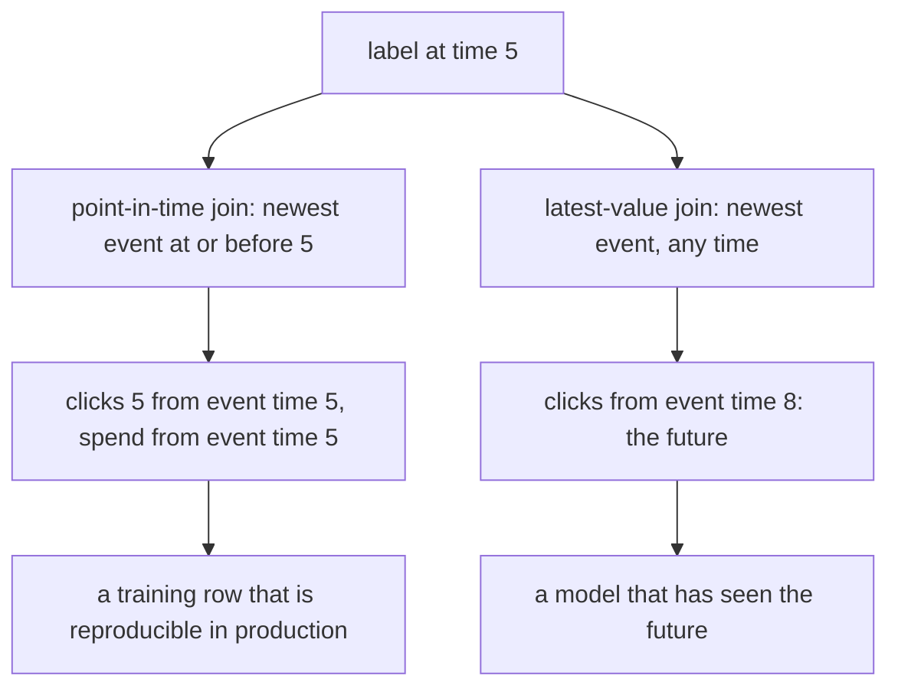
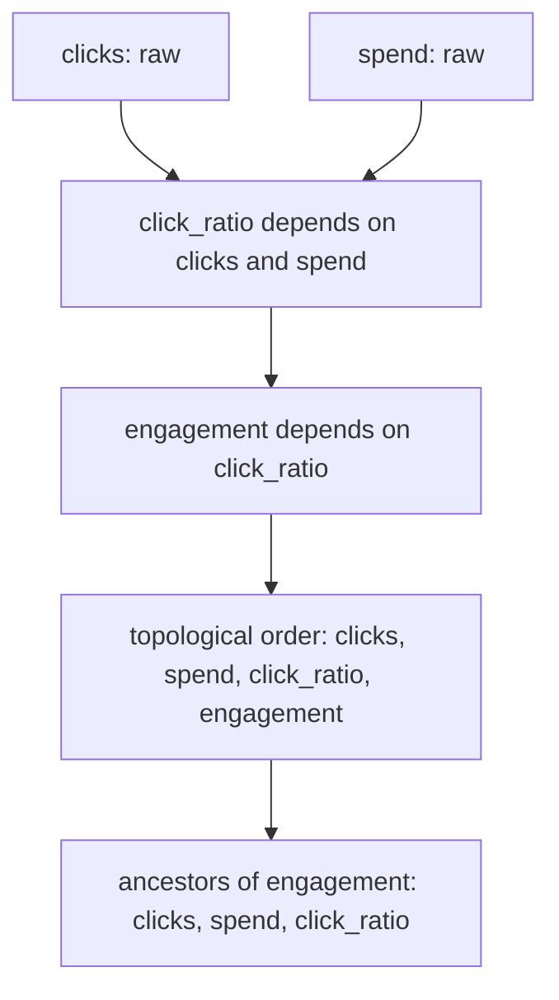
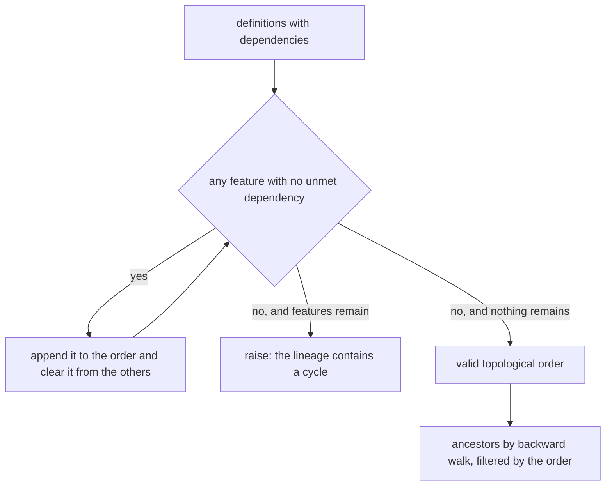
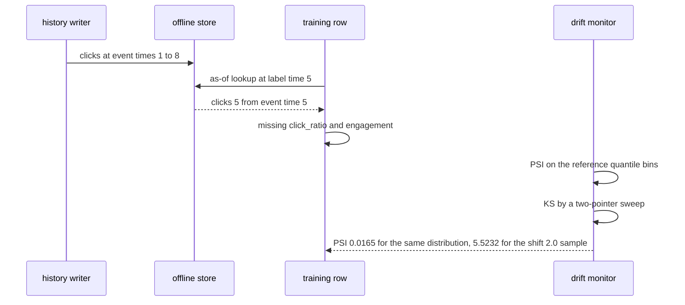

# 928 — Implement production-grade feature store with lineage and drift detection.

> **Tier:** Master · **CTCI chapter:** Ch 14 — Databases
> **Task spec:** [928-implement-production-grade-feature-store-with-lineage-and-drift.md](../../../tasks/master/928-implement-production-grade-feature-store-with-lineage-and-drift.md)
> **Solutions:** [Python](../../../solutions/python/master/928-implement-production-grade-feature-store-with-lineage-and-drift/solution.py) ·
> [Java](../../../solutions/java/master/928-implement-production-grade-feature-store-with-lineage-and-drift/Solution.java) ·
> [JavaScript](../../../solutions/javascript/master/928-implement-production-grade-feature-store-with-lineage-and-drift/solution.js) ·
> [C#](../../../solutions/csharp/master/928-implement-production-grade-feature-store-with-lineage-and-drift/Solution.cs)

## 1. Problem restatement

**The modelling contract first.** An in-memory feature store with integer entity ids, versioned feature
records, no persistence, no streaming ingestion and a single drift metric pair (PSI and KS). Stated
simplifications: in-memory versions, a quantile-bin PSI, and a single drift metric. What the design
actually guarantees is the trio that makes a feature store safe to train and serve from:

- **lineage** — every feature is `(entity, dependencies, transform)`, topologically ordered, with cycles
  rejected rather than silently half-sorted;
- **correct point-in-time joins** — `point_in_time(entity, feature, label_time)` returns the newest value
  with `event_time <= label_time`, so a training row can never see the future; the deliberately *wrong*
  "latest value" join is implemented too, purely to show the two disagree;
- **drift monitoring** — population stability index over reference quantile bins plus the two-sample
  Kolmogorov–Smirnov statistic, with a missing-value rate reported alongside.

| Run | Result (printed by the Python solution) |
| --- | --- |
| lineage order | `['clicks', 'spend', 'click_ratio', 'engagement']` |
| ancestors of `engagement` | `['clicks', 'spend', 'click_ratio']`; a raw feature has none |
| cyclic lineage | rejected with a "cycle" error |
| point-in-time row for `user_1` at label time 5 | `clicks == 5`, missing `{click_ratio, engagement}` |
| leaky (latest-value) join | differs from the point-in-time join — which is why it is banned |
| PSI ladder for shifts `0.0, 0.5, 1.0, 2.0` | `[0.0165, 0.6845, 2.6872, 5.5232]`, alert threshold `0.2` |
| KS reference vs shift 1.0 | `0.6620`, matching an O(n²) brute-force oracle |
| constant / single / empty windows | PSI `< 1e-9`, `ks([3,3,3,3,3],[3,3,3,3,3]) == 0`, `ks([1],[2]) == 1`, `ks([], [1]) == 0` |

## 2. Intuition

Two failure modes motivate the whole design, and both are silent in production.

The first is **label leakage**. If a training row joins "the latest value we have" instead of "the value
as of the label time", the model is trained on data from after the label, scores beautifully offline and
fails in production. The insight is that point-in-time correctness is a *data-structure* property, not a
discipline: the offline store keeps `(entity, feature) -> [(event_time, value), ...]` in non-decreasing
event order (asserted on every write), so the as-of lookup is a scan that keeps the newest value with
`event_time <= label_time` and can be checked — the run's hand-computed expectation for `user_1` at label
time 5 is `clicks == 5`, and the leaky join is asserted to differ.



The second failure mode is **undefined dependency order**. A feature derived from other features must be
computed after them, and a cyclic definition is a configuration error that a lazy implementation hides by
returning a partial order. The insight is to run Kahn's algorithm and *fail loudly*: `lineage_order`
repeatedly extracts the features whose dependencies are all satisfied, and raises
`"feature lineage contains a cycle"` when a pass extracts nothing — the run exercises exactly that with a
two-feature cycle.



Drift detection then closes the loop: the same store that serves training rows also answers "has this
feature's distribution moved?" with two independent statistics, so a shift can be detected even when a
model's inputs look numerically plausible.

## 3. Algorithm

1. **Validate and order the lineage.** For each feature, check that its dependencies are declared, then
   run Kahn's algorithm: repeatedly take the sorted set of features with no unmet dependencies, append
   them, and remove them from the remaining dependency sets; if a pass finds nothing, raise a cycle error.
2. **Compute ancestors.** Walk the dependency graph backwards from a feature, then filter the topological
   order to those names — so `ancestors("engagement")` returns every transitive dependency *in order*.
3. **Log versions.** `log(entity, feature, event_time, value)` appends to the `(entity, feature)` list
   after asserting non-decreasing event time.
4. **Join as of the label time.** `point_in_time` keeps the newest value with `event_time <= label_time`;
   `training_row` collects one such value per feature and lists the features with no history in
   `missing`.
5. **Measure drift.** `quantile_bins` derives bin edges from the *reference* window's quantiles;
   `histogram` counts both windows; PSI is `Σ (q - p) · ln(q / p)` with `+0.5` smoothing so empty bins do
   not divide by zero. KS is a two-pointer sweep over both sorted samples.
6. **Verify against oracles.** PSI flat for the same distribution and monotone in the shift, KS against an
   `O(n²)` brute force, missing rates against hand values, and the whole pipeline for determinism.

```text
procedure lineage_order(definitions)
    remaining ← dependencies per feature
    for each name, dependencies in remaining do
        check dependencies are all declared features
    end
    order ← empty list
    while remaining is not empty do
        ready ← sorted names whose dependency set is empty
        if ready is empty then raise "feature lineage contains a cycle" end
        append ready to order
        remove ready from remaining
        subtract ready from every remaining dependency set
    end
    return order
end

procedure point_in_time(store, entity, feature, label_time)
    best ← null
    for each (event_time, value) in store.offline.get((entity, feature), ()) do
        if event_time <= label_time and (best is null or event_time > best.time) then
            best ← (event_time, value)
        end
    end
    return best
end

procedure population_stability_index(reference, current, bins)
    edges ← the reference quantiles at 1/bins, 2/bins, ...
    expected ← histogram(reference, edges)
    actual ← histogram(current, edges)
    if the current window is empty then return infinity end
    psi ← 0
    for each bin index do
        p ← (expected[index] + 0.5) / (count(reference) + 0.5 * bins)
        q ← (actual[index] + 0.5) / (count(current) + 0.5 * bins)
        psi ← psi + (q - p) * natural log of (q / p)
    end
    return psi
end

procedure ks_statistic(reference, current)
    left, right ← both samples sorted
    if either is empty then return 0 end
    index, other, best ← 0, 0, 0
    while index < count(left) and other < count(right) do
        value ← min(left[index], right[other])
        advance index past every left value at most value
        advance other past every right value at most value
        best ← max(best, absolute value of (index / count(left) - other / count(right)))
    end
    return best
end
```



## 4. Worked example

The Python run's printed summary is

```text
lineage order ['clicks', 'spend', 'click_ratio', 'engagement']
PSI ladder [0.0165, 0.6845, 2.6872, 5.5232], alert at 0.2, KS reference-vs-shifted 0.6620
```

The store's history is deterministic: eight points per entity, `clicks = 5 + 2·step + noise` and
`spend = 20 + 3·step + 2·noise` with `step = 1..8`, so values grow with event time and a leak is visible
as a value that is simply too large for the label time.

| Query | Result | Why |
| --- | --- | --- |
| `training_row("user_1", 5)` | `clicks = 5`, `spend = 20`, missing `{click_ratio, engagement}` | newest events at or before time 5 |
| `leaky_row("user_1", ["clicks", "spend"])` | values from event time 8 | the banned latest-value join |
| `training_row("user_1", 0)` | every feature missing | a label before any history must not invent values |
| `training_row("ghost_user", 5)` | empty features, all missing | an unknown entity is not an error |
| PSI at shifts `0.0, 0.5, 1.0, 2.0` | `0.0165, 0.6845, 2.6872, 5.5232` | monotone, crossing the `0.2` alert between the first two |
| KS reference vs shift 1.0 | `0.6620` | agrees with the brute-force oracle to 1e-9 |

The PSI ladder is the part worth reading carefully. A sample drawn from the *same* distribution gives
`0.0165`, well under the `0.2` alert, and the alert only fires from the second rung on — so the
threshold is doing work rather than firing on noise. Each rung also uses the reference window's
quantiles as fixed bin edges, which is what makes the number comparable across windows: rebinning per
window would make two different shifts look identical.



The KS check is deliberately paired with an independent `O(n²)` implementation and run at three shifts
with 60-sample windows; the sweep and the brute force agree to 1e-9 and the statistic stays inside
`[0, 1]`. Degenerate windows are covered as well: constant samples give PSI `< 1e-9` and KS `0`,
`ks([1.0], [2.0]) == 1.0` (complete separation), and an empty window returns `0.0` rather than raising.

## 5. Complexity

Let `F` be the features, `D` the dependency edges, `n` the version records per entity-feature pair,
`A` the ancestors of a feature and `w` the window size used for drift.

| Measure | Bound | Why it holds |
| --- | --- | --- |
| `lineage_order` | `O(F² + D)` with the simple sweep | each pass scans the remaining features; `F = 4` here |
| `ancestors` | `O(D + F)` | a backward walk plus a filter over the topological order |
| `log` | `O(1)` amortised | append after the non-decreasing-time assertion |
| `point_in_time` | `O(n)` | a scan of that pair's version list; a binary search would make it `O(log n)` |
| `training_row` | `O(F · n)` | one as-of lookup per feature; the row also lists missing features |
| `leaky_row` | `O(1)` per feature | indexing the last element — cheaper, and wrong |
| `quantile_bins` | `O(w log w)` | the reference window is sorted once |
| `histogram` | `O(w · bins)` with the linear scan | a binary search per value would be `O(w log bins)` |
| `population_stability_index` | `O(w log w + w · bins)` | dominated by the sort; `bins = 5` |
| `ks_statistic` | `O(w log w)` | two sorted samples and one linear sweep |
| `ks_bruteforce` | `O(w²)` | the oracle used to validate the sweep on small and 60-point windows |

The comparison that matters is the join: the point-in-time lookup is `O(n)` per pair against the leaky
join's `O(1)`, and that difference in cost is exactly what a store pays for training correctness. The
second comparison is KS: the sweep is `O(w log w)` against the oracle's `O(w²)`, which is why the sweep is
the implementation and the brute force only a test.

## 6. Pitfalls and edge cases

- **Leakage is a silent bug.** The run implements the wrong join on purpose and asserts it differs from
  the point-in-time row; without that comparison, a "join the latest value" implementation would pass every
  schema test and produce unreproducible training rows.
- **A label before any history is missing, not null.** `training_row("user_1", 0)` returns no features and
  lists all of them in `missing`, so a downstream consumer distinguishes "no data" from "value is zero".
- **Cycles must fail loudly.** `lineage_order` raises with the word "cycle" when a pass makes no progress;
  a silent partial order would let a derived feature be computed before its inputs and produce plausible
  wrong numbers.
- **Unknown dependencies are configuration errors too.** The same function checks
  `dependencies - set(definitions)` and fails on a feature that depends on something undeclared.
- **The offline store asserts event order.** `log` rejects out-of-order writes, because the as-of scan
  assumes the list is non-decreasing. Streaming ingestion would need an insertion sort or a versioned
  merge instead — a documented simplification.
- **PSI bins come from the reference window.** Rebinned per window, a genuine shift can produce a small
  PSI; the run's ladder (`0.0165 → 0.6845 → 2.6872 → 5.5232`) is only monotone because the bin edges are
  fixed by the reference sample.
- **Smoothing prevents infinities without hiding drift.** `+0.5` in both numerator and denominator keeps
  an empty bin finite; with `bins = 5` and 500-point windows the correction is small, and the
  same-distribution case still reports `0.0165` rather than zero.
- **The alert threshold must not fire on noise.** The suite asserts `alerts[0] is False` for the
  same-distribution sample and `alerts[-1] is True` for shift 2.0, so the `0.2` threshold is validated in
  both directions.
- **Degenerate drift windows.** Constant samples (`[3.0] * 10`, `[3.0] * 5`) must give PSI below 1e-9 and
  KS exactly 0; a single-element window gives KS 1.0 against a different value; an empty window returns
  0.0 instead of dividing by zero; a missing rate of an empty window is 0.0.
- **Missing-value monitoring shares the discipline.** `missing_rate([None] * 3 + [1.0])` must exceed the
  `0.25` alert, and the empty case must return 0.0 rather than raising.
- **Determinism.** The history and the sampler are seeded, so a rebuilt store equals the original for the
  same entity and `sample(1.0)` is reproducible — every number above is a property of the code.

## 7. Variants and follow-ups

- **Where the streaming values come from.** [927-implement-model-backed-materialized-views-updating-with-streamin.md](../../../tasks/master/927-implement-model-backed-materialized-views-updating-with-streamin.md)
  maintains model-scored rows from a feature stream, which is the ingestion side this store's offline
  versions model.
- **Serving the joined rows.** [926-implement-query-aware-caching-for-oltp-workloads-with-eviction-h.md](../../../tasks/master/926-implement-query-aware-caching-for-oltp-workloads-with-eviction-h.md)
  answers the online lookup path, where the same point-in-time rule has to hold at low latency.
- **Declaring failure instead of degrading.** [908-implement-certified-ml-predictions-with-conformal-prediction-int.md](../../../tasks/master/908-implement-certified-ml-predictions-with-conformal-prediction-int.md)
  turns the missing-feature information into a certified prediction interval rather than an imputation.
- **The pipeline that reacts to drift.** [929-implement-end-to-end-automated-ml-system-with-monitoring-drift-a.md](../../../tasks/master/929-implement-end-to-end-automated-ml-system-with-monitoring-drift-a.md)
  consumes these PSI and KS signals and decides what to retrain, which is the operational half of drift
  detection.

## 8. Check yourself

1. Why is the point-in-time join `O(n)` per pair when the leaky join is `O(1)`, and why is the slower one
   the only acceptable choice?

<details><summary>Show answer</summary>

The leaky join indexes the last element of the version list — always the newest value, whatever the label
time. The correct join must find the newest value whose event time is *at most* the label time, which in
the linear scan is `O(n)` per pair (a binary search over the sorted list would make it `O(log n)`). The
cost buys reproducibility: a training row generated today must be identical to the row generated for the
same label time after more data arrives, and the run asserts the two joins disagree on this very store.

</details>

2. Why does the PSI's binning use the reference window instead of each window's own quantiles?

<details><summary>Show answer</summary>

Because the statistic must be comparable across time: with fixed reference bins, a shifted current window
lands disproportionately in the extreme bins and PSI grows. Rebinned per window, both windows would have
the same *shape* of counts and a real shift could produce a near-zero PSI. The run's ladder —
`0.0165, 0.6845, 2.6872, 5.5232` for shifts `0.0, 0.5, 1.0, 2.0` — is monotone precisely because the bin
edges come from the reference sample and are not recomputed.

</details>

3. Why is KS computed by a two-pointer sweep when an `O(n²)` formula is obviously correct?

<details><summary>Show answer</summary>

Because the store is expected to monitor many features over large windows, where the quadratic form is
prohibitive: the sweep is `O(w log w)`, dominated by sorting. The `O(n²)` version is kept as an
independent oracle — the suite asserts agreement to 1e-12 on a three-element example and to 1e-9 on
60-point windows, so the fast implementation is verified rather than trusted. Both statistics are
reported together because PSI is bin-sensitive and KS is not, so a disagreement between them is itself a
signal.

</details>

4. A feature has no ancestors and no versions for an entity. What does the store return, and why is that
   the right answer?

<details><summary>Show answer</summary>

`ancestors` returns an empty list for a raw feature (asserted for `clicks`), and `training_row` puts the
feature in `missing` instead of inserting a null or a zero. The distinction matters because a missing
feature is a data problem to fix (backfill, a later label time, or a different entity), whereas a zero is
a plausible value that would silently bias the model. The run checks the extreme case as well: a label
time of 0 makes *every* feature missing, and an unknown entity yields an empty row rather than an error.

</details>
